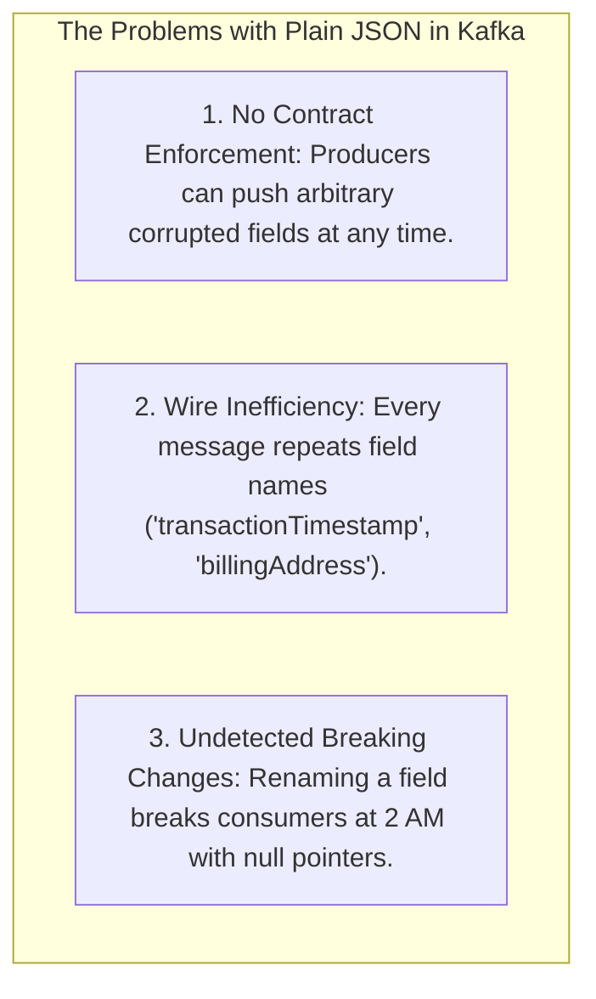
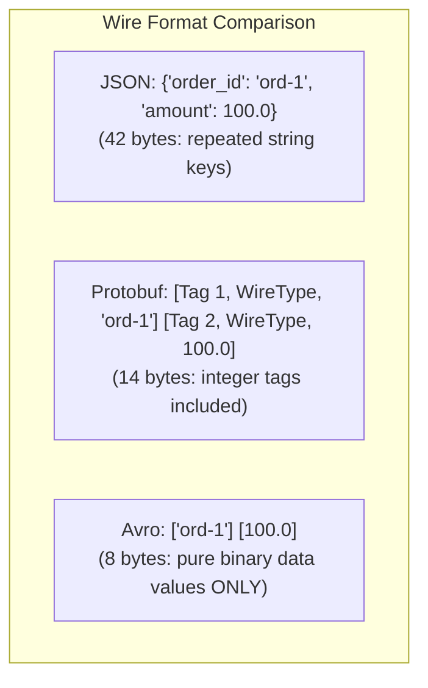
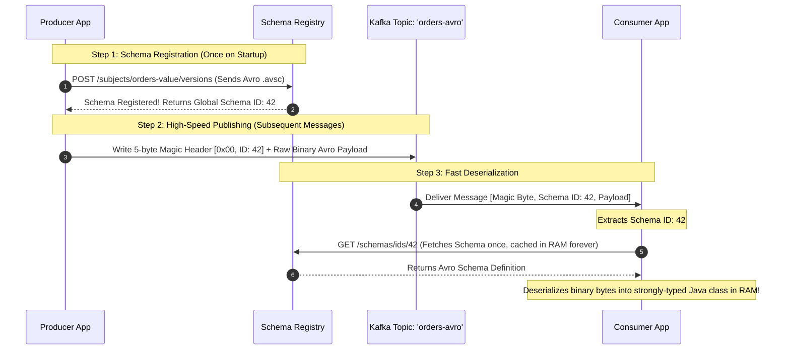
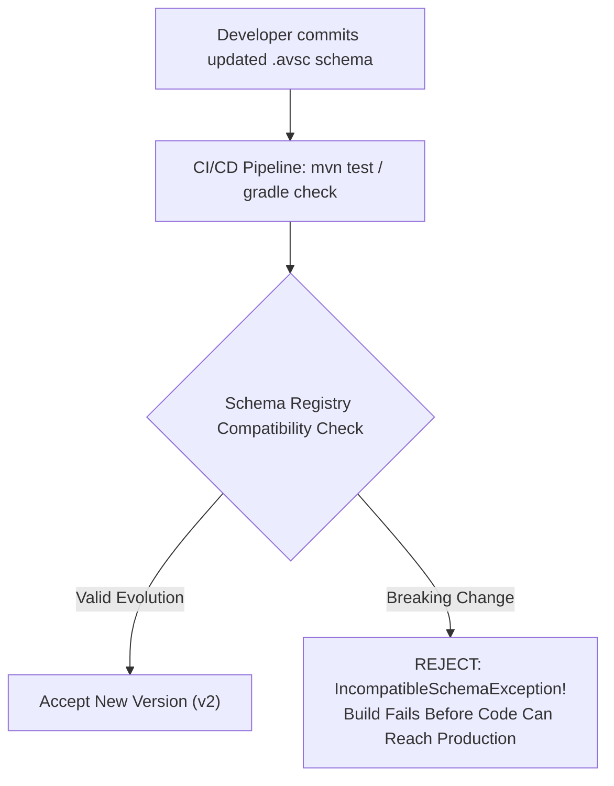
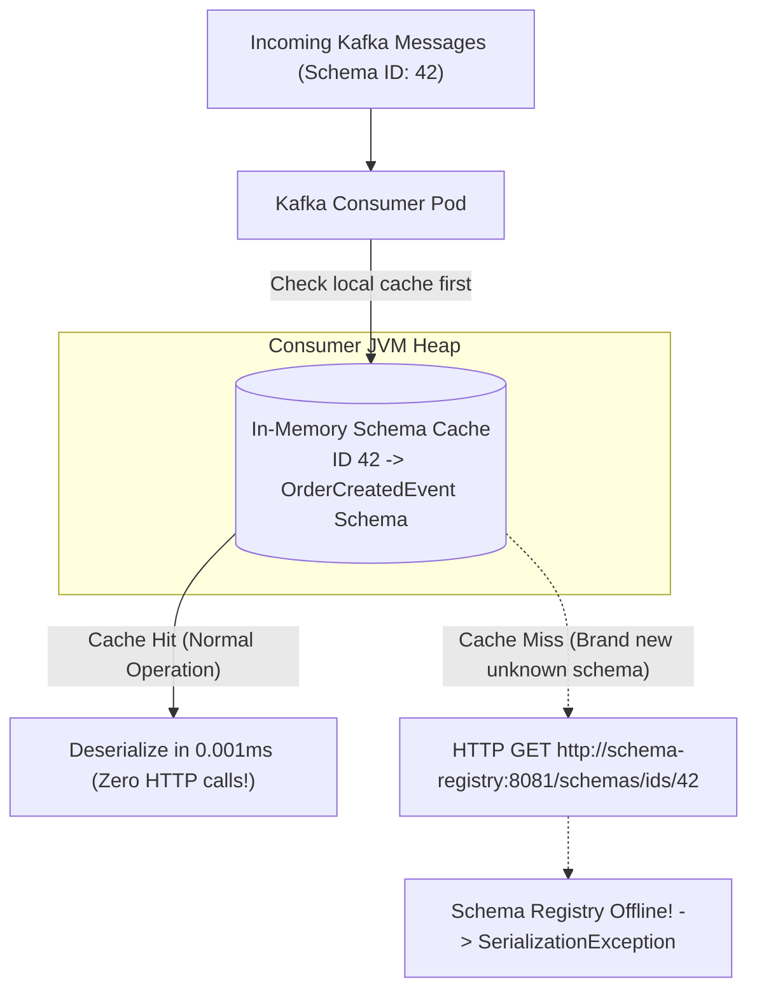

# Schema Registry and Apache Avro

In an event-driven microservice ecosystem, events are the public API of your domain. Just as you would never deploy a breaking REST endpoint change without versioning, you cannot arbitrarily alter the shape of events published to Apache Kafka.

In early architectures using plain JSON, **Schema Drift** is an inevitable disaster:
- Team A renames `userId` to `customer_id` in their Spring Boot producer.
- Three downstream consumer teams—billing, analytics, and shipping—instantly crash with `JsonMappingException` or silently parse the field as `null`.
- To fix the bug, engineers must manually coordinate cross-team deployments, destroying the core benefit of decoupled microservices.

To guarantee that producers and consumers remain decoupled while enforcing strict, type-safe API contracts, enterprise Kafka architectures adopt **Apache Avro** backed by the **Confluent Schema Registry**.

---

## Why Plain JSON Fails at Scale

Publishing plain JSON to Kafka introduces three critical problems:



1. **Massive Wire Overhead:** In JSON, field names are repeated in every single event. If an event has 20 fields and you produce 50,000 events per second, gigabytes of network bandwidth and disk storage are wasted transmitting identical ASCII key names.
2. **Zero Compile-Time Type Safety:** A consumer has no guarantee that a field marked `amount` is an integer, a float, or a string.
3. **No Centralized Evolution Governance:** There is no automated gatekeeper to prevent a developer from deleting a required field or altering an enum value.

---

## Apache Avro: Binary Serialization Without Field Tags

**Apache Avro** is an open-source, compact binary serialization format designed specifically for streaming and big data workloads.

Unlike Protocol Buffers—which embeds integer field tags into every binary message to identify fields—**Avro messages contain zero field names and zero field tags on the wire**. An Avro payload is pure, unadorned binary data values laid out in exact sequential order.



### The Avro Dilemma

Because an Avro message contains only raw bytes with no tags or keys, **it is impossible to deserialize an Avro message without having the exact schema used to write it**.

If you had to attach the full JSON schema to every message sent to Kafka, a 10-byte message would require a 1,500-byte schema header, destroying throughput.

This dilemma is solved by the **Confluent Schema Registry**.

---

## The Schema Registry Architecture and the 5-Byte Magic Header

The **Confluent Schema Registry** is a centralized, highly available HTTP service that acts as an authoritative catalog for event contracts:



### The Confluent 5-Byte Wire Format

When using `KafkaAvroSerializer`, every message written to Kafka is prepended with a tiny **5-byte header**:

```text
Byte 0:       Magic Byte (0x00) -> Signals that the payload is Confluent Schema Registry encoded
Bytes 1 - 4:  Schema ID (4-byte Big-Endian Integer) -> The global ID of the schema in the registry
Bytes 5 - N:  Serialized Avro Binary Data
```

Because the header is only 5 bytes, you achieve maximum compression on the network wire. The Schema Registry caches all schemas in memory, meaning producers and consumers query the HTTP registry only once on startup.

---

## Schema Evolution Rules and Compatibility Modes

Business requirements evolve. New fields are added, deprecated fields are removed, and validation rules shift. The Schema Registry acts as a gatekeeper, verifying that any schema update uploaded by a developer is mathematically compatible with existing consumers before accepting it.



### The Core Compatibility Modes

| Mode | What It Means | Supported Evolution Rules | Use Case |
| :--- | :--- | :--- | :--- |
| **BACKWARD** *(Default)* | Consumers using the **new** schema can read records written by producers using the **old** schema. | Delete fields, or add **optional** fields (must have a `default` value). | Upgrade consumers before producers. |
| **FORWARD** | Consumers using the **old** schema can read records written by producers using the **new** schema. | Add fields, or delete **optional** fields. | Upgrade producers before consumers. |
| **FULL** | Both **BACKWARD** and **FORWARD** compatible. Producers and consumers can be upgraded in any order. | Only add or delete fields that define a default value. | **Enterprise Gold Standard:** Enables fully decoupled, independent deployments. |
| **NONE** | Compatibility checks are disabled. | Any change permitted (High risk). | Development environments only. |

### The Golden Rule of Avro Schema Evolution

> **Never add a field without a default value!**
> If you add `string promoCode` without `"default": "NONE"`, an older consumer that hasn't upgraded yet cannot deserialize new records, immediately causing a production outage under Backward compatibility.

---

## Implementing Avro in Spring Boot 3

Let's build an end-to-end, strongly typed Avro pipeline.

### Step 1: Define the Avro Schema (`.avsc`)

Place this file in `src/main/avro/order_created.avsc`:

```json
{
  "type": "record",
  "name": "OrderCreatedEvent",
  "namespace": "com.javahub.avro.model",
  "doc": "Event emitted whenever a customer completes a checkout order",
  "fields": [
    {
      "name": "orderId",
      "type": "string",
      "doc": "Unique UUID for the order"
    },
    {
      "name": "customerId",
      "type": "string"
    },
    {
      "name": "totalAmount",
      "type": "double"
    },
    {
      "name": "currency",
      "type": "string",
      "default": "USD"
    },
    {
      "name": "orderStatus",
      "type": {
        "type": "enum",
        "name": "OrderStatus",
        "symbols": ["PENDING", "APPROVED", "REJECTED"]
      }
    },
    {
      "name": "notes",
      "type": ["null", "string"],
      "default": null,
      "doc": "Optional customer delivery notes"
    }
  ]
}
```

### Step 2: Configure the Avro CodeGen Plugin

```xml
<dependencies>
    <!-- Apache Avro Core -->
    <dependency>
        <groupId>org.apache.avro</groupId>
        <artifactId>avro</artifactId>
        <version>1.11.3</version>
    </dependency>
    <!-- Confluent Kafka Avro Serializer -->
    <dependency>
        <groupId>io.confluent</groupId>
        <artifactId>kafka-avro-serializer</artifactId>
        <version>7.6.0</version>
    </dependency>
</dependencies>

<build>
    <plugins>
        <plugin>
            <groupId>org.apache.avro</groupId>
            <artifactId>avro-maven-plugin</artifactId>
            <version>1.11.3</version>
            <executions>
                <execution>
                    <phase>generate-sources</phase>
                    <goals>
                        <goal>schema</goal>
                    </goals>
                    <configuration>
                        <sourceDirectory>${project.basedir}/src/main/avro/</sourceDirectory>
                        <outputDirectory>${project.build.directory}/generated-sources/avro</outputDirectory>
                        <stringType>String</stringType>
                    </configuration>
                </execution>
            </executions>
        </plugin>
    </plugins>
</build>

<!-- Confluent Maven Repository -->
<repositories>
    <repository>
        <id>confluent</id>
        <url>https://packages.confluent.io/maven/</url>
    </repository>
</repositories>
```

Running `mvn compile` automatically generates the type-safe Java class `OrderCreatedEvent` and enum `OrderStatus`.

### Step 3: Application Configuration (`application.yml`)

```yaml
spring:
  kafka:
    bootstrap-servers: kafka-broker:9092
    producer:
      key-serializer: org.apache.kafka.common.serialization.StringSerializer
      value-serializer: io.confluent.kafka.serializers.KafkaAvroSerializer
      properties:
        schema.registry.url: http://schema-registry.internal:8081
        auto.register.schemas: false # Enforce CI/CD registration; disable auto-creation in production!
    consumer:
      key-deserializer: org.apache.kafka.common.serialization.StringDeserializer
      value-deserializer: io.confluent.kafka.serializers.KafkaAvroDeserializer
      properties:
        schema.registry.url: http://schema-registry.internal:8081
        # CRITICAL: Deserializes into generated Java class, not generic GenericRecord
        specific.avro.reader: true
```

### Step 4: The Type-Safe Producer Service

```java
package com.javahub.avro.producer;

import com.javahub.avro.model.OrderCreatedEvent;
import com.javahub.avro.model.OrderStatus;
import org.slf4j.Logger;
import org.slf4j.LoggerFactory;
import org.springframework.kafka.core.KafkaTemplate;
import org.springframework.stereotype.Service;

import java.util.UUID;

@Service
public class AvroOrderProducer {

    private static final Logger log = LoggerFactory.getLogger(AvroOrderProducer.class);
    private static final String TOPIC = "fintech.orders.v1";

    private final KafkaTemplate<String, OrderCreatedEvent> kafkaTemplate;

    public AvroOrderProducer(KafkaTemplate<String, OrderCreatedEvent> kafkaTemplate) {
        this.kafkaTemplate = kafkaTemplate;
    }

    public void publishOrder(String customerId, double amount) {
        String orderId = UUID.randomUUID().toString();

        // Instantiate strongly-typed Avro model using generated builder
        OrderCreatedEvent event = OrderCreatedEvent.newBuilder()
                .setOrderId(orderId)
                .setCustomerId(customerId)
                .setTotalAmount(amount)
                .setCurrency("USD")
                .setOrderStatus(OrderStatus.PENDING)
                .setNotes("Leave package at front porch")
                .build();

        log.info("Publishing type-safe Avro event for order: {}", orderId);
        kafkaTemplate.send(TOPIC, orderId, event);
    }
}
```

### Step 5: The Strongly Typed Consumer

```java
package com.javahub.avro.consumer;

import com.javahub.avro.model.OrderCreatedEvent;
import org.apache.kafka.clients.consumer.ConsumerRecord;
import org.slf4j.Logger;
import org.slf4j.LoggerFactory;
import org.springframework.kafka.annotation.KafkaListener;
import org.springframework.kafka.support.Acknowledgment;
import org.springframework.stereotype.Service;

@Service
public class AvroOrderConsumer {

    private static final Logger log = LoggerFactory.getLogger(AvroOrderConsumer.class);

    @KafkaListener(topics = "fintech.orders.v1", groupId = "billing-avro-consumer")
    public void consume(ConsumerRecord<String, OrderCreatedEvent> record, Acknowledgment ack) {
        // Payload is already deserialized into the compiled Java class!
        OrderCreatedEvent event = record.value();

        log.info("Received Avro event: OrderId={}, CustomerId={}, Amount={} {}, Status={}",
                event.getOrderId(),
                event.getCustomerId(),
                event.getTotalAmount(),
                event.getCurrency(),
                event.getOrderStatus());

        ack.acknowledge();
    }
}
```

---

## Schema Registry Outage Resilience: Local Cache Protection

What happens if the Schema Registry crashes or network connectivity between Kafka consumers and the Schema Registry is severed?



### The Resilience Guarantees

1. **In-Memory Caching:** Both `KafkaAvroSerializer` and `KafkaAvroDeserializer` maintain an internal in-memory cache of all resolved schemas. Once a consumer has seen a schema ID once, it **never contacts the Schema Registry again** for that schema.
2. **Crash Resilience:** If the Schema Registry goes down completely, existing production producers and consumers continue processing billions of messages uninterrupted, provided no new unseen schema versions are introduced during the outage.
3. **Disabling Auto-Registration in Production:** Never allow producers to register new schemas automatically in production (`auto.register.schemas=false`). Schemas should be validated and registered strictly via your CI/CD pipeline using the `schema-registry-maven-plugin`.

---

## Senior Engineer Interview Crucible

### How does the Confluent Schema Registry wire format communicate the schema version in just 5 bytes of overhead?

The Confluent wire format avoids embedding verbose JSON schemas or string schema names by prepending a standardized **5-byte binary header** to every message payload:
- **Byte 0 (Magic Byte):** Always `0x00`. Indicates to consumers that the message was encoded using the Confluent Schema Registry wire format.
- **Bytes 1 through 4 (Schema ID):** A 4-byte big-endian integer representing the unique global ID assigned to that specific schema version by the Schema Registry.
- **Bytes 5 onward:** The raw Avro binary data.

When a consumer reads a message, it extracts the 4-byte integer ID and looks it up in its local in-memory cache. If cached, it deserializes the payload immediately with zero network overhead. If not cached, it makes a single HTTP call to `/schemas/ids/{id}`, caches the schema, and proceeds.

---

### Explain the exact rules for maintaining FULL compatibility in an Avro schema. What happens if a developer deletes a field without a default value?

**FULL compatibility** means that new schemas are both **BACKWARD** and **FORWARD** compatible. Old consumers can read data produced by new producers, and new consumers can read data produced by old producers. This allows microservice teams to deploy updates in any sequence without downtime.

To maintain FULL compatibility, the following rules must be observed:
1. You may only **add** new fields if they define a **default value**.
2. You may only **delete** existing fields if they had a **default value** defined.
3. You must never rename a field without specifying an `aliases` array.
4. You must never modify a primitive data type (e.g., changing `int` to `string`).

**What happens if a field without a default is deleted:**
If a developer deletes a mandatory field (e.g., removing `string customerId` which had no default), an older consumer reading a newly produced message will look for `customerId`, find it absent in the binary stream, check for a default value, find none, and fail with a fatal deserialization error. Under FULL compatibility, the Schema Registry will reject the schema update during CI/CD with an `IncompatibleSchemaException`.

---

### Contrast Apache Avro with Protocol Buffers (Protobuf). Why is Avro historically preferred for data lakes and event streaming, while Protobuf dominates RPC?

While both are compact binary serialization frameworks, their design optimizations serve different architectural domains:

- **Protobuf in RPC (gRPC):** Protobuf messages embed integer field tags into every message. This makes Protobuf self-describing at the message level: a receiving node can skip unknown fields without possessing the original schema. This makes Protobuf ideal for low-latency, point-to-point RPC microservice calls where intermediate schema registries add unnecessary operational complexity.
- **Avro in Streaming and Data Lakes (Kafka, Hadoop, Iceberg, Snowflake):** Avro separates the schema entirely from the payload. Messages contain zero tags and zero field metadata, making individual Avro messages smaller than Protobuf. In big data and event streaming, where billions of identical records are stored in Kafka partitions, Parquet files, or S3 object stores, factoring out field tags yields massive bandwidth and storage savings.

---

### What happens if the Schema Registry crashes or suffers a network partition while producers and consumers are actively streaming?

Because the Confluent `KafkaAvroSerializer` and `KafkaAvroDeserializer` utilize aggressive local in-memory caches, **active production streaming is completely unaffected** by a temporary Schema Registry outage, under one condition: *no new schemas or field changes are introduced during the downtime*.

- **Existing Workloads:** Producers and consumers already have the schema mappings (e.g., `Schema ID 42 <-> OrderCreatedEvent`) cached in JVM heap memory. They continue serializing and deserializing records at full speed with zero network traffic to the Schema Registry.
- **New Schema Deployments:** If a newly deployed microservice produces a brand-new schema version, or a consumer receives a message with an unknown Schema ID not present in its cache, the client must contact the Schema Registry. In that scenario, the client throws a `SerializationException` or blocks until `schema.registry.url` becomes reachable again.

