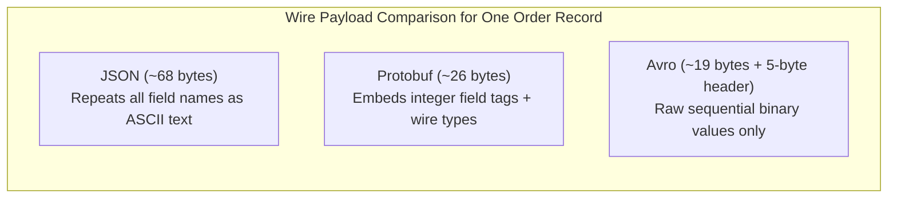
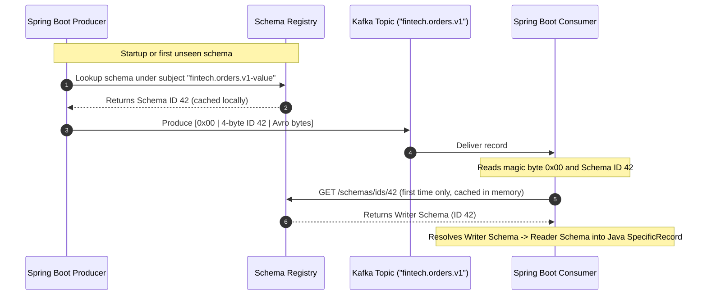
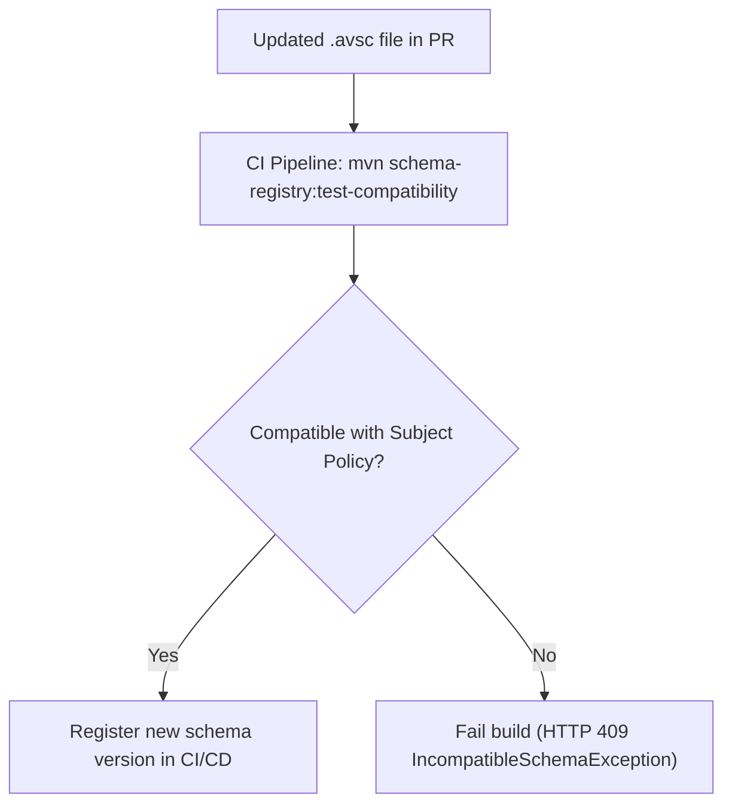
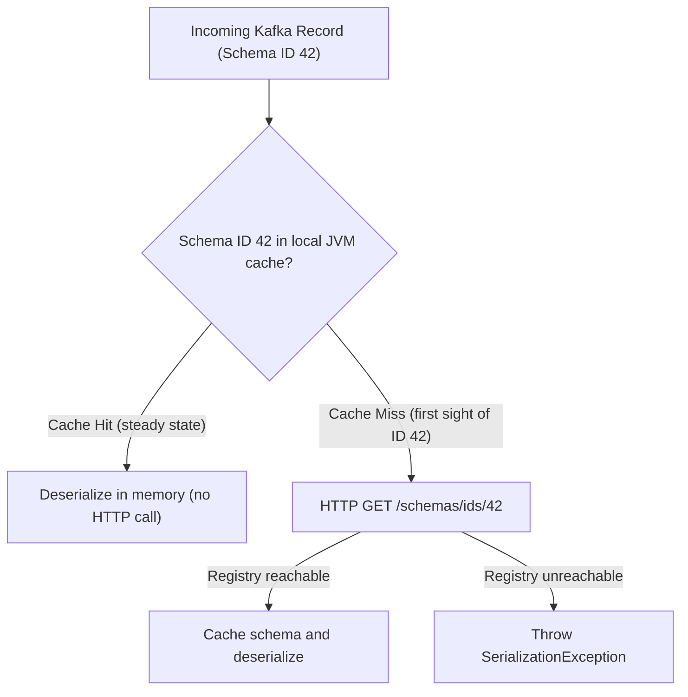

When a team first adopts Apache Kafka, serializing Java objects to JSON with Jackson feels like the path of least resistance. Messages are human-readable in CLI tools, setup takes five minutes, and no extra infrastructure is required.

That convenience wears off quickly once three or four services consume the same topic. A producer team renames `userId` to `customerId`, or changes `totalAmount` from a number to a string `"149.50"`. Because Kafka brokers treat message keys and values as opaque byte arrays, the broker happily accepts the new payload. Downstream consumers either throw `JsonMappingException` in production or, worse, quietly deserialize `userId` as `null` when `FAIL_ON_UNKNOWN_PROPERTIES` is disabled.

In high-throughput event pipelines, events are a public API contract. **Apache Avro** paired with the **Confluent Schema Registry** gives you compact binary encoding, generated type-safe Java classes, and an automated gatekeeper that blocks breaking contract changes before they reach production.

## Why JSON Breaks Down for High-Scale Events

Plain JSON creates three compounding problems as event volume and team count grow:

1. **Payload bloat on the wire and on disk:** JSON repeats every field name as ASCII text in every single record. A payload with 20 descriptive field names (`transactionTimestamp`, `billingPostalCode`, `paymentInstrumentId`) often spends 60% to 75% of its bytes repeating keys rather than carrying values. Across millions of events per minute, that inflates network egress, broker storage, replication bandwidth, and GC pressure during parsing.
2. **Weak, inconsistent typing:** JSON has no native distinction between `int`, `long`, `float`, `double`, and exact decimals, and no standard representation for timestamps or enums. One producer serializes timestamps as ISO-8601 strings; another sends epoch milliseconds.
3. **No enforced contract or evolution governance:** Without an external registry checking compatibility rules, breaking changes are discovered at runtime by whichever consumer happens to read the bad record first.

JSON Schema can address contract validation, but it still carries the wire overhead and parsing cost of text-based JSON. That is why high-volume Kafka architectures usually move to a binary format like Apache Avro or Protocol Buffers.

## Apache Avro Binary Serialization

**Apache Avro** is a schema-first binary serialization format built for streaming and analytical data workloads. Its defining design choice is that **an Avro binary payload contains neither field names nor integer field tags**.



In Avro's binary encoding:

- Integers and longs use variable-length **zig-zag encoding** (small numbers take 1 byte instead of 4 or 8).
- Strings and byte arrays are length-prefixed UTF-8 or raw bytes.
- Union fields (like `["null", "string"]`) write a single varint branch index (`0` for `null`, `1` for `string`) followed by the value.
- Record fields appear strictly in the order declared in the schema, with zero delimiters or tags between them.

### Writer Schema vs Reader Schema

Because the raw bytes carry no field identifiers, **you cannot deserialize an Avro message unless you know the exact schema that wrote it**. Avro deserialization always involves two schemas:

- **Writer schema:** The exact schema version used by the producer to encode those bytes.
- **Reader schema:** The schema version compiled into the consumer application.

Avro's schema resolution algorithm compares the writer schema and reader schema field-by-field: matching fields are decoded, fields present only in the writer schema are skipped cleanly, and fields present only in the reader schema are populated from their declared `default` value.

Embedding the full JSON schema in every Kafka message would wipe out the space savings of binary encoding. That is the exact problem **Confluent Schema Registry** solves.

## Confluent Schema Registry Integration

Confluent Schema Registry is a stateless HTTP service (backed by a compacted internal Kafka topic named `_schemas`) that stores immutable versions of schemas and assigns each unique schema a monotonically increasing 4-byte integer ID.

### The 5-Byte Confluent Wire Format

Instead of embedding a 1 KB schema in every message, `KafkaAvroSerializer` prepends a fixed **5-byte header** to the Avro binary payload:

```text
Byte 0       : Magic Byte (0x00) — identifies the Confluent Schema Registry wire format
Bytes 1..4   : Schema ID (4-byte big-endian unsigned integer, e.g., 42)
Bytes 5..N   : Raw Avro binary payload
```

Here is the end-to-end flow between producer, Schema Registry, Kafka, and consumer:



### Subjects and Naming Strategies

Schema Registry organizes versions under **subjects**. By default, Confluent uses `TopicNameStrategy`, which derives the subject name from the topic:

- `<topic-name>-key` for record keys
- `<topic-name>-value` for record values

This assumes every message in a topic shares one schema lineage. If a single topic legitimately carries multiple distinct event types (such as `OrderCreated` and `OrderCancelled` on an `orders` topic to preserve ordering), switch to `RecordNameStrategy` (subject = fully qualified Avro record name) or `TopicRecordNameStrategy` (subject = `<topic>-<record-name>`).

## Schema Compatibility Modes: `BACKWARD`, `FORWARD`, and `FULL`

Before Schema Registry accepts a new schema version for a subject, it runs compatibility checks against previously registered versions. If the change breaks the configured rule, the registry rejects it with HTTP `409 Conflict` (`IncompatibleSchemaException`), stopping a bad release during CI/CD rather than in production.



| Compatibility Mode | Meaning | Allowed Changes | Upgrade Order |
| :--- | :--- | :--- | :--- |
| **`BACKWARD`** *(default)* | New consumers can read data written by old producers. | Delete any field; add a field **with a default**. | Upgrade consumers first, then producers. |
| **`FORWARD`** | Old consumers can read data written by new producers. | Add any field; delete a field **that had a default**. | Upgrade producers first, then consumers. |
| **`FULL`** | Both `BACKWARD` and `FORWARD` compatible simultaneously. | Only add fields **with a default**; only delete fields **that had a default**. | Upgrade producers and consumers in any order. |
| **`NONE`** | No compatibility checks performed. | Any change allowed. | Local experimentation only. |

### Non-Transitive vs Transitive Modes

Each mode also has a transitive variant: `BACKWARD_TRANSITIVE`, `FORWARD_TRANSITIVE`, and `FULL_TRANSITIVE`.

- **Non-transitive (`BACKWARD`, `FORWARD`, `FULL`)** validates a new schema version `v3` only against the immediately previous version `v2`.
- **Transitive (`*_TRANSITIVE`)** validates `v3` against **every** prior version (`v1` and `v2`).

In Kafka, consumers regularly rewind offsets to replay days of history, and compacted topics can retain records written months ago under `v1`. If you only check against `v2`, a subtle sequence of two changes can remain compatible step-by-step while breaking `v1 -> v3`. For long-lived or compacted topics, prefer `BACKWARD_TRANSITIVE` or `FULL_TRANSITIVE`.

### Why Optional Fields Use `["null", "string"]` with `"default": null`

Two rules in the Avro specification trip up nearly every team on their first schema evolution:

1. **A field's `default` value must match the first branch of its union.** Writing `"type": ["string", "null"], "default": null` fails schema compilation because `null` does not match the first union type (`string`). Optional nullable fields must always place `"null"` first:
   ```json
   {
     "name": "promoCode",
     "type": ["null", "string"],
     "default": null
   }
   ```
2. **Understand which side needs the default:**
   - Under **`BACKWARD`** compatibility, a *new* consumer reads *old* records that do not contain `promoCode`. Without a `default`, the new consumer cannot populate `promoCode` and throws an error.
   - Under **`FORWARD`** compatibility, an *old* consumer reads *new* records. If a producer deletes an old field that had no default, the old consumer expects that field, finds it missing in the writer schema, and fails. If the old field already had a default, the old consumer falls back to that default cleanly.
   - Under **`FULL`** compatibility, you must follow both rules: never add a required field without a default, and never delete a field unless it already had a default in earlier versions. Also avoid changing field types or renaming fields without Avro `aliases`.

For `enum` types, Avro 1.9+ supports a `"default"` symbol (such as `"UNKNOWN"`). Including a default enum symbol lets old consumers gracefully map newly added enum values instead of failing deserialization.

## Implementing Avro in Spring Boot 3

Here is a complete Maven and Spring Kafka setup using generated Java classes (`SpecificRecord`).

### Define the Avro Schema (`.avsc`)

Place `order_created.avsc` under `src/main/avro/`. Notice the use of `logicalType: "decimal"` for currency amounts (avoiding binary floating-point rounding errors from `double`), `timestamp-millis` for event time, an enum default, and a nullable union for optional notes:

```json
{
  "type": "record",
  "name": "OrderCreatedEvent",
  "namespace": "com.javahub.avro.model",
  "doc": "Emitted when a customer submits an order",
  "fields": [
    {
      "name": "orderId",
      "type": "string",
      "doc": "Unique order identifier"
    },
    {
      "name": "customerId",
      "type": "string"
    },
    {
      "name": "totalAmount",
      "type": {
        "type": "bytes",
        "logicalType": "decimal",
        "precision": 12,
        "scale": 2
      }
    },
    {
      "name": "currency",
      "type": "string",
      "default": "USD"
    },
    {
      "name": "orderStatus",
      "type": {
        "type": "enum",
        "name": "OrderStatus",
        "symbols": ["UNKNOWN", "PENDING", "APPROVED", "REJECTED"],
        "default": "UNKNOWN"
      },
      "default": "UNKNOWN"
    },
    {
      "name": "createdAt",
      "type": {
        "type": "long",
        "logicalType": "timestamp-millis"
      }
    },
    {
      "name": "notes",
      "type": ["null", "string"],
      "default": null,
      "doc": "Optional delivery instructions"
    }
  ]
}
```

### Generate Java Classes with `avro-maven-plugin`

Configure `pom.xml` with `org.apache.avro:avro`, Confluent's `kafka-avro-serializer`, and `avro-maven-plugin`. Setting `<stringType>String</stringType>` is important: without it, Avro generates getters returning `CharSequence` backed by `org.apache.avro.util.Utf8`, which breaks `equals()` checks against standard Java `String` values.

```xml
<repositories>
    <repository>
        <id>confluent</id>
        <url>https://packages.confluent.io/maven/</url>
    </repository>
</repositories>

<dependencies>
    <dependency>
        <groupId>org.apache.avro</groupId>
        <artifactId>avro</artifactId>
        <version>1.11.4</version>
    </dependency>
    <dependency>
        <groupId>io.confluent</groupId>
        <artifactId>kafka-avro-serializer</artifactId>
        <version>7.7.1</version>
    </dependency>
</dependencies>

<build>
    <plugins>
        <plugin>
            <groupId>org.apache.avro</groupId>
            <artifactId>avro-maven-plugin</artifactId>
            <version>1.11.4</version>
            <executions>
                <execution>
                    <phase>generate-sources</phase>
                    <goals>
                        <goal>schema</goal>
                    </goals>
                    <configuration>
                        <sourceDirectory>${project.basedir}/src/main/avro</sourceDirectory>
                        <outputDirectory>${project.build.directory}/generated-sources/avro</outputDirectory>
                        <stringType>String</stringType>
                        <enableDecimalLogicalType>true</enableDecimalLogicalType>
                    </configuration>
                </execution>
            </executions>
        </plugin>
    </plugins>
</build>
```

Running `mvn generate-sources` creates `OrderCreatedEvent` (with a type-safe builder, `BigDecimal` getter for `totalAmount`, and `Instant` getter for `createdAt`) plus the `OrderStatus` enum.

### Configure Spring Kafka Serializers and Deserializers

In `application.yml`, disable runtime auto-registration in production so schemas are always tested and registered through CI/CD, and wrap `KafkaAvroDeserializer` in Spring Kafka's `ErrorHandlingDeserializer` so a corrupted record does not trap the consumer in an endless deserialization loop:

```yaml
spring:
  kafka:
    bootstrap-servers: kafka-broker:9092
    producer:
      key-serializer: org.apache.kafka.common.serialization.StringSerializer
      value-serializer: io.confluent.kafka.serializers.KafkaAvroSerializer
      properties:
        schema.registry.url: http://schema-registry.internal:8081
        auto.register.schemas: false
        use.latest.version: true
    consumer:
      group-id: billing-avro-consumer
      key-deserializer: org.springframework.kafka.support.serializer.ErrorHandlingDeserializer
      value-deserializer: org.springframework.kafka.support.serializer.ErrorHandlingDeserializer
      properties:
        spring.deserializer.key.delegate.class: org.apache.kafka.common.serialization.StringDeserializer
        spring.deserializer.value.delegate.class: io.confluent.kafka.serializers.KafkaAvroDeserializer
        schema.registry.url: http://schema-registry.internal:8081
        specific.avro.reader: true
```

Setting `specific.avro.reader: true` tells `KafkaAvroDeserializer` to instantiate your generated `OrderCreatedEvent` class rather than returning an untyped `org.apache.avro.generic.GenericRecord`. If you leave `specific.avro.reader` at its default (`false`), injecting `ConsumerRecord<String, OrderCreatedEvent>` into a `@KafkaListener` throws a `ClassCastException` at runtime.

### Producer and Consumer Services

```java
package com.javahub.avro.service;

import com.javahub.avro.model.OrderCreatedEvent;
import com.javahub.avro.model.OrderStatus;
import org.apache.kafka.clients.consumer.ConsumerRecord;
import org.slf4j.Logger;
import org.slf4j.LoggerFactory;
import org.springframework.kafka.annotation.KafkaListener;
import org.springframework.kafka.core.KafkaTemplate;
import org.springframework.kafka.support.Acknowledgment;
import org.springframework.stereotype.Service;

import java.math.BigDecimal;
import java.time.Instant;
import java.util.UUID;

@Service
public class AvroOrderPipeline {

    private static final Logger log = LoggerFactory.getLogger(AvroOrderPipeline.class);
    private static final String TOPIC = "fintech.orders.v1";

    private final KafkaTemplate<String, OrderCreatedEvent> kafkaTemplate;

    public AvroOrderPipeline(KafkaTemplate<String, OrderCreatedEvent> kafkaTemplate) {
        this.kafkaTemplate = kafkaTemplate;
    }

    public void publishOrder(String customerId, BigDecimal amount, String notes) {
        String orderId = UUID.randomUUID().toString();

        OrderCreatedEvent event = OrderCreatedEvent.newBuilder()
                .setOrderId(orderId)
                .setCustomerId(customerId)
                .setTotalAmount(amount)
                .setCurrency("USD")
                .setOrderStatus(OrderStatus.PENDING)
                .setCreatedAt(Instant.now())
                .setNotes(notes) // nullable because schema defines ["null", "string"]
                .build();

        kafkaTemplate.send(TOPIC, orderId, event);
    }

    @KafkaListener(topics = TOPIC, groupId = "billing-avro-consumer")
    public void consume(ConsumerRecord<String, OrderCreatedEvent> record, Acknowledgment ack) {
        OrderCreatedEvent event = record.value();
        log.info("Processed Avro orderId={} customerId={} amount={} {} status={}",
                event.getOrderId(),
                event.getCustomerId(),
                event.getTotalAmount(),
                event.getCurrency(),
                event.getOrderStatus());
        ack.acknowledge();
    }
}
```

## Schema Registry Caching and Outage Behavior

Teams often worry that placing Schema Registry in the path of Kafka producers and consumers turns it into a single point of failure. In practice, both `KafkaAvroSerializer` and `KafkaAvroDeserializer` cache schema IDs and parsed schemas in local JVM memory (bounded by `max.schemas.per.subject`, defaulting to 1000).



Once a running producer or consumer has resolved a schema ID, it does not make another HTTP call to Schema Registry for that ID. If Schema Registry restarts or goes offline briefly, active traffic using already-cached schema IDs continues unaffected. Failures only occur when a brand-new pod starts up with an empty cache or when an unseen schema version appears during the outage. Even so, run Schema Registry as at least two stateless instances behind a load balancer, with Kafka's `_schemas` topic configured with `replication.factor >= 3`.

## Interview Questions

### How does the Confluent 5-byte wire format work, and why does Avro need it?

Avro binary payloads contain neither field names nor integer field tags, so a consumer cannot decode the bytes without the exact writer schema. Embedding the full schema in every message would waste bandwidth. Instead, `KafkaAvroSerializer` prepends a 5-byte header: byte `0` is the magic byte `0x00`, and bytes `1` through `4` carry a 4-byte big-endian integer Schema ID assigned by Schema Registry. Consumers read the ID, look up the writer schema in their in-memory cache (fetching `/schemas/ids/{id}` over HTTP only on a cache miss), and resolve it against their compiled reader schema.

### What is the difference between `BACKWARD`, `FORWARD`, `FULL`, and `FULL_TRANSITIVE` compatibility?

`BACKWARD` means a newly deployed consumer can read older records (so you can delete fields or add fields with defaults, and you upgrade consumers before producers). `FORWARD` means an older consumer can read records from a newer producer (so you can add fields or delete fields that previously had defaults, and you upgrade producers before consumers). `FULL` combines both rules so producers and consumers can be deployed in any order. Adding `_TRANSITIVE` forces Schema Registry to verify compatibility against *all* historical versions under that subject, not just the immediately preceding version, which is important whenever topics retain or compact older events.

### Why must an optional Avro field be declared as `["null", "string"]` with `"default": null` instead of `["string", "null"]`?

The Avro specification requires a field's `default` value to conform to the **first** type in its union. If you write `["string", "null"]` with `"default": null`, Avro rejects the schema because `null` is not a valid `string`. Putting `"null"` first makes `null` a valid default, allowing new consumers to read older records where the field did not exist while still permitting producers to send either `null` or a `String`.

### When would you choose Apache Avro over Protocol Buffers for Kafka events?

Both formats produce compact binary payloads and support Confluent Schema Registry. Avro tends to fit event streaming and data-lake pipelines well because schemas are decoupled from individual records, wire payloads omit field tags, and ecosystems like Kafka Connect, Spark, Iceberg, and BigQuery integrate with Avro schemas out of the box. Protobuf embeds field tags inside each message, which makes it convenient when payloads also travel across gRPC APIs and you want a single `.proto` definition shared between synchronous RPC services and asynchronous Kafka topics.
