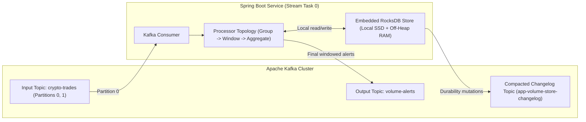
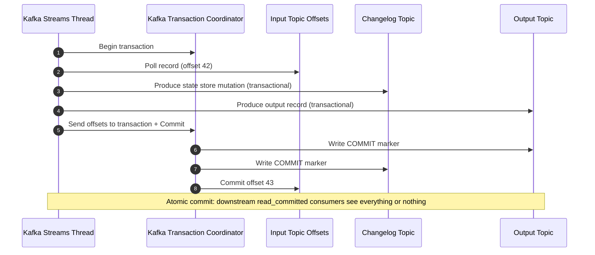

Stateless Kafka consumers are straightforward: read a record, transform or write it, and commit the offset. Real-time streaming systems quickly outgrow stateless processing, though. Fraud detection, payment velocity checks, real-time inventory balances, and order enrichment all need to remember what happened previously:

- Has this card been used in three countries within the last five minutes?
- What is the rolling 10-minute trade volume per ticker symbol?
- What is the customer's current account tier at the moment this order arrived?

Storing that intermediate state in an external relational database or Redis cluster works at moderate throughput, but network round trips, connection pool contention, and cross-system failure recovery turn stateful aggregations into a bottleneck. **Kafka Streams** takes a different approach: it embeds partitioned, fault-tolerant state directly inside your Java application using local **RocksDB** stores backed by compacted Kafka changelog topics.

## Embedded Stream Processing Architecture

Unlike Apache Flink or Apache Spark Streaming, Kafka Streams is not a separate distributed cluster you have to deploy and operate. It is a Java library that runs inside your standard Spring Boot or containerized JVM microservices, relying on Kafka's native consumer group protocol for partition assignment, horizontal scaling, and failover.



Kafka Streams divides work into **Stream Tasks**, one per input partition (or co-partitioned group of partitions). Each task owns its own isolated local state store. Because lookups hit local off-heap memory and local SSD instead of crossing the network, stateful operations stay fast and scale linearly as you add application instances up to the topic's partition count.

## `KStream`, `KTable`, and `GlobalKTable` Duality

Kafka Streams models event data around the **stream-table duality**: a stream is a changelog of mutations over time, and a table is the materialized snapshot obtained by replaying those mutations by key.

```text
KStream      -> Append-only sequence of independent events (INSERT semantics)
KTable       -> Partitioned materialized state per key (UPSERT + tombstone DELETE semantics)
GlobalKTable -> Unpartitioned materialized state replicated in full to every application instance
```

### `KStream` (Event Log)

Every record in a `KStream` is an independent fact. Two records with key `acct-42` and values `+50` and `+75` represent two separate deposits totaling `+125`.

```java
KStream<String, OrderEvent> orders = builder.stream(
        "orders",
        Consumed.with(Serdes.String(), orderEventSerde)
);
```

### `KTable` (Partitioned Materialized View)

A `KTable` treats records with the same key as updates to the same entity:

- A new key inserts a row in the local state store.
- An existing key overwrites the previous value.
- A record with a `null` value (a tombstone) deletes that key from the store.

```java
KTable<String, CustomerProfile> customers = builder.table(
        "customer-profiles",
        Consumed.with(Serdes.String(), customerProfileSerde),
        Materialized.<String, CustomerProfile, KeyValueStore<Bytes, byte[]>>as("customer-profile-store")
                .withKeySerde(Serdes.String())
                .withValueSerde(customerProfileSerde)
);
```

By default, Kafka Streams places a record cache in front of state stores (`statestore.cache.max.bytes` in Kafka Streams 3.x, replacing the deprecated `cache.max.bytes.buffering`). When the same key updates 50 times before the next commit interval, the cache deduplicates those updates and forwards only the latest value downstream.

### `GlobalKTable` (Replicated Reference Data)

A standard `KTable` is partitioned: Instance A holds only partitions 0 and 1, while Instance B holds partitions 2 and 3. A `GlobalKTable` reads **all** partitions of its input topic on **every** application instance so every task has the complete dataset locally.

```java
GlobalKTable<String, ExchangeRate> exchangeRates = builder.globalTable(
        "fx-exchange-rates",
        Consumed.with(Serdes.String(), exchangeRateSerde),
        Materialized.as("fx-exchange-rate-store")
);
```

Use `GlobalKTable` for relatively small, slowly changing reference datasets (currency rates, country rules, product catalog metadata) that you want to join with streams by a foreign key without repartitioning the stream. Avoid loading multi-gigabyte high-churn datasets into a `GlobalKTable`: every pod stores a full copy, startup waits until the global store finishes bootstrapping, and `GlobalKTable` updates are not synchronized with stream event time.

## RocksDB Local Embedded State Stores

By default, persistent Kafka Streams state stores are backed by **RocksDB**, an embedded C++ LSM-tree key-value store accessed through JNI. RocksDB writes incoming updates to an in-memory **MemTable**, flushes them asynchronously to sorted immutable **SST files** on local disk (`state.dir`), and caches hot data blocks in an off-heap **Block Cache**.

### Sizing RocksDB Off-Heap Memory in Containers

One of the most common production surprises with Kafka Streams in Kubernetes is a pod getting `OOMKilled` by the Linux kernel even though JVM heap usage is sitting comfortably at 50%.

Because RocksDB allocates its Block Cache, MemTables (write buffers), and index/filter blocks **off-heap in native C++ memory**, the JVM's `-Xmx` flag does **not** bound RocksDB. Worse, by default every RocksDB store instance (one per state store per task/partition) creates its own separate Block Cache and write buffers. If a pod hosts 32 tasks across 2 state stores, 64 independent RocksDB instances can easily consume gigabytes of native memory.

The fix is implementing a custom `RocksDBConfigSetter` that shares a single bounded `LRUCache` and `WriteBufferManager` across all RocksDB instances in the JVM:

```java
package com.javahub.streams.config;

import org.apache.kafka.streams.state.RocksDBConfigSetter;
import org.rocksdb.BlockBasedTableConfig;
import org.rocksdb.Cache;
import org.rocksdb.LRUCache;
import org.rocksdb.Options;
import org.rocksdb.WriteBufferManager;

import java.util.Map;

public class BoundedMemoryRocksDBConfigSetter implements RocksDBConfigSetter {

    // Total off-heap budget shared by ALL RocksDB instances in this JVM (e.g., 512 MiB)
    private static final long TOTAL_OFF_HEAP_BYTES = 512L * 1024 * 1024;
    private static final double WRITE_BUFFER_RATIO = 0.5;
    private static final double HIGH_PRIORITY_POOL_RATIO = 0.1;

    private static final Cache SHARED_CACHE =
            new LRUCache(TOTAL_OFF_HEAP_BYTES, -1, false, HIGH_PRIORITY_POOL_RATIO);

    private static final WriteBufferManager SHARED_WRITE_BUFFER_MANAGER =
            new WriteBufferManager((long) (TOTAL_OFF_HEAP_BYTES * WRITE_BUFFER_RATIO), SHARED_CACHE);

    @Override
    public void setConfig(String storeName, Options options, Map<String, Object> configs) {
        BlockBasedTableConfig tableConfig = (BlockBasedTableConfig) options.tableFormatConfig();
        tableConfig.setBlockCache(SHARED_CACHE);
        // Charge index and filter blocks against the shared cache budget too
        tableConfig.setCacheIndexAndFilterBlocks(true);
        tableConfig.setPinL0FilterAndIndexBlocksInCache(true);
        tableConfig.setBlockSize(16 * 1024L);

        options.setTableFormatConfig(tableConfig);
        options.setWriteBufferManager(SHARED_WRITE_BUFFER_MANAGER);
        options.setMaxWriteBufferNumber(3);
        options.setWriteBufferSize(16 * 1024 * 1024L);
    }

    @Override
    public void close(String storeName, Options options) {
        // Shared static cache and write buffer manager live for the lifetime of the JVM
    }
}
```

Register it with `streamsProps.put(StreamsConfig.ROCKSDB_CONFIG_SETTER_CLASS_CONFIG, BoundedMemoryRocksDBConfigSetter.class)` and leave adequate container memory headroom above `-Xmx` for JVM metaspace, thread stacks, page cache, and your RocksDB off-heap budget.

### Standby Replicas and Persistent Local Volumes

When a stateful pod restarts or crashes, another pod takes over its tasks and must rebuild RocksDB by replaying the changelog topic. For multi-gigabyte stores, cold restoration can take several minutes. Two settings cut recovery time dramatically:

- **`num.standby.replicas = 1`** (or `2`): Keeps warm shadow copies of each task's RocksDB store continuously tailing the changelog on another instance. On failover, Kafka Streams assigns the active task to the warm standby, cutting recovery from minutes to seconds.
- **Persistent volumes for `state.dir`** (such as Kubernetes `StatefulSet` PVCs): During rolling deployments, pods reattach to their existing local RocksDB files and only catch up the small delta since shutdown rather than replaying the full changelog from offset `0`.

### Interactive Queries

Because state already lives inside your Spring Boot service, you can expose read-only HTTP or gRPC queries directly against local RocksDB stores without copying results into a separate cache database:

```java
@RestController
@RequestMapping("/api/customers")
public class CustomerStateController {

    private final StreamsBuilderFactoryBean factoryBean;

    public CustomerStateController(StreamsBuilderFactoryBean factoryBean) {
        this.factoryBean = factoryBean;
    }

    @GetMapping("/{customerId}")
    public ResponseEntity<CustomerProfile> getCustomer(@PathVariable String customerId) {
        KafkaStreams streams = factoryBean.getKafkaStreams();
        if (streams == null || !streams.state().isRunningOrRebalancing()) {
            return ResponseEntity.status(HttpStatus.SERVICE_UNAVAILABLE).build();
        }

        // Check whether this instance owns the partition for customerId, or forward to the owner host
        KeyQueryMetadata metadata = streams.queryMetadataForKey(
                "customer-profile-store", customerId, Serdes.String().serializer()
        );
        // In a multi-instance deployment, if metadata.activeHost() != local host, proxy the request there.

        ReadOnlyKeyValueStore<String, CustomerProfile> store = streams.store(
                StoreQueryParameters.fromNameAndType(
                        "customer-profile-store",
                        QueryableStoreTypes.keyValueStore()
                )
        );

        CustomerProfile profile = store.get(customerId);
        return profile != null ? ResponseEntity.ok(profile) : ResponseEntity.notFound().build();
    }
}
```

Configure `application.server = <pod-host>:<port>` so `queryMetadataForKey` returns the exact host and port of the instance holding any key.

## Windowing Operations: Tumbling, Hopping, and Sliding Windows

Unbounded streams never end, so aggregations like counts, sums, and averages are usually computed over bounded time slices called **windows**. Kafka Streams supports four window types, driven by **event time** (record timestamps) rather than wall-clock processing time:

- **Tumbling windows:** Fixed-size, non-overlapping intervals aligned to epoch boundaries (for example, `10:00-10:05`, `10:05-10:10`). Every event belongs to exactly one window.
- **Hopping windows:** Fixed-size, overlapping intervals that advance by a hop size smaller than the window size (for example, a 5-minute window advancing every 1 minute: `10:00-10:05`, `10:01-10:06`, `10:02-10:07`). One event falls into multiple windows.
- **Sliding windows:** Fixed time-difference windows whose boundaries are driven by **actual record timestamps** rather than fixed clock ticks. A 2-minute sliding window captures every pair or cluster of events for the same key whose timestamps are within 2 minutes of each other, creating new windows only when records enter or leave that difference.
- **Session windows:** Variable-length windows grouped by activity and closed after a configurable inactivity gap (useful for clickstream user sessions).

```java
// 1. Tumbling: 5-minute non-overlapping windows with 1-minute grace period (Kafka Streams 3.x factory)
TimeWindows tumbling = TimeWindows.ofSizeAndGrace(Duration.ofMinutes(5), Duration.ofMinutes(1));

// 2. Hopping: 5-minute windows advancing every 1 minute, 1-minute grace period
TimeWindows hopping = TimeWindows.ofSizeAndGrace(Duration.ofMinutes(5), Duration.ofMinutes(1))
        .advanceBy(Duration.ofMinutes(1));

// 3. Sliding: records within 2 minutes of each other, 30-second grace period
SlidingWindows sliding = SlidingWindows.ofTimeDifferenceAndGrace(
        Duration.ofMinutes(2), Duration.ofSeconds(30)
);
```

### Grace Periods and `Suppressed.untilWindowCloses`

In distributed systems, events arrive out of order due to mobile offline queues, retries, or network jitter. The **grace period** specifies how long after a window's end timestamp Kafka Streams will still accept late records for that window (measured against the highest event timestamp observed in that task, called *stream time*). Records arriving after `windowEnd + grace` are dropped and counted in the `dropped-records-total` metric.

By default, a windowed `KTable` emits intermediate updates on every commit or cache flush. If you only want **one final result per window** (for example, to avoid sending ten duplicate Slack or webhook alerts for the same 5-minute window), add `.suppress(Suppressed.untilWindowCloses(...))`:

```java
package com.javahub.streams.topology;

import org.apache.kafka.common.serialization.Serdes;
import org.apache.kafka.common.utils.Bytes;
import org.apache.kafka.streams.KeyValue;
import org.apache.kafka.streams.StreamsBuilder;
import org.apache.kafka.streams.kstream.Consumed;
import org.apache.kafka.streams.kstream.Grouped;
import org.apache.kafka.streams.kstream.KStream;
import org.apache.kafka.streams.kstream.KTable;
import org.apache.kafka.streams.kstream.Materialized;
import org.apache.kafka.streams.kstream.Produced;
import org.apache.kafka.streams.kstream.Suppressed;
import org.apache.kafka.streams.kstream.TimeWindows;
import org.apache.kafka.streams.kstream.Windowed;
import org.apache.kafka.streams.state.WindowStore;
import org.springframework.context.annotation.Bean;
import org.springframework.context.annotation.Configuration;
import org.springframework.kafka.support.serializer.JsonSerde;

import java.math.BigDecimal;
import java.time.Duration;
import java.time.Instant;

@Configuration
public class CryptoVolumeTopology {

    @Bean
    public KStream<String, VolumeAlert> cryptoVolumeStream(StreamsBuilder builder) {
        JsonSerde<TradeEvent> tradeSerde = new JsonSerde<>(TradeEvent.class);
        JsonSerde<BigDecimal> decimalSerde = new JsonSerde<>(BigDecimal.class);
        JsonSerde<VolumeAlert> alertSerde = new JsonSerde<>(VolumeAlert.class);

        KStream<String, TradeEvent> trades = builder.stream(
                "crypto-trades",
                Consumed.with(Serdes.String(), tradeSerde)
        );

        TimeWindows fiveMinTumbling = TimeWindows.ofSizeAndGrace(
                Duration.ofMinutes(5),
                Duration.ofMinutes(1)
        );

        KTable<Windowed<String>, BigDecimal> finalWindowedVolume = trades
                .groupBy(
                        (key, trade) -> trade.symbol(),
                        Grouped.with(Serdes.String(), tradeSerde)
                )
                .windowedBy(fiveMinTumbling)
                .aggregate(
                        () -> BigDecimal.ZERO,
                        (symbol, trade, runningTotal) -> runningTotal.add(trade.notionalUsd()),
                        Materialized.<String, BigDecimal, WindowStore<Bytes, byte[]>>as("crypto-volume-store")
                                .withKeySerde(Serdes.String())
                                .withValueSerde(decimalSerde)
                )
                // Buffer updates until stream time passes windowEnd + 1 minute grace period
                .suppress(Suppressed.untilWindowCloses(
                        Suppressed.BufferConfig.unbounded()
                ));

        KStream<String, VolumeAlert> alerts = finalWindowedVolume
                .toStream()
                .filter((windowedKey, total) -> total.compareTo(new BigDecimal("10000000.00")) > 0)
                .map((windowedKey, total) -> KeyValue.pair(
                        windowedKey.key(),
                        new VolumeAlert(
                                windowedKey.key(),
                                total,
                                windowedKey.window().startTime(),
                                windowedKey.window().endTime()
                        )
                ));

        alerts.to("volume-alerts", Produced.with(Serdes.String(), alertSerde));
        return alerts;
    }

    public record TradeEvent(String tradeId, String symbol, BigDecimal notionalUsd) {}
    public record VolumeAlert(String symbol, BigDecimal totalVolumeUsd, Instant windowStart, Instant windowEnd) {}
}
```

> [!NOTE]
> `Suppressed.untilWindowCloses` only advances when new records arrive on the partition to push *stream time* forward. On very quiet topics where a partition stops receiving events, a closed window can sit buffered until the next record arrives and advances stream time past `windowEnd + grace`. Also, in high-cardinality topologies, consider bounding the suppression buffer (`BufferConfig.maxBytes(...)`) so a traffic spike does not exhaust JVM heap.

## Stream-Table Joins and Changelog Topic Compaction

Joining a high-volume event stream with a materialized table is one of the most common patterns in Kafka Streams, such as enriching incoming `OrderPlaced` events with customer profiles and currency conversion rates:

```java
KStream<String, OrderPlaced> ordersByCustomer = builder
        .stream("orders", Consumed.with(Serdes.String(), orderSerde))
        // Re-key by customerId and explicitly repartition so it aligns with customer-profiles
        .selectKey((orderId, order) -> order.customerId())
        .repartition(Repartitioned.with(Serdes.String(), orderSerde)
                .withName("orders-by-customer")
                .withNumberOfPartitions(12));

KTable<String, CustomerProfile> customers = builder.table(
        "customer-profiles", // Also 12 partitions, keyed by customerId with StringSerializer
        Consumed.with(Serdes.String(), customerSerde)
);

GlobalKTable<String, ExchangeRate> fxRates = builder.globalTable(
        "fx-exchange-rates", // Partition count does not need to match
        Consumed.with(Serdes.String(), fxSerde)
);

// Stream-KTable join (requires co-partitioning on customerId)
KStream<String, EnrichedOrder> withCustomer = ordersByCustomer.join(
        customers,
        (order, customer) -> EnrichedOrder.from(order, customer),
        Joined.with(Serdes.String(), orderSerde, customerSerde)
);

// Stream-GlobalKTable join (no co-partitioning required; foreign-key lookup via lambda)
KStream<String, PricedOrder> pricedOrders = withCustomer.join(
        fxRates,
        (customerId, enriched) -> enriched.currency(), // KeyValueMapper selects lookup key
        (enriched, rate) -> enriched.convertToUsd(rate)
);
```

### Co-Partitioning Constraints

A `KStream`-`KTable` join runs locally inside each task: Task `N` joins Partition `N` of the stream against Partition `N` of the table. That only works when both topics are **co-partitioned**:

1. **Identical partition count** (if `orders` has 12 partitions and `customer-profiles` has 6, Kafka Streams refuses to start and throws a `TopologyException`).
2. **Identical key schema and partitioner** (for example, both producers serialize `customerId` as UTF-8 `String` using Kafka's default partitioner).

If keys were serialized differently (for example, one producer used raw `StringSerializer` and another used JSON-quoted `"cust-42"`), Kafka Streams cannot detect that mismatch at startup, and the join will silently miss matches because the two byte arrays hash to different partitions!

### Changelog Topic Compaction

Every RocksDB state store (for `KTable`s, aggregations, and windowed stores) is backed by an internal **changelog topic** named `<application.id>-<store-name>-changelog`, configured with `cleanup.policy=compact` (and for windowed stores, `cleanup.policy=compact,delete` with retention matching window retention).

As your topology updates RocksDB, Kafka Streams writes each key-value mutation to the changelog topic. Kafka's background log cleaner periodically compacts older log segments, keeping only the latest value per key and dropping keys whose latest record is a tombstone. That prevents changelog topics from growing without bound and keeps state restoration fast after a node failure.

## Exactly-Once Processing Semantics (EOS) in Kafka Streams

Under the default `at_least_once` setting, if a stream task writes an aggregated result to the output topic and crashes before committing its input consumer offset, the restarted task re-reads the input record and emits a duplicate (and increments local state twice).

Enabling **Exactly-Once Semantics** coordinates input offset commits, changelog updates, and output writes into a single atomic Kafka transaction:

```properties
# Kafka Streams 3.x (and required in 4.x; KIP-447)
processing.guarantee=exactly_once_v2
# Optional: tune commit interval (EOS defaults to 100ms for low latency)
commit.interval.ms=100
```

Under `exactly_once_v2` (introduced in KIP-447 and the sole EOS implementation going forward after the legacy `exactly_once` mode was deprecated in 3.0), Kafka Streams uses a single transactional producer per `StreamThread` rather than one producer per task, greatly reducing broker memory and connection overhead.



### How EOS Protects Local RocksDB State on Crash

RocksDB lives on local disk outside Kafka's transaction coordinator, so you might wonder what happens if a task updates RocksDB locally and crashes *before* the Kafka transaction commits.

Kafka Streams tracks the committed state of local disk through a `.checkpoint` file inside `state.dir`. While a task is running under `exactly_once_v2`, Kafka Streams deletes or withholds updating the checkpoint file until transactions commit cleanly (and writes checkpoints on clean shutdown or commit boundaries). If the JVM crashes mid-transaction:

1. The Kafka transaction coordinator aborts the uncommitted transaction, marking any uncommitted changelog and output records as aborted.
2. Downstream consumers configured with `isolation.level=read_committed` never see the aborted output records.
3. On restart, Kafka Streams detects the dirty local RocksDB state (missing or stale checkpoint), wipes the dirty local store, and restores cleanly from **only committed records** in the changelog topic.

Keep the boundary of EOS clear: `exactly_once_v2` guarantees atomic read-process-write **within Kafka** (input topics, state stores/changelogs, and output topics). If a processor calls an external REST API or writes directly to PostgreSQL inside `.mapValues()`, those external side effects fall outside Kafka's transaction coordinator and still require idempotency or an outbox/sink connector.

## Interview Questions

### Why can a Kafka Streams pod get OOMKilled in Kubernetes even when JVM heap usage stays well below `-Xmx`?

RocksDB is a native C++ library loaded via JNI, so its Block Cache, MemTables (write buffers), and index/filter blocks live **off-heap** outside `-Xmx`. By default, every state store on every Stream Task allocates its own RocksDB cache and write buffers independently. When a pod owns dozens of partitions across multiple state stores, native off-heap memory can easily exceed the container's cgroup memory limit. Implementing a custom `RocksDBConfigSetter` that shares a single bounded `LRUCache` and `WriteBufferManager` across all stores caps native memory predictably.

### What is the difference between a Hopping Window and a Sliding Window in Kafka Streams?

A **Hopping Window** has fixed size and fixed advance intervals aligned to epoch time (for example, 5-minute windows starting every 1 minute: `10:00-10:05`, `10:01-10:06`), regardless of when events actually arrive. A **Sliding Window** is defined by a maximum time difference between record timestamps for the same key. Window boundaries are anchored to actual event timestamps, and a new window is created only when a record enters or drops out of the time difference, making sliding windows better suited for continuous rolling metrics and anomaly detection without arbitrary clock-boundary effects.

### Why do `KStream`-`KTable` joins require co-partitioning, and how do you work around topics that are not co-partitioned?

Each Stream Task joins Partition `N` of the stream with Partition `N` of the table using its local RocksDB store. If the two topics have different partition counts, the same key hashes to different partition numbers across the topics, so the task would miss matching rows (and Kafka Streams throws a `TopologyException` at startup). You resolve this either by re-keying and explicitly repartitioning the stream with `.selectKey(...).repartition(...)` to match the table's partition count and key serializer, or by loading the table as a `GlobalKTable` if the dataset is small enough to replicate across every instance.

### How does `processing.guarantee=exactly_once_v2` guarantee consistency across input offsets, output topics, and local RocksDB stores?

Under `exactly_once_v2`, each `StreamThread` runs a Kafka transactional producer that bundles output records, state-store changelog mutations, and input consumer offsets into a single atomic transaction coordinated by Kafka's Transaction Coordinator. Downstream consumers set `isolation.level=read_committed` so aborted output records are invisible. Because RocksDB is local and outside Kafka's coordinator, if a crash occurs before commit, Kafka Streams detects the uncommitted local state via its checkpoint file, discards the dirty local store, and restores exclusively from committed changelog records before reprocessing the uncommitted input offset.
