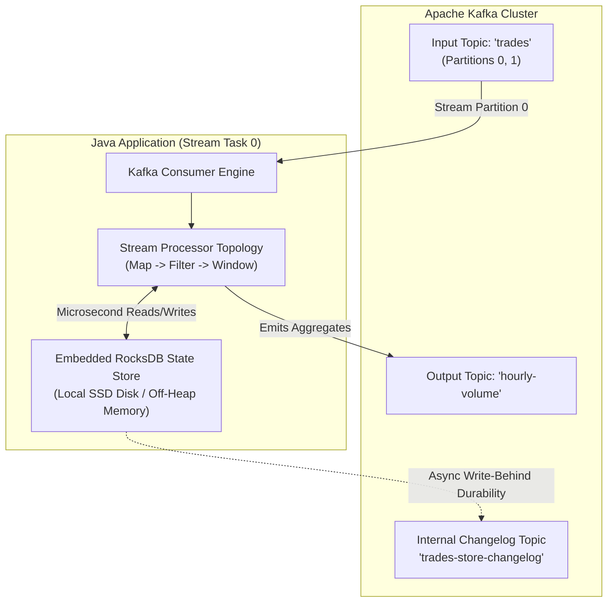
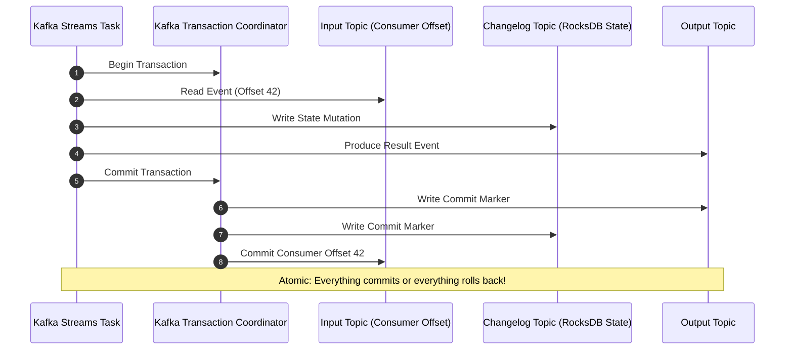

Stateless event-driven microservices are relatively straightforward to build. A consumer reads an event from a Kafka topic, validates its payload, performs a database write, and commits the consumer offset. If the consumer crashes, a rebalance assigns the partition to another instance, which resumes reading from the committed offset.

However, modern real-time systems—such as fraud detection platforms, financial ticker aggregators, and IoT telematics pipelines—require **state**. They must answer questions like:
- *"Has this credit card been swiped in three different countries within the last 5 minutes?"*
- *"What is the 10-minute moving average price of Bitcoin across all trades?"*
- *"Join this unbounded clickstream event with the latest user profile snapshot."*

If you attempt to maintain this state in an external relational database or Redis cache, your event pipeline collapses under network latency, socket pool exhaustion, and distributed locking contention. 

The **Kafka Streams API** solves this by embedding distributed, fault-tolerant state directly inside your Java application process. In this deep dive, we explore the duality of Streams and Tables (`KStream` vs `KTable`), how embedded **RocksDB** state stores achieve microsecond query latencies, how to execute windowed temporal aggregations, and how Kafka achieves **Exactly-Once Semantics (EOS)**.

---

### The Architecture of Kafka Streams: Embedded State

Unlike distributed stream engines like Apache Flink or Apache Spark Streaming—which require dedicated cluster managers, master nodes, and complex deployment topologies—Kafka Streams is a **pure Java client library**. 

You embed Kafka Streams directly into a standard Spring Boot application. It runs inside the standard JVM process, leveraging Kafka's consumer group protocol for partition assignment, elastic scaling, and automated fault tolerance:



Every stream processing instance maintains a local **RocksDB** embedded Key-Value store on local disk (or in off-heap memory). Because state is stored locally on the worker node, read and write operations complete in microseconds without crossing network boundaries.

---

### The Duality of Streams and Tables: KStream vs KTable

The cornerstone of stream processing theory is the **Stream-Table Duality**:

> **A Stream can be viewed as a Changelog of a Table, and a Table can be viewed as a Snapshot of a Stream.**

```
Event Stream (KStream):    Insert-only, unbounded facts over time.
State Table (KTable):      Update-by-key, latest materialized state per key.
```

#### KStream (The Event Log)
A `KStream` represents an unbounded, append-only stream of independent events. Every new record is an immutable fact added to the stream. Two records with the identical key `UUID-101` represent two distinct events (e.g., two distinct deposits into the same bank account).

```java
// KStream: Every event is processed independently
KStream<String, OrderEvent> orderStream = builder.stream("orders", 
    Consumed.with(Serdes.String(), new JsonSerde<>(OrderEvent.class)));
```

#### KTable (The Materialized View)
A `KTable` represents the current state of the world. It interprets the event stream as an **upsert** (Update or Insert) log:
- A new key-value pair inserts a row.
- A record with an existing key updates the row.
- A record with a `null` value acts as a **Tombstone**, deleting the row from the table.

```java
// KTable: Maintains only the latest profile state per userId
KTable<String, UserProfile> userProfiles = builder.table("user-profiles",
    Consumed.with(Serdes.String(), new JsonSerde<>(UserProfile.class)),
    Materialized.<String, UserProfile, KeyValueStore<Bytes, byte[]>>as("user-profile-store"));
```

#### GlobalKTable (Broadcast Cache)
A standard `KTable` is partitioned across worker nodes: instance A holds only partitions 0 and 1, while instance B holds partitions 2 and 3. 

A `GlobalKTable` populates an entire dataset across **all** worker instances by consuming all partitions. It is designed for small, slowly changing reference datasets (e.g., zip codes, currency exchange rates, tax tables) that must be joined with streams without requiring co-partitioning.

---

### Windowed Aggregations: Temporal State

When computing metrics across streaming data, you must bound time into discrete **Windows**:

```
Windowing Types in Kafka Streams
  |-- Tumbling Window: Fixed-size, non-overlapping (e.g., 00:00-00:05, 00:05-00:10)
  |-- Hopping Window:  Fixed-size, overlapping (e.g., 5-min window advancing every 1 min)
  |-- Sliding Window:  Time-difference between record timestamps (e.g., within 2 minutes of each other)
  `-- Session Window:  Dynamic window bounded by periods of inactivity (e.g., user activity gap > 30 min)
```

#### Computing 5-Minute Tumbling Aggregations

Here is a production topology that groups high-frequency cryptocurrency trades by symbol, computes the total trade volume across 5-minute tumbling windows, and emits alerts on unusual volume spikes:

```java
@Configuration
public class CryptoAlertTopology {

    @Bean
    public KStream<String, AlertEvent> buildPipeline(StreamsBuilder builder) {
        
        KStream<String, TradeEvent> trades = builder.stream(
            "crypto-trades",
            Consumed.with(Serdes.String(), new JsonSerde<>(TradeEvent.class))
        );

        // 1. Define a 5-minute Tumbling Window with a 1-minute Grace Period for late data
        TimeWindows tumblingWindow = TimeWindows.ofSizeWithNoGrace(Duration.ofMinutes(5))
            .grace(Duration.ofMinutes(1));

        KTable<Windowed<String>, BigDecimal> windowedVolume = trades
            // Key by currency symbol (e.g., "BTC-USD")
            .groupBy((key, trade) -> trade.symbol(), Grouped.with(Serdes.String(), new JsonSerde<>(TradeEvent.class)))
            
            // Apply 5-minute temporal windowing
            .windowedBy(tumblingWindow)
            
            // Aggregate trading volume inside RocksDB
            .aggregate(
                () -> BigDecimal.ZERO, // Initializer
                (symbol, trade, currentTotal) -> currentTotal.add(trade.volume()), // Aggregator
                Materialized.<String, BigDecimal, WindowStore<Bytes, byte[]>>as("crypto-volume-store")
                    .withKeySerde(Serdes.String())
                    .withValueSerde(new BigDecimalSerde())
            );

        // Filter and emit volume alerts
        KStream<String, AlertEvent> alerts = windowedVolume
            .toStream()
            .filter((windowedKey, totalVolume) -> totalVolume.compareTo(new BigDecimal("10000000.00")) > 0)
            .map((windowedKey, totalVolume) -> KeyValue.pair(
                windowedKey.key(), 
                new AlertEvent(windowedKey.key(), totalVolume, windowedKey.window().startTime())
            ));

        alerts.to("volume-alerts", Produced.with(Serdes.String(), new JsonSerde<>(AlertEvent.class)));

        return alerts;
    }
}
```

> [!NOTE]
> The `.grace(Duration.ofMinutes(1))` clause guarantees that if network jitter or mobile connectivity issues cause an event with an older timestamp to arrive up to 60 seconds late, Kafka Streams will reopen the window, update the aggregation, and emit the correction. Events arriving after the grace period are discarded as late records.

---

### Stream-Table Joins and the Co-Partitioning Constraint

One of the most powerful capabilities of Kafka Streams is joining a dynamic event stream with a state table in real time (e.g., enriching a raw `OrderPlaced` event with customer profile details):

```java
KStream<String, OrderPlacedEvent> orders = builder.stream("orders");
KTable<String, CustomerProfile> customers = builder.table("customers");

KStream<String, EnrichedOrder> enriched = orders.join(
    customers,
    (order, customer) -> new EnrichedOrder(order, customer),
    Joined.with(Serdes.String(), new JsonSerde<>(OrderPlacedEvent.class), new JsonSerde<>(CustomerProfile.class))
);
```

#### The Strict Co-Partitioning Rule
For a Stream-Table or Stream-Stream join to execute, both input topics **must be co-partitioned**:
1. Both topics must have the **exact same number of partitions**.
2. Both topics must use the **same partitioning strategy** (same serializer and hashing function).

Why? Kafka Streams assigns partitions to local task instances. Task 0 processes Partition 0 of `orders` and Partition 0 of `customers`. If `customerId-99` was mapped to Partition 0 in `orders` but Partition 2 in `customers`, Task 0 would never find the customer's record in its local RocksDB store, and the join would silently produce null results!

If your topics are not co-partitioned, you must re-partition the stream using `.selectKey()` and `.repartition()`, or load the table as a `GlobalKTable`.

---

### Fault Tolerance & RocksDB Durability: The Changelog Topic

What happens when a node running Kafka Streams suffers a catastrophic hardware failure? Does the local RocksDB state vanish into the void?

No. Every state store in Kafka Streams is backed by an internal **Kafka Changelog Topic** running on the Kafka broker cluster:

1. **Write-Behind Changelog:** Whenever your application writes an entry to its local RocksDB store, Kafka Streams asynchronously writes that mutation to a compacted changelog topic (e.g., `applicationId-crypto-volume-store-changelog`).
2. **Crash Recovery:** When a worker crashes, the Kafka consumer coordinator detects the failure via heartbeat timeouts and triggers a rebalance.
3. **State Rehydration:** A standby node is assigned the orphaned partition. It spins up a fresh RocksDB instance and **replays the compacted changelog topic from offset 0** to fully reconstruct the exact local state table in memory.
4. **Standby Replicas for Instant Failover:** In mission-critical environments, you can configure `num.standby.replicas=1`. Kafka Streams will maintain a warm standby replica of RocksDB on an alternate node, tailing the changelog in real-time. If the primary node crashes, the standby takes over with **zero seconds of rehydration lag**.

---

### Exactly-Once Semantics (EOS) in Kafka Streams

In financial ledgers and billing systems, processing an event twice (due to network retries) or dropping an event causes catastrophic financial discrepancies.

Kafka Streams provides the world's premier implementation of **Exactly-Once Processing**:

```properties
# Enable modern Exactly-Once Semantics (JEP / KIP-447)
processing.guarantee=exactly_once_v2
```

Under `exactly_once_v2`, Kafka Streams coordinates consumer offsets, RocksDB state changelog commits, and output topic message writes into a single, atomic **Two-Phase Commit (2PC) Transaction** managed by Kafka's Transaction Coordinator:



If an error or network partition occurs midway through processing, the transaction coordinator aborts the transaction. The uncommitted output messages are never exposed to `read_committed` downstream consumers, the changelog mutations are ignored, and the consumer offset is not advanced. The event is retried cleanly with zero duplicates and zero loss.

---

## Senior Engineer Interview Crucible

### How does Kafka Streams differ from Apache Flink, and when would you choose one over the other?
**Answer:** The fundamental difference is the deployment and operational model:
- **Kafka Streams** is an embedded Java client library. There is no cluster to install, configure, or monitor. It runs directly inside standard Spring Boot or containerized microservices, using Kafka itself for coordination and fault tolerance. It is ideal for microservice architectures where event processing logic lives alongside business domain services, and where operational simplicity is paramount.
- **Apache Flink** is a heavyweight, standalone distributed computing framework with its own dedicated Master (JobManager) and Worker (TaskManager) clusters. Flink supports complex complex event processing (CEP), advanced out-of-order event watermarking, cross-cluster resource scheduling, and multi-source stateful joins across heterogeneous systems (Kafka, S3, HDFS, Cassandra). 

Choose **Kafka Streams** when your data originates in and outputs to Kafka, and you want zero infrastructure overhead. Choose **Flink** when you require massive petabyte-scale stream joins across multiple non-Kafka backends or need advanced dynamic watermarking beyond Kafka's native partition model.

### What is the "Changelog Topic" in Kafka Streams, and how does topic compaction prevent it from running out of disk space?
**Answer:** A Changelog Topic is an internal, system-managed Kafka topic automatically created by the Kafka Streams library to guarantee the durability and recoverability of local embedded RocksDB state stores. Every time an aggregation, join, or table mutation modifies a record in RocksDB, the update is emitted to the corresponding changelog topic.

Because an event stream might process billions of updates over months, an uncompacted changelog topic would grow indefinitely and exhaust broker disk space. To prevent this, Kafka Streams configures all internal changelog topics with `cleanup.policy=compact`. In a compacted topic, Kafka's background cleaner threads periodically scan log segments and retain only the **latest value for each message key**, discarding obsolete historic updates. When a new node boots up and needs to restore a 10GB RocksDB state store, it only needs to replay the compacted snapshots, allowing state reconstruction to finish in seconds rather than days.

### Why does a Stream-Table join require co-partitioning, and what happens if the input topics have different partition counts?
**Answer:** A Stream-Table join in Kafka Streams is executed locally on each worker task. Task 0 receives Partition 0 of the stream topic and Partition 0 of the table topic. The join algorithm looks up the incoming stream record's key in Task 0's local RocksDB instance (which stores Partition 0 of the table).

If the input topics have different partition counts (e.g., `orders` has 12 partitions and `customers` has 6 partitions), Kafka's default `MurmurHash2` partitioner will hash the identical key to different partition IDs across the two topics. As a result, Task 0 may receive an order for `user-123`, but the corresponding customer profile for `user-123` was routed to Partition 3 (assigned to Task 3). Task 0 searches its local RocksDB store, finds nothing, and the join produces a null or missing record. 

If Kafka Streams detects at startup that joined topics have different partition counts, it throws a fatal `TopologyException` preventing the application from booting until the topics are aligned or a re-partitioning step is introduced.

### How does `processing.guarantee=exactly_once_v2` prevent duplicate state updates in RocksDB if a crash occurs before consumer offsets are committed?
**Answer:** Under `exactly_once_v2`, Kafka Streams utilizes transactional producers and transactional consumer offset commits. 

However, RocksDB is a local, embedded C++ database running outside the Kafka broker. If a worker updates RocksDB on local disk, writes to the output topic, and then crashes before committing consumer offsets, a naive recovery would re-read the input event, incrementing the local RocksDB counter a second time!

Kafka Streams prevents this by decoupling state updates from local durability:
1. When running under EOS, state mutations are buffered in memory and in the transactional changelog topic.
2. If a task crashes or a rebalance occurs before the transaction commits, **the local RocksDB state store is discarded or rolled back** to the last successfully committed checkpoint offset.
3. During recovery, the new task restores its state strictly from the **committed** records in the changelog topic. Uncommitted changelog writes (marked by an abort marker) are skipped by the recovery reader, ensuring that RocksDB never reflects phantom or duplicated mutations.
