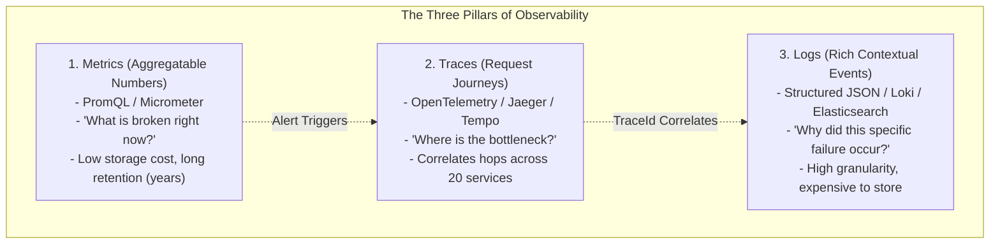
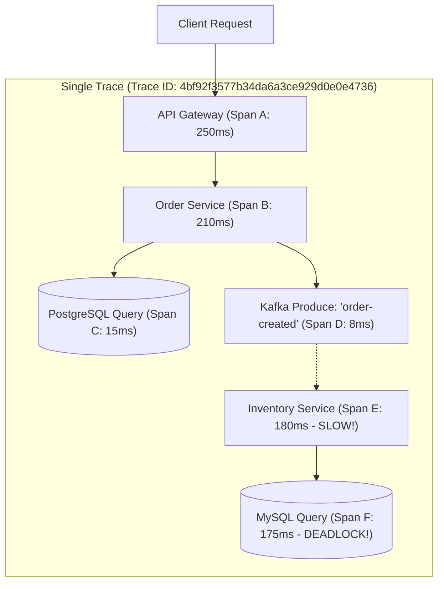

In a single-process monolithic application, debugging a production incident is straightforward: you open an SSH terminal to the server, run `tail -f /var/log/application.log`, and search for stack traces.

In a distributed cloud-native architecture with 60 microservices running across 250 dynamic Kubernetes pods, SSHing into servers is strictly impossible. When an executive or customer complains that *"checkout was slow or failed"*, which of the 60 microservices caused the problem? Was it a slow PostgreSQL query in the Inventory Service, an SSL handshake timeout in the Payment Gateway, or thread pool starvation in the Order Service?

Without comprehensive **Observability**, your engineering team is flying blind. 

Monitoring tells you *when* a system is broken (e.g., *"HTTP 500 error rate is 8%"*). **Observability** gives you the internal telemetry to understand *why* it is broken, even for completely novel failure modes you never anticipated.

In this guide, we will connect the **Three Pillars of Observability**, master **Distributed Tracing with OpenTelemetry**, instrument high-throughput metrics using **Micrometer and Prometheus**, and implement structured correlation logging across microservice boundaries.

---

## The Three Pillars of Observability

Modern observability rests upon three complementary telemetry streams:



### Triangulating an Incident
A production investigation follows a standard triage workflow:
1. **Metrics trigger the alert**: A Prometheus alert fires: *"Order Service P99 latency exceeded 2,000ms for 3 minutes."*
2. **Traces isolate the culprit**: You open Grafana Tempo or Jaeger and inspect the P99 trace waterfall. You discover that 1,900ms of the latency was spent in a single downstream span: `InventoryService.reserveStock()`.
3. **Logs reveal the root cause**: You click the `traceId` link directly into Grafana Loki or Elasticsearch. The log stream reveals: `Deadlock detected on table 'inventory_items' during row lock acquisition for SKU-884`.

---

## Distributed Tracing with OpenTelemetry (OTel)

When an incoming HTTP request hits your API Gateway, it triggers a chain reaction of downstream calls across multiple microservices, message queues, and databases. **Distributed Tracing** assigns a unique identifier to that end-to-end journey and records timing data for every intermediate operation.



### Trace Terminology
- **Trace**: The complete end-to-end journey of a request through the distributed system. Identified by a globally unique 128-bit **Trace ID**.
- **Span**: A single, contiguous unit of work within a service (e.g., executing an HTTP handler, running a database query, or publishing a Kafka event). Has a 64-bit **Span ID**, start time, duration, and optional key-value **Attributes** (e.g., `http.status_code = 200`, `db.statement = "SELECT..."`).
- **Parent Span ID**: Links child spans back to their caller, constructing a directed acyclic graph (DAG) waterfall.

---

### Context Propagation: The W3C TraceContext Standard
How does a downstream microservice know which Trace ID to continue? 
Services propagate context over the wire using the standardized **W3C TraceContext HTTP Headers**:

```http
traceparent: 00-4bf92f3577b34da6a3ce929d0e0e4736-00f067aa0ba902b7-01
```

```
 ┌── Version (00)
 │  ┌── Trace ID (32 hex characters / 16 bytes)
 │  │                                ┌── Parent Span ID (16 hex characters / 8 bytes)
 │  │                                │                ┌── Trace Flags (01 = Sampled)
 │  │                                │                │
 00-4bf92f3577b34da6a3ce929d0e0e4736-00f067aa0ba902b7-01
```

In Spring Boot 3, **Micrometer Tracing** (bridging to OpenTelemetry) automatically extracts and injects this header across `RestClient`, OpenFeign, Kafka headers, and WebClient!

---

## Metrics with Micrometer, Prometheus, and Grafana

**Micrometer** is the vendor-neutral metrics facade for Java (analogous to SLF4J for logging). It exposes your application metrics in formats understood by Prometheus, Datadog, New Relic, or InfluxDB.

### Dimensional Metrics: The Power of Tags
Older systems used flat hierarchical metric names (e.g., `orders.europe.success.count`). Modern monitoring systems use **Dimensional Metrics**—a single metric name decorated with key-value tag labels:

```
http_server_requests_seconds_count{method="POST", uri="/api/v1/orders", status="201"}
```

This allows Grafana dashboards to slice and dice metrics dynamically:
- Total throughput across all endpoints: `sum(rate(http_server_requests_seconds_count[1m]))`
- Error rate percentage for checkout: `sum(rate(http_server_requests_seconds_count{status=~"5.."}[1m])) / sum(rate(http_server_requests_seconds_count[1m])) * 100`

### SRE Golden Signals: The RED Method
Senior Site Reliability Engineers monitor microservices using the **RED Method**:
1. **Rate**: The number of requests per second the service is handling.
2. **Errors**: The number of requests that are failing (HTTP 5xx).
3. **Duration**: How long requests take (P50, P95, and P99 latency percentiles).

---

## The High Cardinality Disaster in Prometheus

The most common way developers destroy their Prometheus monitoring cluster is by creating a **Cardinality Explosion**.

### What is Cardinality?
Cardinality is the total number of unique time series generated by a metric. It is calculated by multiplying the number of possible values across all its tag labels:

```
Total Time Series = Values(Tag1) x Values(Tag2) x Values(Tag3)
```

```java
// ANTI-PATTERN: DO NOT DO THIS IN PRODUCTION!
meterRegistry.counter("orders.placed", 
    "customer_id", customerId,  // 5,000,000 unique values!
    "order_id", orderId.toString() // 50,000,000 unique values!
).increment();
```

### Why This Destroys Prometheus
Prometheus maintains an in-memory index for every single unique time series string. 
If you tag a metric with `orderId` or `userId` in a system handling millions of transactions, you create **50 million active time series**. 
Prometheus memory usage will explode from 4 GB to 128 GB within hours, triggering an out-of-memory crash that blinds your entire operations team!

**Cardinality Rules of Thumb:**
- **Allowed in Metric Tags (Low Cardinality)**: HTTP method (`GET`, `POST`), HTTP status (`200`, `404`, `500`), Service Name, Cloud Region (`us-east-1`).
- **FORBIDDEN in Metric Tags (High Cardinality)**: User IDs, Order IDs, Email addresses, Timestamps, UUIDs. These belong strictly in **Logs** and **Traces**, never in Metrics!

---

## Centralized Structured Logging with MDC

Unstructured plain-text logs like `log.info("Order processed for user " + userId)` are terrible for automated analysis. Production microservices must emit machine-parseable **Structured JSON logs** decorated with the **Mapped Diagnostic Context (MDC)**.

### Configuring JSON Logging with Logstash Logback Encoder
In `logback-spring.xml`:

```xml
<?xml version="1.0" encoding="UTF-8"?>
<configuration>
    <appender name="JSON_CONSOLE" class="ch.qos.logback.core.ConsoleAppender">
        <encoder class="net.logstash.logback.encoder.LogstashEncoder">
            <!-- Automatically includes MDC fields, timestamps, and thread info -->
            <includeMdcKeyName>traceId</includeMdcKeyName>
            <includeMdcKeyName>spanId</includeMdcKeyName>
            <includeMdcKeyName>userId</includeMdcKeyName>
        </encoder>
    </appender>

    <root level="INFO">
        <appender-ref ref="JSON_CONSOLE" />
    </root>
</configuration>
```

### What Structured Output Looks Like
```json
{
  "@timestamp": "2026-10-29T14:45:12.102Z",
  "level": "INFO",
  "thread_name": "http-nio-8080-exec-4",
  "logger_name": "com.example.ecommerce.service.OrderService",
  "message": "Order successfully authorized",
  "traceId": "4bf92f3577b34da6a3ce929d0e0e4736",
  "spanId": "00f067aa0ba902b7",
  "userId": "USR-8841",
  "orderId": "ORD-9921",
  "amount": 149.50
}
```

Now, when you search for `traceId: 4bf92f3577b34da6a3ce929d0e0e4736` in Grafana Loki or Elasticsearch, you see the **exact synchronized timeline of logs across all 5 participating microservices** in a single window!

---

## Architectural Traps and Real-World Outages

### The "MDC Thread Pool Context Bleed" Data Privacy Breach
A healthcare tele-medicine platform stored patient medical IDs in the SLF4J `MDC` to correlate clinical records:
```java
public void processAppointment(AppointmentRequest request) {
    MDC.put("patientId", request.getPatientId());
    appointmentService.schedule(request);
    // Forgot to call MDC.clear() in a finally block!
}
```
In servlet containers like Tomcat and async thread pools, worker threads are pooled and reused across thousands of requests. 
When Thread 8 finished processing Patient A's request, its `ThreadLocal` MDC retained `patientId: PATIENT_A`. 
Ten seconds later, Thread 8 was assigned to process Patient B's appointment. The subsequent database query logs recorded Patient B's diagnosis under Patient A's ID, causing a major HIPAA privacy violation and audit investigation.

**The Fix:** Always clear the MDC inside a mandatory `finally` block:
```java
try {
    MDC.put("userId", userId);
    doWork();
} finally {
    MDC.clear();
}
```

### The 100% Trace Sampling Storage Meltdown
A social networking platform deployed OpenTelemetry with default `100% Trace Sampling` (`AlwaysOnSampler`). 
During a viral product launch, the platform handled 80,000 requests per second. The OpenTelemetry Collector pushed 80,000 traces per second to their Jaeger/Elasticsearch cluster. 

Within 4 hours, the tracing cluster ingested 40 Terabytes of telemetry data, exhausting SSD disk capacity, crashing the search cluster, and generating an unexpected USD 45,000 cloud storage bill.

**The Fix:** Use **Tail-Based Sampling** or probabilistic head-based sampling (e.g., sample only 1% of normal 200 OK requests, but retain **100%** of all 5xx HTTP error traces and requests exceeding 1,000ms latency).

---

## Senior Interview Questions

### Question 1: What is the difference between Head-Based Sampling and Tail-Based Sampling in Distributed Tracing?
**Answer:**  
- **Head-Based Sampling**: The sampling decision is made at the **very start** of the request (e.g., at the API Gateway) before the transaction executes. For example, a probabilistic sampler randomly samples 5% of all incoming requests. 
  - *Pros:* Minimal memory overhead; downstream services simply check the `traceparent` sample flag (`01` vs `00`) and discard non-sampled spans immediately.
  - *Cons:* It might sample thousands of boring, fast 200 OK requests while completely missing a rare, critical 500 error or P99 latency spike that occurred deeper in the call graph.
- **Tail-Based Sampling**: The sampling decision is deferred until the **entire trace has completed** across all services. An OpenTelemetry Collector buffers spans in memory. If any span in the trace contains an HTTP 5xx error, throws an unhandled exception, or has a total duration exceeding 2,000ms, the entire trace is sampled and saved to long-term storage; otherwise, the successful trace is discarded.

### Question 2: Why should you avoid putting URI path variables directly into Prometheus metric tags (e.g., `/orders/{id}`)?
**Answer:**  
If a developer configures a metric tag with the raw request URI path (e.g., `exchange.getRequest().getPath()`), a request to `/orders/101` and a request to `/orders/102` will generate two distinct time series in Prometheus:
- `http_requests_total{uri="/orders/101"}`
- `http_requests_total{uri="/orders/102"}`

If your platform processes 10 million orders, you create 10 million distinct time series in Prometheus, triggering a fatal **Cardinality Explosion** that exhausts memory. 
Spring Boot Actuator automatically avoids this by using the parameterized route template pattern (`/orders/{id}`) as the metric tag value, ensuring that all 10 million orders collapse into a single time series:
`http_requests_total{uri="/orders/{id}"}`.

### Question 3: How does Micrometer's `DistributionSummary` and `Timer` calculate percentiles (P95, P99), and what is the trade-off of client-side vs server-side percentiles?
**Answer:**  
- **Client-Side Percentiles**: The application calculates P95/P99 percentiles locally using algorithms like HdrHistogram before publishing to Prometheus. 
  - *Trade-off:* Client-side percentiles **cannot be aggregated across multiple pods**! Mathematically, the average of three P99 numbers from three separate pods does not equal the true P99 of the entire cluster.
- **Server-Side Histogram Buckets (Recommended)**: The application exposes cumulative histogram bucket counters (e.g., `le="0.1"`, `le="0.5"`, `le="1.0"`, `le="+Inf"`). Prometheus scrapes these raw bucket counts, and you calculate the true cluster-wide percentile dynamically in Grafana using PromQL:
  `histogram_quantile(0.99, sum(rate(http_server_requests_seconds_bucket[5m])) by (le))`

### Question 4: How do you correlate logs and distributed traces when work is offloaded to an asynchronous `@Async` thread or Kafka consumer?
**Answer:**  
Standard logging MDC and trace scopes rely on `ThreadLocal` storage, which is lost when execution hops to a new worker thread.
1. **For `@Async` Thread Pools**: Configure the thread pool with a `TaskDecorator` (such as `DelegatingSecurityContextAsyncTaskExecutor` or OpenTelemetry's context-propagating executor wrapper) that copies the current thread's MDC map and OTel trace context before task dispatch, and restores it on the worker thread.
2. **For Kafka Messaging**: The producer extracts the active Trace ID and injects it into the Kafka record headers (`RecordHeader("traceparent", ...)`). When the downstream consumer reads the record, a Kafka consumer interceptor extracts the `traceparent` header, activates a child Span, and populates the consumer thread's SLF4J MDC before invoking the listener method.

