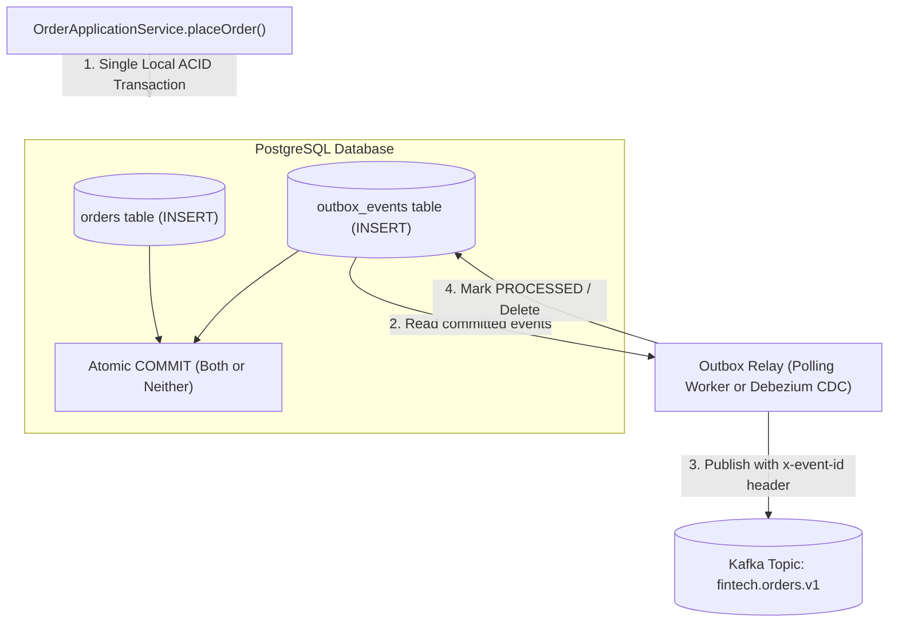
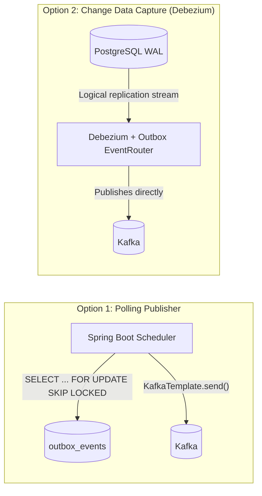
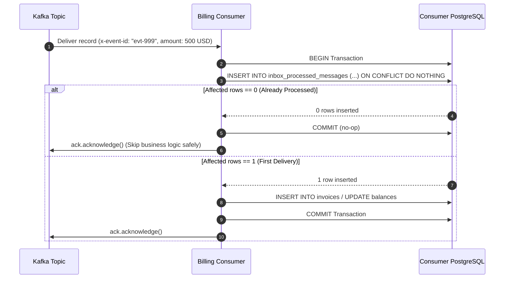

Almost every event-driven service has to do two things when a business action happens: update its own database, and publish an event so other services know what changed.

The first version of that code usually looks like this:

```java
// Dual-write bug: PostgreSQL and Kafka do not share a transaction
@Transactional
public Order createOrder(OrderRequest request) {
    Order order = orderRepository.save(new Order(request));
    kafkaTemplate.send("orders.events.v1", order.getId(), toEvent(order));
    return order;
}
```

That method works in local tests and breaks quietly in production. Understanding why it breaks—and how the **Transactional Outbox** and **Transactional Inbox** patterns close the gap—is foundational to reliable microservices.

---

## The Dual-Write Problem

Spring's `@Transactional` manages a single JDBC transaction on PostgreSQL. Kafka is a separate distributed system with its own protocol and does not participate in that transaction. No matter what order you run the two writes in, a crash or timeout at the wrong millisecond leaves the database and the event stream out of sync:

- **Publish before DB commit**: `kafkaTemplate.send()` succeeds and downstream services immediately receive `OrderCreated`. Half a millisecond later, PostgreSQL rejects the `COMMIT` because of a unique constraint violation, serialization failure, or connection drop. The database rolls back, but you cannot unsend a Kafka event. Billing charges a customer for an order that does not exist.
- **Publish after DB commit**: PostgreSQL commits the order, and then the pod is OOM-killed or Kafka times out before `send()` completes. The order exists in your database, but inventory and shipping never hear about it.

Classical distributed transactions (XA / Two-Phase Commit) are not a practical escape hatch here. Apache Kafka does not support XA 2PC, and holding database locks across network round-trips to an external broker degrades throughput and availability.

The reliable alternative is to reduce the write side to **one local ACID transaction** using the **Transactional Outbox** pattern, and absorb at-least-once duplicates on the read side using the **Transactional Inbox** pattern.

---

## Transactional Outbox Table with Database Commits

Instead of calling Kafka directly inside `createOrder()`, you write the business row (`orders`) and an event row (`outbox_events`) to the **same relational database inside the same `@Transactional` block**.



Because both inserts live in one local PostgreSQL transaction, atomicity is guaranteed by the database engine: either both the order and its outbox event commit together, or both roll back together.

### Outbox and Inbox SQL Schemas

Start with clean, indexed PostgreSQL tables on the producer and consumer sides:

```sql
-- Producer database: stores domain events committed atomically with business state
CREATE TABLE outbox_events (
    id             UUID PRIMARY KEY,
    aggregate_type VARCHAR(64) NOT NULL,
    aggregate_id   VARCHAR(64) NOT NULL,
    event_type     VARCHAR(128) NOT NULL,
    payload        JSONB NOT NULL,
    status         VARCHAR(16) NOT NULL DEFAULT 'PENDING',
    created_at     TIMESTAMP WITH TIME ZONE NOT NULL DEFAULT NOW(),
    processed_at   TIMESTAMP WITH TIME ZONE
);

-- Partial index keeps polling queries fast even if historical rows are retained briefly
CREATE INDEX idx_outbox_pending
    ON outbox_events (created_at)
    WHERE status = 'PENDING';

-- Consumer database: tracks processed message IDs per consumer group
CREATE TABLE inbox_processed_messages (
    message_id     UUID NOT NULL,
    consumer_group VARCHAR(64) NOT NULL,
    processed_at   TIMESTAMP WITH TIME ZONE NOT NULL DEFAULT NOW(),
    PRIMARY KEY (message_id, consumer_group)
);
```

### Atomic Spring `@Transactional` Producer Service

Notice that `eventId` is a freshly generated `UUID` for every single domain event, distinct from `orderId`. One order can emit multiple events over its lifecycle (`OrderPlaced`, `OrderPaid`, `OrderCancelled`), so the order ID is the **Kafka partition key**, while `eventId` is the **idempotency key**.

```java
package com.javahub.outbox.service;

import com.fasterxml.jackson.core.JsonProcessingException;
import com.fasterxml.jackson.databind.ObjectMapper;
import com.javahub.outbox.domain.Order;
import com.javahub.outbox.domain.OutboxEvent;
import com.javahub.outbox.repository.OrderRepository;
import com.javahub.outbox.repository.OutboxRepository;
import org.springframework.stereotype.Service;
import org.springframework.transaction.annotation.Transactional;

import java.math.BigDecimal;
import java.time.Instant;
import java.util.UUID;

@Service
public class OrderApplicationService {

    private final OrderRepository orderRepository;
    private final OutboxRepository outboxRepository;
    private final ObjectMapper objectMapper;

    public OrderApplicationService(
            OrderRepository orderRepository,
            OutboxRepository outboxRepository,
            ObjectMapper objectMapper) {
        this.orderRepository = orderRepository;
        this.outboxRepository = outboxRepository;
        this.objectMapper = objectMapper;
    }

    @Transactional
    public Order placeOrder(String customerId, BigDecimal totalAmount) {
        String orderId = UUID.randomUUID().toString();
        Order savedOrder = orderRepository.save(new Order(orderId, customerId, totalAmount, "PLACED"));

        UUID eventId = UUID.randomUUID();
        OrderPlacedEvent domainEvent = new OrderPlacedEvent(
                eventId,
                savedOrder.getId(),
                savedOrder.getCustomerId(),
                savedOrder.getTotalAmount(),
                Instant.now()
        );

        String jsonPayload;
        try {
            jsonPayload = objectMapper.writeValueAsString(domainEvent);
        } catch (JsonProcessingException ex) {
            // Runtime exception triggers full transaction rollback of the Order insert as well
            throw new IllegalStateException("Failed to serialize OrderPlacedEvent", ex);
        }

        OutboxEvent outboxRecord = new OutboxEvent(
                eventId,
                "Order",
                savedOrder.getId(),
                "OrderPlaced",
                jsonPayload,
                "PENDING",
                Instant.now()
        );

        // Persisted in the exact same local ACID transaction as savedOrder
        outboxRepository.save(outboxRecord);
        return savedOrder;
    }

    public record OrderPlacedEvent(
            UUID eventId,
            String orderId,
            String customerId,
            BigDecimal amount,
            Instant occurredAt) {}
}
```

Plan table retention early: either delete processed rows on a scheduled cleanup job or partition `outbox_events` by day so old partitions can be dropped without vacuum overhead.

---

## Polling Publisher vs CDC Event Streaming

Once committed rows land in `outbox_events`, an asynchronous relay process needs to publish them to Kafka. You have two main architectural options.



### Option One: Polling Publisher with `SELECT ... FOR UPDATE SKIP LOCKED`

A scheduled worker queries pending rows, publishes them to Kafka, and marks them processed. Using PostgreSQL's `FOR UPDATE SKIP LOCKED` lets multiple application pods poll the same table concurrently without blocking each other: each pod locks a disjoint slice of rows and skips rows currently locked by sibling pods.

```java
package com.javahub.outbox.relay;

import org.apache.kafka.clients.producer.ProducerRecord;
import org.apache.kafka.common.header.internals.RecordHeader;
import org.slf4j.Logger;
import org.slf4j.LoggerFactory;
import org.springframework.jdbc.core.simple.JdbcClient;
import org.springframework.kafka.core.KafkaTemplate;
import org.springframework.scheduling.annotation.Scheduled;
import org.springframework.stereotype.Component;
import org.springframework.transaction.annotation.Transactional;

import java.nio.charset.StandardCharsets;
import java.util.List;
import java.util.UUID;
import java.util.concurrent.TimeUnit;

@Component
public class OutboxPollingRelay {

    private static final Logger log = LoggerFactory.getLogger(OutboxPollingRelay.class);
    private static final String TOPIC = "fintech.orders.v1";

    private final JdbcClient jdbcClient;
    private final KafkaTemplate<String, String> kafkaTemplate;

    public OutboxPollingRelay(JdbcClient jdbcClient, KafkaTemplate<String, String> kafkaTemplate) {
        this.jdbcClient = jdbcClient;
        this.kafkaTemplate = kafkaTemplate;
    }

    @Scheduled(fixedDelay = 500)
    @Transactional
    public void relayPendingEvents() {
        List<OutboxRow> pending = jdbcClient.sql("""
                SELECT id, aggregate_id, event_type, payload::text AS payload
                FROM outbox_events
                WHERE status = 'PENDING'
                ORDER BY created_at ASC
                LIMIT 50
                FOR UPDATE SKIP LOCKED
                """)
                .query(OutboxRow.class)
                .list();

        if (pending.isEmpty()) {
            return;
        }

        for (OutboxRow row : pending) {
            try {
                ProducerRecord<String, String> record = new ProducerRecord<>(
                        TOPIC,
                        row.aggregateId(), // Partition key preserves per-aggregate order
                        row.payload()
                );
                record.headers().add(new RecordHeader("x-event-id", row.id().toString().getBytes(StandardCharsets.UTF_8)));
                record.headers().add(new RecordHeader("x-event-type", row.eventType().getBytes(StandardCharsets.UTF_8)));

                // Bound the wait so a Kafka outage does not pin DB connections indefinitely
                kafkaTemplate.send(record).get(5, TimeUnit.SECONDS);

                jdbcClient.sql("""
                        UPDATE outbox_events
                        SET status = 'PROCESSED', processed_at = NOW()
                        WHERE id = ?
                        """)
                        .param(row.id())
                        .update();
            } catch (Exception ex) {
                log.error("Failed to relay outbox event id={}; stopping batch to retry on next poll", row.id(), ex);
                break;
            }
        }
    }

    public record OutboxRow(UUID id, String aggregateId, String eventType, String payload) {}
}
```

Watch two real-world caveats with the polling publisher:
1. **DB connection pool pressure**: Calling `kafkaTemplate.send().get()` inside `@Transactional` holds a JDBC connection open during network I/O. Keep batches small (`LIMIT 50`) and use a tight timeout (`5s`), or run the relay on a dedicated small connection pool so a Kafka outage cannot starve user-facing HTTP requests.
2. **Per-aggregate ordering with multi-pod `SKIP LOCKED`**: If an order produces `OrderPlaced` and `OrderCancelled` milliseconds apart, Pod 1 might lock row 1 while Pod 2 skips row 1 and locks row 2, publishing them out of order. If strict per-aggregate ordering matters across multi-pod relays, either run a single leader-elected poller, shard pollers by `hashtext(aggregate_id) % workerCount`, or move to CDC.

### Option Two: Change Data Capture (CDC) with Debezium Outbox Router

Instead of polling the database with SQL queries, **Debezium** attaches to PostgreSQL's Write-Ahead Log (WAL) through a logical replication slot and streams every committed `INSERT` on `outbox_events` directly to Kafka in milliseconds.

Debezium ships with a built-in **`EventRouter`** Single Message Transform (SMT) designed specifically for outbox tables. Here is a representative Kafka Connect connector config:

```json
{
  "name": "orders-outbox-connector",
  "config": {
    "connector.class": "io.debezium.connector.postgresql.PostgresConnector",
    "database.hostname": "postgres-orders",
    "database.port": "5432",
    "database.user": "debezium_repl",
    "database.password": "${file:/secrets/db.properties:password}",
    "database.dbname": "orders_db",
    "topic.prefix": "orders",
    "plugin.name": "pgoutput",
    "slot.name": "orders_outbox_slot",
    "table.include.list": "public.outbox_events",
    "transforms": "outbox",
    "transforms.outbox.type": "io.debezium.transforms.outbox.EventRouter",
    "transforms.outbox.table.field.event.id": "id",
    "transforms.outbox.table.field.event.key": "aggregate_id",
    "transforms.outbox.table.field.event.type": "event_type",
    "transforms.outbox.table.field.event.payload": "payload",
    "transforms.outbox.route.by.field": "aggregate_type",
    "transforms.outbox.route.topic.replacement": "fintech.${routedByValue}.v1",
    "transforms.outbox.table.fields.additional.placement": "event_type:header:x-event-type"
  }
}
```

Debezium's `EventRouter` automatically puts `id` into the Kafka message header (`id`), sets `aggregate_id` as the Kafka record key, extracts `payload` as the message value, and routes based on `aggregate_type`. You can even `INSERT` into `outbox_events` and immediately `DELETE` the row in the same transaction: PostgreSQL still records the `INSERT` in the WAL for Debezium to stream, while the physical table stays nearly empty.

### Choosing Between Polling and CDC

| Dimension | Polling Publisher (`SKIP LOCKED`) | Debezium CDC (WAL Tailing) |
| :--- | :--- | :--- |
| **Operational Complexity** | Low; pure Spring Boot + JDBC | Higher; requires Kafka Connect, Debezium, replication slot monitoring |
| **Database Load** | Adds periodic query load, row updates, and vacuum churn | Zero SQL polling queries; reads sequential WAL stream |
| **Publish Latency** | Bounded by polling interval (typically 250 ms to 2 s) | Near real-time (tens of milliseconds) |
| **Ordering** | Preserved easily with single leader or sharded pollers; watch multi-pod `SKIP LOCKED` | Preserved naturally in strict WAL commit order |
| **Primary Operational Risk** | Connection pool contention or table bloat under high write rates | Stalled replication slot causing WAL disk exhaustion on PostgreSQL |

Start with a polling publisher when event volume is modest (dozens to low hundreds of events/sec) and you want minimal infrastructure. Move to Debezium CDC when throughput, sub-second latency, or database CPU overhead justifies running Kafka Connect.

---

## Idempotent Consumer with the Inbox Pattern

Notice what the Transactional Outbox actually guarantees: **At-Least-Once delivery**.

If the polling relay publishes an event to Kafka and crashes right before updating `status = 'PROCESSED'`, the next poll publishes that exact same event a second time. Likewise, if a Kafka consumer commits its database transaction and crashes right before acknowledging the Kafka offset, Kafka redelivers the record on restart.

To turn At-Least-Once delivery into **effectively-once side effects**, consumers use the **Transactional Inbox Pattern**: record the unique `message_id` inside `inbox_processed_messages` in the **exact same local ACID transaction** as the business update.



### Two Subtle Pitfalls to Avoid in Spring Boot

1. **Use `ON CONFLICT DO NOTHING` instead of catching `DuplicateKeyException` inside `@Transactional` on PostgreSQL**: In PostgreSQL, any SQL error (including a primary-key constraint violation) puts the current transaction into an aborted state (`current transaction is aborted, commands ignored until end of transaction block`). Using `INSERT ... ON CONFLICT DO NOTHING` and checking whether `rowsInserted == 0` avoids aborting the PostgreSQL transaction and avoids exception overhead on duplicate bursts.
2. **Acknowledge the Kafka offset *after* the DB transaction commits**: If you put `@Transactional` directly on the `@KafkaListener` method and call `ack.acknowledge()` inside it, the Kafka offset commits *before* Spring executes the JDBC `COMMIT` when the method returns. If the DB commit fails, you lose the message. Keep the `@KafkaListener` non-transactional, delegate to a `@Transactional` service method, and call `ack.acknowledge()` only after that method returns cleanly.

```java
package com.javahub.inbox.consumer;

import org.apache.kafka.clients.consumer.ConsumerRecord;
import org.apache.kafka.common.header.Header;
import org.slf4j.Logger;
import org.slf4j.LoggerFactory;
import org.springframework.jdbc.core.simple.JdbcClient;
import org.springframework.kafka.annotation.KafkaListener;
import org.springframework.kafka.support.Acknowledgment;
import org.springframework.stereotype.Component;
import org.springframework.stereotype.Service;
import org.springframework.transaction.annotation.Transactional;

import java.nio.charset.StandardCharsets;
import java.util.UUID;

@Component
public class BillingKafkaListener {

    private static final String CONSUMER_GROUP = "billing-payment-service";

    private final IdempotentBillingHandler handler;

    public BillingKafkaListener(IdempotentBillingHandler handler) {
        this.handler = handler;
    }

    @KafkaListener(topics = "fintech.orders.v1", groupId = CONSUMER_GROUP)
    public void onOrderEvent(ConsumerRecord<String, String> record, Acknowledgment ack) {
        Header eventIdHeader = record.headers().lastHeader("x-event-id");
        if (eventIdHeader == null) {
            throw new IllegalArgumentException("Missing required x-event-id header at offset " + record.offset());
        }
        UUID messageId = UUID.fromString(new String(eventIdHeader.value(), StandardCharsets.UTF_8));

        // 1. Complete and COMMIT the local DB transaction before committing the Kafka offset
        handler.handleOnce(messageId, CONSUMER_GROUP, record.value());

        // 2. DB commit succeeded (or duplicate was skipped); now acknowledge Kafka offset
        ack.acknowledge();
    }
}

@Service
class IdempotentBillingHandler {

    private static final Logger log = LoggerFactory.getLogger(IdempotentBillingHandler.class);

    private final JdbcClient jdbcClient;
    private final BillingLedgerService billingLedgerService;

    IdempotentBillingHandler(JdbcClient jdbcClient, BillingLedgerService billingLedgerService) {
        this.jdbcClient = jdbcClient;
        this.billingLedgerService = billingLedgerService;
    }

    @Transactional
    public void handleOnce(UUID messageId, String consumerGroup, String payload) {
        int inserted = jdbcClient.sql("""
                INSERT INTO inbox_processed_messages (message_id, consumer_group, processed_at)
                VALUES (?, ?, NOW())
                ON CONFLICT (message_id, consumer_group) DO NOTHING
                """)
                .params(messageId, consumerGroup)
                .update();

        if (inserted == 0) {
            log.info("Duplicate event skipped via inbox: messageId={}", messageId);
            return;
        }

        // Executes atomically with the inbox insert
        billingLedgerService.recordInvoice(payload);
    }
}
```

Just like the outbox table, plan inbox retention. Keep rows for longer than your Kafka topic retention and retry window (for example, 14 to 30 days) using daily time-based partitions so old rows can be dropped cheaply.

---

## Interview Questions

### Why doesn't putting `@Transactional` on a method that calls `orderRepository.save()` and `kafkaTemplate.send()` solve the dual-write problem?

Spring's `@Transactional` only coordinates the relational database's JDBC transaction. Kafka does not participate in that transaction. If `kafkaTemplate.send()` runs before the DB commit and the DB commit subsequently fails, downstream consumers still receive a phantom event. If `kafkaTemplate.send()` runs after the DB commit and fails (or the pod crashes), the database state is saved without any event published.

### Why should the Inbox table key on a unique `eventId` rather than the business entity ID (`orderId`)?

A single entity such as `order-42` typically emits multiple distinct events over its lifetime (`OrderPlaced`, `OrderPaid`, `OrderShipped`, `OrderRefunded`). If you deduplicate on `orderId`, the consumer processes `OrderPlaced` and silently drops every subsequent event for that order. Use `orderId` as the Kafka partition key for ordering, and generate a unique `eventId` (UUID) per event for inbox deduplication.

### Why is `SELECT ... FOR UPDATE SKIP LOCKED` useful in a polling outbox relay, and what is its ordering caveat?

Without `SKIP LOCKED`, multiple polling pods try to lock the same oldest rows and serialize behind each other. `SKIP LOCKED` tells PostgreSQL to skip rows locked by another transaction so each pod claims a separate batch concurrently. The caveat is that two pending events for the same `aggregate_id` can be picked up by two different pods simultaneously and published out of order; if strict per-aggregate ordering is required, use a single leader-elected poller, shard polling by aggregate hash, or switch to Debezium CDC.

### Why should `ack.acknowledge()` run outside the `@Transactional` consumer method?

If `ack.acknowledge()` runs inside a `@Transactional` method, Spring commits the Kafka offset before the database `COMMIT` executes when the method exits. If the database commit then fails (for example, due to a deferred constraint or transient connection drop), the Kafka offset has already moved forward and the event is lost. Delegating the database work to a separate `@Transactional` service and calling `ack.acknowledge()` after it returns guarantees the database commit finishes first.
