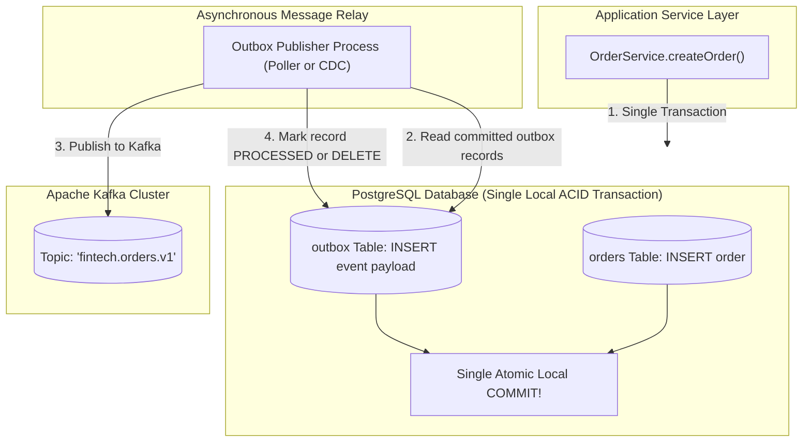
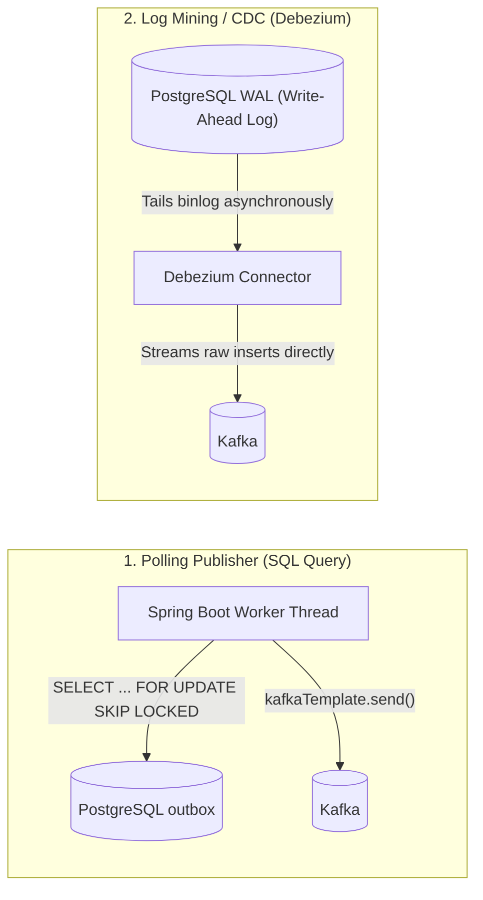
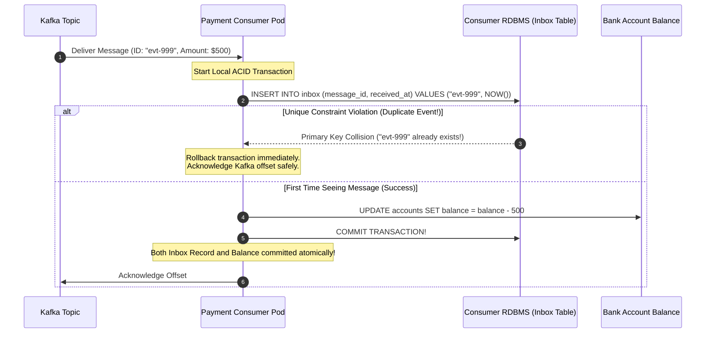

# Transactional Outbox and Inbox Patterns

In distributed event-driven systems, microservices must regularly perform two actions in response to a business event:
1. Update internal state in a local database (e.g., save a new `Order` in PostgreSQL).
2. Publish an event to a message broker (e.g., send an `OrderCreated` message to Apache Kafka).

Almost every developer begins by writing code like this:

```java
// DANGEROUS: The Classic Dual-Write Anti-Pattern!
@Transactional
public Order createOrder(OrderRequest request) {
    Order order = orderRepository.save(new Order(request));
    
    // What happens if Kafka times out or the network drops right here?
    kafkaTemplate.send("orders.v1", order.getId(), toEvent(order));
    
    return order;
}
```

In production, this code is an architectural time bomb known as the **Dual-Write Problem**:
- **Scenario A (Kafka Fails):** PostgreSQL commits the order, but Kafka experiences a transient timeout or broker disconnect. The transaction rolls back the database—unless the Kafka call was outside the transaction, in which case the database retains the order but the event is never published. Downstream inventory, billing, and shipping microservices never hear about the order.
- **Scenario B (Database Fails):** Kafka sends the message successfully, but during database commit, a unique constraint violation or network partition strikes PostgreSQL. The database transaction rolls back, but the event is already out in the wild! The shipping service dispatches a physical product for an order that does not exist in the database.

Because standard distributed two-phase commit (XA transactions) is slow, blocking, and unsupported across modern message brokers like Kafka, we must solve this using **Local ACID Transactions** and two fundamental patterns: the **Transactional Outbox** and the **Transactional Inbox**.

---

## The Transactional Outbox Pattern: Anatomy and Architecture

The Transactional Outbox pattern guarantees that database state updates and message publication occur **atomically without distributed transactions**:



### How It Works

1. **The Outbox Table:** We introduce an `outbox` table into the **exact same relational database** where our business entities reside.
2. **Atomic Local Write:** When a business entity is inserted or updated, the application inserts an event payload into the `outbox` table **inside the exact same local ACID transaction**. If the database commit succeeds, both the order and the outbox event exist on disk. If it fails, both roll back atomically.
3. **The Outbox Relay:** An independent background process (either a polling worker or a Change Data Capture connector) reads uncommitted records from the outbox table and publishes them to Kafka.
4. **Reliability Guarantee:** The event is guaranteed to be published to Kafka at least once as long as the outbox record was committed.

---

## The Outbox Publishing Topologies: Polling vs Log Mining (CDC)

How does the Relay process move records from the database outbox table to Kafka? There are two primary architectural strategies:



### Strategy 1: The Polling Publisher (`SELECT ... FOR UPDATE SKIP LOCKED`)

A scheduled worker thread in Spring Boot queries the `outbox` table periodically:

- **The Concurrency Secret:** To scale outbox publishing across multiple Kubernetes pods without lock contention or duplicate publishing, use PostgreSQL/MySQL's `FOR UPDATE SKIP LOCKED`.
- **Pros:** 100% pure Java/SQL implementation; requires zero external infrastructure.
- **Cons:** Polling creates constant query load on the database. If thousands of orders are generated per second, the outbox table experiences high write and delete churn, requiring frequent PostgreSQL vacuuming.

### Strategy 2: Transaction Log Mining (CDC via Debezium)

Instead of querying the database with SQL, an external engine like **Debezium** tails the database's native append-only Write-Ahead Log (WAL in PostgreSQL, binlog in MySQL):

- **Zero Polling Overhead:** The database engine executes zero SQL queries. Debezium reads raw bytes directly from the disk-backed replication stream.
- **Sub-Millisecond Publishing:** Events are streamed to Kafka within milliseconds of the database transaction committing.
- **Outbox Event Router:** Debezium includes a native `OutboxEventRouter` Single Message Transform (SMT) that parses outbox table mutations and routes them to target Kafka topics automatically.

---

## The Receiving Side: The Transactional Inbox Pattern

Publishing an event via the Transactional Outbox guarantees **At-Least-Once Delivery**. Because network retries, broker rebalances, and worker failovers can occur, **Kafka consumers will inevitably receive duplicate messages**.

If your consumer processes a 500-dollar payment event twice, your customer is billed 1,000 dollars.

To guarantee **Exactly-Once Processing Semantics (EOS)** at the application boundary, consumers implement the **Transactional Inbox Pattern**:



### The Invariant

By recording the unique event ID in an `inbox` table within the **same local transaction** that updates the business state, duplicates are detected and rejected by standard database primary key uniqueness constraints.

---

## Production Implementation in Spring Boot 3

Let's build a production-ready Transactional Outbox and Inbox implementation using Spring Boot 3, Spring Data JPA, and `JdbcClient`.

### Step 1: The Database Schemas

```sql
-- The Outbox Table (Producer Database)
CREATE TABLE outbox_events (
    id UUID PRIMARY KEY,
    aggregate_type VARCHAR(64) NOT NULL,
    aggregate_id VARCHAR(64) NOT NULL,
    event_type VARCHAR(128) NOT NULL,
    payload JSONB NOT NULL,
    status VARCHAR(32) NOT NULL DEFAULT 'PENDING',
    created_at TIMESTAMP WITH TIME ZONE NOT NULL DEFAULT NOW(),
    processed_at TIMESTAMP WITH TIME ZONE
);

CREATE INDEX idx_outbox_pending ON outbox_events (created_at) WHERE status = 'PENDING';

-- The Inbox Table (Consumer Database)
CREATE TABLE inbox_events (
    message_id VARCHAR(128) PRIMARY KEY,
    consumer_group VARCHAR(64) NOT NULL,
    processed_at TIMESTAMP WITH TIME ZONE NOT NULL DEFAULT NOW()
);
```

### Step 2: The Atomic Producer Service

```java
package com.javahub.outbox.service;

import com.fasterxml.jackson.databind.ObjectMapper;
import com.javahub.outbox.domain.Order;
import com.javahub.outbox.domain.OutboxEvent;
import com.javahub.outbox.repository.OrderRepository;
import com.javahub.outbox.repository.OutboxRepository;
import org.springframework.stereotype.Service;
import org.springframework.transaction.annotation.Transactional;

import java.time.Instant;
import java.util.UUID;

@Service
public class OrderApplicationService {

    private final OrderRepository orderRepository;
    private final OutboxRepository outboxRepository;
    private final ObjectMapper objectMapper;

    public OrderApplicationService(OrderRepository orderRepository,
                                   OutboxRepository outboxRepository,
                                   ObjectMapper objectMapper) {
        this.orderRepository = orderRepository;
        this.outboxRepository = outboxRepository;
        this.objectMapper = objectMapper;
    }

    @Transactional
    public Order placeOrder(String customerId, double totalAmount) {
        // 1. Mutate Business Entity
        Order order = new Order(UUID.randomUUID().toString(), customerId, totalAmount, "PLACED");
        Order savedOrder = orderRepository.save(order);

        // 2. Prepare Outbox Event
        try {
            String jsonPayload = objectMapper.writeValueAsString(new OrderPlacedEvent(
                    savedOrder.getId(),
                    savedOrder.getCustomerId(),
                    savedOrder.getTotalAmount(),
                    Instant.now()
            ));

            OutboxEvent outboxRecord = new OutboxEvent(
                    UUID.randomUUID(),
                    "Order",
                    savedOrder.getId(),
                    "OrderPlacedEvent",
                    jsonPayload,
                    "PENDING",
                    Instant.now()
            );

            // 3. Persist to outbox table inside the SAME ACID transaction!
            outboxRepository.save(outboxRecord);

        } catch (Exception e) {
            throw new IllegalStateException("Failed to serialize outbox event payload", e);
        }

        return savedOrder;
    }

    public record OrderPlacedEvent(String orderId, String customerId, double amount, Instant timestamp) {}
}
```

### Step 3: High-Throughput Polling Relay with `SKIP LOCKED`

```java
package com.javahub.outbox.relay;

import org.slf4j.Logger;
import org.slf4j.LoggerFactory;
import org.springframework.jdbc.core.simple.JdbcClient;
import org.springframework.kafka.core.KafkaTemplate;
import org.springframework.scheduling.annotation.Scheduled;
import org.springframework.stereotype.Component;
import org.springframework.transaction.annotation.Transactional;

import java.util.List;
import java.util.UUID;

@Component
public class OutboxPollingRelay {

    private static final Logger log = LoggerFactory.getLogger(OutboxPollingRelay.class);
    private static final String TOPIC = "fintech.orders.v1";

    private final JdbcClient jdbcClient;
    private final KafkaTemplate<String, String> kafkaTemplate;

    public OutboxPollingRelay(JdbcClient jdbcClient, KafkaTemplate<String, String> kafkaTemplate) {
        this.jdbcClient = jdbcClient;
        this.kafkaTemplate = kafkaTemplate;
    }

    @Scheduled(fixedDelay = 1000) // Poll every 1 second
    @Transactional
    public void publishPendingOutboxEvents() {
        // 1. Fetch up to 100 pending events locking rows with SKIP LOCKED (enables multi-pod scaling!)
        List<OutboxRecordDto> pendingEvents = jdbcClient.sql("""
            SELECT id, aggregate_id, event_type, payload
            FROM outbox_events
            WHERE status = 'PENDING'
            ORDER BY created_at ASC
            LIMIT 100
            FOR UPDATE SKIP LOCKED
        """)
        .query(OutboxRecordDto.class)
        .list();

        if (pendingEvents.isEmpty()) {
            return;
        }

        log.info("Relaying {} outbox records to Kafka topic: {}", pendingEvents.size(), TOPIC);

        for (OutboxRecordDto event : pendingEvents) {
            try {
                // 2. Publish to Kafka synchronously within the lock
                kafkaTemplate.send(TOPIC, event.aggregateId(), event.payload()).get();

                // 3. Mark processed or delete to prevent table bloat
                jdbcClient.sql("""
                    UPDATE outbox_events 
                    SET status = 'PROCESSED', processed_at = NOW() 
                    WHERE id = ?
                """)
                .param(event.id())
                .update();

            } catch (Exception e) {
                log.error("Failed to relay outbox event ID: {}. Will be retried on next poll.", event.id(), e);
                // Break loop; uncommitted rows roll back lock, allowing next poll to retry
                break;
            }
        }
    }

    public record OutboxRecordDto(UUID id, String aggregateId, String eventType, String payload) {}
}
```

### Step 4: The Idempotent Inbox Consumer

```java
package com.javahub.inbox.consumer;

import org.apache.kafka.clients.consumer.ConsumerRecord;
import org.slf4j.Logger;
import org.slf4j.LoggerFactory;
import org.springframework.dao.DuplicateKeyException;
import org.springframework.jdbc.core.simple.JdbcClient;
import org.springframework.kafka.annotation.KafkaListener;
import org.springframework.kafka.support.Acknowledgment;
import org.springframework.stereotype.Service;
import org.springframework.transaction.annotation.Transactional;

@Service
public class PaymentInboxConsumer {

    private static final Logger log = LoggerFactory.getLogger(PaymentInboxConsumer.class);
    private static final String CONSUMER_GROUP = "billing-payment-service";

    private final JdbcClient jdbcClient;
    private final BillingLedgerService billingLedgerService;

    public PaymentInboxConsumer(JdbcClient jdbcClient, BillingLedgerService billingLedgerService) {
        this.jdbcClient = jdbcClient;
        this.billingLedgerService = billingLedgerService;
    }

    @KafkaListener(topics = "fintech.orders.v1", groupId = CONSUMER_GROUP)
    @Transactional
    public void onMessage(ConsumerRecord<String, String> record, Acknowledgment ack) {
        String messageId = record.key(); // Or read unique event ID from Kafka headers

        // 1. Check for Duplicate via Atomic Insert into Inbox Table
        try {
            jdbcClient.sql("""
                INSERT INTO inbox_events (message_id, consumer_group, processed_at)
                VALUES (?, ?, NOW())
            """)
            .params(messageId, CONSUMER_GROUP)
            .update();

        } catch (DuplicateKeyException e) {
            // DUPLICATE DETECTED: Primary key conflict on message_id!
            log.warn("Duplicate event detected in inbox: {}. Skipping execution.", messageId);
            ack.acknowledge(); // Acknowledge offset to move past duplicate safely
            return;
        }

        // 2. Business Execution (Guaranteed to execute exactly once!)
        log.info("Processing event uniquely for order ID: {}", messageId);
        billingLedgerService.recordInvoice(record.value());

        // 3. Commit Kafka Offset
        ack.acknowledge();
    }
}
```

---

## Senior Engineer Interview Crucible

### Why is the Dual-Write problem insoluble with standard Spring `@Transactional` when writing to both PostgreSQL and Kafka?

Spring's `@Transactional` annotation manages transaction boundaries for a single database resource (backed by a `PlatformTransactionManager` like `DataSourceTransactionManager`).

When a method writes to PostgreSQL and invokes `KafkaTemplate.send()`, the two systems operate under completely different protocols and resource managers:
- If the Kafka call fails with an exception, Spring can roll back the uncommitted PostgreSQL transaction.
- However, if the Kafka call succeeds, but the subsequent database commit fails (due to a deadlock, constraint violation, or network timeout), the Kafka message has already been broadcast to downstream consumers. 
- Conversely, if you place the Kafka call after the database transaction commits, a server crash or network timeout between the commit and the Kafka call leaves the event permanently un-published.

Because Kafka does not participate in the database's local ACID transaction protocol, atomicity between the two systems cannot be achieved through code annotations alone.

---

### Explain how `SELECT ... FOR UPDATE SKIP LOCKED` enables multiple concurrent outbox publisher workers to poll a single table without lock contention.

Standard `SELECT ... FOR UPDATE` locks the selected rows. If multiple worker threads or Kubernetes pods execute this query simultaneously, every worker attempts to lock the exact same set of rows (the top 100 pending records). All workers except the first block and wait. When the first worker commits, the second worker re-reads the rows, finding they are already processed, resulting in high lock contention and serialized execution.

The **`SKIP LOCKED`** clause modifies this behavior:
- When a worker queries `SELECT ... FOR UPDATE SKIP LOCKED LIMIT 100`, the database engine inspects candidate rows.
- If any row is currently locked by another active transaction, the database **skips that row immediately** and locks the next available unlocked rows.
- This allows 10 different worker pods to poll the exact same `outbox_events` table simultaneously, each locking a distinct, non-overlapping batch of 100 records with zero blocking, zero thread contention, and linear horizontal scalability.

---

### Compare the Polling Outbox vs the Change Data Capture (CDC) Outbox. When does polling become an operational bottleneck?

- **Polling Outbox:** A scheduled background thread queries the table with SQL (`SELECT ... FOR UPDATE SKIP LOCKED`).
  - *Strengths:* Simple to implement, requires zero infrastructure beyond standard Spring Boot and JDBC.
  - *Bottlenecks:* At high transaction volumes (thousands of writes per second), polling creates severe database load. Repeatedly inserting, updating, and deleting rows causes table bloat, index fragmentation, and high I/O, requiring aggressive autovacuum tuning. Furthermore, polling introduces a latency floor equal to the polling interval (e.g., 500ms - 2s).
- **Change Data Capture (CDC) Outbox:** An external tool (like **Debezium**) tails the database's native append-only Write-Ahead Log (WAL / binlog) and streams changes to Kafka.
  - *Strengths:* Zero query overhead on the database engine, sub-millisecond publishing latency, and no table locking.
  - *Trade-offs:* Requires deploying and operating additional infrastructure (Kafka Connect, Debezium, ZooKeeper/KRaft), managing replication slots, and handling database schema evolutions.

---

### Walk through the Transactional Inbox Pattern. How does it guarantee idempotency even if a consumer thread crashes after database commit but before Kafka offset commit?

In Kafka, consumers operate under **At-Least-Once delivery**. A common failure mode occurs when a consumer processes a payment, commits the database transaction, but crashes (or loses network connectivity) right before sending `acknowledgment.acknowledge()` to Kafka.

When the consumer pod restarts, Kafka redelivers the unacknowledged message.

The **Transactional Inbox Pattern** neutralizes this failure:
1. Every event carries a globally unique business identifier (`message_id` or `eventId`).
2. The consumer service inserts this ID into an `inbox_events` table with a `PRIMARY KEY (message_id)` constraint **inside the exact same local ACID transaction** that updates the business entities.
3. When the duplicate message arrives after the crash, the consumer attempts to insert the ID again.
4. The database rejects the insert with a `DuplicateKeyException` (Primary Key collision).
5. The consumer catches the duplicate exception, safely acknowledges the Kafka offset, and skips the business logic.

This guarantees that the business side-effect executes exactly once, while accommodating Kafka's at-least-once delivery semantics.
