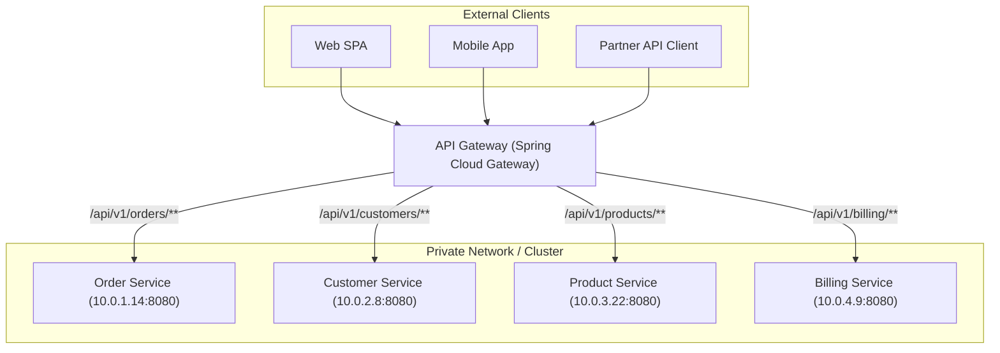
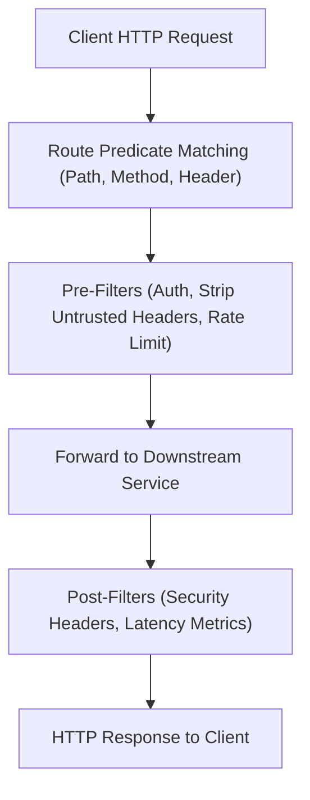
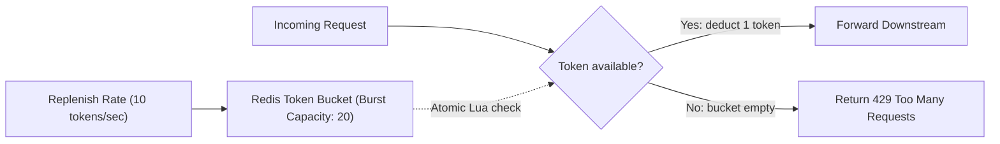
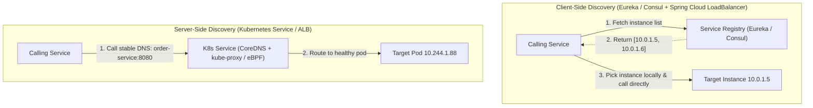

Once an application is split into dozens of services running across ephemeral containers, two practical networking questions show up immediately: how should external clients reach your backend without knowing internal hostnames or ports, and how do services find each other when instance IP addresses change every time a deployment rolls out or a pod restarts?

API Gateways and Service Discovery solve those two halves of the problem. The gateway gives external clients a single stable front door and centralizes edge concerns like TLS termination, JWT validation, and rate limiting. Service discovery keeps an up-to-date map of healthy service instances so neither the gateway nor internal callers ever hardcode IP addresses.

## The Role of an API Gateway

An API Gateway is a programmable reverse proxy placed between external callers (browsers, mobile apps, partner integrations) and your internal microservices.



In production, teams typically give the gateway five edge responsibilities:

- **Single public entry point:** External callers talk to one domain (such as `api.example.com`). Internal service topologies, ports, and private subnets stay unreachable from the public internet.
- **Routing and path rewriting:** Public paths like `/api/v1/orders/42` map cleanly onto internal endpoints like `http://order-service:8080/internal/orders/42`, letting you refactor or split backend services without breaking mobile clients.
- **Authentication offloading and token relay:** The gateway validates incoming OAuth2/OIDC tokens or sessions at the perimeter, rejects unauthenticated traffic early, and forwards verified identity context downstream.
- **Rate limiting and request shaping:** Edge rate limits protect downstream databases and third-party APIs from spikes, scraping bots, or misbehaving partner scripts.
- **Cross-cutting edge hygiene:** CORS headers, security response headers, TLS termination, request size limits, and edge access logging are configured once instead of duplicated across thirty services.

> [!WARNING]
> Keep business logic out of the API Gateway. A gateway is a shared runtime dependency in front of every request. If teams begin adding complex domain rules, database queries, or multi-service orchestration inside the gateway, it turns into a fragile bottleneck that requires coordinated deployments across every product team.

## Spring Cloud Gateway: WebFlux (Netty) vs Server MVC

Spring Cloud Gateway provides two server implementations, and choosing the right one depends on your team's concurrency model and existing middleware:

1. **Spring Cloud Gateway Server WebFlux (`spring-cloud-starter-gateway`):** The classic reactive implementation built on Project Reactor, Spring WebFlux, and Netty. A small pool of non-blocking event-loop threads handles a large number of concurrent HTTP connections with low memory overhead. The catch is that custom filters must stay strictly non-blocking; a stray JDBC call or blocking `.block()` inside a Netty event-loop thread stalls all requests sharing that thread.
2. **Spring Cloud Gateway Server MVC (`spring-cloud-starter-gateway-mvc`):** Introduced in Spring Cloud 2023.0 (Spring Boot 3.2+), this variant runs on standard Servlet containers like Tomcat or Jetty using Spring MVC `RouterFunctions`. When paired with Java 21 virtual threads (`spring.threads.virtual.enabled=true`), it handles high I/O concurrency while letting teams write plain imperative Servlet filters and reuse blocking Java libraries without adopting reactive programming.



Both variants share the same core route concepts: an **ID**, a target **URI** (either a direct URL or a discovery-backed `lb://service-name`), **Predicates** that match incoming requests, and **Filters** that inspect or transform the request on the way in and the response on the way out.

## Routing, Rate Limiting, and Authentication Offloading

### Route Configuration in YAML

Most teams define standard routes declaratively in `application.yml` so routes can be reviewed easily and updated without recompiling code. The example below uses the reactive Spring Cloud Gateway with service discovery (`lb://`), path rewriting, Redis-backed rate limiting, and OAuth2 `TokenRelay`:

```yaml
spring:
  application:
    name: api-gateway
  data:
    redis:
      host: redis.internal
      port: 6379
  security:
    oauth2:
      resourceserver:
        jwt:
          issuer-uri: https://auth.example.com/realms/storefront
  cloud:
    gateway:
      default-filters:
        # Never trust identity headers sent by external clients
        - RemoveRequestHeader=X-User-Id
        - RemoveRequestHeader=X-User-Roles
      routes:
        - id: order-service-route
          uri: lb://order-service
          predicates:
            - Path=/api/v1/orders/**
            - Method=GET,POST,PATCH
          filters:
            - RewritePath=/api/v1/orders/(?<segment>.*), /internal/orders/${segment}
            - TokenRelay=
            - name: RequestRateLimiter
              args:
                redis-rate-limiter.replenishRate: 10
                redis-rate-limiter.burstCapacity: 20
                redis-rate-limiter.requestedTokens: 1
                key-resolver: "#{@userOrIpKeyResolver}"
            - name: CircuitBreaker
              args:
                name: orderServiceBreaker
                fallbackUri: forward:/fallback/orders

        - id: public-catalog-route
          uri: lb://catalog-service
          predicates:
            - Path=/api/v1/catalog/**
            - Method=GET
          filters:
            - RewritePath=/api/v1/catalog/(?<segment>.*), /catalog/${segment}
```

A couple of details here matter in real deployments:

- `RemoveRequestHeader` in `default-filters` strips any `X-User-Id` or `X-User-Roles` headers sent by an untrusted caller before your authentication filter attaches verified values. Without this, an attacker can forge identity headers on a public route or bypass header logic.
- `TokenRelay` forwards the caller's OAuth2 access token to the downstream service when the gateway acts as an OAuth2 client (for example, in a Browser BFF flow with session cookies on the outside and Bearer JWTs on the inside).

### Authentication Offloading at the Gateway

There are two common ways to handle JWTs across a gateway and downstream services:

1. **Validate at the edge and forward the JWT:** The gateway verifies token signature, expiry, and issuer once (rejecting invalid requests immediately) and passes the Bearer token downstream so services can still check fine-grained scopes or object ownership (for instance, *"does this user own order 42?"*).
2. **Validate at the edge and attach internal identity headers:** The gateway validates the JWT, strips any external `X-User-Id` header, and injects verified headers over an internal mTLS network that external clients cannot reach directly.

In Spring Cloud Gateway (WebFlux), configuring JWT validation at the edge uses `SecurityWebFilterChain`:

```java
package com.example.gateway.security;

import org.springframework.context.annotation.Bean;
import org.springframework.context.annotation.Configuration;
import org.springframework.http.HttpMethod;
import org.springframework.security.config.Customizer;
import org.springframework.security.config.annotation.web.reactive.EnableWebFluxSecurity;
import org.springframework.security.config.web.server.ServerHttpSecurity;
import org.springframework.security.web.server.SecurityWebFilterChain;

@Configuration
@EnableWebFluxSecurity
public class GatewaySecurityConfig {

    @Bean
    public SecurityWebFilterChain securityWebFilterChain(ServerHttpSecurity http) {
        return http
                .csrf(ServerHttpSecurity.CsrfSpec::disable)
                .authorizeExchange(exchanges -> exchanges
                        .pathMatchers(HttpMethod.GET, "/api/v1/catalog/**").permitAll()
                        .pathMatchers("/actuator/health/**").permitAll()
                        .anyExchange().authenticated()
                )
                .oauth2ResourceServer(oauth2 -> oauth2.jwt(Customizer.withDefaults()))
                .build();
    }
}
```

### Distributed Rate Limiting with Redis and a Custom KeyResolver

In-memory rate limiters fail to enforce global limits as soon as you run multiple replicas of your API gateway. If you run four gateway pods with an in-memory limit of 10 requests per second, a client can send 40 requests per second across the cluster.

Spring Cloud Gateway's `RequestRateLimiter` uses Redis and a Lua script implementing the **Token Bucket** algorithm atomically across all gateway instances.



A bucket starts with up to `burstCapacity` tokens (for example, 20) and refills steadily at `replenishRate` tokens per second (for example, 10). Short bursts up to 20 requests pass smoothly, while sustained traffic above 10 requests per second receives `HTTP 429 Too Many Requests` along with `X-RateLimit-Remaining` response headers.

To decide *whose* bucket to charge, you provide a `KeyResolver` bean. Always handle missing remote addresses or proxy headers defensively:

```java
package com.example.gateway.ratelimit;

import org.springframework.cloud.gateway.filter.ratelimit.KeyResolver;
import org.springframework.context.annotation.Bean;
import org.springframework.context.annotation.Configuration;
import org.springframework.security.core.Authentication;
import reactor.core.publisher.Mono;

import java.net.InetSocketAddress;

@Configuration
public class RateLimiterConfig {

    @Bean
    public KeyResolver userOrIpKeyResolver() {
        return exchange -> exchange.getPrincipal()
                .cast(Authentication.class)
                .map(Authentication::getName)
                .switchIfEmpty(Mono.fromSupplier(() -> resolveClientIp(exchange)));
    }

    private String resolveClientIp(org.springframework.web.server.ServerWebExchange exchange) {
        String forwardedFor = exchange.getRequest().getHeaders().getFirst("X-Forwarded-For");
        if (forwardedFor != null && !forwardedFor.isBlank()) {
            return forwardedFor.split(",")[0].trim();
        }
        InetSocketAddress remoteAddress = exchange.getRequest().getRemoteAddress();
        if (remoteAddress != null && remoteAddress.getAddress() != null) {
            return remoteAddress.getAddress().getHostAddress();
        }
        return "anonymous";
    }
}
```

### Writing a Custom GlobalFilter

When behavior needs to run across every route (such as ensuring every request carries a correlation ID and recording downstream duration without dropping existing tracing headers), implement `GlobalFilter` and `Ordered`:

```java
package com.example.gateway.filter;

import org.slf4j.Logger;
import org.slf4j.LoggerFactory;
import org.springframework.cloud.gateway.filter.GatewayFilterChain;
import org.springframework.cloud.gateway.filter.GlobalFilter;
import org.springframework.core.Ordered;
import org.springframework.http.server.reactive.ServerHttpRequest;
import org.springframework.stereotype.Component;
import org.springframework.web.server.ServerWebExchange;
import reactor.core.publisher.Mono;

import java.util.UUID;

@Component
public class CorrelationAndTimingFilter implements GlobalFilter, Ordered {

    private static final Logger log = LoggerFactory.getLogger(CorrelationAndTimingFilter.class);
    private static final String CORRELATION_HEADER = "X-Correlation-Id";

    @Override
    public Mono<Void> filter(ServerWebExchange exchange, GatewayFilterChain chain) {
        long startNanos = System.nanoTime();
        String existingId = exchange.getRequest().getHeaders().getFirst(CORRELATION_HEADER);
        String correlationId = (existingId != null && !existingId.isBlank())
                ? existingId
                : UUID.randomUUID().toString();

        // Mutate the existing request so W3C traceparent and other headers remain intact
        ServerHttpRequest mutatedRequest = exchange.getRequest().mutate()
                .header(CORRELATION_HEADER, correlationId)
                .build();

        exchange.getResponse().getHeaders().set(CORRELATION_HEADER, correlationId);

        return chain.filter(exchange.mutate().request(mutatedRequest).build())
                .doFinally(signalType -> {
                    long elapsedMs = (System.nanoTime() - startNanos) / 1_000_000;
                    log.info("method={} path={} status={} durationMs={} correlationId={}",
                            mutatedRequest.getMethod(),
                            mutatedRequest.getURI().getPath(),
                            exchange.getResponse().getStatusCode(),
                            elapsedMs,
                            correlationId);
                });
    }

    @Override
    public int getOrder() {
        return Ordered.HIGHEST_PRECEDENCE + 10;
    }
}
```

Notice `exchange.getRequest().mutate()`. Always mutate the existing request rather than constructing a fresh one from scratch so W3C Distributed Tracing headers (`traceparent`, `tracestate`) and security headers survive the hop downstream.

### Routing with Spring Cloud Gateway Server MVC

If your team chooses `spring-cloud-starter-gateway-mvc` (for example, on Tomcat with Java 21 virtual threads), routes can still be defined in YAML or in Java using Spring's functional `RouterFunction`:

```java
package com.example.gateway.mvc;

import org.springframework.cloud.gateway.server.mvc.filter.BeforeFilterFunctions;
import org.springframework.cloud.gateway.server.mvc.handler.GatewayRouterFunctions;
import org.springframework.cloud.gateway.server.mvc.handler.HandlerFunctions;
import org.springframework.context.annotation.Bean;
import org.springframework.context.annotation.Configuration;
import org.springframework.web.servlet.function.RequestPredicates;
import org.springframework.web.servlet.function.RouterFunction;
import org.springframework.web.servlet.function.ServerResponse;

@Configuration
public class MvcGatewayRoutes {

    @Bean
    public RouterFunction<ServerResponse> catalogRoute() {
        return GatewayRouterFunctions.route("catalog-service-mvc")
                .route(RequestPredicates.path("/api/v1/catalog/**"), HandlerFunctions.http())
                .before(BeforeFilterFunctions.uri("http://catalog-service:8080"))
                .before(BeforeFilterFunctions.rewritePath("/api/v1/catalog/(?<segment>.*)", "/catalog/${segment}"))
                .build();
    }
}
```

## Client-Side vs Server-Side Service Discovery

In containers and cloud VMs, instance IP addresses are temporary. Autoscaling adds new instances during traffic peaks, deployments replace running containers with new IPs, and unhealthy nodes get terminated. Service discovery solves this by mapping logical service names (like `order-service`) to live network endpoints.

There are two architectural models for discovery and load balancing: **client-side** and **server-side**.



| Dimension | Client-Side Discovery (Eureka, Consul client) | Server-Side Discovery (Kubernetes Services, AWS ALB) |
|---|---|---|
| **Where load balancing runs** | Inside the caller's process (e.g., `Spring Cloud LoadBalancer`) | In platform infrastructure (`kube-proxy`, Cilium eBPF, Envoy, or cloud LB) |
| **Client library coupling** | Every service needs a discovery client library in its language | Language-agnostic; any client that resolves DNS works |
| **Network hops** | Direct from caller to target instance after local cache lookup | Handled by virtual IP packet routing or an infrastructure proxy |
| **Health checking** | Periodic heartbeats or active HTTP health checks to the registry | Platform readiness and liveness probes managed by Kubelet or LB |
| **Typical deployment fit** | VM fleets, hybrid clusters, or Spring Cloud environments without Kubernetes | Kubernetes clusters and managed container platforms |

## Netflix Eureka, HashiCorp Consul, and Kubernetes DNS

### Netflix Eureka

Eureka is a Java-based service registry designed for cloud environments where temporary network partitions happen regularly.

- **Availability over consistency (AP):** Eureka servers replicate registrations asynchronously between peer nodes without a consensus leader. Different registry nodes can temporarily hold slightly different views of running instances, so clients rely on timeouts and retries to handle stale entries.
- **Heartbeats and self-preservation:** Registered services send periodic heartbeats (every 30 seconds by default). If a Eureka server suddenly loses heartbeats from more than 15% of registered instances within a short window, it assumes a network partition rather than a mass crash and enters **Self-Preservation Mode**, pausing instance eviction until connectivity recovers.

Configuring a Spring Boot microservice to register with Eureka and discover peers via `lb://`:

```yaml
# Client-side discovery with Netflix Eureka
spring:
  application:
    name: order-service

eureka:
  client:
    service-url:
      defaultZone: http://eureka-1.internal:8761/eureka/,http://eureka-2.internal:8761/eureka/
    registry-fetch-interval-seconds: 15
  instance:
    prefer-ip-address: true
    lease-renewal-interval-in-seconds: 10
    lease-expiration-duration-in-seconds: 30
```

### HashiCorp Consul

Consul is a language-agnostic service discovery and configuration system written in Go.

- **Consistency over availability (CP):** Consul servers form a cluster using the **Raft** consensus algorithm. Reads and writes agree on a strongly consistent view of service health, which means losing a quorum of Consul servers pauses registry updates until quorum returns.
- **Health checks and DNS interface:** Unlike Eureka's heartbeat-only model, Consul agents actively probe service health endpoints (`/actuator/health`) and expose healthy instances over both an HTTP API and a built-in DNS interface (`order-service.service.consul`). Consul also includes a distributed Key-Value store and optional mTLS service mesh support.

```yaml
# Client-side discovery with HashiCorp Consul
spring:
  application:
    name: order-service
  cloud:
    consul:
      host: consul.internal
      port: 8500
      discovery:
        health-check-path: /actuator/health
        health-check-interval: 10s
        prefer-ip-address: true
```

### Kubernetes Service DNS (Server-Side Discovery)

When you deploy Spring Boot services on Kubernetes, the platform already provides service discovery, health probing, and load balancing. Running Eureka inside Kubernetes duplicates what Kubernetes already manages and adds another stateful component to operate.

With a standard Kubernetes `Service`, CoreDNS maps `order-service` to a stable virtual ClusterIP and routes traffic only to pods passing their readiness probes:

```yaml
apiVersion: v1
kind: Service
metadata:
  name: order-service
  namespace: storefront
spec:
  selector:
    app: order-service
  ports:
    - name: http
      port: 8080
      targetPort: 8080
```

Your API Gateway route then points directly to `http://order-service:8080` (or `http://order-service.storefront.svc.cluster.local:8080` across namespaces), with no Eureka client dependency needed.

> [!NOTE]
> Standard Kubernetes Services perform L4 (TCP connection-level) load balancing. For HTTP/1.1 with short-lived connections that balances fairly evenly, but for long-lived HTTP/2 or gRPC connections, a single persistent TCP socket pins traffic to one backend pod. In that case, teams either use a headless Kubernetes Service (`clusterIP: None`) with client-side gRPC load balancing, or an L7 proxy / service mesh such as Envoy or Istio.

## Common Production Pitfalls

### Eureka Self-Preservation Routing Across a Partition

If a network partition separates two availability zones, Eureka's self-preservation mode intentionally keeps unreachable instances in the registry rather than wiping them out. If upstream callers do not configure tight connect timeouts and circuit breakers, client-side load balancers will continue sending a fraction of live traffic to unreachable IPs across the broken link, tying up caller threads until timeouts expire. Self-preservation works properly only when paired with fast client-side failure handling and zone-aware load balancing.

### Losing Distributed Trace Context in Custom Gateway Filters

A subtle bug occurs when a gateway authentication or logging filter builds a new HTTP request object instead of mutating the incoming one, accidentally dropping W3C `traceparent` or B3 headers. The gateway logs a 500 error, the downstream service logs a database timeout, and nothing links the two spans in OpenTelemetry or Jaeger. Always verify end-to-end trace propagation in integration tests whenever you add a custom gateway filter.

### Trusting Spoofed Identity Headers

If your gateway reads `X-User-Id` from an authenticated JWT and forwards it downstream, make sure external requests cannot pass their own `X-User-Id` header past the gateway, and make sure downstream services cannot be reached directly from outside the private network.

## Interview Questions

### How does Spring Cloud Gateway (WebFlux) differ from Spring Cloud Gateway Server MVC?

Spring Cloud Gateway Server WebFlux runs on Project Reactor and Netty's non-blocking event loop. A small number of threads can hold tens of thousands of open connections with low heap overhead, provided none of your filters execute blocking I/O. Spring Cloud Gateway Server MVC runs on standard Servlet containers (Tomcat, Jetty) using imperative Spring MVC routing. It integrates smoothly with existing Servlet libraries and pairs well with Java 21 virtual threads when teams want high concurrency without maintaining reactive code.

### What happens internally when Spring Cloud Gateway routes to a `lb://order-service` URI?

The `lb://` scheme triggers `ReactiveLoadBalancerClientFilter` (in WebFlux) or the MVC load-balancer filter. Instead of opening a socket to a host named `order-service`, the filter queries the configured `DiscoveryClient` (backed by Eureka, Consul, or Kubernetes) for healthy instances registered under `order-service`, chooses one instance using `Spring Cloud LoadBalancer` (typically Round Robin or weighted/zone-aware selection), and rewrites the URI to the concrete `http://host:port` before sending the request.

### Why do teams sometimes use the Backend-for-Frontend (BFF) pattern instead of one shared API Gateway?

Different client channels have conflicting needs. A mobile app on a slow cellular link wants compact payloads and fewer round trips, while a web dashboard wants richer filtering and different cookie/session semantics, and external B2B partners use API keys or OAuth2 client credentials with strict rate tiers. Putting every client's transformations into a single shared gateway creates coupling between unrelated frontend teams. With the BFF pattern, each client channel owns a focused edge service (such as `web-bff` and `mobile-bff`) behind a thin infrastructure ingress.

### How does Eureka's consistency model differ from Consul's, and how does that affect Java clients?

Eureka favors Availability and Partition Tolerance (AP) with asynchronous peer-to-peer replication. Registry updates propagate quickly without waiting for quorum, so clients might briefly receive an instance IP that just shut down. Consul favors Consistency and Partition Tolerance (CP) using Raft consensus, which keeps health views strongly consistent at the cost of requiring a healthy quorum of server nodes for writes. Because even a consistent registry cannot prevent a pod from crashing milliseconds after a lookup, Java callers still need short connect timeouts, safe retries, and circuit breakers regardless of which registry they choose.
