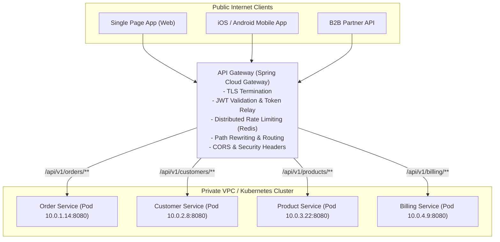
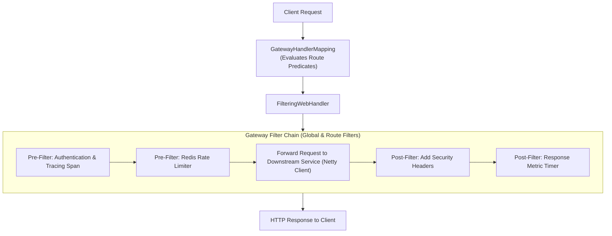
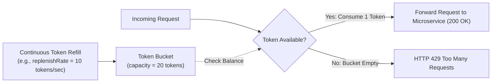
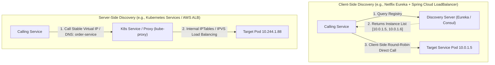

When you transition from a single monolithic application to an ecosystem of 40 microservices running across 150 ephemeral Kubernetes pods, a fundamental question emerges: **How do external clients actually reach your services?**

If your mobile app or frontend has to know the direct IP addresses of 40 separate backends, you have created an unmaintainable operational catastrophe. Every IP change breaks mobile clients. Every backend change forces cross-origin CORS reconfiguration. Every microservice must duplicate authentication tokens, rate limiting algorithms, and SSL certificates. And your entire internal network is exposed directly to the public internet.

To solve this, modern distributed architectures rely on two cornerstone patterns: the **API Gateway** (the unified front door) and **Service Discovery** (the dynamic phonebook).

In this guide, we will dissect the non-blocking architecture of Spring Cloud Gateway, implement distributed Redis rate limiting, demystify client-side versus server-side discovery, and explore how cloud-native Kubernetes DNS compares to Netflix Eureka and HashiCorp Consul.

---

## The Role of the API Gateway

An API Gateway sits as a reverse proxy between external clients (web browsers, mobile applications, third-party partners) and your internal microservices fleet.



### Core Responsibilities of an Enterprise Gateway
1. **Single Public Entry Point**: External clients interact with a single stable domain (`api.company.com`). Internal microservice topologies and private IP subnets remain shielded behind firewalls.
2. **Authentication Offloading & Token Relay**: The gateway validates incoming JWTs or OAuth2 bearer tokens once at the perimeter. It then relays sanitized user identity headers (`X-User-Id`, `X-User-Roles`) to downstream services over internal mTLS, relieving individual services from repeatedly validating tokens.
3. **Dynamic Routing & Path Rewriting**: Routes public URLs like `/api/v1/checkout` to internal endpoints like `http://orders-service:8080/internal/checkout`.
4. **Resilience & Rate Limiting**: Protects downstream services from denial-of-service (DDoS) attacks, scraping bots, and traffic spikes using algorithms like the Token Bucket.
5. **Backend-for-Frontend (BFF) Pattern**: Different clients often require different data representations. A gateway can expose specialized endpoints tailored for mobile networks (compact payloads) versus desktop web (rich payloads).

---

## Spring Cloud Gateway: Non-Blocking Architecture

Older gateway frameworks like Netflix Zuul 1 were built on the traditional Java Servlet API (`javax.servlet`), where each incoming HTTP connection consumed a dedicated operating system thread. Under heavy traffic or slow downstream responses, worker thread pools quickly exhausted.

**Spring Cloud Gateway** is built on **Project Reactor** and **Spring WebFlux**, running on top of the high-performance **Netty** non-blocking event loop. A handful of event-loop worker threads can handle tens of thousands of concurrent connections with minimal memory overhead.



### Route Anatomy: Predicates and Filters
Every route in Spring Cloud Gateway consists of:
- **ID**: A unique identifier.
- **URI**: The target destination (e.g., `lb://order-service` or `https://httpbin.org`).
- **Predicates**: Boolean conditions evaluated against the HTTP request (Path, Method, Headers, Query parameters).
- **Filters**: Interceptors that inspect or modify the request before forwarding, or modify the response before returning.

### Declarative Java Route Configuration
```java
package com.example.gateway.config;

import org.springframework.cloud.gateway.route.RouteLocator;
import org.springframework.cloud.gateway.route.builder.RouteLocatorBuilder;
import org.springframework.context.annotation.Bean;
import org.springframework.context.annotation.Configuration;
import org.springframework.http.HttpMethod;

@Configuration
public class GatewayRouteConfig {

    @Bean
    public RouteLocator customRoutes(RouteLocatorBuilder builder) {
        return builder.routes()
            // 1. Order Service Route with Path Rewriting and Header Injection
            .route("order-service-route", r -> r
                .path("/api/v1/orders/**")
                .and().method(HttpMethod.GET, HttpMethod.POST)
                .filters(f -> f
                    .rewritePath("/api/v1/orders/(?<segment>.*)", "/internal/orders/${segment}")
                    .addRequestHeader("X-Gateway-Source", "Edge-Router-US")
                    .circuitBreaker(c -> c.setName("orderCircuitBreaker").setFallbackUri("forward:/fallback/orders"))
                )
                .uri("lb://order-service") // Dynamic lookup via Service Discovery!
            )
            // 2. Public Catalog Route
            .route("catalog-service-route", r -> r
                .path("/api/v1/catalog/**")
                .uri("lb://catalog-service")
            )
            .build();
    }
}
```

---

## Distributed Rate Limiting with Redis

Without rate limiting, a single runaway batch script or distributed scraper can saturate database connection pools across all downstream services.

Spring Cloud Gateway integrates out-of-the-box with **Redis** using the **Token Bucket Algorithm**.



### How the Token Bucket Works
- A bucket has a maximum capacity (e.g., 20 tokens).
- Tokens are added at a constant replenish rate (e.g., 10 tokens per second).
- Each incoming request consumes 1 token.
- If tokens are available, the request proceeds. If the bucket is empty, the gateway immediately returns `HTTP 429 Too Many Requests`.
- This accommodates bursty traffic up to the bucket capacity while guaranteeing an average rate ceiling.

### Configuring the Redis Rate Limiter in Spring Boot
Define a `KeyResolver` bean to identify the client (e.g., by authenticated user ID or remote IP address):

```java
package com.example.gateway.ratelimit;

import org.springframework.cloud.gateway.filter.ratelimit.KeyResolver;
import org.springframework.cloud.gateway.filter.ratelimit.RedisRateLimiter;
import org.springframework.context.annotation.Bean;
import org.springframework.context.annotation.Configuration;
import org.springframework.context.annotation.Primary;
import reactor.core.publisher.Mono;

@Configuration
public class RateLimiterConfig {

    // Resolves rate-limit key based on authenticated user or fallback IP
    @Bean
    @Primary
    public KeyResolver userKeyResolver() {
        return exchange -> {
            String userHeader = exchange.getRequest().getHeaders().getFirst("X-User-Id");
            if (userHeader != null && !userHeader.isBlank()) {
                return Mono.just(userHeader);
            }
            // Fallback to client remote address
            return Mono.just(exchange.getRequest().getRemoteAddress().getAddress().getHostAddress());
        };
    }

    @Bean
    public RedisRateLimiter redisRateLimiter() {
        // replenishRate: 10 tokens/sec, burstCapacity: 20 tokens
        return new RedisRateLimiter(10, 20);
    }
}
```

Attach it to the route in `application.yml`:
```yaml
spring:
  cloud:
    gateway:
      routes:
        - id: payment-service-route
          uri: lb://payment-service
          predicates:
            - Path=/api/v1/payments/**
          filters:
            - name: RequestRateLimiter
              args:
                redis-rate-limiter.replenishRate: 10
                redis-rate-limiter.burstCapacity: 20
                key-resolver: "#{@userKeyResolver}"
```

---

## Service Discovery: Solving the Ephemeral IP Problem

In a dynamic containerized environment (Kubernetes, AWS ECS, Docker Swarm), microservice instances are constantly spinning up, crashing, scaling out, and terminating. A pod might have IP `10.0.2.45` at 10:00 AM and terminate at 10:15 AM, replaced by a new pod with IP `10.0.3.112`.

Hardcoding IP addresses in configuration files is impossible. Services require a dynamic registry.

### Client-Side vs Server-Side Service Discovery



| Dimension | Client-Side Discovery (Eureka / Consul) | Server-Side Discovery (Kubernetes Services) |
|---|---|---|
| **Where Load Balancing Occurs** | Inside the client's Java process (`Spring Cloud LoadBalancer`). | At the network/infrastructure layer (`kube-proxy`, AWS ALB). |
| **Language Dependency** | Heavy client library required (Java Spring Cloud). Difficult for polyglot systems. | Completely language-agnostic. Any language supporting standard DNS works. |
| **Network Hops** | Single hop directly from client to target instance. | Extra hop through load balancer/proxy (or iptables packet rewriting). |
| **Failure Detection** | Heartbeats sent periodically to the Eureka server. | Kubernetes liveness and readiness probes directly managed by Kubelet. |
| **Industry Adoption Today** | Popular in on-premise VM deployments. | **The de facto industry standard** in containerized cloud platforms. |

---

## Service Discovery Implementations: Eureka vs Consul vs Kubernetes

### Netflix Eureka
- Designed for AWS cloud resiliency where nodes fail constantly.
- **AP in CAP Theorem**: Prioritizes Availability over strong Consistency. Registry replicas asynchronously synchronize.
- **Self-Preservation Mode**: If Eureka suddenly stops receiving heartbeats from more than 15% of registered instances (usually caused by a transient network partition rather than all instances dying), Eureka refuses to evict those instances from its registry, preventing a catastrophic cascade of false deletions.

### HashiCorp Consul
- **CP in CAP Theorem**: Built on the Raft consensus algorithm. Prioritizes strong consistency.
- Provides built-in Distributed Key-Value Configuration and Service Mesh capabilities (Consul Connect with Envoy sidecars).
- Language-agnostic with native HTTP REST and DNS interfaces (`order-service.service.consul`).

### Native Kubernetes DNS (CoreDNS)
In modern Kubernetes, you rarely need Eureka. When you deploy a microservice:
1. You define a Kubernetes `Deployment` with 3 replica pods.
2. You define a Kubernetes `Service` named `order-service`.
3. Kubernetes assigns a stable virtual ClusterIP and automatically creates a DNS record: `order-service.default.svc.cluster.local`.
4. Your Spring Boot gateway simply routes to `http://order-service:8080`. CoreDNS resolves the name, and Linux kernel `iptables` or IPVS routes packets directly to healthy pods.

---

## Architectural Traps and Real-World Outages

### The "Eureka Self-Preservation" Routing Cascade
A financial platform deployed Eureka across two AWS Availability Zones (AZ-East-1a and AZ-East-1b). A brief fiber optic cut between the AZs caused AZ-1a to lose connectivity with instances in AZ-1b. 

Eureka detected a sudden drop in heartbeats and entered Self-Preservation Mode, locking its registry. However, client-side load balancers continued trying to send 50% of real user transactions across the severed AZ link. Because the clients had no circuit breakers or aggressive connection timeouts, client worker threads hung waiting for TCP acknowledgments, bringing down the entire customer payment portal.

### The Missing Distributed Tracing Header Bug
A team deployed Spring Cloud Gateway and configured an authentication pre-filter that validated incoming JWTs. However, the custom filter created a new HTTP request object and forgot to forward the W3C Distributed Tracing headers (`traceparent`, `tracestate` / OpenTelemetry `X-B3-TraceId`). 

When an outage occurred in a downstream shipping service, the site reliability engineers discovered that all distributed traces terminated at the gateway! It was impossible to correlate gateway errors with downstream database exceptions, turning a 5-minute root cause diagnosis into a 4-hour forensic nightmare.

---

## Senior Interview Questions

### Question 1: What is the difference between Netflix Zuul 1 and Spring Cloud Gateway in terms of their concurrency and threading models?
**Answer:**  
- **Netflix Zuul 1**: Uses a **one-thread-per-connection** synchronous blocking model based on the standard Servlet 2.5/3.0 API. When an incoming request arrives, a Tomcat worker thread is allocated and blocked until the downstream microservice responds. Under slow downstream network conditions, the thread pool is quickly exhausted, causing thread starvation and high memory footprint.
- **Spring Cloud Gateway**: Uses an **asynchronous, non-blocking event-driven** model built on Project Reactor and Netty. Instead of allocating a thread per request, a small number of event-loop threads (typically matching the number of CPU cores) handle thousands of concurrent TCP sockets. When a downstream call is waiting for I/O, the event-loop thread is freed to handle other incoming requests, achieving vastly superior throughput and resilience under high concurrency.

### Question 2: How does Spring Cloud Gateway integrate with Service Discovery using the `lb://` URI scheme?
**Answer:**  
When a route URI is prefixed with `lb://` (for example, `lb://order-service`), Spring Cloud Gateway invokes a `ReactiveLoadBalancerClientFilter`. 

Instead of treating `order-service` as an IP address or DNS hostname:
1. The load balancer filter intercepts the request and extracts the service ID (`order-service`).
2. It queries the configured `ReactiveDiscoveryClient` (backed by Eureka, Consul, or Kubernetes) to fetch the list of healthy running instances.
3. It passes the instance list to a load balancing algorithm (such as Round Robin or Weighted Random from `Spring Cloud LoadBalancer`).
4. It rewrites the `lb://` URI into the physical IP and port of the selected instance (e.g., `http://10.0.4.15:8080`) before dispatching the Netty client request.

### Question 3: In a microservices architecture, what is the "Backend-for-Frontend" (BFF) pattern, and why is it preferred over a single generic API Gateway?
**Answer:**  
A single generic API Gateway attempts to serve all client types (desktop browsers, mobile native apps, smart TVs, external partners) with the exact same API endpoints. This creates severe friction: mobile apps on constrained 4G networks need small, tailored payloads and bundled requests, while desktop web applications need rich, expansive data models.

The **Backend-for-Frontend (BFF)** pattern introduces dedicated, specialized gateways for each user interface channel:
- `Web-BFF Gateway`: Optimized for high-bandwidth browsers with rich aggregation.
- `Mobile-BFF Gateway`: Aggregates multiple downstream calls into a single compressed JSON response and optimizes image dimensions.
- `Public-Partner Gateway`: Enforces strict third-party OAuth2 scopes and aggressive tier-based rate limiting.
Each frontend team owns their corresponding BFF gateway, allowing rapid UI iteration without breaking other clients.

### Question 4: How does Eureka's peer-to-peer replication achieve High Availability, and what is the trade-off regarding consistency?
**Answer:**  
Eureka servers operate in a peer-to-peer cluster where every node replicates its registry to all other known peers. 
When a microservice instance registers, renews its heartbeat, or cancels its registration with Eureka Node 1, Node 1 immediately processes the write locally and asynchronously propagates the change to Node 2 and Node 3.

The trade-off is governed by the CAP theorem: Eureka chooses **Availability and Partition Tolerance (AP)** over Consistency. Because replication is asynchronous without a distributed consensus leader (unlike Raft or ZooKeeper), different Eureka nodes can have temporarily conflicting views of healthy instances. A client querying Node 1 might receive an instance that Node 2 has already marked as dying. Microservices using Eureka must tolerate eventual consistency by combining discovery with client-side retries and circuit breakers.
