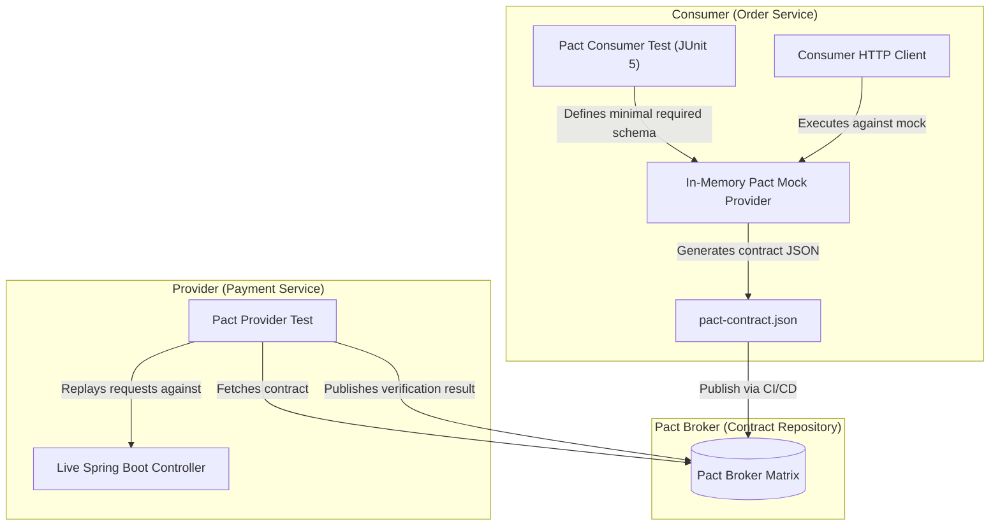
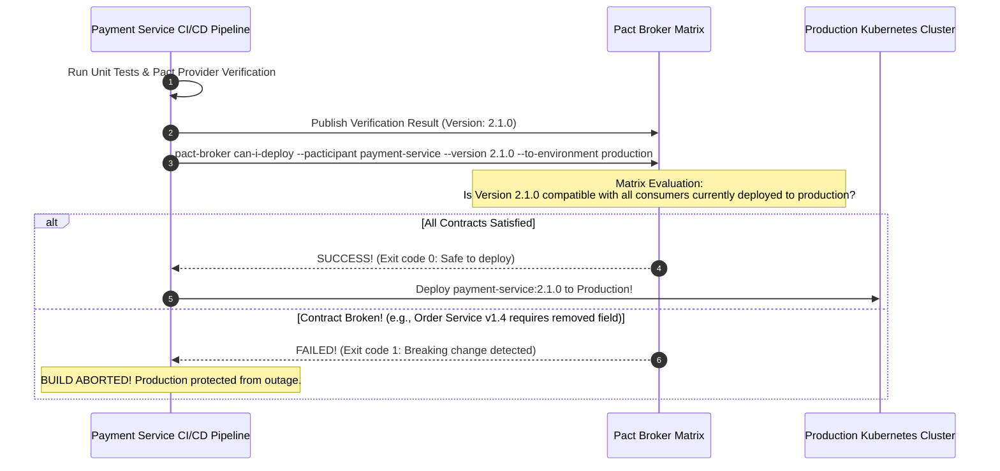

# Contract Testing with Pact

In microservice architectures, verifying that services communicate correctly without breaking each other is one of the hardest engineering challenges:

- **Unit Tests are Too Isolated:** They test business logic against hardcoded mocks. If the provider service renames a JSON response field, your unit tests still pass with flying colors while production crashes.
- **End-to-End (E2E) Tests are Brittle and Expensive:** Spinning up 25 microservices, databases, and message brokers in a staging environment is slow, flaky, and expensive. E2E tests break frequently due to network timeouts, test data pollution, and deployment race conditions. When an E2E test fails, identifying which service caused the failure is painful.

The industry-standard solution to this dilemma is **Consumer-Driven Contract Testing (CDCT)**.

By formalizing the API agreement using **Pact**, teams can verify HTTP and messaging contracts in complete isolation without spinning up real environments, while mathematically guaranteeing that services remain compatible before deploying to production.

---

## What is Consumer-Driven Contract Testing?

In traditional API development, the Provider (the backend team) writes an API and publishes a Swagger/OpenAPI specification telling Consumers (web, mobile, or other microservices) what to expect.

**Consumer-Driven Contract Testing inverts this dynamic**:



### The Three Phases of CDCT:
1. **The Consumer Dictates the Contract:** The consumer team writes a test that specifies: *"This is the exact request I will send, and this is the minimum JSON structure I require to function."* Executing this test produces an immutable **Pact file** (a JSON specification).
2. **Publish to the Pact Broker:** The consumer's CI pipeline publishes the pact file to a centralized **Pact Broker**.
3. **The Provider Verifies Against Live Code:** The provider's CI pipeline fetches the consumer's pact from the broker and replays the requests against its actual Spring Boot `@RestController`. If the controller's response conforms to the pact, the contract is verified.

---

## Consumer Testing in Java: Generating the Contract

Let's build a consumer test for an `OrderService` calling a downstream `PaymentService`.

### Maven Dependencies

```xml
<dependency>
    <groupId>au.com.dius.pact.consumer</groupId>
    <artifactId>junit5</artifactId>
    <version>4.6.8</version>
    <scope>test</scope>
</dependency>
```

### Writing the Consumer Test with JUnit 5 and Pact DSL

```java
package com.javahub.contract.consumer;

import au.com.dius.pact.consumer.MockServer;
import au.com.dius.pact.consumer.dsl.DslPart;
import au.com.dius.pact.consumer.dsl.LambdaDsl;
import au.com.dius.pact.consumer.dsl.PactDslWithProvider;
import au.com.dius.pact.consumer.junit5.PactConsumerTestExt;
import au.com.dius.pact.consumer.junit5.PactTestFor;
import au.com.dius.pact.core.model.RequestResponsePact;
import au.com.dius.pact.core.model.annotations.Pact;
import org.junit.jupiter.api.Test;
import org.junit.jupiter.api.extension.ExtendWith;
import org.springframework.web.client.RestClient;

import java.util.Map;

import static org.assertj.core.api.Assertions.assertThat;

@ExtendWith(PactConsumerTestExt.class)
@PactTestFor(providerName = "payment-service")
public class PaymentServiceClientContractTest {

    // 1. Define the Pact Contract
    @Pact(consumer = "order-service")
    public RequestResponsePact createPaymentPact(PactDslWithProvider builder) {
        // Define dynamic matching rules using LambdaDsl (avoids brittle hardcoded values)
        DslPart responseBody = LambdaDsl.newJsonBody(body -> body
                .uuid("paymentId", "8c1995cb-6447-4e78-8386-d2ef5628fb68")
                .stringType("status", "SUCCESS")
                .numberType("amount", 99.50)
                .stringType("currency", "USD")
                .iso8601DateTime("processedAt")
        ).build();

        return builder
                .given("Order 101 exists and account has sufficient funds")
                .uponReceiving("A request to authorize a payment for Order 101")
                    .path("/api/v1/payments")
                    .method("POST")
                    .headers(Map.of("Content-Type", "application/json"))
                    .body("{\"orderId\": \"ord-101\", \"amount\": 99.50, \"currency\": \"USD\"}")
                .willRespondWith()
                    .status(200)
                    .headers(Map.of("Content-Type", "application/json"))
                    .body(responseBody)
                .toPact();
    }

    // 2. Execute Consumer Code Against the In-Memory Mock Server
    @Test
    @PactTestFor(pactMethod = "createPaymentPact")
    public void testAuthorizePayment(MockServer mockServer) {
        // Point the client to the ephemeral mock server port
        RestClient restClient = RestClient.builder()
                .baseUrl(mockServer.getUrl())
                .build();

        PaymentResponse response = restClient.post()
                .uri("/api/v1/payments")
                .header("Content-Type", "application/json")
                .body(new PaymentRequest("ord-101", 99.50, "USD"))
                .retrieve()
                .body(PaymentResponse.class);

        assertThat(response).isNotNull();
        assertThat(response.status()).isEqualTo("SUCCESS");
        assertThat(response.amount()).isEqualTo(99.50);
    }

    public record PaymentRequest(String orderId, double amount, String currency) {}
    public record PaymentResponse(String paymentId, String status, double amount, String currency, String processedAt) {}
}
```

### Notice the Matching Rules (`LambdaDsl`):
Never test exact hardcoded string values in response contracts:
- Use `.uuid("paymentId", ...)`: Verifies the provider returns any valid UUID format.
- Use `.stringType("status", "SUCCESS")`: Verifies the provider returns a string, using `"SUCCESS"` as the example mock value.
- Use `.iso8601DateTime("processedAt")`: Verifies valid ISO-8601 timestamps.

This prevents consumer tests from failing when dynamic IDs or real dates are generated.

---

## Provider Verification in Spring Boot: Testing Against Real Code

On the Provider side (`PaymentService`), we do not spin up wiremock or write complex test stubs. We run a JUnit 5 test that points Pact directly at our actual Spring Boot application context.

### Maven Dependencies

```xml
<dependency>
    <groupId>au.com.dius.pact.provider</groupId>
    <artifactId>junit5spring</artifactId>
    <version>4.6.8</version>
    <scope>test</scope>
</dependency>
```

### The Provider Verification Test

```java
package com.javahub.contract.provider;

import au.com.dius.pact.provider.junit5.PactVerificationContext;
import au.com.dius.pact.provider.junit5.PactVerificationInvocationContextProvider;
import au.com.dius.pact.provider.junitsupport.Provider;
import au.com.dius.pact.provider.junitsupport.State;
import au.com.dius.pact.provider.junitsupport.loader.PactBroker;
import org.junit.jupiter.api.BeforeEach;
import org.junit.jupiter.api.TestTemplate;
import org.junit.jupiter.api.extension.ExtendWith;
import org.springframework.boot.test.context.SpringBootTest;
import org.springframework.boot.test.web.server.LocalServerPort;
import org.springframework.test.context.bean.override.mockito.MockitoBean;

import static org.mockito.ArgumentMatchers.any;
import static org.mockito.Mockito.when;

@SpringBootTest(webEnvironment = SpringBootTest.WebEnvironment.RANDOM_PORT)
@Provider("payment-service")
@PactBroker(url = "https://pact-broker.internal.company.com")
public class PaymentProviderVerificationTest {

    @LocalServerPort
    private int port;

    @MockitoBean
    private PaymentRepository paymentRepository;

    @BeforeEach
    public void setup(PactVerificationContext context) {
        // Tells Pact where to send the replayed HTTP requests
        context.setTarget(new au.com.dius.pact.provider.junit5.HttpTestTarget("localhost", port));
    }

    @TestTemplate
    @ExtendWith(PactVerificationInvocationContextProvider.class)
    public void pactVerificationTestTemplate(PactVerificationContext context) {
        context.verifyInteraction();
    }

    // Handles the provider state defined by the consumer
    @State("Order 101 exists and account has sufficient funds")
    public void setupOrder101State() {
        // Prepare mock or test database state before Pact fires the replayed request
        when(paymentRepository.save(any())).thenReturn(new PaymentRecord(
                "8c1995cb-6447-4e78-8386-d2ef5628fb68",
                "SUCCESS",
                99.50,
                "USD"
        ));
    }
}
```

### How Provider Verification Works:
1. Pact queries the **Pact Broker** for all active consumer contracts targeting `payment-service`.
2. For each interaction, Pact checks the `@State` label (`"Order 101 exists and account has sufficient funds"`) and executes the corresponding `@State` setup method.
3. Pact sends the HTTP request described in the contract to `localhost:RANDOM_PORT`.
4. It compares the actual response returned by Spring Boot against the expectations defined in the contract.
5. If the controller returns a matching response, the test passes and the verification result is published back to the Pact Broker.

---

## The Pact Broker and the `can-i-deploy` Gatekeeper

In a continuous deployment pipeline, how do you prevent an engineer from releasing a breaking change to production?

Enter the **Pact Matrix** and the **`can-i-deploy` CLI**:



The command:
```bash
pact-broker can-i-deploy \
  --pacticipant payment-service \
  --version 2.1.0 \
  --to-environment production \
  --broker-base-url https://pact-broker.company.com
```

evaluates the exact matrix of consumer versions running in production. If `order-service:1.4.0` in production requires a field that `payment-service:2.1.0` deleted, the build halts immediately. The breaking change never reaches production.

---

## Senior Engineer Interview Crucible

### How does Consumer-Driven Contract Testing differ fundamentally from OpenAPI/Swagger schema validation?

While both approaches describe API interfaces, they solve fundamentally different problems:

- **OpenAPI/Swagger (Provider-Driven):** Describes **everything the provider is capable of doing**. It lists all available endpoints, parameters, and response fields. However, it provides zero visibility into **what consumers are actually using**. A provider team cannot tell whether deleting a field from a 40-field OpenAPI specification will break three microservices or none.
- **Consumer-Driven Contract Testing (Pact):** Captures **the precise subset of features that specific consumers depend on**. 

If an OpenAPI specification defines 40 fields, but the consumer's Pact contract specifies only 3 fields (`id`, `status`, `amount`), the provider is completely free to modify, rename, or delete the other 37 fields without breaking verification. CDCT provides exact consumer dependency tracking, eliminating fear during backend refactoring.

---

### Why is testing against mocked Provider services in E2E suites insufficient, and how does Pact ensure mocks never drift from reality?

Testing against static mocks (like WireMock or Mockito) in an integration test only tests your code against **your assumptions of what the provider looks like**. 

Over time, this causes **Mock Drift**:
- The provider team changes a field name or response structure in their repository.
- Your integration tests continue passing because they test against your outdated, hardcoded mock.
- The failure is only discovered when the two services are deployed and call each other in staging or production.

**How Pact Eliminates Mock Drift:**
Pact turns the mock into a shared, verifiable contract artifact. The mock server used by the consumer is generated from the exact same contract file that the provider subsequently verifies against its live `@RestController` in its own CI pipeline. If the provider alters its response structure, the provider's build fails immediately during contract verification before deployment.

---

### Walk through the purpose of the `@State` annotation in Pact Provider tests. How do you prepare state for multiple distinct consumer scenarios?

In HTTP APIs, the response returned often depends on pre-existing database state (e.g., an order exists vs does not exist, an account is locked, a balance is sufficient).

The consumer declares these prerequisite conditions in the contract using the `.given("Order 101 exists")` clause.

During provider verification:
1. Pact inspects the incoming interaction's `given` clause.
2. It looks for a matching `@State("Order 101 exists")` method in the provider test class and executes it **before** firing the HTTP request.
3. The `@State` method sets up the local test environment—inserting test rows into an H2/Testcontainers database or configuring Mockito mocks—to ensure the controller has the exact context required to return the expected response.

This allows the provider to test dozens of different edge cases and error responses deterministically in complete isolation.

---

### Explain how the `can-i-deploy` tool prevents breaking changes from reaching production in an automated CI/CD pipeline.

The `pact-broker can-i-deploy` CLI tool is an automated release gate that queries the Pact Broker's **Compatibility Matrix**.

The Pact Broker tracks not only contract definitions and verification results, but also **which versions of each microservice are currently running in each environment** (e.g., `production`, `staging`).

Before a CI/CD pipeline deploys a new artifact (e.g., `order-service:3.2.0`), it calls `can-i-deploy`. The broker checks:
1. Which version of `payment-service` is currently live in production (e.g., `payment-service:1.9.0`).
2. Does a verified contract exist proving that `order-service:3.2.0` is compatible with `payment-service:1.9.0`?

If the verification succeeded, the command returns exit code `0`, and the deployment proceeds. If no verification exists or the contract failed, it returns exit code `1`, immediately aborting the deployment and preventing breaking changes from reaching production users.

