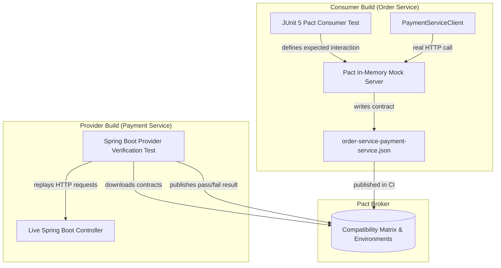
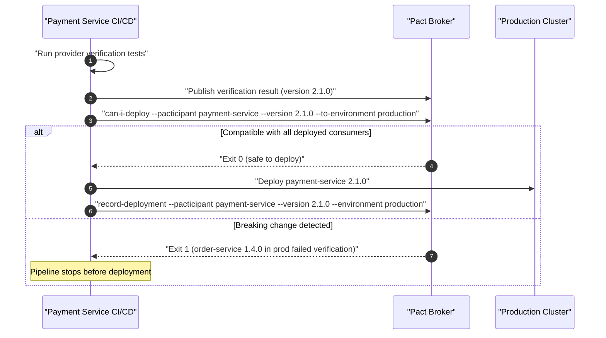

When services communicate over HTTP or Kafka, two classic testing layers leave a painful gap between them:

- **Unit tests with handwritten mocks are too isolated:** Your `OrderService` tests pass against a hardcoded WireMock stub or Mockito return value. Months later, `PaymentService` renames `paymentId` to `transactionId`. Your unit tests stay green while production deserialization breaks.
- **Full end-to-end (E2E) staging suites are slow and flaky:** Keeping 20 microservices, their databases, and message brokers deployed and synchronized in a shared test environment is expensive. Tests fail because another team is mid-deploy, test fixtures collide, or an unrelated service timed out. When a build turns red, engineers spend hours figuring out which service broke the contract.

**Consumer-Driven Contract Testing (CDCT)** with **Pact** closes that gap. Each service tests in isolation in seconds, yet the mock used by the consumer and the verification run by the provider come from the exact same contract file.

---

## Consumer-Driven Contract Testing Principles

In a provider-driven workflow, the backend team publishes an OpenAPI spec describing every endpoint and field the API exposes. That tells you what the provider *offers*, not what callers *actually use*. If an endpoint returns 35 JSON fields, the provider team has no reliable way to know whether removing `legacyTaxCode` will break three services or zero.

Consumer-driven contract testing flips the direction of feedback:

1. **The consumer defines only what it depends on:** In a JUnit 5 test, the consumer specifies the request it sends and the minimal response shape it needs (for instance, just 4 fields out of 35). Pact spins up a local in-memory mock server, runs the consumer's real HTTP client against it, and writes the recorded interactions into a JSON **Pact file**.
2. **The contract is published to a Pact Broker:** The consumer's CI pipeline uploads that Pact file tagged with its Git SHA and branch.
3. **The provider verifies the contract against real code:** The provider's CI pipeline downloads every active consumer contract from the Pact Broker and replays each request against its real Spring Boot application. Verification results are published back to the Broker.



> [!IMPORTANT]
> Be realistic about what Pact verifies. Pact confirms that the provider satisfies the **specific request/response shapes, status codes, headers, and matching rules** recorded by its consumers. It does **not** verify internal business logic, concurrency bugs, database query accuracy, performance, or code paths that no consumer wrote a contract for. Keep unit tests, focused integration tests (with Testcontainers), and a thin smoke-test suite in your testing pyramid.

---

## Writing Consumer Tests with Pact Java (JUnit 5)

A good consumer test exercises your **real HTTP client class** (including Jackson serialization, headers, path building, and error mapping), not a throwaway `RestClient` written inside the test method. Otherwise, you only verify your test code rather than the code shipped to production.

### Consumer Maven Dependency

```xml
<dependency>
    <groupId>au.com.dius.pact.consumer</groupId>
    <artifactId>junit5</artifactId>
    <version>4.6.16</version>
    <scope>test</scope>
</dependency>
```

### Defining the Contract with `LambdaDsl` Matchers

Hardcoding exact values in response assertions creates brittle contracts because the provider will generate a new UUID and timestamp on every verification run. Use Pact's `LambdaDsl` type and format matchers (`uuid`, `stringType`, `decimalType`, `iso8601DateTime`, `eachLike`) so the mock returns deterministic example values to the consumer while the provider only has to match the type or format:

```java
package com.example.order.client;

import au.com.dius.pact.consumer.MockServer;
import au.com.dius.pact.consumer.dsl.DslPart;
import au.com.dius.pact.consumer.dsl.LambdaDsl;
import au.com.dius.pact.consumer.dsl.PactDslWithProvider;
import au.com.dius.pact.consumer.junit5.PactConsumerTestExt;
import au.com.dius.pact.consumer.junit5.PactTestFor;
import au.com.dius.pact.core.model.PactSpecVersion;
import au.com.dius.pact.core.model.RequestResponsePact;
import au.com.dius.pact.core.model.annotations.Pact;
import org.junit.jupiter.api.Test;
import org.junit.jupiter.api.extension.ExtendWith;
import org.springframework.web.client.RestClient;

import java.math.BigDecimal;
import java.util.Map;

import static org.assertj.core.api.Assertions.assertThat;

@ExtendWith(PactConsumerTestExt.class)
@PactTestFor(providerName = "payment-service", pactVersion = PactSpecVersion.V3)
class PaymentServiceClientContractTest {

    @Pact(consumer = "order-service")
    RequestResponsePact authorizePaymentPact(PactDslWithProvider builder) {
        DslPart requestBody = LambdaDsl.newJsonBody(body -> body
                .stringType("orderId", "ord-101")
                .decimalType("amount", new BigDecimal("99.50"))
                .stringType("currency", "USD")
        ).build();

        DslPart responseBody = LambdaDsl.newJsonBody(body -> body
                .uuid("paymentId", "8c1995cb-6447-4e78-8386-d2ef5628fb68")
                .stringMatcher("status", "AUTHORIZED|DECLINED", "AUTHORIZED")
                .decimalType("amount", new BigDecimal("99.50"))
                .stringType("currency", "USD")
                .iso8601DateTime("processedAt")
        ).build();

        return builder
                .given("Account for order ord-101 has sufficient funds")
                .uponReceiving("a valid payment authorization request")
                    .path("/api/v1/payments")
                    .method("POST")
                    .headers(Map.of("Content-Type", "application/json"))
                    .body(requestBody)
                .willRespondWith()
                    .status(201)
                    .headers(Map.of("Content-Type", "application/json"))
                    .body(responseBody)
                .toPact();
    }

    @Test
    @PactTestFor(pactMethod = "authorizePaymentPact")
    void authorizesPaymentThroughRealClient(MockServer mockServer) {
        // Wire the production client class against Pact's ephemeral mock server
        RestClient restClient = RestClient.builder()
                .baseUrl(mockServer.getUrl())
                .build();
        PaymentServiceClient client = new PaymentServiceClient(restClient);

        PaymentResponse response = client.authorize(
                new PaymentRequest("ord-101", new BigDecimal("99.50"), "USD")
        );

        assertThat(response.paymentId()).isEqualTo("8c1995cb-6447-4e78-8386-d2ef5628fb68");
        assertThat(response.status()).isEqualTo("AUTHORIZED");
        assertThat(response.amount()).isEqualByComparingTo("99.50");
    }

    record PaymentRequest(String orderId, BigDecimal amount, String currency) {}
    record PaymentResponse(String paymentId, String status, BigDecimal amount,
                           String currency, String processedAt) {}
}
```

When the JUnit test passes, Pact writes `target/pacts/order-service-payment-service.json`. Notice two good habits in that test:

- **Use `stringMatcher` for enums:** `stringMatcher("status", "AUTHORIZED|DECLINED", "AUTHORIZED")` ensures the provider does not unexpectedly start returning `"OK"` or `"COMPLETED"`, which would fail enum parsing in the consumer.
- **Keep requests concrete and responses flexible (Postel's Law):** The consumer should assert only the fields it reads. If `payment-service` also returns `gatewayFee`, `merchantId`, and `riskScore`, omit them from `responseBody` so the provider stays free to change them later.

---

## Provider Verification in Spring Boot

On the provider side (`payment-service`), Pact fetches consumer contracts from the Pact Broker and replays each interaction against the running Spring Boot web layer.

### Provider Maven Dependency

```xml
<dependency>
    <groupId>au.com.dius.pact.provider</groupId>
    <artifactId>junit5spring</artifactId>
    <version>4.6.16</version>
    <scope>test</scope>
</dependency>
```

### Provider Test with `@State` Setup and Teardown

Because HTTP responses depend on precondition data (an account having funds, an order existing, or a card being expired), Pact matches each consumer's `.given(...)` clause to a `@State` method on the provider test. When your provider test writes to a real database (such as PostgreSQL via Testcontainers), pair `StateChangeAction.SETUP` with `StateChangeAction.TEARDOWN` so interactions never leak state into one another.

Note that `@MockitoBean` is the Spring Boot 3.4+ annotation replacing the deprecated `@MockBean` (use `@MockBean` if you are on Spring Boot 3.0 to 3.3):

```java
package com.example.payment.contract;

import au.com.dius.pact.provider.junit5.HttpTestTarget;
import au.com.dius.pact.provider.junit5.PactVerificationContext;
import au.com.dius.pact.provider.junit5.PactVerificationInvocationContextProvider;
import au.com.dius.pact.provider.junitsupport.Provider;
import au.com.dius.pact.provider.junitsupport.State;
import au.com.dius.pact.provider.junitsupport.StateChangeAction;
import au.com.dius.pact.provider.junitsupport.loader.PactBroker;
import au.com.dius.pact.provider.junitsupport.loader.PactBrokerConsumerVersionSelectors;
import au.com.dius.pact.provider.junitsupport.loader.SelectorBuilder;
import com.example.payment.domain.PaymentGateway;
import com.example.payment.domain.PaymentRecord;
import com.example.payment.domain.PaymentRepository;
import org.junit.jupiter.api.BeforeEach;
import org.junit.jupiter.api.TestTemplate;
import org.junit.jupiter.api.extension.ExtendWith;
import org.springframework.boot.test.context.SpringBootTest;
import org.springframework.boot.test.web.server.LocalServerPort;
import org.springframework.test.context.bean.override.mockito.MockitoBean;

import java.math.BigDecimal;
import java.time.Instant;
import java.util.UUID;

import static org.mockito.ArgumentMatchers.any;
import static org.mockito.Mockito.reset;
import static org.mockito.Mockito.when;

@SpringBootTest(webEnvironment = SpringBootTest.WebEnvironment.RANDOM_PORT)
@Provider("payment-service")
@PactBroker(url = "https://pact-broker.internal.example.com")
class PaymentProviderVerificationTest {

    @LocalServerPort
    private int port;

    @MockitoBean
    private PaymentGateway paymentGateway;

    @MockitoBean
    private PaymentRepository paymentRepository;

    @PactBrokerConsumerVersionSelectors
    static SelectorBuilder consumerVersionSelectors() {
        return new SelectorBuilder()
                .deployedOrReleased()
                .mainBranch();
    }

    @BeforeEach
    void setTarget(PactVerificationContext context) {
        context.setTarget(new HttpTestTarget("localhost", port));
    }

    @TestTemplate
    @ExtendWith(PactVerificationInvocationContextProvider.class)
    void verifyPactInteraction(PactVerificationContext context) {
        context.verifyInteraction();
    }

    @State(value = "Account for order ord-101 has sufficient funds", action = StateChangeAction.SETUP)
    void setupSufficientFunds() {
        PaymentRecord saved = new PaymentRecord(
                UUID.randomUUID(),
                "ord-101",
                "AUTHORIZED",
                new BigDecimal("99.50"),
                "USD",
                Instant.now()
        );
        when(paymentGateway.authorize(any())).thenReturn("AUTH-991");
        when(paymentRepository.save(any())).thenReturn(saved);
    }

    @State(value = "Account for order ord-101 has sufficient funds", action = StateChangeAction.TEARDOWN)
    void tearDownSufficientFunds() {
        reset(paymentGateway, paymentRepository);
    }
}
```

In CI (not on a developer's laptop), pass JVM properties so Maven publishes verification results back to the Pact Broker tied to the current Git commit and branch:

```bash
mvn test -Dtest=PaymentProviderVerificationTest \
  -Dpact.verifier.publishResults=true \
  -Dpact.provider.version="$GIT_SHA" \
  -Dpact.provider.branch="$GIT_BRANCH"
```

---

## Asynchronous and Kafka Message Contracts

Pact is not restricted to synchronous REST APIs. Microservices frequently communicate through Kafka or RabbitMQ events where an unexpected schema rename breaks downstream consumers just as silently as an HTTP change.

With Pact's message support (`MessagePactBuilder` on the consumer and `MessageTestTarget` + `@PactVerifyProvider` on the provider), you verify event payloads without starting a Kafka broker:

- **Kafka consumer test:** Defines the expected JSON message payload (e.g., `OrderCreatedEvent`) using `LambdaDsl`, passes the generated message bytes directly into the consumer's real deserializer/listener method, and publishes the message Pact to the Broker.
- **Kafka producer verification:** Annotates a verification method with `@PactVerifyProvider("an OrderCreatedEvent message")` that invokes the producer's real event serializer and returns the JSON string + metadata headers for Pact to validate.

```java
// Provider side: verifies the JSON produced by OrderEventMapper without needing Kafka
@PactVerifyProvider("an OrderCreatedEvent message")
MessageAndMetadata verifyOrderCreatedEvent() throws Exception {
    OrderCreatedEvent event = new OrderCreatedEvent("ord-101", "cust-42", new BigDecimal("99.50"));
    String payload = objectMapper.writeValueAsString(event);
    return new MessageAndMetadata(
            payload.getBytes(StandardCharsets.UTF_8),
            Map.of("contentType", "application/json", "eventType", "OrderCreatedEvent")
    );
}
```

---

## Pact Broker Integration in CI/CD

Running Pact tests locally is helpful, but the real payoff happens in CI/CD when the **Pact Broker** tracks a **Compatibility Matrix** across versions and environments.

Every service build follows a four-step lifecycle:

1. **Publish contracts / verification results:** Consumers publish Pact files with their Git SHA (`pact-broker publish`); providers run verification against `deployedOrReleased` + `mainBranch` consumer versions and publish pass/fail results.
2. **Gate deployment with `can-i-deploy`:** Before deploying version `2.1.0` of `payment-service` to `production`, the pipeline asks the Broker whether `payment-service:2.1.0` is verified compatible with every consumer version currently deployed in `production`.
3. **Deploy the artifact:** Proceed only if `can-i-deploy` exits with `0`.
4. **Record the deployment with `record-deployment`:** Immediately after the rollout succeeds, notify the Broker that `payment-service:2.1.0` is now live in `production`. Without `record-deployment`, the Broker has no idea which versions are running in each environment, and `can-i-deploy` cannot accurately gate future releases.



Here are the concrete CLI commands used in a GitHub Actions or GitLab CI deployment job:

```bash
# Gate deployment against what is currently running in production
pact-broker can-i-deploy \
  --pacticipant payment-service \
  --version "$GIT_SHA" \
  --to-environment production \
  --broker-base-url "$PACT_BROKER_BASE_URL" \
  --broker-token "$PACT_BROKER_TOKEN"

# Deploy to Kubernetes (only reached if can-i-deploy exits 0)
kubectl set image deployment/payment-service app="registry.example.com/payment-service:$GIT_SHA"
kubectl rollout status deployment/payment-service

# Record the live version so future can-i-deploy checks know what is in production
pact-broker record-deployment \
  --pacticipant payment-service \
  --version "$GIT_SHA" \
  --environment production \
  --broker-base-url "$PACT_BROKER_BASE_URL" \
  --broker-token "$PACT_BROKER_TOKEN"
```

---

## Pact vs. OpenAPI Schema Validation

Teams often ask whether OpenAPI (Swagger) validation makes Pact redundant. They answer different questions and frequently complement each other:

| Dimension | Consumer-Driven Pact | OpenAPI Schema Validation |
| :--- | :--- | :--- |
| **Direction** | Consumer-driven (what callers actually use) | Provider-driven (everything the API exposes) |
| **Safe field removal** | High: unused fields are absent from contracts and can be removed safely | Low: schema cannot tell you which consumers still read a field |
| **Best fit** | Internal microservices where you own both consumers and providers | Public or partner APIs with unknown external consumers |
| **Setup overhead** | Requires Pact test suites and a Pact Broker across teams | Lower barrier if you already maintain OpenAPI specs |

If you maintain public APIs or have teams reluctant to write provider-side Pact verification tests, **Bi-Directional Contract Testing** (available in PactFlow) bridges the two: the provider publishes its OpenAPI specification (verified against its own test suite), consumers publish their Pact contracts, and the broker cross-checks that every consumer expectation is a valid subset of the provider's OpenAPI spec.

---

## Interview Questions

### Why are hardcoded WireMock or Mockito stubs insufficient for verifying microservice integrations?

Handwritten mocks only verify your consumer code against your *assumption* of what the provider returns. If the provider team renames a field, changes a status code from `200` to `201`, or alters a date format, your consumer tests keep passing against the stale stub—a failure mode called **mock drift**. Pact eliminates mock drift by generating the consumer's mock behavior and the provider's verification requests from the same shared contract artifact.

### What does `@State` do in a Pact provider test, and why do you sometimes need both `SETUP` and `TEARDOWN` actions?

Provider responses often depend on existing state, such as whether an account has enough balance or an order ID exists. The consumer declares that prerequisite with `.given("...")`. Before replaying the HTTP request, Pact runs the provider's matching `@State(..., action = StateChangeAction.SETUP)` method to seed a test database or configure mocks. Adding a `StateChangeAction.TEARDOWN` method cleans up inserted rows or resets mocks afterward so earlier interactions never pollute later ones.

### Why is `record-deployment` just as important as `can-i-deploy` in a Pact CI/CD pipeline?

`can-i-deploy --to-environment production` checks the Pact Broker's matrix to see whether the candidate version is verified against every counterpart currently live in production. That check only works if the Broker actually knows which version of every service is deployed in `production`. Running `pact-broker record-deployment` immediately after each successful rollout keeps the Broker's environment state accurate.

### What are the limits of Contract Testing with Pact, and what still requires other kinds of tests?

Pact verifies wire-level compatibility (paths, HTTP methods, headers, status codes, JSON/message structures, and matching rules) for the specific interactions consumers wrote tests for. It does not test complex multi-step business workflows, SQL query correctness (especially if repositories are mocked during provider verification), latency under load, or untested error branches. Combine Pact with unit tests, Testcontainers-backed repository/service integration tests, and a small set of end-to-end smoke tests for critical user journeys.
