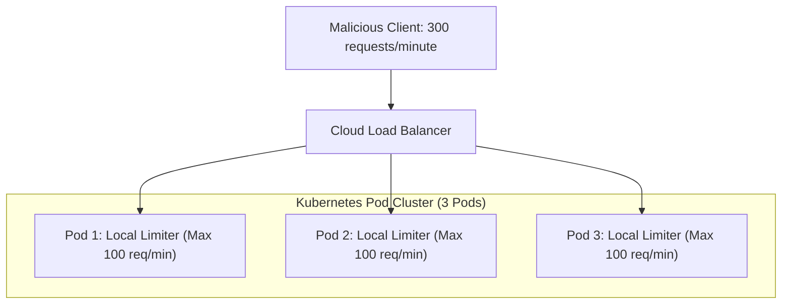
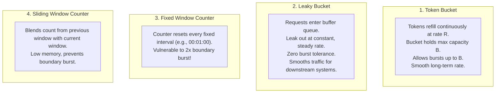
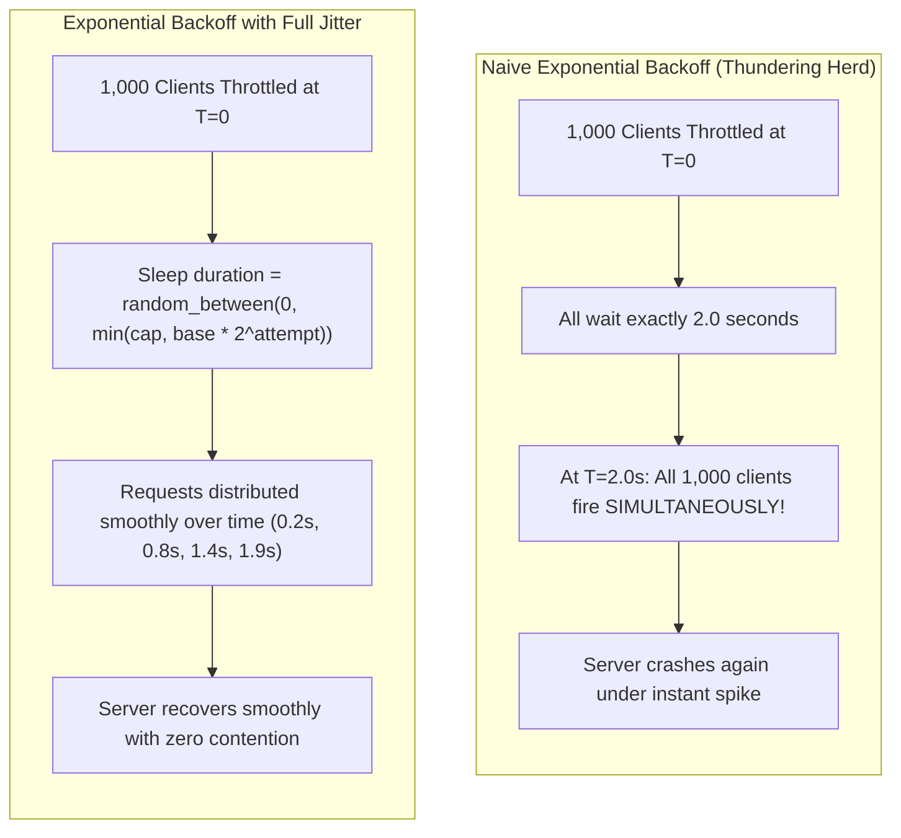

# Distributed Rate Limiting and Throttling

Every backend service has finite computational capacity:
- Relational databases have bounded connection pools (e.g., 50 HikariCP connections).
- Microservice thread pools can only process a finite number of concurrent HTTP requests before latency explodes.
- Third-party SaaS dependencies (Stripe, Twilio, OpenAI) enforce strict API rate limits and bill excessive penalties for overages.

Without proactive traffic governance, an unexpected marketing surge, a rogue automated script, or a distributed denial-of-service (DDoS) attack will overwhelm your services. A single unconstrained tenant can exhaust database resources, bringing down the entire platform for all other customers—a classic **Noisy Neighbor** failure.

To build defensible distributed systems, backend architects enforce **Rate Limiting and Throttling**.

In this deep dive, we will unpack the mathematics of core rate-limiting algorithms, examine why JVM-local limiters fail in clustered environments, implement a production-grade distributed rate limiter using Redis and Bucket4j, and configure standard IETF throttling headers.

---

## Why JVM-Local Rate Limiters Fail in Cloud Environments

When developers first encounter rate limiting, they often reach for in-memory Java libraries like Google Guava's `RateLimiter` or Resilience4j's `RateLimiter`:



### The Inherent Flaws of JVM-Local Limiting

1. **Capacity Multiplied by Node Count:** If your business requirement is *"Allow customer X at most 100 requests per minute,"* and you configure a local 100 req/min limiter on each pod:
   - When running 1 pod, the client can make 100 req/min.
   - When Kubernetes scales your service to 10 pods, the client can make **1,000 req/min** simply because the load balancer spreads requests across pods. The limit dynamically drifts based on auto-scaling!
2. **Uneven Load Balancing:** If round-robin DNS sends 80% of traffic to Pod 1, the client will be throttled prematurely on Pod 1 while Pods 2 and 3 sit idle with unused capacity.
3. **Pod Evictions and Restarts:** Every time a pod restarts or scales down, all local rate-limiting memory is erased.

**The Architectural Remedy:** Rate limit state must be externalized into a high-speed, shared distributed consensus cache—**Redis**.

---

## The Four Core Rate Limiting Algorithms

Choosing the right algorithm depends on whether your workload requires burst tolerance, perfectly smoothed output traffic, or minimal memory overhead.



### Token Bucket
- Tokens are added to a bucket at a constant rate `R` (e.g., 10 tokens per second).
- The bucket has a maximum capacity `B` (e.g., 50 tokens).
- When a request arrives, it attempts to consume 1 token. If tokens are available, the request proceeds immediately. If the bucket is empty, the request is rejected with HTTP `429 Too Many Requests`.
- **Strengths:** Supports **controlled bursts** (up to capacity `B`) while strictly enforcing a sustainable average rate over time. The industry standard for public web APIs.

### Leaky Bucket
- Requests enter a First-In, First-Out (FIFO) queue of fixed capacity.
- The queue drains ("leaks") at a strictly constant rate, regardless of how fast requests arrive.
- If the queue overflows, incoming requests are dropped.
- **Strengths:** Eliminates all bursts. Ideal for protecting downstream legacy services that crash when hit with sudden traffic spikes.

### Fixed Window Counter
- Divides time into fixed intervals (e.g., 1 minute from 12:00 to 12:01).
- Increments a counter for each request. When the counter exceeds the threshold, requests are rejected until the window resets.
- **The Fatal Flaw (The Boundary Burst):**
  - If a user sends 100 requests at 12:00:59, and sends another 100 requests at 12:01:01, the system processes **200 requests within a 2-second window**, potentially crashing the database while remaining compliant with the naive 100 req/minute rule.

### Sliding Window Counter (Weighted Interpolation)
- Solves the boundary burst problem without the high memory cost of storing individual request timestamps.
- It approximates the rolling count using a weighted formula:

```text
Requests in Window = (Previous Window Count * (1 - Elapsed Ratio)) + Current Window Count
```

If 70% of the current minute has elapsed, the algorithm weights 30% of the previous minute's requests plus 100% of the current minute's requests. It prevents boundary spikes with negligible memory consumption.

---

## Distributed Token Bucket with Redis and Lua Scripts

To implement distributed rate limiting in Redis, naive multi-step commands are hazardous:

```text
// DANGEROUS: Non-atomic race condition!
1. GET user:101:count
2. IF count < 100 THEN
3.   INCR user:101:count
4.   EXPIRE user:101:count 60
```

Under high concurrency, multiple application pods reading step 1 simultaneously will all pass the condition, allowing thousands of requests to bypass the limit.

The check, token replenishment, and deduction must execute as a single, atomic operation using a **Redis Lua script**.

### The Atomic Token Bucket Lua Script

```lua
-- KEYS[1]: Rate limit key (e.g., "ratelimit:user-101")
-- ARGV[1]: Bucket capacity (max burst)
-- ARGV[2]: Refill rate (tokens added per millisecond)
-- ARGV[3]: Current timestamp in milliseconds
-- ARGV[4]: Requested tokens (usually 1)

local key = KEYS[1]
local capacity = tonumber(ARGV[1])
local refill_rate = tonumber(ARGV[2])
local now = tonumber(ARGV[3])
local requested = tonumber(ARGV[4])

-- Retrieve current state: [tokens, last_refreshed_timestamp]
local data = redis.call("HMGET", key, "tokens", "last_updated")
local tokens = tonumber(data[1])
local last_updated = tonumber(data[2])

if tokens == nil then
    tokens = capacity
    last_updated = now
else
    -- Calculate newly accumulated tokens since last request
    local elapsed = math.max(0, now - last_updated)
    local generated_tokens = elapsed * refill_rate
    tokens = math.min(capacity, tokens + generated_tokens)
    last_updated = now
end

-- Evaluate token availability
if tokens >= requested then
    tokens = tokens - requested
    redis.call("HMSET", key, "tokens", tokens, "last_updated", last_updated)
    -- Set TTL so idle keys clean themselves up automatically (2 * refill duration)
    local ttl = math.ceil(capacity / (refill_rate * 1000)) * 2
    redis.call("EXPIRE", key, math.max(60, ttl))
    return {1, math.floor(tokens)} -- Allowed: 1, Remaining tokens
else
    redis.call("HMSET", key, "tokens", tokens, "last_updated", last_updated)
    return {0, math.floor(tokens)} -- Blocked: 0, Remaining tokens
end
```

Because Redis executes Lua scripts as a single atomic transaction, no two threads can interleave token calculations.

---

## Production Implementation with Bucket4j and Redisson

Writing and maintaining raw Lua scripts adds maintenance overhead. In the enterprise Java ecosystem, the production standard for distributed rate limiting is **Bucket4j** integrated with **Redisson**.

### Step 1: Maven Dependencies

```xml
<dependency>
    <groupId>com.bucket4j</groupId>
    <artifactId>bucket4j-core</artifactId>
    <version>8.10.1</version>
</dependency>
<dependency>
    <groupId>com.bucket4j</groupId>
    <artifactId>bucket4j-redis</artifactId>
    <version>8.10.1</version>
</dependency>
<dependency>
    <groupId>org.redisson</groupId>
    <artifactId>redisson-spring-boot-starter</artifactId>
    <version>3.37.0</version>
</dependency>
```

### Step 2: Rate Limiter Configuration and Tier Definition

```java
package com.javahub.ratelimit.config;

import io.github.bucket4j.Bandwidth;
import io.github.bucket4j.BucketConfiguration;
import io.github.bucket4j.distributed.proxy.ProxyManager;
import io.github.bucket4j.redis.redisson.Bucket4jRedisson;
import org.redisson.api.RedissonClient;
import org.redisson.client.codec.ByteArrayCodec;
import org.springframework.context.annotation.Bean;
import org.springframework.context.annotation.Configuration;

import java.time.Duration;

@Configuration
public class RateLimiterConfig {

    @Bean
    public ProxyManager<byte[]> bucketProxyManager(RedissonClient redissonClient) {
        // Uses Redisson command executor to manage distributed Redis state atomically
        return Bucket4jRedisson.casBasedBuilder(redissonClient)
                .build();
    }

    public enum CustomerTier {
        FREE(10, Duration.ofMinutes(1)),        // 10 requests / minute
        STANDARD(100, Duration.ofMinutes(1)),    // 100 requests / minute
        ENTERPRISE(1000, Duration.ofMinutes(1)); // 1,000 requests / minute

        private final long capacity;
        private final Duration refillPeriod;

        CustomerTier(long capacity, Duration refillPeriod) {
            this.capacity = capacity;
            this.refillPeriod = refillPeriod;
        }

        public BucketConfiguration toBucketConfiguration() {
            return BucketConfiguration.builder()
                    .addLimit(Bandwidth.builder()
                            .capacity(capacity)
                            .refillGreedy(capacity, refillPeriod)
                            .build())
                    .build();
        }
    }
}
```

### Step 3: Enterprise WebFilter with IETF RateLimit Headers

In modern REST architectures, when an application throttles a client, it must communicate remaining limits and reset intervals via standard **IETF RateLimit Headers**:

- `RateLimit-Limit`: Maximum quota allowed in the current window.
- `RateLimit-Remaining`: Number of tokens remaining.
- `RateLimit-Reset`: Seconds remaining until the quota is replenished.
- `Retry-After`: (Included on 429) Number of seconds the client must wait before retrying.

```java
package com.javahub.ratelimit.filter;

import com.javahub.ratelimit.config.RateLimiterConfig.CustomerTier;
import io.github.bucket4j.Bucket;
import io.github.bucket4j.BucketConfiguration;
import io.github.bucket4j.ConsumptionProbe;
import io.github.bucket4j.distributed.proxy.ProxyManager;
import jakarta.servlet.FilterChain;
import jakarta.servlet.ServletException;
import jakarta.servlet.http.HttpServletRequest;
import jakarta.servlet.http.HttpServletResponse;
import org.slf4j.Logger;
import org.slf4j.LoggerFactory;
import org.springframework.http.HttpStatus;
import org.springframework.security.core.Authentication;
import org.springframework.security.core.context.SecurityContextHolder;
import org.springframework.security.oauth2.jwt.Jwt;
import org.springframework.stereotype.Component;
import org.springframework.web.filter.OncePerRequestFilter;

import java.io.IOException;
import java.nio.charset.StandardCharsets;
import java.util.concurrent.TimeUnit;

@Component
public class DistributedRateLimitFilter extends OncePerRequestFilter {

    private static final Logger log = LoggerFactory.getLogger(DistributedRateLimitFilter.class);
    private final ProxyManager<byte[]> proxyManager;

    public DistributedRateLimitFilter(ProxyManager<byte[]> proxyManager) {
        this.proxyManager = proxyManager;
    }

    @Override
    protected void doFilterInternal(HttpServletRequest request,
                                    HttpServletResponse response,
                                    FilterChain filterChain) throws ServletException, IOException {
        // 1. Identify Client and Customer Tier
        String rateLimitKey = resolveClientKey(request);
        CustomerTier tier = resolveCustomerTier();

        // 2. Retrieve Distributed Bucket from Redis
        BucketConfiguration config = tier.toBucketConfiguration();
        Bucket bucket = proxyManager.builder().build(rateLimitKey.getBytes(StandardCharsets.UTF_8), () -> config);

        // 3. Attempt to Consume 1 Token
        ConsumptionProbe probe = bucket.tryConsumeAndReturnRemaining(1);

        if (probe.isConsumed()) {
            // Success: Attach Informational Headers
            response.setHeader("RateLimit-Remaining", String.valueOf(probe.getRemainingTokens()));
            filterChain.doFilter(request, response);
        } else {
            // Throttled: Calculate Wait Duration
            long waitForRefillNanos = probe.getNanosToWaitForRefill();
            long waitSeconds = Math.max(1, TimeUnit.NANOSECONDS.toSeconds(waitForRefillNanos));

            log.warn("Rate limit exceeded for key: {}. Throttling request with 429.", rateLimitKey);

            // Populate RFC 6585 and IETF Throttling Headers
            response.setStatus(HttpStatus.TOO_MANY_REQUESTS.value());
            response.setContentType("application/json");
            response.setHeader("Retry-After", String.valueOf(waitSeconds));
            response.setHeader("RateLimit-Remaining", "0");
            response.setHeader("RateLimit-Reset", String.valueOf(waitSeconds));

            response.getWriter().write(String.format(
                    "{\"error\": \"Too Many Requests\", \"message\": \"Rate limit exceeded. Retry after %d seconds.\"}",
                    waitSeconds
            ));
        }
    }

    private String resolveClientKey(HttpServletRequest request) {
        Authentication auth = SecurityContextHolder.getContext().getAuthentication();
        if (auth != null && auth.getPrincipal() instanceof Jwt jwt) {
            return "ratelimit:user:" + jwt.getSubject();
        }
        // Fallback to client IP for unauthenticated public endpoints
        return "ratelimit:ip:" + request.getRemoteAddr();
    }

    private CustomerTier resolveCustomerTier() {
        Authentication auth = SecurityContextHolder.getContext().getAuthentication();
        if (auth != null && auth.getPrincipal() instanceof Jwt jwt) {
            String plan = jwt.getClaimAsString("subscription_plan");
            if ("ENTERPRISE".equalsIgnoreCase(plan)) return CustomerTier.ENTERPRISE;
            if ("STANDARD".equalsIgnoreCase(plan)) return CustomerTier.STANDARD;
        }
        return CustomerTier.FREE;
    }
}
```

---

## Client Throttling, Exponential Backoff, and Jitter

When a server returns HTTP 429, the client's retry behavior determines whether the system recovers gracefully or collapses into a **Thundering Herd**:



### The AWS Full Jitter Algorithm

In high-concurrency distributed systems, exponential backoff must always incorporate **randomized jitter** to break client synchronization:

```java
public class ResilientHttpClient {

    public long calculateFullJitterSleepMs(int attempt, long baseDelayMs, long maxDelayMs) {
        // Calculate exponential ceiling: base * 2^attempt
        long exponentialCeiling = (long) (baseDelayMs * Math.pow(2, attempt));
        long cappedDelay = Math.min(maxDelayMs, exponentialCeiling);

        // FULL JITTER: Uniform random distribution between 0 and capped delay
        return ThreadLocalRandom.current().nextLong(0, cappedDelay + 1);
    }
}
```

By scattering retries uniformly between 0 and the exponential ceiling, traffic is converted from synchronized sharp spikes into a smooth, manageable stream that allows the recovering server to stabilize.

---

## Senior Engineer Interview Crucible

### Explain the boundary reset flaw in the Fixed Window Counter algorithm and how the Sliding Window Counter resolves it with minimal memory overhead.

The **Fixed Window Counter** assigns requests to static time buckets (e.g., 100 requests per minute from 12:00:00 to 12:01:00). 

**The Boundary Reset Flaw:**
If an attacker sends 100 requests at 12:00:59 (the very end of Window 1), and then sends another 100 requests at 12:01:01 (the start of Window 2), both batches are legally accepted because they fall into separate windows. However, the system receives **200 requests within a 2-second interval** across the boundary—twice the intended maximum capacity.

**How Sliding Window Counter Resolves It:**
Instead of storing timestamps of every single request (which consumes significant RAM), the **Sliding Window Counter** approximates the rolling rate by weighting the previous window's count by the percentage of time that has elapsed in the current window:

```text
Rate = (Previous Count * (1 - Percentage of Current Window Passed)) + Current Window Count
```

If 60% of the current minute has passed, the calculation takes 40% of the previous minute's count and adds it to the current minute's count. This smooths out boundary spikes while requiring only two integer counters in memory per user.

---

### Why must distributed rate limiting in Redis be implemented using Lua scripts rather than sequential multi-command transactions?

Implementing distributed rate limiting with sequential commands (`GET`, followed by conditional application logic, followed by `SET` or `INCR`) fails under concurrency due to check-then-act race conditions. If multiple Kubernetes pods read the key simultaneously, they will all observe the same un-incremented counter and all permit their requests, allowing traffic to drastically exceed the configured limit.

While Redis supports `MULTI` / `EXEC` transactions, transactions cannot branch conditionally based on values read within the transaction itself (Redis transactions cannot execute `if (val > 100)`).

A **Redis Lua script** executes directly on the Redis server engine as a single atomic unit. No other Redis command or script can run while a Lua script is executing. This enables atomic read-modify-write semantics: fetching current tokens, calculating elapsed replenishment, deducting tokens, and setting expiration happens in a single thread-safe step with zero network round-trip latency.

---

### Walk through the Token Bucket algorithm. How does it gracefully accommodate legitimate bursty traffic while enforcing a strict long-term rate?

The **Token Bucket** algorithm models capacity using two parameters:
1. **Capacity (`B`):** The maximum number of tokens the bucket can physically hold.
2. **Refill Rate (`R`):** The speed at which tokens are continuously added to the bucket (e.g., 10 tokens per second).

When a request arrives, it checks if a token is present. If yes, it removes one token and proceeds; if empty, it is rejected.

**Why It Accommodates Bursts:**
If a client remains idle for a minute, tokens accumulate up to the maximum capacity `B`. If the client suddenly fires a burst of requests (e.g., rendering an e-commerce dashboard that fires 20 parallel API calls), the bucket has 20 tokens ready. The burst is accommodated immediately with zero artificial delay.

Once the accumulated tokens are exhausted, the client is strictly constrained to the refill rate `R` (10 requests per second). Thus, Token Bucket permits short, legitimate user-driven bursts while guaranteeing that sustained traffic cannot exceed the downstream system's capacity.

---

### Why is adding randomized Jitter to exponential backoff essential when clients handle HTTP 429 Too Many Requests?

When a service experiences a temporary bottleneck and returns HTTP 429 to hundreds of concurrent clients, standard **Exponential Backoff** without jitter causes a **Thundering Herd Problem**.

With deterministic backoff, if 1,000 clients are throttled at the exact same millisecond and all back off using `2^attempt` seconds, every single one of those 1,000 clients will sleep for exactly 2.0 seconds and retry at the **exact same millisecond**. 

Instead of recovering, the server is hit by another massive wave of 1,000 requests, forcing it to throttle them again. The clients then all wait exactly 4.0 seconds and hit the server simultaneously again, creating permanent cyclical instability.

**Adding Full Jitter** replaces the deterministic sleep duration with a uniform random value between 0 and the exponential ceiling (`random(0, backoff)`). This distributes the 1,000 retries across a smooth time gradient, eliminating synchronized spikes and allowing the server to clear its backlog.
