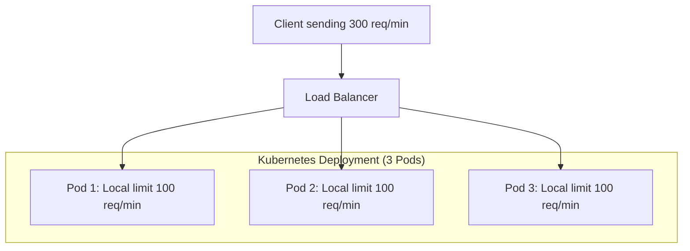
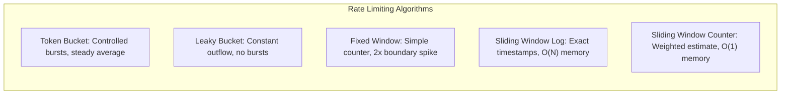

Every backend service runs against hard capacity ceilings. A PostgreSQL primary handles only so many active connections in its HikariCP pool, an application container can hold only so many concurrent requests before tail latency spikes, and third-party APIs like Stripe or OpenAI enforce strict request quotas.

Without traffic limits, a buggy retry loop in a client app, a sudden traffic surge, or a single abusive tenant can exhaust shared pools and degrade the service for everyone else (the classic **noisy neighbor** problem). Rate limiting caps how many requests a caller can make over time, while throttling shapes or rejects excess traffic cleanly before downstream components collapse.

---

## Why In-Memory Rate Limiters Break in Clustered Deployments

When teams first add rate limiting in Java, they often start with a local in-memory limiter such as Guava's `RateLimiter` or Resilience4j's `RateLimiter`. That works on a single JVM, but breaks down as soon as you run multiple replicas behind a load balancer:



Three issues appear immediately:

- **Effective limits scale with replica count:** If your policy is 100 requests per minute per tenant and each pod enforces 100 locally, scaling from 3 pods to 12 pods silently raises the tenant's real quota to 1,200 requests per minute.
- **Uneven routing causes premature throttling:** Sticky sessions or uneven load distribution can push most of a tenant's traffic onto Pod 1, triggering HTTP 429 errors while Pods 2 and 3 still have unused allowance.
- **State disappears on restart:** Rolling deployments and pod evictions wipe local counters back to zero.

To enforce a consistent cluster-wide quota, rate-limit state must live in a shared, low-latency data store. In most Java architectures, that store is **Redis**.

---

## Core Rate Limiting Algorithms

Choosing an algorithm comes down to three trade-offs: how you want to handle short bursts, how strictly you need to enforce window boundaries, and how much memory you are willing to spend per key.



### Token Bucket

A bucket holds up to `B` tokens (the burst capacity) and refills continuously at a steady rate `R` (for example, 10 tokens per second). Each incoming request removes one or more tokens; if the bucket does not have enough tokens, the request is rejected.

Because an idle caller builds up tokens up to `B`, Token Bucket absorbs normal interactive bursts (such as a browser loading a dashboard with 15 parallel API calls) without artificial delay, while capping sustained traffic at `R`. It stores only two numbers per key (current token count and last refill timestamp), which is why it is the default choice for most public APIs and Spring Cloud Gateway.

### Leaky Bucket

Requests enter a FIFO queue of fixed capacity and drain ("leak") to the downstream service at a fixed, uniform rate. If the queue is full, new requests are rejected immediately.

Unlike Token Bucket, Leaky Bucket smooths traffic into a completely flat outflow with no bursts. That makes it useful in front of fragile legacy systems or payment gateways that reject short spikes even when the 1-minute average looks fine. The trade-off is added queuing latency when traffic arrives in bursts.

### Fixed Window Counter and the Boundary Spike

Fixed Window splits time into discrete buckets (such as `12:00:00` to `12:01:00`) and increments a single counter per window. It is trivial to implement with Redis `INCR` and `EXPIRE`, but it has a well-known boundary flaw: if a client sends 100 requests at `12:00:59` and another 100 requests at `12:01:01`, both windows stay at 100, yet your backend absorbs **200 requests in 2 seconds**.

### Sliding Window Log

Sliding Window Log fixes the boundary spike completely by recording the exact timestamp of every accepted request for a key (in Redis, using a Sorted Set `ZSET`). On each request, you remove entries older than `now - windowSize` (`ZREMRANGEBYSCORE`), count the remaining entries (`ZCARD`), and if below the limit, add the current timestamp (`ZADD`).

The enforcement is exact across any rolling interval, with no boundary spikes. The downside is memory: if a tenant is allowed 10,000 requests per hour, Redis must store up to 10,000 sorted-set members for that single tenant (`O(N)` memory per key).

### Sliding Window Counter

Sliding Window Counter offers a practical middle ground. It keeps just two fixed-window counters per key (the previous window and the current window) and estimates the rolling count with a weighted sum:

```text
estimated_count = (previous_window_count * (1 - elapsed_ratio_in_current_window)) + current_window_count
```

If 70% of the current minute has elapsed, it takes 30% of the previous minute's count plus 100% of the current minute's count. Memory stays `O(1)` per key while smoothing out boundary bursts well enough for most APIs.

| Algorithm | Burst Handling | Boundary Accuracy | Memory per Key | Typical Use Case |
| :--- | :--- | :--- | :--- | :--- |
| **Token Bucket** | Allows bursts up to capacity | Smooth long-term rate | `O(1)` (2 fields) | General-purpose REST APIs, API gateways |
| **Leaky Bucket** | Eliminates bursts (queues) | Strict constant outflow | `O(queue size)` | Protecting brittle downstream services |
| **Fixed Window** | Up to 2x at window edges | Low at boundaries | `O(1)` (1 counter) | Coarse daily quotas, simple internal limits |
| **Sliding Window Log** | No boundary spikes | Exact | `O(limit)` | Strict low-volume limits (e.g., OTP/SMS, login attempts) |
| **Sliding Window Counter** | Minimal boundary spill | High approximation | `O(1)` (2 counters) | High-scale API throttling with tight RAM budgets |

---

## Distributed Rate Limiting with Redis and Lua Scripts

Implementing a Redis rate limiter with separate client commands fails under concurrency:

```text
-- Race condition across multiple pods:
1. GET ratelimit:user-42      -> returns 99 to Pod A and Pod B simultaneously
2. Both pods see 99 < 100
3. Both pods call INCR        -> both requests pass, exceeding the limit
```

Even Redis `MULTI`/`EXEC` transactions cannot branch conditionally on a value read inside the same transaction. To make the read, refill calculation, check, and update atomic without multiple network round trips, run a **Lua script** directly inside Redis. Redis executes Lua scripts atomically on its single command thread: no other command interleaves until the script returns.

### Atomic Token Bucket Lua Script Using `redis.call('TIME')`

One subtle bug in many sample Lua scripts is passing the current timestamp from the Java application (`System.currentTimeMillis()`) as an argument. In a multi-node cluster, clock skew between pods can cause tokens to jump backward or refill inconsistently. Calling `redis.call('TIME')` inside the Lua script uses Redis's own server clock instead (Redis 7+ uses effects-based replication by default, so non-deterministic reads like `TIME` are safe inside Lua scripts).

```lua
-- KEYS[1]: rate limit key (e.g., "rl:token:tenant-42")
-- ARGV[1]: bucket capacity (max burst)
-- ARGV[2]: refill rate (tokens per second)
-- ARGV[3]: tokens requested (typically 1)

local key = KEYS[1]
local capacity = tonumber(ARGV[1])
local refill_per_sec = tonumber(ARGV[2])
local requested = tonumber(ARGV[3])

-- Use Redis server time to avoid clock skew across application pods
local server_time = redis.call("TIME")
local now_ms = (tonumber(server_time[1]) * 1000) + math.floor(tonumber(server_time[2]) / 1000)

local state = redis.call("HMGET", key, "tokens", "last_refill_ms")
local tokens = tonumber(state[1])
local last_refill_ms = tonumber(state[2])

if tokens == nil then
    tokens = capacity
    last_refill_ms = now_ms
else
    local elapsed_ms = math.max(0, now_ms - last_refill_ms)
    local added = (elapsed_ms / 1000.0) * refill_per_sec
    tokens = math.min(capacity, tokens + added)
    last_refill_ms = now_ms
end

local allowed = 0
local retry_after_ms = 0

if tokens >= requested then
    tokens = tokens - requested
    allowed = 1
else
    local deficit = requested - tokens
    retry_after_ms = math.ceil((deficit / refill_per_sec) * 1000)
end

redis.call("HSET", key, "tokens", tokens, "last_refill_ms", last_refill_ms)

-- Expire idle keys after twice the time needed to fill an empty bucket
local ttl_sec = math.max(60, math.ceil((capacity / refill_per_sec) * 2))
redis.call("EXPIRE", key, ttl_sec)

return { allowed, math.floor(tokens), retry_after_ms }
```

### Invoking the Script from Spring Boot with `EVALSHA`

Sending the full Lua source code on every HTTP request wastes bandwidth. Spring Data Redis's `DefaultRedisScript` automatically hashes the script with SHA-1 and runs `EVALSHA` against Redis, falling back to `EVAL` only the first time (or if Redis flushes its script cache):

```java
package com.example.ratelimit.redis;

import org.springframework.core.io.ClassPathResource;
import org.springframework.data.redis.core.StringRedisTemplate;
import org.springframework.data.redis.core.script.DefaultRedisScript;
import org.springframework.stereotype.Service;

import java.util.List;

@Service
public class RedisTokenBucketLimiter {

    private final StringRedisTemplate redisTemplate;
    private final DefaultRedisScript<List> tokenBucketScript;

    public RedisTokenBucketLimiter(StringRedisTemplate redisTemplate) {
        this.redisTemplate = redisTemplate;
        this.tokenBucketScript = new DefaultRedisScript<>();
        this.tokenBucketScript.setLocation(new ClassPathResource("scripts/token_bucket.lua"));
        this.tokenBucketScript.setResultType(List.class);
    }

    @SuppressWarnings("unchecked")
    public RateLimitDecision tryAcquire(String key, int capacity, int refillPerSecond, int requestedTokens) {
        List<Long> result = redisTemplate.execute(
                tokenBucketScript,
                List.of("rl:token:" + key),
                String.valueOf(capacity),
                String.valueOf(refillPerSecond),
                String.valueOf(requestedTokens)
        );

        if (result == null || result.size() < 3) {
            throw new IllegalStateException("Unexpected Redis Lua script response");
        }

        boolean allowed = result.get(0) == 1L;
        long remaining = result.get(1);
        long retryAfterMs = result.get(2);
        return new RateLimitDecision(allowed, remaining, retryAfterMs);
    }

    public record RateLimitDecision(boolean allowed, long remainingTokens, long retryAfterMs) {}
}
```

---

## Spring Cloud Gateway `RequestRateLimiter`

If your architecture already routes external traffic through **Spring Cloud Gateway**, you do not need to write or maintain your own Lua script. Spring Cloud Gateway ships with a built-in `RequestRateLimiter` filter backed by Redis (`RedisRateLimiter`), which runs an atomic Token Bucket Lua script inside Redis under the hood.

### Dependencies

Include Spring Cloud Gateway and Reactive Redis:

```xml
<dependency>
    <groupId>org.springframework.cloud</groupId>
    <artifactId>spring-cloud-starter-gateway</artifactId>
</dependency>
<dependency>
    <groupId>org.springframework.boot</groupId>
    <artifactId>spring-boot-starter-data-redis-reactive</artifactId>
</dependency>
```

### Configuring Routes and Token Bucket Parameters

In `application.yml`, attach the `RequestRateLimiter` filter to a route and configure the three core Redis Token Bucket properties:

- `redis-rate-limiter.replenishRate`: How many tokens are added per second (sustained throughput per key).
- `redis-rate-limiter.burstCapacity`: Maximum tokens the bucket can hold (short-term burst allowance).
- `redis-rate-limiter.requestedTokens`: How many tokens a single request costs (defaults to `1`; set higher for expensive endpoints like report exports or LLM inference).

```yaml
spring:
  data:
    redis:
      host: redis.internal
      port: 6379
      timeout: 50ms
  cloud:
    gateway:
      routes:
        - id: orders-api
          uri: lb://order-service
          predicates:
            - Path=/api/v1/orders/**
          filters:
            - name: RequestRateLimiter
              args:
                redis-rate-limiter.replenishRate: 20
                redis-rate-limiter.burstCapacity: 40
                redis-rate-limiter.requestedTokens: 1
                key-resolver: "#{@clientKeyResolver}"
                deny-empty-key: true
                empty-key-status: FORBIDDEN
        - id: reports-export-api
          uri: lb://reporting-service
          predicates:
            - Path=/api/v1/reports/export/**
          filters:
            - name: RequestRateLimiter
              args:
                redis-rate-limiter.replenishRate: 10
                redis-rate-limiter.burstCapacity: 20
                redis-rate-limiter.requestedTokens: 5
                key-resolver: "#{@clientKeyResolver}"
```

### Writing a Custom `KeyResolver` Bean

The `KeyResolver` decides *who* gets their own bucket. Never rely blindly on a raw `X-Forwarded-For` header without trusting your reverse proxy, because callers can spoof arbitrary headers to bypass IP rate limits. Prefer an authenticated subject (JWT `sub` or validated API key), falling back to the remote peer address only for unauthenticated endpoints:

```java
package com.example.gateway.config;

import org.springframework.cloud.gateway.filter.ratelimit.KeyResolver;
import org.springframework.context.annotation.Bean;
import org.springframework.context.annotation.Configuration;
import org.springframework.security.core.Authentication;
import org.springframework.web.server.ServerWebExchange;
import reactor.core.publisher.Mono;

import java.net.InetSocketAddress;

@Configuration
public class GatewayRateLimitConfig {

    @Bean
    public KeyResolver clientKeyResolver() {
        return exchange -> resolveAuthenticatedPrincipal(exchange)
                .switchIfEmpty(Mono.defer(() -> Mono.justOrEmpty(resolveApiKey(exchange))))
                .switchIfEmpty(Mono.defer(() -> Mono.just(resolveClientIp(exchange))));
    }

    private Mono<String> resolveAuthenticatedPrincipal(ServerWebExchange exchange) {
        return exchange.getPrincipal()
                .cast(Authentication.class)
                .filter(Authentication::isAuthenticated)
                .map(auth -> "user:" + auth.getName());
    }

    private String resolveApiKey(ServerWebExchange exchange) {
        String apiKey = exchange.getRequest().getHeaders().getFirst("X-API-Key");
        return (apiKey != null && !apiKey.isBlank()) ? "apikey:" + apiKey : null;
    }

    private String resolveClientIp(ServerWebExchange exchange) {
        InetSocketAddress remoteAddress = exchange.getRequest().getRemoteAddress();
        String host = (remoteAddress != null && remoteAddress.getAddress() != null)
                ? remoteAddress.getAddress().getHostAddress()
                : "unknown";
        return "ip:" + host;
    }
}
```

When a request is rejected, Spring Cloud Gateway automatically returns `429 Too Many Requests` along with `X-RateLimit-Remaining`, `X-RateLimit-Replenish-Rate`, `X-RateLimit-Burst-Capacity`, and `X-RateLimit-Requested-Tokens` response headers (which you can disable or customize if you do not want to expose internal bucket parameters).

If you are running a servlet-based Spring MVC service without Spring Cloud Gateway, or need tiered multi-window limits (for example, 10 requests/second *and* 5,000 requests/day per tenant), **Bucket4j** with Redisson or Lettuce provides a mature Java abstraction over Redis atomic operations.

---

## API Throttling and `429 Too Many Requests` Responses

Rejecting a request with a bare `429` status code forces clients to guess when to retry, which usually makes them retry too aggressively. Well-behaved APIs return structured throttling metadata:

- **HTTP `429 Too Many Requests`** (defined in RFC 6585).
- **`Retry-After`:** Standard HTTP header indicating how many seconds the client should wait before sending another request.
- **`X-RateLimit-*` vs. IETF `RateLimit` headers:** Many existing APIs and Spring Cloud Gateway emit `X-RateLimit-Limit`, `X-RateLimit-Remaining`, and `X-RateLimit-Reset`. Newer APIs are adopting the IETF draft standard headers (`RateLimit-Limit`, `RateLimit-Remaining`, `RateLimit-Reset`, or the structured `RateLimit` / `RateLimit-Policy` pair). Pick one convention and document it consistently across your API.

Here is a Spring MVC `OncePerRequestFilter` that uses our `RedisTokenBucketLimiter`, emits standard throttling headers, and handles Redis outages explicitly:

```java
package com.example.ratelimit.web;

import com.example.ratelimit.redis.RedisTokenBucketLimiter;
import com.example.ratelimit.redis.RedisTokenBucketLimiter.RateLimitDecision;
import jakarta.servlet.FilterChain;
import jakarta.servlet.ServletException;
import jakarta.servlet.http.HttpServletRequest;
import jakarta.servlet.http.HttpServletResponse;
import org.slf4j.Logger;
import org.slf4j.LoggerFactory;
import org.springframework.dao.DataAccessException;
import org.springframework.http.HttpHeaders;
import org.springframework.http.HttpStatus;
import org.springframework.http.MediaType;
import org.springframework.web.filter.OncePerRequestFilter;

import java.io.IOException;

public class ApiRateLimitFilter extends OncePerRequestFilter {

    private static final Logger log = LoggerFactory.getLogger(ApiRateLimitFilter.class);

    private final RedisTokenBucketLimiter limiter;
    private final boolean failOpenOnRedisError;

    public ApiRateLimitFilter(RedisTokenBucketLimiter limiter, boolean failOpenOnRedisError) {
        this.limiter = limiter;
        this.failOpenOnRedisError = failOpenOnRedisError;
    }

    @Override
    protected void doFilterInternal(HttpServletRequest request,
                                    HttpServletResponse response,
                                    FilterChain filterChain) throws ServletException, IOException {
        String tenantId = request.getHeader("X-Tenant-Id");
        String key = (tenantId != null && !tenantId.isBlank())
                ? "tenant:" + tenantId
                : "ip:" + request.getRemoteAddr();

        int capacity = 60;
        int refillPerSecond = 10;

        RateLimitDecision decision;
        try {
            decision = limiter.tryAcquire(key, capacity, refillPerSecond, 1);
        } catch (DataAccessException ex) {
            log.error("Redis rate limiter unavailable for key {}", key, ex);
            if (failOpenOnRedisError) {
                filterChain.doFilter(request, response);
                return;
            }
            response.sendError(HttpStatus.SERVICE_UNAVAILABLE.value(), "Rate limiting service unavailable");
            return;
        }

        response.setHeader("RateLimit-Limit", String.valueOf(capacity));
        response.setHeader("RateLimit-Remaining", String.valueOf(decision.remainingTokens()));

        if (decision.allowed()) {
            filterChain.doFilter(request, response);
            return;
        }

        long retryAfterSeconds = Math.max(1L, (decision.retryAfterMs() + 999L) / 1000L);
        response.setStatus(HttpStatus.TOO_MANY_REQUESTS.value());
        response.setContentType(MediaType.APPLICATION_PROBLEM_JSON_VALUE);
        response.setHeader(HttpHeaders.RETRY_AFTER, String.valueOf(retryAfterSeconds));
        response.setHeader("RateLimit-Reset", String.valueOf(retryAfterSeconds));
        response.getWriter().write("""
                {"type":"about:blank","title":"Too Many Requests","status":429,"detail":"Rate limit exceeded. Retry after %d seconds."}
                """.formatted(retryAfterSeconds));
    }
}
```

### Client Retries: Exponential Backoff with Full Jitter

When hundreds of clients receive `429 Too Many Requests` at the same second and all apply plain exponential backoff (`1s`, `2s`, `4s`), they wake up together and hammer the server in synchronized waves (a **thundering herd**). Adding **full jitter** spreads retries randomly between `0` and the backoff cap, honoring `Retry-After` as a lower bound when the server supplies one:

```java
package com.example.ratelimit.client;

import java.util.concurrent.ThreadLocalRandom;

public final class RetryBackoff {

    private RetryBackoff() {}

    public static long computeDelayMs(int attempt, long baseDelayMs, long maxDelayMs, long retryAfterMs) {
        // Guard against bit-shift overflow for large attempt numbers
        int shift = Math.min(attempt, 30);
        long exponential = Math.min(maxDelayMs, baseDelayMs * (1L << shift));
        long jittered = ThreadLocalRandom.current().nextLong(0, exponential + 1);
        return Math.max(retryAfterMs, jittered);
    }
}
```

---

## Fail-Open vs. Fail-Closed When Redis Goes Down

Because every request touches Redis on the hot path, you must decide up front what happens when Redis times out or fails over.

First, set an aggressive Redis command timeout on your rate limiter client (typically 20 ms to 50 ms) rather than the multi-second default. If Redis stalls, you want the rate-limit check to fail fast instead of tying up Tomcat or Netty threads across your entire fleet.

Second, pick the failure policy intentionally per endpoint:

- **Fail-open (allow requests through when Redis errors):** The right default for most customer-facing APIs. A Redis hiccup should not take down checkout or search for legitimate users. Pair fail-open with immediate alerting and an optional coarse in-memory fallback limiter per pod so traffic cannot go completely unbounded during a Redis outage.
- **Fail-closed (reject with `503` or `429` when Redis errors):** Appropriate for endpoints with direct financial or security risk, such as SMS/OTP dispatch, password-reset verification, or metered third-party LLM endpoints where an unthrottled loop could burn thousands of dollars in minutes.

---

## Interview Questions

### How does the Fixed Window Counter boundary spike happen, and how do Sliding Window Log and Sliding Window Counter differ in fixing it?

With a Fixed Window limit of 100 requests per minute, a client can send 100 requests at `12:00:59` and 100 more at `12:01:01`, pushing 200 requests through in 2 seconds even though neither calendar minute exceeded 100. Sliding Window Log solves this with exact precision by storing each request timestamp in a Redis Sorted Set and pruning entries older than `now - 60s`, at the cost of `O(N)` memory per key. Sliding Window Counter keeps only two counters (previous and current window) and weights the previous window by the remaining overlap percentage, eliminating most of the boundary spike in `O(1)` memory.

### Why should a Redis rate limiter run inside a Lua script rather than using `GET`, `INCR`, and `EXPIRE` from Java?

Separate commands leave a race window between reading the counter and updating it: two concurrent pods can both read `99`, decide the request is allowed, and push the count past the limit. Redis `MULTI`/`EXEC` transactions cannot execute conditional `if` logic based on values read inside the transaction. A Lua script runs atomically on Redis's single execution thread in one network round trip, and calling `redis.call('TIME')` inside the script avoids clock skew across application nodes.

### In Spring Cloud Gateway's `RequestRateLimiter`, what is the difference between `replenishRate` and `burstCapacity`?

`replenishRate` is the sustained number of tokens added to the bucket every second, controlling long-term average throughput. `burstCapacity` is the maximum number of tokens the bucket can accumulate when idle, controlling how many requests can pass in a single second before throttling kicks in. Setting `replenishRate: 20` and `burstCapacity: 40` lets an idle client fire a short burst of 40 requests immediately, then caps continued traffic at 20 requests per second.

### When should a distributed rate limiter fail open vs. fail closed if Redis becomes unreachable?

Fail open on revenue-critical or general read/write APIs where an outage in the rate-limiting cache would cause worse user impact than briefly relaxing quotas (ideally backed by a coarse local per-pod fallback limiter and a tight 20–50 ms Redis timeout). Fail closed on security-sensitive or directly billable endpoints—such as login/OTP verification or expensive external API proxies—where unchecked traffic could enable brute-force attacks or runaway third-party bills.
