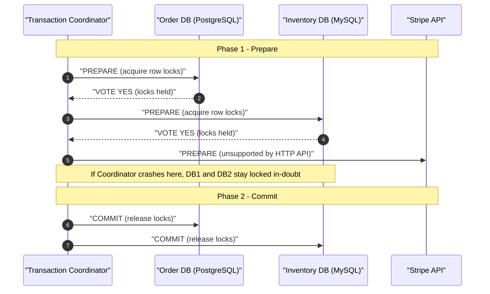
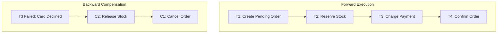
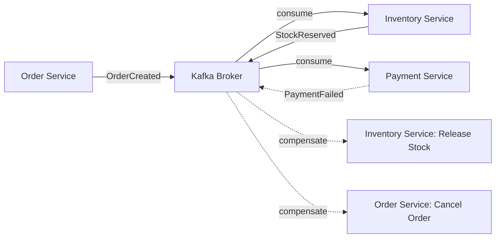
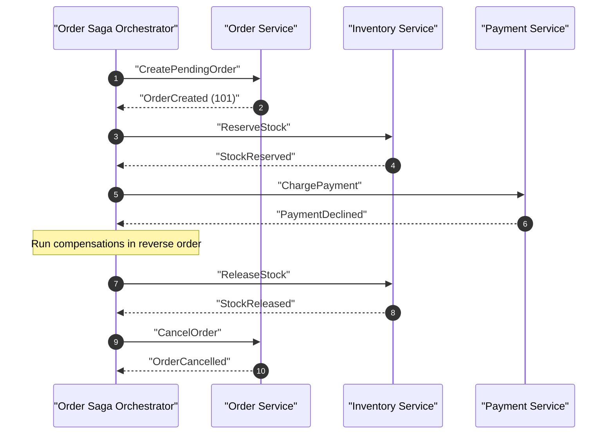

Inside a single service backed by one relational database, a multi-step write is straightforward. You wrap a method in `@Transactional`, execute four SQL statements, and rely on the database engine for ACID guarantees. If the fourth statement violates a constraint, the engine rolls back the first three, and no other session ever sees the partial work.

Once you split a system into services with separate databases, that safety net disappears. A single checkout flow might touch four independent data stores and an external gateway:

1. **Order Service** creates an order record in PostgreSQL.
2. **Inventory Service** reserves physical stock in MySQL.
3. **Payment Service** charges a card through Stripe.
4. **Loyalty Service** deducts reward points in MongoDB.

If the Loyalty Service rejects the request because the customer's point balance changed concurrently, there is no `connection.rollback()` that spans PostgreSQL, MySQL, MongoDB, and Stripe. The earlier steps already committed locally. Handling partial failure across independent services requires a different set of patterns, and each comes with clear trade-offs around consistency, isolation, and operational complexity.

---

## The Two-Phase Commit (2PC) Problem

Before microservice architectures became common, enterprise Java applications coordinated writes across multiple databases or JMS brokers using **Two-Phase Commit (2PC)** through the XA specification (`javax.transaction.xa` / `jakarta.transaction.xa`). A central transaction coordinator runs the protocol in two rounds:

1. **Prepare phase:** The coordinator asks each participating resource manager to execute the local work, write its undo/redo logs to disk, acquire the necessary row locks, and reply with a vote (`YES` or `NO`).
2. **Commit phase:** If every participant votes `YES`, the coordinator writes a commit decision to its own log and tells every participant to commit and release locks. If any participant votes `NO` or times out, the coordinator tells everyone to roll back.



In cloud-native microservice architectures, 2PC runs into three practical walls:

- **Blocking locks across the network:** Every participant holds local database locks for the entire duration of the prepare-to-commit round trip. A slow participant or a brief network stall causes locks to pile up across all participating databases, saturating connection pools and cascading into unrelated requests.
- **Coordinator failure leaves in-doubt transactions:** Once a participant votes `YES`, it has promised it can commit. If the coordinator crashes before delivering Phase 2, participants cannot safely decide to commit or abort on their own. Those rows remain locked until the coordinator recovers or an operator manually resolves the heuristic state.
- **No universal XA support:** Many modern data stores (MongoDB, Cassandra, DynamoDB) and nearly all third-party HTTP APIs (Stripe, Twilio, shipping carriers) do not participate in XA transactions. You cannot enroll a REST call to a payment processor in a database two-phase commit.

> [!NOTE]
> Even when every database supports XA, availability drops fast. Because every participant must be reachable during the prepare phase, the probability of a transaction succeeding is the product of the availability of every service involved.

---

## The Saga Pattern: Choreography vs. Orchestration

A **Saga** replaces a single distributed ACID transaction with a sequence of local ACID transactions. Each service updates its own database and emits a message or responds to a coordinator so the next service can run.

If a step fails partway through, the Saga does not roll back the earlier databases at the storage layer. Instead, it runs **compensating transactions** in reverse order to semantically undo the completed steps.



There are two ways to coordinate those steps: **Choreography** and **Orchestration**.

### Choreography (Event-Driven, Decentralized)

In a choreographed saga, no single service knows the whole workflow. Each service subscribes to domain events from a broker such as Kafka, performs its local transaction, and publishes a new event describing what happened.



Here is what the Inventory Service side of a choreographed saga looks like in Spring Boot and Java 21. Notice that it handles both the forward path (`OrderCreatedEvent`) and the compensation path (`PaymentFailedEvent`), and emits an explicit failure event if stock is unavailable:

```java
package com.example.inventory.saga;

import com.example.inventory.domain.InsufficientStockException;
import com.example.inventory.domain.InventoryService;
import org.springframework.kafka.annotation.KafkaListener;
import org.springframework.kafka.core.KafkaTemplate;
import org.springframework.stereotype.Component;

import java.math.BigDecimal;
import java.util.UUID;

@Component
public class InventorySagaListener {

    private final InventoryService inventoryService;
    private final KafkaTemplate<String, Object> kafkaTemplate;

    public InventorySagaListener(InventoryService inventoryService,
                                 KafkaTemplate<String, Object> kafkaTemplate) {
        this.inventoryService = inventoryService;
        this.kafkaTemplate = kafkaTemplate;
    }

    @KafkaListener(topics = "orders.created", groupId = "inventory-service")
    public void onOrderCreated(OrderCreatedEvent event) {
        try {
            inventoryService.reserveStock(event.orderId(), event.sku(), event.quantity());
            kafkaTemplate.send(
                    "inventory.reserved",
                    event.orderId().toString(),
                    new StockReservedEvent(event.orderId(), event.customerId(), event.amount())
            );
        } catch (InsufficientStockException ex) {
            kafkaTemplate.send(
                    "inventory.reservation-failed",
                    event.orderId().toString(),
                    new StockReservationFailedEvent(event.orderId(), ex.getMessage())
            );
        }
    }

    @KafkaListener(topics = "payments.failed", groupId = "inventory-service")
    public void onPaymentFailed(PaymentFailedEvent event) {
        inventoryService.releaseStock(event.orderId());
    }

    public record OrderCreatedEvent(UUID orderId, UUID customerId, String sku, int quantity, BigDecimal amount) {}
    public record StockReservedEvent(UUID orderId, UUID customerId, BigDecimal amount) {}
    public record StockReservationFailedEvent(UUID orderId, String reason) {}
    public record PaymentFailedEvent(UUID orderId, String reason) {}
}
```

> [!WARNING]
> In production code, calling `inventoryService.reserveStock(...)` and then `kafkaTemplate.send(...)` directly introduces a dual-write hazard: if the process crashes between the database commit and the Kafka publish, the saga stalls silently. Pair local transactions with the **Transactional Outbox** pattern (writing the event to an `outbox_events` table in the same DB transaction and relaying it with a poller or Debezium CDC).

Choreography works well when a flow has two to four steps and each team wants minimal coupling to a central controller. Beyond four or five steps, however, the full workflow only exists implicitly across multiple repositories and topic subscriptions. Adding a new step or tracing why an order got stuck becomes tedious.

### Orchestration (Command-Driven, Centralized)

In an orchestrated saga, a dedicated coordinator owns the state machine. It sends commands to participant services, records which steps have completed, and triggers compensations in reverse order if a downstream step fails.



In a full production deployment, you would typically persist each state transition to a database (or use a durable execution engine like Temporal) so a coordinator crash mid-saga does not lose track of pending compensations. Even a compact Java coordinator makes the control flow much easier to read than scattered listeners:

```java
package com.example.order.saga;

import org.slf4j.Logger;
import org.slf4j.LoggerFactory;
import org.springframework.stereotype.Service;

import java.math.BigDecimal;
import java.util.ArrayDeque;
import java.util.Deque;
import java.util.UUID;

@Service
public class OrderSagaOrchestrator {

    private static final Logger log = LoggerFactory.getLogger(OrderSagaOrchestrator.class);

    private final OrderClient orderClient;
    private final InventoryClient inventoryClient;
    private final PaymentClient paymentClient;
    private final SagaCompensationOutbox compensationOutbox;

    public OrderSagaOrchestrator(OrderClient orderClient,
                                 InventoryClient inventoryClient,
                                 PaymentClient paymentClient,
                                 SagaCompensationOutbox compensationOutbox) {
        this.orderClient = orderClient;
        this.inventoryClient = inventoryClient;
        this.paymentClient = paymentClient;
        this.compensationOutbox = compensationOutbox;
    }

    public SagaResult executeCheckout(CheckoutRequest request) {
        UUID orderId = request.orderId();
        // LIFO stack records compensations only for steps that actually succeeded
        Deque<CompensationStep> completedSteps = new ArrayDeque<>();

        try {
            orderClient.createPendingOrder(orderId, request.customerId(), request.amount());
            completedSteps.push(new CompensationStep(
                    "cancel-order",
                    () -> orderClient.cancelOrder(orderId, "Saga rolled back")
            ));

            inventoryClient.reserveStock(orderId, request.sku(), request.quantity());
            completedSteps.push(new CompensationStep(
                    "release-stock",
                    () -> inventoryClient.releaseStock(orderId)
            ));

            paymentClient.charge(orderId, request.customerId(), request.amount());

            // Pivot transaction succeeded: move forward to confirmation
            orderClient.confirmOrder(orderId);
            return SagaResult.confirmed(orderId);

        } catch (RuntimeException failure) {
            log.warn("Checkout saga failed for order {}: {}", orderId, failure.getMessage());
            compensate(orderId, completedSteps);
            return SagaResult.failed(orderId, failure.getMessage());
        }
    }

    private void compensate(UUID orderId, Deque<CompensationStep> completedSteps) {
        while (!completedSteps.isEmpty()) {
            CompensationStep step = completedSteps.pop();
            try {
                step.action().run();
            } catch (RuntimeException compFailure) {
                // Never silently drop a failed compensation; persist for durable retry / alerting
                log.error("Compensation '{}' failed for order {}, enqueuing for retry",
                        step.name(), orderId, compFailure);
                compensationOutbox.enqueueRetry(orderId, step.name(), compFailure.getMessage());
            }
        }
    }

    private record CompensationStep(String name, Runnable action) {}
    public record CheckoutRequest(UUID orderId, UUID customerId, String sku, int quantity, BigDecimal amount) {}
    public record SagaResult(UUID orderId, String status, String reason) {
        static SagaResult confirmed(UUID id) { return new SagaResult(id, "CONFIRMED", null); }
        static SagaResult failed(UUID id, String reason) { return new SagaResult(id, "CANCELLED", reason); }
    }
}
```

### Comparing the Two Styles

| Dimension | Choreography | Orchestration |
| :--- | :--- | :--- |
| **Control flow visibility** | Spread across event listeners in multiple services | Explicit in one coordinator class or state machine |
| **Coupling** | Services know about shared event schemas, not each other | Orchestrator depends on participant commands; participants stay decoupled |
| **Best fit** | 2 to 4 steps, simple reactive flows | 5+ steps, branching, timeouts, auditability |
| **Main risk** | Event cycles and hard-to-trace failures | Coordinator turning into a bloated "god service" if it absorbs domain logic |

Keep the orchestrator focused strictly on coordination (ordering, state transitions, retries, compensations). Business rules like pricing, inventory math, and fraud checks belong inside the participant services.

---

## Designing Idempotent Compensating Transactions

A compensating transaction is a **semantic undo**, not a storage rollback. You cannot erase history; you record a new action that reverses the business effect. Refunding a settled payment creates a second ledger entry rather than deleting the original charge.

Every step in a saga falls into one of three categories (a classification popularized by Chris Richardson):

1. **Compensatable transactions:** Steps that can be undone if a later step fails (creating a pending order, reserving inventory).
2. **Pivot transaction:** The go/no-go point of the saga (charging the customer's card). Once the pivot succeeds, the saga runs forward to completion.
3. **Retriable transactions:** Steps after the pivot that must eventually succeed via retries (confirming the order, sending a receipt, triggering fulfillment).

### Guarding Compensations with Explicit State Transitions

Messaging systems provide at-least-once delivery, and orchestrators retry on network timeouts. That means `releaseStock(orderId)` will eventually be called twice for the same order, or even arrive *before* a delayed `reserveStock(orderId)` message in an asynchronous system.

If you blindly run `UPDATE inventory SET available = available + :qty`, a duplicate message will inflate your stock count. Instead, model the reservation itself as an entity with explicit states (`RESERVED` -> `RELEASED`, or `CANCELLED` if the cancellation arrived early) and guard the transition atomically inside the database transaction:

```java
package com.example.inventory.domain;

import org.springframework.stereotype.Service;
import org.springframework.transaction.annotation.Transactional;

import java.util.UUID;

@Service
public class InventoryService {

    private final StockReservationRepository reservationRepository;
    private final InventoryItemRepository itemRepository;

    public InventoryService(StockReservationRepository reservationRepository,
                            InventoryItemRepository itemRepository) {
        this.reservationRepository = reservationRepository;
        this.itemRepository = itemRepository;
    }

    @Transactional
    public void reserveStock(UUID orderId, String sku, int quantity) {
        var existing = reservationRepository.findByOrderId(orderId);
        if (existing.isPresent()) {
            // Either a duplicate reserve call (idempotent no-op)
            // or a cancellation tombstone that arrived early
            if (existing.get().getStatus() == ReservationStatus.CANCELLED_BEFORE_RESERVE) {
                throw new IllegalStateException("Order " + orderId + " was already cancelled");
            }
            return;
        }

        int decremented = itemRepository.decrementAvailableIfSufficient(sku, quantity);
        if (decremented == 0) {
            throw new InsufficientStockException("Insufficient stock for SKU " + sku);
        }

        reservationRepository.save(StockReservation.reserved(orderId, sku, quantity));
    }

    @Transactional
    public void releaseStock(UUID orderId) {
        var maybeReservation = reservationRepository.findByOrderId(orderId);

        if (maybeReservation.isEmpty()) {
            // Out-of-order compensation arrived before reserveStock.
            // Store a tombstone so a late reserveStock cannot allocate stock for a dead order.
            reservationRepository.save(StockReservation.cancelledBeforeReserve(orderId));
            return;
        }

        StockReservation reservation = maybeReservation.get();

        // Atomic conditional update: only one concurrent caller can transition RESERVED -> RELEASED
        int updated = reservationRepository.transitionStatus(
                orderId,
                ReservationStatus.RESERVED,
                ReservationStatus.RELEASED
        );

        if (updated == 1) {
            itemRepository.incrementAvailable(reservation.getSku(), reservation.getQuantity());
        }
        // If updated == 0, it was already RELEASED or CANCELLED_BEFORE_RESERVE -> safe no-op
    }
}
```

Look closely at the conditional update `transitionStatus(orderId, RESERVED, RELEASED)` (which executes `UPDATE stock_reservations SET status = 'RELEASED' WHERE order_id = ? AND status = 'RESERVED'`). Even if two consumer threads process duplicate `PaymentFailedEvent` messages at the exact same millisecond, PostgreSQL's row lock guarantees that only one thread observes `updated == 1` and increments available stock. The second thread sees `updated == 0` and exits cleanly without double-restoring inventory.

---

## Handling ACD Without Isolation

Sagas provide Atomicity (eventually, via compensation), Consistency (locally per service), and Durability. What they give up is **Isolation** (the "I" in ACID). Because Step 1 commits to PostgreSQL before Step 3 runs, other transactions and users can observe intermediate, uncommitted-to-the-saga data.

Without safeguards, lack of isolation produces three classic anomalies:

- **Dirty reads:** Order 101 is inserted as `CONFIRMED`, the user sees it as confirmed on their profile page, and two seconds later Payment fails and the order flips to `CANCELLED`.
- **Lost updates:** While Order 101's checkout saga is in progress, a customer support tool updates the shipping address or applies a discount, and the saga's final confirmation step overwrites the row with stale state.
- **Non-repeatable / fuzzy reads:** A reporting job sums confirmed revenue while orders are mid-flight between services, seeing inconsistent totals across databases.

### Countermeasures: Semantic Locking and Optimistic Concurrency

The primary defense against isolation anomalies is a **semantic lock**: mark the record with an explicit intermediate state (`PENDING_PAYMENT`, `PENDING_CANCELLATION`) while a saga is operating on it. Other operations inspect that state and either reject conflicting mutations or filter pending records out of public read views.

Combine semantic locking with JPA `@Version` optimistic locking so concurrent updates cannot silently overwrite each other:

```java
package com.example.order.domain;

import jakarta.persistence.Entity;
import jakarta.persistence.EnumType;
import jakarta.persistence.Enumerated;
import jakarta.persistence.Id;
import jakarta.persistence.Version;

import java.math.BigDecimal;
import java.util.UUID;

@Entity
public class OrderEntity {

    @Id
    private UUID id;

    private UUID customerId;
    private BigDecimal totalAmount;

    @Enumerated(EnumType.STRING)
    private OrderStatus status;

    @Version
    private long version; // Guards against lost updates across concurrent transactions

    protected OrderEntity() {}

    public static OrderEntity createPending(UUID id, UUID customerId, BigDecimal amount) {
        OrderEntity order = new OrderEntity();
        order.id = id;
        order.customerId = customerId;
        order.totalAmount = amount;
        order.status = OrderStatus.PENDING_PAYMENT;
        return order;
    }

    public void updateTotalAmount(BigDecimal newAmount) {
        // Semantic lock check: refuse mutations while a checkout saga holds the order
        if (this.status != OrderStatus.DRAFT) {
            throw new IllegalStateException(
                    "Cannot modify order " + id + " while in status " + status);
        }
        this.totalAmount = newAmount;
    }

    public void confirm() {
        if (this.status == OrderStatus.CONFIRMED) {
            return; // Idempotent
        }
        if (this.status != OrderStatus.PENDING_PAYMENT) {
            throw new IllegalStateException(
                    "Cannot confirm order " + id + " from status " + status);
        }
        this.status = OrderStatus.CONFIRMED;
    }

    public void cancel() {
        if (this.status == OrderStatus.CANCELLED) {
            return; // Idempotent
        }
        if (this.status == OrderStatus.CONFIRMED) {
            throw new IllegalStateException("Confirmed orders require a refund workflow, not cancellation");
        }
        this.status = OrderStatus.CANCELLED;
    }

    public enum OrderStatus {
        DRAFT,
        PENDING_PAYMENT,
        CONFIRMED,
        CANCELLED
    }
}
```

On the read side, customer-facing dashboards or reporting queries explicitly handle pending rows rather than treating them as final:

```sql
-- Reporting query excludes in-flight sagas to avoid dirty reads of unsettled orders
SELECT customer_id, SUM(total_amount) AS confirmed_revenue
FROM orders
WHERE status = 'CONFIRMED'
GROUP BY customer_id;
```

Other useful isolation countermeasures include **commutative updates** (designing operations like `balance = balance - 50` and `balance = balance + 50` so order of execution does not break the final result) and **pessimistic view ordering** (running the highest-risk steps, such as payment authorization, earlier so fewer compensations are needed if they fail).

---

## Eventual Consistency and User Experience

Because sagas commit locally and propagate asynchronously across services, the system as a whole follows **eventual consistency** (often summarized alongside BASE: Basically Available, Soft state, Eventually consistent). Between the moment a user clicks "Place Order" and the moment all downstream read models catch up, the data across services is temporarily out of sync.

This shows up directly in the API contract and frontend UX. If `POST /api/orders` returns `201 Created` synchronously after only creating the pending order, and the client immediately calls `GET /api/orders/{id}` against a separate query service whose Kafka consumer is 400 ms behind, the user may see a `404 Not Found` or a stale status.

Teams typically handle this gap in three ways:

- **Return `202 Accepted` with the pending order ID:** Treat checkout as an asynchronous job. The UI displays "Processing payment..." and polls `GET /api/orders/{id}/status` with short intervals until the status transitions out of `PENDING_PAYMENT`.
- **Push status updates over SSE or WebSockets:** Once the saga commits `OrderConfirmed` or `OrderCancelled`, a notification gateway pushes the terminal state to the open browser session.
- **Read-your-writes routing for the initiating user:** Immediately after checkout, serve the order status directly from the Order Service's primary database rather than an asynchronously populated search index or read replica.

---

## Common Production Failure Modes

### Cyclic Event Loops in Choreography

A payment team and an order team wire up a choreographed saga. When a payment fails, Payment Service emits `PaymentFailedEvent`. Order Service consumes it, marks the order cancelled, and emits `OrderCancelledEvent`. Later, someone adds a listener in Payment Service for `OrderCancelledEvent` to void open authorizations, and that handler emits `PaymentFailedEvent` whenever a void runs.

The two services begin bouncing events back and forth at thousands of messages per second. You prevent this by keeping event semantics strictly factual (past-tense domain facts, not disguised commands), enforcing idempotency checks on state transitions so a cancelled order never emits a second `OrderCancelledEvent`, and adding correlation IDs plus hop/TTL monitoring on broker topics.

### Abandoned Compensations

Suppose a transfer saga debits USD 500 from Account A, fails to credit Account B because Account B is frozen, and then tries to credit USD 500 back to Account A. If that compensation call fails due to a transient database timeout and the caller simply logs the exception and returns, the customer loses USD 500 with no automated recovery.

Compensating transactions must be treated as **must-succeed** operations. Persist failed compensations to a durable outbox or retry queue, retry with exponential backoff, and route permanently failing compensations (for example, Account A was closed mid-transfer) to a Dead Letter Queue that pages an operator or opens a reconciliation ticket.

---

## Interview Questions

### What is the difference between Backward Recovery and Forward Recovery in a Saga?

Backward recovery undoes completed steps in reverse order when a failure occurs before the pivot transaction (for example, releasing reserved stock and cancelling a pending order when a credit card is declined). Forward recovery retries a failed step until it succeeds instead of undoing prior work. You use forward recovery after the pivot transaction has already committed (for instance, once payment is settled and non-reversible, or when updating a downstream audit/shipping system), relying on persistent state, exponential backoff, and idempotent consumers.

### Why does a Saga break ACID Isolation, and how does semantic locking help?

In a single database transaction, uncommitted writes are hidden from concurrent sessions until `COMMIT`. In a saga, each participating service commits its own local database transaction immediately so downstream services can proceed. Those intermediate records are visible to other queries and mutations. Semantic locking marks in-flight records with explicit intermediate statuses such as `PENDING_PAYMENT`. Other business operations check that status and reject conflicting changes, while read queries can either hide pending rows or clearly label them as in progress until the saga reaches `CONFIRMED` or `CANCELLED`.

### What happens if a compensating transaction arrives before the forward transaction in an asynchronous system?

With Kafka or SQS, network delays or partition rebalancing can occasionally deliver a `CancelOrder` or `ReleaseStock` message before the corresponding `ReserveStock` message finishes processing. If the compensation handler simply says "reservation not found, ignoring," the delayed `ReserveStock` message will later arrive and lock stock for an order that was already cancelled. The standard fix is to write a tombstone record (such as `CANCELLED_BEFORE_RESERVE`) when the compensation finds no matching reservation, and have the forward `reserveStock` method check for that tombstone and abort if present.

### How do you keep a Saga Orchestrator from becoming a single point of failure or scalability bottleneck?

Keep orchestrator instances stateless by storing saga state transitions in a replicated database (such as PostgreSQL across availability zones) or delegating execution to a clustered workflow engine like Temporal. Dispatch commands asynchronously over partitioned queues or topics rather than holding threads open on synchronous HTTP calls. Finally, build small orchestrators per bounded context (one for checkout, another for onboarding) instead of routing every business process in the company through a single central service.
