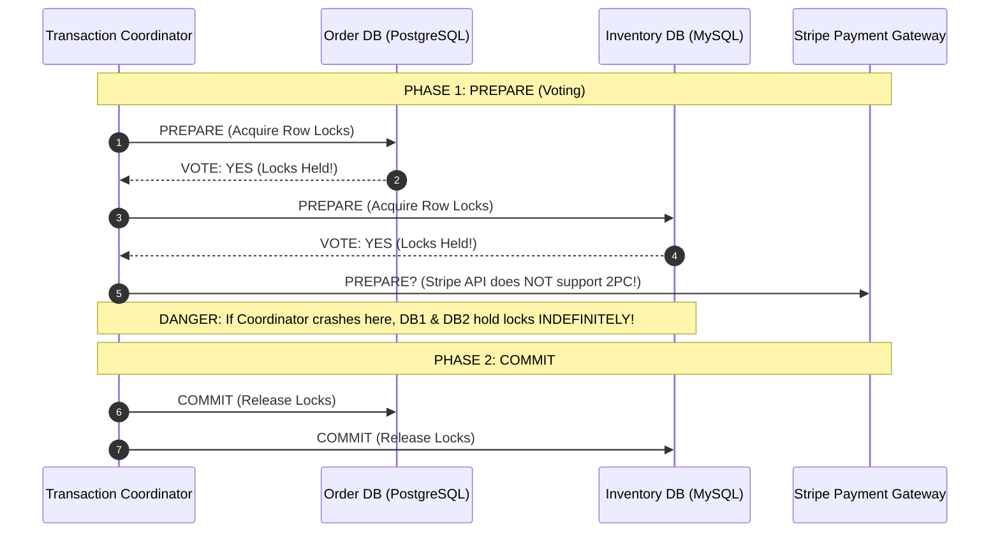
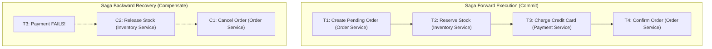
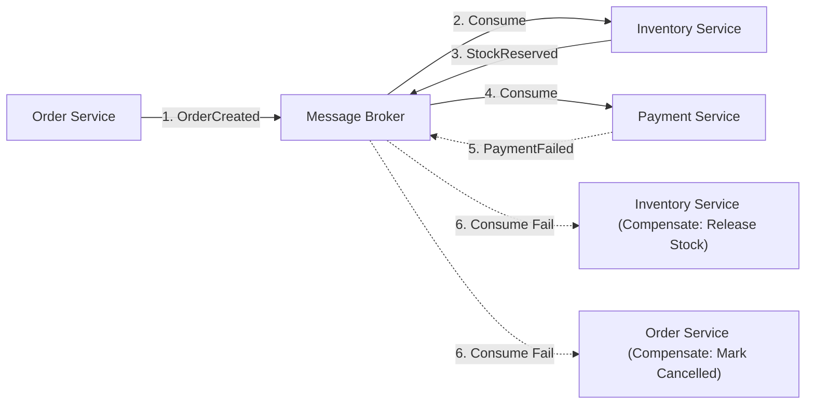
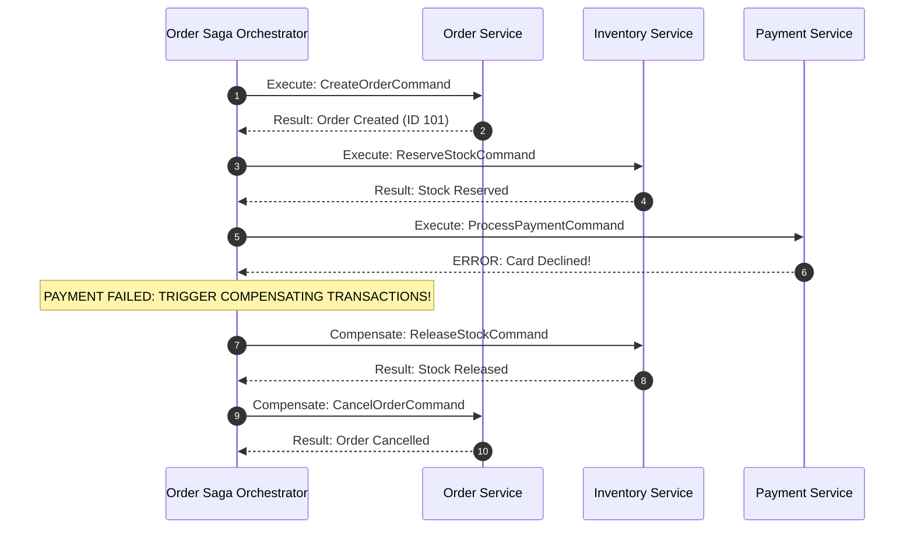

In a monolithic architecture backed by a single relational database, executing a business transaction is straightforward: you annotate a method with `@Transactional`, run five SQL queries, and the database engine guarantees **ACID** (Atomicity, Consistency, Isolation, Durability). If a constraint fails on line 4, the database engine rolls back lines 1 through 3 automatically.

In a microservices architecture with the Database-per-Service principle, a single business workflow crosses multiple process boundaries:
1. **Order Service**: Creates an order in PostgreSQL.
2. **Payment Service**: Charges a credit card via Stripe.
3. **Inventory Service**: Reserves physical stock in MySQL.
4. **Loyalty Service**: Deducts reward points in MongoDB.

If Step 4 fails because the customer has insufficient reward points, **you cannot simply call `connection.rollback()`**. 
The credit card has already been charged, the stock has already been reserved, and the order has already been committed to PostgreSQL. You are now operating in the unforgiving world of **Distributed Transactions**.

In this guide, we will analyze why traditional Two-Phase Commit (2PC) fails in cloud environments, master the **Saga Pattern** in both Choreographed and Orchestrated flavors, design semantic **Compensating Transactions**, and embrace **Eventual Consistency**.

---

## Why Two-Phase Commit (2PC) Fails in the Cloud

Before microservices, enterprise systems attempted to achieve distributed ACID transactions using **Two-Phase Commit (2PC)** and **XA Transactions** (`javax.transaction.xa`).



### The Three Fatal Flaws of 2PC
1. **Synchronous Blocking Protocol**: In Phase 1, every participating database acquires exclusive database row locks and holds them until the coordinator signals Phase 2. If a network netsplit or slow query delays the coordinator, database locks are held open across the entire enterprise, choking database connection pools and killing throughput.
2. **Single Point of Failure**: If the coordinator crashes after participants vote "YES", participating databases are left in an "in-doubt" state. They cannot unilaterally commit or roll back because they don't know the global outcome.
3. **Third-Party APIs Don't Support XA**: You cannot enlist Stripe, Twilio, SendGrid, or Kafka in an XA distributed transaction.

> [!CAUTION]
> **CAP Theorem Reality**  
> 2PC attempts to provide strong Consistency (C) across a distributed network. In cloud environments where network partitions (P) are inevitable, 2PC forces your entire platform's Availability (A) to equal the availability of your *least reliable component*.

---

## The Saga Pattern: Orchestration vs Choreography

A **Saga** is a sequence of local ACID transactions. Each local transaction updates data within a single service and publishes an event or message. The next step is triggered by that event.

If a local transaction fails at any point in the sequence, the Saga executes a series of **Compensating Transactions** that undo the changes made by preceding steps in reverse order.



### Choreography-Based Sagas (Decentralized)
In a Choreographed Saga, there is no centralized coordinator. Participating microservices listen to domain events and decide autonomously what actions to perform next.



#### When to Choose Choreography
- Simple workflows involving 2 to 4 microservices.
- High desire for complete service autonomy without a central orchestrator dependency.
- *Downside:* As workflows grow beyond 4 steps, tracking global business state becomes an incomprehensible spaghetti of event listeners.

---

### Orchestration-Based Sagas (Centralized)
In an Orchestrated Saga, a dedicated **Saga Orchestrator** service (often implemented with a state machine, or tools like Temporal / Camunda) explicitly tells participant services what local transactions to execute via command messages.



#### When to Choose Orchestration
- Complex business processes with 5 or more steps.
- Workflows that require human approval steps, wait timers, or complex branching logic.
- Clear audit requirements where management needs to view the exact real-time state of an order workflow in a single dashboard.

---

## Designing Robust Compensating Transactions

A **Compensating Transaction** is a semantic undo operation. It is **not** a database rollback.

In a database rollback, the previous dirty data was never visible to other transactions. In a Saga, because Step 1 committed to PostgreSQL before Step 3 failed, **the intermediate state was visible to the outside world**.

### The Lack of Isolation (ACID without the I)
The greatest challenge in the Saga pattern is the lack of **Isolation**:
- If Step 1 creates an order and reserves a hotel room, another user looking at hotel availability will see that room as booked!
- If Step 3 fails and the compensation cancels the reservation, the room becomes available again 5 seconds later.

### Countermeasures for Lack of Isolation
1. **Semantic Locking (Pending States)**: Never mark a record as `ACTIVE` or `CONFIRMED` until the entire Saga completes. Use explicit intermediate states:
   - `Order.status = PENDING_PAYMENT`
   - `Account.balance = RESERVED_FUNDS`
2. **Pessimistic Read Filtering**: In search queries, filter out entities that are currently in an unconfirmed state (`WHERE status != 'PENDING'`).
3. **Idempotent Compensations**: Compensating commands can be retried multiple times due to network drops. A compensation method must be strictly idempotent: calling `releaseStock()` three times for the same order must release stock exactly once.

```java
package com.example.ecommerce.inventory;

import org.springframework.stereotype.Service;
import org.springframework.transaction.annotation.Transactional;

import java.util.UUID;

@Service
public class InventoryCompensationService {

    private final InventoryRepository inventoryRepository;
    private final ProcessedCompensationRepository processedCompensations;

    public InventoryCompensationService(
            InventoryRepository inventoryRepository,
            ProcessedCompensationRepository processedCompensations
    ) {
        this.inventoryRepository = inventoryRepository;
        this.processedCompensations = processedCompensations;
    }

    @Transactional
    public void compensateStockReservation(UUID orderId, String sku, int quantity) {
        // 1. Idempotency Check: Has this compensation already run?
        if (processedCompensations.existsByOrderIdAndSku(orderId, sku)) {
            return; // Already compensated! Return cleanly.
        }

        // 2. Execute semantic compensation (restore inventory count)
        inventoryRepository.incrementAvailableStock(sku, quantity);

        // 3. Record compensation completion in the same local ACID transaction
        processedCompensations.save(new ProcessedCompensationRecord(orderId, sku));
    }
}
```

---

## Eventual Consistency and BASE

Monoliths adhere to **ACID**:
- **A**tomicity
- **C**onsistency
- **I**solation
- **D**urability

Distributed microservices adhere to **BASE**:
- **B**asically **A**vailable: The system guarantees availability by breaking down monolithic single-point-of-failures.
- **S**oft State: The state of the system may change over time without user input due to asynchronous event propagation.
- **E**ventual Consistency: Given enough time without new updates, all replicas and microservices will eventually converge on consistent state.

### Managing Eventual Consistency in the Frontend UI
Because events propagate asynchronously, if a user clicks *"Place Order"* and the browser immediately redirects to `GET /orders/101`, the query might hit a read-replica that hasn't received the Kafka event yet, rendering a *"404 Not Found"*!

#### Frontend Strategies for Eventual Consistency
- **Optimistic UI Updates**: The frontend immediately updates local state, displaying the order as placed while polling in the background.
- **WebSocket / Server-Sent Events (SSE)**: The server pushes the final `OrderConfirmed` event over an open SSE connection once the Saga orchestrator finishes.
- **Polling with Graceful Loading**: The order confirmation page displays a spinner with *"Finalizing your order..."* for 2 seconds before querying the read model.

---

## Architectural Traps and Real-World Outages

### The "Cyclic Event Loop" in Choreography
A payment team and an order team configured an event-driven choreography. 
When a payment failed, the Payment Service emitted `PaymentFailedEvent`. 
The Order Service consumed this event, cancelled the order, and emitted `OrderCancelledEvent`. 
Unfortunately, a new developer in the Payment Service added a listener for `OrderCancelledEvent` to void any open pre-authorizations, which in turn emitted `PaymentFailedEvent`. 

The two microservices began ping-ponging events back and forth at 15,000 messages per second, generating 40 million log entries in Datadog and running up USD 8,000 in cloud infrastructure bills in 45 minutes before on-call engineers killed the Kafka consumer group.

### The "Failed Compensation" Financial Discrepancy
A peer-to-peer money transfer application executed a Saga:
1. Debit USD 500 from Sender (Succeeded).
2. Credit USD 500 to Receiver (Failed because receiver's account was frozen).
3. Compensate: Credit USD 500 back to Sender.

The compensation call to credit the sender failed due to a database connection timeout. Because the team had not configured a persistent retry queue for failed compensations, the execution was abandoned. The sender lost USD 500 without the receiver receiving it. 

**Lesson Learned:** Compensating transactions **must never be abandoned on failure**. They must be placed into a durable retry queue (or Dead Letter Queue) and retried until they succeed or trigger an urgent page to human operators.

---

## Senior Interview Questions

### Question 1: What is the fundamental difference between Backward Recovery and Forward Recovery in the Saga Pattern?
**Answer:**  
- **Backward Recovery (Compensation)**: When a step fails, the system executes compensating transactions in reverse order to undo all previously committed local transactions, returning the system to a clean original state (e.g., cancelling an order and refunding money).
- **Forward Recovery (Retry to Completion)**: Used when a transaction cannot easily be compensated or when business rules dictate that failure is not an option once started (e.g., provisioning an activated SIM card or processing a booked flight after payment was settled). Instead of rolling back, the system persists the current saga state and relentlessly retries the failed step (with exponential backoff and idempotency) until it eventually succeeds.

### Question 2: Why does the Saga Pattern violate the "Isolation" guarantee of ACID, and how does this lead to Dirty Reads?
**Answer:**  
In a monolithic database, uncommitted changes made inside a transaction are hidden from other concurrent transactions (under Read Committed or Repeatable Read isolation levels). 

In a Saga, each step commits its changes to a local database immediately so that other services can read the state or process subsequent steps. Therefore, **intermediate states are fully committed and visible to the outside world**. 

A **Dirty Read** occurs if Step 1 commits an order with status `CONFIRMED`, a customer reads their dashboard and sees the order confirmed, but Step 3 (Payment) subsequently fails and Step 1's compensation changes the status to `CANCELLED`. To prevent this, systems use semantic pending flags (`PENDING_PAYMENT`) and pessimistic query filtering.

### Question 3: How do you handle a scenario where a Compensating Transaction itself fails?
**Answer:**  
A compensating transaction **cannot simply roll back** because there is no prior state to fall back to. If a compensation fails (e.g., due to a network glitch or database lock timeout):
1. **Automatic Retry with Exponential Backoff**: The orchestrator must persistently retry the compensation until the transient error resolves.
2. **Idempotency Guarantee**: The compensation logic must be strictly idempotent so repeated retries do not double-refund or corrupt state.
3. **Dead-Letter Queue & Human Escalation**: If the compensation fails permanently (e.g., account closed, fatal business rule violation), the saga state must be routed to a dead-letter queue and flagged for manual intervention in an administrative back-office console.

### Question 4: In an Orchestrated Saga, how do you prevent the Saga Orchestrator from becoming a single point of failure and a scalability bottleneck?
**Answer:**  
1. **Stateless Orchestrator Instances**: Run multiple stateless replicas of the orchestrator service behind a load balancer, storing the saga state machine's transitions in a highly available, clustered database (e.g., PostgreSQL with multi-AZ replication or distributed Key-Value stores).
2. **Asynchronous Command Dispatch**: The orchestrator does not make blocking synchronous HTTP calls to downstream services. It writes command messages to partitioned Kafka topics, allowing asynchronous decoupled execution.
3. **Dedicated Orchestrators per Bounded Context**: Avoid building a single "God Orchestrator" for the entire company. Build focused, domain-specific orchestrators (e.g., `OrderFulfillmentSagaOrchestrator`, `UserOnboardingSagaOrchestrator`) that scale independently.
