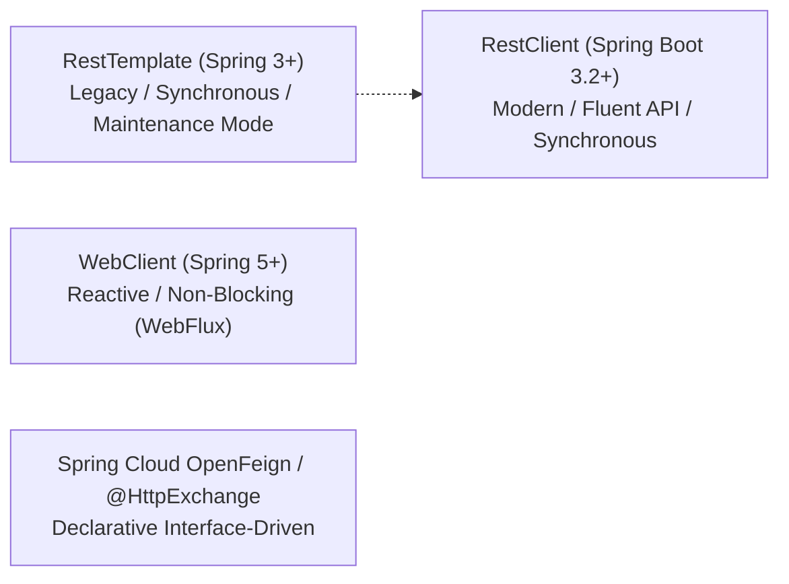
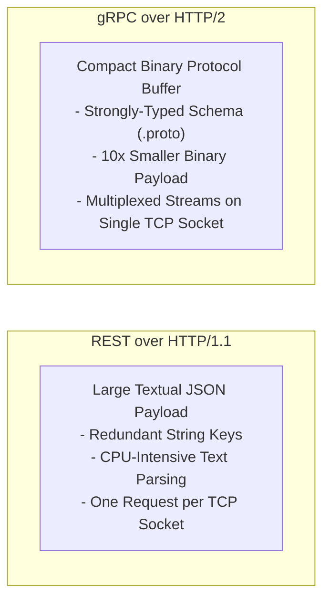
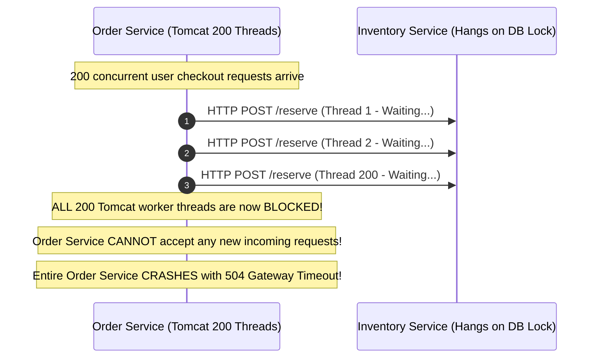

In a monolithic architecture, calling another domain component is as simple as `orderService.processOrder(order)`. The JVM executes an `invokevirtual` bytecode instruction, passing an object pointer across stack frames in 2 nanoseconds. There are no timeouts, no network partitions, no serialization overhead, and no partial failures.

In microservices, that 2-nanosecond pointer dereference is replaced by an Ethernet cable, a TLS handshake, network switches, JSON serialization, and an HTTP/2 or HTTP/1.1 transport layer across a fallible network. 

If you design inter-service communication as if it were still simple local Java method calls, your system will suffer from cascading outages, silent thread starvation, and catastrophic latency spikes.

In this guide, we will master the communication patterns of distributed Java systems. We will compare synchronous versus asynchronous paradigms, migrate from legacy `RestTemplate` to modern `RestClient` and OpenFeign, dive deep into binary RPC with **gRPC and Protocol Buffers**, and architect bulletproof defenses against network timeouts and retry storms.

---

## Synchronous vs Asynchronous Communication

Every inter-service interaction falls into one of two fundamental communication paradigms:

```mermaid
flowchart TD
    subgraph Synchronous ["Synchronous Request-Response (REST / gRPC)"]
        Client1["Order Service"] -->|1. HTTP Request (Blocks / Awaits)| Server1["Payment Service"]
        Server1 -->|2. Processes & Returns Response| Client1
        Note1["Temporal Coupling:
Both services MUST be online and reachable simultaneously."]
    end

    subgraph Asynchronous ["Asynchronous Event-Driven (Kafka / RabbitMQ)"]
        Client2["Order Service"] -->|1. Publish Event| Broker["Message Broker"]
        Broker -.->|2. Consume Event When Ready| Server2["Fulfillment Service"]
        Note2["Temporal Decoupling:
Producer does NOT wait.
Consumer can be offline or restart safely."]
    end
```

### Trade-Off Matrix
| Feature | Synchronous (REST / gRPC) | Asynchronous (Kafka / RabbitMQ) |
|---|---|---|
| **Temporal Coupling** | **High**: Both caller and receiver must be operational at the exact same millisecond. | **Zero**: Sender publishes and moves on; receiver consumes when ready. |
| **Latency** | Low for immediate single-hop queries. | Higher end-to-end propagation latency. |
| **Throughput** | Bound by connection pools and network round-trip time (RTT). | Extremely high; buffers massive traffic spikes during peak loads. |
| **Complexity** | Simple mental model; standard HTTP request/reply. | Requires event schemas, dead-letter queues, idempotent consumers. |
| **Best Used For** | Immediate queries (e.g., *"Is this promo code valid right now?"*). | State changes and side effects (e.g., *"OrderPlaced"*, *"PaymentCaptured"*). |

---

## Modern Spring REST Clients: RestTemplate vs RestClient vs OpenFeign

For over a decade, Spring developers used `RestTemplate`. In modern Java and Spring Boot 3+, the ecosystem has evolved:



### The Legacy: `RestTemplate`
`RestTemplate` is in maintenance mode. While still supported, no new features are being added. It lacks a modern fluent API and requires clunky `HttpEntity` and `ParameterizedTypeReference` boilerplate for generic collections.

### The Modern Standard: `RestClient`
Introduced in Spring Boot 3.2 (Spring Framework 6.1), `RestClient` provides a modern, fluent, synchronous API backed by the same infrastructure as `WebClient` without requiring reactive Project Reactor dependencies:

```java
package com.example.ecommerce.client;

import com.example.ecommerce.dto.CustomerResponse;
import org.springframework.http.HttpStatusCode;
import org.springframework.http.MediaType;
import org.springframework.stereotype.Service;
import org.springframework.web.client.RestClient;

import java.util.UUID;

@Service
public class CustomerServiceClient {

    private final RestClient restClient;

    public CustomerServiceClient(RestClient.Builder restClientBuilder) {
        this.restClient = restClientBuilder
                .baseUrl("http://customer-service:8080")
                .defaultHeader("X-Client-Origin", "OrderService")
                .build();
    }

    public CustomerResponse getCustomerById(UUID customerId) {
        return restClient.get()
                .uri("/api/v1/customers/{id}", customerId)
                .accept(MediaType.APPLICATION_JSON)
                .retrieve()
                .onStatus(HttpStatusCode::is4xxClientError, (request, response) -> {
                    throw new CustomerNotFoundException("Customer does not exist: " + customerId);
                })
                .onStatus(HttpStatusCode::is5xxServerError, (request, response) -> {
                    throw new RemoteServiceUnavailableException("Customer service failed");
                })
                .body(CustomerResponse.class);
    }
}
```

### Declarative HTTP with Spring Cloud OpenFeign
For large microservice architectures, writing manual HTTP client wrappers is tedious. **OpenFeign** lets you declare the HTTP contract as a standard Java interface:

```java
package com.example.ecommerce.client;

import com.example.ecommerce.dto.PaymentRequest;
import com.example.ecommerce.dto.PaymentResponse;
import org.springframework.cloud.openfeign.FeignClient;
import org.springframework.web.bind.annotation.PathVariable;
import org.springframework.web.bind.annotation.PostMapping;
import org.springframework.web.bind.annotation.RequestBody;

import java.util.UUID;

@FeignClient(name = "payment-service", path = "/api/v1/payments")
public interface PaymentFeignClient {

    @PostMapping("/{orderId}/charge")
    PaymentResponse processPayment(
            @PathVariable("orderId") UUID orderId,
            @RequestBody PaymentRequest request
    );
}
```
Spring dynamically synthesizes a dynamic proxy implementing `PaymentFeignClient`, wiring URL construction, JSON encoding/decoding, and load balancing automatically!

---

## High-Performance RPC: gRPC and Protocol Buffers

While REST over HTTP/1.1 with JSON is universal, it is inefficient for high-frequency internal **East-West** communication between microservices inside a private data center.

JSON is verbose, human-readable text. It requires repeated transmission of string keys (`"customerId": "..."`), and parsing JSON into Java objects consumes significant CPU and heap memory.

**gRPC** (Google Remote Procedure Call) solves this with **HTTP/2** and **Protocol Buffers (Protobuf)**:



### Defining the Protocol Buffer Contract (`.proto`)
In gRPC, contracts are declared in language-neutral `.proto` files:

```protobuf
syntax = "proto3";

package ecommerce;

option java_package = "com.example.ecommerce.grpc";
option java_multiple_files = true;

message InventoryCheckRequest {
  string sku = 1;
  int32 quantity = 2;
}

message InventoryCheckResponse {
  bool isAvailable = 1;
  int32 availableStock = 2;
  double unitPrice = 3;
}

service InventoryService {
  rpc CheckStock (InventoryCheckRequest) returns (InventoryCheckResponse);
}
```

The Protobuf compiler (`protoc`) compiles this schema into high-performance, strongly-typed Java classes and gRPC stubs.

### Implementing a gRPC Server in Spring Boot
Using modern Spring Boot gRPC starters:

```java
package com.example.ecommerce.grpc;

import io.grpc.stub.StreamObserver;
import net.devh.boot.grpc.server.service.GrpcService;

@GrpcService
public class InventoryGrpcServiceImpl extends InventoryServiceGrpc.InventoryServiceImplBase {

    @Override
    public void checkStock(
            InventoryCheckRequest request,
            StreamObserver<InventoryCheckResponse> responseObserver
    ) {
        String sku = request.getSku();
        int requestedQty = request.getQuantity();

        // Business logic check
        boolean available = requestedQty <= 100;
        int remaining = available ? 100 - requestedQty : 0;

        InventoryCheckResponse response = InventoryCheckResponse.newBuilder()
                .setIsAvailable(available)
                .setAvailableStock(remaining)
                .setUnitPrice(49.99)
                .build();

        // Send binary response back over HTTP/2 stream
        responseObserver.onNext(response);
        responseObserver.onCompleted();
    }
}
```

### Why gRPC Outperforms REST
1. **Binary Serialization**: Numbers are encoded as variable-length varints; strings are raw byte arrays without escape characters. Payloads are typically 70% to 90% smaller than equivalent JSON.
2. **HTTP/2 Multiplexing**: A single long-lived TCP connection carries hundreds of bidirectional streams concurrently, eliminating TCP handshake overhead and head-of-line blocking.
3. **Strict Type Safety**: The `.proto` file serves as an immutable, compiler-enforced contract, eliminating runtime field mismatch bugs.
4. **Streaming Modes**: Supports Server Streaming, Client Streaming, and Bidirectional Streaming natively.

---

## The Silent Killer: Network Timeouts and Partial Failures

In a distributed system, network latency is not constant. A downstream service might normally respond in 15 milliseconds, but suddenly take 35 seconds due to a full JVM garbage collection pause or database lock escalation.

### The Danger of Default Infinite Timeouts
Out of the box, standard Java HTTP clients (and older versions of `RestTemplate`) configure **infinite timeouts** (`timeout = 0`).



### The Two Critical Timeouts You Must Configure
Every HTTP and gRPC client in production must explicitly configure two distinct timeouts:
1. **Connect Timeout**: Maximum time allowed to establish the physical TCP connection (and TLS handshake) with the remote server. Should be aggressive (typically **500ms to 2 seconds**). If a server is down, fail fast.
2. **Read / Socket Timeout**: Maximum time allowed between two consecutive data packets arriving from the server once connected. Should match your service SLA (typically **2 to 5 seconds**).

### Configuring Production Timeouts on `RestClient`
Always configure a production connection pool manager (such as Apache HttpClient 5):

```java
package com.example.ecommerce.config;

import org.apache.hc.client5.http.config.RequestConfig;
import org.apache.hc.client5.http.impl.classic.CloseableHttpClient;
import org.apache.hc.client5.http.impl.classic.HttpClients;
import org.apache.hc.client5.http.impl.io.PoolingHttpClientConnectionManager;
import org.apache.hc.core5.util.Timeout;
import org.springframework.context.annotation.Bean;
import org.springframework.context.annotation.Configuration;
import org.springframework.http.client.HttpComponentsClientHttpRequestFactory;
import org.springframework.web.client.RestClient;

@Configuration
public class HttpClientConfig {

    @Bean
    public RestClient customRestClient() {
        PoolingHttpClientConnectionManager connectionManager = new PoolingHttpClientConnectionManager();
        connectionManager.setMaxTotal(200);           // Maximum total concurrent connections
        connectionManager.setDefaultMaxPerRoute(50);   // Max connections to a single target host

        RequestConfig requestConfig = RequestConfig.custom()
                .setConnectTimeout(Timeout.ofMilliseconds(1000))       // 1 second TCP connect
                .setResponseTimeout(Timeout.ofMilliseconds(3000))      // 3 second Read timeout
                .build();

        CloseableHttpClient httpClient = HttpClients.custom()
                .setConnectionManager(connectionManager)
                .setDefaultRequestConfig(requestConfig)
                .build();

        return RestClient.builder()
                .requestFactory(new HttpComponentsClientHttpRequestFactory(httpClient))
                .build();
    }
}
```

---

## Idempotency and The Retry Storm Nightmare

When a network read timeout occurs, what actually happened?
Did the downstream service fail *before* executing the operation, or did it successfully charge the credit card and fail *while sending the response packet*?

**You do not know.**

If the caller automatically retries the operation blindly, it risks charging the customer's card a second time. Furthermore, if 500 callers simultaneously retry a struggling backend service, the exponential wave of retries causes a **Retry Storm**, ensuring the struggling service can never recover.

### Enforcing Idempotency with Idempotency Keys
For any state-mutating operation (`POST`), the caller must generate a unique UUID **Idempotency Key** and pass it in the request header:

```http
POST /api/v1/payments/charge
X-Idempotency-Key: 9b1deb4d-3b7d-4bad-9bdd-2b0d7b3dcb6d
Content-Type: application/json

{"amount": 149.50, "currency": "USD"}
```

### How Downstream Services Handle Idempotency Keys
1. The receiving service attempts to insert the `X-Idempotency-Key` into a Redis cache or unique database table inside an atomic transaction.
2. **First Request**: The key is stored with status `PROCESSING`. The charge executes, and the final response payload is cached against the key.
3. **Retried Request**: If a retry arrives with the exact same key, the service detects the key already exists! It skips payment processing completely and returns the cached response immediately.

---

## Architectural Traps and Real-World Outages

### The "Default Infinite Timeout" Black Friday Meltdown
A major European fashion retailer prepared their microservices for Black Friday traffic. In their Loyalty Points service, a developer instantiated `new RestTemplate()` using the default no-argument constructor to query an external partner API. 

During the peak 10:00 AM rush, the partner API experienced an outage and stopped sending TCP response packets. Within 40 seconds, all 400 worker threads in the Loyalty Service were blocked waiting for socket reads that never arrived. Memory utilization climbed, health check probes timed out, Kubernetes declared the pods dead, and restarted them. The restarted pods immediately hung on the same calls, entering a fatal crash loop that knocked out user authentication across the entire website.

### The Internal "JSON-over-REST" Bandwidth Saturation
An algorithmic trading startup built 15 microservices exchanging market order book updates via REST JSON over internal HTTP/1.1 connections. Under heavy market volatility, the fleet exchanged 40,000 requests per second. 

Top-of-rack network switches in the AWS datacenter began dropping packets due to bandwidth saturation, and Java garbage collectors spent 35% of their CPU time parsing JSON strings into memory. The engineering team migrated internal East-West traffic to gRPC and Protobuf. Network bandwidth plummeted by 82%, payload sizes dropped by a factor of 8, and CPU utilization dropped from 85% to 22%, saving USD 15,000 per month in AWS infrastructure costs.

---

## Senior Interview Questions

### Question 1: What is HTTP/2 Multiplexing in gRPC, and how does it solve the Head-of-Line (HoL) blocking problem of HTTP/1.1?
**Answer:**  
In HTTP/1.1, a single TCP connection can only handle **one request-response cycle at a time**. If Request A takes 3 seconds to process on the server, Request B must wait in line behind it on that connection (Head-of-Line blocking). To work around this, clients create connection pools (e.g., 50 separate TCP connections), which consume significant OS socket memory and require repeated TCP/TLS handshakes.

HTTP/2 breaks binary messages down into independent **frames** tagged with a unique Stream ID. Multiple independent request and response streams are interleaved concurrently across a **single physical TCP connection**. A slow response on Stream 1 does not delay frames belonging to Stream 3. This eliminates application-layer head-of-line blocking and allows thousands of concurrent RPC calls to share a single connection.

### Question 2: What is the exact difference between Spring Framework's new `RestClient` and the legacy `RestTemplate`?
**Answer:**  
`RestTemplate` is an older, template-method-based synchronous client with dozens of overloaded methods (`getForObject`, `exchange`, `execute`). It is verbose, lacks fluent method chaining, and is currently in maintenance mode with no new features planned.

`RestClient` (introduced in Spring Boot 3.2 / Spring 6.1) is a modern, synchronous HTTP client that provides a **fluent, functional API** matching `WebClient` (`.get().uri(...).accept(...).retrieve().body(...)`). Under the hood, it uses the same flexible HTTP client request factories (Apache HttpClient 5, OkHttp, JDK HttpClient) and message converters as `RestTemplate`, but offers superior error handling (`.onStatus()`), cleaner interceptors, and a modern, expressive syntax without requiring reactive dependencies.

### Question 3: Why is exponential backoff with jitter mandatory when implementing retry logic between microservices?
**Answer:**  
If a downstream microservice suffers a transient failure or high load and 1,000 upstream clients retry at fixed intervals (e.g., exactly every 1 second), all 1,000 clients will hit the struggling service at the exact same millisecond: `t = 1s, t = 2s, t = 3s`. This synchronized thundering herd pushes the struggling service back into failure.

- **Exponential Backoff**: Doubles the delay after each failed attempt (100ms, 200ms, 400ms, 800ms), giving the downstream service progressively more breathing room to recover.
- **Jitter**: Adds a randomized variable interval to the delay (delay plus or minus random jitter). Jitter decorrelates the retry times across the 1,000 clients, spreading the incoming traffic smoothly across the timeline rather than hitting in synchronized spikes.

### Question 4: In what scenario would you choose REST over gRPC for internal microservice communication?
**Answer:**  
While gRPC is superior for performance and throughput, REST is preferred when:
1. **Public/External Integration**: External third-party clients, browser JavaScript, and partner developers have ubiquitous support for HTTP/JSON and OpenAPI/Swagger documentation, whereas consuming gRPC from web browsers requires specialized proxies (gRPC-Web).
2. **Simplicity and Debuggability**: REST payloads can be easily inspected and debugged using standard curl, Postman, browser dev tools, and proxy access logs without requiring `.proto` schema reflection tools.
3. **Edge Caching**: REST leverages standard HTTP caching semantics (`Cache-Control`, `ETag`, `304 Not Modified`) natively recognized by CDNs (Cloudflare, Akamai) and reverse proxies.
4. **Low Traffic Volume**: If a microservice only handles 5 requests per minute, the operational complexity of managing Protobuf build toolchains and code generation plugins outweighs any minor latency gain.
