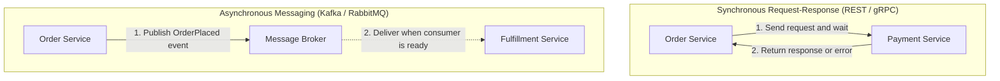
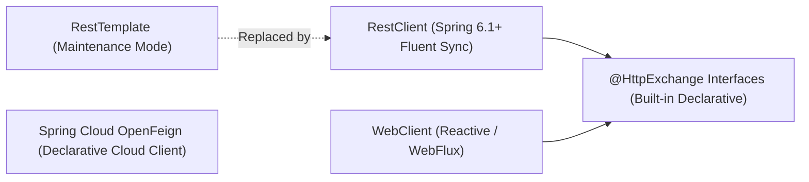
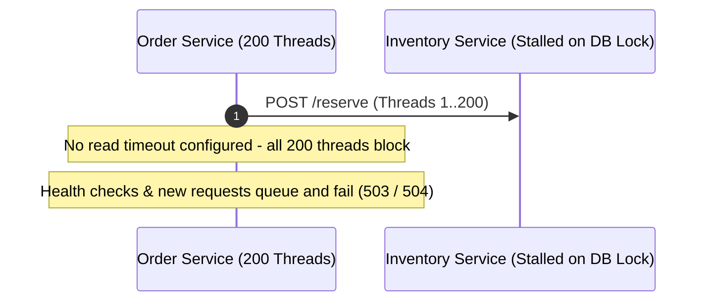

Inside a monolith, calling another module is a local method invocation on the JVM stack. It completes in nanoseconds, passes references in memory, and either returns a value or throws an exception cleanly.

Once that call crosses a process boundary over a network, every assumption changes. Serialization burns CPU, TCP connections drop, TLS handshakes add latency, and a downstream service can finish writing to its database and still time out before sending back a response. Choosing the right communication style and configuring your Java clients defensively determines whether a slowdown stays localized or spreads across your whole system.

## Synchronous vs Asynchronous Communication

Service-to-service interactions generally fall into two models: synchronous request-response (REST or gRPC) and asynchronous messaging (Kafka, RabbitMQ, SQS).



The core difference is **temporal coupling**. In a synchronous call, both the caller and the callee must be reachable and responsive during the same request window. In an asynchronous flow, the producer hands an event to a durable broker and returns immediately; the consumer can be temporarily down, deploying, or catching up on a backlog without blocking the producer.

| Dimension | Synchronous (REST / gRPC) | Asynchronous (Kafka / RabbitMQ) |
|---|---|---|
| **Temporal coupling** | Both services must be available at the same time | Producer and consumer operate independently |
| **Response semantics** | Immediate answer returned to the caller | Eventual processing; caller does not block on downstream work |
| **Traffic spikes** | Bounded by connection pools and downstream capacity | Broker buffers bursts so consumers drain at a steady pace |
| **Operational needs** | Timeouts, circuit breakers, load balancing | Schema evolution, dead-letter queues, idempotent consumers |
| **Good fit for** | Real-time reads and validation needed before replying to a user | Domain notifications, side effects, cross-service projections |

A practical rule of thumb: use synchronous calls when the user cannot move forward without the answer right now (for example, checking whether a coupon code is valid or authorizing a payment). Use asynchronous events for everything that happens *after* a decision is committed (sending confirmation emails, updating search indexes, triggering warehouse fulfillment).

## Spring HTTP Clients: RestTemplate, RestClient, @HttpExchange, and OpenFeign

Java teams on Spring Boot 3+ have four HTTP client options to navigate, and understanding how they relate avoids mixing outdated APIs into new services.



### `RestTemplate` (Maintenance Mode)

`RestTemplate` was Spring's synchronous HTTP client for more than a decade. It is now in **maintenance mode**: Spring still supports existing applications and fixes critical issues, but new features go into `RestClient` and `WebClient`. You will still encounter `RestTemplate` in mature codebases, and if you maintain one, the most important rule is never to rely on `new RestTemplate()` with default timeouts.

### `RestClient` (Modern Synchronous Standard)

Introduced in Spring Framework 6.1 (Spring Boot 3.2), `RestClient` brings the fluent API style of `WebClient` to synchronous applications without requiring reactive dependencies. It works cleanly with traditional Servlet threads and Java 21 virtual threads.

```java
package com.example.orders.client;

import org.springframework.http.HttpStatusCode;
import org.springframework.http.MediaType;
import org.springframework.stereotype.Component;
import org.springframework.web.client.RestClient;

import java.util.UUID;

@Component
public class CustomerRestClient {

    private final RestClient restClient;

    public CustomerRestClient(RestClient.Builder builder) {
        this.restClient = builder
                .baseUrl("http://customer-service:8080")
                .defaultHeader("X-Client-Service", "order-service")
                .build();
    }

    public CustomerResponse findCustomer(UUID customerId) {
        return restClient.get()
                .uri("/api/v1/customers/{id}", customerId)
                .accept(MediaType.APPLICATION_JSON)
                .retrieve()
                .onStatus(HttpStatusCode::is4xxClientError, (req, res) -> {
                    throw new CustomerNotFoundException("Customer not found: " + customerId);
                })
                .onStatus(HttpStatusCode::is5xxServerError, (req, res) -> {
                    throw new DownstreamUnavailableException("Customer service returned " + res.getStatusCode());
                })
                .body(CustomerResponse.class);
    }

    public record CustomerResponse(UUID id, String displayName, String email) {}
}
```

### Declarative HTTP Interfaces (`@HttpExchange`)

Introduced in Spring Framework 6 and backed by `RestClient` (as of Spring 6.1) or `WebClient`, declarative HTTP interfaces let you describe an external API as a plain Java interface with zero third-party cloud dependencies:

```java
package com.example.orders.client;

import org.springframework.web.bind.annotation.PathVariable;
import org.springframework.web.bind.annotation.RequestBody;
import org.springframework.web.bind.annotation.RequestHeader;
import org.springframework.web.service.annotation.GetExchange;
import org.springframework.web.service.annotation.HttpExchange;
import org.springframework.web.service.annotation.PostExchange;

import java.util.UUID;

@HttpExchange("/api/v1/payments")
public interface PaymentHttpClient {

    @PostExchange("/{orderId}/charges")
    PaymentResponse charge(
            @PathVariable UUID orderId,
            @RequestHeader("Idempotency-Key") String idempotencyKey,
            @RequestBody PaymentRequest request
    );

    @GetExchange("/{paymentId}")
    PaymentResponse findById(@PathVariable UUID paymentId);

    record PaymentRequest(long amountCents, String currency, String paymentMethodToken) {}
    record PaymentResponse(UUID paymentId, String status) {}
}
```

You wire the proxy once in a `@Configuration` class using `RestClientAdapter` and `HttpServiceProxyFactory`:

```java
package com.example.orders.config;

import com.example.orders.client.PaymentHttpClient;
import org.springframework.context.annotation.Bean;
import org.springframework.context.annotation.Configuration;
import org.springframework.web.client.RestClient;
import org.springframework.web.client.support.RestClientAdapter;
import org.springframework.web.service.invoker.HttpServiceProxyFactory;

@Configuration
public class PaymentClientConfig {

    @Bean
    public PaymentHttpClient paymentHttpClient(RestClient configuredRestClient) {
        RestClient paymentClient = configuredRestClient.mutate()
                .baseUrl("http://payment-service:8080")
                .build();

        HttpServiceProxyFactory factory = HttpServiceProxyFactory
                .builderFor(RestClientAdapter.create(paymentClient))
                .build();

        return factory.createClient(PaymentHttpClient.class);
    }
}
```

### Spring Cloud OpenFeign

Before `@HttpExchange` existed, **Spring Cloud OpenFeign** was the standard way to write declarative HTTP clients in Spring microservices, using familiar Spring MVC annotations (`@PostMapping`, `@PathVariable`) paired with Spring Cloud LoadBalancer and discovery clients:

```java
package com.example.orders.client;

import org.springframework.cloud.openfeign.FeignClient;
import org.springframework.web.bind.annotation.PathVariable;
import org.springframework.web.bind.annotation.PostMapping;
import org.springframework.web.bind.annotation.RequestBody;
import org.springframework.web.bind.annotation.RequestHeader;

import java.util.UUID;

@FeignClient(name = "payment-service", path = "/api/v1/payments")
public interface PaymentFeignClient {

    @PostMapping("/{orderId}/charges")
    PaymentHttpClient.PaymentResponse charge(
            @PathVariable("orderId") UUID orderId,
            @RequestHeader("Idempotency-Key") String idempotencyKey,
            @RequestBody PaymentHttpClient.PaymentRequest request
    );
}
```

OpenFeign remains widely deployed and supported in Spring Cloud, though the Spring Cloud project itself now treats OpenFeign as feature-complete and encourages evaluating Spring Framework's built-in `@HttpExchange` interfaces for new Spring Boot 3+ applications.

## gRPC and Protocol Buffers in Java

REST with JSON over HTTP/1.1 is easy to inspect and works everywhere, which makes it the default for public APIs and browser-facing backends. For high-throughput internal service-to-service traffic, however, JSON carries extra overhead: field names repeat in every payload, text parsing allocates short-lived strings on the heap, and HTTP/1.1 handles one active request per connection at a time unless you open a pool of sockets.

**gRPC** pairs **HTTP/2** transport with **Protocol Buffers (Protobuf)** binary serialization:

- **Compact typed contracts:** Schemas live in `.proto` files compiled by `protoc` into strongly typed Java message classes and client/server stubs. Field numbers replace repeated string keys on the wire, usually producing noticeably smaller payloads and faster parsing than JSON.
- **HTTP/2 multiplexing:** Multiple concurrent RPC streams share a single long-lived TCP connection via interleaved binary frames, avoiding HTTP/1.1 application-level head-of-line blocking.
- **Streaming and built-in deadlines:** Alongside standard unary request-response calls, gRPC supports server streaming, client streaming, bidirectional streaming, and first-class deadline propagation.

### Defining a `.proto` Contract

Notice that monetary values should use integer minor units (such as cents) or a dedicated currency/units message rather than floating-point `double`, avoiding binary rounding errors:

```protobuf
syntax = "proto3";

package ecommerce.inventory.v1;

option java_package = "com.example.inventory.grpc";
option java_multiple_files = true;

message StockCheckRequest {
  string sku = 1;
  int32 requested_quantity = 2;
}

message StockCheckResponse {
  bool available = 1;
  int32 remaining_stock = 2;
  int64 unit_price_cents = 3;
  string currency = 4;
}

service InventoryService {
  rpc CheckStock (StockCheckRequest) returns (StockCheckResponse);
}
```

### Implementing the gRPC Server and Client in Java

With `grpc-java` (integrated via Spring gRPC or community Spring Boot gRPC starters), the server extends the generated `*ImplBase` class and writes results to a `StreamObserver`:

```java
package com.example.inventory.grpc;

import io.grpc.Status;
import io.grpc.stub.StreamObserver;

public class InventoryGrpcService extends InventoryServiceGrpc.InventoryServiceImplBase {

    private final InventoryRepository repository;

    public InventoryGrpcService(InventoryRepository repository) {
        this.repository = repository;
    }

    @Override
    public void checkStock(
            StockCheckRequest request,
            StreamObserver<StockCheckResponse> responseObserver
    ) {
        if (request.getRequestedQuantity() <= 0) {
            responseObserver.onError(Status.INVALID_ARGUMENT
                    .withDescription("requested_quantity must be positive")
                    .asRuntimeException());
            return;
        }

        StockItem item = repository.findBySku(request.getSku());
        if (item == null) {
            responseObserver.onError(Status.NOT_FOUND
                    .withDescription("Unknown SKU: " + request.getSku())
                    .asRuntimeException());
            return;
        }

        boolean available = item.quantityOnHand() >= request.getRequestedQuantity();
        StockCheckResponse response = StockCheckResponse.newBuilder()
                .setAvailable(available)
                .setRemainingStock(item.quantityOnHand())
                .setUnitPriceCents(item.unitPriceCents())
                .setCurrency(item.currency())
                .build();

        responseObserver.onNext(response);
        responseObserver.onCompleted();
    }
}
```

On the calling side, always attach an explicit deadline (`withDeadlineAfter`) so a stalled RPC cannot hang indefinitely:

```java
package com.example.orders.grpc;

import com.example.inventory.grpc.InventoryServiceGrpc;
import com.example.inventory.grpc.StockCheckRequest;
import com.example.inventory.grpc.StockCheckResponse;

import java.util.concurrent.TimeUnit;

public class InventoryGrpcClient {

    private final InventoryServiceGrpc.InventoryServiceBlockingStub stub;

    public InventoryGrpcClient(InventoryServiceGrpc.InventoryServiceBlockingStub stub) {
        this.stub = stub;
    }

    public StockCheckResponse checkStock(String sku, int quantity) {
        StockCheckRequest request = StockCheckRequest.newBuilder()
                .setSku(sku)
                .setRequestedQuantity(quantity)
                .build();

        // Propagates deadline metadata to the server and aborts locally after 2 seconds
        return stub.withDeadlineAfter(2, TimeUnit.SECONDS)
                .checkStock(request);
    }
}
```

### When REST Is Still the Better Choice

gRPC is not automatically better for every link in a system. REST over JSON remains preferable for public partner APIs, browser clients (browsers cannot speak native gRPC without a gRPC-Web proxy), CDN-cacheable GET endpoints, and low-traffic internal services where maintaining `.proto` distribution and code generation adds more friction than the latency savings are worth.

## Explicit Connect and Read Timeouts

One of the fastest ways to take down a Java microservice in production is leaving an HTTP client with default unbounded timeouts. If a downstream service hits a database lock or long GC pause and stops sending response bytes, every calling worker thread parks on the socket until the server thread pool fills up and stops accepting even health checks.



Every HTTP client in production needs two distinct timeouts configured explicitly:

1. **Connect timeout:** How long the client waits to establish the TCP connection. Keep this short (for example, 500ms to 2 seconds). If a host is unreachable or a port is dropping packets, waiting 30 seconds wastes resources.
2. **Read (response) timeout:** How long the client waits for response data once connected. Tune this to the downstream service's realistic latency budget (for example, 2 to 5 seconds).

### Configuring Pooled Timeouts on `RestClient` with Apache HttpClient 5

In Apache HttpClient 5.2+, connect timeout belongs on `ConnectionConfig` (attached to the connection manager) while response timeout and connection-lease timeout belong on `RequestConfig`:

```java
package com.example.orders.config;

import org.apache.hc.client5.http.config.ConnectionConfig;
import org.apache.hc.client5.http.config.RequestConfig;
import org.apache.hc.client5.http.impl.classic.CloseableHttpClient;
import org.apache.hc.client5.http.impl.classic.HttpClients;
import org.apache.hc.client5.http.impl.io.PoolingHttpClientConnectionManager;
import org.apache.hc.client5.http.impl.io.PoolingHttpClientConnectionManagerBuilder;
import org.apache.hc.core5.util.TimeValue;
import org.apache.hc.core5.util.Timeout;
import org.springframework.context.annotation.Bean;
import org.springframework.context.annotation.Configuration;
import org.springframework.http.client.HttpComponentsClientHttpRequestFactory;
import org.springframework.web.client.RestClient;

@Configuration
public class HttpClientConfig {

    @Bean
    public RestClient configuredRestClient() {
        ConnectionConfig connectionConfig = ConnectionConfig.custom()
                .setConnectTimeout(Timeout.ofMilliseconds(1000))     // 1s TCP connect
                .setSocketTimeout(Timeout.ofMilliseconds(3000))      // 3s socket read inactivity
                .setTimeToLive(TimeValue.ofMinutes(5))
                .build();

        PoolingHttpClientConnectionManager pool = PoolingHttpClientConnectionManagerBuilder.create()
                .setDefaultConnectionConfig(connectionConfig)
                .setMaxConnTotal(200)
                .setMaxConnPerRoute(50)
                .build();

        RequestConfig requestConfig = RequestConfig.custom()
                .setConnectionRequestTimeout(Timeout.ofMilliseconds(500)) // Wait for pool lease
                .setResponseTimeout(Timeout.ofMilliseconds(3000))         // 3s response timeout
                .build();

        CloseableHttpClient httpClient = HttpClients.custom()
                .setConnectionManager(pool)
                .setDefaultRequestConfig(requestConfig)
                .evictExpiredConnections()
                .build();

        return RestClient.builder()
                .requestFactory(new HttpComponentsClientHttpRequestFactory(httpClient))
                .build();
    }
}
```

If you prefer not to pull in Apache HttpClient, Spring Boot 3.2+ also provides `JdkClientHttpRequestFactory` wrapping `java.net.http.HttpClient`, where you set `connectTimeout` on `HttpClient.newBuilder()` and `setReadTimeout` on the factory.

## Handling Partial Failures and Idempotency

A **partial failure** happens when a request crosses the network and the caller never gets a clear answer. Suppose `OrderService` sends a `POST /api/v1/payments/charge` request and hits a 3-second read timeout. Two completely different outcomes look identical to the caller:

1. The request dropped before reaching `PaymentService`, so the customer's card was never charged.
2. `PaymentService` charged the card and committed the transaction, and the timeout happened while the HTTP 200 response was traveling back.

Blindly retrying a non-idempotent `POST` request in that situation charges the customer twice. Failing immediately without a recovery plan leaves the order marked unpaid even though money moved.

### Making Retries Safe with `Idempotency-Key`

To let callers retry safely after ambiguous timeouts, state-changing endpoints accept a client-generated `Idempotency-Key` header (typically a UUID tied to the business attempt, such as one key per checkout attempt):

```http
POST /api/v1/payments/9c24f0c1-2a5b-4a80-b122-1d657c91f402/charges HTTP/1.1
Host: payment-service:8080
Idempotency-Key: 9b1deb4d-3b7d-4bad-9bdd-2b0d7b3dcb6d
Content-Type: application/json

{"amountCents": 14950, "currency": "USD", "paymentMethodToken": "pm_card_visa"}
```

On the server side, the payment service persists the key in a table with a `UNIQUE` constraint inside the same transactional boundary (or coordinates via an atomic lock) before charging:

```java
package com.example.payments.service;

import org.springframework.dao.DataIntegrityViolationException;
import org.springframework.http.HttpStatus;
import org.springframework.stereotype.Service;
import org.springframework.web.server.ResponseStatusException;

import java.util.UUID;

@Service
public class IdempotentPaymentService {

    private final IdempotencyStore store;
    private final PaymentGateway gateway;

    public IdempotentPaymentService(IdempotencyStore store, PaymentGateway gateway) {
        this.store = store;
        this.gateway = gateway;
    }

    public PaymentResult charge(UUID orderId, String idempotencyKey, ChargeCommand cmd) {
        String requestHash = cmd.sha256Fingerprint();

        // Check if this key was already seen
        var existing = store.findByKey(idempotencyKey);
        if (existing.isPresent()) {
            return handleExistingRecord(existing.get(), requestHash);
        }

        // Reserve the key atomically (backed by a UNIQUE constraint on idempotency_key)
        try {
            store.insertInProgress(idempotencyKey, requestHash);
        } catch (DataIntegrityViolationException raceLost) {
            IdempotencyRecord record = store.findByKey(idempotencyKey).orElseThrow();
            return handleExistingRecord(record, requestHash);
        }

        // Execute the actual payment and persist the final result
        PaymentResult result = gateway.capture(orderId, idempotencyKey, cmd);
        store.markCompleted(idempotencyKey, result);
        return result;
    }

    private PaymentResult handleExistingRecord(IdempotencyRecord record, String requestHash) {
        if (!record.requestHash().equals(requestHash)) {
            // Same key reused with different amount or payload
            throw new ResponseStatusException(
                    HttpStatus.UNPROCESSABLE_ENTITY,
                    "Idempotency-Key reused with a different request payload"
            );
        }
        if (record.isInProgress()) {
            // Original request is still executing; ask caller to back off and retry
            throw new ResponseStatusException(
                    HttpStatus.CONFLICT,
                    "Request with this Idempotency-Key is currently in progress"
            );
        }
        return record.cachedResult();
    }
}
```

Notice the two edge cases handled here:

- **Payload mismatch:** If a client accidentally reuses an old `Idempotency-Key` with a different dollar amount, returning `422 Unprocessable Entity` prevents silent corruption.
- **Concurrent duplicate:** If a retry fires before the original call finishes, returning `409 Conflict` avoids executing two charges in parallel.

### Other Partial Failure Defenses

Idempotency handles safe retries for mutations, while the rest of a partial-failure strategy focuses on limiting blast radius:

- **Graceful degradation for optional data:** If the product page calls `ReviewsService` and `PricingService`, a timeout in `ReviewsService` should hide the review widget or serve cached ratings rather than failing the whole product page.
- **Bounded request budgets (deadlines):** When Service A has a 2-second SLA and spends 1.8 seconds before calling Service B, Service B should receive the remaining 200ms budget (native in gRPC deadlines) rather than starting a fresh 3-second query whose answer nobody is waiting for anymore.
- **Reconciliation for multi-step workflows:** For critical workflows spanning multiple services (reserve inventory, capture payment, schedule shipment), pair idempotent calls with a Saga or periodic reconciliation job so an interrupted step is either completed or cleanly compensated.

## Interview Questions

### How does HTTP/2 multiplexing in gRPC reduce head-of-line blocking compared to HTTP/1.1?

In HTTP/1.1, a single TCP connection processes one request-response exchange at a time; if the first request stalls on the server, queued requests behind it wait (application-layer head-of-line blocking), forcing clients to maintain larger connection pools. HTTP/2 splits messages into tagged binary frames belonging to independent streams and interleaves them over one persistent TCP connection, so a slow response on Stream 1 does not stall frames on Stream 3. Note that TCP itself can still experience transport-layer head-of-line blocking if a single IP packet drops and the kernel waits for retransmission (which HTTP/3 over QUIC addresses).

### What are the main differences between `RestTemplate`, `RestClient`, `@HttpExchange`, and OpenFeign in Spring Boot 3+?

`RestTemplate` is the legacy synchronous client now in maintenance mode. `RestClient` (Spring 6.1 / Boot 3.2+) is its modern fluent synchronous replacement using the same pluggable HTTP request factories and converters. `@HttpExchange` is Spring Framework's built-in declarative HTTP interface mechanism that generates typed client proxies backed by `RestClient` or `WebClient`. Spring Cloud OpenFeign is the older Spring Cloud declarative client; it remains supported in existing microservices, though Spring recommends considering `@HttpExchange` for greenfield Spring Boot 3+ services.

### Why is an HTTP read timeout after a `POST` request uniquely dangerous in microservices?

A read timeout only tells the caller that no response arrived within the deadline; it does not tell you whether the downstream service failed before executing or committed the change and failed while sending the response. Retrying a non-idempotent `POST` blindly can create duplicate orders or double charges. Requiring an `Idempotency-Key` header persisted atomically on the server lets the caller retry safely and receive the original outcome instead of running the side effect twice.

### When should a team stick with REST/JSON instead of adopting gRPC between microservices?

Stick with REST/JSON when external partners or web browsers consume the API directly, when HTTP caching (`Cache-Control`, `ETag`) at CDNs or proxies matters, when easy human debugging with `curl` and standard logs is more valuable than serialization efficiency, or when internal request volume is modest enough that Protobuf schema tooling and code generation add unnecessary operational overhead.
