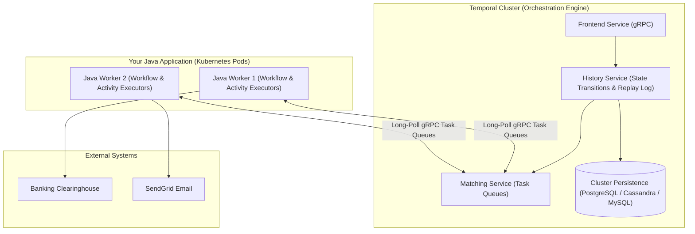
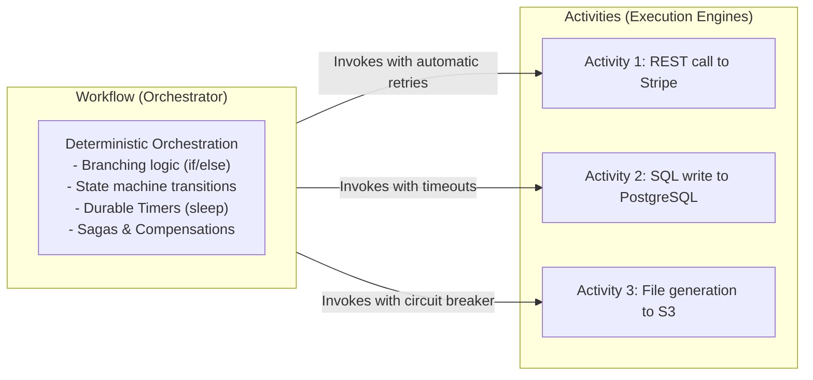
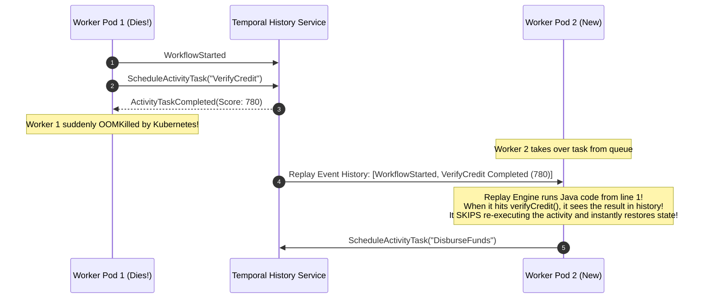

# Long-Running Workflows with Temporal

Consider a common enterprise business process: **Customer Loan Approval and Disbursal**.
1. Verify customer identity via an external government API.
2. Run credit scoring through a third-party bureau.
3. Wait up to 5 days for a human risk officer to approve or reject the application.
4. If approved, disburse funds via a banking clearinghouse.
5. If disbursal fails, initiate compensating reversals across internal accounts.
6. Send email and SMS confirmations.

How do most engineering teams implement this today?
- They build a state machine in a relational database with 15 status flags (`PENDING_APPROVAL`, `WAITING_FOR_DOCS`, `DISBURSING`).
- They create 5 Kafka topics and 5 microservices choreographing events back and forth.
- They schedule a dozen Spring `@Scheduled` cron jobs polling the database every 60 seconds to check: *"Has the user been waiting more than 5 days?"*

This ad-hoc architecture is notoriously brittle. If a network blip drops a Kafka message, if a server reboots mid-transaction, or if a cron job times out, the workflow gets stuck in an inconsistent state. Debugging requires joining five distributed databases and grepping through millions of log lines to reconstruct what happened.

The modern distributed systems paradigm that solves this is **Durable Execution**, pioneered by **Temporal**.

---

## What is Durable Execution?

**Durable Execution** is a programming model where code executes reliably to completion, regardless of infrastructure failures.

In Temporal, you write standard, idiomatic Java code—using loops, conditionals, and standard try-catch blocks:

```java
// Conceptual Temporal Workflow in Java
@WorkflowMethod
public void processLoanApplication(LoanRequest request) {
    creditCheckActivity.verifyCredit(request);

    // Sleep for 3 days without holding a thread or memory!
    Workflow.sleep(Duration.ofDays(3));

    // Wait for human signal via web portal
    Workflow.await(() -> isHumanApproved || isHumanRejected);

    if (isHumanApproved) {
        disbursementActivity.disburseFunds(request);
        notificationActivity.sendConfirmation(request);
    }
}
```

If the Kubernetes pod executing this code is terminated by an OOM killer, if the underlying cloud VM experiences a kernel panic, or if a network partition isolates the data center on day 2 of the 3-day sleep, **the execution state is never lost**. A new worker pod on the other side of the planet picks up execution and resumes on the exact line of code where the previous worker died.

---

## Temporal Architecture: The Server vs The Worker

A common misconception is that Temporal runs your Java code inside the Temporal cluster. It does not.



### The Architectural Separation of Concerns

1. **Temporal Cluster:** The state orchestrator. It manages task queues, tracks workflow execution history, schedules timers, and coordinates task dispatching. The cluster never executes your business code; it only stores immutable event history logs.
2. **Temporal Workers:** Your Spring Boot microservices. They run your compiled Java code, long-poll the Temporal cluster for tasks over gRPC, execute activities, and report results back to the cluster.
3. **Task Queues:** Dynamic queues hosted by the Temporal cluster where tasks wait to be picked up by available workers.

---

## Workflows vs Activities: The Two Core Pillars

Temporal strictly bifurcates code into **Workflows** and **Activities**:



### Workflows (Pure, Deterministic Orchestration)
A Workflow is the coordinator. Its job is to orchestrate the flow of control, evaluate business decisions, and invoke activities.
- **The Golden Rule:** Workflows must be **100% deterministic**. Given the exact same inputs and history of events, a workflow must execute the exact same sequence of statements.

### Activities (Non-Deterministic Side Effects)
An Activity performs real-world I/O: calling downstream REST APIs, querying databases, generating PDFs, or dispatching emails.
- Activities can fail transiently. Temporal wraps activities with declarative **RetryOptions** (exponential backoff, jitter, maximum attempts) and comprehensive timeouts (heartbeats, schedule-to-close, start-to-close).

---

## The Replay Engine and the Determinism Law

How does Temporal recover a workflow's in-memory variables and execution position when a worker crashes, without saving the JVM's physical thread stack?

It uses **Event Sourcing Replay**:



### How Replay Works:
1. Every time a workflow schedules a timer, awaits a signal, or completes an activity, the Temporal cluster records an immutable event in the workflow's history log.
2. When a worker crashes and a new worker takes over, Temporal feeds the entire **Event History** to the new worker.
3. The new worker executes the Java workflow method **from the very beginning (line 1)**.
4. When the code encounters an activity invocation that already completed in history, the Temporal SDK intercepts the call, retrieves the return value from the history log, and returns it immediately **without re-executing the activity**.
5. Within milliseconds, the code replays through past events and resumes execution at the exact line that was pending when the crash occurred.

### The Strict Rules of Workflow Determinism

Because replay relies on identical code execution paths, **you must never do the following inside a `@WorkflowMethod`**:

- Never call `System.currentTimeMillis()` or `Instant.now()`. Use `Workflow.currentTimeMillis()` instead (which returns the recorded event timestamp during replay).
- Never call `UUID.randomUUID()`. Use `Workflow.randomUUID()` (which generates deterministic pseudorandom values recorded in history).
- Never execute database queries, HTTP calls, or file I/O directly in a workflow (delegate them to an Activity).
- Never use standard Java threads (`new Thread()`, `Executors`). Use `Async.function()` or `Workflow.newPromise()`.
- Never modify global or static mutable state.

Violating these rules causes Temporal's validation engine to detect a mismatch between history and code, throwing a fatal `NonDeterministicWorkflowException`.

---

## Implementing the Saga Pattern with Temporal

In distributed architectures, multi-service transactions cannot use database 2-phase commit. Instead, we use the **Saga Pattern**: execute a series of forward local transactions, and if any step fails, execute compensating transactions in reverse order to restore consistency.

Writing Sagas by hand with event choreography is complex and error-prone. In Temporal, the Java SDK provides a built-in `Saga` orchestrator:

```java
package com.javahub.temporal.workflow;

import com.javahub.temporal.activity.BankingActivities;
import io.temporal.failure.ActivityFailure;
import io.temporal.workflow.Saga;
import io.temporal.workflow.Workflow;
import org.slf4j.Logger;

import java.time.Duration;

public class OrderFulfillmentWorkflowImpl implements OrderFulfillmentWorkflow {

    private static final Logger log = Workflow.getLogger(OrderFulfillmentWorkflowImpl.class);

    private final BankingActivities activities = Workflow.newActivityStub(
            BankingActivities.class,
            Workflow.newActivityOptionsBuilder()
                    .setStartToCloseTimeout(Duration.ofSeconds(30))
                    .build()
    );

    @Override
    public void fulfillOrder(OrderRequest request) {
        // 1. Configure the Saga orchestrator
        Saga.Options sagaOptions = new Saga.Options.Builder()
                .setParallelCompensation(false) // Compensate in strict reverse sequential order
                .build();
        Saga saga = new Saga(sagaOptions);

        try {
            // Step 1: Reserve Inventory
            activities.reserveInventory(request.orderId(), request.items());
            // Register compensation immediately: what to run if downstream steps fail!
            saga.addCompensation(() -> activities.cancelInventoryReservation(request.orderId()));

            // Step 2: Authorize Payment
            activities.chargeCustomer(request.customerId(), request.totalAmount());
            saga.addCompensation(() -> activities.refundPayment(request.customerId(), request.totalAmount()));

            // Step 3: Dispatch Shipping
            activities.dispatchShipment(request.orderId(), request.shippingAddress());

            log.info("Order {} fulfilled successfully!", request.orderId());

        } catch (ActivityFailure e) {
            log.error("Workflow failed at step! Initiating automated compensating rollback.", e);
            // 2. Automatically triggers all registered compensations in reverse order!
            saga.compensate();
            throw e;
        }
    }
}
```

If Step 3 (Shipping) fails after 5 retries, the `catch` block catches the `ActivityFailure`, invokes `saga.compensate()`, and Temporal automatically runs `refundPayment()` followed by `cancelInventoryReservation()`.

---

## Asynchronous Human-in-the-Loop: Signals and Queries

Many enterprise processes require human input: a fraud analyst approving a suspicious transfer, an author reviewing an article draft, or a manager authorizing an expense report.

Temporal handles this natively using **Signals** and **Queries**:

- **Signal:** An asynchronous write into a running workflow from an external system (e.g., REST controller).
- **Query:** A synchronous read to inspect a running workflow's current in-memory state without modifying history.

```java
package com.javahub.temporal.workflow;

import io.temporal.workflow.QueryMethod;
import io.temporal.workflow.SignalMethod;
import io.temporal.workflow.WorkflowInterface;
import io.temporal.workflow.WorkflowMethod;

@WorkflowInterface
public interface ExpenseApprovalWorkflow {

    @WorkflowMethod
    void processExpense(ExpenseClaim claim);

    // Human-in-the-loop signal from frontend manager dashboard
    @SignalMethod
    void submitManagerDecision(boolean approved, String reviewerNotes);

    // Synchronous read to check current state from REST API
    @QueryMethod
    String getCurrentStatus();
}
```

### Implementing Signals and Timers:

```java
package com.javahub.temporal.workflow;

import io.temporal.workflow.Workflow;
import java.time.Duration;

public class ExpenseApprovalWorkflowImpl implements ExpenseApprovalWorkflow {

    private boolean isApproved = false;
    private boolean decisionReceived = false;
    private String status = "PENDING_MANAGER_REVIEW";

    @Override
    public void processExpense(ExpenseClaim claim) {
        // Wait up to 7 days for manager to click Approve/Reject in web portal!
        boolean signalArrived = Workflow.await(
                Duration.ofDays(7),
                () -> decisionReceived
        );

        if (!signalArrived) {
            // Manager timed out after 7 days: Auto-escalate to VP!
            status = "ESCALATED_TO_VP";
            escalationActivity.escalateToVP(claim);
            return;
        }

        if (isApproved) {
            status = "APPROVED";
            accountingActivity.reimburseEmployee(claim);
        } else {
            status = "REJECTED";
            notificationActivity.sendRejectionEmail(claim);
        }
    }

    @Override
    public void submitManagerDecision(boolean approved, String reviewerNotes) {
        this.isApproved = approved;
        this.decisionReceived = true;
    }

    @Override
    public String getCurrentStatus() {
        return this.status;
    }
}
```

`Workflow.await(Duration.ofDays(7), ...)` does not block a thread. The worker suspends execution, frees all resources, and the workflow state rests peacefully on disk in the Temporal cluster until either the 7-day timer fires or the manager submits a signal.

---

## Senior Engineer Interview Crucible

### How does Temporal's Event History Replay restore a workflow's execution state after a worker crashes without checkpointing JVM heap memory?

Temporal achieves durable state recovery without saving heavyweight JVM heap memory dumps by using **deterministic event sourcing replay**:

1. During execution, every external interaction (activity scheduling, activity completion, timer start, signal receipt) is recorded as an immutable event in the workflow's **Event History** on the Temporal cluster.
2. When a worker pod crashes, the cluster detects the timeout and reassigns the workflow execution to an available worker.
3. The new worker loads the complete Event History and begins executing the Java workflow method **from the very first line of code**.
4. When the code encounters an activity or timer call that already completed in history, the Temporal Java SDK intercepts the call, suppresses actual network execution, and immediately injects the recorded return value from the history log.
5. In milliseconds, the code replays through historical execution paths and reconstructs all local variables, loop counters, and call stacks in memory, resuming forward execution from the point of failure.

---

### Why is invoking `System.currentTimeMillis()` or injecting a standard Spring `@Repository` inside a Temporal `@WorkflowMethod` strictly forbidden?

Workflows must be **100% deterministic** because they are frequently replayed from history. 

If a workflow method invokes `System.currentTimeMillis()`:
- During the first execution, it returns `1793262000000`.
- During replay 2 days later, it returns `1793434800000`.
- If this timestamp was used in an `if (elapsed > 1000)` statement, the replay would take an entirely different code branch than the original execution, violating execution history and throwing `NonDeterministicWorkflowException`.

Similarly, injecting a Spring `@Repository` or performing HTTP calls directly inside a workflow method introduces non-determinism: database rows change and external services can return different responses during replay. All non-deterministic operations (I/O, database access, external APIs, clock checks) must reside strictly within `@ActivityInterface` implementations, where results are recorded in the event history and replayed deterministically.

---

### How does `Workflow.sleep(Duration.ofDays(30))` work under the hood without consuming OS threads or JVM memory for 30 days?

When `Workflow.sleep(Duration.ofDays(30))` is invoked:
1. The Temporal Java SDK generates a `StartTimer` command with a 30-day duration and sends it to the Temporal cluster over gRPC.
2. The cluster records a `TimerStarted` event in the workflow's history log and assigns a durable timer in its internal persistence layer.
3. The worker completes its current task pass and **releases the Java thread back to the worker thread pool**. The workflow's in-memory state is garbage-collected from the worker JVM. Zero CPU cycles, zero OS threads, and zero heap memory are consumed.
4. Exactly 30 days later, the Temporal cluster's internal timer service fires, appends a `TimerFired` event to the history, and enqueues a new workflow task.
5. An available worker picks up the task, replays the event history up to the timer, and continues execution past the `Workflow.sleep()` line.

---

### Contrast Choreography (event-driven Kafka choreography) with Orchestration (Temporal Durable Execution). When does choreography become an unmaintainable anti-pattern?

- **Event Choreography (Decentralized Pub/Sub):** Each microservice listens to incoming Kafka events, executes its business logic, and emits a new event for the next service to consume. There is no central coordinator.
- **Orchestration (Temporal Durable Execution):** A centralized workflow explicitly dictates the execution order, timeouts, conditional branches, and compensations across services.

**When Choreography Becomes an Anti-Pattern:**
Choreography works well for simple, decoupled 2-step event notifications (e.g., `UserRegistered` -> `SendWelcomeEmail`). However, when applied to complex multi-step business transactions (like loans, fulfillment, or multi-day approval sagas), it degrades into an unmaintainable architectural mess known as **Distributed Spaghetti**:
1. **Hidden Business Logic:** No single engineer or codebase knows the complete end-to-end business flow. It is implicitly scattered across 10 different Kafka consumers and configuration files.
2. **Brittle Timeout and Failure Handling:** Implementing a business rule like *"If Service C doesn't reply within 48 hours, cancel Service A and alert Service B"* in pure choreography requires building custom state stores, timer tables, and compensator topics in every single microservice.
3. **Observability Nightmares:** Tracking the current progress of a single customer order requires tracing distributed trace IDs across dozens of asynchronous topics.

Temporal replaces choreography with an explicit, readable, code-defined workflow where timeouts, retries, and saga rollbacks are clearly expressed in a single, type-safe Java class.
