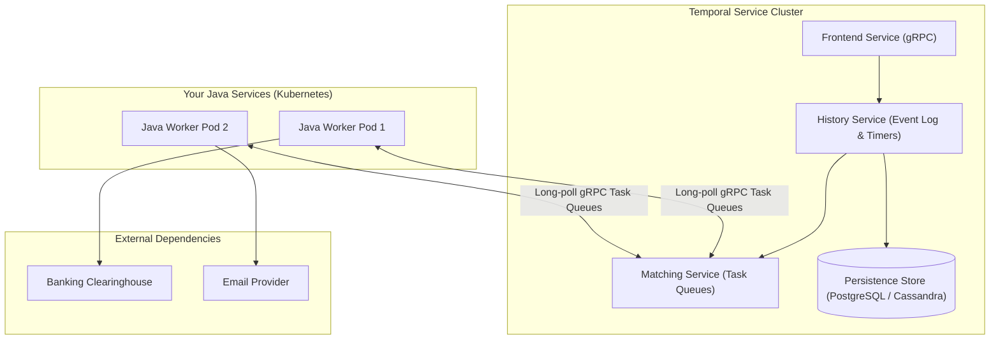
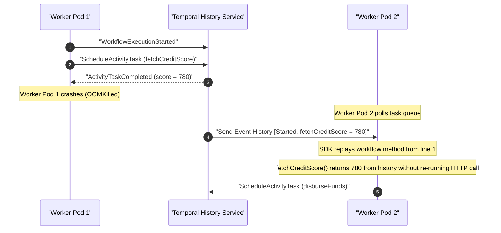

Think about what it takes to implement a multi-day business process such as customer loan approval and disbursal:

1. Verify customer identity against a government KYC API.
2. Fetch a credit score from a third-party bureau.
3. Wait up to 5 days for a human underwriter to approve or reject the application.
4. If approved, transfer funds through a banking clearinghouse.
5. If disbursal fails, reverse internal ledger holds and notify operations.
6. Send email and SMS updates to the applicant.

Without a workflow engine, teams usually assemble this out of several moving parts: a database table with a dozen status columns (`PENDING_KYC`, `WAITING_FOR_UNDERWRITER`, `DISBURSING`), several Kafka topics passing events between services, and Spring `@Scheduled` jobs polling the database every minute to check whether any application has been waiting longer than 5 days.

That setup works on day one, then gets harder to reason about every quarter. A pod restarts between a database write and a Kafka publish, a cron job double-fires during a deployment, or a downstream bank API goes down for four hours. Reconstructing what happened to a single loan means correlating logs across five services and querying three databases.

**Temporal** replaces that patchwork of status tables, polling jobs, and ad-hoc retry queues with **durable execution**: you write the orchestration as plain Java code, and Temporal persists every step so execution resumes cleanly after crashes, deployments, or multi-week waits.

---

## Orchestration Complexity vs. Durable Execution

With durable execution, control flow lives in ordinary Java statements—`if/else` branches, loops, and `try/catch` blocks—rather than scattered across message listeners and cron expressions:

```java
// Conceptual Temporal workflow method
@WorkflowMethod
public LoanOutcome processLoan(LoanApplication application) {
    kycActivities.verifyIdentity(application.applicantId());
    int creditScore = creditActivities.fetchCreditScore(application.applicantId());

    if (creditScore < 620) {
        notificationActivities.sendRejection(application.applicantId(), "Credit threshold not met");
        return LoanOutcome.REJECTED;
    }

    // Suspends without holding a JVM thread or heap memory for up to 5 days
    boolean decisionArrived = Workflow.await(Duration.ofDays(5), () -> decisionReceived);

    if (!decisionArrived) {
        escalationActivities.escalateToSeniorUnderwriter(application.loanId());
        return LoanOutcome.ESCALATED;
    }

    if (approved) {
        disbursalActivities.disburseFunds(application.loanId(), application.amount());
        notificationActivities.sendApproval(application.applicantId());
        return LoanOutcome.DISBURSED;
    }

    notificationActivities.sendRejection(application.applicantId(), reviewerNotes);
    return LoanOutcome.REJECTED;
}
```

If the Kubernetes pod running this workflow is killed by an OOM error or evicted during a cluster upgrade on day 3 of the 5-day wait, the workflow does not lose its local variables or forget that `verifyIdentity` and `fetchCreditScore` already ran. Another worker pod picks up the workflow when the timer fires or the signal arrives, reconstructs its state from persisted history, and continues on the next line.

---

## Temporal Architecture: Cluster, Workers, and Task Queues

A common early misunderstanding is thinking that Temporal executes your Java code inside the Temporal Server. It does not. Your compiled application code stays inside your own services (called **Workers**), inside your own VPC and Kubernetes clusters.



The responsibilities are cleanly separated:

- **Temporal Cluster (Workflow Engine):** Stores immutable workflow event histories, manages durable timers, tracks activity retries, and routes tasks through task queues. It never runs business logic and never needs network access to your internal databases or third-party APIs.
- **Task Queues:** Lightweight, dynamically created queues hosted by Temporal's Matching Service. Workflows and Activities are dispatched onto named task queues (such as `"loan-processing-queue"`). Because workers pull work via gRPC long-polling, you do not need to open inbound firewall ports to workers, and load balancing scales naturally as you add pods.
- **Workers:** Processes inside your Java or Spring Boot application that host your Workflow and Activity implementations, poll Task Queues, execute code, and report commands/results back to the cluster.

Here is how a Java service connects to Temporal and registers a worker on a Task Queue:

```java
package com.example.loan.worker;

import com.example.loan.activity.LoanActivitiesImpl;
import com.example.loan.workflow.LoanApprovalWorkflowImpl;
import io.temporal.client.WorkflowClient;
import io.temporal.serviceclient.WorkflowServiceStubs;
import io.temporal.worker.Worker;
import io.temporal.worker.WorkerFactory;

public class LoanWorkerBootstrap {

    public static final String LOAN_TASK_QUEUE = "loan-processing-queue";

    public static void main(String[] args) {
        WorkflowServiceStubs service = WorkflowServiceStubs.newLocalServiceStubs();
        WorkflowClient client = WorkflowClient.newInstance(service);

        WorkerFactory factory = WorkerFactory.newInstance(client);
        Worker worker = factory.newWorker(LOAN_TASK_QUEUE);

        // Register workflow implementation class (instantiated per workflow execution)
        worker.registerWorkflowImplementationTypes(LoanApprovalWorkflowImpl.class);

        // Register stateless, thread-safe activity implementations
        worker.registerActivitiesImplementations(new LoanActivitiesImpl());

        // Starts polling the task queue for workflow and activity tasks
        factory.start();
    }
}
```

If you use `temporal-spring-boot-starter`, Spring Boot handles `WorkflowServiceStubs`, `WorkflowClient`, and `WorkerFactory` auto-configuration based on `spring.temporal.*` properties and `@WorkflowImpl` / `@ActivityImpl` annotations.

---

## Event History Replay and Deterministic Java Workflows

Temporal splits your code into two distinct building blocks:

- **Workflows:** Pure, deterministic orchestration logic. They decide what to run, in what order, when to sleep, and how to recover on error.
- **Activities:** Regular Java methods that perform non-deterministic I/O (HTTP calls, SQL queries, Kafka publishes, file writes).

Temporal does not serialize JVM thread stacks or heap memory to disk. Instead, it uses **event sourcing replay**. Every time a workflow schedules an activity, receives an activity result, starts a timer, or receives a signal, Temporal appends an immutable event to that workflow's **Event History**.



When Worker Pod 2 takes over, the Temporal Java SDK runs your `@WorkflowMethod` from line 1. Whenever execution reaches an activity call that already completed in the Event History, the SDK intercepts the call and immediately returns the recorded result instead of invoking the activity again. Within a few milliseconds, all local variables and control-flow positions are reconstructed, and the worker executes the next unrecorded command.

### Concrete Rules for Deterministic Workflows

Because replay re-executes your workflow method from the start and compares the commands your code emits against the recorded Event History, **workflow code must always take the exact same execution path for a given history**.

Never call standard non-deterministic Java APIs inside a `@WorkflowMethod`:

| Avoid in Workflow Code | Use Instead in Temporal | Why |
| :--- | :--- | :--- |
| `Instant.now()` / `System.currentTimeMillis()` | `Workflow.currentTimeMillis()` | System clock changes between original run and replay |
| `UUID.randomUUID()` / `new Random()` | `Workflow.randomUUID()` / `Workflow.newRandom()` | Unseeded randomness produces different IDs on replay |
| `Thread.sleep(...)` | `Workflow.sleep(Duration)` | Blocks an OS thread and is not durable across crashes |
| `new Thread(...)` / `CompletableFuture.supplyAsync` | `Async.function(...)` / `Workflow.newPromise()` | External threads break Temporal's deterministic scheduler |
| Direct JDBC, JPA `@Repository`, or `RestClient` | Invoke an `@ActivityInterface` stub | DB rows and HTTP responses change over time |
| `LoggerFactory.getLogger(...)` | `Workflow.getLogger(...)` | Suppresses duplicate log lines during history replay |
| Iterating over `HashSet` / `HashMap` to schedule work | `LinkedHashMap`, `TreeMap`, or sorted `List` | Unordered iteration can schedule activities in a different order |

Consider what happens if you ignore the clock rule:

```java
// Broken: non-deterministic workflow code
public void processInvoice(Invoice invoice) {
    // On original run (Monday), this is false -> schedules sendReminder()
    // On replay (Wednesday after worker restart), this is true -> schedules applyLateFee()
    if (Instant.now().isAfter(invoice.dueDate())) {
        billingActivities.applyLateFee(invoice.id());
    } else {
        billingActivities.sendReminder(invoice.id());
    }
}
```

When the worker replays the workflow on Wednesday, the Event History says the first command was `ScheduleActivityTask(sendReminder)`, while the replayed code tries to emit `ScheduleActivityTask(applyLateFee)`. Temporal detects the mismatch and throws `io.temporal.worker.NonDeterministicException`, failing the workflow task so it does not corrupt state.

Replacing `Instant.now()` with `Instant.ofEpochMilli(Workflow.currentTimeMillis())` fixes the bug because `Workflow.currentTimeMillis()` returns the timestamp recorded in the workflow task's history event.

---

## Activity Options, Retries, and Saga Compensations

Real-world downstream services time out, return HTTP 503, and drop TCP connections. In Temporal, you handle transient failures declaratively with `ActivityOptions` and `RetryOptions` rather than writing manual retry loops.

```java
package com.example.order.activity;

import io.temporal.activity.ActivityInterface;
import io.temporal.activity.ActivityMethod;

import java.math.BigDecimal;
import java.util.UUID;

@ActivityInterface
public interface FulfillmentActivities {

    @ActivityMethod
    void reserveInventory(UUID orderId, String sku, int quantity);

    @ActivityMethod
    void releaseInventory(UUID orderId);

    @ActivityMethod
    String chargeCard(UUID orderId, UUID customerId, BigDecimal amount);

    @ActivityMethod
    void refundCard(String chargeId);

    @ActivityMethod
    void createShipment(UUID orderId, String destination);
}
```

Notice two practical details when configuring `ActivityOptions` in the workflow:

1. **Always set `startToCloseTimeout` (or `scheduleToCloseTimeout`):** Temporal requires a timeout on every activity so a wedged worker is detected and retried on another pod. For long-running activities (like processing a 500 MB video), also set a `heartbeatTimeout` and call `Activity.getExecutionContext().heartbeat(progress)` periodically.
2. **Mark permanent business errors as non-retryable:** If a credit card is declined for insufficient funds, retrying 50 times will not help. Configure `setDoNotRetry(...)` or throw `ApplicationFailure.newNonRetryableFailure(...)` from the activity so Temporal stops retrying immediately and hands control to your `catch` block.

Temporal's Java SDK also ships with a built-in `Saga` helper for registering compensating activities and running them in reverse order on failure:

```java
package com.example.order.workflow;

import com.example.order.activity.FulfillmentActivities;
import io.temporal.activity.ActivityOptions;
import io.temporal.common.RetryOptions;
import io.temporal.failure.ActivityFailure;
import io.temporal.workflow.Saga;
import io.temporal.workflow.Workflow;
import org.slf4j.Logger;

import java.math.BigDecimal;
import java.time.Duration;
import java.util.UUID;

public class OrderFulfillmentWorkflowImpl implements OrderFulfillmentWorkflow {

    private static final Logger log = Workflow.getLogger(OrderFulfillmentWorkflowImpl.class);

    private final FulfillmentActivities activities = Workflow.newActivityStub(
            FulfillmentActivities.class,
            ActivityOptions.newBuilder()
                    .setStartToCloseTimeout(Duration.ofSeconds(30))
                    .setRetryOptions(RetryOptions.newBuilder()
                            .setInitialInterval(Duration.ofSeconds(1))
                            .setBackoffCoefficient(2.0)
                            .setMaximumInterval(Duration.ofMinutes(1))
                            .setMaximumAttempts(5)
                            .setDoNotRetry("CardDeclinedException", "InsufficientStockException")
                            .build())
                    .build()
    );

    @Override
    public void fulfillOrder(OrderRequest request) {
        Saga saga = new Saga(new Saga.Options.Builder()
                .setParallelCompensation(false) // Run compensations in strict reverse order
                .setContinueWithError(true)     // Attempt remaining compensations even if one fails
                .build());

        try {
            activities.reserveInventory(request.orderId(), request.sku(), request.quantity());
            saga.addCompensation(activities::releaseInventory, request.orderId());

            String chargeId = activities.chargeCard(
                    request.orderId(), request.customerId(), request.totalAmount());
            saga.addCompensation(activities::refundCard, chargeId);

            activities.createShipment(request.orderId(), request.shippingAddress());
            log.info("Order {} fulfilled", request.orderId());

        } catch (ActivityFailure failure) {
            log.warn("Order {} failed; running saga compensations", request.orderId(), failure);
            saga.compensate();
            throw failure;
        }
    }

    public record OrderRequest(UUID orderId, UUID customerId, String sku, int quantity,
                               BigDecimal totalAmount, String shippingAddress) {}
}
```

Because `releaseInventory` and `refundCard` are themselves Temporal activities, they automatically inherit durable retries. Even if the payment gateway is briefly unreachable during rollback, Temporal keeps retrying `refundCard` according to its retry policy until it succeeds.

---

## Signals, Queries, and Durable Timers

Long-running workflows rarely run straight through without external input. A manager needs to approve an expense report, a customer might cancel an order before shipment, or a web UI needs to display the current step of an onboarding pipeline.

Temporal handles external interaction with two annotations on the `@WorkflowInterface`:

- **`@SignalMethod`:** An asynchronous, durable message sent into a running workflow. Signals are recorded in Event History and can mutate workflow fields or wake up a `Workflow.await(...)` condition.
- **`@QueryMethod`:** A synchronous, read-only inspection of a workflow's current state. Queries must never mutate state or schedule activities, and they are not appended to Event History.

```java
package com.example.expense.workflow;

import io.temporal.workflow.QueryMethod;
import io.temporal.workflow.SignalMethod;
import io.temporal.workflow.WorkflowInterface;
import io.temporal.workflow.WorkflowMethod;

import java.math.BigDecimal;
import java.util.UUID;

@WorkflowInterface
public interface ExpenseApprovalWorkflow {

    @WorkflowMethod
    void processExpense(ExpenseClaim claim);

    @SignalMethod
    void recordManagerDecision(boolean approved, String reviewerNotes);

    @QueryMethod
    ExpenseStatus getStatus();

    record ExpenseClaim(UUID claimId, UUID employeeId, BigDecimal amount) {}
    record ExpenseStatus(String stage, String reviewerNotes) {}
}
```

Inside the workflow implementation, `Workflow.await(Duration, Supplier<Boolean>)` combines a durable timer with a signal predicate. If the signal arrives on day 2, execution resumes immediately. If 7 days pass with no signal, the timer fires and the workflow escalates:

```java
package com.example.expense.workflow;

import com.example.expense.activity.ExpenseActivities;
import io.temporal.activity.ActivityOptions;
import io.temporal.workflow.Workflow;

import java.time.Duration;

public class ExpenseApprovalWorkflowImpl implements ExpenseApprovalWorkflow {

    private final ExpenseActivities activities = Workflow.newActivityStub(
            ExpenseActivities.class,
            ActivityOptions.newBuilder()
                    .setStartToCloseTimeout(Duration.ofSeconds(20))
                    .build()
    );

    private boolean decisionReceived = false;
    private boolean approved = false;
    private String reviewerNotes = "";
    private String stage = "PENDING_MANAGER_REVIEW";

    @Override
    public void processExpense(ExpenseClaim claim) {
        activities.notifyManager(claim.claimId());

        // Durable wait: consumes zero worker threads while suspended
        boolean signalArrived = Workflow.await(
                Duration.ofDays(7),
                () -> decisionReceived
        );

        if (!signalArrived) {
            stage = "ESCALATED_TO_VP";
            activities.escalateToVp(claim.claimId());
            return;
        }

        if (approved) {
            stage = "REIMBURSED";
            activities.reimburseEmployee(claim.employeeId(), claim.amount());
        } else {
            stage = "REJECTED";
            activities.notifyEmployeeRejected(claim.employeeId(), reviewerNotes);
        }
    }

    @Override
    public void recordManagerDecision(boolean approved, String reviewerNotes) {
        this.approved = approved;
        this.reviewerNotes = reviewerNotes;
        this.decisionReceived = true;
    }

    @Override
    public ExpenseStatus getStatus() {
        return new ExpenseStatus(stage, reviewerNotes);
    }
}
```

From a Spring Boot REST controller, you interact with the running workflow using its deterministic business ID (for example, `"expense-" + claimId`):

```java
package com.example.expense.api;

import com.example.expense.workflow.ExpenseApprovalWorkflow;
import io.temporal.client.WorkflowClient;
import org.springframework.web.bind.annotation.GetMapping;
import org.springframework.web.bind.annotation.PathVariable;
import org.springframework.web.bind.annotation.PostMapping;
import org.springframework.web.bind.annotation.RequestBody;
import org.springframework.web.bind.annotation.RequestMapping;
import org.springframework.web.bind.annotation.RestController;

import java.util.UUID;

@RestController
@RequestMapping("/api/expenses")
public class ExpenseController {

    private final WorkflowClient workflowClient;

    public ExpenseController(WorkflowClient workflowClient) {
        this.workflowClient = workflowClient;
    }

    @PostMapping("/{claimId}/decision")
    public void submitDecision(@PathVariable UUID claimId, @RequestBody DecisionRequest body) {
        ExpenseApprovalWorkflow workflow = workflowClient.newWorkflowStub(
                ExpenseApprovalWorkflow.class,
                "expense-" + claimId
        );
        // Delivers durable signal asynchronously to the running workflow
        workflow.recordManagerDecision(body.approved(), body.notes());
    }

    @GetMapping("/{claimId}/status")
    public ExpenseApprovalWorkflow.ExpenseStatus getStatus(@PathVariable UUID claimId) {
        ExpenseApprovalWorkflow workflow = workflowClient.newWorkflowStub(
                ExpenseApprovalWorkflow.class,
                "expense-" + claimId
        );
        return workflow.getStatus();
    }

    public record DecisionRequest(boolean approved, String notes) {}
}
```

---

## Safe Workflow Evolution: Avoiding `NonDeterministicException`

Because a Temporal workflow can remain open for days, months, or even years (think annual subscription billing), deploying a new version of your Java code creates a versioning problem.

Suppose 10,000 loan workflows are currently paused at `Workflow.await(Duration.ofDays(5), ...)`. Today you deploy a code change that adds a new `fraudCheckActivity.checkFraud(...)` call *before* `Workflow.await(...)`. When one of those existing 10,000 workflows wakes up tomorrow, the worker replays its Event History from line 1. The new code tries to schedule `fraudCheckActivity`, but the recorded history has a timer start at that position. Replay fails with `NonDeterministicException`.

Temporal offers two main mechanisms to evolve workflow code safely:

### Patching with `Workflow.getVersion`

`Workflow.getVersion(changeId, minSupported, maxSupported)` records a version marker in Event History for new executions while letting older executions replay their original branch:

```java
public void processExpense(ExpenseClaim claim) {
    activities.notifyManager(claim.claimId());

    int version = Workflow.getVersion("add-compliance-audit", Workflow.DEFAULT_VERSION, 1);
    if (version == 1) {
        // Only new workflow runs execute this activity
        activities.runComplianceAudit(claim.claimId());
    }

    boolean signalArrived = Workflow.await(Duration.ofDays(7), () -> decisionReceived);
    // ...
}
```

- **Existing workflows (started before the deploy):** Their history does not contain the `"add-compliance-audit"` marker, so `Workflow.getVersion` returns `Workflow.DEFAULT_VERSION` (`-1`), skipping the new activity and replaying cleanly.
- **New workflows (started after the deploy):** Temporal writes a version marker `1` into Event History and executes `runComplianceAudit`. On any future replay of those workflows, `Workflow.getVersion` returns `1`.

Once all old executions have completed, you can bump `minSupported` to `1` and eventually remove the old branch.

### Worker Versioning and Continue-As-New

For teams deploying frequently or making larger structural rewrites, Temporal also supports **Worker Versioning** (pinning workflow executions to specific worker Build IDs so old executions continue routing to workers running the old artifact while new executions start on the latest Build ID).

One more production limit to plan for: Temporal stores the full Event History for each execution and enforces soft/hard history limits (50,000 events / 50 MB). For perpetually running workflows such as monthly subscription billing, call `Workflow.continueAsNew(nextState)` at the end of each billing cycle. That atomically closes the current history and starts a fresh execution carrying forward the compact state.

---

## Interview Questions

### How does Temporal restore a workflow's execution state after a worker crashes without serializing JVM heap memory?

Temporal uses deterministic event sourcing replay. Every external interaction (scheduling an activity, receiving an activity output, starting a timer, accepting a signal) is persisted as an immutable event in the workflow's Event History on the Temporal cluster. When a worker crashes and another worker picks up the task, the SDK runs the workflow method from the first line using that Event History. Whenever execution hits a previously completed activity or timer, the SDK supplies the recorded result from history without re-running the side effect, rebuilding local variables and resuming right where the dead worker left off.

### Why does calling `Instant.now()` or querying a Spring `@Repository` directly inside a `@WorkflowMethod` cause `NonDeterministicException`?

Both operations can return different values during replay than they returned during the initial run. If an `if` condition branches on `Instant.now()` or a database column that was later updated, the replaying worker may attempt to schedule a different activity or timer than the one recorded in Event History. Temporal detects that the emitted command sequence diverges from the history log and throws `NonDeterministicException`. Put all database queries, HTTP calls, and external reads inside `@ActivityInterface` methods, and use `Workflow.currentTimeMillis()`, `Workflow.randomUUID()`, and `Workflow.sleep()` inside workflow code.

### How does `Workflow.sleep(Duration.ofDays(30))` work without holding a JVM thread for 30 days?

Calling `Workflow.sleep(Duration.ofDays(30))` emits a `StartTimer` command to the Temporal cluster. The cluster appends a `TimerStarted` event to the workflow's history and persists a durable timer in its database. The worker immediately finishes the workflow task and returns its Java thread to the pool; the workflow object can be evicted from the worker's in-memory cache with zero CPU or thread overhead. Thirty days later, the cluster fires the timer, appends `TimerFired`, and places a new workflow task on the Task Queue for any available worker to replay and continue.

### When should you reach for Temporal instead of plain Kafka choreography?

Kafka choreography is a good fit for loosely coupled pub/sub notifications with two or three steps, such as emitting a `UserSignedUp` event so separate services send a welcome email and update an analytics warehouse. Once a business process spans many steps, involves multi-day timers, human approvals, conditional branching, or strict Saga compensations, pure choreography scatters the workflow across multiple repositories and custom polling tables. Temporal keeps the orchestration readable in one codebase with built-in retries, timeouts, timers, and execution history inspection.
