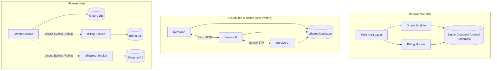
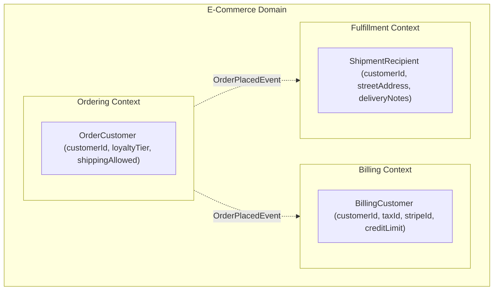
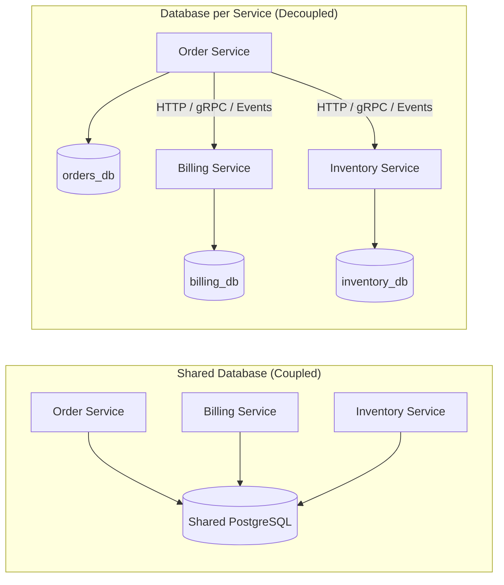
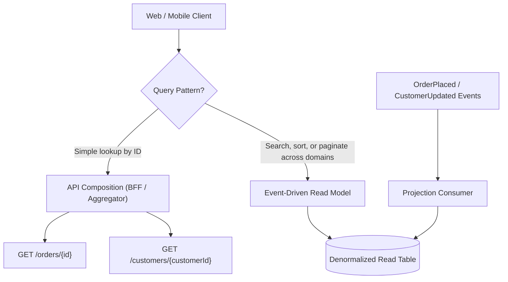

Splitting a working application into microservices is rarely a technical upgrade on its own. When a team breaks apart a codebase without clear domain boundaries or independent data ownership, they usually end up with a distributed monolith: all the network latency, serialization overhead, and partial failure modes of a distributed system, combined with the coordinated deployments and shared-schema coupling of a tangled monolith.

Microservices are an organizational and architectural trade-off. They pay off when multiple teams need to build, deploy, and scale separate parts of a business independently. They hurt when a small team takes on distributed-systems complexity before their domain boundaries have even stabilized.

## Monolith vs SOA vs Microservices

Each of these architectures came out of a different set of scaling and organizational constraints.



Notice the structural difference between the three layouts. A modular monolith keeps everything inside one process and one deployable unit while enforcing module boundaries in code. Microservices move those boundaries across network hops and separate databases. The distributed monolith sits in the worst middle ground: separate deployments that still share one database and call each other synchronously in lockstep.

| Dimension | Modular Monolith | Service-Oriented Architecture (SOA) | Microservices |
|---|---|---|---|
| **Deployment unit** | Single artifact (`.jar` or container image) | Large, coarse-grained enterprise services | Small, independently deployable services |
| **Communication** | In-process method calls | Often an Enterprise Service Bus (ESB) with SOAP/XML | Direct lightweight REST, gRPC, or event brokers (Kafka, RabbitMQ) |
| **Database ownership** | Shared database (ideally separated by schema) | Frequently shared enterprise databases | Strict database per service |
| **Transactions** | Local ACID transactions | Distributed transactions (XA / 2PC) or orchestrators | Local transactions plus eventual consistency (Saga, Outbox) |
| **Failure blast radius** | Whole process restarts on fatal error | Service or central ESB failure | Contained to one service if callers isolate failures |
| **Team fit** | One team or a few tightly coordinated teams | Large enterprise IT groups integrating legacy systems | Multiple autonomous teams owning distinct business domains |

### Why the Modular Monolith Deserves Serious Consideration

Before splitting a system into services, most engineering teams are better off starting with a well-structured modular monolith.

In a Java modular monolith (using package-private types, multi-module Maven/Gradle builds, ArchUnit rules, or Spring Modulith), changing a boundary between two domains is a compiler-checked refactoring. You move a class, adjust a module API, and run your test suite. Moving a boundary between two live microservices means migrating production tables, versioning HTTP or Kafka contracts, running dual writes during cutover, and coordinating rollbacks across repositories.

A modular monolith also avoids network latency on internal calls and lets you rely on straightforward local database transactions while your product requirements are still shifting. If one module eventually needs independent scaling, a different technology stack, or its own deployment cadence, clean internal boundaries make extracting it into a service far less painful.

> [!TIP]
> A reliable test for whether you actually have microservices is deployment independence. If releasing a routine feature in Service A forces you to deploy Service B and Service C in the same maintenance window, you are paying the operational cost of microservices without getting their primary benefit.

## Conway's Law and Team Boundaries

In 1967, Melvin Conway noted that organizations design systems whose structure mirrors their internal communication paths.

When a company splits engineering into horizontal layers (a frontend group, a backend Java group, and a central DBA team), every user-facing feature has to cross all three hand-off queues. The architecture naturally settles into a three-tier layout with a central database schema owned by the DBA team. Even if that company adopts Kubernetes and creates twenty Spring Boot repositories, the services will still end up tightly coupled through shared tables and joint release schedules.

Teams that succeed with microservices typically apply the inverse of Conway's observation: they organize small, cross-functional teams (often five to eight engineers) around business capabilities such as Checkout, Search, or Fulfillment. Each team owns its service code, schema migrations, deployment pipeline, and on-call alerts. Service boundaries then align with team ownership rather than cutting across three different managers' backlogs.

## Domain-Driven Design Basics and Bounded Contexts

One of the most common ways teams misdraw microservice boundaries is by slicing along database tables or nouns: a `UserService`, an `AddressService`, an `OrderItemService`, and a `TaxService`. That turns every user action into a chain of five or six synchronous network calls just to assemble one screen.

Strategic Domain-Driven Design (DDD) offers a better unit of decomposition: the **Bounded Context**.

A Bounded Context is an explicit boundary within which a domain model and its terminology (its **Ubiquitous Language**) have one precise, consistent meaning. Inside that boundary, words mean one thing. Outside that boundary, the same word often means something completely different.



In a monolithic application, developers often create a single `Customer` entity with 60 columns used by authentication, invoicing, marketing, and warehouse shipping. Over time, every change to that class risks breaking an unrelated workflow.

With Bounded Contexts, there is no single universal `Customer` model. Each context defines only the attributes and invariants it actually cares about, linked only by a shared opaque identifier (such as `customerId`).

### Modeling Separate Bounded Contexts in Java

Look at how the Ordering context and the Billing context represent the same person as two completely independent Java records in two separate services:

```java
// Inside the Ordering Service (com.acme.ordering.domain)
package com.acme.ordering.domain;

import java.util.UUID;

public record OrderCustomer(
        UUID customerId,
        String displayName,
        LoyaltyTier loyaltyTier,
        boolean blockedFromOrdering
) {
    public boolean canPlaceOrder() {
        return !blockedFromOrdering;
    }

    public enum LoyaltyTier { STANDARD, SILVER, GOLD }
}
```

```java
// Inside the Billing Service (com.acme.billing.domain)
package com.acme.billing.domain;

import java.math.BigDecimal;
import java.util.Currency;
import java.util.UUID;

public record BillingCustomer(
        UUID customerId,
        String legalName,
        String taxId,
        String stripeCustomerId,
        BigDecimal creditLimit,
        Currency billingCurrency
) {
    public boolean canCover(BigDecimal invoiceTotal) {
        return creditLimit.compareTo(invoiceTotal) >= 0;
    }
}
```

Neither service imports the other's domain JAR. Sharing a "common-domain-models" Maven dependency across microservices is a frequent mistake: the moment Billing needs a new tax field, every service depending on the shared library has to recompile and redeploy. Small, context-specific DTOs or records with explicit translation are much easier to evolve safely.

### Protecting Boundaries with an Anti-Corruption Layer

When a new microservice has to integrate with an older legacy system or a third-party vendor whose data model is awkward or unstable, you put an **Anti-Corruption Layer (ACL)** at the edge of your bounded context. The ACL translates external payloads into your own clean domain types so legacy field names and quirks never leak into your core business logic.

```java
package com.acme.billing.acl;

import com.acme.billing.domain.BillingCustomer;

import java.math.BigDecimal;
import java.util.Currency;
import java.util.UUID;

public class LegacyCrmCustomerTranslator {

    // External legacy payload with cryptic field names and string amounts
    public record LegacyCrmAccountDto(
            String custUuid,
            String acctLegalTitle,
            String vatNumber,
            String pspRef,
            String maxExposure,
            String isoCurrency
    ) {}

    public BillingCustomer toDomain(LegacyCrmAccountDto legacy) {
        return new BillingCustomer(
                UUID.fromString(legacy.custUuid()),
                legacy.acctLegalTitle().trim(),
                legacy.vatNumber(),
                legacy.pspRef(),
                new BigDecimal(legacy.maxExposure()),
                Currency.getInstance(legacy.isoCurrency())
        );
    }
}
```

If the legacy CRM renames `maxExposure` or changes its date format next quarter, only `LegacyCrmCustomerTranslator` changes. The rest of the Billing service remains untouched.

## The Database-per-Service Pattern

If two microservices read and write the same database tables directly, they are coupled at the storage layer regardless of how clean their REST APIs look. The **Database-per-Service** pattern states that each service owns its persistent store exclusively. Other services access that data only through the owning service's public API or by consuming domain events it publishes.



Direct cross-service database access creates four practical problems in production:

- **Hidden schema coupling:** Renaming a column or splitting a table in the Order service silently breaks raw SQL queries sitting inside Billing or Reporting jobs that the Order team did not even know existed.
- **Noisy-neighbor contention:** A heavy analytics query from Reporting locks rows or exhausts the connection pool, stalling checkout traffic on the same database server.
- **Bypassed invariants:** Validation rules enforced in Java (such as preventing an order from transitioning from `CANCELLED` back to `SHIPPED`) are bypassed whenever another service runs an `UPDATE` statement directly against the table.
- **Storage lock-in:** A catalog search service may fit Elasticsearch, an order ledger fits PostgreSQL, and session state fits Redis. Sharing one relational database forces every workload onto the same engine and tuning profile.

### Enforcing Isolation in Configuration and Schema

In practice, database-per-service does not always require separate physical servers on day one, though separate instances give the best runtime isolation. At minimum, each service must use its own database or schema with dedicated credentials that cannot `SELECT` from another service's tables.

```yaml
# orders-service/src/main/resources/application.yml
spring:
  application:
    name: orders-service
  datasource:
    url: jdbc:postgresql://orders-db.internal:5432/orders_db
    username: ${ORDERS_DB_USER}
    password: ${ORDERS_DB_PASSWORD}
    hikari:
      maximum-pool-size: 20
```

```yaml
# billing-service/src/main/resources/application.yml
spring:
  application:
    name: billing-service
  datasource:
    url: jdbc:postgresql://billing-db.internal:5432/billing_db
    username: ${BILLING_DB_USER}
    password: ${BILLING_DB_PASSWORD}
    hikari:
      maximum-pool-size: 15
```

Inside each database, references to entities owned by another service are stored as plain IDs, never as SQL foreign keys across databases:

```sql
-- In orders_db (owned exclusively by orders-service)
CREATE TABLE orders (
    id            UUID PRIMARY KEY,
    customer_id   UUID NOT NULL,          -- Opaque reference to Identity/Customer context
    status        VARCHAR(32) NOT NULL,
    total_cents   BIGINT NOT NULL,
    currency      CHAR(3) NOT NULL,
    created_at    TIMESTAMPTZ NOT NULL DEFAULT NOW()
);

-- In billing_db (owned exclusively by billing-service)
CREATE TABLE invoices (
    id            UUID PRIMARY KEY,
    order_id      UUID NOT NULL UNIQUE,   -- Opaque reference to Orders context
    customer_id   UUID NOT NULL,
    amount_cents  BIGINT NOT NULL,
    status        VARCHAR(32) NOT NULL,
    issued_at     TIMESTAMPTZ NOT NULL DEFAULT NOW()
);
```

## Replacing Cross-Database SQL Joins

Once tables live in separate databases, you lose the ability to run a single relational join across domains. In a monolith, an order history screen is a straightforward SQL query:

```sql
-- Works in a single database, impossible once Orders and Customers are separated
SELECT o.id, o.status, o.total_cents, c.display_name, c.email
FROM orders o
JOIN customers c ON o.customer_id = c.id
WHERE o.id = :orderId;
```

In a microservice architecture, teams replace cross-database joins with one of two main strategies: **API Composition** or a **Replicated Read Model (CQRS projection)**.



### API Composition

For simple lookups by ID, an aggregator service or Backend-for-Frontend (BFF) fetches data from each owning service over HTTP or gRPC and combines the result in memory.

```java
package com.acme.bff.orders;

import java.util.UUID;

public class OrderSummaryComposer {

    private final OrderApiClient orderClient;
    private final CustomerApiClient customerClient;

    public OrderSummaryComposer(OrderApiClient orderClient, CustomerApiClient customerClient) {
        this.orderClient = orderClient;
        this.customerClient = customerClient;
    }

    public OrderSummaryResponse getOrderSummary(UUID orderId) {
        OrderDto order = orderClient.findById(orderId);
        CustomerSummaryDto customer = customerClient.findSummaryById(order.customerId());

        return new OrderSummaryResponse(
                order.id(),
                order.status(),
                order.totalCents(),
                customer.displayName(),
                customer.email()
        );
    }

    public record OrderDto(UUID id, UUID customerId, String status, long totalCents) {}
    public record CustomerSummaryDto(UUID id, String displayName, String email) {}
    public record OrderSummaryResponse(
            UUID orderId,
            String status,
            long totalCents,
            String customerName,
            String customerEmail
    ) {}
}
```

API Composition is easy to reason about and returns fresh data, but it has real limits. Latency is the sum (or max, when calls can run in parallel) of every downstream call, availability drops as you add more synchronous dependencies, and you cannot efficiently filter or paginate across thousands of joined rows in memory.

### Replicated Read Models and Snapshots

When you need search, sorting, or high read throughput across domains (for instance, *"find all unpaid orders for customers in Germany"*), services maintain a local read-optimized table populated from asynchronous domain events.

```java
package com.acme.ordering.projection;

import org.springframework.jdbc.core.simple.JdbcClient;
import org.springframework.kafka.annotation.KafkaListener;
import org.springframework.stereotype.Component;

import java.time.Instant;
import java.util.UUID;

@Component
public class CustomerProjectionListener {

    private final JdbcClient jdbcClient;

    public CustomerProjectionListener(JdbcClient jdbcClient) {
        this.jdbcClient = jdbcClient;
    }

    public record CustomerUpdatedEvent(
            UUID customerId,
            String displayName,
            String email,
            long version,
            Instant occurredAt
    ) {}

    @KafkaListener(topics = "customer.updated", groupId = "orders-customer-projection")
    public void onCustomerUpdated(CustomerUpdatedEvent event) {
        // Upsert with version check so out-of-order events do not overwrite newer state
        jdbcClient.sql("""
                INSERT INTO customer_read_model (customer_id, display_name, email, version, updated_at)
                VALUES (:id, :name, :email, :version, :updatedAt)
                ON CONFLICT (customer_id) DO UPDATE
                SET display_name = EXCLUDED.display_name,
                    email = EXCLUDED.email,
                    version = EXCLUDED.version,
                    updated_at = EXCLUDED.updated_at
                WHERE customer_read_model.version < EXCLUDED.version
                """)
                .param("id", event.customerId())
                .param("name", event.displayName())
                .param("email", event.email())
                .param("version", event.version())
                .param("updatedAt", event.occurredAt())
                .update();
    }
}
```

Notice the `WHERE customer_read_model.version < EXCLUDED.version` guard. In event-driven systems, messages can arrive more than once or slightly out of order; making projections idempotent and version-aware keeps the local read model consistent.

The trade-off is eventual consistency. After a user edits their display name, the Orders read model might take a few hundred milliseconds to reflect the update. For many business screens that lag is acceptable, and for historical invoices you actually *want* the snapshot of the customer's billing name at the time of purchase rather than a live join.

## The Eight Fallacies of Distributed Computing

In the 1990s, Peter Deutsch and colleagues at Sun Microsystems documented eight assumptions developers routinely carry over from single-process programming that break down once calls cross a network:

1. **The network is reliable:** Switches reboot, cables get bumped, cloud availability zones suffer transient packet loss, and TLS connections drop mid-response. Callers need timeouts, retries (where safe), and failure isolation.
2. **Latency is zero:** A local Java method call takes a few nanoseconds. An HTTP call across a cloud data center takes milliseconds, and cross-region calls take tens of milliseconds. Chatty loops that were harmless inside a monolith become severe bottlenecks over HTTP.
3. **Bandwidth is infinite:** Serializing large object graphs to JSON and shipping them between ten services saturates network interfaces and drives up JVM garbage collection pressure. Fetch only the fields you need.
4. **The network is secure:** Do not assume an internal VPC is safe from lateral movement. Encrypt internal service traffic with TLS or mutual TLS (mTLS) and verify authorization rather than trusting raw headers.
5. **Topology does not change:** Containers scale up, crash, and reschedule onto new IP addresses continuously. Services rely on dynamic service discovery or DNS instead of hardcoded hosts.
6. **There is one administrator:** In a multi-team organization, different services upgrade runtimes, rotate keys, and deploy changes on different schedules. Contracts must stay backwards-compatible across rolling deployments.
7. **Transport cost is zero:** Marshaling Java objects into JSON or Protobuf, running TLS encryption, and routing through load balancers or service-mesh proxies all consume real CPU cycles and cloud data-transfer spend.
8. **The network is homogeneous:** Even in a primarily Java shop, you will eventually talk to Python ML services, Go proxies, or Node.js frontends. Wire formats and error conventions need to be language-neutral.

## Common Failure Modes in Practice

### Coordinated Release Trains

A common failure mode occurs when an organization splits its codebase into dozens of microservices but still requires every service to be deployed together on a monthly release night because internal APIs break compatibility with each change. Teams end up spending more time managing environment drift, contract mismatches, and deployment sequencing than shipping product changes. Keeping contracts backwards-compatible (using expand-and-contract schema and API changes) is mandatory for independent deployments.

### Deep Synchronous Call Chains

Suppose an API endpoint calls Service A, which calls Service B, which calls Service C, which queries a slow database. Even if each service individually has 99.5% availability, chaining four synchronous dependencies together drops composite availability noticeably, and tail latency compounds at every hop. When a missing database index slows down Service C, upstream thread pools back up across B and A until the edge gateway times out. Prefer shallow synchronous call graphs, explicit timeouts, and asynchronous events for work that does not need to finish before the HTTP response returns.

## Practical Questions

### How does Orchestration differ from Choreography across microservices?

In **orchestration**, a central coordinator tells each participating service what step to run next (for example, an order orchestrator calls Payment, waits for confirmation, then calls Inventory, and triggers a refund if Inventory fails). Workflow state lives in one place, which makes debugging and monitoring straightforward, though the orchestrator becomes a dependency that knows about every participant.

In **choreography**, services react to domain events published on a broker without a central controller. `OrderService` publishes `OrderCreated`, `PaymentService` listens and publishes `PaymentCaptured`, and `InventoryService` listens and reserves stock. Services stay loosely coupled and adding a new subscriber (like an email notifier) does not require modifying the producer, but understanding the full end-to-end state of a multi-step business workflow requires solid distributed tracing and event correlation IDs.

### When should a greenfield project start with a Modular Monolith instead of Microservices?

Almost always at the start of a new product or when working with a small engineering group. Early in a product's life, domain boundaries change frequently as you learn how customers actually use the system. Refactoring module boundaries inside one Java codebase is cheap compared to rewriting API contracts and migrating split databases. Starting with a modular monolith lets a small team focus on delivering features while keeping package boundaries and database schemas clean enough to extract a service later if team size or scaling profiles genuinely demand it.

### What is an Anti-Corruption Layer (ACL) and when do you need one?

An Anti-Corruption Layer is a translation boundary (usually adapters and mappers) placed between your bounded context and an external or legacy system. You need an ACL whenever an upstream API uses awkward data models, legacy naming, or frequent schema quirks that would otherwise spread through your core domain classes. By converting external DTOs into your own domain records at the edge, you isolate your business logic from upstream churn.

### Why do most microservice architectures avoid Two-Phase Commit (2PC) across service databases?

Two-Phase Commit coordinates distributed ACID transactions by asking every participating database to prepare and hold locks while waiting for a global commit decision. Across microservices, 2PC introduces several serious operational problems: databases hold exclusive locks across network round trips, throughput drops under contention, and if the coordinator crashes mid-protocol, participants can remain stuck holding locks until manual intervention. Most cloud-native Java systems instead use local ACID transactions paired with the Transactional Outbox pattern and Sagas for compensating actions when a downstream step fails.
