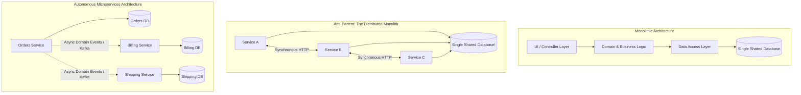
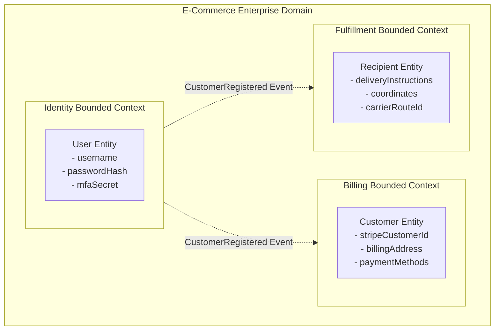
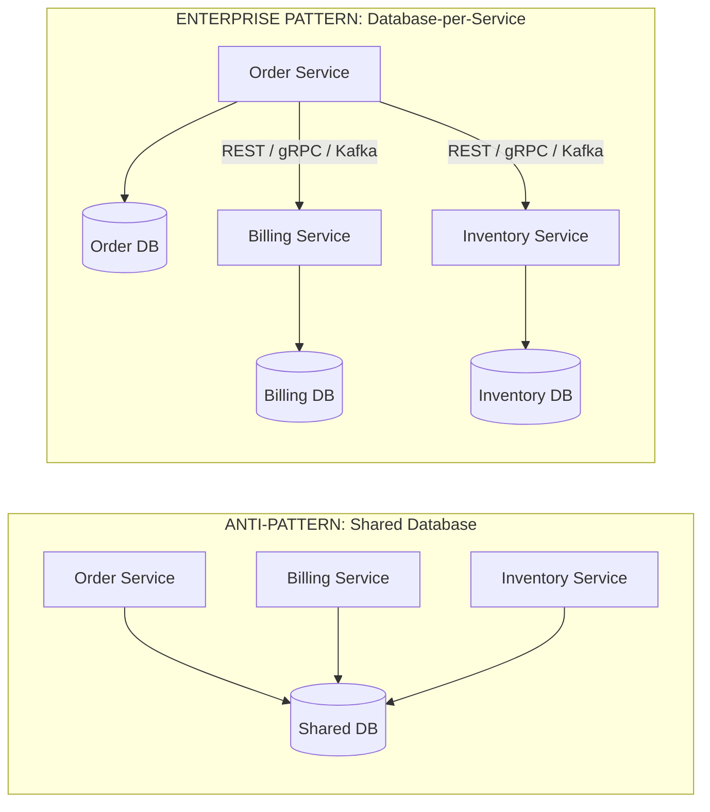
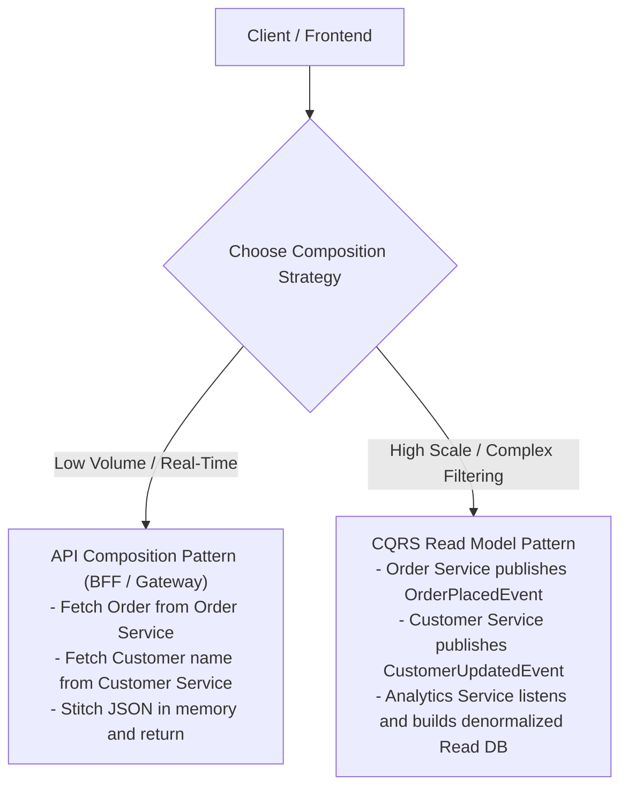

There is a brutally honest axiom in software engineering: *"If you cannot build a well-structured modular monolith, what makes you think you can manage a fleet of 50 microservices communicating over a fallible network?"*

During the microservices boom, thousands of engineering organizations rushed to chop their monolithic applications into dozens of tiny services. Most did not end up with an agile, independently deployable microservices architecture. Instead, they built the dreaded **Distributed Monolith**—inheriting all the complexity, network latency, distributed data inconsistencies, and partial failures of distributed systems, while retaining all the tight coupling, coordinated release cycles, and shared database bottlenecks of the worst legacy monoliths.

Microservices are not an objective or a status symbol; they are an organizational and architectural **trade-off**. In this guide, we will step into the shoes of a distributed systems architect. We will explore Conway's Law, use Strategic Domain-Driven Design (DDD) to carve clean bounded contexts, enforce the Database-per-Service principle, and inoculate our designs against the classic Fallacies of Distributed Computing.

---

## Evolution of Architecture: Monolith vs SOA vs Microservices

To understand why microservices exist, we must understand the engineering pressures that shaped each evolutionary architectural phase:

### Architectural Comparison
| Dimension | Modular Monolith | Service-Oriented Architecture (SOA) | Microservices |
|---|---|---|---|
| **Deployment Unit** | Single deployable artifact (`.jar` or container) | Large, coarse-grained business services | Small, fine-grained autonomous services |
| **Communication** | In-memory method calls (`invokevirtual`) | Enterprise Service Bus (ESB), SOAP, XML | Lightweight REST, gRPC, Event Streaming (Kafka) |
| **Database Ownership** | Single shared database | Often shared enterprise databases | **Strict Database-per-Service** |
| **Transaction Model** | Single local ACID transaction | WS-AtomicTransaction / Two-Phase Commit (2PC) | **Eventual Consistency / Saga Pattern** |
| **Failure Domain** | Whole process crashes | Service or ESB middleware failure | Isolated to a single service boundary |
| **Organizational Fit** | Single cross-functional team | Large enterprise IT departments | Multiple small autonomous "Two-Pizza" teams |

> [!TIP]
> **The Distributed Monolith Warning Sign**  
> If deploying Service A requires you to simultaneously deploy Service B and Service C to avoid breaking production, you do not have microservices. You have a distributed monolith. True microservices must be **independently deployable and backwards-compatible**.

---

## Conway's Law and Team Topologies

In 1967, computer programmer Melvin Conway observed:
> *"Organizations which design systems are constrained to produce designs which are copies of the communication structures of these organizations."*

If your engineering organization is structured into three horizontal silos:
1. The Frontend Team
2. The Backend Java Team
3. The DBA / Database Administrator Team

Your system architecture will inevitably reflect that organization: a three-tier architecture where every business feature requires cross-team meetings, ticketing queues, and coordinated hand-offs.

Microservices reverse this dynamic using the **Inverse Conway Maneuver**:
Organize cross-functional "Two-Pizza Teams" (typically 5 to 8 engineers) around distinct **Business Capabilities** (e.g., The Checkout Team, The Search Team, The Fulfillment Team). Each team owns their service end-to-end: UI components, Java backend, database schema, CI/CD pipeline, and 24/7 on-call operational monitoring.

---

## Domain-Driven Design (DDD): Carving Service Boundaries

The biggest mistake teams make when adopting microservices is carving boundaries along technical layers or entity tables (e.g., creating a `UserMicroservice`, an `AddressMicroservice`, and a `PaymentMicroservice`). This results in an unmaintainable web of synchronous network hops.

Instead, microservice boundaries must align with **Bounded Contexts** from Domain-Driven Design.

### The Concept of Bounded Contexts
In a naive monolith, developers attempt to build a single, universal `User` class with 85 fields, shared by every subsystem.
In DDD, there is no universal "User". The concept changes depending on the context:
- In the **Identity Context**, the model is `User` (focused on credentials, permissions, authentication tokens).
- In the **Billing Context**, the model is `Customer` (focused on tax IDs, credit limits, invoices, Stripe payment tokens).
- In the **Fulfillment Context**, the model is `Recipient` (focused on physical warehouse coordinates, delivery gate codes, shipping addresses).

Each bounded context maintains its own independent domain model, its own database schema, and its own **Ubiquitous Language** tailored to the specific business problem.

---

## The Database-per-Service Principle

If there is one non-negotiable rule in microservices, it is this: **A microservice must own its persistent data exclusively. No other service is ever permitted to read or write directly to its database.**

### Why Shared Databases Destroy Microservices
1. **Schema Coupling**: If the Order Service alters a column name, it instantly breaks uncompiled SQL queries running inside the Billing Service and Inventory Service.
2. **Connection Pool Exhaustion**: A runaway report query running in the Inventory Service can consume all available database connections, starving the critical Order Service and taking down checkout.
3. **Loss of Invariant Enforcement**: Business rules (e.g., *"An order cannot exceed the customer's credit limit"*) cannot be enforced in Java code if another service bypasses the Order application boundary and mutates rows directly via SQL.
4. **Polyglot Inflexibility**: Different services have different data characteristics. The Catalog Service may thrive on MongoDB or Elasticsearch, while the Ledger Service requires PostgreSQL ACID transactions, and the Session Service requires Redis. A single shared database forces a suboptimal lowest-common-denominator data store on every team.

---

## The Death of the SQL JOIN: Distributed Data Challenges

Enforcing the Database-per-Service pattern brings immense autonomy, but it completely destroys the most fundamental tool relational developers rely upon: `SELECT ... JOIN`.

How do you display an order history screen that requires the Order details, the Customer's current name, and the Product title?

### Strategy 1: API Composition (The Gateway Aggregator)
The API Gateway or Backend-for-Frontend (BFF) queries both services via HTTP/gRPC and merges the payloads in memory:
- Fetch order by ID from `OrderService`.
- Extract `customerId` and call `CustomerService.findById(customerId)`.
- Merge both JSON payloads and return them to the client.
*Trade-off:* High network chatter, increased latency, and vulnerable to partial service failures.

### Strategy 2: CQRS & Denormalized Projections
When an order is created, the `OrderService` captures purchase-time snapshots of the product title and customer name and embeds them directly inside its own `Order` table. 
Alternatively, a dedicated search/reporting service consumes Kafka events from both services and populates a denormalized read-optimized Elasticsearch or PostgreSQL database.
*Trade-off:* Eventual consistency. The customer name in an old order might take 200 milliseconds to reflect an update.

---

## The Eight Fallacies of Distributed Computing

In 1994, Sun Microsystems fellow Peter Deutsch articulated the eight false assumptions every developer makes when moving from single-process monoliths to network-based architectures:

1. **The network is reliable**: Packets drop, cables are severed, routers crash, and cloud availability zones experience netsplits.
2. **Latency is zero**: An in-memory method call takes 2 nanoseconds (`0.000000002s`). An HTTP call between AWS regions takes 50 milliseconds (`0.050s`)—twenty-five million times slower!
3. **Bandwidth is infinite**: Serializing and transmitting massive JSON payloads over TCP saturates network interfaces and switches.
4. **The network is secure**: Traffic crossing internal VPCs or data centers can be intercepted unless mutual TLS (mTLS) is enforced.
5. **Topology does not change**: Servers, IP addresses, and Kubernetes pods spin up and terminate continuously.
6. **There is one administrator**: Different services are managed by different teams with different patch cycles, deployment windows, and access keys.
7. **Transport cost is zero**: Serializing Java objects into JSON/Protobuf, establishing TLS handshakes, and traversing proxies consumes significant CPU.
8. **The network is homogeneous**: Services are written in different languages (Java, Go, Python, Node.js) and run on diverse operating systems.

---

## Architectural Traps and Real-World Outages

### The "Coordinated Release Train" Trap
A retail bank split their core banking system into 42 microservices. However, every time a new banking feature was developed, the enterprise architecture board required all 42 services to be tested together in a staging environment for two weeks, packaged into a single monthly release, and deployed simultaneously at 3:00 AM on Sunday. 

They did not have microservices; they had an astronomically expensive distributed monolith. The team spent 80% of their engineering hours troubleshooting deployment sequencing and network timeouts between services instead of delivering product features.

### The Cascading Network Thread Exhaustion Outage
A streaming platform had a home page endpoint that synchronously called the Recommendation Service, which synchronously called the Content Metadata Service, which synchronously called the User History Service. 

When a database index was accidentally dropped in the User History Service, its query latency climbed from 10ms to 4,000ms. Because none of the upstream services configured connection timeouts or circuit breakers, Tomcat worker threads backed up across all 4 services within 45 seconds. The entire platform collapsed like a row of dominos.

---

## Senior Interview Questions

### Question 1: What is the difference between an Orchestrated workflow and an Event-Driven Choreography workflow across microservices?
**Answer:**  
- **Orchestration**: A centralized service (the Orchestrator or Saga Coordinator) explicitly commands participant services on what to do and when: *"PaymentService, charge card. InventoryService, reserve stock."* If an operation fails, the orchestrator issues compensating commands. 
  - *Pros:* Clear, centralized visibility into the workflow state; easy to understand and debug.
  - *Cons:* The orchestrator can become a centralized bottleneck and creates tighter coupling between the coordinator and services.
- **Choreography**: Services communicate purely by reacting to domain events published to an asynchronous message broker without a central controller. When `OrderService` creates an order, it publishes `OrderCreatedEvent`. `PaymentService` listens, charges the card, and publishes `PaymentCompletedEvent`. `InventoryService` listens to payment events and reserves stock.
  - *Pros:* Loose coupling, high autonomy, easy to add new event subscribers without modifying producers.
  - *Cons:* Difficult to track the global state of a distributed business process; harder to debug and detect cyclic event loops.

### Question 2: How do you choose between building a Modular Monolith versus a Microservices Architecture for a brand-new startup product?
**Answer:**  
For a greenfield product or startup, the recommended default is almost always a **Modular Monolith**.
1. **Domain Boundary Volatility**: In early-stage products, business requirements change rapidly. Shifting boundaries inside a modular monolith is a fast, safe Java refactoring (moving classes between packages or Maven modules). Shifting boundaries across microservices requires database migrations, changing API contracts, modifying routing gateways, and managing dual deployments.
2. **Operational Overhead**: Microservices require Kubernetes, service discovery, distributed tracing, API gateways, and complex CI/CD infrastructure. A small team should invest their limited engineering capital in finding product-market fit, not managing distributed infrastructure.
3. **Clean Migration Path**: If a modular monolith enforces strict encapsulation (e.g., using Java 9+ Modules or ArchUnit to prevent illegal cross-module package access and private database schemas), extracting a hot module into a dedicated microservice later is straightforward when business scale justifies it.

### Question 3: What is an Anti-Corruption Layer (ACL) in Domain-Driven Design, and when is it required in microservices?
**Answer:**  
An Anti-Corruption Layer (ACL) is a translation layer placed between two bounded contexts to prevent the domain model of one service (often a messy legacy system or third-party vendor API) from bleeding into and corrupting the clean domain model of a new microservice.

The ACL consists of Facades, Adapters, and Translators. When communicating with the external system, the ACL converts external foreign concepts and schemas into native, domain-specific Value Objects and Entities that make sense in the new bounded context, isolating the new service from upstream breaking changes.

### Question 4: Why is Two-Phase Commit (2PC) considered an anti-pattern in high-scale cloud-native microservices?
**Answer:**  
Two-Phase Commit (2PC) guarantees distributed ACID consistency across multiple databases using a transaction coordinator and two phases: Prepare and Commit.
However, 2PC is an anti-pattern in modern cloud architectures because:
1. **Blocking Protocol**: During the Prepare phase, every participating database acquires exclusive row locks and holds them until the coordinator signals Commit. If one service node or network link hangs, database locks are held indefinitely, choking system throughput.
2. **Single Point of Failure**: If the transaction coordinator crashes during the prepare phase, participating databases are left in doubt, unable to commit or roll back.
3. **CAP Theorem Violation**: In an unreliable cloud network where network partitions (P) occur, 2PC prioritizes Consistency (C) at the complete expense of Availability (A). Microservices embrace eventual consistency and the Saga pattern instead.
