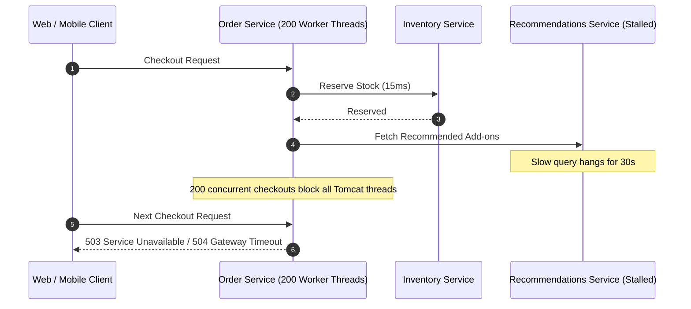
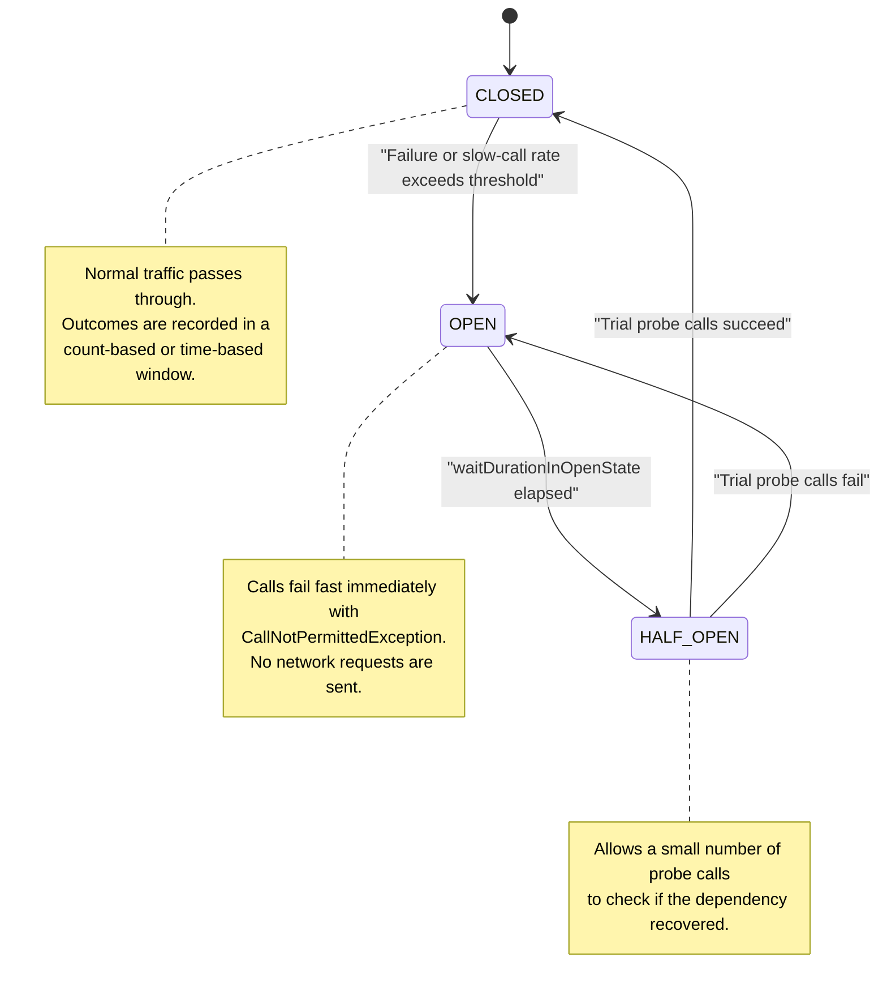
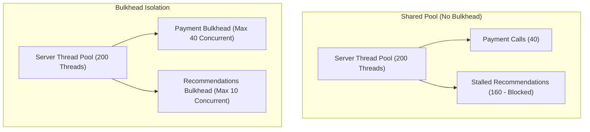
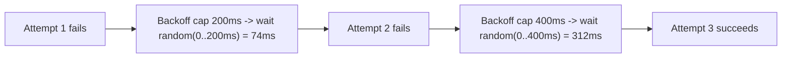

In a distributed system, partial slowdowns are far more dangerous than clean crashes. If a downstream service returns `HTTP 500` in 5 milliseconds, your caller handles the error and moves on. If that same downstream service hangs for 30 seconds on a database lock, calling threads pile up waiting for sockets that never reply, memory climbs, health checks stall, and a minor issue in a secondary service takes down the entire platform.

Resiliency patterns exist to keep localized failures localized. In modern Java and Spring Boot 3+, **Resilience4j** provides lightweight functional decorators and Spring annotations for circuit breakers, retries, time limiters, bulkheads, and rate limiters.

## How Cascading Failures Happen

A cascading failure starts when one slow dependency saturates a shared resource pool in its callers, which then become slow for *their* callers.



Notice the core problem in this sequence: the critical checkout path (inventory and payment) was completely healthy. The entire storefront went down because a non-essential feature (product recommendations) was allowed to hold worker threads indefinitely on the same shared pool.

Breaking that chain requires four coordinated defenses: **timeouts**, **bulkheads**, **circuit breakers**, and **controlled retries**.

## Timeouts: Socket-Level vs Resilience4j `TimeLimiter`

Timeouts are the foundation of every other resiliency pattern. Without a hard bound on how long a call may run, a hanging call never throws an exception, which means neither a retry policy nor a circuit breaker ever sees the failure.

In Java microservices, you need to think about timeouts at two separate layers:

### Socket-Level HTTP Connect and Read Timeouts

Configured directly on your HTTP client (`RestClient`, `WebClient`, or Apache HttpClient 5), socket timeouts operate at the TCP/network layer:

- **Connect timeout** bounds how long the client waits to complete the TCP handshake (usually 500ms to 2 seconds).
- **Read (socket) timeout** bounds the maximum idle gap between consecutive packets arriving from the server (usually 2 to 5 seconds).

Socket read timeouts have one subtle blind spot: they measure *inactivity between packets*, not total wall-clock duration. If a buggy downstream service drips 10 bytes every 500 milliseconds, a 3-second socket read timeout resets on every chunk and the call can still drag on for minutes. Socket timeouts also do not cover time spent waiting to acquire a connection from a saturated connection pool or waiting in a thread-pool queue.

### Application-Level Timeouts with Resilience4j `TimeLimiter`

Resilience4j's `TimeLimiter` enforces an upper bound on the **total wall-clock time** of an asynchronous operation (`CompletableFuture` or Reactor `Mono`/`Flux`). If the future does not complete within `timeoutDuration`, `TimeLimiter` fails it with a `TimeoutException` and, when `cancelRunningFuture: true` is set, interrupts the underlying task.

Because `@TimeLimiter` monitors an asynchronous future, the annotated method must return `CompletableFuture<T>` (or a reactive type), typically paired with a `ThreadPoolBulkhead` so the blocking client call executes on an isolated worker thread:

```java
package com.example.storefront.service;

import com.example.storefront.client.RecommendationClient;
import com.example.storefront.dto.ProductRecommendation;
import io.github.resilience4j.bulkhead.annotation.Bulkhead;
import io.github.resilience4j.circuitbreaker.annotation.CircuitBreaker;
import io.github.resilience4j.timelimiter.annotation.TimeLimiter;
import org.slf4j.Logger;
import org.slf4j.LoggerFactory;
import org.springframework.stereotype.Service;

import java.util.List;
import java.util.UUID;
import java.util.concurrent.CompletableFuture;

@Service
public class ProductRecommendationService {

    private static final Logger log = LoggerFactory.getLogger(ProductRecommendationService.class);
    private final RecommendationClient recommendationClient;

    public ProductRecommendationService(RecommendationClient recommendationClient) {
        this.recommendationClient = recommendationClient;
    }

    @CircuitBreaker(name = "recommendationService", fallbackMethod = "recommendationsFallback")
    @TimeLimiter(name = "recommendationService")
    @Bulkhead(name = "recommendationService", type = Bulkhead.Type.THREADPOOL)
    public CompletableFuture<List<ProductRecommendation>> getRecommendations(UUID customerId) {
        return CompletableFuture.supplyAsync(
                () -> recommendationClient.fetchForCustomer(customerId)
        );
    }

    // Fallback must match original parameter list + final Throwable, and return the same type
    private CompletableFuture<List<ProductRecommendation>> recommendationsFallback(
            UUID customerId,
            Throwable ex
    ) {
        log.warn("Serving fallback recommendations for customer={} reason={}",
                customerId, ex.toString());

        List<ProductRecommendation> fallbackItems = List.of(
                new ProductRecommendation("SKU-TOP-1", "Popular Starter Kit", 2999),
                new ProductRecommendation("SKU-TOP-2", "Everyday Essentials", 4999)
        );
        return CompletableFuture.completedFuture(fallbackItems);
    }
}
```

Use both layers together: set your HTTP client's connect/read timeouts slightly shorter than (or aligned with) your `TimeLimiter` duration so the underlying socket actually closes instead of leaking connections in the background after the `TimeLimiter` gives up.

> [!IMPORTANT]
> In Resilience4j, a `fallbackMethod` must have the exact same return type and parameter list as the annotated method, plus a trailing `Throwable` (or specific exception subtype) parameter. If the signature does not match, Resilience4j throws `NoSuchMethodException` at runtime when the first failure triggers the fallback.

## The Circuit Breaker Pattern

When a downstream service is genuinely down, continuing to wait 2 seconds per request until timeouts fire still wastes threads and hammers a struggling server that is trying to restart. A **Circuit Breaker** tracks recent call outcomes and trips open when error rates or slow-call rates cross a threshold, failing subsequent calls immediately without touching the network.



A Resilience4j circuit breaker moves through three primary states:

- **CLOSED:** Normal operation. Calls pass through and outcomes (successes, failures, and slow calls exceeding `slowCallDurationThreshold`) are recorded in a sliding window.
- **OPEN:** Once at least `minimumNumberOfCalls` have been recorded and the failure rate or slow-call rate crosses its threshold, the breaker opens. Incoming calls immediately receive `CallNotPermittedException` (or invoke the fallback) without hitting the downstream service.
- **HALF_OPEN:** After `waitDurationInOpenState` passes, the breaker allows a small fixed number of trial calls (`permittedNumberOfCallsInHalfOpenState`, usually 3 to 10). If those probes stay below the failure threshold, the breaker closes again; otherwise it trips back to `OPEN`.

### Configuring Circuit Breaker and TimeLimiter in Spring Boot

With `io.github.resilience4j:resilience4j-spring-boot3` (and `spring-boot-starter-aop` on the classpath for annotations):

```yaml
resilience4j:
  circuitbreaker:
    instances:
      recommendationService:
        slidingWindowType: TIME_BASED
        slidingWindowSize: 30                     # Evaluate calls over the last 30 seconds
        minimumNumberOfCalls: 10                  # Wait for 10 calls before computing rates
        failureRateThreshold: 50                  # Open if >= 50% fail
        slowCallRateThreshold: 50                 # Open if >= 50% are slow
        slowCallDurationThreshold: 1500ms         # > 1.5s counts as slow
        waitDurationInOpenState: 15s              # Stay open for 15s before probing
        permittedNumberOfCallsInHalfOpenState: 5  # Probe with 5 requests in HALF_OPEN
        automaticTransitionFromOpenToHalfOpenEnabled: true
        ignoreExceptions:
          - com.example.storefront.exception.InvalidCustomerException

  timelimiter:
    instances:
      recommendationService:
        timeoutDuration: 2s
        cancelRunningFuture: true
```

Notice `ignoreExceptions`: client validation errors (4xx business exceptions like `InvalidCustomerException` or `OrderNotFoundException`) do not mean the downstream server is unhealthy. If you omit them from `ignoreExceptions`, a burst of bad user inputs can trip your circuit breaker open for every healthy user.

## Bulkheads: Semaphore vs ThreadPool Isolation

Borrowed from ship hull compartments that keep a leak from flooding the whole vessel, the **Bulkhead** pattern caps how much concurrency a single downstream dependency can consume. Even if the Recommendations service stalls completely, it can only fill its own small quota while Checkout and Inventory keep serving traffic normally.



Resilience4j offers two bulkhead implementations with distinct trade-offs:

### Semaphore Bulkhead

A **Semaphore Bulkhead** limits concurrent calls on the *caller's existing thread* using a permit counter (`maxConcurrentCalls`). If all permits are taken, additional callers wait up to `maxWaitDuration` (often `0ms` to fail fast) before receiving `BulkheadFullException`.

- **Strengths:** Very low overhead, no context switching, and `ThreadLocal` values (such as Spring Security's `SecurityContextHolder` or SLF4J MDC trace fields) stay intact automatically. On Java 21 with virtual threads enabled, a Semaphore Bulkhead is often the cleanest way to cap downstream concurrency without introducing extra platform thread pools.
- **Limitation:** Because execution runs on the caller's thread, it cannot asynchronously cancel a stuck call on its own; it relies on the underlying HTTP client socket timeouts.

### ThreadPool Bulkhead

A **ThreadPool Bulkhead** dispatches work to a dedicated bounded thread pool and queue, returning a `CompletableFuture`.

- **Strengths:** True thread isolation from your web server threads and full compatibility with Resilience4j `@TimeLimiter` for cancelling hung tasks.
- **Trade-offs:** Extra thread memory and context switching, plus `ThreadLocal` state (security context, MDC logging, tracing spans) does *not* automatically cross threads unless you configure a `ContextPropagator`.

```yaml
resilience4j:
  bulkhead:
    instances:
      catalogSemaphore:
        maxConcurrentCalls: 25
        maxWaitDuration: 0ms        # Fail fast with BulkheadFullException when saturated

  thread-pool-bulkhead:
    instances:
      recommendationService:
        coreThreadPoolSize: 5
        maxThreadPoolSize: 10
        queueCapacity: 15
        keepAliveDuration: 20ms
```

## Retries with Exponential Backoff and Full Jitter

Transient network blips happen regularly in cloud environments: a Kubernetes pod shuts down mid-connection, a load balancer resets an idle socket, or a primary database finishes a brief failover. Retrying once or twice often turns a visible user error into a clean success.

Naive retries, however, make outages much worse. If a service degrades and 500 callers all retry immediately or at an identical fixed 1-second interval, those 500 callers slam the recovering server in lockstep waves (a **retry storm** or thundering herd), pushing CPU back to 100% every second.

### Exponential Backoff with Full Jitter

To spread retries out smoothly while giving the downstream service progressively more room to recover, combine **exponential backoff** with **jitter**:

1. **Exponential backoff** increases the ceiling on each attempt: `baseDelay * (multiplier ^ attempt)`, capped at a maximum delay (for example, 100ms, 200ms, 400ms, 800ms, capped at 5s).
2. **Full Jitter** picks a uniform random wait across the entire range from `0` up to the current backoff cap:

```text
cappedBackoff = min(maxDelay, baseDelay * 2^(attempt - 1))
actualWait    = random(0, cappedBackoff)
```

AWS architecture benchmarks showed that Full Jitter spreads competing clients much more effectively than fixed intervals or pure exponential backoff without randomness.



### Configuring Retries in Resilience4j

In Spring Boot YAML, Resilience4j supports exponential backoff with symmetric randomized wait (`interval +/- interval * randomizedWaitFactor`):

```yaml
resilience4j:
  retry:
    instances:
      inventoryRetry:
        maxAttempts: 3                       # 1 initial call + up to 2 retries
        waitDuration: 200ms
        enableExponentialBackoff: true
        exponentialBackoffMultiplier: 2.0
        exponentialMaxWaitDuration: 2s
        enableRandomizedWait: true
        randomizedWaitFactor: 0.5            # Adds +/- 50% jitter around each backoff step
        retryExceptions:
          - java.io.IOException
          - java.util.concurrent.TimeoutException
          - org.springframework.web.client.ResourceAccessException
        ignoreExceptions:
          - com.example.storefront.exception.InvalidSkuException
```

If you specifically want AWS-style **Full Jitter** (`random(0, min(cap, base * 2^(attempt-1)))`), you can supply a custom `IntervalFunction` directly in Java:

```java
package com.example.storefront.config;

import io.github.resilience4j.core.IntervalFunction;
import io.github.resilience4j.retry.Retry;
import io.github.resilience4j.retry.RetryConfig;

import java.io.IOException;
import java.time.Duration;
import java.util.concurrent.ThreadLocalRandom;
import java.util.concurrent.TimeoutException;

public class FullJitterRetryFactory {

    public static Retry create(String name, Duration baseDelay, Duration maxDelay) {
        long baseMs = baseDelay.toMillis();
        long maxMs = maxDelay.toMillis();

        IntervalFunction fullJitter = attempt -> {
            long expDelay = baseMs * (1L << Math.min(attempt - 1, 10));
            long cap = Math.min(maxMs, expDelay);
            return ThreadLocalRandom.current().nextLong(0, cap + 1);
        };

        RetryConfig config = RetryConfig.custom()
                .maxAttempts(3)
                .intervalFunction(fullJitter)
                .retryExceptions(IOException.class, TimeoutException.class)
                .build();

        return Retry.of(name, config);
    }
}
```

> [!WARNING]
> Only attach retries to **idempotent** operations (`GET`, `PUT`, `DELETE`, or `POST` requests protected by an `Idempotency-Key` header). Also avoid configuring retries at every layer of a deep call chain (Gateway -> Service A -> Service B -> Service C): 3 attempts across 3 hops multiplies a single failure into 27 downstream calls. Retry only at the immediate caller of the flaky dependency, or at the edge, not everywhere at once.

## Resilience4j Aspect and Decorator Precedence Order

When you stack multiple Resilience4j annotations on the same Spring bean method, the order in which those aspects wrap one another changes runtime behavior significantly.

By default in `resilience4j-spring-boot3`, the aspects wrap your method from **outermost to innermost** in this exact order:

```text
Retry ( CircuitBreaker ( RateLimiter ( TimeLimiter ( Bulkhead ( TargetMethod ) ) ) ) )
```


Why does the relative position of `Retry` and `CircuitBreaker` matter so much?

### Default Order: `Retry` Outside `CircuitBreaker`

Each attempt initiated by `Retry` passes through `CircuitBreaker` separately:

- If one user request fails 3 times (1 initial + 2 retries), the `CircuitBreaker` records **3 separate failures** in its sliding window. During an outage, the breaker reaches `minimumNumberOfCalls` and trips open quickly.
- If the circuit opens on attempt 2, attempt 3 hits the open breaker and fails fast with `CallNotPermittedException` without sending another packet downstream (as long as `CallNotPermittedException` is not listed in `retryExceptions`).
- **Trade-off:** Occasional transient blips that succeed on attempt 2 still record attempt 1 as a failure in the breaker's metrics, which can artificially raise the observed failure rate.

### Swapped Order: `CircuitBreaker` Outside `Retry`

If you place `CircuitBreaker` outside `Retry`, all retry attempts execute inside one single circuit-breaker evaluation:

- If attempt 1 fails due to a transient socket reset and attempt 2 succeeds, the `CircuitBreaker` records **1 success**. Transient noise does not inflate your circuit breaker's failure rate.
- If all 3 attempts fail, the `CircuitBreaker` records **1 failure** instead of 3.
- **Trade-off:** While `Retry` is working through its backoff delays, the `CircuitBreaker` does not see the failures until the entire retry cycle ends, so it opens more slowly and allows in-flight retries to keep hitting a failing server until the cycle finishes.

In Spring AOP, a **lower** order value has higher priority (meaning it wraps on the **outside**). To put `CircuitBreaker` outside `Retry`, assign `circuitBreakerAspectOrder` a smaller number than `retryAspectOrder`:

```yaml
resilience4j:
  circuitbreaker:
    circuitBreakerAspectOrder: 1   # Outer wrapper (runs first on entry)
  retry:
    retryAspectOrder: 2            # Inner wrapper (runs inside CircuitBreaker)
```

Whenever annotation ordering feels subtle or you need different nesting per client, skip AOP annotations and compose decorators explicitly in Java using `Decorators`:

```java
package com.example.storefront.client;

import io.github.resilience4j.bulkhead.Bulkhead;
import io.github.resilience4j.circuitbreaker.CircuitBreaker;
import io.github.resilience4j.decorators.Decorators;
import io.github.resilience4j.retry.Retry;

import java.util.function.Supplier;

public class ExplicitResilientCaller {

    private final CircuitBreaker circuitBreaker;
    private final Retry retry;
    private final Bulkhead bulkhead;

    public ExplicitResilientCaller(CircuitBreaker circuitBreaker, Retry retry, Bulkhead bulkhead) {
        this.circuitBreaker = circuitBreaker;
        this.retry = retry;
        this.bulkhead = bulkhead;
    }

    public <T> T execute(Supplier<T> remoteCall, Supplier<T> fallback) {
        // Explicit composition: Bulkhead (innermost) -> Retry -> CircuitBreaker (outermost)
        Supplier<T> decorated = Decorators.ofSupplier(remoteCall)
                .withBulkhead(bulkhead)
                .withRetry(retry)
                .withCircuitBreaker(circuitBreaker)
                .withFallback(throwable -> fallback.get())
                .decorate();

        return decorated.get();
    }
}
```

With `Decorators.ofSupplier(...)`, every developer reading the code sees the exact wrapping order immediately without hunting through `application.yml`.

## Common Production Pitfalls

### Allowing Too Many Probe Calls in `HALF_OPEN`

Setting `permittedNumberOfCallsInHalfOpenState` to a large number (like 500) defeats the purpose of probing recovery gently. When `waitDurationInOpenState` expires, a flood of requests hits a database or service that just finished restarting, immediately pushing it back into overload and tripping the circuit right back to `OPEN`. Keep probe counts small (typically 3 to 10 calls).

### Returning `null` or Broken Objects from a Fallback

A fallback that returns `null` often causes an unhandled `NullPointerException` two lines later in the controller, turning a graceful degradation into a 500 error anyway. Fallbacks should return valid degraded domain values (empty lists, cached snapshots, default UI state) or throw a clean domain exception that your API error handler translates into a clear client response.

### Forgetting Spring Proxy Self-Invocation Rules

Resilience4j annotations (`@CircuitBreaker`, `@Retry`, `@Bulkhead`) work through Spring AOP proxies. If `methodA()` inside `ProductService` calls `this.getRecommendations()` directly on the same bean, the call bypasses the proxy and none of the Resilience4j annotations execute. Always invoke resilient methods through an injected Spring bean (typically a dedicated client wrapper class) or use the programmatic `Decorators` API.

## Interview Questions

### What is the difference between a count-based and a time-based sliding window in Resilience4j?

A **count-based** sliding window evaluates the outcome of the last `N` calls (for example, the last 50 calls), regardless of how much wall-clock time passed. It works well for services with steady traffic. A **time-based** sliding window aggregates calls over the last `N` seconds using one-second buckets. It is usually safer for variable or bursty workloads because failures from three hours ago expire naturally instead of lingering in the window during quiet periods and keeping the breaker biased toward opening.

### Why do you still need socket timeouts even if you configure a Resilience4j `TimeLimiter`?

`TimeLimiter` cancels the `CompletableFuture` and throws `TimeoutException` to the caller when the deadline expires, freeing the caller to run its fallback. However, `Future.cancel(true)` only sends a thread interrupt. If the underlying HTTP socket library does not react promptly to interruption or has no socket read timeout configured, background worker threads and TCP connections can still linger until the remote peer resets them. Configuring explicit connect and read timeouts on the HTTP client ensures the OS socket closes cleanly.

### How do Semaphore Bulkheads and ThreadPool Bulkheads differ on thread context and cancellation?

A **Semaphore Bulkhead** runs the call on the caller's thread, so there is no thread-switching overhead and `ThreadLocal` state (Spring Security context, MDC correlation IDs) works out of the box, though it cannot independently interrupt a stalled call. A **ThreadPool Bulkhead** executes work on a separate worker pool with a bounded queue, isolating web server threads and enabling `TimeLimiter` cancellation, at the cost of extra memory, context switches, and explicit `ContextPropagator` setup if downstream code relies on `ThreadLocal` values.

### Why does placing `Retry` inside vs outside `CircuitBreaker` change how quickly a breaker opens?

With Resilience4j's default order (`Retry` outside `CircuitBreaker`), every retry attempt goes through the circuit breaker individually, so a single failed call with 3 attempts counts as 3 failures in the breaker window and trips the circuit faster during an outage. Placing `CircuitBreaker` outside `Retry` counts all retry attempts as one single outcome, preventing transient blips that succeed on attempt 2 from inflating the breaker's failure rate, at the cost of slower detection when a dependency is genuinely down.
