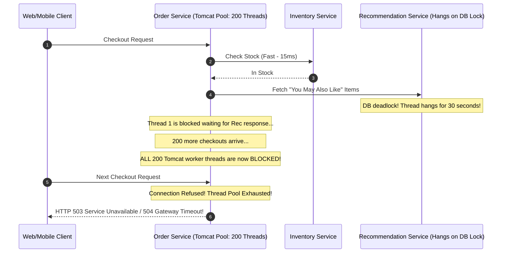
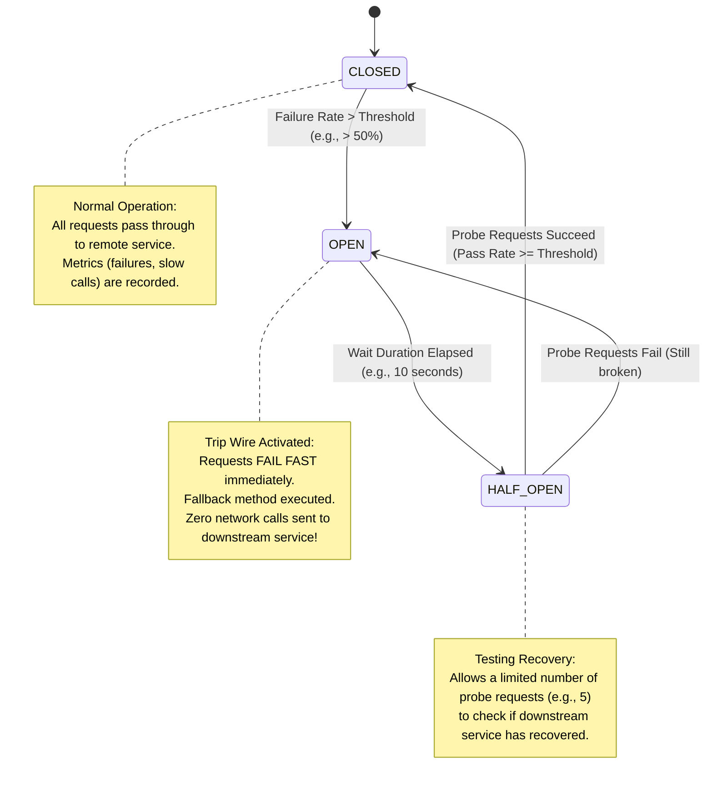
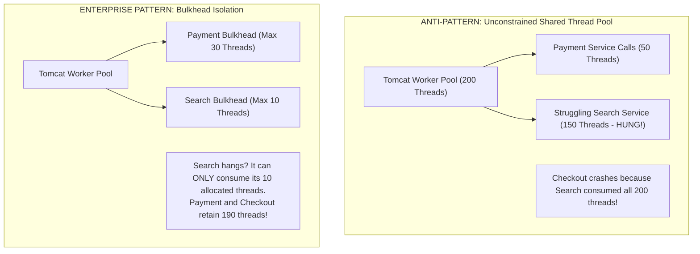
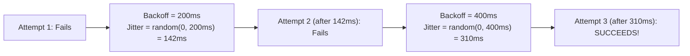

In a monolithic application, when an exception occurs, a simple Java `try-catch` block handles it within microseconds. In a distributed microservices ecosystem, failures are not rare anomalies—they are an everyday mathematical certainty.

At any given second across a cluster of 50 microservices, a network cable is experiencing packet loss, a cloud availability zone is suffering a transient netsplit, a PostgreSQL master is failing over, or a third-party payment API is running an 8-second Stop-the-World garbage collection pause.

If your architecture assumes that downstream dependencies will always respond promptly, your system will succumb to **Cascading Failures**—where a minor hiccup in a non-critical recommendation service brings down the entire checkout pipeline.

In this guide, we will master the engineering principles of distributed fault tolerance. We will dismantle Netflix Hystrix's successor, **Resilience4j**, implement state-machine Circuit Breakers, isolate failure domains using the **Bulkhead Pattern**, and tune retry strategies with **Exponential Backoff and Jitter**.

---

## Anatomy of a Cascading Failure

A cascading failure occurs when a localized latency spike or outage in a low-level service propagates upward, starving resources in upstream callers until the entire platform collapses.



### The Fatal Flaw
Notice what happened above: the primary business operation (**ordering physical items**) was completely ready to succeed. The entire checkout pipeline was destroyed because of a slow, non-essential feature (**product recommendations**) that should have been safely ignored or degraded!

---

## The Circuit Breaker Pattern

Named after physical electrical circuit breakers that protect home wiring from overheating during power surges, a software Circuit Breaker wraps remote network calls and monitors failure rates.



### The Three Internal States
1. **CLOSED**: Normal state. All requests pass through to the downstream service. The circuit breaker tracks execution outcomes in a sliding window (e.g., the last 100 calls).
2. **OPEN**: If the failure rate (or percentage of slow calls) exceeds a configured threshold (e.g., 50%), the breaker trips to **OPEN**. In this state, the breaker **fails fast immediately** without sending any network traffic to the remote service, protecting the downstream system from overload and freeing upstream caller threads instantly.
3. **HALF-OPEN**: After a configured sleep window (e.g., 10 seconds), the breaker enters **HALF-OPEN**. It permits a small, controlled number of trial "probe requests" to evaluate downstream health. If the probes succeed, the breaker returns to **CLOSED**; if any probe fails, it trips back to **OPEN** for another sleep cycle.

---

## Implementing Resilience4j in Spring Boot

In modern Java, **Resilience4j** is the industry standard for fault tolerance (Netflix Hystrix was officially placed into maintenance mode in 2018). Resilience4j is lightweight, modular, and built on Java functional programming.

### Step 1: Add Dependencies and Configuration
Add `resilience4j-spring-boot3` and configure sliding windows in `application.yml`:

```yaml
resilience4j:
  circuitbreaker:
    instances:
      recommendationService:
        slidingWindowType: COUNT_BASED
        slidingWindowSize: 20                  # Track the last 20 calls
        minimumNumberOfCalls: 10               # Minimum calls before evaluating failure rate
        failureRateThreshold: 50.0             # Trip if 50% of calls fail
        slowCallRateThreshold: 50.0            # Trip if 50% of calls take longer than slowCallDuration
        slowCallDurationThreshold: 2000ms      # Calls taking > 2s are considered slow
        waitDurationInOpenState: 10000ms       # Stay in OPEN state for 10 seconds
        permittedNumberOfCallsInHalfOpenState: 5 # Allow 5 trial calls in HALF-OPEN
        automaticTransitionFromOpenToHalfOpenEnabled: true
  timelimiter:
    instances:
      recommendationService:
        timeoutDuration: 2500ms                # Hard timeout at 2.5 seconds
```

### Step 2: Annotate the Service with Fallbacks

```java
package com.example.ecommerce.service;

import com.example.ecommerce.client.RecommendationClient;
import com.example.ecommerce.dto.ProductRecommendation;
import io.github.resilience4j.circuitbreaker.annotation.CircuitBreaker;
import io.github.resilience4j.timelimiter.annotation.TimeLimiter;
import org.slf4j.Logger;
import org.slf4j.LoggerFactory;
import org.springframework.stereotype.Service;

import java.util.Collections;
import java.util.List;
import java.util.UUID;
import java.util.concurrent.CompletableFuture;

@Service
public class ProductService {

    private static final Logger log = LoggerFactory.getLogger(ProductService.class);
    private final RecommendationClient recommendationClient;

    public ProductService(RecommendationClient recommendationClient) {
        this.recommendationClient = recommendationClient;
    }

    @CircuitBreaker(name = "recommendationService", fallbackMethod = "getRecommendationsFallback")
    public List<ProductRecommendation> getRecommendations(UUID customerId) {
        // Synchronous remote REST/gRPC call
        return recommendationClient.fetchPersonalizedRecommendations(customerId);
    }

    // Fallback method MUST match the target method's return type and parameters,
    // plus a Throwable parameter as the final argument!
    public List<ProductRecommendation> getRecommendationsFallback(UUID customerId, Throwable ex) {
        log.warn("Recommendation service unavailable (Circuit Breaker OPEN or Call Failed). Triggering fallback. Reason: {}", ex.getMessage());
        
        // Graceful degradation: Return cached static popular items or an empty list
        return List.of(
            new ProductRecommendation("PROD-DEFAULT-1", "Featured Bestseller", 29.99),
            new ProductRecommendation("PROD-DEFAULT-2", "Top Rated Item", 49.99)
        );
    }
}
```

> [!IMPORTANT]
> **The Fallback Signature Rule**  
> In Resilience4j, fallback methods must have the **exact same parameter list** as the original method, with an additional `Throwable` parameter appended at the end. If the signatures do not match, Resilience4j throws `NoSuchMethodException` at runtime!

---

## The Bulkhead Pattern: Thread and Resource Isolation

The term "Bulkhead" comes from naval architecture: a ship hull is divided into watertight internal compartments (bulkheads). If a torpedo punctures one compartment, only that compartment floods with water; the rest of the ship remains buoyant and operational.

In software, a Bulkhead prevents a slow or broken downstream dependency from consuming all available application resources (threads, sockets, CPU).



### Resilience4j Bulkhead Types
1. **Semaphore Bulkhead**: Limits the number of concurrent executions permitted on the current thread. Zero thread-switching overhead; fastest and lightest.
2. **ThreadPool Bulkhead**: Dispatches calls to a dedicated, isolated thread pool with a bounded queue. Provides true thread isolation.

### Configuring a ThreadPool Bulkhead
```yaml
resilience4j:
  thread-pool-bulkhead:
    instances:
      inventoryBulkhead:
        maxThreadPoolSize: 10
        coreThreadPoolSize: 5
        queueCapacity: 20
        keepAliveDuration: 20ms
```

---

## Retries: Exponential Backoff and Full Jitter

When a network glitch occurs (e.g., a momentary TCP drop during a pod restart), retrying the request often succeeds. 
However, **naive retries without backoff are catastrophic**.

If a database is struggling under 100% CPU utilization and 1,000 clients immediately retry every 500ms, the clients inflict a self-generated Denial-of-Service attack (**Retry Storm**), ensuring the database can never recover.

### The Algorithm: Exponential Backoff with Full Jitter
To break synchronization between competing clients:
1. Double the delay after each consecutive attempt (100ms -> 200ms -> 400ms -> 800ms).
2. Apply a random jitter between 0 and the calculated backoff interval.



### Configuring Resilience4j Retry
```yaml
resilience4j:
  retry:
    instances:
      paymentRetry:
        maxAttempts: 3
        waitDuration: 200ms
        enableExponentialBackoff: true
        exponentialBackoffMultiplier: 2.0
        enableRandomizedWait: true
        randomizedWaitFactor: 0.5
        retryExceptions:
          - java.io.IOException
          - org.springframework.web.client.ResourceAccessException
        ignoreExceptions:
          - com.example.ecommerce.exception.InvalidCardException # Never retry 4xx business errors!
```

> [!WARNING]
> **Never Retry Non-Idempotent Operations!**  
> Never attach a retry policy to an unsafe HTTP `POST` operation unless the target endpoint supports **Idempotency Keys**. If a timeout occurs after the server charged the customer but before the response packet returned, retrying blindly will charge the customer twice.

---

## Architectural Traps and Real-World Outages

### The "Half-Open Thundering Herd" Outage
A high-throughput streaming service configured a Circuit Breaker with `permittedNumberOfCallsInHalfOpenState: 1000`. 
When their database recovered and the breaker transitioned from `OPEN` to `HALF-OPEN`, 1,000 waiting requests instantly slammed the database at the exact same millisecond. The sudden surge crashed the database's CPU back to 100%, tripping the breaker right back into `OPEN` state. 

**Lesson Learned:** Keep `permittedNumberOfCallsInHalfOpenState` small (typically 3 to 10 calls) to gently probe downstream recovery before opening the floodgates.

### The "Fallback Throws NullPointerException" Blunder
A team implemented a graceful fallback method:
```java
public UserProfile fallback(UUID userId, Throwable ex) {
    return null; // ANTI-PATTERN!
}
```
Downstream in the controller, code attempted to access `profile.getEmail()`, throwing an unhandled `NullPointerException`. The monitoring system reported a 500 Internal Server Error, and customers saw a blank white error screen. Fallbacks must return valid, non-null degraded domain objects or throw explicit, handled business exceptions.

---

## Senior Interview Questions

### Question 1: What is the difference between a Count-Based sliding window and a Time-Based sliding window in Resilience4j?
**Answer:**  
- **Count-Based Sliding Window**: Records the outcome of the last N calls (e.g., N = 100). It evaluates the failure rate over that exact window of 100 calls regardless of how long it took to accumulate them. It is ideal for consistent, medium-to-high traffic services.
- **Time-Based Sliding Window**: Uses a circular array of time buckets (e.g., the last 60 seconds divided into 6 buckets of 10 seconds each). It evaluates the failure rate across whatever calls occurred during that moving time window. It is ideal for services with variable or bursty traffic, ensuring that failures from 4 hours ago do not linger in the window during a quiet morning period.

### Question 2: Why should you combine a TimeLimiter with a CircuitBreaker in Resilience4j?
**Answer:**  
A Circuit Breaker by itself only tracks method **completions** (exceptions or successful returns). If a remote call hangs indefinitely on a locked TCP socket and never throws an exception or returns, the Circuit Breaker cannot record a failure! 

A `TimeLimiter` enforces a hard ceiling on total execution time (e.g., 2.5 seconds). If the remote call exceeds this duration, the `TimeLimiter` completes the `CompletableFuture` exceptionally with a `TimeoutException`. This exception is then caught by the `CircuitBreaker`, incrementing its failure count and allowing the breaker to trip to OPEN, preventing thread leaks.

### Question 3: How does the Semaphore Bulkhead differ from the ThreadPool Bulkhead in terms of memory and context propagation?
**Answer:**  
- **Semaphore Bulkhead**: Executes the decorated call on the **caller's original thread** using an atomic counter (`Semaphore`). It introduces zero thread allocation, zero queue overhead, and preserves `ThreadLocal` variables (such as Spring Security's `SecurityContextHolder` and MDC logging contexts) effortlessly. However, it cannot asynchronously cancel or interrupt a hanging execution.
- **ThreadPool Bulkhead**: Offloads execution to an isolated, dedicated worker thread pool with an array queue. It consumes additional heap memory and context switching overhead. Because it runs on a separate thread, `ThreadLocal` variables are lost unless explicit context propagators are configured. However, it allows true thread isolation and permits hard task cancellation via `Future.cancel(true)`.

### Question 4: What is the risk of having retries enabled on multiple hops in a deep microservices call graph (e.g., Service A -> Service B -> Service C)?
**Answer:**  
This leads to an **Explosive Retry Amplification (Retry Multiplier Effect)**:
If Service A retries Service B 3 times, and Service B retries Service C 3 times, a single failed call to Service C results in:
`Total Calls to C = 3 x 3 = 9 calls`
If there is a 4th hop that also retries 3 times, a single user request can trigger `3 x 3 x 3 = 27` concurrent calls to the struggling backend database! 

To prevent retry explosions:
1. Only retry at the **immediate caller** of the failing dependency, or only at the edge API gateway—never at every intermediate layer.
2. Ensure downstream errors return a specific header (e.g., `X-Do-Not-Retry`) when the failure is systemic rather than transient.
