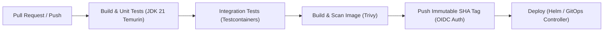
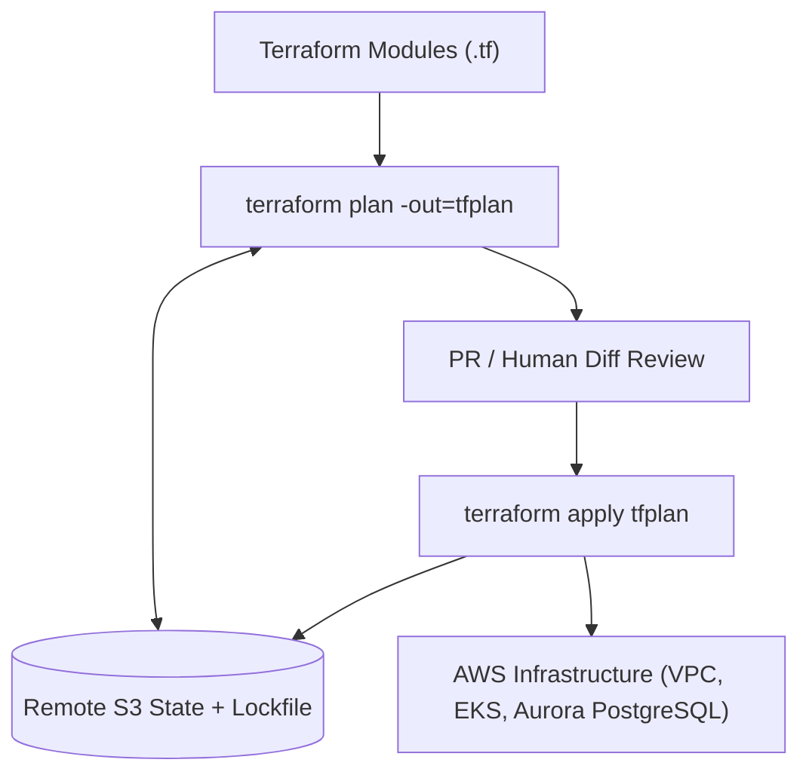
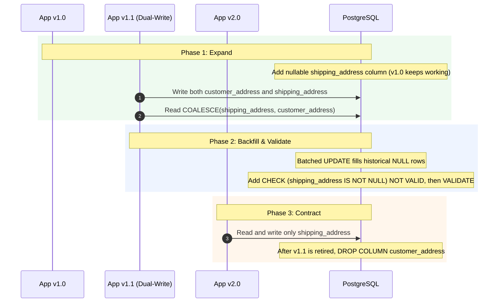

Manual deployments fail in predictable ways. Someone builds an artifact on a laptop with a slightly different JDK patch, forgets to update an environment variable in production, or clicks through a cloud console change in staging without recording it anywhere. Under incident pressure, nobody is completely sure what is running or how to get back to the previous known-good state.

Continuous Integration and Continuous Delivery (CI/CD) replace manual release checklists with automated pipelines that compile, test, scan, package, and deploy every change identically. Infrastructure as Code (IaC) brings the same discipline to networks, Kubernetes clusters, and databases by declaring them in version-controlled files that go through pull requests and automated diff checks before touching production.

## Automating Java 21 Builds and Deployments in GitHub Actions

A solid Java CI/CD pipeline separates fast pull-request verification from artifact publishing and deployment. Every pull request should compile against a pinned JDK, run unit tests and real Testcontainers integration tests, and fail fast if anything breaks. Only commits merged to `main` should publish immutable container images and trigger deployments.



Two security and reliability practices are worth adopting from the start:
1. **Use OIDC short-lived credentials instead of long-lived cloud keys.** Rather than storing static `AWS_ACCESS_KEY_ID` and `AWS_SECRET_ACCESS_KEY` secrets in GitHub, grant the job `id-token: write` and exchange GitHub's signed OIDC token for a short-lived IAM role via AWS STS. Nothing sits around to leak or expire on a calendar.
2. **Tag container images immutably by Git commit SHA.** Never deploy `:latest` to production. A `:latest` tag moves underneath you, making rollbacks unreliable and hiding which exact commit is running inside a crashed pod.

### Java 21 GitHub Actions Workflow (`.github/workflows/ci-cd.yml`)

```yaml
name: Order Service CI/CD

on:
  pull_request:
    branches: [main]
  push:
    branches: [main]

permissions:
  contents: read

jobs:
  verify:
    name: Build and Test
    runs-on: ubuntu-latest
    timeout-minutes: 15
    steps:
      - name: Check out source
        uses: actions/checkout@v4

      - name: Set up JDK 21 with Maven cache
        uses: actions/setup-java@v4
        with:
          java-version: "21"
          distribution: temurin
          cache: maven

      - name: Run unit and Testcontainers integration tests
        run: ./mvnw verify -B

  publish:
    name: Build, Scan, and Push Image
    needs: verify
    if: github.event_name == 'push' && github.ref == 'refs/heads/main'
    runs-on: ubuntu-latest
    timeout-minutes: 15
    permissions:
      contents: read
      id-token: write
    steps:
      - name: Check out source
        uses: actions/checkout@v4

      - name: Set up JDK 21 with Maven cache
        uses: actions/setup-java@v4
        with:
          java-version: "21"
          distribution: temurin
          cache: maven

      - name: Package application JAR (tests already passed)
        run: ./mvnw package -DskipTests -B

      - name: Build container image locally
        run: docker build -t order-service:scan .

      - name: Scan container image with Trivy
        uses: aquasecurity/trivy-action@0.28.0
        with:
          image-ref: order-service:scan
          format: table
          exit-code: "1"
          ignore-unfixed: true
          severity: CRITICAL,HIGH

      - name: Assume AWS role via OIDC
        uses: aws-actions/configure-aws-credentials@v4
        with:
          role-to-assume: ${{ vars.AWS_DEPLOY_ROLE_ARN }}
          aws-region: us-east-1

      - name: Log in to Amazon ECR
        uses: aws-actions/amazon-ecr-login@v2

      - name: Tag and push immutable SHA image
        run: |
          docker tag order-service:scan "123456789012.dkr.ecr.us-east-1.amazonaws.com/order-service:${GITHUB_SHA}"
          docker push "123456789012.dkr.ecr.us-east-1.amazonaws.com/order-service:${GITHUB_SHA}"
```

Notice the narrow `permissions` block: `verify` runs with read-only permissions on pull requests, while only the `publish` job on `main` gets `id-token: write`. On GitHub-hosted Ubuntu runners, Docker is pre-installed so Testcontainers works out of the box without extra daemon wiring.

## GitLab CI Equivalent

If your team runs on GitLab, the same pipeline maps cleanly to `.gitlab-ci.yml`. GitLab uses `services: [docker:27-dind]` to provide a Docker daemon for Testcontainers and container builds, and `id_tokens:` to mint OIDC tokens for cloud authentication.

```yaml
stages:
  - verify
  - publish
  - deploy

variables:
  MAVEN_OPTS: "-Dmaven.repo.local=.m2/repository"
  DOCKER_TLS_CERTDIR: "/certs"

cache:
  key: "${CI_COMMIT_REF_SLUG}-maven"
  paths:
    - .m2/repository

verify:
  stage: verify
  image: eclipse-temurin:21-jdk
  services:
    - docker:27-dind
  variables:
    DOCKER_HOST: "tcp://docker:2376"
    DOCKER_TLS_VERIFY: "1"
    DOCKER_CERT_PATH: "/certs/client"
  script:
    - ./mvnw verify -B

publish:
  stage: publish
  image: docker:27
  services:
    - docker:27-dind
  id_tokens:
    AWS_OIDC_TOKEN:
      aud: https://sts.amazonaws.com
  rules:
    - if: '$CI_COMMIT_BRANCH == "main"'
  script:
    - IMAGE_REF="123456789012.dkr.ecr.us-east-1.amazonaws.com/order-service:${CI_COMMIT_SHA}"
    - docker build -t "${IMAGE_REF}" .
    - docker push "${IMAGE_REF}"

deploy_prod:
  stage: deploy
  image: alpine/helm:3.16
  rules:
    - if: '$CI_COMMIT_BRANCH == "main"'
      when: manual
  environment:
    name: production
  script:
    - helm upgrade --install order-service ./charts/order-service -n production -f ./charts/order-service/values-prod.yaml --set-string "image.tag=${CI_COMMIT_SHA}" --atomic --timeout 5m
```

In practice, teams choose between GitHub Actions and GitLab CI mostly based on where their repositories already live. GitLab integrates environments, protected branches, and a container registry tightly out of the box; GitHub Actions shines with its reusable workflows and broad ecosystem of maintained actions.

## Infrastructure as Code with Terraform

Configuring VPC subnets, security groups, EKS clusters, and RDS databases by hand in a cloud console creates environments that cannot be reproduced reliably. **Terraform** lets you declare desired infrastructure in HCL (`.tf`) files. On every run, Terraform compares your code against a state file representing existing cloud resources, computes the exact diff, and shows you what it will create, update, or destroy before making changes.



### Remote State and Locking

Never commit `terraform.tfstate` to Git. State files can contain sensitive attributes (such as generated credentials or internal endpoints), and local state breaks as soon as two engineers or two CI jobs touch the same environment.

Configure a remote backend with encryption and locking. As of Terraform 1.10+, the S3 backend supports native lockfiles via `use_lockfile = true` (using S3 conditional writes), removing the need to maintain a separate DynamoDB table. On older Terraform versions prior to 1.10, teams used `dynamodb_table = "terraform-state-lock"` for the same purpose, which HashiCorp has since deprecated in favor of S3 lockfiles.

```hcl
terraform {
  required_version = ">= 1.10.0"

  required_providers {
    aws = {
      source  = "hashicorp/aws"
      version = "~> 5.80"
    }
  }

  backend "s3" {
    bucket       = "acme-terraform-state-prod"
    key          = "order-platform/prod/terraform.tfstate"
    region       = "us-east-1"
    encrypt      = true
    use_lockfile = true
  }
}

provider "aws" {
  region = var.aws_region

  default_tags {
    tags = {
      Environment = var.environment
      ManagedBy   = "Terraform"
      Service     = "order-platform"
    }
  }
}
```

### Structuring a Reusable Module

Avoid dumping all resources into one giant `main.tf`. Group cohesive components into modules (`modules/aurora-postgres/`) and instantiate them per environment (`environments/staging/`, `environments/prod/`).

```hcl
# modules/aurora-postgres/variables.tf
variable "cluster_name" {
  type = string
}

variable "database_name" {
  type = string
}

variable "instance_class" {
  type    = string
  default = "db.r6g.large"
}

variable "instance_count" {
  type    = number
  default = 2
}

variable "subnet_group_name" {
  type = string
}

variable "security_group_ids" {
  type = list(string)
}
```

```hcl
# modules/aurora-postgres/main.tf
resource "aws_rds_cluster" "this" {
  cluster_identifier          = var.cluster_name
  engine                      = "aurora-postgresql"
  engine_version              = "16.4"
  database_name               = var.database_name
  master_username             = "db_admin"
  manage_master_user_password = true
  backup_retention_period     = 30
  preferred_backup_window     = "02:00-03:00"
  storage_encrypted           = true
  deletion_protection         = true
  skip_final_snapshot         = false
  final_snapshot_identifier   = "${var.cluster_name}-final"

  vpc_security_group_ids = var.security_group_ids
  db_subnet_group_name   = var.subnet_group_name

  lifecycle {
    prevent_destroy = true
  }
}

resource "aws_rds_cluster_instance" "nodes" {
  count              = var.instance_count
  identifier         = format("%s-%d", var.cluster_name, count.index)
  cluster_identifier = aws_rds_cluster.this.id
  instance_class     = var.instance_class
  engine             = aws_rds_cluster.this.engine
  engine_version     = aws_rds_cluster.this.engine_version
}
```

Notice two defensive settings in this module:
- `manage_master_user_password = true` delegates credential generation and rotation to AWS Secrets Manager so no database password ever enters a `.tfvars` file or Terraform state variable.
- Combining `deletion_protection = true` (enforced by AWS) with `prevent_destroy = true` (enforced by Terraform) prevents a careless refactor from dropping a production database.

### Always Run `plan` Before `apply`

In CI and locally, save the execution plan to a file, review every `-` (destroy) or `-/+` (replace) line, and apply that exact plan file:

```bash
terraform init
terraform plan -var-file="prod.tfvars" -out=tfplan
# Review the plan output on the pull request before approving
terraform apply tfplan
```

Applying a saved `tfplan` guarantees Terraform executes only what reviewers approved, rather than silently picking up unexpected drift that happened between planning and merging.

## Zero-Downtime Deployment Strategies

Once your pipeline produces an immutable image, you have to replace running v1 instances with v2 without dropping active user requests.

```mermaid
flowchart TD
    subgraph Rolling["Rolling Update"]
        R1["Gradually replace pods in place (maxUnavailable: 0)"]
        R2["Low extra cost; v1 and v2 serve traffic concurrently"]
        R1 --> R2
    end

    subgraph BlueGreen["Blue/Green Deployment"]
        BG1["Run full v2 Green stack alongside active v1 Blue stack"]
        BG2["Smoke test Green, then switch load balancer / Service selector"]
        BG3["Instant rollback to Blue; requires 2x compute during cutover"]
        BG1 --> BG2 --> BG3
    end

    subgraph Canary["Canary Deployment"]
        C1["Route 5% traffic to v2 while 95% stays on v1"]
        C2["Check error rate, P99 latency, and domain KPIs"]
        C3["Step up to 25%, 50%, 100% or auto-rollback on regression"]
        C1 --> C2 --> C3
    end
```



| Strategy | Downtime | Extra Compute | Rollback Speed | Best Fit |
|---|---|---|---|---|
| Recreate | Yes (stops v1 before v2 starts) | None (1x) | Slow (redeploy v1) | Non-production or single-writer batch workers |
| Rolling Update | Zero (with readiness probes + graceful shutdown) | Small (e.g., 1.25x) | Moderate (roll back pod by pod) | Standard stateless microservices |
| Blue / Green | Zero | High (2x during cutover) | Instant (flip router back to Blue) | Releases needing full pre-cutover verification and clean version separation |
| Canary (Argo Rollouts / Istio) | Zero | Small (1.05x to 1.2x) | Fast and automated | High-traffic services where limiting blast radius matters most |

For any of these strategies to achieve true zero downtime in Spring Boot, enable graceful shutdown (`server.shutdown=graceful` and `spring.lifecycle.timeout-per-shutdown-phase=30s`) and configure a Kubernetes `preStop` sleep of a few seconds so kube-proxy and ingress controllers stop sending new requests before the JVM stops accepting connections.

### Push CI vs Pull GitOps

In the GitLab example above, the CI runner pushes directly to Kubernetes using `helm upgrade`. That works for smaller setups, but it requires handing cluster-admin or namespace-write credentials to your CI system.

In a **GitOps pull model** (using ArgoCD or Flux), CI stops after building the image and updating the image tag in a separate deployment Git repository. An in-cluster controller watches that Git repository and reconciles Kubernetes to match. CI never holds production cluster credentials, manual `kubectl edit` drift is detected and reverted automatically, and rolling back a deployment is a `git revert`.

## Coordinating Database Migrations: Expand and Contract

Blue/Green and Canary rollouts only protect stateless application code. Your relational database is shared by both versions during the rollout (and must remain compatible with v1 if you roll back after cutover).

Suppose v1 reads `customer_address` and v2 renames it in a single Flyway migration:

```sql
-- Breaks v1 immediately during Rolling, Blue/Green, or Canary rollouts
ALTER TABLE customers RENAME COLUMN customer_address TO shipping_address;
```

The moment that migration runs, every live v1 pod fails with a missing-column SQL error. If you instead run the migration after deploying v2, v2 fails until the migration finishes.

The **Expand and Contract** pattern breaks destructive schema changes into three backward-compatible steps spread across separate releases:



In PostgreSQL, handle constraints carefully so you do not hold an `ACCESS EXCLUSIVE` lock on a large table during peak traffic:

```sql
-- Phase 1 (Expand): fast metadata-only operation in PostgreSQL
ALTER TABLE customers ADD COLUMN shipping_address TEXT;

-- Phase 2 (Backfill in chunks via a background job, then enforce NOT NULL safely)
ALTER TABLE customers
  ADD CONSTRAINT customers_shipping_address_not_null
  CHECK (shipping_address IS NOT NULL) NOT VALID;

-- Scans table with SHARE UPDATE EXCLUSIVE lock (reads and writes continue)
ALTER TABLE customers
  VALIDATE CONSTRAINT customers_shipping_address_not_null;

-- If a unique index is needed, build it without blocking writes
CREATE UNIQUE INDEX CONCURRENTLY idx_customers_account_ref
  ON customers (account_ref);

-- Phase 3 (Contract, in a later release after v1.x is fully retired)
ALTER TABLE customers DROP COLUMN customer_address;
```

Run schema migrations in a dedicated pre-deploy Kubernetes Job (or Helm `pre-upgrade` hook) rather than inside Spring Boot's startup across multiple replicas, so migrations run exactly once and do not race for Flyway's lock table.

## Common Failure Modes

### Concurrent Terraform Applies Without State Locking

When two pipelines run `terraform apply` against the same S3 state file without locking, the second write can overwrite the first. Resources created by the first run vanish from state, leaving orphaned cloud infrastructure or causing the next `plan` to recreate resources unexpectedly. Always enable `use_lockfile = true` (or a DynamoDB lock table on Terraform versions before 1.10), serialize applies per environment in CI (for example, using GitHub Actions `concurrency:` groups), and enable `deletion_protection = true` on stateful resources like RDS.

### Canary Checks That Only Watch HTTP 5xx

Monitoring only HTTP `5xx` error rates gives false confidence. A regression that accidentally returns `200 OK` with an empty response body or skips writing an event to Kafka looks completely healthy to a basic `5xx` check and gets promoted to 100% of traffic. Pair infrastructure signals (`5xx` rate, P99 latency, JVM memory/GC pauses) with at least one domain metric (such as successful order completions per minute) and automated post-deploy smoke tests.

## Practical Questions

### Why should CI pipelines use OIDC short-lived credentials and Git SHA image tags instead of static cloud keys and `:latest`?

Static cloud access keys stored in CI secrets are long-lived credentials that require manual rotation and carry high blast radius if leaked. OIDC federation mints a short-lived token scoped to a specific repository, branch, and workflow run. Immutable Git SHA tags guarantee that staging and production run the exact same built artifact and let you trace any running pod directly back to a commit; `:latest` is mutable and makes rollbacks ambiguous.

### How does Terraform remote state locking work, and why should CI run `terraform plan -out=tfplan` before `terraform apply`?

When Terraform starts a state-modifying operation, it acquires a lock in the remote backend (via an S3 lockfile with `use_lockfile = true` in Terraform 1.10+ or a DynamoDB table in older versions) so concurrent runs fail fast instead of corrupting state. Saving the plan to `tfplan` and applying that file ensures CI applies the exact set of changes reviewed on the pull request rather than silently applying changes caused by concurrent drift.

### How does a GitOps pull model (ArgoCD or Flux) differ from a CI push deployment?

In a CI push pipeline, the CI runner authenticates directly to the Kubernetes cluster and executes `kubectl` or `helm upgrade`. In a GitOps pull model, CI updates a declared manifest or Helm value in Git, and an in-cluster controller pulls and reconciles cluster state continuously. That removes cluster write credentials from CI, detects and corrects manual configuration drift, and makes rollbacks a standard Git revert.

### How do you add a `NOT NULL` or `UNIQUE` constraint to a busy PostgreSQL table without blocking traffic?

Add the new column as nullable first (Expand), deploy dual-writing code, and backfill existing rows in small batches. Then add a `CHECK (col IS NOT NULL) NOT VALID` constraint (which only checks new writes and takes a brief lock) followed by `ALTER TABLE ... VALIDATE CONSTRAINT` (which scans existing rows without blocking reads or writes). For uniqueness, run `CREATE UNIQUE INDEX CONCURRENTLY` so PostgreSQL builds the index in the background without taking an exclusive write lock.
