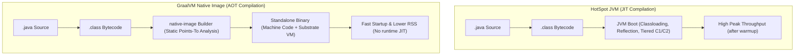
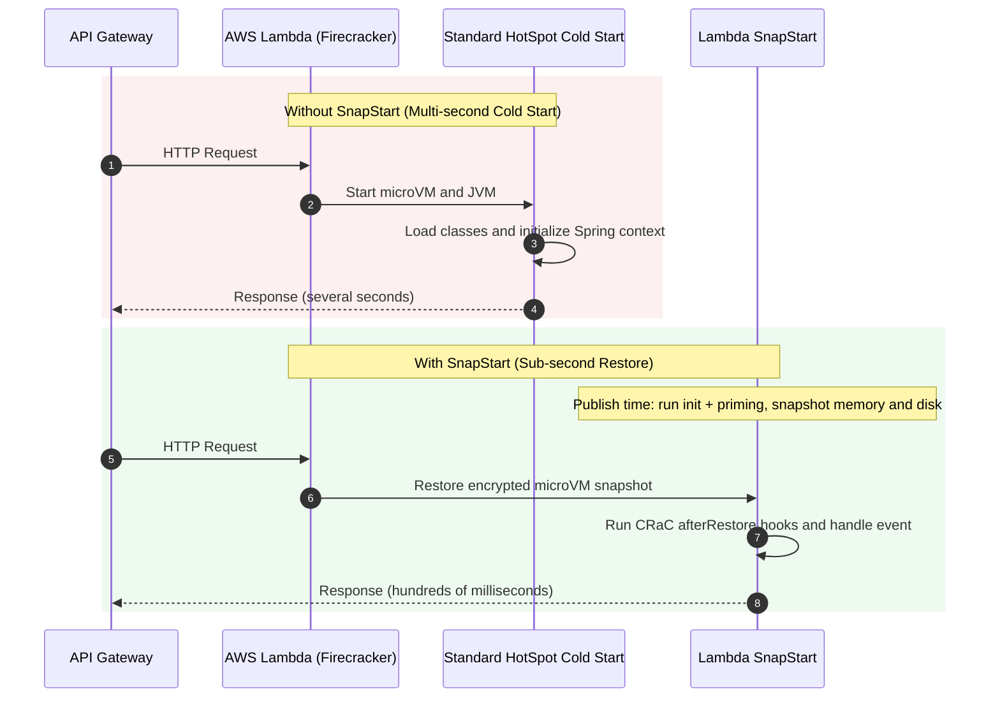

For most of its history, the HotSpot JVM optimized for long-running server processes. Taking five seconds to boot and reserving 400 MB of RAM was a worthwhile trade when a service stayed up for weeks and the C1/C2 JIT compilers could profile live traffic, inline hot call sites, and reach high sustained throughput.

Serverless platforms (AWS Lambda, Google Cloud Run) and elastic Kubernetes workloads invert those priorities. When traffic arrives on a scaled-to-zero function or a burst triggers horizontal pod autoscaling, a ten-second startup stalls user requests, and a heavy baseline memory footprint multiplies cloud bills across dozens of small replicas.

Modern Java addresses this from three angles: ahead-of-time compilation with GraalVM Native Image, checkpoint/restore with Project CRaC and AWS Lambda SnapStart, and leaner container packaging with Jib, Cloud Native Buildpacks, and `jlink`. Each carries real engineering trade-offs.

## GraalVM Native Image and Ahead-of-Time Compilation

Standard Java compiles `.java` source into `.class` bytecode, and the HotSpot JVM interprets and JIT-compiles hot methods at runtime. **GraalVM Native Image** moves compilation to build time: it analyzes your application bytecode and outputs a standalone, OS-specific executable (an ELF binary on Linux) that runs without a JVM installation.

Because there is no HotSpot runtime in the container, the native binary embeds **Substrate VM**, a small runtime providing thread management, signal handling, and garbage collection.



### The Closed-World Assumption and Reachability Metadata

To keep the executable small and fast, `native-image` operates under a **Closed-World Assumption**. Starting from `public static void main`, the builder runs a static points-to analysis to discover every class, method, and field reachable at runtime. Everything else is omitted from the binary.

That static analysis breaks whenever code relies on dynamic JVM features that cannot be inferred purely from bytecode call graphs:
- Reflection (`Class.forName`, `Method.invoke`, Jackson binding on dynamically discovered types)
- JDK dynamic proxies
- Classpath resources loaded via `ClassLoader.getResourceAsStream`
- Java serialization and JNI calls

To keep those code paths alive, you supply **Reachability Metadata** JSON files under `META-INF/native-image/` (historically split into `reflect-config.json`, `resource-config.json`, and `proxy-config.json`, and consolidated into `reachability-metadata.json` in newer GraalVM releases):

```json
[
  {
    "name": "com.acme.payments.dto.PaymentWebhookPayload",
    "allDeclaredConstructors": true,
    "allDeclaredMethods": true,
    "allDeclaredFields": true
  }
]
```

Writing these JSON files by hand for every third-party library does not scale. Two mechanisms handle most of the work in practice:
1. **The GraalVM Reachability Metadata Repository**, a community-maintained catalog automatically pulled in by the GraalVM Maven and Gradle plugins for popular libraries (PostgreSQL JDBC, Netty, Logback, Jackson, Hibernate).
2. **The GraalVM Tracing Agent**, which you attach to a normal HotSpot JVM run while executing your integration test suite:

```bash
java -agentlib:native-image-agent=config-output-dir=src/main/resources/META-INF/native-image \
  -jar target/payment-service.jar
```

The agent records every reflective lookup, proxy, and resource access observed during the run and writes the metadata files for you. Its obvious limitation is test coverage: if an obscure error-handling path (like serializing a rare downstream exception) is never exercised during testing, the agent will not record it, and the native binary will fail at runtime when that path finally executes in production.

### Honest Trade-Offs: GraalVM AOT vs HotSpot JIT

Native images are not a universal upgrade over HotSpot. They trade peak runtime adaptability and fast builds for startup latency and memory density.

| Dimension | HotSpot JVM (JIT) | GraalVM Native Image (AOT) |
|---|---|---|
| Startup time | Typically 1.5 to 10+ seconds | Typically 20 to 100 milliseconds |
| Memory footprint (RSS) | Higher (JVM + JIT code cache + metaspace) | Significantly lower (often 30 to 100 MB for small APIs) |
| Peak throughput | Very high (speculative inlining and devirtualization from live profiling) | Lower by default; can approach or match JIT with PGO |
| Garbage collectors | G1, ZGC (generational), Shenandoah, Parallel, Serial | Serial GC by default in Community Edition; G1 available in Oracle GraalVM |
| Build time & CI RAM | Fast (`mvn package` in seconds, modest RAM) | Slow (2 to 8+ minutes, often needs 6 to 12 GB RAM) |
| Dynamic tooling | Full JFR, JMX, runtime bytecode agents, hot attach | Limited runtime agents; JFR support exists but narrower |

Profile-Guided Optimization (**PGO**, available in Oracle GraalVM) narrows the throughput gap by compiling an instrumented binary, collecting a runtime profile under representative load, and recompiling with that profile data so the AOT compiler knows which branches and virtual calls are hot. Even with PGO, long-lived, CPU-intensive microservices with steady traffic often run better and cheaper to build on HotSpot JVM (especially when paired with CDS / AppCDS or Project Leyden AOT caches in newer JDKs). Native images shine most for CLI tools, scale-to-zero HTTP functions, and memory-constrained edge or sidecar services.

## Spring Boot 3 AOT vs Quarkus vs Micronaut

Three frameworks dominate cloud-native Java, and they take distinct approaches to shifting work from runtime to build time.

### Spring Boot 3 with Spring AOT

Spring Boot 3 preserves the familiar Spring programming model while adding an optional Ahead-of-Time build phase (`./mvnw -Pnative native:compile` or `./mvnw -Pnative spring-boot:build-image`). During `process-aot`, Spring inspects your application context at build time, evaluates `@Conditional` annotations, generates plain Java source code to wire beans without reflection (`BeanDefinition` and `InstanceSupplier`), and emits reachability hints for GraalVM.

When you have custom reflective types or template resources, you register hints in Java rather than editing JSON by hand:

```java
package com.acme.payments.config;

import com.acme.payments.dto.PaymentWebhookPayload;
import org.springframework.aot.hint.MemberCategory;
import org.springframework.aot.hint.RuntimeHints;
import org.springframework.aot.hint.RuntimeHintsRegistrar;
import org.springframework.context.annotation.Configuration;
import org.springframework.context.annotation.ImportRuntimeHints;

@Configuration
@ImportRuntimeHints(PaymentRuntimeHints.class)
public class PaymentNativeConfig {
}

class PaymentRuntimeHints implements RuntimeHintsRegistrar {

    @Override
    public void registerHints(RuntimeHints hints, ClassLoader classLoader) {
        hints.reflection().registerType(
            PaymentWebhookPayload.class,
            MemberCategory.INVOKE_DECLARED_CONSTRUCTORS,
            MemberCategory.INVOKE_DECLARED_METHODS,
            MemberCategory.DECLARED_FIELDS
        );
        hints.resources().registerPattern("templates/receipts/*.txt");
    }
}
```

Spring Boot 3 AOT is the lowest-friction option for teams already invested in Spring Data, Spring Security, and the wider Spring ecosystem. The main caveat is that some dynamic runtime behaviors (such as changing Spring profiles after AOT processing or dynamically registering bean definitions at startup) are restricted in native mode.

### Quarkus

Quarkus was built around **build-time augmentation** from the start. Its dependency injection container (ArC, based on Jakarta CDI) resolves injection graphs, parses annotations, and runs Hibernate metadata bootstrapping during the build rather than at startup. Its core HTTP layer sits on Vert.x and Netty, letting you mix imperative and reactive endpoints cleanly.

Quarkus offers a strong native story because its curated extensions are tested against GraalVM directly, and `quarkus dev` gives fast live coding and continuous testing. The trade-off is a smaller ecosystem than Spring and tighter coupling to Quarkus extensions when you want zero-hassle native builds.

### Micronaut

Micronaut eliminates runtime reflection altogether by using **Java Annotation Processors (APT)** during `javac` compilation to generate bean factories, HTTP route metadata, and AOP proxies. Because it does not scan the classpath or rely on reflection at startup, Micronaut boots quickly and uses modest memory even on a standard HotSpot JVM, without requiring GraalVM.

The trade-off is slightly slower compilation (annotation processing runs on every compile) and a smaller community footprint than Spring Boot.

| Criterion | Spring Boot 3 (AOT) | Quarkus | Micronaut |
|---|---|---|---|
| Build-time mechanism | Spring AOT code generation + hints | Build-time bytecode augmentation (ArC) | Compile-time Annotation Processing (APT) |
| HotSpot startup | Moderate (improved with AOT/CDS) | Fast | Fast (no runtime reflection) |
| GraalVM Native Image | First-class in Boot 3+ | First-class via Quarkus extensions | First-class |
| Ecosystem & migration | Easiest for existing Spring teams | Strong Kubernetes & Jakarta EE alignment | Strong for lightweight microservices & serverless |

## Cold Starts in AWS Lambda, Project CRaC, and SnapStart

Serverless functions scale to zero when idle. When a request hits an idle AWS Lambda function, the platform provisions a Firecracker microVM, boots the JVM, loads thousands of classes, initializes the dependency injection container, and finally runs your handler. For a Spring Boot application on standard Java, that cold start can easily take 4 to 10 seconds, long enough to trip API Gateway or upstream webhook timeouts.

One option is compiling to a GraalVM Native Image and running it on Lambda's custom runtime (`provided.al2023`). That drops cold starts well under 200 ms, at the cost of slower native builds and reachability metadata maintenance.

A second option keeps the standard HotSpot JVM: **Project CRaC (Coordinated Restore at Checkpoint)** in OpenJDK (built on Linux CRIU) and **AWS Lambda SnapStart**, which applies the same checkpoint/restore concept at the Firecracker microVM level.



When you publish a new Lambda version with SnapStart enabled (supported on Java 11, Java 17, and Java 21 managed runtimes; SnapStart applies to published versions and aliases, not `$LATEST`), AWS initializes your function, runs static initializers and optional priming code, snapshots the microVM's memory and disk state, and caches the encrypted snapshot. When traffic arrives, Lambda restores that pre-initialized snapshot instead of booting the JVM from scratch.

### Handling Checkpoint and Restore State Safely

SnapStart and CRaC introduce a subtle bug class: **any state initialized before the checkpoint is cloned identically into every restored execution environment.**

Three things commonly go wrong if you ignore checkpoint semantics:
1. **Open network sockets**: Database connection pools (HikariCP) or HTTP keep-alive connections opened before the checkpoint are dead or shared awkwardly after restore.
2. **Randomness and cryptographic state**: A `java.util.Random` instance seeded before the checkpoint will emit the exact same sequence of numbers on every restored Lambda instance. (`SecureRandom` on modern OpenJDK/SnapStart handles OS entropy better, but explicitly clearing and re-initializing sensitive generators on restore is still good hygiene.)
3. **Time-sensitive data**: Short-lived OAuth tokens, STS credentials, or timestamps cached during init may already be expired when a snapshot restores hours later.

The `org.crac:crac` API gives your code deterministic lifecycle hooks (`beforeCheckpoint` and `afterRestore`) that both OpenJDK CRaC and AWS Lambda SnapStart invoke automatically (and Spring Boot 3.2+ integrates CRaC support via `SmartLifecycle` beans as well):

```java
package com.acme.serverless;

import com.zaxxer.hikari.HikariDataSource;
import org.crac.Context;
import org.crac.Core;
import org.crac.Resource;

import java.security.SecureRandom;
import java.time.Instant;

public class LambdaRuntimeResources implements Resource {

    private final HikariDataSource dataSource;
    private volatile SecureRandom secureRandom;
    private volatile Instant lastRestoredAt;

    public LambdaRuntimeResources(HikariDataSource dataSource) {
        this.dataSource = dataSource;
        this.secureRandom = new SecureRandom();
        Core.getGlobalContext().register(this);
    }

    @Override
    public void beforeCheckpoint(Context<? extends Resource> context) {
        // Evict idle connections and clear sensitive state before snapshotting
        dataSource.getHikariPoolMXBean().softEvictConnections();
        this.secureRandom = null;
    }

    @Override
    public void afterRestore(Context<? extends Resource> context) {
        // Re-seed randomness and record fresh clock state after restore
        this.secureRandom = new SecureRandom();
        this.lastRestoredAt = Instant.now();
    }

    public byte[] nextTokenBytes(int length) {
        byte[] bytes = new byte[length];
        secureRandom.nextBytes(bytes);
        return bytes;
    }

    public Instant lastRestoredAt() {
        return lastRestoredAt;
    }
}
```

To get the most out of SnapStart, teams also use **priming**: executing a harmless warm-up call (such as marshaling a dummy JSON payload or loading a DynamoDB client) inside `beforeCheckpoint` or static initialization so those classes are already loaded before the snapshot is taken.

### Choosing Between SnapStart and GraalVM on AWS Lambda

- Pick **SnapStart** when you want normal `mvn package` build times, full HotSpot compatibility with existing Spring/Hibernate libraries, and sub-second cold starts without fighting reflection metadata. Keep in mind that Lambda still pays for JVM memory sizing, and SnapStart carries snapshot caching charges on Java runtimes.
- Pick **GraalVM Native Image** when you need the smallest possible memory allocation (128 MB to 256 MB Lambda functions), the fastest possible cold starts, or portable native containers that run outside AWS Lambda (such as Cloud Run or Kubernetes KEDA scale-to-zero).

## Optimizing Java Container Images: Jib, Buildpacks, and `jlink`

Even if you stay on the HotSpot JVM, how you package your container directly affects CI speed, registry storage, attack surface, and Kubernetes pod pull latency. A naive Dockerfile that copies a 90 MB Spring Boot fat JAR into a full JDK image invalidates the entire 90 MB layer every time you change a single line of Java code.

### Google Jib (Daemonless Layered Builds)

**Google Jib** builds OCI container images directly from Maven or Gradle without needing a Docker daemon, Dockerfile, or root privileges on CI runners. It separates your application into deterministic layers: third-party dependencies, snapshot dependencies, resources, and compiled application classes. When you modify business logic, Jib rebuilds and pushes only the tiny classes layer (often under 500 KB) and strips non-deterministic timestamps so identical inputs produce identical image digests.

```xml
<plugin>
    <groupId>com.google.cloud.tools</groupId>
    <artifactId>jib-maven-plugin</artifactId>
    <version>3.4.4</version>
    <configuration>
        <from>
            <image>gcr.io/distroless/java21-debian12:nonroot</image>
        </from>
        <to>
            <image>ghcr.io/acme-commerce/order-service:2.8.3</image>
        </to>
        <container>
            <jvmFlags>
                <jvmFlag>-XX:MaxRAMPercentage=75.0</jvmFlag>
                <jvmFlag>-XX:+UseZGC</jvmFlag>
                <jvmFlag>-XX:+ZGenerational</jvmFlag>
                <jvmFlag>-XX:+ExitOnOutOfMemoryError</jvmFlag>
            </jvmFlags>
            <ports>
                <port>8080</port>
            </ports>
        </container>
    </configuration>
</plugin>
```

### Cloud Native Buildpacks

Spring Boot integrates **Cloud Native Buildpacks (Paketo)** directly into its Maven and Gradle plugins:

```bash
# Standard JVM container image (no Dockerfile required)
./mvnw spring-boot:build-image -Dspring-boot.build-image.imageName=ghcr.io/acme-commerce/order-service:2.8.3

# GraalVM Native Image container via Paketo Native Image Buildpack
./mvnw -Pnative spring-boot:build-image -Dspring-boot.build-image.imageName=ghcr.io/acme-commerce/order-service:2.8.3-native
```

Paketo Buildpacks detect the Java version, install a minimal BellSoft Liberica JRE, split the Spring Boot JAR into layers, and bundle a **JVM memory calculator** that inspects the container's cgroup memory limit at startup and calculates safe heap, metaspace, and direct-memory flags automatically. Buildpacks also support **OCI rebasing**, allowing security teams to patch the underlying OS base layer across hundreds of images without recompiling Java code.

### Custom Minimal Runtimes with `jlink`

When you prefer explicit Dockerfiles, `jdeps` and `jlink` let you build a custom JRE containing only the JDK modules your service actually uses, paired with Spring Boot 3.3+'s `extract` tool for clean layer caching:

```dockerfile
# Stage 1: Build custom JRE and extract Spring Boot layers
FROM eclipse-temurin:21-jdk AS builder
WORKDIR /build
COPY target/order-service.jar app.jar

RUN java -Djarmode=tools -jar app.jar extract --layers --destination extracted

RUN jlink \
    --add-modules java.base,java.logging,java.naming,java.sql,java.management,java.instrument,java.desktop,java.security.jgss,jdk.unsupported \
    --strip-debug \
    --no-man-pages \
    --no-header-files \
    --compress=zip-6 \
    --output /custom-jre

# Stage 2: Minimal runtime image
FROM debian:bookworm-slim
RUN useradd --system --uid 10001 appuser
WORKDIR /app

COPY --from=builder /custom-jre /opt/java
ENV PATH="/opt/java/bin:${PATH}"

COPY --from=builder /build/extracted/dependencies/ ./
COPY --from=builder /build/extracted/spring-boot-loader/ ./
COPY --from=builder /build/extracted/snapshot-dependencies/ ./
COPY --from=builder /build/extracted/application/ ./

USER 10001
EXPOSE 8080
ENTRYPOINT ["java", "-XX:MaxRAMPercentage=75.0", "-XX:+ExitOnOutOfMemoryError", "org.springframework.boot.loader.launch.JarLauncher"]
```

A `jlink` runtime trims roughly 100 to 150 MB off a full JDK image, removes shells and build tools you do not want in production, and keeps full HotSpot JIT performance.

## Practical Questions

### When is it better to stay on HotSpot JIT instead of compiling to a GraalVM Native Image?

Stay on HotSpot JIT for long-running, high-throughput services where startup happens rarely and sustained CPU efficiency matters more than a 50 ms boot time. HotSpot gives you fast CI builds, full compatibility with dynamic libraries and APM agents, low-pause collectors like Generational ZGC, and runtime speculative optimizations without needing PGO. Choose GraalVM Native Image when scale-to-zero cold starts, tight memory limits per container, or fast CLI execution are primary requirements.

### What is Profile-Guided Optimization (PGO) in GraalVM, and why does it matter?

An AOT compiler has to make inlining and branch-layout decisions without seeing live traffic, which can leave default native images trailing HotSpot C2 on peak throughput. With PGO, you compile an instrumented binary, run realistic workload traffic against it to record execution frequencies, and recompile the native image using that profile. The AOT compiler then inlines hot paths and lays out branches with knowledge similar to a JIT compiler.

### What goes wrong if you enable AWS Lambda SnapStart without handling CRaC hooks?

Every restored Lambda instance clones the exact memory snapshot taken at publish time. If a database pool opened connections before the checkpoint, those sockets will be broken or timed out on restore. If a pseudo-random generator was seeded before the checkpoint, concurrent invocations can generate identical token sequences. Implementing `org.crac.Resource` (`beforeCheckpoint` and `afterRestore`) lets you evict network connections before snapshotting and re-seed randomness or refresh time-sensitive caches immediately on restore.

### How do Google Jib, Cloud Native Buildpacks, and `jlink` fit together?

They solve container optimization at different levels. **Google Jib** builds layered, reproducible OCI images directly from Maven or Gradle without a Docker daemon, speeding up CI pushes. **Cloud Native Buildpacks** eliminate Dockerfiles while automatically configuring a minimal JRE, a container-aware JVM memory calculator, and rebaseable OS layers. **`jlink`** is a JDK tool used inside multi-stage Dockerfiles to strip the Java runtime down to only the modules your service needs.
