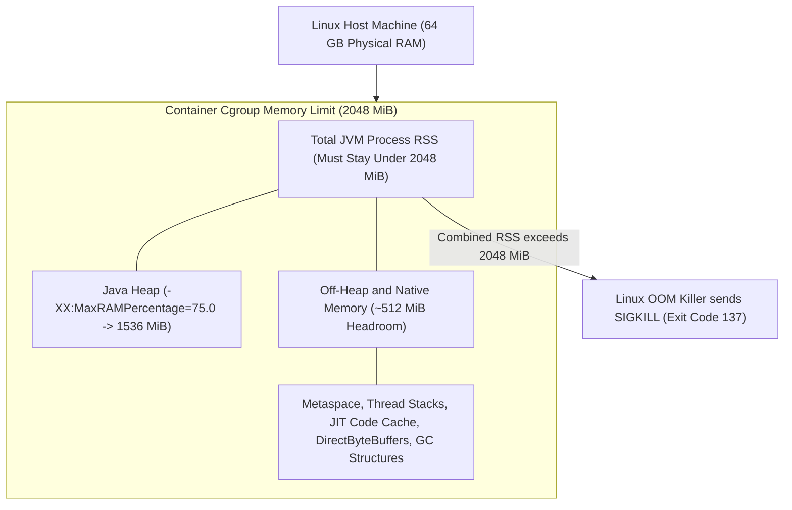
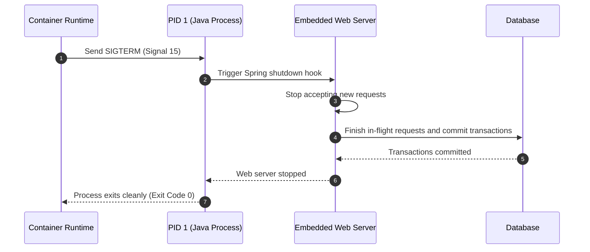

Putting a Java application into a container looks deceptively simple at first: copy a Spring Boot fat JAR into an OpenJDK image, add an `ENTRYPOINT`, and run `docker build`. That works on a laptop, and it usually fails in predictable ways once the image reaches a real CI pipeline or production traffic.

Containerized Java services run into four recurring problems: oversized images that rebuild slowly because layer caching is broken, root processes with unnecessary OS utilities exposed to attackers, Linux OOM killer terminations (Exit Code 137) caused by ignoring native JVM memory, and dropped in-flight requests during deployments because a shell process swallowed `SIGTERM`. Working through each of these takes you from a toy Dockerfile to something you can actually run in production.

---

## Multi-Stage Dockerfiles for Java Applications

A common starting point is building directly inside a Maven or Gradle image and shipping that same image to production:

```dockerfile
# Avoid this pattern for production images
FROM maven:3.9-eclipse-temurin-21
WORKDIR /app
COPY . .
RUN mvn clean package -DskipTests
ENTRYPOINT java -jar target/order-service.jar
```

There are several things wrong here. First, the final image ships the entire JDK, Maven, your source code, and the `.m2` cache, easily crossing 800 MB to 1 GB. Second, `COPY . .` invalidates the build cache on every edit, even a README tweak, forcing Maven to re-download dependencies from scratch. Third, the container runs as `root`. Fourth, the shell-form `ENTRYPOINT` breaks graceful shutdown.

A **multi-stage build** separates the build toolchain from the runtime image. Stage 1 compiles the application and unpacks the JAR into layers; Stage 2 copies only the compiled layers onto a minimal JRE image and switches to a non-root user.

```dockerfile
# -----------------------------------------------------------------------------
# Stage 1: Build and extract Spring Boot layers
# -----------------------------------------------------------------------------
FROM eclipse-temurin:21-jdk-jammy AS builder
WORKDIR /workspace

# Copy build metadata first so Docker caches resolved dependencies
COPY pom.xml mvnw ./
COPY .mvn .mvn
RUN ./mvnw dependency:go-offline -B

# Copy application source and package the executable JAR
COPY src src
RUN ./mvnw package -DskipTests -B

# Extract layers using Spring Boot 3.3+ jarmode=tools
# (For Spring Boot 2.3 to 3.2, use: java -Djarmode=layertools -jar target/*.jar extract --destination extracted)
RUN java -Djarmode=tools -jar target/*.jar extract --layers --launcher --destination extracted

# -----------------------------------------------------------------------------
# Stage 2: Minimal runtime image
# -----------------------------------------------------------------------------
FROM eclipse-temurin:21-jre-jammy AS runtime
WORKDIR /application

# Create a dedicated non-root user with a fixed numeric UID
RUN groupadd --gid 10001 spring \
 && useradd --uid 10001 --gid 10001 --no-create-home --shell /sbin/nologin spring

# Copy layers from least frequently changed to most frequently changed
COPY --from=builder /workspace/extracted/dependencies/ ./
COPY --from=builder /workspace/extracted/spring-boot-loader/ ./
COPY --from=builder /workspace/extracted/snapshot-dependencies/ ./
COPY --from=builder /workspace/extracted/application/ ./

# Run as numeric UID so Kubernetes runAsNonRoot validation can verify it directly
USER 10001:10001

EXPOSE 8080

# Configure JVM flags without needing a shell to expand variables
ENV JAVA_TOOL_OPTIONS="-XX:MaxRAMPercentage=75.0 -XX:+ExitOnOutOfMemoryError"

# Exec-form ENTRYPOINT ensures the JVM is PID 1 and receives SIGTERM directly
ENTRYPOINT ["java", "org.springframework.boot.loader.launch.JarLauncher"]
```

### Why Each Part Matters

**Dependency caching and `.dockerignore`.** Copying `pom.xml` and running `dependency:go-offline` before `COPY src src` keeps Docker from re-fetching third-party JARs whenever Java source files change. If you use BuildKit (default in modern Docker), you can go a step further with a cache mount (`RUN --mount=type=cache,target=/root/.m2 ./mvnw package -DskipTests -B`) so the Maven repository persists across builds even when `pom.xml` changes. Always pair your Dockerfile with a `.dockerignore` file excluding `.git`, `target/`, `build/`, and IDE directories so Docker does not copy hundreds of megabytes into the build context.

**Spring Boot layered JAR extraction.** A standard executable JAR bundles 80 to 150 MB of third-party libraries (Spring, Jackson, Hibernate, JDBC drivers) with a few hundred kilobytes of your own `.class` files. Changing one line of business logic changes the hash of the whole JAR, forcing Docker to push a new 100+ MB layer on every build. Extracting layers splits the archive into `dependencies`, `spring-boot-loader`, `snapshot-dependencies`, and `application`. On a typical code change, Docker reuses the first three cached layers and only rebuilds the small `application` layer.

> [!NOTE]
> Spring Boot 3.2 moved `JarLauncher` from `org.springframework.boot.loader.JarLauncher` to `org.springframework.boot.loader.launch.JarLauncher`. In Spring Boot 3.3+, you can also omit `--launcher` when running `extract --layers`, which unpacks a regular `lib/` folder alongside a thin executable JAR that you launch with `java -jar order-service.jar`, avoiding nested-JAR scanning at startup.

**Non-root execution and file ownership.** Copying the extracted files while still `root` and then switching to `USER 10001:10001` leaves the application artifacts owned by `root` and read-only to the running JVM. If a vulnerability allows arbitrary code execution inside the container, the attacker cannot overwrite application bytecode or install OS packages. Using a numeric UID (`10001:10001`) rather than just a username (`spring:spring`) also allows Kubernetes `securityContext.runAsNonRoot: true` checks to verify non-root execution without inspecting `/etc/passwd`.

---

## Choosing a Base Image: Debian Slim vs Alpine vs Distroless

The base image you pick for Stage 2 shapes image size, native library compatibility, CVE noise, and how you debug production containers.

| Base Image | C Library | Approximate Size | Security & CVE Surface | Practical Trade-Offs |
| :--- | :--- | :--- | :--- | :--- |
| `eclipse-temurin:21-jre-jammy` (Ubuntu/Debian) | `glibc` | ~260–290 MB | Moderate (includes shell and standard OS utilities) | Broad compatibility with JNI libraries (Netty native transport, RocksDB, Snappy); easy to troubleshoot |
| `eclipse-temurin:21-jre-alpine` | `musl` | ~150–180 MB | Small (minimal BusyBox + `apk`) | JNI libraries compiled against `glibc` can fail or crash; `musl` thread allocator and DNS behavior differ under load |
| `gcr.io/distroless/java21-debian12:nonroot` | `glibc` | ~200–220 MB | Minimal (no shell, no `apt`, no `curl`/`wget`) | `glibc` compatible with very few OS CVEs and built-in UID `65532`; no `/bin/sh` for `docker exec` |

For most Spring Boot services in production, **Distroless** (`gcr.io/distroless/java21-debian12:nonroot`) or a slim `glibc`-based JRE image is the safest default. Alpine is tempting because of its small size, but `musl` surprises Java teams when a dependency quietly bundles a `glibc`-linked native library (such as Netty's `epoll` transport, Snappy compression, or RocksDB in Kafka Streams) or when multi-threaded native allocations behave differently than on `glibc`.

Distroless gives you `glibc` compatibility while removing shells and package managers so an attacker with remote code execution cannot run `curl` or spawn `/bin/sh`. The trade-off is operational: you cannot shell into a running container. In Kubernetes, teams handle emergency inspection with ephemeral debug containers (`kubectl debug`) and rely on structured logs, metrics, and Java Flight Recorder (JFR) rather than interactive shells. If you need an even smaller runtime, you can also build a stripped custom JRE using `jlink` in Stage 1 and copy it onto `gcr.io/distroless/java-base-debian12:nonroot`.

---

## Container Resource Limits and JVM Memory Alignment

The most frequent production surprise when moving Java to containers is a pod or container dying silently with **Exit Code 137** and no stack trace in the application logs.

Exit Code 137 is `128 + 9`, meaning the Linux kernel sent signal 9 (`SIGKILL`). When a container exceeds the memory ceiling enforced by Linux **control groups (cgroups)**, the kernel's Out-Of-Memory (OOM) killer terminates the process immediately. The JVM gets no chance to log an error, run shutdown hooks, or write a heap dump.



### How Cgroups v1 and v2 Interact with HotSpot

Older versions of Java (prior to Java 8u191 and Java 10) did not read container cgroup limits at all. HotSpot inspected the host's `/proc/meminfo`, saw a 64 GB server, and defaulted max heap to 25% of host RAM (16 GB) inside a 2 GB container. The process ran fine at startup and got OOM-killed as soon as traffic grew.

Modern HotSpot JVMs (Java 17 and Java 21 LTS) are container-aware by default (`-XX:+UseContainerSupport` is enabled out of the box) and support both **cgroups v1** and **cgroups v2**. Most current Linux distributions and Kubernetes nodes run cgroups v2, which uses a single unified hierarchy (`/sys/fs/cgroup`) and tracks memory more consistently via files like `memory.max` and `memory.current`.

You can verify exactly what memory and CPU limits the JVM detects inside a running container without guessing:

```bash
docker run --rm --memory=2g --cpus=2 eclipse-temurin:21-jre-jammy \
  java -XshowSettings:system -XX:+PrintFlagsFinal -version | grep -E "Memory|MaxHeapSize|CPU"
```

### Why You Must Account for Native Memory

A common mistake is setting `-Xmx2g` inside a container whose memory limit is `2Gi`. **The Java heap is only part of the JVM's memory footprint.** Every Java process also allocates native (off-heap) memory outside `-Xmx`:

- **Metaspace**: stores class metadata loaded by the JVM. Spring Boot services with Hibernate, Jackson, and dynamic proxies commonly use 100 to 250 MB.
- **Thread stacks**: each platform thread reserves stack space (typically 1 MB by default on 64-bit Linux, committed lazily as stack depth grows). Two hundred Tomcat worker threads plus background pools can consume 100 to 200 MB of native memory.
- **JIT Code Cache**: stores machine code compiled by the C1 and C2 compilers, with a default ceiling of 240 MB under tiered compilation.
- **Direct Byte Buffers**: Netty, NIO channels, and some database or HTTP clients allocate off-heap buffers for I/O. By default, `-XX:MaxDirectMemorySize` can grow as large as `-Xmx` if left uncapped.
- **GC and JVM internal structures**: G1GC remembered sets, card tables, symbol tables, and native libraries add another 5 to 15% overhead.

### Sizing Heap with `-XX:MaxRAMPercentage`

Instead of hardcoding `-Xmx` in your Dockerfile (which goes stale the moment someone changes the container memory limit in Kubernetes), size the heap proportionally:

```bash
JAVA_TOOL_OPTIONS="-XX:MaxRAMPercentage=75.0 -XX:InitialRAMPercentage=50.0 -XX:+ExitOnOutOfMemoryError"
```

In a **2048 MiB** container, `-XX:MaxRAMPercentage=75.0` caps the heap at **1536 MiB**, leaving **512 MiB** for Metaspace, thread stacks, Code Cache, and DirectByteBuffers.

Be careful not to treat `75.0` as a magic constant for every container size. Native overhead does not shrink linearly:

- In a **512 MiB** container, 25% headroom is only 128 MiB, which is often not enough for a Spring Boot application's Metaspace, Code Cache, and threads. A value around `50.0` to `55.0` (or bumping the container limit to 768 MiB or 1 GiB) is much safer.
- In a **4 GiB or 8 GiB** container, `75.0` to `80.0` usually leaves comfortable headroom unless your application allocates heavy Netty direct buffers or JNI memory (such as RocksDB in Kafka Streams).

If you want to measure actual native memory usage rather than guess, enable Native Memory Tracking in staging with `-XX:NativeMemoryTracking=summary` and inspect it while running load tests:

```bash
jcmd 1 VM.native_memory summary
```

> [!TIP]
> Adding `-XX:+ExitOnOutOfMemoryError` tells the JVM to terminate immediately if the heap or Metaspace is exhausted instead of limping along in a half-broken state where health checks intermittently fail. Combine it with `-XX:MaxDirectMemorySize` if your service uses Netty or heavy NIO.

---

## PID 1 and Graceful Shutdown: `SIGTERM` vs `SIGKILL`

When Docker or Kubernetes stops a container during a rolling deployment or scale-down, it sends **`SIGTERM` (Signal 15)** to **PID 1** inside the container and waits for a grace period (10 seconds by default in Docker, 30 seconds in Kubernetes). If the process has not exited by then, the runtime sends **`SIGKILL` (Signal 9)** and cuts every open TCP socket and active database transaction.



### The Shell-Form Entrypoint Trap

If your Dockerfile uses shell form instead of exec form:

```dockerfile
# Problematic: runs /bin/sh -c "java -jar app.jar"
ENTRYPOINT java -jar app.jar
```

Docker invokes `/bin/sh -c "java -jar app.jar"`. That makes `/bin/sh` PID 1 and puts `java` at PID 2. Standard POSIX shells do not forward `SIGTERM` to child processes. When Kubernetes asks the container to stop, `/bin/sh` ignores the signal, the JVM keeps accepting traffic, and 30 seconds later `SIGKILL` kills the process mid-request.

Using exec form (`ENTRYPOINT ["java", ...]`) places the JVM directly at PID 1 so it receives `SIGTERM` immediately. And because there is no shell to expand environment variables like `$JAVA_OPTS`, pass JVM arguments through **`JAVA_TOOL_OPTIONS`** (a standard HotSpot environment variable that the JVM reads directly at startup without needing a shell).

### Configuring Spring Boot for Graceful Shutdown

Receiving `SIGTERM` only helps if the web server actually drains active work before closing. Configure graceful shutdown explicitly in `application.yml`:

```yaml
server:
  shutdown: graceful

spring:
  lifecycle:
    timeout-per-shutdown-phase: 25s
```

In Spring Boot 3.4+, `server.shutdown` defaults to `graceful`, while earlier Spring Boot 3.x releases defaulted to `immediate`. Setting both properties explicitly makes the shutdown budget clear across versions and ensures `timeout-per-shutdown-phase` stays comfortably below the container runtime's `SIGKILL` deadline.

---

## Local Development Environments with Docker Compose

Running a Spring Boot microservice locally usually means talking to PostgreSQL, Redis, or a message broker. Having every developer install and configure different versions natively on macOS, Windows, and Linux leads to subtle schema and version mismatches.

Docker Compose defines the local topology in a single `compose.yaml` file (note that the top-level `version:` key is obsolete in modern Compose v2 and can be omitted).

```yaml
services:
  postgres:
    image: postgres:16-alpine
    environment:
      POSTGRES_DB: ecommerce_db
      POSTGRES_USER: dev_user
      POSTGRES_PASSWORD: dev_password
    ports:
      - "5432:5432"
    volumes:
      - postgres_data:/var/lib/postgresql/data
    healthcheck:
      test: ["CMD-SHELL", "pg_isready -U dev_user -d ecommerce_db"]
      interval: 5s
      timeout: 5s
      retries: 5

  redis:
    image: redis:7-alpine
    ports:
      - "6379:6379"
    healthcheck:
      test: ["CMD", "redis-cli", "ping"]
      interval: 5s
      timeout: 3s
      retries: 5

  order-service:
    build:
      context: .
      dockerfile: Dockerfile
    ports:
      - "8080:8080"
    environment:
      SPRING_DATASOURCE_URL: jdbc:postgresql://postgres:5432/ecommerce_db
      SPRING_DATASOURCE_USERNAME: dev_user
      SPRING_DATASOURCE_PASSWORD: dev_password
      SPRING_DATA_REDIS_HOST: redis
      JAVA_TOOL_OPTIONS: "-XX:MaxRAMPercentage=75.0 -XX:+ExitOnOutOfMemoryError"
    deploy:
      resources:
        limits:
          memory: 1G
          cpus: "1.0"
    depends_on:
      postgres:
        condition: service_healthy
      redis:
        condition: service_healthy

volumes:
  postgres_data:
```

Notice two practical details in this file:

1. **`condition: service_healthy`**: A plain `depends_on` list only waits for the PostgreSQL *container* to start, not for PostgreSQL to finish initializing its data directory and accept TCP connections. Combining `healthcheck` with `service_healthy` prevents Spring Boot from failing at startup with `Connection refused`.
2. **Local resource limits (`deploy.resources.limits`)**: Applying a 1 GB memory limit locally lets you verify `-XX:MaxRAMPercentage` behavior and catch memory spikes on your laptop before deploying to a shared cluster.

If you prefer running Spring Boot directly from IntelliJ IDEA for fast debug restarts while keeping PostgreSQL and Redis in containers, Spring Boot 3.1+ provides `spring-boot-docker-compose`. Adding it as an optional runtime dependency lets Spring Boot automatically detect `compose.yaml`, start the backing services, and wire datasource and Redis connection properties without manual configuration.

---

## Common Failure Modes

**Setting `-Xmx` equal to the container memory limit.** A service deployed with `limits.memory: 2Gi` and `-Xmx2g` often passes light staging tests because heap usage stays around 600 MB. Under peak load, the heap expands toward 2 GB while Tomcat threads, Metaspace, and Netty buffers consume another 350 to 500 MB. Total RSS crosses 2 GiB and the kernel kills the container with Exit Code 137. Each restarted instance immediately takes the traffic backlog and hits the same wall, producing a prolonged crash loop until heap is capped with `-XX:MaxRAMPercentage` or the container limit is raised.

**Copying the entire workspace before resolving dependencies.** Writing `COPY . .` before `mvn package` invalidates the dependency layer whenever any tracked or untracked file changes. On a busy team, every commit re-downloads hundreds of Maven artifacts, turning 20-second builds into multi-minute bottlenecks and driving up CI network egress costs.

**Forgetting `.dockerignore`.** Without `.dockerignore`, `docker build .` sends `.git/`, local `target/` directories, and log files to the Docker daemon on every build, bloating the build context and occasionally leaking local `.env` files into build layers.

---

## Interview Questions

### What is the difference between cgroups v1 and cgroups v2 for Java containers?

Cgroups v1 managed CPU, memory, and I/O in separate directory hierarchies (`/sys/fs/cgroup/memory`, `/sys/fs/cgroup/cpu`). Accounting for kernel memory, page cache, and nested groups had edge cases that sometimes caused misleading usage stats or unexpected OOM kills. Cgroups v2 unifies all controllers under a single hierarchy (`/sys/fs/cgroup`) with cleaner memory controls (`memory.min`, `memory.low`, `memory.high`, `memory.max`) and more accurate tracking of page cache and socket memory. Modern HotSpot builds (Java 17 and 21) detect whether the host runs v1 or v2 automatically through HotSpot's `OSContainer` layer and size heap and GC thread counts accordingly.

### How do you tell an internal Java `OutOfMemoryError` apart from a Linux OOMKill (Exit Code 137)?

An internal `java.lang.OutOfMemoryError` happens when a JVM-managed region (such as Heap, Metaspace, or Direct Memory) hits its configured JVM limit. The JVM stays in control long enough to log the exception and stack trace, and if configured with `-XX:+HeapDumpOnOutOfMemoryError`, it can write an `.hprof` file before exiting.

An external Linux OOMKill happens when the combined resident memory of the entire process (Heap plus Metaspace, thread stacks, Code Cache, direct buffers, and native libraries) exceeds the container's cgroup memory limit. The kernel immediately terminates the process with `SIGKILL` (`128 + 9 = 137`). You see no `OutOfMemoryError` and no heap dump in application logs; instead, you confirm it by checking `OOMKilled: true` in `docker inspect` or `kubectl describe pod`, or checking the host kernel logs (`dmesg`).

### Why extract Spring Boot layered JARs in a multi-stage Dockerfile?

In a monolithic fat JAR, third-party dependencies and application classes sit inside a single archive file. Any code change alters the file hash and forces Docker to rebuild and push the entire 100+ MB layer. Spring Boot's layered extraction places stable release dependencies, the Boot loader, snapshot dependencies, and application classes into separate `COPY` instructions ordered from least to most volatile. When application code changes, Docker reuses the cached dependency layers and only rebuilds and transfers the small final application layer.

### When should you choose Google Distroless over Debian-slim or Alpine for a Java service?

Distroless (`gcr.io/distroless/java21-debian12:nonroot`) is a strong default for production services because it keeps `glibc` compatibility while removing shells, package managers, and OS utilities. That shrinks both the post-exploit attack surface and scanner CVE noise. The trade-off is that you cannot run `docker exec -it <container> /bin/sh` for live debugging, so your team needs solid logging, metrics, and familiarity with `kubectl debug` ephemeral containers. Debian-slim is easier if your team still depends on in-container troubleshooting tools, while Alpine should be tested carefully with any dependency that ships native JNI binaries compiled against `glibc`.
