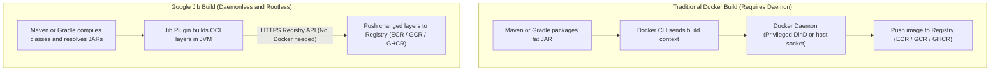
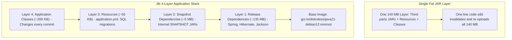

Writing a multi-stage Dockerfile solves image bloat and layer caching, yet running `docker build` inside an enterprise CI/CD pipeline still leaves a thorny operational problem: it requires a Docker daemon.

On a developer laptop, Docker Desktop is already running in the background. Inside a locked-down Kubernetes CI runner (GitLab CI, GitHub Actions self-hosted runners, Tekton, or Jenkins), giving build jobs access to a Docker daemon opens serious security holes and adds maintenance overhead across every Java repository. **Google Jib** sidesteps the Docker daemon altogether by building OCI-compliant container images directly from Maven or Gradle in pure Java.

---

## Why Traditional Dockerfiles Fail in CI/CD

Consider the Dockerfile still found in many Spring Boot repositories:

```dockerfile
FROM eclipse-temurin:21-jre-jammy
WORKDIR /app
COPY target/order-service-0.0.1-SNAPSHOT.jar app.jar
ENTRYPOINT ["java", "-jar", "app.jar"]
```

Even when teams upgrade this to a multi-stage Dockerfile, three CI/CD issues keep resurfacing at scale:

1. **Docker-in-Docker (DinD) and host socket security risks.** To run `docker build` inside a containerized CI runner, platform teams either run a nested Docker daemon with `--privileged` (disabling kernel isolation for the runner pod) or bind-mount the worker node's `/var/run/docker.sock` into the build container. Mounting the Docker socket effectively grants root control over the underlying host node. Any malicious build script or compromised transitive Maven plugin can launch a privileged sibling container on that node and read cluster credentials.
2. **Broken layer caching with fat JARs.** When a Dockerfile copies a single Spring Boot fat JAR, 120 MB of stable libraries sit inside the same archive as 200 KB of application classes. Every one-line bug fix alters the JAR hash and invalidates the cache, forcing CI to re-pack and push the entire 120 MB layer. You can fix this with Spring Boot layered JAR extraction in a multi-stage Dockerfile, but you now have to keep that boilerplate synchronized across dozens of microservices.
3. **Dockerfile drift and base image hygiene.** Each microservice repository ends up carrying its own slightly different Dockerfile, some still running as `root`, some pinning stale JRE tags, and some carrying full OS package managers (`apt`, `curl`, `bash`) that generate constant security scanner alerts.

---

## How Google Jib Works Without a Docker Daemon

Google Jib (`com.google.cloud.tools`) is an open-source Java containerizer that integrates directly into your Maven or Gradle build lifecycle. Instead of invoking the Docker CLI, Jib reads your compiled classes, resources, and dependency graph directly from the build tool, assembles OCI or Docker V2 image layers in memory, and pushes them to your container registry over standard HTTPS using the OCI Distribution Specification.



Because Jib speaks HTTP directly to the registry:

- **No Docker daemon is required** on CI runners or developer workstations.
- **No `--privileged` flag or `/var/run/docker.sock` mount** is needed; the CI job runs as an ordinary unprivileged user.
- **No Dockerfile is required**, and JVM/image conventions can be standardized in a shared parent POM or Gradle convention plugin across an entire organization.

---

## Fast Layered Builds: Dependencies, Resources, and Classes

A container image is a stack of immutable tar layers identified by SHA-256 digests. If a layer's digest already exists in the remote container registry, it does not need to be uploaded again.

Rather than zipping your whole application into a Spring Boot fat JAR and unpacking it later, Jib skips fat-JAR creation entirely. It organizes the compiled output into four distinct application layers on top of the base image, ordered from least frequently changed at the bottom to most frequently changed at the top:



Here is what goes into each layer inside the generated container filesystem:

1. **Dependencies (`/app/libs`)**: Stable release JARs from Maven Central or your internal artifact repository. This is usually 95% of the application's size and stays cached in the registry across builds.
2. **Snapshot Dependencies (`/app/libs`)**: Internal `-SNAPSHOT` libraries under active development, separated so updating an internal library does not invalidate all stable third-party dependencies.
3. **Resources (`/app/resources`)**: Configuration files (`application.yml`), templates, and Flyway/Liquibase migrations.
4. **Classes (`/app/classes`)**: Your compiled `.class` files. On a typical commit, this is the only layer whose SHA-256 changes, so Jib uploads a few hundred kilobytes instead of 140 MB.

If you also need static files such as an OpenTelemetry Java agent or custom CA certificates, Jib places them in an optional `extraDirectories` layer.

At runtime, Jib does not run `java -jar app.jar`. It generates a deterministic exec-form entrypoint using a classpath argument file (`java -cp @/app/jib-classpath-file com.example.OrderServiceApplication`). That keeps the JVM as PID 1 for clean `SIGTERM` handling and avoids nested-JAR classloader unpacking at startup.

---

## Configuring Jib in Maven and Gradle

Jib defaults to a hardened **Google Distroless** base image, which includes only the OpenJDK JRE and minimal `glibc` libraries without `/bin/sh`, `apt`, or `curl`. For Java 21 services, pin an explicit Distroless tag (or digest) and configure a non-root numeric user (`65532:65532` is Distroless's built-in `nonroot` user).

### Maven Plugin Configuration (`pom.xml`)

```xml
<plugin>
    <groupId>com.google.cloud.tools</groupId>
    <artifactId>jib-maven-plugin</artifactId>
    <version>3.4.4</version>
    <configuration>
        <from>
            <image>gcr.io/distroless/java21-debian12:nonroot</image>
            <platforms>
                <platform>
                    <architecture>amd64</architecture>
                    <os>linux</os>
                </platform>
                <platform>
                    <architecture>arm64</architecture>
                    <os>linux</os>
                </platform>
            </platforms>
        </from>
        <to>
            <image>ghcr.io/my-org/order-service:${project.version}</image>
            <tags>
                <tag>latest</tag>
            </tags>
        </to>
        <container>
            <!-- Numeric UID 65532 (Distroless nonroot) passes Kubernetes runAsNonRoot checks -->
            <user>65532:65532</user>
            <ports>
                <port>8080</port>
            </ports>
            <jvmFlags>
                <jvmFlag>-XX:MaxRAMPercentage=75.0</jvmFlag>
                <jvmFlag>-XX:+ExitOnOutOfMemoryError</jvmFlag>
            </jvmFlags>
            <labels>
                <org.opencontainers.image.source>https://github.com/my-org/order-service</org.opencontainers.image.source>
            </labels>
        </container>
    </configuration>
</plugin>
```

### Gradle Plugin Configuration (`build.gradle.kts`)

```kotlin
plugins {
    java
    id("org.springframework.boot") version "3.3.5"
    id("com.google.cloud.tools.jib") version "3.4.4"
}

jib {
    from {
        image = "gcr.io/distroless/java21-debian12:nonroot"
        platforms {
            platform {
                architecture = "amd64"
                os = "linux"
            }
            platform {
                architecture = "arm64"
                os = "linux"
            }
        }
    }
    to {
        image = "ghcr.io/my-org/order-service:${project.version}"
        tags = setOf("latest")
    }
    container {
        user = "65532:65532"
        ports = listOf("8080")
        jvmFlags = listOf(
            "-XX:MaxRAMPercentage=75.0",
            "-XX:+ExitOnOutOfMemoryError"
        )
        labels = mapOf(
            "org.opencontainers.image.source" to "https://github.com/my-org/order-service"
        )
    }
}
```

A few details worth calling out in both configurations:

- **Multi-architecture manifests (`platforms`)**: Because Jib does not execute native binaries inside the base image during build, it can produce a multi-architecture manifest list (`linux/amd64` for x86 nodes and `linux/arm64` for AWS Graviton or Apple Silicon laptops) in one command with no QEMU emulation.
- **Modern JVM flags**: In Java 17 and Java 21, `-XX:+UseContainerSupport` is already enabled by default, and legacy workarounds like `-Djava.security.egd=file:/dev/./urandom` are no longer necessary on modern Linux kernels. Keeping `jvmFlags` focused on `-XX:MaxRAMPercentage=75.0` and `-XX:+ExitOnOutOfMemoryError` avoids clutter.
- **Non-root numeric UID (`65532:65532`)**: Distroless's `:nonroot` tag already defaults to UID `65532`, and declaring it numerically in `<user>` guarantees that Kubernetes admission policies enforcing `runAsNonRoot: true` accept the image cleanly.

### Running Jib: Remote Registry vs Local Docker vs Tarball

Jib gives you three build targets depending on where the image needs to go:

| Goal | Maven Command | Gradle Command | Docker Required? |
| :--- | :--- | :--- | :--- |
| Push directly to remote registry | `./mvnw compile jib:build` | `./gradlew jib` | No |
| Load into local Docker daemon for testing | `./mvnw compile jib:dockerBuild` | `./gradlew jibDockerBuild` | Yes (local daemon) |
| Write a local OCI/Docker `.tar` archive | `./mvnw compile jib:buildTar` | `./gradlew jibBuildTar` | No |

Notice that you run `mvn compile jib:build`, not `mvn package jib:build`. Running `compile` skips building the Spring Boot executable fat JAR completely because Jib reads directly from `target/classes` and your Maven dependency graph. The `buildTar` target is especially handy in CI pipelines that scan an image archive locally with Trivy or Grype before pushing to a production registry, or in air-gapped environments.

### Daemonless GitHub Actions Workflow

In CI, Jib eliminates Docker setup actions, Buildx configuration, and socket access:

```yaml
name: Build and Publish OCI Image

on:
  push:
    branches: [ main ]

jobs:
  publish:
    runs-on: ubuntu-latest
    permissions:
      contents: read
      packages: write

    steps:
      - name: Checkout repository
        uses: actions/checkout@v4

      - name: Set up JDK 21
        uses: actions/setup-java@v4
        with:
          java-version: "21"
          distribution: "temurin"
          cache: "maven"

      - name: Test and push image with Jib
        env:
          REGISTRY_USER: ${{ github.actor }}
          REGISTRY_TOKEN: ${{ secrets.GITHUB_TOKEN }}
          IMAGE_TAG: ${{ github.sha }}
        run: |
          ./mvnw test jib:build \
            -Djib.to.image="ghcr.io/my-org/order-service:${IMAGE_TAG}" \
            -Djib.to.auth.username="${REGISTRY_USER}" \
            -Djib.to.auth.password="${REGISTRY_TOKEN}"
```

The entire job runs in user space inside the JVM. Notice also that tagging with the Git commit SHA instead of overwriting `latest` gives Kubernetes deployments an immutable tag to roll out and roll back cleanly.

---

## Reproducible Bit-for-Bit Container Images

If you run `docker build` twice in a row on the exact same Git commit, Docker produces two different SHA-256 image digests. File modification timestamps, layer tar headers, and the image configuration's `created` field all capture the current wall-clock time.

By default, Jib builds **reproducible images**:

- File modification timestamps inside generated layers are normalized to `1970-01-01T00:00:01Z` (one second after the Unix epoch, avoiding tools that interpret `0` as missing).
- The image configuration's `creationTime` defaults to the Unix epoch (`1970-01-01T00:00:00Z`).
- Entries inside every tar layer are sorted deterministically, and file permissions are normalized.

As a result, compiling the same source commit with the same JDK and dependencies on two different machines produces the exact same layer digests and final image SHA-256 digest. If no code or dependency changed, Jib sees that every layer digest already matches the remote registry and skips uploading anything.

> [!NOTE]
> True end-to-end reproducibility also depends on your Java build outputs being deterministic. In Maven, set `<project.build.outputTimestamp>` (for example, to your Git commit timestamp) so generated properties files and JAR metadata do not inject current build timestamps into your resources layer.

### The `creationTime` Trade-Off

Some container registries and cleanup policies prune old images based on the image's `created` timestamp, and seeing "56 years ago" in `docker images` can confuse teams unfamiliar with Jib. You can set `<creationTime>USE_CURRENT_TIMESTAMP</creationTime>` in Maven (or `creationTime = "USE_CURRENT_TIMESTAMP"` in Gradle) to stamp the current time on the image config. Just remember the trade-off: doing so changes the top-level image manifest digest on every build, breaking bit-for-bit reproducibility even though the underlying application layers remain cached. A good compromise in CI is passing the Git commit timestamp (`git show -s --format=%cI HEAD`) as `creationTime`, which preserves both human-readable dates and reproducible digests for the same commit.

---

## Jib vs Spring Boot Buildpacks vs Multi-Stage Dockerfiles

Jib is not the only way to containerize Java applications. Choosing the right approach depends on whether your service needs custom OS packages, how strict your CI security boundary is, and whether your organization standardizes on a polyglot build pipeline.

| Dimension | Google Jib | Spring Boot Buildpacks (`spring-boot:build-image`) | Multi-Stage Dockerfile |
| :--- | :--- | :--- | :--- |
| **Docker Daemon Needed?** | No (fully daemonless) | Yes (requires Docker/Podman or in-cluster `kpack`) | Yes (or BuildKit/Kaniko/Buildah) |
| **Incremental Build Speed** | Very fast (uploads only changed `.class` layer) | Moderate (Paketo lifecycle overhead on cold caches) | Fast if layered JAR + BuildKit cache are tuned |
| **JVM Memory Tuning** | Manual via `jvmFlags` | Automatic (Paketo Memory Calculator computes heap from threads, classes, and container limit) | Manual via `JAVA_TOOL_OPTIONS` |
| **Custom OS Packages (`apt`/`apk`)** | Not supported directly (must pre-build a custom base image) | Via custom buildpacks only | Full control (`RUN apt-get install ...`) |
| **GraalVM Native Images** | Not designed for AOT native builds | First-class support (`-Pnative spring-boot:build-image`) | Supported via GraalVM builder stage |
| **Reproducible Digests** | Built in by default | Supported (deterministic timestamps) | Requires extra BuildKit flags (`SOURCE_DATE_EPOCH`) |
| **Best Fit** | Pure JVM microservices in locked-down CI/CD pipelines | Teams wanting zero-config JVM tuning, SBOMs, and GraalVM native support | Services needing custom OS tools, `jlink` JREs, or polyglot builds |

In practice, Jib shines for standard JVM microservices when your CI runners cannot mount a Docker socket and you want fast, repeatable builds with minimal configuration. If your team relies on GraalVM native images or wants Paketo's automatic JVM memory calculator and SBOM generation, Spring Boot Buildpacks is often the better tool. And if a service needs native OS tools like `ffmpeg`, LibreOffice, or custom system packages, a multi-stage Dockerfile remains the cleanest option.

---

## Interview Questions

### Why are privileged Docker-in-Docker and `/var/run/docker.sock` mounting discouraged in Kubernetes CI runners, and how does Jib avoid them?

Running Docker inside a CI container requires either `--privileged` mode (which disables Linux namespace and capability isolation and exposes host devices) or mounting the host worker node's `/var/run/docker.sock`. Any process that can talk to the host Docker socket can start a new container mounting `/` from the host filesystem, giving it effective root access to the node and other pods running there. Jib avoids both patterns because it is a pure Java library that builds OCI tar layers in memory and pushes them directly to the container registry over HTTPS, requiring no daemon, no socket, and no elevated Linux capabilities.

### How does Jib structure layers differently from a Dockerfile that copies a Spring Boot fat JAR?

A fat JAR bundles stable third-party libraries, snapshot libraries, configuration resources, and application bytecode into a single archive, so editing one Java class invalidates the entire 100+ MB layer. Jib never builds a fat JAR; it writes four separate layers ordered from least volatile to most volatile: release dependencies, snapshot dependencies, resources, and compiled application classes. When you modify business logic, only the small classes layer changes digest and gets uploaded, while the large dependency layers stay cached in the registry.

### What are the operational trade-offs of using Google Distroless as Jib's base image?

Distroless images contain only the JRE and minimal `glibc` dependencies, omitting shells (`/bin/sh`), package managers (`apt`), and network tools (`curl`, `wget`). That sharply reduces CVE scanner findings and makes post-exploit lateral movement harder if an application vulnerability is exploited. The operational trade-off is that engineers cannot run `kubectl exec -it <pod> -- /bin/sh` to poke around inside a live container. Teams compensate with structured logging, Prometheus/OpenTelemetry observability, JFR profiling, and Kubernetes ephemeral debug containers (`kubectl debug`) for emergency inspection.

### How does Jib produce bit-for-bit reproducible images, and what can break reproducibility?

Jib strips non-deterministic metadata by setting file modification times inside layers to `1970-01-01T00:00:01Z`, setting the image creation timestamp to the Unix epoch (`1970-01-01T00:00:00Z`), and sorting tar entries deterministically. Reproducibility can still break if you configure `creationTime` to `USE_CURRENT_TIMESTAMP`, if you pull a mutable base image tag like `:latest` instead of pinning a digest, or if your Maven/Gradle compilation embeds build timestamps into generated resource files (which can be prevented in Maven with `project.build.outputTimestamp`).
