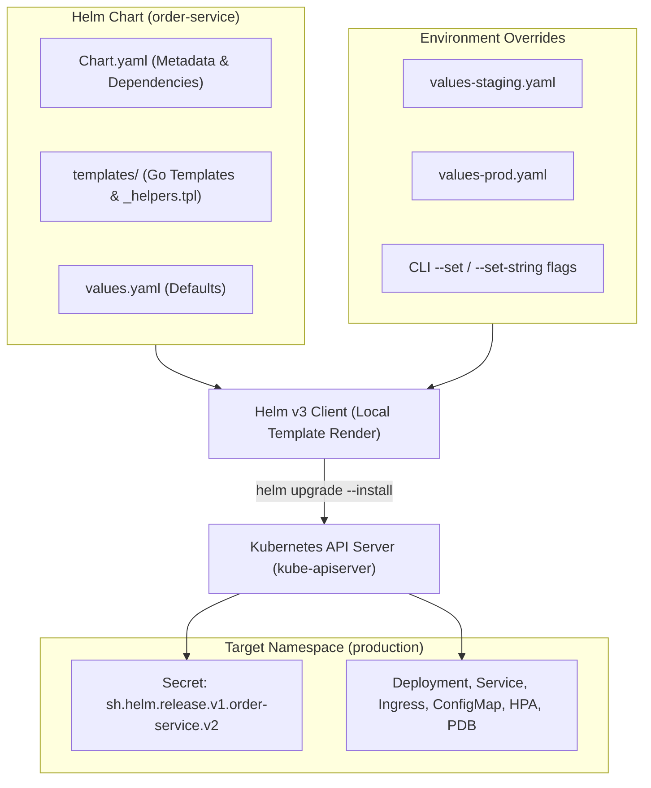
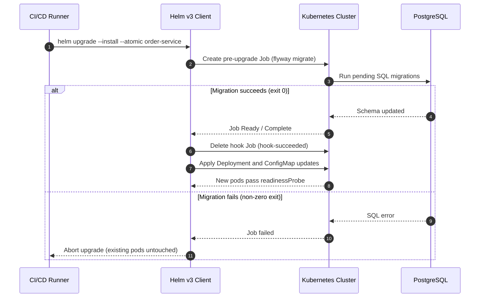

Shipping a Spring Boot service to Kubernetes takes more than a `deployment.yaml`. By the time a service is ready for production traffic, it typically needs a `Deployment`, a `Service`, an `Ingress` or `HTTPRoute`, a `ConfigMap`, a `Secret` reference, a `HorizontalPodAutoscaler` (HPA), a `PodDisruptionBudget` (PDB), and a `ServiceAccount`. Multiply those manifests across `dev`, `staging`, and `production`, and copying raw YAML files quickly leads to configuration drift: someone adds a readiness probe or a JVM memory flag in staging and forgets to carry it into production.

Helm solves this by packaging related Kubernetes manifests into a versioned **Chart** and separating the template structure from environment-specific configuration. You maintain one set of templates and drive environment differences through layered values files.

## Helm Architecture and Chart Anatomy

Helm v3 is purely client-side. Earlier versions (Helm v2) relied on an in-cluster server component called Tiller, which required broad cluster permissions and complicated multi-tenant security. Helm v3 removed Tiller completely. When you run `helm upgrade` or `helm install`, the `helm` CLI renders templates locally on your workstation or CI runner, talks directly to `kube-apiserver` using your current `kubeconfig` credentials and RBAC permissions, and records the release history inside the target namespace.

By default, Helm stores each release revision as a base64-encoded, gzipped **Kubernetes Secret** named `sh.helm.release.v1.<release-name>.v<revision>` in the same namespace as the workload. (You can switch the storage driver to ConfigMaps or SQL via `HELM_DRIVER`, though Secrets are the default because they support encryption at rest in etcd.)



### Standard Chart Layout

A production Spring Boot chart follows a predictable directory layout:

```text
order-service-chart/
  ├── Chart.yaml               # Chart metadata, chart version, appVersion, and dependencies
  ├── Chart.lock               # Pinned dependency versions and digests (generated by helm dependency update)
  ├── values.yaml              # Safe baseline defaults for local or dev installs
  ├── values.schema.json       # Optional JSON Schema to validate values before rendering
  ├── .helmignore              # Files excluded when packaging the chart
  ├── charts/                  # Packaged dependency subcharts (.tgz)
  └── templates/
      ├── _helpers.tpl         # Reusable Go template helpers (names, labels, annotations)
      ├── configmap.yaml       # Non-sensitive Spring Boot environment config
      ├── deployment.yaml      # Pod spec, probes, JVM resources, securityContext
      ├── service.yaml         # ClusterIP service
      ├── ingress.yaml         # External routing and TLS configuration
      ├── hpa.yaml             # HorizontalPodAutoscaler
      ├── pdb.yaml             # PodDisruptionBudget
      └── migration-job.yaml   # Pre-upgrade Hook running Flyway/Liquibase
```

Environment override files (`values-dev.yaml`, `values-staging.yaml`, `values-prod.yaml`) can live next to the chart or in a separate GitOps deployment repository so platform teams can review production config changes independently from chart template changes.

### Defining `Chart.yaml`

In Helm v3, `apiVersion` is always `v2`. Keep `version` (the SemVer of the chart templates themselves) distinct from `appVersion` (the version of your Spring Boot application):

```yaml
apiVersion: v2
name: order-service
description: Order processing Spring Boot service
type: application
version: 1.4.0
appVersion: "2.8.3"

dependencies:
  - name: postgresql
    version: "15.5.x"
    repository: "oci://registry-1.docker.io/bitnamicharts"
    condition: postgresql.enabled
```

Notice `condition: postgresql.enabled`. That lets developers spin up an ephemeral PostgreSQL subchart in local or PR preview namespaces while keeping it disabled in staging and production, where the database is provisioned separately.

## Writing Templates and Helpers for Spring Boot

Helm uses Go's `text/template` engine extended with the Sprig function library. Rather than duplicating label blocks and naming logic across seven files, define shared partials in `templates/_helpers.tpl`.

```gotemplate
{{- define "order-service.fullname" -}}
{{- if .Values.fullnameOverride }}
{{- .Values.fullnameOverride | trunc 63 | trimSuffix "-" }}
{{- else }}
{{- printf "%s-%s" .Release.Name .Chart.Name | trunc 63 | trimSuffix "-" }}
{{- end }}
{{- end }}

{{- define "order-service.selectorLabels" -}}
app.kubernetes.io/name: {{ .Chart.Name }}
app.kubernetes.io/instance: {{ .Release.Name }}
{{- end }}

{{- define "order-service.labels" -}}
helm.sh/chart: {{ printf "%s-%s" .Chart.Name .Chart.Version | replace "+" "_" }}
{{ include "order-service.selectorLabels" . }}
app.kubernetes.io/version: {{ .Values.image.tag | default .Chart.AppVersion | quote }}
app.kubernetes.io/managed-by: {{ .Release.Service }}
{{- end }}
```

Two template helpers matter in nearly every chart you write:
- Use `include` instead of Go's built-in `template` action. `template` writes directly to output and cannot be piped; `include` returns a string, so you can pipe it into `nindent` to keep YAML indentation exact.
- Use `toYaml` with `nindent` whenever a block of arbitrary YAML (such as `resources`, `nodeSelector`, or `tolerations`) comes straight from `values.yaml`.

### A Production-Ready `templates/deployment.yaml`

Java containers have a few operational quirks on Kubernetes: slower startup than Go or Node binaries, explicit heap/cgroup memory bounds, and configuration loaded from environment variables at boot. The template below addresses each one directly.

```yaml
apiVersion: apps/v1
kind: Deployment
metadata:
  name: {{ include "order-service.fullname" . }}
  labels:
    {{- include "order-service.labels" . | nindent 4 }}
spec:
  {{- if not .Values.autoscaling.enabled }}
  replicas: {{ .Values.replicaCount }}
  {{- end }}
  strategy:
    type: RollingUpdate
    rollingUpdate:
      maxSurge: 25%
      maxUnavailable: 0
  selector:
    matchLabels:
      {{- include "order-service.selectorLabels" . | nindent 6 }}
  template:
    metadata:
      annotations:
        checksum/config: {{ include (print $.Template.BasePath "/configmap.yaml") . | sha256sum }}
        {{- with .Values.podAnnotations }}
        {{- toYaml . | nindent 8 }}
        {{- end }}
      labels:
        {{- include "order-service.selectorLabels" . | nindent 8 }}
    spec:
      serviceAccountName: {{ include "order-service.fullname" . }}
      securityContext:
        runAsNonRoot: true
        runAsUser: 65532
        fsGroup: 65532
      containers:
        - name: {{ .Chart.Name }}
          image: "{{ .Values.image.repository }}:{{ .Values.image.tag | default .Chart.AppVersion }}"
          imagePullPolicy: {{ .Values.image.pullPolicy }}
          ports:
            - name: http
              containerPort: 8080
              protocol: TCP
          envFrom:
            - configMapRef:
                name: {{ include "order-service.fullname" . }}
          env:
            - name: JAVA_TOOL_OPTIONS
              value: {{ .Values.jvm.toolOptions | quote }}
            - name: DB_PASSWORD
              valueFrom:
                secretKeyRef:
                  name: {{ .Values.database.secretName }}
                  key: password
          startupProbe:
            httpGet:
              path: /actuator/health/liveness
              port: http
            periodSeconds: 2
            failureThreshold: 30
          livenessProbe:
            httpGet:
              path: /actuator/health/liveness
              port: http
            periodSeconds: 10
            timeoutSeconds: 3
            failureThreshold: 3
          readinessProbe:
            httpGet:
              path: /actuator/health/readiness
              port: http
            periodSeconds: 5
            timeoutSeconds: 3
            failureThreshold: 2
          resources:
            {{- toYaml .Values.resources | nindent 12 }}
```

A few details in this manifest save real debugging time in production:

- **ConfigMap checksum annotation**: Updating a `ConfigMap` does not trigger a rolling restart of existing pods, because the `Deployment`'s pod template has not changed. Computing `sha256sum` over the rendered `configmap.yaml` and storing it in `spec.template.metadata.annotations` changes the pod template whenever a config key changes, forcing Kubernetes to roll the pods cleanly.
- **Omitting `replicas` when HPA is enabled**: If you render `replicas: 4` while an HPA has scaled production up to 12 pods during peak traffic, the next `helm upgrade` resets the deployment back to 4 pods and causes a sudden traffic drop. Guarding `replicas` with `{{- if not .Values.autoscaling.enabled }}` prevents Helm from fighting the autoscaler.
- **Separate startup, liveness, and readiness probes**: Spring Boot 3 exposes `/actuator/health/liveness` and `/actuator/health/readiness` when `management.endpoint.health.probes.enabled=true` (enabled automatically inside Kubernetes). The `startupProbe` disables liveness and readiness checks for up to 60 seconds (`30 * 2s`) while Spring initializes beans and Hibernate metamodels. Once started, failing readiness removes the pod from Service endpoints without restarting it, while failing liveness restarts a wedged JVM.

## Layering `values.yaml` for Multi-Environment Configuration

The chart's own `values.yaml` should contain safe, minimal defaults so a developer can run the chart locally without extra flags:

```yaml
replicaCount: 1

image:
  repository: ghcr.io/acme-commerce/order-service
  pullPolicy: IfNotPresent
  tag: ""

jvm:
  toolOptions: "-XX:MaxRAMPercentage=75.0 -XX:+ExitOnOutOfMemoryError"

resources:
  requests:
    cpu: 250m
    memory: 512Mi
  limits:
    cpu: 1000m
    memory: 512Mi

autoscaling:
  enabled: false

postgresql:
  enabled: true

database:
  secretName: order-db-dev
```

Then `values-staging.yaml` and `values-prod.yaml` override only the fields that differ:

```yaml
# values-staging.yaml
replicaCount: 2

resources:
  requests:
    cpu: 500m
    memory: 1Gi
  limits:
    cpu: 1500m
    memory: 1Gi

postgresql:
  enabled: false

database:
  secretName: order-db-staging
```

```yaml
# values-prod.yaml
autoscaling:
  enabled: true
  minReplicas: 4
  maxReplicas: 20
  targetCPUUtilizationPercentage: 70

resources:
  requests:
    cpu: 1000m
    memory: 2Gi
  limits:
    cpu: 2000m
    memory: 2Gi

postgresql:
  enabled: false

database:
  secretName: order-db-prod

ingress:
  enabled: true
  className: nginx
  hosts:
    - host: api.acme-commerce.example
      paths:
        - path: /api/v1/orders
          pathType: Prefix
```

### How Helm Merges Values

When you pass multiple value sources, Helm evaluates them from left to right with right-side precedence:

```bash
helm upgrade --install order-service ./order-service-chart \
  --namespace production \
  --create-namespace \
  -f ./values-prod.yaml \
  --set-string image.tag=a4f91e0c
```

The chart's built-in `values.yaml` loads first, each `-f` file deep-merges on top of it, and CLI `--set` / `--set-string` flags win over everything. Keep two subtleties in mind:

1. **Maps merge; lists replace.** If `values.yaml` defines a list of three `env` entries and `values-prod.yaml` defines a list with one entry, Helm replaces the entire list rather than appending to it. Prefer maps (keyed by variable name) over lists when environments need to override individual entries.
2. **Use `--set-string` for Git SHAs and numeric tags.** With `--set`, Helm parses values as YAML types. A short Git commit hash made solely of digits and an `e`, such as `48291e7`, gets parsed as a floating-point number (`4.8291e+11`), breaking the image pull. `--set-string` forces string typing.

> [!TIP]
> Add a `values.schema.json` file at the chart root to enforce required keys, allowed enums, and numeric ranges. Helm validates the merged values against the schema automatically during `helm install`, `helm upgrade`, `helm lint`, and `helm template`.

## Subcharts, Dependencies, and `Chart.lock`

When a chart lists dependencies in `Chart.yaml`, running `helm dependency update` resolves the SemVer constraints, downloads the chart archives into `charts/`, and writes the exact versions and SHA-256 digests into `Chart.lock`:

```bash
helm dependency update ./order-service-chart
```

Commit `Chart.lock` to version control (just like `package-lock.json` or Gradle lockfiles) so CI and teammates build against identical subchart versions.

### Passing Configuration to Subcharts

A parent chart configures a subchart by nesting keys under the subchart's name (or its `alias` from `Chart.yaml`). Values under the special `global` key are visible to both the parent and every subchart:

```yaml
# Parent values.yaml
global:
  imageRegistry: ghcr.io/acme-commerce

postgresql:
  enabled: true
  auth:
    database: orders
    existingSecret: order-db-dev
  primary:
    persistence:
      size: 10Gi
```

In production, teams generally avoid bundling stateful databases as subcharts of an application release. Tying PostgreSQL or Kafka to a microservice's Helm release means a careless `helm uninstall` or chart upgrade can affect live data. Use subcharts for ephemeral test/preview environments or stateless sidecars, and manage production stateful infrastructure separately via Terraform or a Kubernetes Operator.

## Lifecycle Hooks and Database Migrations

Running Flyway or Liquibase inside the Spring Boot application container on startup works fine with one replica, but causes trouble at scale. When a rolling update starts five pods simultaneously, all five race for the migration lock. Worse, a slow schema migration can exceed `startupProbe` timeouts and cause the kubelet to kill a pod mid-migration.

Helm **Lifecycle Hooks** let you run a one-off Kubernetes `Job` at a defined point in the release lifecycle, before the new application pods roll out.



### Writing `templates/migration-job.yaml`

```yaml
apiVersion: batch/v1
kind: Job
metadata:
  name: "{{ include "order-service.fullname" . }}-migrate-{{ .Release.Revision }}"
  annotations:
    "helm.sh/hook": pre-install,pre-upgrade
    "helm.sh/hook-weight": "-5"
    "helm.sh/hook-delete-policy": before-hook-creation,hook-succeeded
spec:
  backoffLimit: 2
  activeDeadlineSeconds: 300
  template:
    spec:
      restartPolicy: Never
      containers:
        - name: flyway
          image: "{{ .Values.migrations.image }}:{{ .Values.image.tag | default .Chart.AppVersion }}"
          command: ["flyway", "migrate"]
          env:
            - name: FLYWAY_URL
              value: {{ .Values.database.jdbcUrl | quote }}
            - name: FLYWAY_USER
              valueFrom:
                secretKeyRef:
                  name: {{ .Values.database.secretName }}
                  key: username
            - name: FLYWAY_PASSWORD
              valueFrom:
                secretKeyRef:
                  name: {{ .Values.database.secretName }}
                  key: password
```

Three hook annotations govern behavior:
- `helm.sh/hook`: When the resource runs (`pre-install`, `post-install`, `pre-upgrade`, `post-upgrade`, `pre-rollback`, `post-rollback`, `test`).
- `helm.sh/hook-weight`: Integer ordering (lowest runs first; negative weights are allowed). Useful if you need a config check before the migration runs.
- `helm.sh/hook-delete-policy`: Helm does **not** track hook resources in normal release garbage collection. Without a deletion policy, completed Jobs accumulate in the namespace. Combining `before-hook-creation,hook-succeeded` cleans up successful Jobs automatically while leaving failed Job pods around so you can inspect `kubectl logs` to see why a migration failed.

> [!WARNING]
> Notice that the migration Job above uses `value: {{ .Values.database.jdbcUrl | quote }}` rather than reading from a `ConfigMap` created by the same chart. Because `pre-install` runs *before* the chart's regular templates are applied, referencing a ConfigMap that has not been created yet will fail on first install. Also remember that a Helm rollback reverts Kubernetes manifests, not SQL schema changes, so migrations must remain backward-compatible with the currently running application version.

## Verifying, Deploying, and Rolling Back Releases

Never run `helm upgrade` blind against production. Build a fast local and CI verification sequence first:

```bash
# Check chart structure, YAML syntax, and values.schema.json
helm lint ./order-service-chart -f ./values-prod.yaml

# Render manifests locally to inspect or pass to static policy tools (kubeconform, trivy)
helm template order-service ./order-service-chart \
  --namespace production \
  -f ./values-prod.yaml \
  --set-string image.tag=a4f91e0c | kubeconform -strict -summary

# Preview exact live cluster changes (requires the helm-diff plugin)
helm diff upgrade order-service ./order-service-chart \
  --namespace production \
  -f ./values-prod.yaml \
  --set-string image.tag=a4f91e0c
```

When you are ready to deploy, use `--atomic` and an explicit `--timeout`:

```bash
helm upgrade --install order-service ./order-service-chart \
  --namespace production \
  --create-namespace \
  -f ./values-prod.yaml \
  --set-string image.tag=a4f91e0c \
  --atomic \
  --timeout 5m
```

`--atomic` implies `--wait`: Helm watches the cluster until every Deployment, StatefulSet, and Job reaches a Ready state within the timeout window. If pods crash-loop or fail readiness probes, Helm automatically rolls back to the previous revision (or uninstalls a failed initial install).

### Inspecting History and Manual Rollbacks

If a release passes readiness checks but exhibits elevated latency or a business logic bug ten minutes later, inspect the release history and roll back explicitly:

```bash
# View stored release Secrets in the namespace
kubectl get secrets -n production -l owner=helm

# Check revision history
helm history order-service -n production
# REVISION  UPDATED                   STATUS      CHART                APP VERSION  DESCRIPTION
# 1         Sun Oct 25 10:00:00 2026  superseded  order-service-1.3.0  2.8.2        Install complete
# 2         Thu Oct 29 12:00:00 2026  deployed    order-service-1.4.0  2.8.3        Upgrade complete

# Roll back to revision 1
helm rollback order-service 1 -n production --wait
```

Rolling back does not delete revision 2; it creates **revision 3** using the rendered manifests from revision 1, keeping a full audit trail of every change.

## Deploying Spring Boot Microservice Fleets

Once an organization runs 20 or 50 Spring Boot services, maintaining a copy of `deployment.yaml`, `hpa.yaml`, and `pdb.yaml` inside every microservice repository recreates the same duplication problem one level higher. Teams handle microservice fleets using two chart patterns, often together.

### Library Charts for Standardization

A Helm **Library Chart** (`type: library` in `Chart.yaml`) cannot be installed on its own. It only exports named templates under `templates/_*.tpl`. A platform team publishes a versioned `spring-boot-common` library chart to an OCI registry containing the company's standard Deployment, Service, HPA, PDB, ServiceMonitor, and security defaults.

Each microservice then keeps a minimal chart that depends on `spring-boot-common`:

```yaml
# order-service/Chart.yaml
apiVersion: v2
name: order-service
type: application
version: 1.0.0
dependencies:
  - name: spring-boot-common
    version: "2.3.x"
    repository: "oci://ghcr.io/acme-commerce/charts"
```

Its `templates/deployment.yaml` becomes a single line:

```gotemplate
{{- include "spring-boot-common.deployment" . -}}
```

When the platform team needs to add an OpenTelemetry environment variable or tighten pod security standards across 40 Java services, they release `spring-boot-common` `2.4.0`, and each service picks it up cleanly through a dependency bump.

### Umbrella Charts for Coordinated Stacks

An **Umbrella Chart** is a parent chart with no templates of its own; its `Chart.yaml` simply lists multiple microservices (`order-service`, `inventory-service`, `payment-service`) as dependencies. Umbrella charts work well for spinning up a full integration or QA stack with one command.

In production, however, umbrella charts introduce release coupling: deploying a one-line fix in `order-service` forces you to re-evaluate the entire umbrella release. Most mature Kubernetes teams use a library chart to share templates, while deploying each microservice as its own independent Helm release (often driven by ArgoCD or Flux so each service releases on its own cadence).

## Practical Questions

### Why does updating a ConfigMap in Helm not automatically restart running Spring Boot pods, and how do you fix it?

Kubernetes watches the `Deployment`'s `.spec.template` field to decide whether to start a rolling update. Editing a `ConfigMap` changes the ConfigMap object, not the pod template, so Spring Boot pods that read environment variables via `envFrom` keep running with stale settings until they happen to restart. Adding a `checksum/config` annotation to `spec.template.metadata.annotations` using `{{ include (print $.Template.BasePath "/configmap.yaml") . | sha256sum }}` ensures that any change to the rendered ConfigMap alters the pod template hash and triggers a controlled rolling restart.

### What happens if you hardcode `replicas` in `deployment.yaml` while using a `HorizontalPodAutoscaler`?

Helm performs a three-way merge against the live cluster manifest. If an HPA has scaled your service from 4 replicas to 12 replicas under load, and your template unconditionally renders `replicas: 4`, the next `helm upgrade` overwrites `spec.replicas` back to 4, dropping capacity abruptly until the HPA scales back up. Omit `spec.replicas` conditionally whenever `autoscaling.enabled` is true.

### How does Helm v3 track release state and perform rollbacks without a server component?

Helm v3 stores each revision's rendered manifests, chart metadata, and values as a gzipped, base64-encoded Kubernetes Secret (`sh.helm.release.v1.<release>.v<rev>`) in the release namespace. When you run `helm rollback <release> <rev>`, the Helm client reads the target revision's Secret, compares it against the current cluster state, applies the resulting patch to `kube-apiserver`, and records the rollback as a new revision number so the history remains intact.

### When should you choose a library chart over an umbrella chart for a Spring Boot fleet?

Use a **library chart** when you want consistent Kubernetes boilerplate (probes, security contexts, PDBs, Prometheus annotations) across dozens of services while keeping each service independently deployable. Use an **umbrella chart** only when multiple services genuinely need to be installed and versioned as a single unit, such as ephemeral preview environments or an on-premise appliance bundle.
