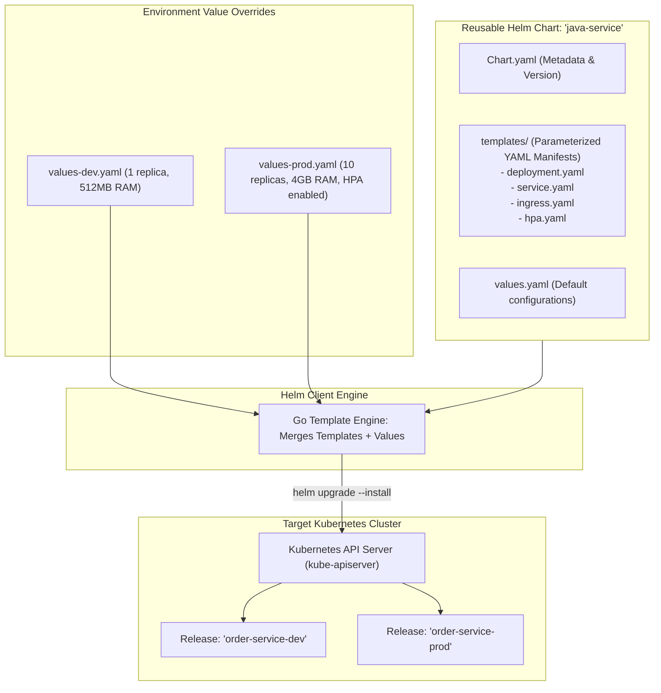
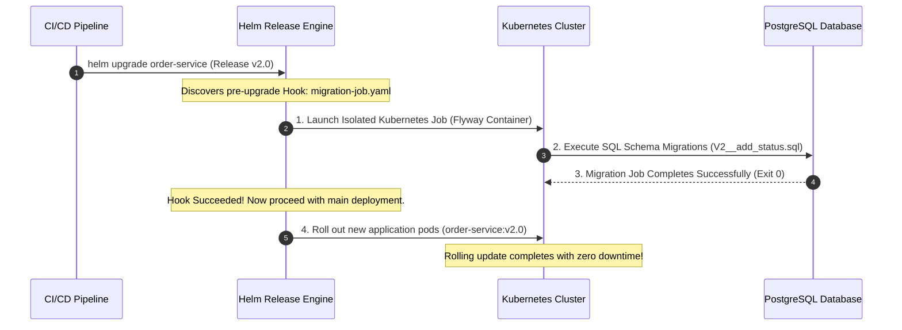

# Helm Package Management in K8s

Deploying a production Java Spring Boot microservice to Kubernetes requires far more than a single `deployment.yaml` file. A resilient, enterprise-grade deployment demands a constellation of interconnected Kubernetes resources:
- A `Deployment` configuring JVM container memory, replicas, and rolling update strategies.
- A `Service` defining internal Layer 4 cluster networking.
- An `Ingress` managing external TLS routing.
- A `ConfigMap` storing non-sensitive environment variables and logging configurations.
- A `Secret` injecting database credentials and OAuth2 API keys.
- A `HorizontalPodAutoscaler` (HPA) scaling pods dynamically based on CPU and memory thresholds.
- A `PodDisruptionBudget` (PDB) guaranteeing minimum pod availability during node drains and cluster upgrades.

When you multiply these seven files across three target environments (`dev`, `staging`, `production`) and four geographical regions, managing raw YAML manifests becomes an operational nightmare. Teams inevitably resort to copy-pasting YAML files, leading to **Environment Configuration Drift**: a configuration flag is updated in staging but forgotten in production, causing a catastrophic failure during release.

The cloud-native industry standard for packaging, configuring, and deploying Kubernetes applications is **Helm**.

---

## What is Helm?

**Helm** is the package manager for Kubernetes (analogous to Maven for Java or apt/yum for Linux).

Helm abstracts complex Kubernetes manifest collections into reusable, versioned packages called **Charts**. By decoupling the parameterized template structure from environment-specific configuration values, Helm allows you to deploy the exact same verified chart across development, staging, and production with 100% fidelity.



---

## Anatomy of an Enterprise Helm Chart

A production Helm chart for a Java service follows a standardized directory structure:

```text
order-service-chart/
  ├── Chart.yaml              # Chart metadata, version, and dependencies
  ├── values.yaml             # Default configuration values
  ├── values-dev.yaml         # Development environment overrides
  ├── values-staging.yaml     # Staging environment overrides
  ├── values-prod.yaml        # Production environment overrides
  └── templates/
      ├── _helpers.tpl        # Reusable Go template helper functions and labels
      ├── deployment.yaml     # Kubernetes Deployment with JVM container tuning
      ├── service.yaml        # ClusterIP or Headless Service
      ├── ingress.yaml        # Ingress routing rules and TLS cert-manager annotations
      ├── configmap.yaml      # Environment variable configurations
      ├── hpa.yaml            # Horizontal Pod Autoscaler definition
      ├── pdb.yaml            # Pod Disruption Budget
      └── migration-job.yaml  # Helm pre-upgrade Hook for Flyway/Liquibase DB migration
```

---

## Crafting the Production Java Deployment Template

Deploying Java workloads in containers requires specific Kubernetes configurations to prevent random restarts and OOMKilled errors.

Here is a production-hardened `templates/deployment.yaml`:

```yaml
apiVersion: apps/v1
kind: Deployment
metadata:
  name: {{ include "java-service.fullname" . }}
  labels:
    {{- include "java-service.labels" . | nindent 4 }}
spec:
  {{- if not .Values.autoscaling.enabled }}
  replicas: {{ .Values.replicaCount }}
  {{- end }}
  strategy:
    type: RollingUpdate
    rollingUpdate:
      maxSurge: 25%        # Spin up at most 25% extra pods during rolling deploy
      maxUnavailable: 0     # Never take down a healthy pod until replacement is fully ready!
  selector:
    matchLabels:
      {{- include "java-service.selectorLabels" . | nindent 6 }}
  template:
    metadata:
      annotations:
        # Automatically trigger rolling restart when ConfigMap values change!
        checksum/config: {{ include (print $.Template.BasePath "/configmap.yaml") . | sha256sum }}
      labels:
        {{- include "java-service.selectorLabels" . | nindent 8 }}
    spec:
      serviceAccountName: {{ include "java-service.serviceAccountName" . }}
      securityContext:
        runAsNonRoot: true
        runAsUser: 65532     # Distroless non-root UID
        fsGroup: 65532
      containers:
        - name: {{ .Chart.Name }}
          image: "{{ .Values.image.repository }}:{{ .Values.image.tag | default .Chart.AppVersion }}"
          imagePullPolicy: {{ .Values.image.pullPolicy }}
          ports:
            - name: http
              containerPort: 8080
              protocol: TCP
          envFrom:
            - configMapRef:
                name: {{ include "java-service.fullname" . }}
          env:
            - name: DB_PASSWORD
              valueFrom:
                secretKeyRef:
                  name: {{ .Values.database.secretName }}
                  key: password
          
          # 1. Startup Probe: Accommodates slow JVM warm-up without triggering premature restarts
          startupProbe:
            httpGet:
              path: /actuator/health/liveness
              port: 8080
            failureThreshold: 30 # Gives Spring Boot up to 30 * 2s = 60 seconds to boot
            periodSeconds: 2
          
          # 2. Liveness Probe: Detects deadlocks and crashes once running
          livenessProbe:
            httpGet:
              path: /actuator/health/liveness
              port: 8080
            initialDelaySeconds: 0
            periodSeconds: 10
            timeoutSeconds: 3
            failureThreshold: 3
          
          # 3. Readiness Probe: Controls whether traffic is routed to this pod
          readinessProbe:
            httpGet:
              path: /actuator/health/readiness
              port: 8080
            initialDelaySeconds: 0
            periodSeconds: 5
            timeoutSeconds: 3
            failureThreshold: 2

          # 4. Strict Resource Allocations: Essential for JVM cgroup sizing
          resources:
            requests:
              cpu: {{ .Values.resources.requests.cpu }}
              memory: {{ .Values.resources.requests.memory }}
            limits:
              cpu: {{ .Values.resources.limits.cpu }}
              memory: {{ .Values.resources.limits.memory }}
```

### Critical Architecture Elements:

1. **The Three Probes (Startup, Liveness, Readiness):**
   - **Startup Probe:** Spring Boot applications can take 30 to 60 seconds to initialize JPA metamodels, Flyway migrations, and caches. If you only define a Liveness probe with a 15-second delay, Kubernetes will kill the pod while it is still booting, creating an infinite crash loop. The **Startup probe** gives the JVM time to boot; Liveness and Readiness probes do not activate until the Startup probe passes.
   - **Readiness Probe:** Points to Spring Boot 3's `/actuator/health/readiness`. If a downstream database disconnects, Spring Boot automatically transitions the readiness state to `OUT_OF_SERVICE`. Kubernetes stops routing traffic to the pod without killing it.
2. **ConfigMap Checksum Annotation:** A classic Kubernetes trap is updating a ConfigMap and finding that existing pods never reload the new configuration. By embedding `checksum/config: {{ ... | sha256sum }}`, modifying a configuration value alters the deployment's Pod template metadata, automatically prompting Kubernetes to execute a seamless rolling update.

---

## Multi-Environment Configuration Management

The core philosophy of Helm is that the templates in `templates/` remain completely static across all environments. All variance is driven through YAML values files.

### Default `values.yaml` (Base Configurations)

```yaml
replicaCount: 1

image:
  repository: ghcr.io/my-org/order-service
  pullPolicy: IfNotPresent
  tag: "" # Overridden by CI/CD git commit hash

resources:
  requests:
    cpu: 200m
    memory: 512Mi
  limits:
    cpu: 1000m
    memory: 512Mi

autoscaling:
  enabled: false

database:
  secretName: order-db-credentials
```

### Production Override: `values-prod.yaml`

```yaml
# Production values override base settings
replicaCount: 4

resources:
  requests:
    cpu: 1000m
    memory: 2048Mi
  limits:
    cpu: 2000m
    memory: 2048Mi

autoscaling:
  enabled: true
  minReplicas: 4
  maxReplicas: 20
  targetCPUUtilizationPercentage: 70
  targetMemoryUtilizationPercentage: 80

ingress:
  enabled: true
  className: nginx
  hosts:
    - host: api.company.com
      paths:
        - path: /api/v1/orders
          pathType: Prefix
  tls:
    - secretName: api-company-tls
      hosts:
        - api.company.com
```

### Deploying with Value Hierarchy Merging

When deploying, Helm merges values files sequentially from left to right:

```bash
helm upgrade --install order-service ./order-service-chart \
  --namespace production \
  --values ./order-service-chart/values.yaml \
  --values ./order-service-chart/values-prod.yaml \
  --set image.tag=v2.4.1
```

Any setting defined in `values-prod.yaml` overrides `values.yaml`, and `--set` overrides everything.

---

## Database Migrations with Helm Lifecycle Hooks

In enterprise deployments, running database migrations (Flyway or Liquibase) on pod startup inside the application container is an anti-pattern. If you scale your deployment to 10 pods, 10 pods attempt to execute database migrations concurrently, causing database lock contention and schema race conditions.

Helm solves this via **Lifecycle Hooks**:



### Implementing `templates/migration-job.yaml`

```yaml
apiVersion: batch/v1
kind: Job
metadata:
  name: "{{ .Release.Name }}-db-migration-{{ .Release.Revision }}"
  annotations:
    # 1. Execute BEFORE new application pods are deployed!
    "helm.sh/hook": pre-install,pre-upgrade
    # 2. Automatically delete the completed job pod upon success
    "helm.sh/hook-delete-policy": hook-succeeded,before-hook-creation
    "helm.sh/hook-weight": "0"
spec:
  backoffLimit: 2
  template:
    metadata:
      name: "{{ .Release.Name }}-db-migration"
    spec:
      restartPolicy: Never
      containers:
        - name: flyway-migration
          image: "flyway/flyway:10-alpine"
          command: ["flyway", "migrate"]
          env:
            - name: FLYWAY_URL
              valueFrom:
                configMapKeyRef:
                  name: {{ include "java-service.fullname" . }}
                  key: SPRING_DATASOURCE_URL
            - name: FLYWAY_USER
              valueFrom:
                secretKeyRef:
                  name: {{ .Values.database.secretName }}
                  key: username
            - name: FLYWAY_PASSWORD
              valueFrom:
                secretKeyRef:
                  name: {{ .Values.database.secretName }}
                  key: password
```

If the Flyway migration job fails (e.g., due to an invalid SQL constraint), **Helm immediately halts the upgrade**. The existing production pods remain untouched and running, and the new version is never deployed.

---

## Release Management, History, and Instant Rollbacks

Helm treats deployments as stateful **Releases**. Every time you run `helm upgrade`, Helm increments the revision number (`REVISION 1`, `REVISION 2`).

### How Helm Tracks State Internally

Helm does not require an external database or server component. It stores the full, gzipped manifest of every release revision directly inside **Kubernetes Secrets** within the release's target namespace:

```bash
kubectl get secrets -n production -l owner=helm
# Output:
# sh.helm.release.v1.order-service.v1
# sh.helm.release.v1.order-service.v2
```

### Inspecting History and Executing Instant Rollbacks

If a bad release slips past testing and causes memory leaks in production, rolling back takes a single command:

```bash
# Step A: Inspect Release History
helm history order-service -n production

# REVISION    UPDATED                     STATUS        CHART               APP VERSION   DESCRIPTION
# 1           Sun Oct 25 10:00:00 2026    superseded    order-service-1.0.0 1.0.0         Install complete
# 2           Thu Oct 29 12:00:00 2026    deployed      order-service-1.1.0 1.1.0         Upgrade to 1.1.0

# Step B: Instant Rollback to Revision 1 in Under 3 Seconds!
helm rollback order-service 1 -n production
```

Helm retrieves the exact, verified manifest from Revision 1's secret and instructs the Kubernetes API server to revert the cluster to that exact state immediately.

---

## Senior Engineer Interview Crucible

### How does a Kubernetes Startup Probe prevent the Kubelet from prematurely killing a slow-starting Java Spring Boot application?

Java Spring Boot applications in production often take 30 to 90 seconds to bootstrap: loading dozens of auto-configurations, initializing database connection pools, compiling Hibernate metamodels, and warming up the JVM JIT compiler.

If you rely solely on a **Liveness Probe**:
1. The Kubelet checks `/actuator/health/liveness` every 10 seconds.
2. If the initial delay is set too short (e.g., 20 seconds), the liveness probe fails while Spring Boot is still midway through its startup sequence.
3. The Kubelet interprets the failed health check as an application deadlock and issues a `SIGKILL` to restart the container.
4. The pod enters an infinite **CrashLoopBackOff**, never completing initialization.

The **Startup Probe** resolves this by establishing a temporary protective barrier during initialization. When defined:
- All Liveness and Readiness checks are **completely disabled** until the Startup probe succeeds.
- By configuring `failureThreshold: 30` and `periodSeconds: 2`, the JVM is granted up to 60 seconds to complete initialization.
- Once the Startup probe succeeds, it deactivates forever, handing continuous health monitoring over to the Liveness and Readiness probes.

---

### Explain the difference between `values.yaml` and environment-specific values files (`values-prod.yaml`). How does Helm merge values hierarchies?

- **`values.yaml` (The Chart Default):** Contains the baseline default settings for the chart. It should define safe, functional defaults (e.g., resource requests, container ports, standard health check paths) suitable for running a minimal instance on a local Minikube or development cluster.
- **`values-prod.yaml` (Environment Specific):** Contains environment-specific overrides for a production deployment (e.g., multi-replica counts, large CPU/memory allocations, production database hostnames, ingress domains, and TLS secret names).

**The Merging Hierarchy:**
When Helm evaluates a release, it merges values trees using a right-precedence deep merge:
1. Base `values.yaml` is loaded first.
2. Files passed via `-f` or `--values` are merged sequentially from left to right, with subsequent files overwriting existing scalar values and merging map structures.
3. Explicit parameters passed via `--set` take the highest precedence, overriding all file-based values.

This pattern enforces **DRY (Don't Repeat Yourself)** configuration: environment files only specify values that deviate from the baseline defaults.

---

### Walk through the exact mechanism Helm uses to manage releases and execute zero-downtime rollbacks (`helm rollback`). Where is release history stored?

Helm 3 is completely client-side and serverless; it does not use a server daemon (like the deprecated Tiller in Helm 2). 

**Storage Mechanism:**
Helm stores the state of every release revision directly inside the target Kubernetes namespace as a **Kubernetes Secret** (or ConfigMap) named:

```text
sh.helm.release.v1.<RELEASE_NAME>.v<REVISION_NUMBER>
```

This secret contains the complete, gzipped, base64-encoded release manifest: the rendered YAML for all resources, applied values, chart metadata, and the execution status.

**Rollback Execution:**
When `helm rollback <RELEASE_NAME> <TARGET_REVISION>` is invoked:
1. The Helm client reads the stored Secret corresponding to the target revision.
2. It extracts the exact Kubernetes manifests that were active during that revision.
3. It computes the structural patch (diff) between the currently running cluster state and the target revision's manifests.
4. It submits a three-way strategic merge patch to the Kubernetes API server (`kube-apiserver`).
5. Kubernetes executes a rolling update to restore the pods, services, and configurations to the exact target state with zero downtime.

---

### How do Helm lifecycle hooks (`pre-install`, `pre-upgrade`) enable safe database schema migrations (e.g. Flyway) during automated CI/CD deployments?

Executing database migrations inside the main application container during pod startup creates concurrency race conditions when multiple pods scale up simultaneously. Furthermore, if a migration fails mid-way, application pods may already be half-deployed, leaving the system in an inconsistent state.

**Helm Lifecycle Hooks** decouple database migrations from pod startup:
1. The migration is packaged as a standalone Kubernetes `Job` template annotated with `"helm.sh/hook": pre-install,pre-upgrade`.
2. When `helm upgrade` is executed in a CI/CD pipeline, Helm renders the chart but **pauses the deployment of the main application manifests** (Deployments, Services).
3. Helm dispatches the migration `Job` to the Kubernetes cluster first.
4. Helm waits and streams the job's execution status:
   - **If the Migration Succeeds (Exit 0):** Helm proceeds to roll out the new application deployment pods, confident that the underlying database schema is ready.
   - **If the Migration Fails (Non-Zero Exit):** Helm immediately halts the release. The new application pods are never scheduled, and the existing production pods remain untouched and healthy.
5. The hook deletion policy (`"helm.sh/hook-delete-policy": hook-succeeded`) automatically deletes the migration job pod upon success, keeping the cluster clean.
