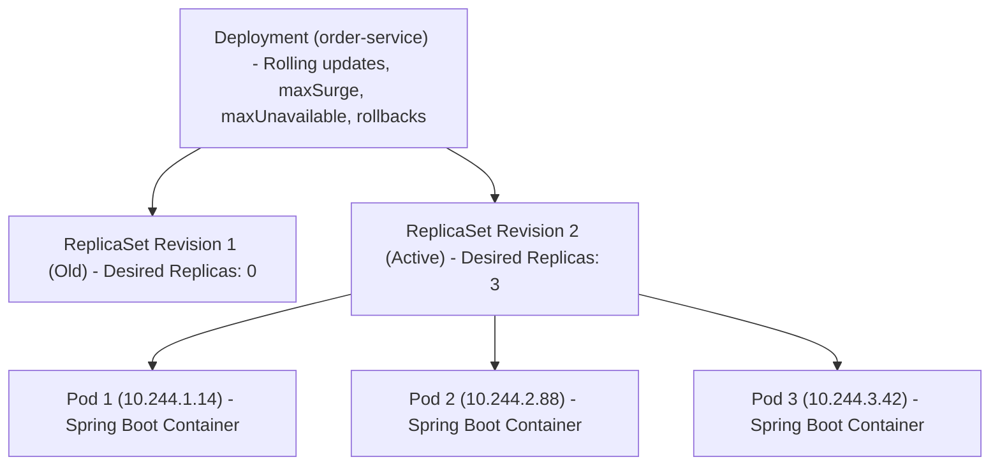
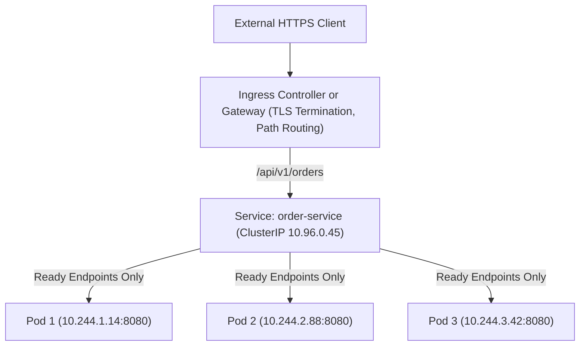
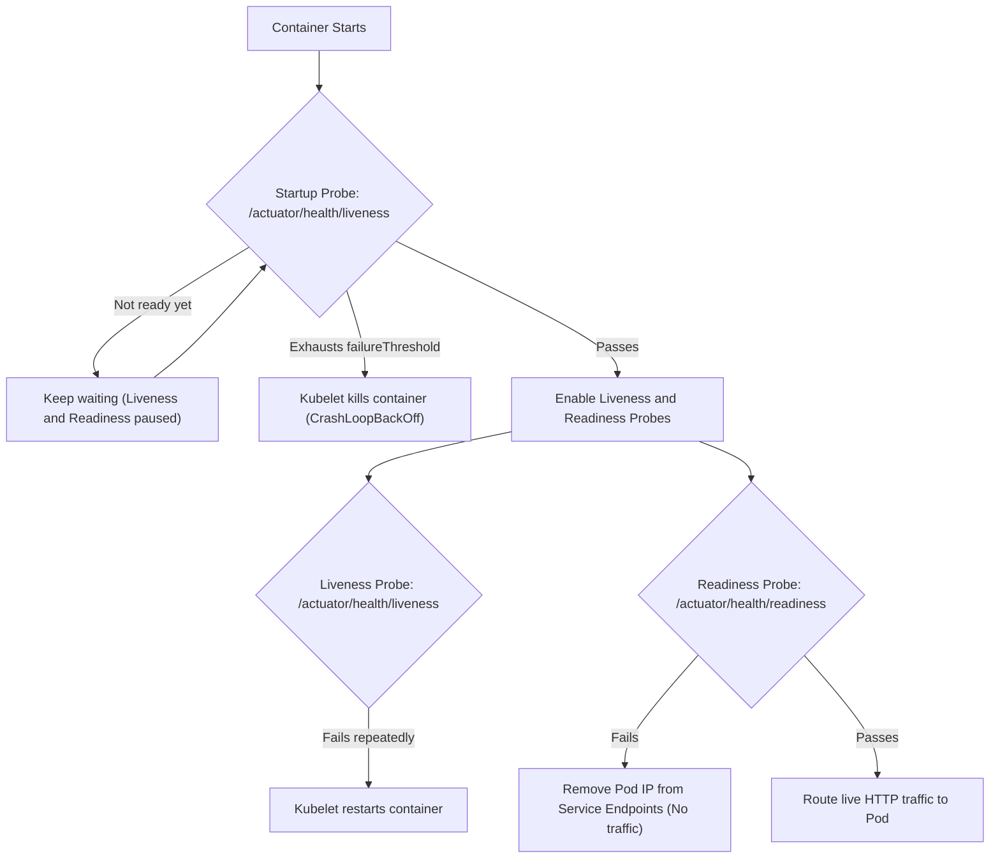

Running a single Spring Boot container with `docker run` is straightforward. Running twelve microservices across dozens of nodes with rolling deployments, automatic restarts, service discovery, and secret management is where **Kubernetes (K8s)** enters the picture.

Most Kubernetes problems that bite Java teams do not come from Kubernetes itself. They come from applying generic YAML templates to the JVM without accounting for how Java starts up, manages memory, runs parallel garbage collection, and drains HTTP connections. Understanding the core Kubernetes primitives alongside those JVM behaviors prevents the majority of production deployment outages.

---

## Core Workloads: Pods, ReplicaSets, and Deployments

In Kubernetes, you rarely run a standalone container directly. Instead, you declare desired state through a three-layer workload hierarchy:



- **Pod**: The smallest deployable unit in Kubernetes. A Pod wraps one or more tightly coupled containers that share a network namespace (one IP address, communicating over `localhost`) and shared storage volumes. For a Spring Boot service, a Pod usually contains one application container plus an optional sidecar such as an Envoy proxy or an OpenTelemetry collector. Pods are ephemeral: if a node fails, the Pod is not repaired in place; a new Pod is scheduled elsewhere with a new IP.
- **ReplicaSet**: A controller whose job is to keep a fixed number of identical Pod replicas running. If one Pod crashes or a node goes offline, the ReplicaSet schedules a replacement.
- **Deployment**: The declarative controller you actually write in YAML. A Deployment manages ReplicaSets for you, orchestrating rolling updates (bringing up new Revision 2 Pods before terminating Revision 1 Pods) and storing revision history so you can roll back immediately with `kubectl rollout undo deployment/order-service`.

### A Production-Ready Spring Boot Deployment Manifest

```yaml
apiVersion: apps/v1
kind: Deployment
metadata:
  name: order-service
  namespace: production
  labels:
    app.kubernetes.io/name: order-service
    app.kubernetes.io/part-of: ecommerce-platform
spec:
  replicas: 3
  revisionHistoryLimit: 5
  strategy:
    type: RollingUpdate
    rollingUpdate:
      maxSurge: 1        # Spin up 1 extra Pod during rollout
      maxUnavailable: 0  # Keep all 3 existing Pods serving until new ones are Ready
  selector:
    matchLabels:
      app: order-service
  template:
    metadata:
      labels:
        app: order-service
    spec:
      terminationGracePeriodSeconds: 45
      securityContext:
        runAsNonRoot: true
        runAsUser: 10001
        fsGroup: 10001
      containers:
        - name: order-service
          image: ghcr.io/my-org/order-service:2.1.0
          imagePullPolicy: IfNotPresent
          securityContext:
            allowPrivilegeEscalation: false
            capabilities:
              drop: ["ALL"]
          ports:
            - name: http
              containerPort: 8080
            - name: actuator
              containerPort: 8081
          resources:
            requests:
              cpu: "500m"
              memory: "2048Mi"
            limits:
              memory: "2048Mi"
          env:
            - name: JAVA_TOOL_OPTIONS
              value: "-XX:MaxRAMPercentage=75.0 -XX:+ExitOnOutOfMemoryError"
            - name: SPRING_PROFILES_ACTIVE
              value: "production"
          envFrom:
            - configMapRef:
                name: order-service-config
            - secretRef:
                name: order-service-secrets
```

Notice two intentional choices in this manifest: Actuator runs on a dedicated internal port (`8081`) so management endpoints are never exposed through the public router, and `requests.memory` matches `limits.memory` (`2048Mi`) while `limits.cpu` is deliberately omitted (explained in the CPU throttling section below).

---

## Services, Ingress, and the Gateway API

Because Pod IP addresses change on every restart or rollout, other services cannot hardcode them. A Kubernetes **Service** provides a stable virtual IP (`ClusterIP`) and an internal DNS name (`order-service.production.svc.cluster.local`). Behind the scenes, Kubernetes maintains `EndpointSlice` records listing only the **Ready** Pod IPs matching the Service selector, and `kube-proxy` (via iptables/IPVS) or an eBPF dataplane (such as Cilium) load-balances connections across them.



### ClusterIP Service

For internal microservice-to-microservice traffic, `ClusterIP` is the default and most common Service type (other types include `NodePort` for static node ports and `LoadBalancer` for provisioning cloud L4 load balancers):

```yaml
apiVersion: v1
kind: Service
metadata:
  name: order-service
  namespace: production
spec:
  type: ClusterIP
  selector:
    app: order-service
  ports:
    - name: http
      port: 80
      targetPort: http # Routes to containerPort 8080 only; port 8081 stays internal
```

### Ingress for HTTP/HTTPS Edge Routing

An **Ingress** exposes HTTP and HTTPS routes from outside the cluster to internal Services, letting a single Ingress controller (such as NGINX, Envoy, Traefik, or AWS Load Balancer Controller) handle TLS termination and host/path routing:

```yaml
apiVersion: networking.k8s.io/v1
kind: Ingress
metadata:
  name: ecommerce-ingress
  namespace: production
  annotations:
    cert-manager.io/cluster-issuer: letsencrypt-prod
spec:
  ingressClassName: nginx
  tls:
    - hosts:
        - api.company.com
      secretName: api-tls-cert
  rules:
    - host: api.company.com
      http:
        paths:
          - path: /api/v1/orders
            pathType: Prefix
            backend:
              service:
                name: order-service
                port:
                  number: 80
```

Use `spec.ingressClassName` rather than the deprecated `kubernetes.io/ingress.class` annotation.

### Moving Beyond Ingress: Kubernetes Gateway API

The original `Ingress` API was intentionally minimal, so real-world features like weighted canary traffic splitting, header-based routing, request timeouts, and cross-namespace routing ended up buried in vendor-specific annotations that break when switching controllers.

The **Kubernetes Gateway API** is the modern successor. It splits responsibilities into role-oriented resources: cluster operators manage `GatewayClass` and `Gateway` (listeners, TLS certificates, ports), while application teams attach `HTTPRoute` (or `GRPCRoute`) resources that declaratively express path matching, header filters, and percentage-based traffic splits without relying on proprietary annotations. If you are standing up a new Kubernetes platform today, Gateway API is worth adopting over Ingress; if you work on an existing cluster, you will still encounter plenty of Ingress manifests.

---

## ConfigMaps and Secrets

Container images should be built once and promoted unchanged across Dev, Staging, and Production. Environment-specific settings belong outside the image in **ConfigMaps** (non-sensitive configuration) and **Secrets** (credentials, certificates, API keys).

### ConfigMap

```yaml
apiVersion: v1
kind: ConfigMap
metadata:
  name: order-service-config
  namespace: production
data:
  SPRING_KAFKA_BOOTSTRAP_SERVERS: "kafka.production.svc.cluster.local:9092"
  APP_FEATURE_VIP_DISCOUNT: "true"
```

### Secret

```yaml
apiVersion: v1
kind: Secret
metadata:
  name: order-service-secrets
  namespace: production
type: Opaque
data:
  # Base64-encoded values (NOT encrypted!)
  SPRING_DATASOURCE_PASSWORD: bXlfZGJfcGFzc3dvcmQ=
  STRIPE_API_SECRET_KEY: c2tfbGl2ZV85OTk4ODg3NzY2NTU=
```

> [!WARNING]
> **Kubernetes Secrets are base64-encoded, not encrypted.** Anyone who can read the YAML file or run `kubectl get secret order-service-secrets -o yaml` can decode the plaintext password in one second with `base64 --decode`. Never commit raw `Secret` manifests to Git.

For production clusters, layer four defenses around Secrets:

1. **Enable Encryption at Rest in `etcd`** so Secrets stored in the cluster control plane are encrypted with a KMS key rather than sitting as plaintext in etcd snapshots.
2. **Sync secrets from an external vault** using the **External Secrets Operator (ESO)** or the **Secrets Store CSI Driver**, pulling credentials dynamically from AWS Secrets Manager, GCP Secret Manager, Azure Key Vault, or HashiCorp Vault. (If you store encrypted manifests in Git for GitOps, use tools like SOPS or Sealed Secrets.)
3. **Restrict RBAC** so developers and CI pipelines cannot list or read production Secrets unnecessarily.
4. **Understand env vars vs volume mounts**: Injecting keys via `envFrom` populates process environment variables only at container startup, so rotating a Secret or ConfigMap requires restarting the Pods. Mounting a ConfigMap or Secret as a volume updates the files on disk automatically (typically within a minute), and Spring Boot natively reads mounted directories via `spring.config.import=optional:configtree:/etc/config/`.

---

## Startup, Liveness, and Readiness Probes for Spring Boot

Health probes are where Java applications most often clash with Kubernetes defaults. Kubernetes supports three probe types, each answering a different question and taking a different action on failure.



### Configuring Spring Boot Actuator Probes

Spring Boot Actuator (2.3+ and Spring Boot 3.x) exposes dedicated Kubernetes probe endpoints backed by internal `LivenessState` and `ReadinessState` indicators. They activate automatically when Spring Boot detects it is running in Kubernetes, and you can also enable them explicitly in `application.yml`:

```yaml
management:
  server:
    port: 8081
  endpoints:
    web:
      exposure:
        include: health,info,prometheus
  endpoint:
    health:
      probes:
        enabled: true
      group:
        liveness:
          include: livenessState
        readiness:
          include: readinessState
```

And wire the three probes into the Deployment container spec:

```yaml
startupProbe:
  httpGet:
    path: /actuator/health/liveness
    port: actuator
  periodSeconds: 2
  failureThreshold: 30 # Up to 60 seconds for JVM boot, Hibernate, and Flyway

livenessProbe:
  httpGet:
    path: /actuator/health/liveness
    port: actuator
  periodSeconds: 10
  timeoutSeconds: 3
  failureThreshold: 3

readinessProbe:
  httpGet:
    path: /actuator/health/readiness
    port: actuator
  periodSeconds: 5
  timeoutSeconds: 3
  failureThreshold: 2
```

### Why Putting Database Checks in Liveness Triggers Restart Loops

Pointing `livenessProbe` to the generic `/actuator/health` endpoint (or adding `db` or `redis` to the `liveness` health group) is one of the fastest ways to turn a minor database hiccup into a prolonged outage.

Suppose your PostgreSQL primary performs a 15-second failover. If Liveness checks database connectivity, every single Spring Boot Pod across the cluster fails its liveness probe at the same time. Kubelet kills and restarts all of them. When PostgreSQL finishes failing over, dozens of cold JVMs boot simultaneously, all compiling bytecode with JIT, running Flyway schema checks, and opening HikariCP connection pools at once. That thundering herd saturates CPU and database connections, causing Startup probes to time out and trapping the fleet in a `CrashLoopBackOff` cycle long after the database itself recovered.

Keep these rules in mind:

- **Startup Probe**: Protects slow JVM boot times (class loading, Spring context initialization, Flyway migrations). While Startup is running, Liveness and Readiness stay disabled so Kubelet does not kill a healthy booting JVM.
- **Liveness Probe**: Should check *only* whether the JVM process itself is broken or unrecoverable (`livenessState`). Restarting your container cannot fix an external database, Redis cluster, or downstream API.
- **Readiness Probe**: Controls whether traffic is sent to the Pod. Use `readinessState` (which automatically flips to `REFUSING_TRAFFIC` during graceful shutdown) and local readiness conditions like cache warm-up. Think carefully before adding external databases to Readiness too: if PostgreSQL drops briefly and *every* Pod fails Readiness, the Service has zero endpoints and Ingress returns generic 503s instead of letting your application return graceful fallback responses or cached data.

---

## Zero-Downtime Graceful Termination

Setting `maxUnavailable: 0` on a Deployment and enabling `server.shutdown: graceful` in Spring Boot is still not enough to eliminate HTTP 502 errors during rolling updates.

When Kubernetes terminates a Pod, two operations happen **in parallel**:

1. Kubelet starts stopping the container (running the `preStop` hook and then sending `SIGTERM`).
2. The control plane removes the Pod IP from `EndpointSlice`, and every node's `kube-proxy` and Ingress controller asynchronously updates its routing tables.

Updating routing tables across a cluster takes anywhere from a few hundred milliseconds to several seconds. If the JVM receives `SIGTERM` immediately and Spring Boot stops accepting new connections before `kube-proxy` or the Ingress controller finishes removing that Pod IP, incoming customer requests still land on the closing Pod and fail with connection resets or HTTP 502 Bad Gateway.

### Adding a `preStop` Delay and Aligning Shutdown Budgets

Add a `preStop` sleep hook so the container keeps serving traffic for a short propagation window while the cluster drains its endpoint from every load balancer:

```yaml
spec:
  terminationGracePeriodSeconds: 45
  containers:
    - name: order-service
      lifecycle:
        preStop:
          # Native sleep action (Kubernetes 1.30+ GA) - works on shell-less Distroless images!
          sleep:
            seconds: 10
```

If you run on an older Kubernetes cluster (prior to 1.29/1.30) and your base image includes `/bin/sh`, use `exec: { command: ["/bin/sh", "-c", "sleep 10"] }` instead.

Pair that with Spring Boot's graceful shutdown settings in `application.yml`:

```yaml
server:
  shutdown: graceful

spring:
  lifecycle:
    timeout-per-shutdown-phase: 25s
```

Make sure the time budget adds up cleanly:

`preStop sleep (10s) + Spring shutdown drain (25s) = 35s < terminationGracePeriodSeconds (45s)`

Because `35s` fits comfortably inside the `45s` grace period, active HTTP requests and database transactions finish cleanly before Kubelet ever resorts to `SIGKILL`.

---

## CPU Requests vs Limits: The CFS Throttling Trap

Memory and CPU behave very differently in Kubernetes, and applying identical request/limit habits to both causes severe latency spikes in Java services.

- **Memory is incompressible.** If a container exceeds `limits.memory`, the Linux OOM killer kills it immediately (Exit Code 137). Setting `requests.memory` equal to `limits.memory` ensures the scheduler reserves the full amount up front and protects your Pod from being evicted first under node memory pressure.
- **CPU is compressible.** `requests.cpu` tells the scheduler how much CPU to reserve and translates to Linux cgroup CPU weight (guaranteed share under contention). `limits.cpu` enforces a hard ceiling through the Linux Completely Fair Scheduler (CFS) bandwidth quota (typically measured in 100ms periods).

Here is where the **CFS throttling trap** hits the JVM. Suppose you set `limits.cpu: "1000m"` (1 full core = 100ms of CPU time per 100ms window). A Spring Boot container is heavily multi-threaded: it runs Tomcat request threads, C2 JIT compiler threads (especially busy during startup and warm-up), and parallel G1GC threads. If 8 threads run concurrently across an 8-core node, they consume the entire 100ms CPU quota in **12.5ms of wall-clock time**. The Linux kernel then freezes *every thread in the container* for the remaining **87.5ms**, even if the worker node's other CPU cores are completely idle.

That throttling manifests as slow Spring Boot startups, stretched GC pauses, and tail latency (p99) spikes that disappear the moment you inspect `container_cpu_cfs_throttled_periods_total` in Prometheus. Even worse, setting a limit like `limits.cpu: "1000m"` causes HotSpot to see `availableProcessors() == 1`, which can automatically switch the default garbage collector from G1GC to **SerialGC** unless you explicitly pass `-XX:+UseG1GC`.

Practical guidance for Java services on Kubernetes:

1. Always set realistic **`requests.cpu`** based on steady-state load (for example, `500m` to `1000m`) so Pods are not over-packed onto overloaded nodes.
2. Either **omit `limits.cpu`** (letting containers burst into idle node capacity during startup and GC cycles while `requests.cpu` guarantees fairness under contention) or, if your platform team mandates CPU limits, set them generously (at least `2000m` or higher) and verify throttling metrics under load.
3. Keep `requests.memory` equal to `limits.memory` and pair it with `-XX:MaxRAMPercentage=75.0`.

---

## Packaging Deployments with Helm Charts

Once you maintain a `Deployment`, `Service`, `Ingress`, `ConfigMap`, and `HorizontalPodAutoscaler` for one microservice, you quickly run into a maintenance problem: keeping Dev, Staging, and Production manifests in sync without copy-paste mistakes.

**Helm** is the standard package manager for Kubernetes. Instead of duplicating YAML files per environment, you bundle your manifests as parameterized Go templates inside a **Helm Chart** and supply environment-specific overrides through `values.yaml` files:

```text
order-service-chart/
├── Chart.yaml          # Chart metadata (name, chart version, appVersion)
├── values.yaml         # Shared defaults
├── values-dev.yaml     # Dev overrides (1 replica, smaller memory)
├── values-prod.yaml    # Production overrides (3+ replicas, autoscaling)
└── templates/
    ├── deployment.yaml
    ├── service.yaml
    ├── ingress.yaml
    └── hpa.yaml
```

A trimmed `values-prod.yaml` looks clean and readable:

```yaml
replicaCount: 3

image:
  repository: ghcr.io/my-org/order-service
  tag: "2.1.0"

resources:
  requests:
    cpu: "500m"
    memory: "2048Mi"
  limits:
    memory: "2048Mi"

springProfile: production
```

Inside `templates/deployment.yaml`, Helm injects those values at deploy time (for example, `replicas: {{ .Values.replicaCount }}`), and a single idempotent command installs or upgrades the release:

```bash
helm upgrade --install order-service ./order-service-chart \
  --namespace production \
  --create-namespace \
  --values ./order-service-chart/values-prod.yaml
```

In the next lesson on **Helm Package Management in K8s**, we dive deeper into Helm template helpers, chart dependencies and subcharts, pre-upgrade hooks for database migrations, and managing fleets of Spring Boot services cleanly.

---

## Interview Questions

### Walk through the exact pod termination sequence in Kubernetes and explain why Java services need a `preStop` hook.

When a Pod is deleted or replaced during a rollout, Kubernetes marks it `Terminating` and executes two tracks concurrently. On the networking track, the control plane removes the Pod's IP from `EndpointSlice` and notifies `kube-proxy` and Ingress controllers across all nodes to update their routing rules. On the node track, Kubelet runs the container's `preStop` hook, sends `SIGTERM` to PID 1, waits for the container to drain requests and exit, and sends `SIGKILL` if `terminationGracePeriodSeconds` expires. Because routing rule updates propagate asynchronously over a few seconds, traffic can still arrive after `SIGTERM` is sent. A `preStop` sleep hook (such as `sleep: { seconds: 10 }` in Kubernetes 1.30+) delays `SIGTERM` until load balancers finish removing the Pod, preventing 502 errors during rolling deployments.

### Why do tight CPU limits (`limits.cpu`) cause latency spikes in JVM containers even when the worker node has idle CPU cores?

Kubernetes enforces `limits.cpu` using the Linux CFS bandwidth quota over short periods (typically 100ms). Because the JVM runs multiple threads in parallel (request workers, C2 JIT compilers, parallel G1GC threads), a tight limit like `1000m` is exhausted in a fraction of the 100ms period, and the kernel throttles all threads in the container until the next period starts, regardless of idle cores on the host. Furthermore, a 1-core CPU limit causes HotSpot to see a single processor and can shift default GC ergonomics unless overridden. Setting accurate `requests.cpu` and either omitting `limits.cpu` or giving generous headroom avoids unnecessary CFS throttling.

### Why is scaling a Horizontal Pod Autoscaler (HPA) on JVM memory utilization usually a bad idea?

HPA calculates desired replicas from current versus target metric ratios. On the JVM, memory usage does not track real-time load cleanly: HotSpot allocates objects into the heap until a GC threshold is reached, so a quiet service with a 2 GiB heap can legitimately sit at 80% heap utilization full of uncollected short-lived garbage, and even after GC, HotSpot often retains committed heap pages rather than immediately returning them to the OS. An HPA targeting 75% memory will see that committed heap, assume the service is saturated, and scale out to `maxReplicas` unnecessarily. Java services scale much more reliably on CPU utilization, HTTP request concurrency/latency, or queue/Kafka consumer lag (via KEDA).

### What is the difference between injecting a ConfigMap via `envFrom` versus mounting it as a volume?

With `envFrom`, Kubernetes reads the ConfigMap keys once at container startup and injects them as OS environment variables into the JVM process. Updating the ConfigMap later does not change the running process's environment; you must roll the Deployment to pick up changes. With `volumeMounts`, Kubernetes projects ConfigMap keys as files in a mounted directory and refreshes them automatically on disk when the ConfigMap changes (typically within a minute). Spring Boot can read those mounted files via `spring.config.import=optional:configtree:/etc/config/`, and tools like Spring Cloud Kubernetes or Reloader can either refresh beans dynamically or trigger controlled rollouts on config changes.
