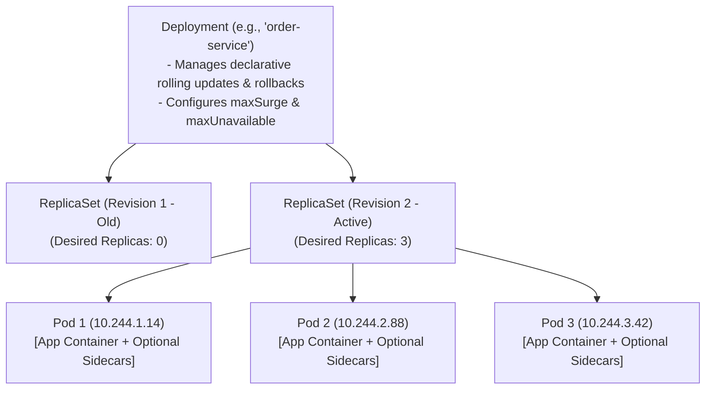
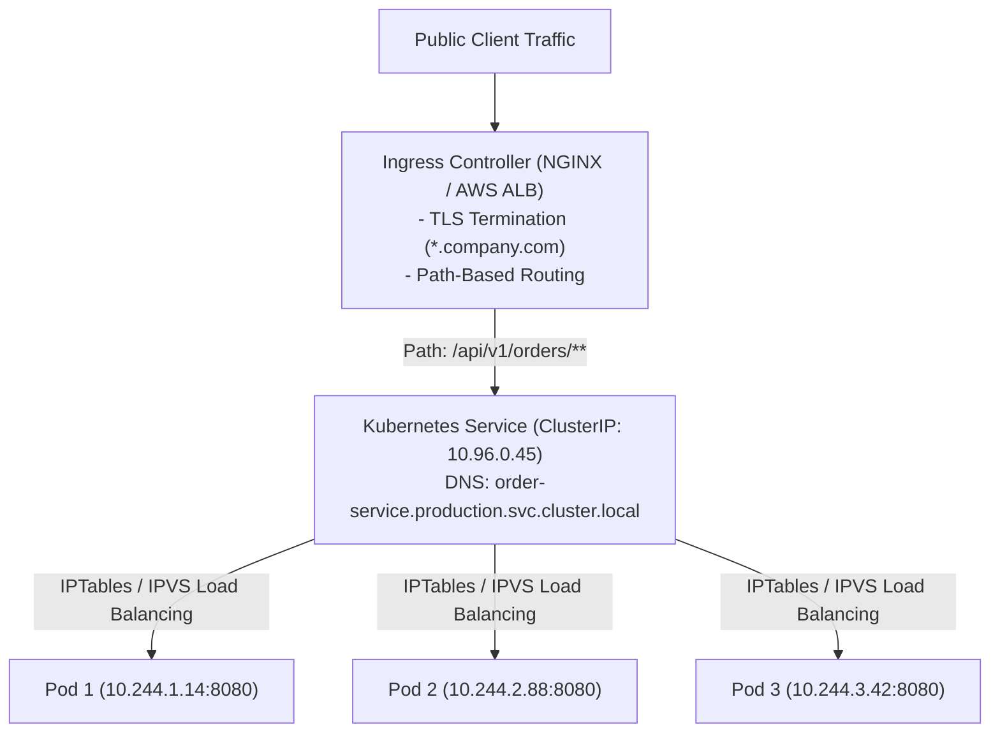
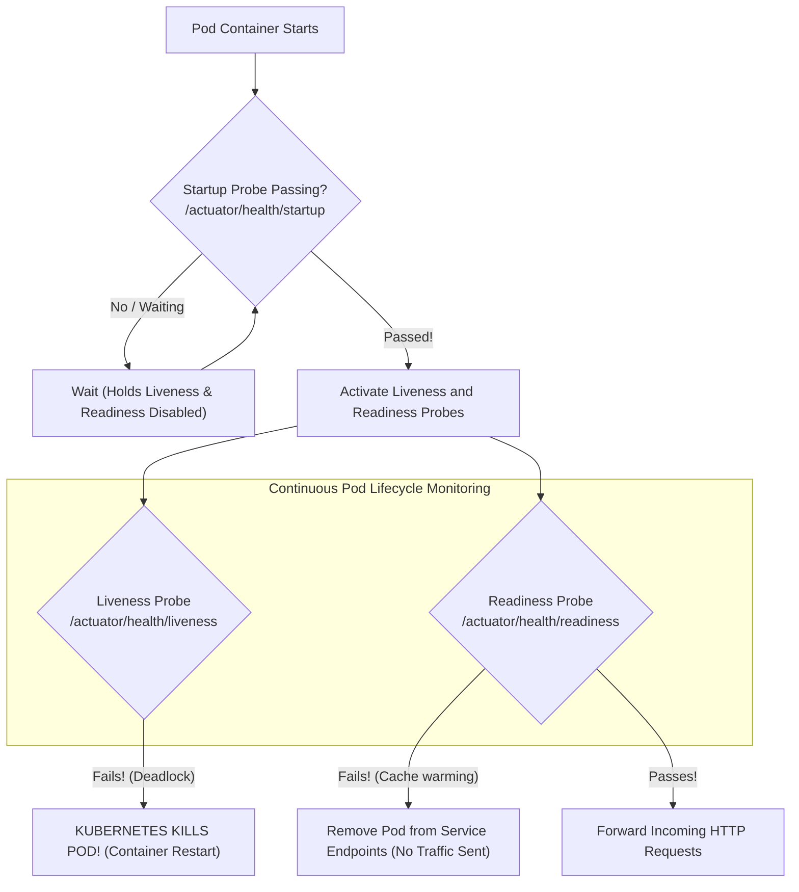

Kubernetes has become the undisputed operating system of the modern cloud. Yet to many Java engineers, Kubernetes feels like an intimidating wall of YAML indentation, esoteric networking acronyms, and frustrating deployment failures.

Worse, blindly applying generic Kubernetes tutorials to Spring Boot applications creates severe production disasters. When developers configure probes incorrectly, Kubernetes routinely kills healthy Java pods during normal startup sequences. When rolling updates are misconfigured, zero-downtime deployments drop customer traffic. And when database health checks are placed in the wrong probe, a momentary database blip triggers cluster-wide suicide.

In this guide, we will translate Kubernetes architecture into clear, senior-level Java mental models. We will master Deployments and Ingress, configure **Spring Boot Actuator Probes** properly, package scalable microservices with **Helm**, and design bulletproof zero-downtime rolling updates.

---

## Core Workloads: Pods, ReplicaSets, and Deployments

In Kubernetes, you never deploy standalone containers directly. You deploy through a hierarchy of declarative controllers:



### The Pod
A Pod is the smallest deployable execution unit in Kubernetes. It encapsulates one or more tightly coupled containers sharing the same **Network Namespace** (same IP address and `localhost`) and **Storage Volumes**. In modern Java architectures, a pod typically runs a single Spring Boot application container, optionally accompanied by a lightweight sidecar (e.g., an Envoy service mesh proxy or an OpenTelemetry log shipper).

### The ReplicaSet
Ensures that a specified number of identical pod replicas are running at all times. If a worker node crashes, the ReplicaSet controller detects the deficit and schedules replacement pods on surviving nodes.

### The Deployment
You almost never create ReplicaSets manually. A **Deployment** manages ReplicaSets declaratively, orchestrating automated rolling updates (deploying Version 2 while gradually terminating Version 1) and supporting instant rollbacks (`kubectl rollout undo`).

---

## Production Deployment Manifest for Spring Boot

```yaml
apiVersion: apps/v1
kind: Deployment
metadata:
  name: order-service
  namespace: production
  labels:
    app.kubernetes.io/name: order-service
    app.kubernetes.io/part-of: ecommerce-platform
spec:
  replicas: 3
  revisionHistoryLimit: 5
  strategy:
    type: RollingUpdate
    rollingUpdate:
      maxSurge: 1        # Allow 1 extra pod above desired count during update
      maxUnavailable: 0  # Never drop below 3 operational pods during update!
  selector:
    matchLabels:
      app: order-service
  template:
    metadata:
      labels:
        app: order-service
    spec:
      terminationGracePeriodSeconds: 45 # Allows in-flight HTTP requests to drain
      securityContext:
        runAsNonRoot: true
        runAsUser: 10001
        fsGroup: 10001
      containers:
        - name: order-service
          image: registry.company.com/ecommerce/order-service:2.1.0
          imagePullPolicy: IfNotPresent
          ports:
            - name: http
              containerPort: 8080
            - name: actuator
              containerPort: 8081
          resources:
            requests:
              cpu: "500m"      # 0.5 CPU core guaranteed
              memory: "1536Mi"  # 1.5 GB RAM guaranteed
            limits:
              cpu: "2000m"     # Throttle ceiling at 2 CPU cores
              memory: "2048Mi"  # Hard cgroup memory ceiling (Triggers OOMKill if exceeded)
          env:
            - name: JAVA_TOOL_OPTIONS
              value: "-XX:MaxRAMPercentage=75.0 -XX:+UseG1GC -XX:+ExitOnOutOfMemoryError"
            - name: SPRING_PROFILES_ACTIVE
              value: "production"
          envFrom:
            - configMapRef:
                name: order-service-config
            - secretRef:
                name: order-service-secrets
```

---

## Service Networking and Ingress Routing

Pods have ephemeral private IP addresses that change every time a pod restarts. A **Service** provides a stable, persistent virtual IP (ClusterIP) and internal DNS entry that automatically load-balances traffic across all healthy matching pods.



### ClusterIP Service Definition
```yaml
apiVersion: v1
kind: Service
metadata:
  name: order-service
  namespace: production
spec:
  type: ClusterIP
  selector:
    app: order-service
  ports:
    - name: http
      port: 80
      targetPort: http # Matches containerPort name 'http' (8080)
```

### Ingress Manifest (Edge Routing)
```yaml
apiVersion: networking.k8s.io/v1
kind: Ingress
metadata:
  name: ecommerce-ingress
  namespace: production
  annotations:
    kubernetes.io/ingress.class: nginx
    cert-manager.io/cluster-issuer: letsencrypt-prod
spec:
  tls:
    - hosts:
        - api.company.com
      secretName: api-tls-cert
  rules:
    - host: api.company.com
      http:
        paths:
          - path: /api/v1/orders
            pathType: Prefix
            backend:
              service:
                name: order-service
                port:
                  number: 80
```

---

## Spring Boot Actuator Probes: The Triad of Survival

The single most common source of outages in Kubernetes-hosted Java is misconfigured health probes. Kubernetes provides three distinct probe types, and confusing their purposes is fatal:



### The Startup Probe: Protecting Slow JVM Boot Times
Spring Boot applications can take 15 to 30 seconds to start up (loading classes, running Flyway migrations, initializing Hibernate). 
If you only configure a `livenessProbe` with a 10-second initial delay, Kubernetes checks the liveness endpoint before Spring Boot is ready, concludes the pod is frozen, and kills it! The pod enters a permanent **CrashLoopBackOff**.

The **Startup Probe** disables liveness and readiness checks until the application has fully initialized:
```yaml
startupProbe:
  httpGet:
    path: /actuator/health/liveness
    port: 8081
  failureThreshold: 30 # 30 attempts x 2 seconds = 60 seconds total startup window!
  periodSeconds: 2
```

### The Liveness Probe: Detecting Deadlocks
Answers: *"Is the JVM deadlocked or in an unrecoverable state?"*
If the liveness probe fails, Kubernetes **kills and restarts the container**.
- **Rule of Thumb**: Liveness checks should ONLY verify internal JVM health (threads, memory). 
- **CRITICAL**: **Never check external databases or message brokers in a liveness probe!** If PostgreSQL is down, restarting your Spring Boot pod will not fix PostgreSQL!

### The Readiness Probe: Traffic Flow Control
Answers: *"Is this pod ready to accept live customer traffic right now?"*
If the readiness probe fails, Kubernetes **does NOT kill the pod**. It simply removes the pod's IP from the Service endpoints list, preventing traffic from reaching it until it recovers.
- Ideal for temporary saturation: warming up local caches, running a heavy GC cycle, or waiting for a transient database reconnect.

### Configuring Spring Boot Actuator for Kubernetes Probes
In `application.yml`:
```yaml
management:
  server:
    port: 8081 # Isolate actuator metrics/health to an internal management port!
  endpoints:
    web:
      exposure:
        include: health,info,prometheus
  endpoint:
    health:
      probes:
        enabled: true # Automatically configures /actuator/health/liveness and /readiness
      group:
        readiness:
          include: readinessState,db # Database check belongs in READINESS, never liveness!
        liveness:
          include: livenessState
```

And attach them to your Kubernetes Deployment spec:
```yaml
livenessProbe:
  httpGet:
    path: /actuator/health/liveness
    port: 8081
  initialDelaySeconds: 0 # Safe because startupProbe protects startup!
  periodSeconds: 10
  timeoutSeconds: 3
  failureThreshold: 3

readinessProbe:
  httpGet:
    path: /actuator/health/readiness
    port: 8081
  initialDelaySeconds: 0
  periodSeconds: 5
  timeoutSeconds: 3
  failureThreshold: 2
```

---

## Decoupling Configuration: ConfigMaps and Secrets

Never hardcode database URLs or API keys inside container images. Use Kubernetes ConfigMaps for environment configuration and Secrets for sensitive credentials.

### ConfigMap Definition
```yaml
apiVersion: v1
kind: ConfigMap
metadata:
  name: order-service-config
  namespace: production
data:
  SPRING_KAFKA_BOOTSTRAP_SERVERS: "kafka.production.svc.cluster.local:9092"
  APP_FEATURE_FLAG_VIP_DISCOUNT: "true"
```

### Secret Definition (Base64 Encoded)
```yaml
apiVersion: v1
kind: Secret
metadata:
  name: order-service-secrets
  namespace: production
type: Opaque
data:
  # Base64 encoded values: echo -n 'my_db_password' | base64
  SPRING_DATASOURCE_PASSWORD: bXlfZGJfcGFzc3dvcmQ=
  STRIPE_API_SECRET_KEY: c2tfbGl2ZV85OTk4ODg3NzY2NTU=
```

---

## Packaging Microservices with Helm Charts

Managing dozens of raw YAML files across Dev, Staging, and Production environments results in massive copy-paste errors. **Helm** is the package manager for Kubernetes, enabling parameterization and templated releases.

### Standard Helm Chart Structure
```text
order-service-chart/
├── Chart.yaml          # Metadata (name, version, appVersion)
├── values.yaml         # Default configuration values
├── values-dev.yaml     # Dev environment overrides
├── values-prod.yaml    # Production overrides
└── templates/
    ├── deployment.yaml # Parameterized Deployment manifest
    ├── service.yaml    # Parameterized Service manifest
    ├── ingress.yaml    # Parameterized Ingress manifest
    └── hpa.yaml        # HorizontalPodAutoscaler
```

### Parameterized `values.yaml`
```yaml
replicaCount: 3

image:
  repository: registry.company.com/ecommerce/order-service
  tag: "2.1.0"
  pullPolicy: IfNotPresent

resources:
  limits:
    cpu: 2000m
    memory: 2048Mi
  requests:
    cpu: 500m
    memory: 1536Mi

autoscaling:
  enabled: true
  minReplicas: 3
  maxReplicas: 15
  targetCPUUtilizationPercentage: 75

env:
  springProfile: production
```

### Deploying with Helm
```bash
# Install or upgrade chart for production
helm upgrade --install order-service ./order-service-chart \
  --namespace production \
  --values ./order-service-chart/values-prod.yaml
```

---

## Architectural Traps and Real-World Outages

### The "Database Outage Turned Cluster Suicide" Outage
A retail banking platform configured their Kubernetes `livenessProbe` to point to `/actuator/health`. 
By default, Spring Boot's generic `/health` endpoint checks all registered health indicators, including the PostgreSQL database. 

During a routine PostgreSQL failover, database connectivity dropped for 12 seconds. 
The liveness probes on **all 60 Spring Boot pods failed simultaneously**. 
Kubernetes immediately killed all 60 pods and attempted to restart them. 
When PostgreSQL recovered, 60 cold JVM pods started at the exact same second, all trying to run Flyway database migrations and establish connection pools at once. The database connection queue backed up, startup probes timed out, and the entire platform entered an unrecoverable death spiral that lasted 2 hours.

**The Fix:** Isolate probes! Liveness checks must verify *only* local JVM process health (`/actuator/health/liveness`). External dependencies belong strictly in the `readinessProbe`!

### The "Zero-Downtime Deployment 502 Bad Gateway" Bug
A company configured rolling deployments with `maxUnavailable: 0` and assumed deployments were 100% zero-downtime. 
However, whenever a deployment rolled out, users experienced a wave of HTTP 502 Bad Gateway errors. 

**Root Cause:** When Kubernetes terminates an old pod, two things happen asynchronously:
1. The Kubelet sends `SIGTERM` to the container.
2. The endpoint controller updates `iptables` / Ingress to remove the pod's IP.

Because updating iptables takes 1 to 3 seconds across a cluster, Ingress continued routing new user traffic to the pod *after* the container had already begun shutting down!
**The Fix:** Add a `preStop` sleep hook in the container spec:
```yaml
lifecycle:
  preStop:
    exec:
      command: ["/bin/sh", "-c", "sleep 10"]
```
This forces the container to wait 10 seconds before terminating, allowing Ingress and iptables to completely remove the pod from routing tables before Spring Boot begins graceful shutdown.

---

## Senior Interview Questions

### Question 1: What is the exact sequence of events during a graceful pod termination in Kubernetes, and why is a `preStop` hook necessary for Java applications?
**Answer:**  
When a pod is deleted or replaced during a rolling update:
1. The Pod status is set to `Terminating`.
2. The Endpoint controller removes the pod's IP from the Service endpoints list.
3. Kube-proxy and Ingress controllers asynchronously update their routing rules and iptables across all nodes.
4. Concurrently, Kubelet executes the `preStop` lifecycle hook (if present).
5. Kubelet sends `SIGTERM` (Signal 15) to the container's PID 1 process.
6. The container enters its graceful shutdown phase (draining in-flight HTTP requests).
7. If the container does not exit before `terminationGracePeriodSeconds` expires, Kubelet sends `SIGKILL` (Signal 9).

Because step 3 (updating network routing) happens asynchronously and can take a few seconds, traffic can still be routed to the pod *after* step 5 starts. A `preStop: exec: command: ["sleep", "10"]` pauses step 5, ensuring all network proxies have completely purged the pod from their load balancing tables before the JVM begins shutting down.

### Question 2: What is the difference between CPU Requests, CPU Limits, and the CFS Bandwidth Quota throttling trap for Java applications?
**Answer:**  
- **CPU Requests**: The guaranteed minimum amount of CPU allocated to the container, used by the Kubernetes scheduler to place pods on worker nodes.
- **CPU Limits**: The maximum hard ceiling of CPU the container is permitted to consume, enforced by the Linux Completely Fair Scheduler (CFS) bandwidth quota (`cpu.cfs_quota_us` / `cpu.cfs_period_us`).

**The CFS Throttling Trap:** If you set a tight CPU limit (e.g., `cpu: "1000m"` = 1 core), the Linux kernel throttles the container's CPU threads as soon as it exhausts its 100ms time slice, even if the host machine has 64 idle CPU cores! 
For Java applications running multi-threaded parallel garbage collectors (G1GC) or C2 JIT compilation during startup, CFS throttling causes massive latency spikes. Senior cloud architects recommend either setting high CPU limits or omitting CPU limits entirely while enforcing strict CPU Requests.

### Question 3: How does Horizontal Pod Autoscaler (HPA) determine when to scale Java applications, and why is scaling on memory metrics dangerous?
**Answer:**  
HPA monitors metrics (typically CPU utilization via the Metrics Server) and calculates desired replicas using the formula:
`Desired Replicas = ceil(Current Replicas * (Current Metric Value / Target Metric Value))`

**Why Scaling on Memory is Dangerous for Java:**  
Java garbage collection is non-deterministic. A JVM with a 2 GB heap might retain 1.8 GB of memory simply because a GC cycle has not been triggered yet, even though 1.4 GB of that memory is dead garbage! 
If HPA is configured to scale out at 80% memory utilization, it will see the un-collected JVM heap, assume the application is under heavy load, and scale out unnecessary pods until it reaches `maxReplicas`. 
Java applications should scale primarily on **CPU utilization**, **HTTP request rates**, or **Kafka consumer group lag** (via KEDA).

### Question 4: What is the difference between ConfigMap volume mounts versus environment variable injections in terms of live configuration reloading?
**Answer:**  
- **Environment Variables (`envFrom`)**: The values are injected into the process environment when the container starts. Once the container is running, modifying the ConfigMap in Kubernetes **will not update** the environment variables inside the running Java process; the pod must be restarted.
- **Volume Mounts (`volumeMounts`)**: The ConfigMap is mounted as a directory of files inside the container. When the ConfigMap is updated, Kubernetes automatically syncs and updates the underlying files on disk within a minute without restarting the pod. Libraries like Spring Cloud Kubernetes can watch these files and trigger `@RefreshScope` bean reloads dynamically at runtime.
