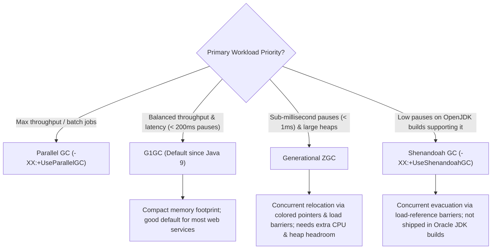
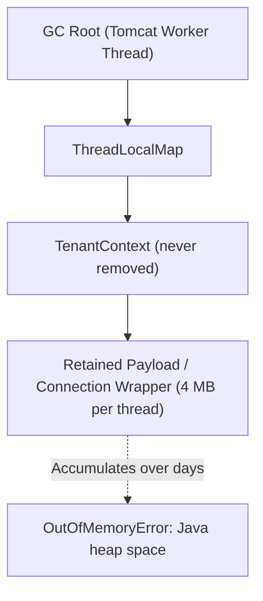

Most Java services run well on HotSpot's default ergonomics, and teams often do more harm than good by copying 20 legacy JVM flags from an old blog post. Tuning should start only after measurement shows a real problem: elevated tail latency, frequent pauses, container OOM kills, or steadily rising memory usage.

When that happens, you need a repeatable workflow: read the GC and safepoint logs to see what the collector is actually doing, pick a collector and heap budget that fit your workload and container limits, inspect `.hprof` heap dumps when memory refuses to drop, and verify bottlenecks with JFR or VisualVM before changing a single flag.

## Reading Unified GC and Safepoint Logs

Since Java 9, HotSpot replaced scattered flags like `-XX:+PrintGCDetails` with the **Unified JVM Logging** flag (`-Xlog`). Enabling GC and safepoint logs in production has negligible overhead and gives you the ground truth whenever latency spikes happen.

### Recommended Production Logging Configuration

```bash
java \
  -Xlog:gc*,gc+age=trace,safepoint:file=/var/log/jvm/gc-%t.log:time,uptime,pid,level,tags:filecount=5,filesize=100M \
  -jar app.jar
```

- `gc*`: Logs all GC tags (evacuation phases, heap transitions, humongous allocations, concurrent cycles, and Full GCs).
- `gc+age=trace`: Prints the survivor tenuring age table so you can spot premature promotion into the Old Generation.
- `safepoint`: Logs *all* stop-the-world safepoints, including non-GC pauses (such as deoptimization, thread dumps, or long Time-To-Safepoint delays).
- `filecount=5,filesize=100M`: Caps disk usage at 500 MB via automatic log rotation so logs cannot fill the container volume.

### Annotated G1GC and Safepoint Log Excerpt

Here is what a healthy G1GC young evacuation pause looks like alongside its tenuring table and safepoint timing:

```text
[2026-10-29T14:22:01.410+0000][124.510s][14022][info ][gc,start    ] GC(42) Pause Young (Normal) (G1 Evacuation Pause)
[2026-10-29T14:22:01.411+0000][124.511s][14022][trace][gc,age      ] GC(42) Desired survivor size 134217728 bytes, new threshold 15 (max threshold 15)
[2026-10-29T14:22:01.412+0000][124.512s][14022][trace][gc,age      ] GC(42) - age   1:   18421040 bytes,   18421040 total
[2026-10-29T14:22:01.412+0000][124.512s][14022][trace][gc,age      ] GC(42) - age   2:    4120560 bytes,   22541600 total
[2026-10-29T14:22:01.416+0000][124.516s][14022][info ][gc,heap     ] GC(42) Eden regions: 210->0(214)
[2026-10-29T14:22:01.416+0000][124.516s][14022][info ][gc,heap     ] GC(42) Survivor regions: 6->5(27)
[2026-10-29T14:22:01.416+0000][124.516s][14022][info ][gc,heap     ] GC(42) Old regions: 48->48
[2026-10-29T14:22:01.416+0000][124.516s][14022][info ][gc,heap     ] GC(42) Humongous regions: 2->2
[2026-10-29T14:22:01.417+0000][124.517s][14022][info ][gc          ] GC(42) Pause Young (Normal) (G1 Evacuation Pause) 1842M->412M(4096M) 6.412ms
[2026-10-29T14:22:01.417+0000][124.517s][14022][info ][gc,cpu      ] GC(42) User=0.05s Sys=0.00s Real=0.01s
[2026-10-29T14:22:01.417+0000][124.517s][14022][info ][safepoint   ] Safepoint "G1CollectForAllocation", Time since last: 1842100450 ns, Reaching safepoint: 182400 ns, At safepoint: 6510200 ns, Total: 6692600 ns
```

Key signals to read from these lines:

- **Heap drop (`1842M->412M(4096M)`)**: Before GC, 1,842 MB was occupied; after GC, 412 MB remained out of 4,096 MB committed. Most of Eden died young (210 regions reclaimed down to 0).
- **Old regions (`48->48`) and age table**: Zero Old regions were added, and survivor occupancy (about 22.5 MB) sits well under the desired survivor size (128 MB), so `new threshold` stayed at 15. If `new threshold` drops to 1 or 2, survivors are overflowing and young objects are promoting prematurely into Old Gen.
- **CPU ratio (`User=0.05s Sys=0.00s Real=0.01s`)**: `User` is summed across parallel GC threads, while `Real` is wall-clock time. High `Sys` time points to OS paging, memory contention, or heavy virtual memory work; `Real` exceeding `User` on a multi-core box usually means Kubernetes CPU throttling (CFS quota starvation) is starving GC threads.
- **Safepoint line (`Reaching safepoint: 0.18 ms`, `At safepoint: 6.51 ms`)**: Always check `Reaching safepoint` (Time-To-Safepoint). If `At safepoint` is 5 ms but `Reaching safepoint` is 400 ms, the GC itself was fast; one thread took 400 ms to reach a safepoint poll while freezing every other thread waiting for it.

### Warning Signs in GC Logs

- **Rising baseline after each GC:** Live heap occupancy after Old/Mixed collections climbs steadily over hours like a sawtooth trending upward. That points to a memory leak or an unbounded cache.
- **High allocation rate vs promotion rate:** Allocation rate is how fast Eden fills (for example, 600 MB/s). Promotion rate is how fast survivors move into Old Gen. High allocation rates cause frequent short Young pauses; high promotion rates trigger frequent Old/Mixed cycles.
- **Humongous allocations:** In G1GC, any object larger than 50% of a G1 region size (for example, a 5 MB `byte[]` when regions are 8 MB) bypasses Eden and allocates directly in contiguous Old Gen regions. Rapid humongous allocations fragment the heap and trigger premature concurrent cycles or Full GCs.
- **`To-space exhausted` or `Pause Full (G1 Compaction Pause)`:** G1 ran out of free regions during evacuation and fell back to a full stop-the-world compaction pause that can last seconds.

## Choosing the Right Garbage Collector

Picking a GC is always a three-way trade-off between **pause latency**, **CPU throughput**, and **memory footprint**. No single collector wins all three.



### Comparing Production Collectors (Java 21+)

| Collector | Typical Pause Time | Throughput & CPU Overhead | Heap Headroom Needed | Version & Distribution Notes |
|---|---|---|---|---|
| **Parallel GC** | Tens of ms to seconds | Highest raw throughput; lowest barrier overhead | Low | Best for offline batch jobs and short-lived CLI tools where pauses do not hurt users. |
| **G1GC** | Tens of ms (targets `-XX:MaxGCPauseMillis`, default 200 ms) | High throughput; modest write-barrier cost | Moderate | Default collector since Java 9. Strong general-purpose choice for heaps from ~2 GB to tens of GB. |
| **Generational ZGC** | Sub-millisecond (typically < 1 ms, independent of heap size) | Roughly 5% to 15% lower peak throughput due to load barriers and concurrent GC CPU | Higher (typically 15% to 30% headroom to avoid allocation stalls) | Introduced in Java 21 (JEP 439, opt-in via `-XX:+UseZGC -XX:+ZGenerational`), became default ZGC mode in Java 23 (JEP 474); non-generational mode removed in Java 24 (JEP 490). |
| **Shenandoah GC** | Single-digit ms or sub-millisecond | Similar barrier trade-off to ZGC | Higher | Included in Red Hat, Eclipse Temurin, Amazon Corretto, and Azul builds (not in Oracle JDK). Generational Shenandoah arrived as an experimental feature in Java 24 (JEP 404). |

### Enabling Generational ZGC vs G1GC

On Java 21 LTS, enabling Generational ZGC requires both flags:

```bash
# Java 21 LTS (Generational ZGC requires explicit opt-in)
java -XX:+UseZGC -XX:+ZGenerational -XX:MaxRAMPercentage=75.0 -jar app.jar

# Java 23+ (Generational mode is already the default for -XX:+UseZGC)
java -XX:+UseZGC -XX:MaxRAMPercentage=75.0 -jar app.jar
```

Why not switch every service to Generational ZGC automatically? Because concurrent collectors need **headroom** in both CPU and RAM. If your container is tightly packed at 85% heap occupancy with 1 vCPU limit, ZGC's concurrent threads cannot reclaim memory fast enough to stay ahead of allocations, causing **allocation stalls** (application threads pause waiting for memory anyway) while paying load-barrier overhead on every reference read. In small, CPU-constrained microservices where a 30 ms G1 pause is completely acceptable, G1GC often runs cheaper and faster.

### Sizing JVM Memory Inside Containers

Modern JVMs (Java 11+ and greatly improved in Java 17/21) read cgroup v1/v2 container limits automatically. Instead of hardcoding `-Xmx` values that drift out of sync with Kubernetes manifests, prefer `-XX:MaxRAMPercentage`:

```bash
java \
  -XX:InitialRAMPercentage=70.0 \
  -XX:MaxRAMPercentage=70.0 \
  -jar app.jar
```

Never set `MaxRAMPercentage` to 95% or 100%. The Java heap is only part of the process's Resident Set Size (RSS). HotSpot also allocates native off-heap memory for:

- **Metaspace** (loaded class metadata)
- **Thread stacks** (often 1 MB virtual, tens to hundreds of KB resident per platform thread)
- **JIT Code Cache** (compiled native machine code, up to 240 MB by default with tiered compilation)
- **Direct ByteBuffers** (`-XX:MaxDirectMemorySize`, used heavily by Netty, Kafka, and NIO)
- **GC internal structures** (remembered sets, card tables, mark bitmaps) and native libraries

If total RSS exceeds the Kubernetes `limits.memory`, the Linux kernel's OOM killer terminates the container instantly with `Exit Code 137` before HotSpot can throw `OutOfMemoryError` or write a heap dump. Leaving 25% to 35% of container memory outside the heap (and sizing conservatively on small < 1 GB containers) prevents surprise OOM kills.

## Memory Leak Detection with Heap Dumps (`.hprof`)

In Java, a memory leak happens when objects your application no longer needs remain strongly reachable from a **GC Root** (static fields, active thread stacks, `ThreadLocal` maps on pooled threads, JNI references, or live classloaders). Because they remain reachable, the garbage collector cannot reclaim them.



### Automatic Capture on Crash

Configure every production JVM to capture a heap dump and exit cleanly if it hits `OutOfMemoryError`:

```bash
java \
  -XX:+HeapDumpOnOutOfMemoryError \
  -XX:HeapDumpPath=/dumps/oom-%p.hprof \
  -XX:+ExitOnOutOfMemoryError \
  -jar app.jar
```

Prefer `-XX:+ExitOnOutOfMemoryError` over `-XX:+CrashOnOutOfMemoryError` in Kubernetes unless you specifically need an `hs_err_pid.log` and OS core dump. Both terminate a half-broken JVM cleanly so Kubernetes can restart the pod, and `ExitOnOutOfMemoryError` avoids dumping a massive native core file onto ephemeral pod storage. Make sure `/dumps` is backed by a persistent volume or enough ephemeral space to hold the full heap size.

### On-Demand Live Heap Dumps with `jcmd`

If memory is trending up before an OOM happens, capture a heap dump on demand:

```bash
# Remove the pod from load-balancer rotation first!
# Capture only live objects (triggers a full GC before dumping)
jcmd <PID> GC.heap_dump /dumps/live-heap.hprof
```

> [!WARNING]
> `GC.heap_dump` pauses the entire JVM for several seconds (or tens of seconds on multi-gigabyte heaps) while serializing the heap to disk. Never run it on a live pod that is actively serving customer traffic without draining traffic or taking the pod out of the readiness pool first.

### Eclipse MAT Forensics Workflow

Open the `.hprof` file in **Eclipse Memory Analyzer Tool (MAT)** (give MAT enough `-Xmx` in `MemoryAnalyzer.ini`, roughly 1.2x to 1.5x the dump size) and work through three views:

1. **Dominator Tree:** Lists objects ordered by the total memory they keep alive. Look at the top entries first. If a single `ConcurrentHashMap` or `ArrayList` owns 75% of the heap, you have found where memory is accumulating.
2. **Shallow Heap vs Retained Heap:**
   - **Shallow Heap** is the size of the object itself (object header, primitive fields, and reference slots—often 24 to 64 bytes).
   - **Retained Heap** is the total memory that would be freed if that object were garbage collected, including every object reachable *exclusively* through it. A single `HashMap` instance can have a 48-byte shallow heap and a 3.2 GB retained heap.
3. **Path to GC Roots (Exclude all phantom/weak/soft references):** Right-click the suspect entry in the Dominator Tree and inspect its shortest strong paths back to a GC root. Filtering out weak/soft/phantom references removes noise from caches like `WeakHashMap` and exposes the exact static field, singleton bean, or pooled thread holding the strong reference.

### Classic Leak Pattern: `ThreadLocal` on Pooled Threads

Servlet containers like Tomcat reuse worker threads across thousands of requests. Storing request-scoped data in a `ThreadLocal` without clearing it pins that object until the thread happens to be reused or destroyed:

```java
public final class RequestContext {

    private static final ThreadLocal<TenantInfo> CURRENT = new ThreadLocal<>();

    public static void set(TenantInfo info) {
        CURRENT.set(info);
    }

    public static TenantInfo get() {
        return CURRENT.get();
    }

    public static void clear() {
        CURRENT.remove();
    }
}
```

Always clear `ThreadLocal` values in a `finally` block inside the filter or interceptor that sets them:

```java
try {
    RequestContext.set(extractTenant(request));
    filterChain.doFilter(request, response);
} finally {
    RequestContext.clear();
}
```

## Profiling with JFR and VisualVM (Without Over-Tuning)

Before touching GC parameters like `-XX:NewRatio`, `-XX:InitiatingHeapOccupancyPercent`, or `-XX:G1HeapRegionSize`, prove that the bottleneck is actually the garbage collector and not application code, lock contention, or slow I/O.

### VisualVM for Local Development and Staging

**VisualVM** is fast and convenient on a developer workstation or staging node when you want live visibility into a running JVM:

- **Monitor tab:** Watch heap sawtooth behavior, metaspace growth, thread counts, and CPU usage in real time while running a load test.
- **Sampler tab (CPU & Memory):** Uses lightweight sampling to spot obvious allocation hotspots or busy methods during local benchmarks. Avoid the **Profiler** tab's full bytecode instrumentation on anything near production traffic because instrumentation overhead skews timings heavily.
- **Heap Dump & Threads tabs:** Capture quick thread dumps to spot deadlocks (`BLOCKED` threads) or take a local heap snapshot and inspect Retained Sizes without leaving the tool.

Because VisualVM's sampler relies on JVMTI/JMX polling and requires remote JMX ports if used over a network, keep it in local and staging environments rather than attaching it to production pods.

### JFR in Production Tuning Loops

In production, **Java Flight Recorder (JFR)** pairs naturally with GC logs to verify whether a tuning change actually worked:

```bash
# Capture a 2-minute production baseline before changing any JVM flags
jcmd <PID> JFR.start name=baseline settings=profile duration=120s filename=/tmp/baseline.jfr
```

Open `baseline.jfr` in JDK Mission Control and check three screens before adjusting GC flags:

1. **Garbage Collections & TLAB Allocations:** Confirm whether pauses are driven by allocation volume (fix the allocating code first!) or heap sizing.
2. **Threads & Lock Instances:** Many "GC pause" reports turn out to be a single `synchronized` method or saturated connection pool stalling worker threads.
3. **File / Socket I/O:** Confirm that latency spikes are inside the JVM rather than waiting on a slow database query or upstream HTTP call.

### A Disciplined JVM Tuning Workflow

1. **Measure a baseline** under realistic traffic (GC logs + JFR + p50/p95/p99 latency + CPU/RSS).
2. **Fix application waste first:** Cutting allocation rate in half (eliminating unnecessary JSON serialization, giant byte arrays, or debug-log string formatting) improves every collector far more than flag tweaks.
3. **Change one flag at a time** (for example, switching to Generational ZGC or bumping `G1HeapRegionSize` from 8m to 16m for 5 MB PDF buffers) and compare against the baseline.
4. **Never leave mystery flags behind:** Document why every non-default JVM flag exists in your deployment manifest, and re-verify it whenever you upgrade Java LTS versions.

## Common Tuning Traps

- **Setting `-XX:MaxGCPauseMillis` unrealistically low (like 10 ms) on G1GC:** G1 tries to meet the target by shrinking the Young Generation to a tiny slice, which causes constant back-to-back minor GCs and rapid premature promotion into Old Gen, hurting both throughput and tail latency. If you truly need sub-10 ms pauses, evaluate Generational ZGC instead of forcing G1GC into an impossible target.
- **Fixing `-Xms` lower than `-Xmx` on latency-sensitive services:** Growing and uncommitting heap regions dynamically triggers extra GCs during traffic ramp-up. Setting `InitialRAMPercentage` equal to `MaxRAMPercentage` (or `-Xms` equal to `-Xmx`) avoids warmup resizing pauses.
- **Ignoring humongous allocations in G1GC:** Repeatedly allocating 5 MB to 10 MB contiguous buffers (such as reading whole files into `byte[]`) bypasses Eden and fragments Old Gen. Stream data in smaller chunks (such as 64 KB buffers) or increase `-XX:G1HeapRegionSize` (up to 32 MB) only if streaming is not feasible.
- **Misreading Kubernetes CPU throttling as slow GC:** When a pod has a strict CPU `limit`, Linux CFS quotas can freeze GC worker threads mid-pause, turning a 15 ms G1 pause into a 300 ms pause. Look for `Real` time exceeding `User` time in `gc,cpu` logs and check container `nr_throttled` metrics.

## Interview Questions

### What is the difference between Shallow Heap and Retained Heap in Eclipse MAT?

Shallow Heap is the memory consumed by a single object itself: its object header, primitive fields, and reference pointers, without counting the objects it points to. Retained Heap is the total memory that would be freed if that object were garbage collected, meaning its own shallow heap plus the shallow heaps of every object reachable *exclusively* through it. When hunting a memory leak in a Dominator Tree, Retained Heap points directly to the container or cache anchoring gigabytes of data in memory.

### How does Generational ZGC keep GC pauses under a millisecond even on large heaps?

Traditional compacting collectors pause application threads while moving live objects and updating every pointer that references them. ZGC performs marking and object relocation concurrently while application threads keep running. It stores GC metadata bits directly inside 64-bit object references (**colored pointers**) and inserts JIT-compiled **load barriers** on reference reads. If an application thread reads a reference to an object that has moved, the load barrier consults ZGC's forwarding table, fixes the pointer in place (self-healing), and returns the updated address without pausing the whole JVM. In Java 21+, Generational ZGC separates Young and Old generations so short-lived objects are collected cheaply without scanning the entire heap.

### Why can a Java container get killed with Exit Code 137 even when `-Xmx` is well below the container memory limit?

Exit Code 137 means the Linux OOM killer terminated the container because its total process RSS exceeded the cgroup memory limit. `-Xmx` caps only the Java heap. Metaspace, thread stacks, JIT code cache, `DirectByteBuffer` / Netty off-heap memory, GC internal data structures, and native C libraries (such as zlib or RocksDB) all live outside `-Xmx`. If you set `-XX:MaxRAMPercentage=90.0` or leak off-heap buffers, total native + heap RSS crosses the container limit and kills the pod without triggering a Java `OutOfMemoryError`.

### Under what conditions does G1GC fall back to a Full GC, and how do you prevent it?

G1GC triggers a stop-the-world Full GC when it runs out of free regions during evacuation (**To-space exhausted**), when concurrent marking cannot finish before Old Gen fills up under heavy allocation or promotion rates, or when frequent humongous allocations (> 50% of a G1 region size) fragment Old Gen so no contiguous regions remain. Prevention starts with reading `-Xlog:gc*` to find which trigger occurred: reduce allocation/promotion churn in code, stream large payloads to eliminate humongous allocations (or adjust `-XX:G1HeapRegionSize`), ensure enough heap headroom, and check for CPU throttling slowing down concurrent marking threads.
