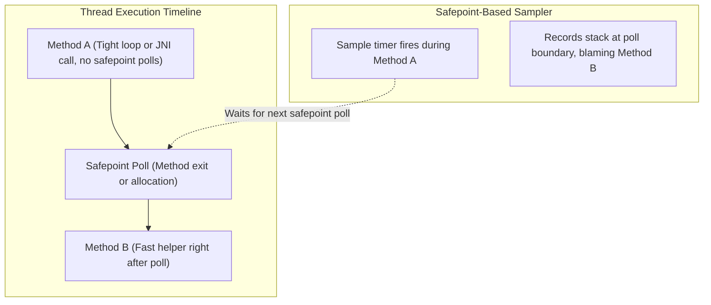
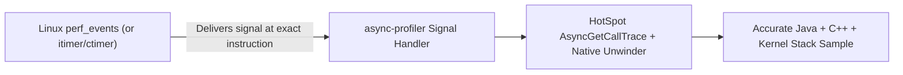
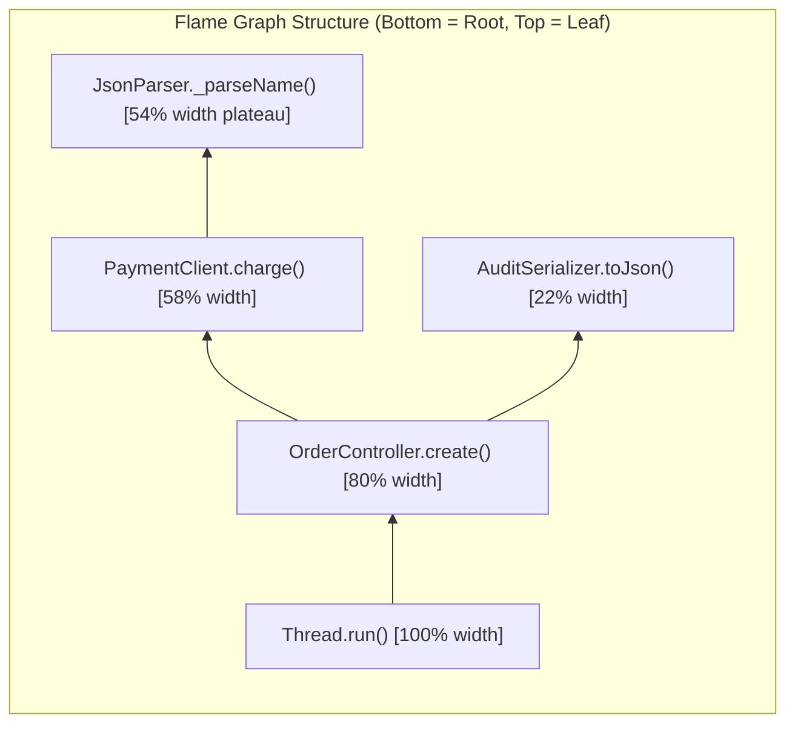
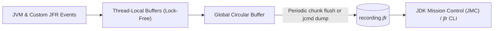
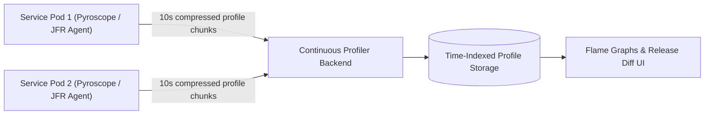

When a production service pins a core at 100% CPU or develops sudden tail-latency spikes, guesswork is expensive. Adding temporary log statements, changing thread pool sizes, or tweaking garbage collection flags on a hunch usually burns hours and sometimes makes the incident worse.

For a long time, teams avoided profiling live production JVMs for good reason. Early profilers relied on bytecode instrumentation (rewriting every method to record entry and exit timestamps), which routinely added 20% to 50% CPU overhead and distorted the very timings you were trying to measure. Early sampling profilers were lighter, but suffered from **safepoint bias** and often blamed the wrong methods entirely.

Modern Java production profiling centers on two tools that keep overhead near 1% and give trustworthy data under real load: **JDK Flight Recorder (JFR)** and **async-profiler**.

## Why Legacy Samplers Mislead You: Safepoint Bias

To understand why async-profiler exists, look at how traditional Java sampling profilers (`Thread.getAllStackTraces()`, `jstack`, or JVMTI `GetStackTrace`) collect stack traces.

The HotSpot JVM cannot safely read a Java thread's stack at an arbitrary CPU instruction using standard JVMTI APIs, because the thread may be mid-way through updating object references or CPU registers. Instead, HotSpot asks the thread to pause at a **safepoint** (or, since Java 10, via thread-local handshakes, which still only trigger at safepoint poll instructions).



HotSpot emits safepoint polls at method exits, uncounted loop back-edges, memory allocations, and transitions back from native code. It deliberately avoids placing polls inside every iteration of hot counted loops (`for (int i = 0; i < n; i++)`), JIT-vectorized intrinsics, and native C/C++ libraries called through JNI. (HotSpot's loop strip mining reduces long stalls when reaching a safepoint, yet samples still cluster at poll boundaries.)

When a legacy profiler fires its timer while a thread is burning CPU inside a tight loop or native crypto library, the sampler has to wait until the thread exits and hits the next safepoint poll. The sample then gets charged to whatever lightweight method happens to sit on that boundary. On top of that, safepoint samplers cannot see C/C++ frames, JIT compiler threads, or GC worker threads.

### How Async-Profiler Avoids Safepoint Bias

**async-profiler** sidesteps safepoints by combining OS-level sampling with HotSpot's internal stack-walking hooks:



1. Linux `perf_events` (hardware performance counters) fires an asynchronous OS signal (`SIGPROF` or a chosen real-time signal) to threads currently running on CPU.
2. The thread is interrupted immediately at whatever instruction it is executing, without waiting for a JVM safepoint.
3. Inside the signal handler, async-profiler invokes HotSpot's internal `AsyncGetCallTrace` API (alongside its own native frame unwinder) to reconstruct both the Java frames and the native C++/kernel frames beneath them.

> [!NOTE]
> Inside restricted Kubernetes containers where `kernel.perf_event_paranoid` is high or seccomp blocks `perf_event_open`, async-profiler cannot attach to kernel `perf_events`. In those pods, it falls back cleanly to `-e itimer` or `-e ctimer` (POSIX CPU timers), which still avoid safepoint bias for Java and user-space native code even though they omit Linux kernel frames.

## Profiling Modes with `asprof`

The `asprof` CLI attaches dynamically to a running JVM PID without requiring a restart or startup agent flag. Choosing the right event mode (`-e`) matters just as much as running the profiler at all.

### CPU Profiling (`-e cpu`)

Samples threads that are actively executing instructions on CPU cores. Use this when CPU utilization is high or throughput is compute-bound:

```bash
# 30-second CPU profile written directly to an interactive HTML flame graph
./asprof -d 30 -e cpu -f /tmp/cpu.html <PID>
```

### Wall-Clock Profiling (`-e wall`)

CPU profiling ignores threads that are sleeping, waiting on network sockets, blocked on database queries, or parked waiting for locks. If your endpoint takes 800 ms while CPU sits at 10%, a CPU flame graph will look almost empty. **Wall-clock profiling** samples *all* threads periodically regardless of whether they are runnable or sleeping:

```bash
# 30-second wall-clock profile, separated by thread (-t) so idle pools are easy to filter
./asprof -d 30 -e wall -t -f /tmp/wall.html <PID>
```

### Allocation Profiling (`-e alloc`)

Heap dumps tell you what is still alive in memory right now. Allocation profiling tells you *what is churning memory the fastest*, even if every object dies milliseconds later in the Young Generation. High allocation rates drive frequent minor GCs and tail-latency spikes. Async-profiler hooks HotSpot's TLAB (Thread-Local Allocation Buffer) refills and outside-TLAB allocations via JVMTI `SampledObjectAlloc`:

```bash
# Profile allocation bytes (default interval ~512 KB) for 30 seconds
./asprof -d 30 -e alloc -f /tmp/alloc.html <PID>
```

### Lock Contention Profiling (`-e lock`)

Tracks threads blocked waiting on `synchronized` monitors and `java.util.concurrent.locks` (`Unsafe.park` contention), measuring how long threads waited to acquire locks:

```bash
# Profile lock wait durations for 30 seconds
./asprof -d 30 -e lock -f /tmp/lock.html <PID>
```

### Native and Off-Heap Memory Leaks (`-e nativemem`)

When a container's RSS climbs steadily toward its Kubernetes memory limit (`Exit Code 137`) while Java heap usage stays flat, the leak is off-heap: `DirectByteBuffer`, Netty pooled buffers, zlib/deflater streams, or JNI libraries. In async-profiler 3.x+, `-e nativemem` intercepts native `malloc`/`free` calls and tracks allocations that were never freed:

```bash
# Attach at startup or dynamically to track native allocations retained over 60 seconds
./asprof -d 60 -e nativemem --live -f /tmp/nativemem.html <PID>
```

You can also capture CPU, allocations, and locks together into a single `.jfr` file and open it in JDK Mission Control:

```bash
./asprof -d 60 -e cpu,alloc,lock -f /tmp/combined.jfr <PID>
```

## Reading Flame Graphs Effectively

A flame graph collapses thousands of captured stack traces into one picture. Once you know the rules of the two axes, you can spot most bottlenecks in under a minute.



- **Horizontal width (X-axis):** The percentage of total samples (CPU time, allocated bytes, or lock wait time) in which that frame appeared on the stack. Wider means more expensive. **Left-to-right order is alphabetical, not chronological.** A frame on the right did not run "after" a frame on the left; identical call paths are simply merged together.
- **Vertical height (Y-axis):** Call stack depth. Bottom frames are entry points (`main`, Tomcat/Netty worker threads); top frames are the leaf methods actively executing when samples fired. (Some tools render an inverted "icicle graph" with roots at the top, which conveys the exact same information upside down.)
- **Self time vs total time (look for plateaus):** A wide frame near the bottom that has equally wide children stacked on top of it is just a caller delegating work. Your real bottleneck is a **wide, flat plateau at the top edge** with nothing above it, because that frame was executing directly when samples landed.
- **Color coding in async-profiler:** By default, green indicates JIT-compiled Java frames, cyan indicates inlined Java frames, yellow represents C++ / JVM runtime frames (such as GC or JIT compiler threads), red indicates user-space native code, and orange indicates Linux kernel frames.
- **Diff flame graphs:** When a release causes a latency regression, compare the before and after profiles side by side. Diff flame graphs highlight frames whose share grew in red and frames whose share shrank in blue, pointing directly to the regression.

## JDK Flight Recorder (JFR) and JDK Mission Control (JMC)

While async-profiler excels at sharp, bias-free CPU, wall, allocation, and native memory flame graphs, **JDK Flight Recorder (JFR)** gives you the broader picture of everything happening inside the JVM at once: GC pauses, safepoint durations, class loading, JIT compilations, thread states, file and socket I/O, exceptions thrown, and OS CPU load.

JFR is built directly into OpenJDK (open-sourced since Java 11) and designed for continuous production use. It keeps runtime overhead around 1% with the default configuration by writing events into lock-free thread-local ring buffers, interning strings and stack traces in constant pools, and flushing binary chunks periodically to a global buffer or disk.



### Operating JFR in Production with `jcmd`

In Kubernetes pods or headless Linux hosts, you control JFR with `jcmd`, which ships with the JDK:

```bash
# Confirm the JVM PID inside the container (often PID 1)
jcmd

# Start a 5-minute recording with the built-in profiling configuration
jcmd 1 JFR.start name=prod_check \
  settings=profile \
  duration=300s \
  filename=/tmp/prod_check.jfr

# Check active recordings
jcmd 1 JFR.check

# Dump early if the spike already happened
jcmd 1 JFR.dump name=prod_check filename=/tmp/spike_now.jfr

# Stop an ongoing continuous recording when done
jcmd 1 JFR.stop name=prod_check
```

Two built-in presets ship with the JDK:
- `settings=default`: Very low overhead (~1% or less), meant for continuous always-on flight recording.
- `settings=profile`: Higher event frequency (for example, 10 ms method sampling and tighter I/O and lock thresholds), better suited for targeted 1 to 5 minute incident captures.

From Kubernetes, copy the file down and inspect it either in **JDK Mission Control (JMC)** or directly on the terminal with the `jfr` command:

```bash
kubectl cp order-service-pod-abc:/tmp/spike_now.jfr ./spike_now.jfr

# Quick terminal triage without opening a GUI
jfr summary ./spike_now.jfr
jfr print --events jdk.GarbageCollection,jdk.JavaMonitorEnter ./spike_now.jfr
```

In JMC, start with the **Automated Analysis Results** page (it flags high GC pauses, socket stalls, excessive exceptions, and lock contention automatically), then drill into **Method Profiling**, **Memory (TLAB Allocations)**, **Lock Instances**, and **Threads**.

### Custom JFR Events and `RecordingStream`

JFR is not limited to built-in JVM internals. You can emit lightweight domain events by subclassing `jdk.jfr.Event`, and consume JFR events live in-process via **JFR Event Streaming** (`jdk.jfr.consumer.RecordingStream`, introduced in Java 14):

```java
import java.time.Duration;
import jdk.jfr.Category;
import jdk.jfr.Description;
import jdk.jfr.Event;
import jdk.jfr.Label;
import jdk.jfr.Name;
import jdk.jfr.Threshold;
import jdk.jfr.consumer.RecordingStream;

@Name("com.example.order.CheckoutEvent")
@Label("Checkout Processing")
@Category({"Application", "Orders"})
@Description("Tracks end-to-end checkout execution inside the JVM")
@Threshold("20 ms")
public class CheckoutEvent extends Event {

    @Label("Order ID")
    public String orderId;

    @Label("Item Count")
    public int itemCount;

    @Label("Payment Provider")
    public String provider;
}
```

Emit the event around the critical path with negligible overhead when disabled or below the 20 ms threshold:

```java
public Receipt processCheckout(Order order) {
    CheckoutEvent event = new CheckoutEvent();
    event.begin();
    try {
        Receipt receipt = paymentGateway.charge(order);
        event.orderId = order.id();
        event.itemCount = order.items().size();
        event.provider = receipt.provider();
        return receipt;
    } finally {
        event.commit();
    }
}
```

To watch both custom events and JVM health signals continuously without manually dumping `.jfr` files, run a `RecordingStream` on a daemon thread:

```java
public class LiveJfrMonitor {

    public void start() {
        Thread monitorThread = Thread.ofPlatform().daemon(true).name("jfr-stream").start(() -> {
            try (RecordingStream rs = new RecordingStream()) {
                rs.enable("jdk.CPULoad").withPeriod(Duration.ofSeconds(5));
                rs.enable("jdk.GarbageCollection").withThreshold(Duration.ofMillis(50));
                rs.enable("com.example.order.CheckoutEvent");

                rs.onEvent("jdk.GarbageCollection", e ->
                    System.out.printf("Slow GC: %s took %.1f ms%n",
                        e.getString("name"),
                        e.getDuration().toNanos() / 1_000_000.0)
                );

                rs.onEvent("com.example.order.CheckoutEvent", e ->
                    System.out.printf("Slow checkout order=%s provider=%s took %d ms%n",
                        e.getString("orderId"),
                        e.getString("provider"),
                        e.getDuration().toMillis())
                );

                rs.start();
            }
        });
    }
}
```

Correlating a slow `CheckoutEvent` directly against concurrent `jdk.GarbageCollection` or `jdk.JavaMonitorEnter` events inside JMC lets you see whether a slow request was caused by your own code, a GC pause, or a blocked lock.

## Continuous Low-Overhead Profiling in Production

Manual `jcmd` and `asprof` captures work well when a problem is reproducible or ongoing. They fail when a latency spike happens for 45 seconds at 3:00 AM and disappears before anyone logs in.

**Continuous profiling** runs a lightweight profiling agent (commonly built on async-profiler, JFR, or Linux eBPF) permanently across your production fleet. Every 10 to 15 seconds, the agent uploads compact profile snapshots to a central backend such as **Grafana Pyroscope**, **Datadog Continuous Profiler**, or **Parca**.



Having continuous profiles changes incident response in two big ways:

1. **Retrospective debugging:** You select the exact 2-minute window of last night's alert and pull up the CPU, allocation, and lock flame graphs from that moment.
2. **Release verification:** You run a diff flame graph comparing `v2.14.0` against `v2.13.9` and spot a 12% allocation regression before it turns into a P1 outage.

Always keep continuous profiling overhead budgeted: stick to sampling intervals that hold CPU overhead under 1% to 2% and test agent upgrades in staging under peak load.

## Two Real Production Incidents Solved by Profiling

### CPU Runaway from Regex Backtracking

A validation microservice began hitting 100% CPU whenever specific user payloads arrived, causing Kubernetes liveness probes to time out and restart pods.

Running `./asprof -d 15 -e cpu -f /tmp/cpu.html 1` produced a flame graph with a 90% wide plateau sitting directly on `java.util.regex.Pattern$Loop.match` under `EmailValidator.isValid`.

The cause was a nested quantifier regex (`^([a-zA-Z0-9]+)+$`) triggering exponential backtracking on malformed 400-character inputs. Because the backtracking loop did almost no allocations, a safepoint-based sampler would have struggled to pin it down cleanly, whereas async-profiler pointed straight to the exact method on the first capture.

### Tail Latency Spikes from Hidden Allocation Churn

An API service saw p99 latency jump to 1.8 seconds every 20 seconds even though average CPU stayed around 35%. Metrics showed Young GC running more than once per second.

An allocation profile (`./asprof -d 30 -e alloc -f /tmp/alloc.html 1`) showed over 70% of allocated bytes coming from `ObjectMapper.writeValueAsString` inside an HTTP filter. The filter was serializing full request and response bodies to strings *before* checking `log.isDebugEnabled()`, churning gigabytes of short-lived `byte[]` and `char[]` buffers per minute even though debug logging was disabled in production. Guarding the serialization with `if (log.isDebugEnabled())` eliminated the churn and brought p99 latency back under 25 ms.

## Interview Questions

### What is safepoint bias in JVM profiling, and how does async-profiler avoid it?

Traditional JVMTI-based sampling profilers can only inspect a thread's stack when the thread reaches a JVM safepoint poll (such as method exits, allocations, or uncounted loop back-edges). If a thread spends most of its time inside tight counted loops, vectorized intrinsics, or native JNI code without safepoint polls, samples wait until the next poll and get attributed to whatever method sits at that boundary, while native frames are missed completely. async-profiler avoids this by using Linux `perf_events` (or `itimer`/`ctimer` in restricted containers) to interrupt threads asynchronously at their current instruction and walking the stack with HotSpot's `AsyncGetCallTrace` plus native frame unwinding.

### When should you run a wall-clock profile (`-e wall`) instead of a CPU profile (`-e cpu`)?

Use `-e cpu` when a service is compute-bound or burning high CPU. Use `-e wall` when latency is high but CPU utilization is low, because `-e cpu` only samples threads actively running on a CPU core. Wall-clock profiling samples sleeping and blocked threads too, revealing time lost waiting on database queries, downstream HTTP calls, DNS lookups, lock contention, or thread-pool starvation.

### Why is allocation profiling often more effective than CPU profiling for diagnosing GC-induced latency spikes?

A CPU profile during heavy garbage collection shows GC worker threads burning CPU, which confirms the GC is busy but does not tell you which application code created the garbage. Allocation profiling intercepts TLAB refills and heap allocations directly, producing a flame graph weighted by bytes allocated per call stack. That points straight to the specific serialization path, string concatenation, or collection copy flooding the Young Generation.

### How do you decide between JFR and async-profiler during an incident?

They complement each other rather than compete. Start with JFR (or inspect your continuous JFR stream) when you do not yet know *what category* of problem you have, because a single JFR recording captures GC pauses, safepoints, thread locks, socket/file I/O, exceptions, and CPU together. Reach for async-profiler when you need high-resolution, bias-free CPU flame graphs (including native/kernel frames), wall-clock latency breakdowns, fast allocation hotspots, or off-heap `nativemem` leak tracking. You can even have async-profiler write `.jfr` files and analyze them inside JDK Mission Control.
