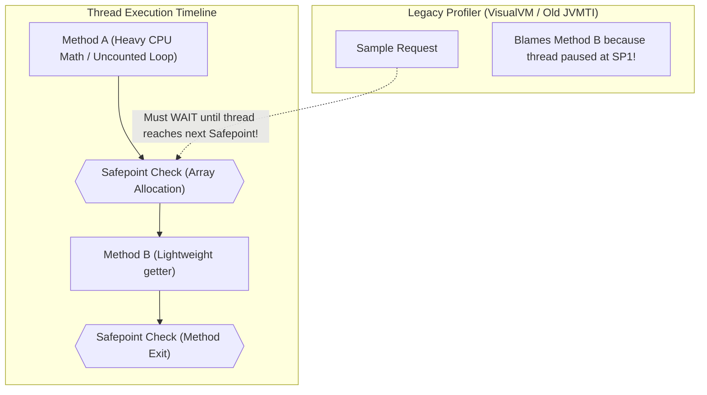
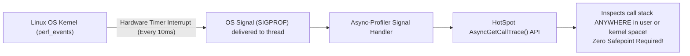
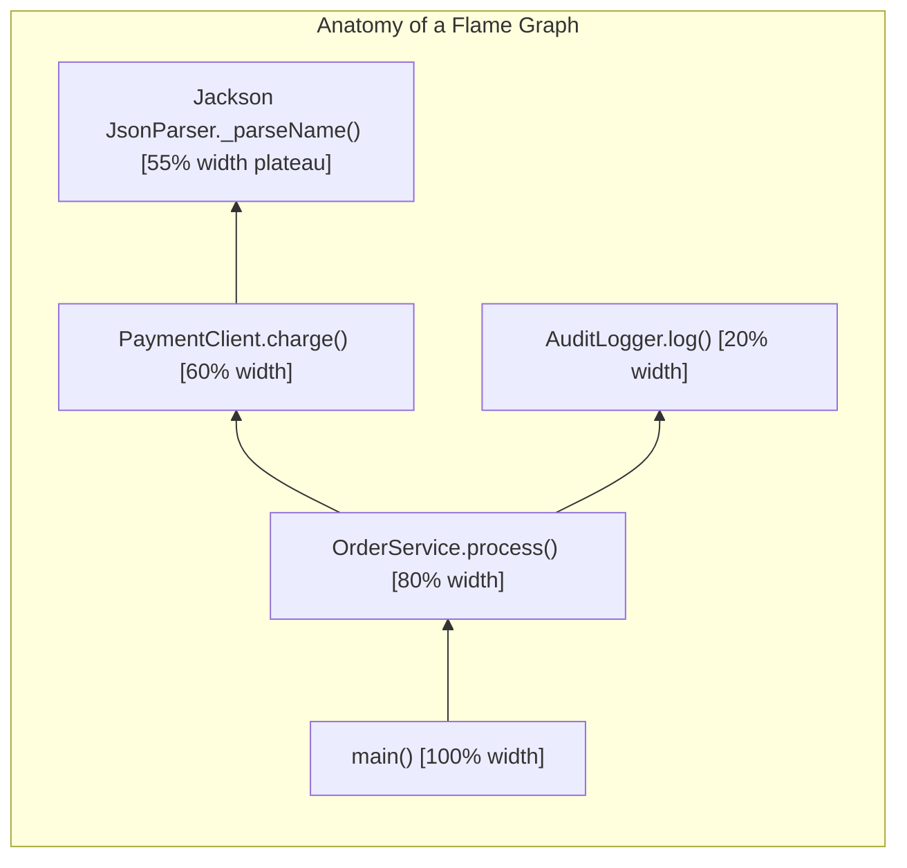
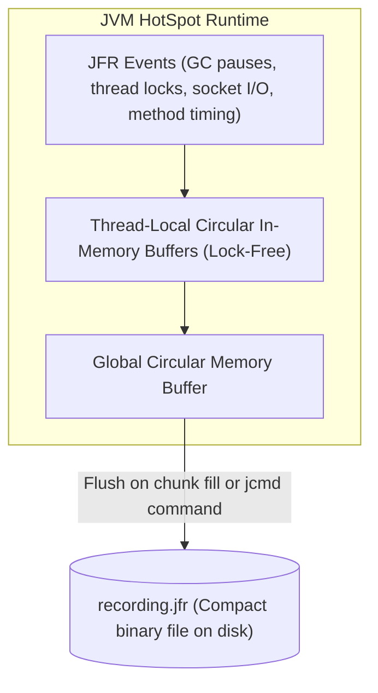
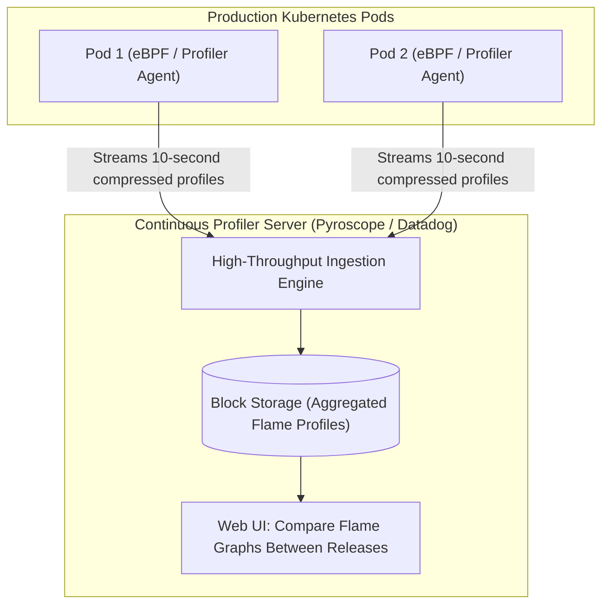

# JVM Profiling with JFR and Async-Profiler

When a production microservice spikes to 100% CPU or suffers sudden 5-second latency pauses, the standard response is often guesswork: adding log statements, tweaking garbage collection flags, or restarting the pod.

In high-throughput distributed systems, guessing is unacceptable. You must measure.

Historically, profiling a live Java application carried severe risks. Traditional profilers used **bytecode instrumentation**—injecting interceptor bytecode into every method entry and exit. This added 20% to 50% CPU overhead, radically altered execution timing, and frequently triggered cascading failures in production. Furthermore, early sampling profilers suffered from **Safepoint Bias**, producing inaccurate reports that blamed the wrong methods for CPU consumption.

Modern JVM performance engineering relies on low-overhead, sampling-based profiling engines that operate with less than 1% overhead: **JDK Flight Recorder (JFR)** and **Async-Profiler**.

In this guide, we will unpack the mechanics of safepoint bias, explore low-level sampling internals, master `jcmd` commands, generate and read CPU and allocation **Flame Graphs**, and diagnose real-world production performance incidents.

---

## The Safepoint Bias Fallacy

To understand why modern profilers exist, you must understand how legacy sampling profilers failed.

When an early profiler sampled a thread's call stack, it used the JVM Tool Interface (`Thread.getAllStackTraces()`). The HotSpot JVM cannot inspect a thread's execution stack while the thread is actively mutating registers and memory. It must pause the thread at a **Safepoint**.



### Why Safepoints Skew Results:
1. HotSpot places safepoint checks only at specific locations: compiled loop back-edges, method entries/exits, and memory allocations.
2. In tight numeric loops, vectorized array computations, or JNI calls, the JVM does not place safepoints.
3. When a legacy profiler requests a stack trace, the thread continues running through the expensive calculation and pauses **only when it reaches the next safepoint**.
4. The profiler samples the stack at the safepoint, falsely attributing 100% of the CPU consumption to the innocent method executing at that boundary.

This distortion is called **Safepoint Bias**. It has led countless engineering teams to spend weeks optimizing harmless methods while the true CPU hog went unnoticed.

---

## Async-Profiler: True Hardware-Level Profiling

**Async-Profiler** eliminates Safepoint Bias by combining the Linux kernel's hardware performance counters with an internal HotSpot API:



### The Three Profiling Modes

1. **CPU Profiling (`-e cpu`):** Samples threads using Linux `perf_events`. It profiles Java methods, JVM internal runtime code (GC, JIT compilation), and native C/C++ libraries, providing an accurate breakdown of CPU utilization.
2. **Allocation Profiling (`-e alloc`):** Intercepts memory allocations directly inside HotSpot's Thread-Local Allocation Buffers (TLAB). Instead of reporting what memory survives garbage collection (which heap dumps do), it shows **which methods are allocating memory at the highest velocity**, exposing allocation churn that causes GC pauses.
3. **Lock Contention (`-e lock`):** Tracks where threads are blocked waiting for Java monitors (`synchronized`) or `ReentrantLock` primitives, exposing concurrency bottlenecks.

---

## Generating and Interpreting Flame Graphs

Async-Profiler compiles profile samples directly into an interactive HTML **Flame Graph**:

```text
# Run a 30-second CPU profile on live PID 1042 and output an HTML flame graph
./asprof -d 30 -e cpu -f /tmp/cpu-flamegraph.html 1042
```



### How to Read a Flame Graph:
- **X-Axis (Horizontal Width):** Represents the **percentage of total samples** spent in that method. The wider a box, the more CPU or memory that method consumed. The ordering along the X-axis is alphabetical, not chronological.
- **Y-Axis (Vertical Height):** Represents **call stack depth**. Top-level callers sit at the bottom; leaf methods sit at the top.
- **The "Plateau" Rule:** When analyzing CPU bottlenecks, look for **wide, flat plateaus at the top of the graph**. If `JsonParser._parseName()` spans 55% of the total width at the top with no taller methods above it, your application is spending 55% of its total CPU time parsing JSON strings.

---

## JDK Flight Recorder (JFR): The Kernel-Level Black Box

**JDK Flight Recorder (JFR)** is an event-recording engine built directly into the HotSpot JVM kernel.

Because JFR is integrated into the JVM, it achieves an overhead of **less than 1% in production**, making it safe to leave enabled continuously on production clusters.



### JFR Event Types:
- **Instant Events:** Occur at a single point in time (e.g., Thread Start, Class Load).
- **Duration Events:** Measure start and end times (e.g., GC Phase, Socket Read, Lock Wait).
- **Sample Events:** Periodic health snapshots (e.g., Thread Dumps, CPU Load, Heap Allocation).

---

## Master Diagnostic Commands: Using `jcmd` in Production

In a containerized Kubernetes pod, you do not have a graphical UI. You control JFR from the command line using the built-in **`jcmd`** utility.

### Identify the JVM Process

```bash
jcmd
# Output:
# 1 org.springframework.boot.loader.JarLauncher
```

### Launch a Low-Overhead 5-Minute Production Recording

```bash
jcmd 1 JFR.start name=prod_incident \
  settings=profile.jfc \
  duration=300s \
  filename=/tmp/incident_profile.jfr
```

- `settings=profile.jfc`: Uses HotSpot's built-in high-detail profiling preset (includes CPU method sampling, memory allocations, and socket read/write timings).
- `duration=300s`: Automatically terminates and flushes to disk after 5 minutes.

### Dump an Active Recording Immediately

If an incident resolves earlier than anticipated, flush the in-memory circular buffer to disk on demand:

```bash
jcmd 1 JFR.dump name=prod_incident filename=/tmp/immediate_dump.jfr
```

### Copy the Artifact for Analysis

In Kubernetes, extract the recording from the pod to your local workstation:

```bash
kubectl cp my-service-pod-xyz:/tmp/immediate_dump.jfr ./incident.jfr
```

Open `incident.jfr` in **JDK Mission Control (JMC)** to visualize thread contention, garbage collection pause duration distributions, and object allocation trees.

---

## Diagnosing Real-World Production Incidents

### Incident 1: 100% CPU Runaway via Catastrophic Regex Backtracking

**Symptom:** A microservice pod CPU utilization jumps from 5% to 100% immediately following an API call with a complex string payload. Kubernetes liveness probes begin timing out.

**Investigation:**
Run Async-Profiler on the live pod:
```bash
./asprof -d 15 -f /tmp/cpu.html 1
```

**The Discovery on the Flame Graph:**
The flame graph reveals a massive plateau occupying 92% of the total width:
```text
java.util.regex.Pattern$Loop.match()
  java.util.regex.Pattern$Curly.match()
    java.util.regex.Matcher.find()
      com.javahub.validator.EmailValidator.isValid()
```

**Root Cause:** A naive regex with nested quantifiers (`^([a-zA-Z0-9]+)+$`) triggered exponential backtracking when evaluated against a non-matching 500-character string. The thread was stuck in an un-safepointed loop evaluating billions of state permutations.

### Incident 2: Hidden GC Pressure via JSON Serialization Churn

**Symptom:** Latency p99 spikes to 2,500ms every 30 seconds. CPU utilization is moderate (40%), but JVM metrics show the Young Generation garbage collector running every 1.5 seconds.

**Investigation:**
Run an Async-Profiler Allocation profile:
```bash
./asprof -d 30 -e alloc -f /tmp/alloc.html 1
```

**The Discovery on the Allocation Flame Graph:**
The width shows where memory bytes are being allocated:
```text
78% width: com.fasterxml.jackson.databind.ObjectMapper.writeValueAsBytes()
  byte[] allocations in ByteArrayBuilder
```

**Root Cause:** A logging interceptor was serializing full 5 MB domain payloads to JSON strings on every request for debug logging, generating 8 GB of garbage per minute. The fix was removing the serialization interceptor, instantly dropping p99 latency from 2,500ms to 12ms.

---

## Continuous Profiling in Kubernetes

Taking manual snapshots with `jcmd` works during active investigations, but transient latency spikes that occur at 3:00 AM and vanish before on-call engineers wake up require **Continuous Profiling**.



Continuous profiling agents (such as **Pyroscope**, **Datadog Continuous Profiler**, or **Grafana Phlare**) run continuously in the background with negligible overhead (< 1% CPU). 

They slice profiling data into 10-second chunks and upload them to a centralized storage cluster. Engineers can select any time window in the past 30 days and view an aggregated Flame Graph for that exact second, or execute a **Diff Flame Graph** comparing CPU profiles before and after a production deployment.

---

## Senior Engineer Interview Crucible

### What is Safepoint Bias in JVM profiling, and how does Async-Profiler eliminate it using `AsyncGetCallTrace` and `perf_events`?

**Safepoint Bias** is an artifact of legacy JVM profiling where stack traces can only be collected when threads reach a JVM Safepoint (such as loop back-edges, method returns, or memory allocations). In computationally intensive methods without safepoints (like tight uncounted numeric loops or JNI calls), the thread cannot pause. When a legacy profiler samples the thread, it is forced to wait until the thread reaches the next safepoint, artificially inflating the sample count of whatever method happens to execute at that safepoint boundary.

**How Async-Profiler Eliminates It:**
Async-Profiler hooks into the Linux kernel's **`perf_events`** subsystem, scheduling hardware timer interrupts that fire an operating system signal (`SIGPROF`) directly to the target thread. When the signal arrives, the thread pauses immediately **at its current instruction**, regardless of whether it is at a safepoint. 

The signal handler invokes HotSpot's internal, non-blocking **`AsyncGetCallTrace()`** API to read the call stack directly from register state and native frame pointers. This delivers a mathematically accurate profile across both Java code and native kernel/C++ libraries.

---

### Contrast CPU profiling with Allocation profiling. Why is allocation profiling often more valuable for diagnosing JVM latency spikes?

- **CPU Profiling (`-e cpu`):** Samples where execution threads spend CPU clock cycles. It excels at identifying algorithmic bottlenecks (tight loops, cryptographic hashing, regex backtracking).
- **Allocation Profiling (`-e alloc`):** Intercepts memory allocations directly inside HotSpot's Thread-Local Allocation Buffers (TLABs). It tracks **where and how fast objects are being allocated in heap memory**.

**Why Allocation Profiling is Often More Valuable:**
In modern Java web services, high p99 latency spikes are rarely caused by raw CPU-bound mathematics. Instead, they are caused by **Garbage Collection Stop-The-World (STW) pauses**. When a microservice allocates memory at an extreme velocity (e.g., creating temporary JSON strings, byte arrays, or defensive defensive object copies), the Young Generation fills up in fractions of a second, triggering frequent minor and major GC pauses. 

A CPU profile might show GC worker threads consuming CPU, but it cannot tell you *which business method* created the garbage. An Allocation Profile points directly to the exact application method generating the memory churn, allowing engineers to eliminate temporary allocations and eradicate GC pauses.

---

### Walk through how to interpret a Flame Graph. What do the width of a box and the vertical stack height represent?

In a Flame Graph:
- **Horizontal Width (X-Axis):** Represents the proportion of total samples spent within that method across the entire profiling session. The wider the box, the greater its resource consumption (CPU time or allocated bytes). The horizontal ordering is alphabetical by package/method name to aggregate identical call stacks; it does **not** represent time.
- **Vertical Stack Height (Y-Axis):** Represents call stack depth. The base caller method (e.g., `main()` or Netty worker loop) is at the bottom, and subsequent nested method invocations stack upwards. The leaf method currently executing at the sample instant is at the top.
- **The "Plateau" Concept:** To find bottlenecks, scan the top edge of the flame graph for **wide, flat plateaus**. A method that has a wide horizontal span with no other methods stacked on top of it is directly responsible for consuming that percentage of the resource. If a method is wide but has tall children, the resource consumption is inside the children, not the parent.

---

### How does JDK Flight Recorder maintain less than 1% runtime overhead in production, and how do you trigger a 60-second JFR dump using `jcmd` in a live Kubernetes pod?

JDK Flight Recorder (JFR) achieves sub-1% overhead through tight integration with the HotSpot JVM kernel:
1. **Thread-Local Ring Buffers:** JFR events are written to thread-local, lock-free circular memory buffers, eliminating thread contention.
2. **Binary Encodings and String Pools:** Numerical data is encoded using compact Varints, and strings are interned in an internal pool to prevent string duplication.
3. **No safepoint requirements:** JFR collects JVM internal events (GC phases, lock durations, socket I/O) directly at the native HotSpot layer without triggering global thread stops.

**Triggering a 60-second JFR Dump via `jcmd` in Kubernetes:**
Execute into the pod and use `jcmd`:

```bash
# Step A: Trigger the 60-second recording
kubectl exec -it order-service-pod-xyz -- \
  jcmd 1 JFR.start name=incident_profile \
  settings=profile.jfc \
  duration=60s \
  filename=/tmp/incident.jfr

# Step B: After 60 seconds elapses, copy the file to local workstation
kubectl cp order-service-pod-xyz:/tmp/incident.jfr ./incident.jfr
```
