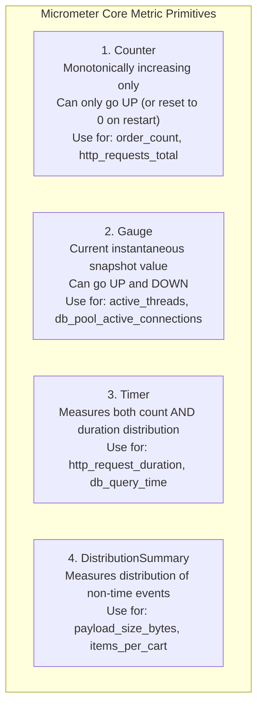
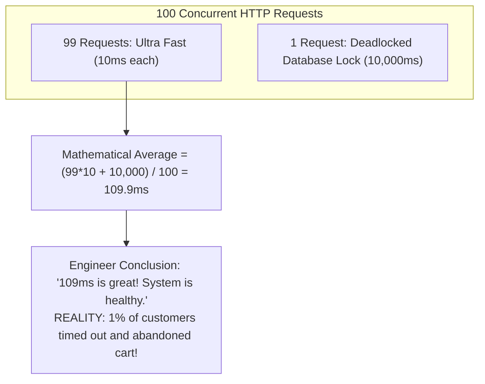
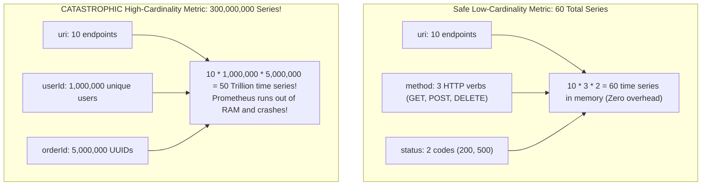
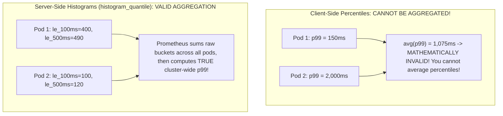

# Production Metrics with Micrometer and Prometheus

When an incident strikes production, the speed at which your engineering team detects, triages, and recovers from the failure determines whether you meet your Service Level Objectives (SLOs) or violate contractual SLAs.

In early architectures, engineers rely on application logs:
- When a service slows down, developers grep through 80 gigabytes of log lines searching for `"ERROR"`.
- To answer a basic business question—*"What was our p99 checkout latency over the last 15 minutes?"*—they must write heavy log aggregation queries that take 45 seconds to scan terabytes of text.

Logs are indispensable for debugging specific discrete events, but they are fundamentally unsuited for real-time alerting and aggregate performance monitoring.

The bedrock of cloud-native observability is **Metrics**: low-overhead, numerical time-series measurements collected and aggregated at high frequency.

In the Java ecosystem, **Micrometer** is the universal dimensional instrumentation facade (the "SLF4J of metrics"), and **Prometheus** is the industry-standard time-series database and alerting engine. In this guide, we will explore the core metric primitives, avoid the catastrophic cardinality explosion trap, write custom business telemetry in Spring Boot 3, and craft high-signal PromQL alerts.

---

## The Four Core Metric Primitives in Micrometer

Understanding which metric primitive to choose is essential for accurate telemetry:



### Counter
A **Counter** is a cumulative metric that represents a single monotonically increasing number. It can only increase or reset to zero upon process restart.
- **Rule of Thumb:** Never use a counter for values that can decrease (like active connections or cache size).
- **In PromQL:** Always apply the `rate()` or `increase()` function to counters to calculate per-second frequency:
  ```promql
  rate(http_server_requests_seconds_count[5m])
  ```

### Gauge
A **Gauge** represents an instantaneous snapshot of a variable that can fluctuate up and down.
- **Rule of Thumb:** Gauges are sampled at the moment Prometheus scrapes the endpoint. Any spikes or drops that occur between scrape intervals (e.g., within the 15-second scrape window) are completely invisible.
- **Use Cases:** Current JVM heap usage, active thread count, database connection pool utilization.

### Timer
A **Timer** measures both short-duration event latencies and their frequency simultaneously. It tracks:
- Total count of events
- Total cumulative time spent
- Max duration observed within the current interval
- Percentiles and histogram buckets for latency distributions

### DistributionSummary
Tracks the statistical distribution of values that are not time-based (e.g., the size of uploaded files in bytes, the number of line items in shopping carts).

---

## Why Averages Lie: The Mathematics of Latency (p99 vs Average)

The most common operational mistake made by junior engineers is monitoring **Average Response Time**:



Mathematical averages hide outliers. In distributed systems with microservice call graphs spanning 10 services, a user request touches dozens of components. If each component has a 1% chance of an outlier delay, **more than 10% of end-user requests experience severe degradation**.

To observe true user experience, you must measure **Percentiles**:
- **p50 (Median):** The latency experienced by the 50th percentile of users. Half of requests were faster, half were slower.
- **p95:** The latency threshold below which 95% of requests completed.
- **p99:** The latency experienced by the slowest 1% of requests. This exposes garbage collection pauses, database lock contention, and thread pool starvation.

---

## The High Cardinality Hazard: How Bad Labels Crash Prometheus

In Micrometer and Prometheus, metrics are multidimensional. You attach key-value tags (labels) to differentiate measurements:

```text
http_server_requests_seconds_count{method="POST", uri="/api/v1/orders", status="200"}
```

### What is Cardinality?

**Cardinality** is the total number of unique time series generated by multiplying all possible values of every label attached to a metric.



### The Golden Cardinality Law:
> **Never use unbounded, high-cardinality values as metric tags!**
> Never add `userId`, `orderId`, `email`, `timestamp`, or `uuid` as a Prometheus label. Every unique label combination creates an entirely new physical time series in Prometheus's memory and disk-backed time-series database (TSDB). Adding a UUID tag to a high-throughput endpoint will allocate millions of series, causing Prometheus to exhaust RAM and crash.
> 
> *If you need to trace an individual transaction by `orderId` or `userId`, use **Distributed Tracing (OpenTelemetry)** or **Structured Logs**, never Metrics.*

---

## Spring Boot 3 Actuator and Prometheus Integration

Let's configure a production telemetry pipeline in Spring Boot 3.

### Step 1: Maven Dependencies

```xml
<dependencies>
    <!-- Spring Boot Actuator Core -->
    <dependency>
        <groupId>org.springframework.boot</groupId>
        <artifactId>spring-boot-starter-actuator</artifactId>
    </dependency>
    <!-- Micrometer Prometheus Exporter Registry -->
    <dependency>
        <groupId>io.micrometer</groupId>
        <artifactId>micrometer-registry-prometheus</artifactId>
    </dependency>
</dependencies>
```

### Step 2: Application Configuration (`application.yml`)

```yaml
management:
  endpoints:
    web:
      exposure:
        include: health,info,prometheus,metrics
      base-path: /actuator
  endpoint:
    health:
      show-details: when_authorized
      probes:
        enabled: true # Enables /actuator/health/liveness and readiness
    prometheus:
      enabled: true
  metrics:
    tags:
      # Common dimensional tags attached to every single metric emitted by this microservice
      application: ${spring.application.name:order-service}
      environment: ${ENVIRONMENT:production}
      region: ${AWS_REGION:us-east-1}
    distribution:
      # Enable server-side histogram generation for HTTP requests
      percentiles-histogram:
        http.server.requests: true
      # Configure explicit SLA buckets for precise latency evaluation
      sla:
        http.server.requests: 50ms, 100ms, 250ms, 500ms, 1000ms, 2500ms
```

---

## Writing Production Custom Metrics in Java

Let's build a dedicated telemetry service tracking business transactions, payment gateway execution times, and inventory reservation gauges.

```java
package com.javahub.observability.metrics;

import io.micrometer.core.instrument.Counter;
import io.micrometer.core.instrument.DistributionSummary;
import io.micrometer.core.instrument.Gauge;
import io.micrometer.core.instrument.MeterRegistry;
import io.micrometer.core.instrument.Timer;
import org.springframework.stereotype.Component;

import java.time.Duration;
import java.util.concurrent.atomic.AtomicInteger;

@Component
public class OrderBusinessMetrics {

    private final MeterRegistry registry;

    // 1. Counters
    private final Counter ordersPlacedCounter;
    private final Counter paymentFailuresCounter;

    // 2. Timer with Percentiles
    private final Timer paymentProcessingTimer;

    // 3. Distribution Summary (Order monetary value distribution)
    private final DistributionSummary orderValueSummary;

    // 4. Gauge State Tracker
    private final AtomicInteger activeCheckoutSessions = new AtomicInteger(0);

    public OrderBusinessMetrics(MeterRegistry registry) {
        this.registry = registry;

        // Counter: Track total orders placed by payment method
        this.ordersPlacedCounter = Counter.builder("fintech.orders.placed.total")
                .description("Total number of successfully placed checkout orders")
                .tag("currency", "USD")
                .register(registry);

        this.paymentFailuresCounter = Counter.builder("fintech.payments.failed.total")
                .description("Total number of rejected or failed payment authorizations")
                .register(registry);

        // Timer: Measures payment gateway latency with server-side histogram buckets
        this.paymentProcessingTimer = Timer.builder("fintech.payment.processing.duration")
                .description("Latency distribution of external payment gateway network calls")
                .publishPercentileHistogram()
                .minimumExpectedValue(Duration.ofMillis(20))
                .maximumExpectedValue(Duration.ofSeconds(10))
                .register(registry);

        // DistributionSummary: Measures distribution of order cart sizes in dollars
        this.orderValueSummary = DistributionSummary.builder("fintech.orders.cart.amount")
                .description("Monetary value distribution of checkout carts")
                .baseUnit("dollars")
                .maximumExpectedValue(10000.0)
                .register(registry);

        // Gauge: Tracks live active browser checkouts currently in progress
        Gauge.builder("fintech.checkouts.active.count", activeCheckoutSessions, AtomicInteger::get)
                .description("Current number of active customer checkout sessions in progress")
                .register(registry);
    }

    public void recordOrderPlaced(double totalAmount) {
        ordersPlacedCounter.increment();
        orderValueSummary.record(totalAmount);
    }

    public void recordPaymentFailure(String reason) {
        // Safe low-cardinality tag (limited to known enum strings)
        registry.counter("fintech.payments.failed.total", "reason", reason).increment();
    }

    public <T> T recordPaymentDuration(java.util.function.Supplier<T> operation) {
        return paymentProcessingTimer.record(operation);
    }

    public void incrementActiveCheckouts() {
        activeCheckoutSessions.incrementAndGet();
    }

    public void decrementActiveCheckouts() {
        activeCheckoutSessions.decrementAndGet();
    }
}
```

---

## The Percentile Dilemma: Client Percentiles vs Histogram Quantiles

When configuring timers in Micrometer, you have two choices for percentiles:
1. **Client-Side Percentiles (`.publishPercentiles(0.99)`):** The Java microservice computes the 99th percentile locally in memory using the HdrHistogram algorithm and exports a gauge named `my_timer{quantile="0.99"}`.
2. **Server-Side Histogram Buckets (`.publishPercentileHistogram()`):** The microservice exports raw counts partitioned into cumulative buckets (`my_timer_bucket{le="100ms"} 450`). Prometheus calculates the percentile across the cluster using the `histogram_quantile()` function.



> **The Architectural Rule:**
> **Never average client-side percentiles.** It is mathematically meaningless to take the average of 10 pod percentiles (`avg(http_server_requests_seconds{quantile="0.99"})`). 
> In Kubernetes environments with multiple pods, always configure **`publishPercentileHistogram()`** and compute percentiles centrally in Prometheus using `histogram_quantile()`.

---

## Essential PromQL Queries and Alerting Rules

Here are production-ready PromQL queries and Prometheus alert definitions based on the **RED (Rate, Errors, Duration)** methodology:

### HTTP Request Rate (Throughput)

```promql
# Measures total HTTP requests per second by URI over a 5-minute sliding window
sum(rate(http_server_requests_seconds_count{application="order-service"}[5m])) by (uri)
```

### HTTP Error Rate Percentage

```promql
# Calculates the percentage of HTTP requests returning 5xx server errors
(
  sum(rate(http_server_requests_seconds_count{application="order-service", status=~"5.."}[5m]))
  /
  sum(rate(http_server_requests_seconds_count{application="order-service"}[5m]))
) * 100
```

### Cluster-Wide p99 Latency via `histogram_quantile`

```promql
# Calculates the true cluster-wide 99th percentile latency across all pods
histogram_quantile(
  0.99,
  sum(rate(http_server_requests_seconds_bucket{application="order-service", uri="/api/v1/orders"}[5m])) by (le)
)
```

### Production Alerting Rule (`alerts.yml`)

```yaml
groups:
  - name: order_service_alerts
    rules:
      - alert: HighHttpErrorRate
        expr: |
          (
            sum(rate(http_server_requests_seconds_count{application="order-service", status=~"5.."}[5m]))
            /
            sum(rate(http_server_requests_seconds_count{application="order-service"}[5m]))
          ) * 100 > 5.0
        for: 2m
        labels:
          severity: critical
        annotations:
          summary: "Order Service high error rate: {{ $value | printf \"%.2f\" }}%"
          description: "Over 5% of all HTTP requests in the last 2 minutes are returning 5xx server errors."

      - alert: HighLatencyP99
        expr: |
          histogram_quantile(
            0.99,
            sum(rate(http_server_requests_seconds_bucket{application="order-service", uri="/api/v1/orders"}[5m])) by (le)
          ) > 1.5
        for: 3m
        labels:
          severity: warning
        annotations:
          summary: "Order Service checkout p99 latency exceeds 1.5 seconds"
          description: "99th percentile response time for /api/v1/orders is {{ $value | printf \"%.2f\" }}s."
```

---

## Senior Engineer Interview Crucible

### Why does calculating average response latency (`avg()`) provide misleading data in production, and how do Histograms and Percentiles (`p99`) expose true user experience?

Mathematical averages are heavily skewed by normal distributions and fail to capture bimodal or long-tail behavior. 

In a system processing 10,000 requests per minute:
- If 9,900 requests take 10ms, and 100 requests deadlock on a database lock and take 30,000ms (30 seconds).
- The arithmetic average response time is `(9900 * 10ms + 100 * 30000ms) / 10000 = 309ms`.
- A dashboard showing an average of 309ms looks completely healthy to an operator.

However, in reality, **1% of your customers are experiencing a 30-second timeout**, failing their transactions and churning.

**How Histograms and Percentiles Solve This:**
A **Percentile** ranks all measured durations in ascending order. The **99th percentile (p99)** reports the boundary value below which 99% of observations fall. In the scenario above, the p99 metric immediately reports **30,000ms**, triggering critical alerts and exposing thread pool starvation, slow database queries, or GC pauses that arithmetic averages completely conceal.

---

### What is the Cardinality Explosion problem in Prometheus, and why must identifiers like `user_id` or `uuid` never be added as metric tags/labels?

Prometheus stores time series data inside an internal inverted index. A distinct **time series** is defined by the unique combination of the metric name and all key-value label pairs.

**The Explosion Mechanism:**
If you instrument an endpoint with tags:
- `http_requests_total{method="POST", uri="/orders", user_id="12345", order_id="8c1995cb-..."}`
- If you have 500,000 active users creating 2,000,000 orders per day, you create **millions of new, distinct time series** within a 24-hour period.

Each time series consumes persistent memory in the Prometheus active chunk index and disk space in the TSDB block chunks. As cardinality explodes:
1. Prometheus memory consumption surges into tens of gigabytes, leading to continuous Out-Of-Memory (OOM) crashes.
2. Query execution times degrade from milliseconds to minutes, breaking alerting rules and Grafana dashboards.
3. Once the TSDB index saturates, Prometheus halts entirely.

**Rule:** Metric labels must always have bounded, low cardinality (e.g., HTTP status codes, method verbs, regions, customer tiers). High-cardinality debugging attributes belong in distributed traces (OpenTelemetry) or logs, never in metric labels.

---

### Contrast a Counter and a Gauge in Micrometer. Why should an active queue size never be tracked using a Counter?

- **Counter:** A cumulative metric representing a monotonically increasing value. It can only increase or be reset to zero upon process restart. Counters are designed to measure **the rate or volume of occurrences over time** (e.g., total requests handled, total bytes transferred, total errors thrown).
- **Gauge:** Represents an instantaneous, point-in-time snapshot of an arbitrary value that can increase or decrease dynamically (e.g., current queue size, active thread count, CPU temperature).

**Why Active Queue Size Cannot Use a Counter:**
An active queue size naturally fluctuates as messages are enqueued and dequeued. If you attempted to use a counter, you could increment it when a message enters the queue, but counters have no API to decrement values. Furthermore, mathematical operations applied to counters in Prometheus (such as `rate()`) compute the per-second rate of increase; applying `rate()` to an active queue counter would calculate how fast the queue is filling up, not how many messages currently sit in the queue. Active queues must always be tracked via a **Gauge** backed by an `AtomicInteger` or `queue.size()`.

---

### Explain the difference between client-side calculated percentiles and server-side Prometheus histogram buckets (`histogram_quantile`). Which one is safe for multi-pod aggregations?

- **Client-Side Percentiles (`.publishPercentiles(0.99)`):** The individual microservice computes the 99th percentile locally in its own JVM memory using an internal data structure (like HdrHistogram) and exports a gauge `http_requests_seconds{quantile="0.99"} 0.250`.
  - *The Mathematical Flaw:* **You cannot aggregate percentiles across nodes.** If Pod 1 reports p99 = 100ms and Pod 2 reports p99 = 2,000ms, running `avg()`, `sum()`, or `max()` in PromQL yields mathematically invalid numbers that do not represent the true cluster-wide 99th percentile.
- **Server-Side Histogram Buckets (`.publishPercentileHistogram()`):** The microservice exports raw, cumulative count buckets representing ranges of duration (e.g., `le="0.1"`, `le="0.5"`, `le="1.0"`, `le="+Inf"`).
  - *The Power of Buckets:* Cumulative bucket counts **can be mathematically summed across any number of pods**.

In PromQL:
```promql
histogram_quantile(0.99, sum(rate(http_requests_seconds_bucket[5m])) by (le))
```
Prometheus sums the raw bucket counts across all 20 running pods first, and then calculates the true cluster-wide 99th percentile using linear interpolation across the aggregated histogram buckets. In multi-pod cloud environments, **always use server-side histogram buckets**.
