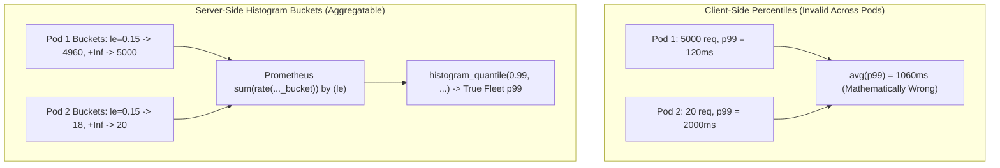

Logs are essential when you need to inspect why one specific order failed, but they are the wrong tool for real-time alerting and capacity planning. Scanning gigabytes of JSON log lines every minute to compute p99 latency or error ratios burns CPU and introduces alerting lag right when you need fast feedback.

Metrics solve that problem by aggregating numeric measurements inside the application and exposing them as lightweight time series. In Java and Spring Boot 3, **Micrometer** provides the vendor-neutral instrumentation API, **Prometheus** scrapes and stores those time series while evaluating alerting rules, and **Grafana** turns PromQL queries into operational dashboards. Getting this stack right in production requires more than adding a dependency: you have to pick the right meter types, understand why averages and client-side percentiles mislead, guard against cardinality explosions, and tie alerts to user-facing SLOs instead of arbitrary CPU thresholds.

## Micrometer Meters: Counter, Gauge, Timer, and DistributionSummary

Micrometer revolves around four core meter primitives. Picking the wrong primitive produces charts that look plausible until an incident exposes that they were measuring the wrong thing.

| Meter Type | Behavior | Prometheus Exported Shape | Typical Uses |
| :--- | :--- | :--- | :--- |
| **Counter** | Monotonically increasing only (resets to 0 on JVM restart) | `*_total` | Completed orders, HTTP requests, failed payments, Kafka messages consumed |
| **Gauge** | Instantaneous snapshot that goes up and down | Single float value | Active DB connections, JVM heap used, in-flight checkouts, queue depth |
| **Timer** | Count, total time, max, and optional latency histogram buckets | `*_seconds_count`, `*_seconds_sum`, `*_seconds_max`, `*_seconds_bucket` | HTTP request latency, SQL query duration, external API calls |
| **DistributionSummary** | Distribution of non-time numeric values | `*_count`, `*_sum`, `*_max`, `*_bucket` | Request payload bytes, items per cart, batch sizes |

### Counter

A `Counter` tracks how many times an event happened. It can only move upward (or reset to zero when a pod restarts). Never use a counter for values that decrease, such as active connections or queue depth. In PromQL, raw counter values are rarely useful on their own; wrap them in `rate()` or `increase()`, which automatically account for counter resets across pod restarts.

### Gauge and the Weak-Reference GC Trap

A `Gauge` reports the current value of something at the exact moment Prometheus scrapes `/actuator/prometheus`. Keep two caveats in mind:

1. **Scrape blind spots:** If Prometheus scrapes every 15 seconds, a 2-second queue spike that drains between scrapes never appears on the graph.
2. **Weak references by default:** Micrometer holds a `WeakReference` to the object passed into `Gauge.builder(name, stateObject, valueFunction)` so registering a gauge does not cause a memory leak if the object is later discarded. If you pass a newly created object that nothing else strongly references, the garbage collector collects it and the gauge silently starts reporting `NaN`.

```java
// Bad: the new ArrayList is unreferenced outside the gauge and gets GC'd -> reports NaN
Gauge.builder("orders.pending.queue", new ArrayList<String>(), List::size)
        .register(registry);

// Good: hold a strong reference in a field on a long-lived Spring bean
private final AtomicInteger activeCheckouts = new AtomicInteger(0);

Gauge.builder("fintech.checkouts.active", activeCheckouts, AtomicInteger::get)
        .description("In-flight checkout sessions on this instance")
        .register(registry);
```

### Timer and LongTaskTimer

A `Timer` measures short-duration operations and tracks both event count and duration distribution. Spring Boot automatically registers `http.server.requests` as a `Timer` for incoming HTTP calls. Note that a normal `Timer` records an event only *after* it finishes; if a nightly batch job hangs for 40 minutes, a standard `Timer` shows nothing until the job completes or times out. For long-running tasks where you need visibility while the work is still in flight, use `LongTaskTimer`.

### DistributionSummary

A `DistributionSummary` is the non-time equivalent of a `Timer`. Use it when you care about the spread of sizes or amounts (such as order values, message sizes in bytes, or rows processed per batch) rather than just the sum.

### Spring Boot 3 Setup and Custom Business Metrics

Add Spring Boot Actuator and the Prometheus registry in `pom.xml`:

```xml
<dependencies>
    <dependency>
        <groupId>org.springframework.boot</groupId>
        <artifactId>spring-boot-starter-actuator</artifactId>
    </dependency>
    <dependency>
        <groupId>io.micrometer</groupId>
        <artifactId>micrometer-registry-prometheus</artifactId>
    </dependency>
</dependencies>
```

Configure Actuator exposure, common tags, and server-side histogram buckets in `application.yml`. Notice that Spring Boot 3 uses `slo` (replacing the older `sla` property) to define explicit histogram bucket boundaries aligned with your latency targets:

```yaml
management:
  server:
    # Serve Actuator on an internal port so /actuator/prometheus is not exposed on public ingress
    port: 8081
  endpoints:
    web:
      exposure:
        include: health,info,prometheus
  endpoint:
    health:
      probes:
        enabled: true
  metrics:
    tags:
      application: ${spring.application.name:order-service}
      environment: ${APP_ENV:production}
    distribution:
      percentiles-histogram:
        http.server.requests: true
      slo:
        http.server.requests: 50ms, 100ms, 250ms, 500ms, 1s, 2.5s
```

Here is a Spring component registering all four meter types cleanly while keeping tag cardinality bounded:

```java
package com.example.orders.metrics;

import io.micrometer.core.instrument.Counter;
import io.micrometer.core.instrument.DistributionSummary;
import io.micrometer.core.instrument.Gauge;
import io.micrometer.core.instrument.MeterRegistry;
import io.micrometer.core.instrument.Timer;
import org.springframework.stereotype.Component;

import java.time.Duration;
import java.util.concurrent.atomic.AtomicInteger;
import java.util.function.Supplier;

@Component
public class OrderMetrics {

    public enum PaymentFailureReason {
        INSUFFICIENT_FUNDS, TIMEOUT, FRAUD_DECLINED, GATEWAY_ERROR
    }

    private final MeterRegistry registry;
    private final Counter ordersPlaced;
    private final Timer paymentLatency;
    private final DistributionSummary cartAmountSummary;
    private final AtomicInteger activeCheckouts = new AtomicInteger(0);

    public OrderMetrics(MeterRegistry registry) {
        this.registry = registry;

        this.ordersPlaced = Counter.builder("orders.placed")
                .description("Total successfully placed orders")
                .register(registry);

        this.paymentLatency = Timer.builder("payment.gateway.duration")
                .description("External payment gateway call latency")
                .publishPercentileHistogram()
                .serviceLevelObjectives(
                        Duration.ofMillis(50),
                        Duration.ofMillis(150),
                        Duration.ofMillis(300),
                        Duration.ofSeconds(1),
                        Duration.ofSeconds(3)
                )
                .minimumExpectedValue(Duration.ofMillis(10))
                .maximumExpectedValue(Duration.ofSeconds(10))
                .register(registry);

        this.cartAmountSummary = DistributionSummary.builder("orders.cart.amount")
                .description("Distribution of checkout cart values")
                .baseUnit("usd")
                .publishPercentileHistogram()
                .serviceLevelObjectives(25, 100, 500, 2000)
                .register(registry);

        Gauge.builder("orders.checkouts.active", activeCheckouts, AtomicInteger::get)
                .description("Current in-flight checkout sessions")
                .register(registry);
    }

    public void recordOrderPlaced(double amountUsd) {
        ordersPlaced.increment();
        cartAmountSummary.record(amountUsd);
    }

    public void recordPaymentFailure(PaymentFailureReason reason) {
        // Enum restricts tag cardinality to 4 known values
        Counter.builder("payment.gateway.failures")
                .tag("reason", reason.name())
                .register(registry)
                .increment();
    }

    public <T> T timePaymentCall(Supplier<T> call) {
        return paymentLatency.record(call);
    }

    public void checkoutStarted() {
        activeCheckouts.incrementAndGet();
    }

    public void checkoutFinished() {
        activeCheckouts.decrementAndGet();
    }
}
```

## Why Averages Mislead and Why Client Percentiles Cannot Be Aggregated

Arithmetic mean hides tail latency. Suppose 100 checkout requests arrive: 99 finish in 10 ms, and 1 blocks on a database row lock for 10,000 ms. The average latency is `(99 * 10 + 10,000) / 100 = 109.9 ms`. A dashboard showing a 110 ms average looks healthy while 1% of customers hit a 10-second stall. In a microservice architecture where one user action fans out to 10 backend calls, a 1% slow rate on each hop means roughly `1 - 0.99^10 = 9.6%` of end-user requests hit at least one slow hop.

Tracking percentiles (p50, p95, p99) exposes that tail, but **how** you compute percentiles matters in a multi-pod Kubernetes deployment:

- **Client-side percentiles (`.publishPercentiles(0.95, 0.99)`):** Each JVM computes quantiles locally in memory and exports gauges like `payment_gateway_duration_seconds{quantile="0.99"}`. You **cannot aggregate these across pods**. Taking `avg()` or `max()` of per-pod p99 values does not produce the cluster-wide p99, especially when one pod handled 5,000 requests and a freshly scaled pod handled 12.
- **Server-side histogram buckets (`.publishPercentileHistogram()`):** Each pod exports cumulative counters per bucket (`le="0.05"`, `le="0.15"`, `le="0.3"`, `le="+Inf"`). Because bucket counts are additive, Prometheus can sum them across all pods first and then compute the cluster-wide quantile with `histogram_quantile()`.



Classic Prometheus histograms create one time series per bucket per label combination, so enabling `publishPercentileHistogram()` without bounds can generate 50+ buckets per series. Always set `minimumExpectedValue`, `maximumExpectedValue`, or explicit `serviceLevelObjectives` buckets to control bucket count. Modern Prometheus (2.40+ experimental, Prometheus 3.x+) and recent Micrometer Prometheus releases also support **Native Histograms**, which encode sparse exponential buckets inside a single time series, giving accurate quantiles without manually tuning static bucket boundaries.

## Prometheus Scraping and Cardinality Explosion Prevention

Prometheus uses a **pull model**: instead of services pushing metrics over UDP or HTTP, Prometheus discovers pods (via Kubernetes annotations or a Prometheus Operator `ServiceMonitor`) and sends `GET /actuator/prometheus` every 15 to 30 seconds. Pull-based scraping automatically tells Prometheus when a pod is unreachable (`up == 0`) and keeps the application from buffering metrics if the monitoring backend goes down.

Because Prometheus indexes every unique `(metric_name, label_1=val_1, label_2=val_2, ...)` tuple in its TSDB head block in RAM, **cardinality** is the primary operational risk:

```text
Total Series = count(uri) * count(method) * count(status) * count(pod)
```

With 20 route templates, 4 HTTP methods, 5 status codes, and 10 pods, `http_server_requests_seconds_count` produces `20 * 4 * 5 * 10 = 4,000` series, which is trivial for Prometheus. Add a single unbounded label like `userId` (500,000 values) or a raw URI path (`/orders/984123` instead of `/orders/{id}`), and you jump into millions of active series. Head block memory spikes, scrape durations climb past timeouts, PromQL queries stall, and Prometheus crashes with OOMKilled.

### Defensive Cardinality Guardrails with `MeterFilter`

Code reviews catch many bad tags, but a single bug in a third-party client or a forgotten route template can still flood Prometheus. In Spring Boot, register a `MeterFilter` bean using `MeterFilter.maximumAllowableTags(...)` to enforce a hard upper bound inside the application before bad series ever leave the JVM:

```java
package com.example.orders.metrics;

import io.micrometer.core.instrument.Meter;
import io.micrometer.core.instrument.config.MeterFilter;
import org.slf4j.Logger;
import org.slf4j.LoggerFactory;
import org.springframework.context.annotation.Bean;
import org.springframework.context.annotation.Configuration;

import java.util.concurrent.atomic.AtomicBoolean;

@Configuration
public class MetricsGuardrailConfig {

    private static final Logger log = LoggerFactory.getLogger(MetricsGuardrailConfig.class);

    @Bean
    public MeterFilter limitUriCardinality() {
        AtomicBoolean warned = new AtomicBoolean(false);
        return MeterFilter.maximumAllowableTags(
                "http.server.requests",
                "uri",
                100,
                new MeterFilter() {
                    @Override
                    public MeterFilterReply accept(Meter.Id id) {
                        if (warned.compareAndSet(false, true)) {
                            log.warn("Dropped http.server.requests metric after exceeding 100 unique URI tags: {}",
                                    id.getTag("uri"));
                        }
                        return MeterFilterReply.DENY;
                    }
                }
        );
    }

    @Bean
    public MeterFilter denyHighNoiseActuatorMetrics() {
        // Drop scrape metrics for /actuator/** endpoints so monitoring traffic does not skew app SLIs
        return MeterFilter.deny(id -> {
            String uri = id.getTag("uri");
            return uri != null && uri.startsWith("/actuator");
        });
    }
}
```

With this filter in place, if someone accidentally exposes an unparameterized URL or a scanner hits thousands of random paths that bypass 404 normalization, Micrometer caps the `uri` tag at 100 values and logs a warning instead of taking down your Prometheus server.

## Defining Production SLOs, SLIs, and Error Budgets

Collecting metrics does not improve reliability on its own. Without clear reliability targets, teams either alert on noisy infrastructure symptoms ("CPU > 80%") that cause alert fatigue, or only discover broken checkouts when support tickets arrive.

Site Reliability Engineering structures reliability around three definitions:

- **SLI (Service Level Indicator):** A quantitative ratio measuring user-facing behavior over time: `good events / valid total events`. Examples: proportion of valid HTTP requests returning non-5xx responses, or proportion of checkout requests finishing under 300 ms.
- **SLO (Service Level Objective):** The internal reliability target for an SLI over a rolling window, such as "99.9% of checkout requests succeed over any rolling 30-day window."
- **SLA (Service Level Agreement):** An external contract with customers that carries penalties or service credits when breached. Your internal SLO should always be stricter than your SLA (for example, 99.95% SLO protecting a 99.9% SLA) so you react before breaking a contract.

### Error Budgets in Practice

The **Error Budget** is simply `1 - SLO`. It quantifies how much unreliability a service can afford over its compliance window before reliability work must take priority over feature launches.

| 30-Day SLO Target | Error Budget Ratio | Allowed Downtime / 100% Outage Equivalent (30 Days) |
| :--- | :--- | :--- |
| **99.0%** | 1.0% | 7 hours 12 minutes |
| **99.9%** | 0.1% | 43 minutes 12 seconds |
| **99.95%** | 0.05% | 21 minutes 36 seconds |
| **99.99%** | 0.01% | 4 minutes 19 seconds |

Notice how expensive each additional "nine" becomes. Going from 99.9% to 99.99% cuts your monthly budget to just over 4 minutes, which usually demands multi-region active-active architecture and automated failover. Error budgets create a shared engineering agreement: while budget remains healthy, the team ships features at normal speed; if a bad release burns most of the 30-day budget, the team pauses risky launches and invests in hardening, tests, or rollback automation until the budget recovers.

### Writing SLIs in PromQL

For a Spring Boot service exposing `http_server_requests_seconds`, keep SLIs cleanly expressed as ratios between `0` and `1`:

**Availability SLI (non-5xx ratio over 5m):**

```promql
1 - (
  sum(rate(http_server_requests_seconds_count{application="order-service", status=~"5.."}[5m]))
  /
  sum(rate(http_server_requests_seconds_count{application="order-service"}[5m]))
)
```

**Latency SLI (percentage of requests faster than 300 ms):**

A common mistake is writing a latency SLO as `histogram_quantile(0.99, ...) < 0.3`. While `histogram_quantile` is useful for dashboards, directly dividing the `le="0.3"` histogram bucket by the total count gives an exact event-based ratio, is cheaper to evaluate, and fits directly into error-budget math (provided `300ms` is configured in `management.metrics.distribution.slo`):

```promql
sum(rate(http_server_requests_seconds_bucket{application="order-service", uri="/api/v1/orders", le="0.3"}[5m]))
/
sum(rate(http_server_requests_seconds_count{application="order-service", uri="/api/v1/orders"}[5m]))
```

### Multi-Window, Multi-Burn-Rate Alerting

Alerting on a static rule like "5xx rate > 1% for 5 minutes" creates two problems: if a 100% outage happens, 5 minutes is too slow; if a 0.2% error rate lingers all weekend on a 99.9% SLO, the rule never fires while your entire monthly error budget silently drains away.

**Burn rate** measures how fast you are consuming your error budget relative to a steady 30-day pace:
- A burn rate of **1x** consumes 100% of the 30-day budget in exactly 30 days.
- For a **99.9% SLO** (error budget = `0.001`), a **14.4x burn rate** (`1.44%` error rate) consumes 2% of the entire 30-day budget in 1 hour, which is worth paging an on-call engineer immediately.
- A **6x burn rate** (`0.6%` error rate) consumes 5% of the monthly budget in 6 hours, which is also page-worthy if sustained.
- A **1x burn rate** (`0.1%` error rate) over 3 days consumes 10% of the monthly budget. That warrants opening a ticket during business hours rather than waking someone at 3:00 AM.

To prevent false pages after a brief spike has already recovered, the Google SRE approach pairs each **long window** (e.g., 1 hour) with a **short window** (e.g., 5 minutes, roughly 1/12th of the long window). Both must exceed the burn threshold simultaneously before firing.

```yaml
groups:
  - name: order_service_slo_recording_rules
    rules:
      - record: job:http_5xx_error_ratio:rate5m
        expr: |
          sum(rate(http_server_requests_seconds_count{application="order-service", status=~"5.."}[5m]))
          /
          sum(rate(http_server_requests_seconds_count{application="order-service"}[5m]))

      - record: job:http_5xx_error_ratio:rate30m
        expr: |
          sum(rate(http_server_requests_seconds_count{application="order-service", status=~"5.."}[30m]))
          /
          sum(rate(http_server_requests_seconds_count{application="order-service"}[30m]))

      - record: job:http_5xx_error_ratio:rate1h
        expr: |
          sum(rate(http_server_requests_seconds_count{application="order-service", status=~"5.."}[1h]))
          /
          sum(rate(http_server_requests_seconds_count{application="order-service"}[1h]))

      - record: job:http_5xx_error_ratio:rate6h
        expr: |
          sum(rate(http_server_requests_seconds_count{application="order-service", status=~"5.."}[6h]))
          /
          sum(rate(http_server_requests_seconds_count{application="order-service"}[6h]))

  - name: order_service_slo_alerts
    rules:
      # 99.9% SLO -> error budget is 0.001
      # Fast burn: 14.4x budget consumption (2% of 30d budget in 1h) -> Page immediately
      - alert: OrderServiceErrorBudgetFastBurn
        expr: |
          job:http_5xx_error_ratio:rate1h > (14.4 * 0.001)
          and
          job:http_5xx_error_ratio:rate5m > (14.4 * 0.001)
        labels:
          severity: page
        annotations:
          summary: "Order Service burning 30-day error budget at >14.4x rate"
          description: "1h error ratio is {{ $value | humanizePercentage }}. Investigate recent releases or downstream dependencies."

      # Slow burn: 6x budget consumption (5% of 30d budget in 6h) -> Page
      - alert: OrderServiceErrorBudgetMediumBurn
        expr: |
          job:http_5xx_error_ratio:rate6h > (6 * 0.001)
          and
          job:http_5xx_error_ratio:rate30m > (6 * 0.001)
        labels:
          severity: page
        annotations:
          summary: "Order Service burning 30-day error budget at >6x rate"
          description: "6h error ratio is {{ $value | humanizePercentage }}."
```

Using recording rules (`record:`) precomputes the ratios on every evaluation cycle so alerts and Grafana panels stay fast even under heavy scrape load.

## Grafana Dashboard Design for Spring Boot Applications

A good service dashboard answers "is the service healthy, and where should I look next?" within 10 seconds. Avoid dumping 40 unrelated JVM metrics onto a single page. Organize rows from user-facing symptoms at the top down to internal resource saturation at the bottom, combining **RED** (Rate, Errors, Duration) for traffic with **USE** (Utilization, Saturation, Errors) for dependencies and the JVM.

### Row One: Service Traffic and SLO Health (RED)

- **Request Rate by URI:**
  ```promql
  sum(rate(http_server_requests_seconds_count{application="order-service"}[5m])) by (uri)
  ```
- **5xx Error Percentage:**
  ```promql
  (
    sum(rate(http_server_requests_seconds_count{application="order-service", status=~"5.."}[5m]))
    /
    sum(rate(http_server_requests_seconds_count{application="order-service"}[5m]))
  ) * 100
  ```
- **p50, p95, and p99 Latency across Fleet:**
  ```promql
  histogram_quantile(
    0.99,
    sum(rate(http_server_requests_seconds_bucket{application="order-service"}[5m])) by (le)
  )
  ```
- **30-Day Error Budget Remaining:** Single stat panel showing remaining budget percentage so deployment decisions are visible at a glance.

### Row Two: Database Connection Pool (HikariCP) and Web Threads (USE)

Database pool exhaustion is one of the most frequent causes of cascading latency spikes in Spring Boot services. Always chart HikariCP saturation right below your HTTP latency graph:

- **HikariCP Active vs Max Connections:** `hikaricp_connections_active{application="order-service"}` overlaid with `hikaricp_connections_max{application="order-service"}`.
- **HikariCP Pending Threads (Saturation):** `hikaricp_connections_pending{application="order-service"}`. Any sustained value above `0` means request threads are blocked waiting for a database connection.
- **Connection Acquisition Wait p99:**
  ```promql
  histogram_quantile(
    0.99,
    sum(rate(hikaricp_connections_acquire_seconds_bucket{application="order-service"}[5m])) by (le)
  )
  ```
- **Tomcat Thread Utilization:** `tomcat_threads_busy_threads{application="order-service"}` against `tomcat_threads_config_max_threads{application="order-service"}`. (If using Java 21 virtual threads, watch pinned carrier thread events via JFR alongside downstream connection pool saturation, since thread counts are no longer capped at 200.)

### Row Three: JVM Memory, GC Pauses, and CPU

- **Heap Usage vs Max:** `sum(jvm_memory_used_bytes{application="order-service", area="heap"}) by (instance)` compared to `jvm_memory_max_bytes{area="heap"}`.
- **GC Pause Time Percentage:**
  ```promql
  sum(rate(jvm_gc_pause_seconds_sum{application="order-service"}[5m])) by (instance) * 100
  ```
  Plot `jvm_gc_pause_seconds_max` beside it to spot individual stop-the-world pauses that coincide with p99 HTTP spikes.
- **Process CPU Usage and Container Throttling:** `process_cpu_usage{application="order-service"}` alongside Kubernetes `container_cpu_cfs_throttled_periods_total` so you catch CPU limit throttling even when average utilization looks modest.

### Practical Dashboard Conventions

Add Grafana template variables for `environment`, `application`, and `instance` (with an `All` option) so one standardized dashboard works across your Spring Boot fleet. Set explicit Y-axis units (`seconds`, `bytes`, `percent (0-100)`), overlay deployment markers as Grafana annotations so you immediately see whether a latency shift coincided with a rollout, and enable Prometheus Exemplars on latency panels to jump straight from a spike to a Jaeger or Tempo trace.

## Practical Questions

### Why can a Micrometer `Gauge` suddenly start reporting `NaN` in production?

By default, Micrometer holds a weak reference to the target object passed to `Gauge.builder(name, obj, valueFn)` so metrics do not inadvertently keep unused domain objects alive. If you pass a temporary object (for example, an inline `new AtomicInteger()` or a wrapper object not stored in a field on a long-lived bean), the garbage collector reclaims it on the next cycle and Prometheus scrapes `NaN`. Always back a gauge with a strongly referenced field on a singleton bean, or explicitly opt into `.strongReference(true)` only when you know the gauge's lifetime matches the JVM's lifetime.

### Why is `avg(http_server_requests_seconds{quantile="0.99"})` mathematically invalid across Kubernetes pods?

Percentiles are not additive or linear. If Pod A handled 10,000 requests with a p99 of 80 ms and Pod B handled 50 requests with a p99 of 1,500 ms, averaging those two numbers produces 790 ms. That number has no relationship to the true 99th percentile of the 10,050 combined requests (which is close to 80 ms). To compute accurate fleet-wide percentiles, enable `publishPercentileHistogram()` so each pod exposes cumulative bucket counts (`_bucket{le="..."}`), sum the bucket rates across all pods in Prometheus, and pass the aggregated buckets to `histogram_quantile()`.

### Why is an event-based bucket ratio preferred over `histogram_quantile()` when evaluating a Latency SLO?

A latency SLO is defined as "at least 99% of requests finish within 300 ms," which directly maps to `good events / total events`: dividing the `le="0.3"` cumulative bucket rate by the `_count` rate. That calculation is exact at the configured bucket boundary, avoids linear interpolation error inside `histogram_quantile()`, consumes less Prometheus CPU, and plugs straight into error-budget burn-rate formulas. Keep `histogram_quantile()` for exploratory Grafana graphs showing how slow the tail got (e.g., 450 ms vs 4,000 ms).

### How do you prevent a single developer mistake from causing a Prometheus cardinality explosion?

Combine design rules with automated runtime limits. Never put unbounded identifiers (`userId`, `orderId`, `email`, raw unparameterized URLs) into metric tags; restrict dynamic tags to Java `enum` values or Spring MVC route templates. In addition, register `MeterFilter.maximumAllowableTags(...)` beans in Spring Boot to cap the maximum number of distinct values for risky tags like `uri` or `client`, logging a warning when the cap is tripped so the team fixes the bug without crashing Prometheus.
