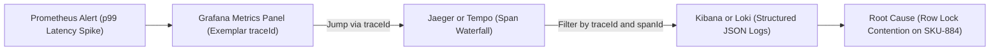
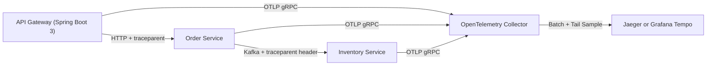
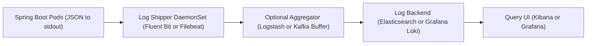

When an application runs as a single process on one server, troubleshooting usually starts with SSH and `tail -f /var/log/app.log`. Once a system grows into dozens of Spring Boot services running across hundreds of short-lived Kubernetes pods, Kafka topics, and databases, that workflow breaks down completely. A checkout request might pass through an API gateway, an order service, a payment service, a message broker, and an inventory database before failing or timing out.

Traditional monitoring checks whether known thresholds have been crossed, such as HTTP 5xx rates exceeding 1% or heap usage passing 85%. Monitoring tells you *that* something is unhealthy. Observability is the property of a system that lets you ask new questions about *why* it is behaving oddly (even for failure modes nobody predicted when they wrote the alerts) using telemetry the system already emits.

For Java backends, practical observability depends on combining three telemetry signals (metrics, traces, and logs) and correlating them with shared identifiers so an on-call engineer can move from a high-level alert straight to the failing database query or exception stack trace.

## The Three Pillars and How They Correlate

Metrics, traces, and logs each answer a different question and carry very different storage and query trade-offs.

| Pillar | What It Records | Primary Question | Typical Storage Cost | Retention |
| :--- | :--- | :--- | :--- | :--- |
| **Metrics** | Aggregated numeric measurements over time | Is the system healthy right now, and what is trending worse? | Low | Months to years |
| **Traces** | Timed, parent-child spans across service hops | Which downstream service, query, or queue caused the delay or failure? | Medium to high (depends on sampling) | Days to weeks |
| **Logs** | Discrete structured events with rich context | What exact inputs, state, or exception caused this specific failure? | High | Days to months |

None of the three pillars replaces the others. Metrics are cheap to store and fast to alert on, but they intentionally discard per-request detail. Logs capture full exception stack traces and business identifiers, but scanning terabytes of logs to compute latency percentiles is slow and expensive. Traces bridge the gap by showing the causal path of a single request across process boundaries.



During a real incident, the triage path usually moves left to right:

1. A Prometheus alert fires because `order-service` p99 latency crossed 2 seconds for 3 minutes.
2. Looking at the Grafana latency panel, you click a Prometheus exemplar (or open traces in that time window) and pull up a slow trace in Jaeger or Grafana Tempo.
3. The trace waterfall shows that `order-service` spent 15 ms in its own code and waited 1,920 ms on `POST /inventory/reserve`. Inside `inventory-service`, a single JDBC span took 1,890 ms.
4. Copying that `traceId` into Kibana or Grafana Loki returns the exact log lines from both services for that request, showing a PostgreSQL lock wait timeout on `inventory_items`.

Without `traceId` and `spanId` connecting all three signals, engineers end up guessing based on timestamps across clocks and pod replicas.

## Distributed Tracing with OpenTelemetry and Jaeger

Distributed tracing records the path of a request as a directed acyclic graph of timed operations.

- A **trace** represents the entire end-to-end journey of a request and carries a globally unique 128-bit `traceId`.
- A **span** represents one contiguous unit of work (handling an HTTP request, running a SQL statement, producing a Kafka message). Each span has a 64-bit `spanId`, a `parentSpanId` linking it to its caller, start/end timestamps, a status (`OK` or `ERROR`), and key-value **attributes** such as `http.response.status_code` or `db.system`.

### W3C TraceContext Propagation

For downstream services to attach their spans to the same trace, the caller must pass trace metadata over the wire. The standard wire format is the W3C TraceContext specification, which uses the `traceparent` HTTP header (and the same header name in Kafka or RabbitMQ message headers):

```http
traceparent: 00-4bf92f3577b34da6a3ce929d0e0e4736-00f067aa0ba902b7-01
```

Each dash-separated segment has a fixed meaning:

```text
00 - 4bf92f3577b34da6a3ce929d0e0e4736 - 00f067aa0ba902b7 - 01
│    │                                  │                  │
│    │                                  │                  └─ trace-flags (01 = sampled, 00 = not sampled)
│    │                                  └─ parent-id / span-id (16 hex chars, 8 bytes)
│    └─ trace-id (32 hex chars, 16 bytes)
└─ version (00)
```

An optional `tracestate` header carries vendor-specific key-value pairs without breaking interoperability between tracing backends.

### Spring Boot 3, Micrometer Observation, and the OpenTelemetry Collector

In production, Java applications should rarely export spans straight to Jaeger or a SaaS vendor. Instead, applications send spans over OTLP (OpenTelemetry Protocol, gRPC port 4317 or HTTP port 4318) to an **OpenTelemetry Collector**. The collector decouples your application code from the backend, batches exports, scrubs sensitive attributes, applies tail-based sampling, and fans out telemetry to Jaeger, Grafana Tempo, or commercial backends without redeploying your services.



Spring Boot 3 builds tracing on the **Micrometer Observation API** bridged to OpenTelemetry. You get automatic instrumentation for Spring MVC, WebFlux, `RestClient`, `WebClient`, Spring Data / JDBC (with datasource-micrometer), and Spring Kafka with three dependencies:

```xml
<dependencies>
    <dependency>
        <groupId>org.springframework.boot</groupId>
        <artifactId>spring-boot-starter-actuator</artifactId>
    </dependency>
    <!-- Bridges Micrometer Observation API to OpenTelemetry -->
    <dependency>
        <groupId>io.micrometer</groupId>
        <artifactId>micrometer-tracing-bridge-otel</artifactId>
    </dependency>
    <!-- Exports spans via OTLP to the OpenTelemetry Collector -->
    <dependency>
        <groupId>io.opentelemetry</groupId>
        <artifactId>opentelemetry-exporter-otlp</artifactId>
    </dependency>
</dependencies>
```

Configure the OTLP endpoint and sampling probability in `application.yml`:

```yaml
spring:
  application:
    name: order-service

management:
  tracing:
    sampling:
      # In production with head-based sampling, start around 0.05 to 0.10.
      # Set to 1.0 only if the OTel Collector handles tail-based sampling.
      probability: 0.10
  otlp:
    tracing:
      endpoint: http://otel-collector.observability.svc.cluster.local:4318/v1/traces
```

One practical benefit of Micrometer's `Observation` API is that a single instrumentation block produces **both** a timer metric and a distributed trace span:

```java
package com.example.orders;

import io.micrometer.observation.Observation;
import io.micrometer.observation.ObservationRegistry;
import org.springframework.stereotype.Service;

@Service
public class CheckoutService {

    private final ObservationRegistry observationRegistry;
    private final PaymentGatewayClient paymentClient;

    public CheckoutService(ObservationRegistry observationRegistry,
                           PaymentGatewayClient paymentClient) {
        this.observationRegistry = observationRegistry;
        this.paymentClient = paymentClient;
    }

    public Receipt authorizePayment(String orderId, String provider) {
        return Observation.createNotStarted("checkout.payment.authorize", observationRegistry)
                // Low-cardinality key: exported to BOTH Prometheus metric tags and trace span attributes
                .lowCardinalityKeyValue("payment.provider", provider)
                // High-cardinality key: exported ONLY to trace span attributes, never to Prometheus
                .highCardinalityKeyValue("order.id", orderId)
                .observe(() -> paymentClient.authorize(orderId, provider));
    }
}
```

Notice the distinction between `lowCardinalityKeyValue` and `highCardinalityKeyValue`. Micrometer sends `payment.provider` to both Prometheus and OpenTelemetry, while keeping `order.id` strictly on the trace span so it cannot pollute your metrics backend.

> [!NOTE]
> Teams running mixed Java versions or legacy services often use the **OpenTelemetry Java Agent** (`-javaagent:opentelemetry-javaagent.jar`) instead of adding Maven libraries. The agent instruments frameworks and JDBC drivers via bytecode injection with zero code changes, at the cost of slightly higher startup time and less direct integration with Spring Boot native images.

## Head-Based vs Tail-Based Trace Sampling

Recording 100% of traces in a high-traffic service quickly becomes unsustainable. At 50,000 requests per second with an average of 8 spans per request, you generate 400,000 spans per second. Storing and indexing that volume burns through collector CPU, network bandwidth, and storage bills while almost all of those traces are uninteresting `200 OK` responses.

There are two main sampling strategies:

- **Head-based sampling** decides whether to record a trace at the entry point (usually the API gateway) before the request runs. The gateway flips a weighted coin (for example, 5% via `TraceIdRatioBased`) and sets the `traceparent` sampled flag to `01` or `00`. Downstream services honor that flag (`ParentBased`). Head-based sampling is cheap and stateless, but it is blind to the outcome: it can easily drop a rare `500` error or a 4-second tail-latency spike.
- **Tail-based sampling** defers the decision until the trace finishes. Services send 100% of spans to an OpenTelemetry Collector tier that buffers spans in memory for a short window (often 10 to 30 seconds). Once the trace completes, the collector evaluates policies: keep 100% of traces containing an error status, keep 100% of traces slower than 1,000 ms, and keep 2% of normal healthy traces for baseline comparison.

Here is a representative OpenTelemetry Collector `tail_sampling` processor configuration:

```yaml
processors:
  tail_sampling:
    decision_wait: 15s
    num_traces: 100000
    expected_new_traces_per_sec: 5000
    policies:
      - name: errors-policy
        type: status_code
        status_code:
          status_codes: [ERROR]
      - name: slow-traces-policy
        type: latency
        latency:
          threshold_ms: 1000
      - name: baseline-probabilistic
        type: probabilistic
        probabilistic:
          sampling_percentage: 2.0
```

Tail-based sampling introduces an important architectural requirement: **every span belonging to the same `traceId` must land on the same collector instance**. If Kubernetes round-robins OTLP connections across 5 collectors, each collector only sees fragments of a trace and makes inconsistent sampling decisions. In practice, teams run a two-tier collector deployment where a lightweight gateway tier uses the `loadbalancing` exporter to hash spans by `traceId` to a stateful pool of tail-sampling collectors.

## Centralized Logging: ELK, EFK, and Grafana Loki

Plain-text log lines such as `Order 9921 failed for user 8841` are fragile to parse with regular expressions and hard to correlate across services. In containerized Java environments, applications should write single-line **structured JSON logs to `stdout`**, letting the container runtime and a node-level log shipper collect and forward them off the host. Writing rotating log files inside a container risks filling the node's ephemeral disk and loses logs when pods are evicted.

### Structured JSON Logging with Logback and MDC

Spring Boot 3 with Micrometer Tracing automatically populates `traceId` and `spanId` in SLF4J's **Mapped Diagnostic Context (MDC)** for every handled request. Using `logstash-logback-encoder` in `logback-spring.xml` (or Spring Boot 3.4+'s built-in `logging.structured.format.console=logstash` property), those MDC fields appear as top-level JSON keys:

```xml
<?xml version="1.0" encoding="UTF-8"?>
<configuration>
    <appender name="JSON_CONSOLE" class="ch.qos.logback.core.ConsoleAppender">
        <encoder class="net.logstash.logback.encoder.LogstashEncoder">
            <includeMdcKeyName>traceId</includeMdcKeyName>
            <includeMdcKeyName>spanId</includeMdcKeyName>
            <includeMdcKeyName>orderId</includeMdcKeyName>
            <customFields>{"service":"order-service"}</customFields>
        </encoder>
    </appender>

    <root level="INFO">
        <appender-ref ref="JSON_CONSOLE" />
    </root>
</configuration>
```

Each log line emitted to `stdout` is now directly indexable:

```json
{
  "@timestamp": "2026-10-29T14:45:12.102Z",
  "level": "ERROR",
  "thread_name": "http-nio-8080-exec-4",
  "logger_name": "com.example.orders.CheckoutService",
  "message": "Inventory reservation timed out",
  "service": "order-service",
  "traceId": "4bf92f3577b34da6a3ce929d0e0e4736",
  "spanId": "00f067aa0ba902b7",
  "orderId": "ORD-9921"
}
```

### Shipping and Indexing: ELK vs EFK vs Grafana Loki

Once pods write JSON to `stdout`, a centralized logging pipeline collects, parses, and stores it:



- **ELK (Elasticsearch, Logstash, Kibana):** Logstash runs on the JVM and provides rich parsing, enrichment, and routing plugins, feeding Elasticsearch for full-text inverted-index search and Kibana for dashboards and log exploration. Because Logstash has a relatively large memory footprint, teams rarely run it as a per-node DaemonSet; they pair Filebeat on nodes with a central Logstash tier (often buffered by Kafka during traffic spikes).
- **EFK (Elasticsearch, Fluentd or Fluent Bit, Kibana):** Very common on Kubernetes. **Fluent Bit** (written in C, small memory footprint) runs as a DaemonSet on every worker node, tails `/var/log/containers/*.log`, enriches records with Kubernetes pod/namespace metadata, and ships them directly to Elasticsearch or OpenSearch.
- **Grafana Loki:** Takes a fundamentally different indexing approach from Elasticsearch. Instead of building a full-text inverted index over every field in every log line, Loki indexes only a small set of low-cardinality stream labels (such as `cluster`, `namespace`, `app`) and stores compressed raw log chunks in cheap object storage (S3 or GCS).

| Trade-Off | ELK / EFK (Elasticsearch / OpenSearch) | Grafana Loki |
| :--- | :--- | :--- |
| **Indexing Model** | Full-text inverted index across JSON fields | Metadata labels only; log bodies scanned at query time |
| **Storage and RAM Cost** | Higher (hot SSD nodes + JVM heap for indices) | Lower (object storage chunks + smaller index) |
| **Ad-Hoc Free-Text Search** | Fast across wide time windows | Fast when filtered by labels and narrow time windows; slower on broad regex scans |
| **Operational Overhead** | Shard sizing, ILM rollover, cluster upgrades | Simpler stateless scaling with object storage |

Many organizations run ELK/EFK when compliance, security auditing, or product analytics require fast full-text queries across arbitrary fields over weeks of logs, and choose Loki when they want lower infrastructure cost and tight Grafana integration with Prometheus metrics and Tempo traces.

### MDC Thread-Pool Leaks and Async Context Propagation

SLF4J's `MDC` is backed by a `ThreadLocal`. In servlet containers like Tomcat or custom `ExecutorService` thread pools, worker threads are reused across requests. If code puts a business identifier into `MDC` and forgets to remove it when an exception occurs, the next unrelated request handled by that thread inherits stale context, which can corrupt audit logs or leak user data across requests.

Always scope manual MDC entries with `try-with-resources`:

```java
try (MDC.MDCCloseable ignored = MDC.putCloseable("orderId", orderId)) {
    processOrder(orderId);
}
```

The second common break happens across asynchronous boundaries: `@Async` methods, `CompletableFuture.supplyAsync(...)`, reactive pipelines, and Kafka consumers execute on different threads, so `ThreadLocal` trace and MDC contexts disappear unless explicitly propagated.

In Spring Framework 6.1+ / Spring Boot 3.2+, wire `ContextPropagatingTaskDecorator` (backed by Micrometer Context Propagation) into your `ThreadPoolTaskExecutor`:

```java
@Bean
public ThreadPoolTaskExecutor applicationTaskExecutor() {
    ThreadPoolTaskExecutor executor = new ThreadPoolTaskExecutor();
    executor.setCorePoolSize(16);
    executor.setMaxPoolSize(32);
    executor.setThreadNamePrefix("async-exec-");
    executor.setTaskDecorator(new ContextPropagatingTaskDecorator());
    executor.initialize();
    return executor;
}
```

For Spring Kafka, enabling observation (`spring.kafka.template.observation-enabled=true` and `spring.kafka.listener.observation-enabled=true`) automatically injects `traceparent` into Kafka `RecordHeaders` on publish and extracts it to start a child span and populate MDC on consume.

## Metrics Architecture with Micrometer, Prometheus, and Grafana

While traces and logs focus on individual requests, metrics give you continuous, low-overhead visibility across the whole fleet.

- **Micrometer** acts as the vendor-neutral instrumentation facade inside Spring Boot (much like SLF4J for logging). Your code records counters, timers, and gauges against `MeterRegistry`, and swapping the registry dependency switches output between Prometheus, Datadog, or OTLP.
- **Prometheus** scrapes your pods' `/actuator/prometheus` HTTP endpoint on a fixed interval (typically every 15 or 30 seconds) and stores dimensional time series in its time-series database (TSDB).
- **Grafana** queries Prometheus using PromQL to render RED (Rate, Errors, Duration) dashboards, evaluate alerting rules, and link latency spikes to traces via **OpenMetrics Exemplars**. When exemplars are enabled, a Prometheus histogram bucket can attach a sample `trace_id` to a latency observation so clicking a dot on a Grafana p99 chart opens that exact trace in Jaeger or Tempo.

### Guarding Against High-Cardinality Metric Tags

Prometheus builds an in-memory inverted index for every unique combination of metric name and label key-value pairs. The number of active time series grows multiplicatively across labels:

```text
Active Time Series = distinct(label_1) * distinct(label_2) * distinct(label_3)
```

Putting unbounded values into metric tags causes a cardinality explosion that exhausts Prometheus RAM and slows down queries across the entire cluster:

```java
// Bad: millions of distinct customer IDs and order IDs create millions of time series
meterRegistry.counter("orders.placed",
        "customer_id", customerId,
        "order_id", orderId
).increment();

// Good: bounded dimensions only; put customerId and orderId in logs and trace spans
meterRegistry.counter("orders.placed",
        "region", region,
        "payment_method", paymentMethod.name()
).increment();
```

A subtle version of this bug happens with HTTP URIs. If a custom filter tags requests with the raw path (`/api/v1/orders/10482`) instead of the Spring MVC route template (`/api/v1/orders/{id}`), every unique order ID creates a new time series. Spring Boot Actuator's built-in HTTP server instrumentation uses the route template automatically, and custom filters should do the same. (The next lesson on Micrometer and Prometheus covers meter types, SLOs, and `MeterFilter` guardrails in full detail.)

## Practical Questions

### How does tail-based sampling differ from head-based sampling, and what operational constraint does it add?

Head-based sampling decides whether to keep a trace at the very first hop (typically the API gateway) using a probability rule, and propagates that decision via the `traceparent` flags byte. It uses almost no memory, but it cannot look ahead to see if a downstream database call will fail or time out. Tail-based sampling buffers spans in the OpenTelemetry Collector until the trace finishes, allowing policies that keep 100% of errors and slow traces while dropping most healthy traffic. The trade-off is higher collector memory consumption and the need for trace-ID-aware load balancing so all spans for a given `traceId` arrive at the same collector instance.

### When should a team choose ELK/EFK over Grafana Loki, and vice versa?

ELK/EFK (Elasticsearch or OpenSearch with Logstash or Fluent Bit) indexes JSON fields into a full-text inverted index. That makes arbitrary searches across fields like `customerEmail` or `errorCode` fast even over long time ranges, at the cost of significantly higher memory, SSD storage, and cluster maintenance. Grafana Loki indexes only low-cardinality stream labels and stores compressed log chunks in object storage, which lowers storage and operational cost substantially. Loki works well when most investigations start from a known service, environment, or `traceId` within a narrow time window, whereas ELK/EFK fits teams that rely heavily on broad full-text analytics across logs.

### Why do `traceId` and MDC fields disappear inside `@Async` methods or Kafka listeners, and how do you fix it?

Both SLF4J MDC and tracing scopes store active context in `ThreadLocal` variables. When execution moves to a different thread in an executor pool or crosses a network hop via Kafka, the target thread starts with an empty `ThreadLocal`. For thread pools in Spring Boot 3.2+, configure `ContextPropagatingTaskDecorator` on `ThreadPoolTaskExecutor` so the submitting thread's observation and MDC context are captured and restored on the worker thread (and cleared afterward). For Kafka, enable Spring Kafka observation support so `traceparent` is written to Kafka record headers by the producer and extracted into a child span and MDC on the consumer side.

### Why is logging `userId` in JSON logs and trace spans safe, while putting `userId` in a Prometheus metric tag can cause an outage?

Log stores and trace backends are designed to store discrete, per-request events with high-cardinality attributes and expire them after days or weeks. Prometheus maintains an active in-memory index and chunk series for every unique metric-plus-label combination. Adding an unbounded label like `userId` turns one metric into millions of active time series, driving up Prometheus heap and disk usage until scrapes time out or the server hits an OOM crash. Keep Prometheus tags bounded to low-cardinality dimensions (service, status code, route template, region) and reserve identifiers like `userId` and `orderId` for logs and trace attributes.
