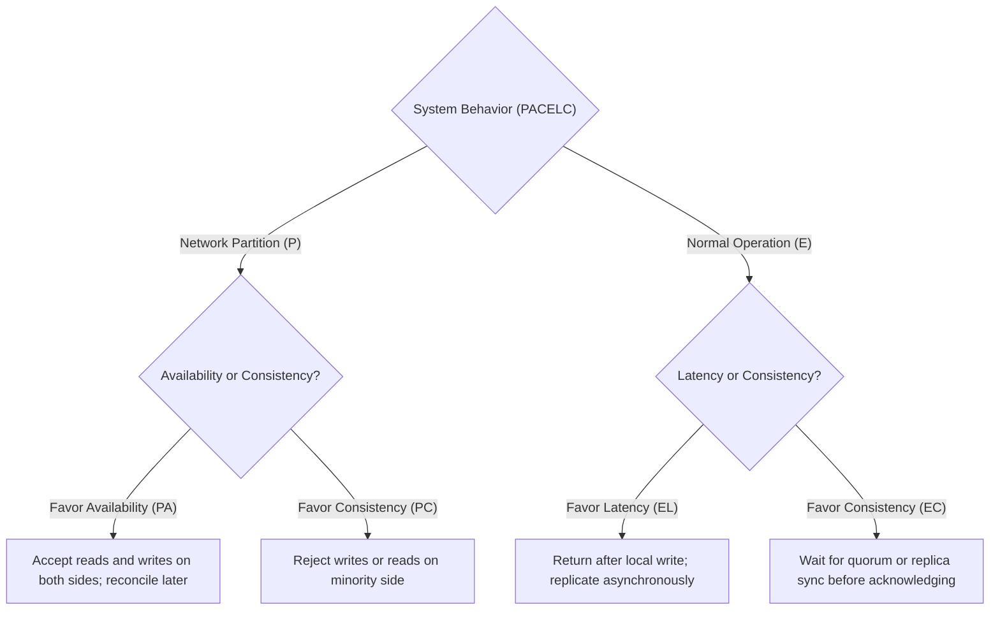
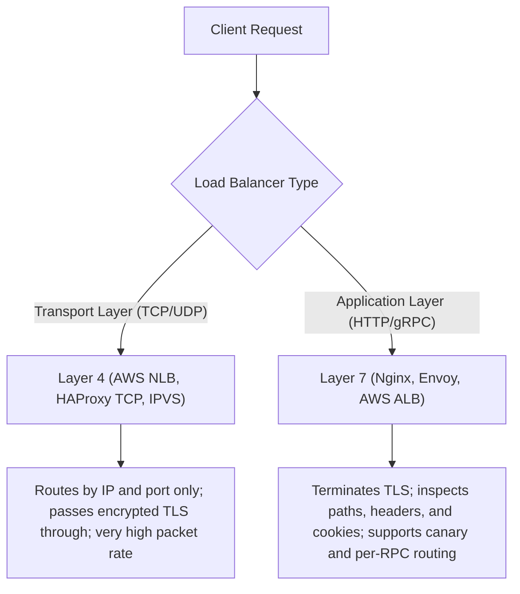
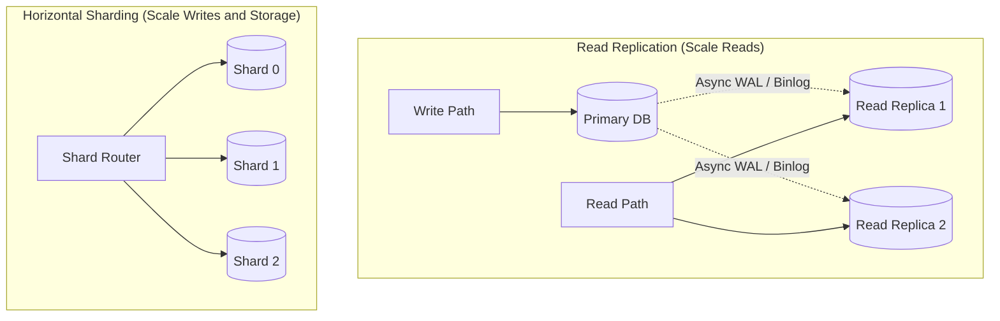
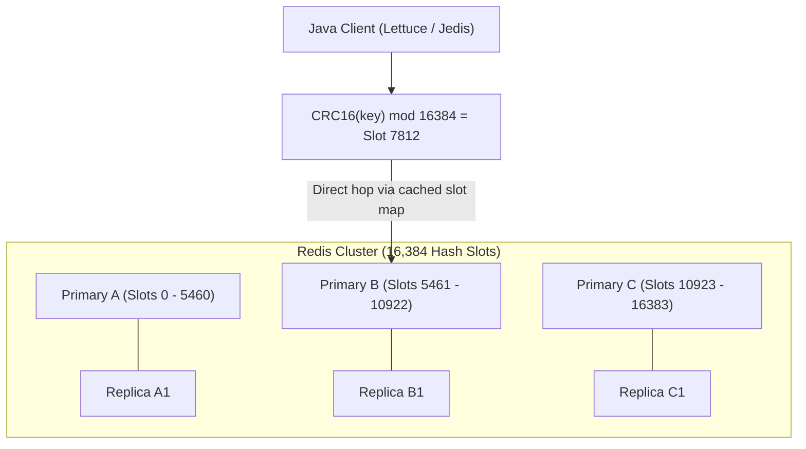
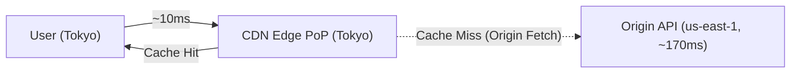

A single Spring Boot service backed by one PostgreSQL instance can handle more traffic than many teams assume, especially with good indexing and connection pooling. Eventually, though, one machine hits a ceiling on CPU, memory, network bandwidth, or storage IOPS. Upgrading to a larger instance (vertical scaling) buys time, but hardware stops scaling linearly well before costs do, and a single node still leaves you with a single failure domain.

Horizontal scaling splits traffic and state across multiple machines. Stateless application servers are the easy part: put them behind a load balancer and add replicas. The hard part is everything that holds state, such as databases, caches, and sessions, along with the network sitting between them. The patterns below are the building blocks engineers reach for when a single node is no longer enough.

## CAP and PACELC Trade-Offs

Eric Brewer's **CAP theorem** describes what a distributed data store can guarantee when a network partition happens. Formally, during a partition, a system cannot provide both linearizable **Consistency** (every read sees the most recent completed write or fails) and **Availability** (every non-failing node returns a non-error response).

Two details often get muddled in casual discussions:

1. **Consistency in CAP is not the "C" in ACID.** ACID consistency is about application invariants like foreign keys and check constraints. CAP consistency is linearizability, meaning the distributed cluster behaves as if there were a single up-to-date copy of the data.
2. **"CA" is not a real choice for networked systems.** Switches fail, routing tables flap, fibers get cut, and long garbage collection pauses look identical to a network drop from the outside. Because partitions will happen, the real decision during a partition is **CP** (refuse some requests rather than return stale or conflicting data) versus **AP** (keep serving requests and reconcile divergence later).



### Why PACELC Is More Useful Day to Day

Daniel Abadi's **PACELC theorem** extends CAP to cover the 99.9% of the time when the network is healthy:

- **If there is a Partition (P):** choose between **Availability (A)** and **Consistency (C)**.
- **Else (E), during normal operation:** choose between **Latency (L)** and **Consistency (C)**.

Even with a healthy network, keeping replicas strictly synchronized requires extra network round trips before acknowledging a write. Returning immediately and replicating asynchronously keeps latency low, but readers on another replica can briefly see stale values.

In practice, many modern databases let you tune this per query or per collection, though each system has a natural default:

| System | Typical Classification | Practical Behavior |
|---|---|---|
| **PostgreSQL (sync standby) / Google Spanner** | PC / EC | Prioritizes consistent reads and writes; waits for replication quorum or synchronized commits under normal operation. |
| **MongoDB (default majority write + primary read)** | PC / EC | Minority partition cannot elect a primary to accept writes; tunable with weaker read/write concerns if you accept staleness. |
| **Apache Cassandra / DynamoDB (default reads)** | PA / EL | Optimized for low latency and high availability with asynchronous replication; supports stronger consistency via quorum (`QUORUM` reads/writes or strongly consistent reads in DynamoDB) at higher latency. |

Notice the key takeaway for application design: consistency is rarely an all-or-nothing choice across an entire company. Payment ledger entries belong on a strongly consistent path (PC/EC), while product view counts or recently viewed items work fine with eventual consistency (PA/EL).

## Load Balancing: Layer 4 vs Layer 7

A load balancer sits in front of a pool of backend instances, routes incoming traffic, and stops sending requests to unhealthy nodes. The choice between **Layer 4** and **Layer 7** comes down to how much of the network packet the balancer inspects.



| Dimension | Layer 4 (Transport) | Layer 7 (Application) |
|---|---|---|
| **Protocols** | TCP, UDP | HTTP/1.1, HTTP/2, HTTP/3, gRPC, WebSockets |
| **Visibility** | Source/destination IP and port | Full URI path, HTTP headers, cookies, gRPC service/method |
| **TLS Handling** | Usually pass-through (backend terminates TLS) | Terminates TLS at the balancer (optionally re-encrypts to backends) |
| **Connection Multiplexing** | Pins one TCP connection to one backend | Can load-balance individual HTTP/2 or gRPC streams across backends |
| **Overhead** | Minimal CPU and memory per connection | Higher CPU due to TLS handshakes and HTTP parsing |

That fourth row is easy to overlook with gRPC or HTTP/2. Because HTTP/2 multiplexes thousands of requests over a single long-lived TCP connection, a Layer 4 load balancer sends all of those requests to whichever backend pod won the initial TCP handshake. Adding new pods does not rebalance existing clients until connections reset. A Layer 7 proxy like Envoy or Nginx understands individual HTTP/2 streams and spreads them evenly across the backend pool.

### Practical Layer 7 Upstream Configuration

Below is a realistic Nginx configuration fronting a pool of Spring Boot order services. It uses `least_conn` routing (generally better than plain round-robin when request durations vary), keeps persistent connections open to the backends to avoid TCP handshake churn, and marks slow or failing nodes down automatically:

```nginx
upstream order_service_pool {
    least_conn;

    server 10.0.1.11:8080 max_fails=3 fail_timeout=15s;
    server 10.0.1.12:8080 max_fails=3 fail_timeout=15s;
    server 10.0.1.13:8080 max_fails=3 fail_timeout=15s;

    keepalive 64;
}

server {
    listen 443 ssl;
    http2 on;
    server_name api.example.com;

    ssl_certificate     /etc/nginx/certs/api.crt;
    ssl_certificate_key /etc/nginx/certs/api.key;

    location /api/v1/orders {
        proxy_pass http://order_service_pool;
        proxy_http_version 1.1;
        proxy_set_header Connection "";
        proxy_set_header Host $host;
        proxy_set_header X-Forwarded-For $proxy_add_x_forwarded_for;
        proxy_set_header X-Forwarded-Proto $scheme;

        proxy_connect_timeout 2s;
        proxy_read_timeout 10s;

        # Retry idempotent failures on another healthy upstream
        proxy_next_upstream error timeout http_502 http_503;
        proxy_next_upstream_tries 2;
    }
}
```

In production Kubernetes or cloud environments, you often combine both layers: an L4 load balancer at the edge for static IPs and raw TCP absorption, forwarding into a fleet of L7 proxies (Nginx Ingress, Envoy, or AWS ALB) that handle TLS, path routing, rate limits, and health probes against `/actuator/health/readiness`.

## Database Replication and Sharding

When a relational database becomes the bottleneck, first check whether the problem is **read volume** or **write volume / dataset size**. Those two problems call for very different architectures.



### Read Replicas and Replication Lag

Most applications are heavily read-biased (often 80% to 95% reads). Adding read replicas offloads `SELECT` traffic from the primary. The primary writes changes to its write-ahead log (WAL in PostgreSQL, binlog in MySQL) and streams them to replicas.

Because replication is usually asynchronous to avoid slowing down primary commits, replicas lag behind the primary. Under normal load that lag might be 10 to 50 milliseconds. During a bulk migration or traffic burst, it can stretch to several seconds.

This causes the classic **read-your-own-writes** bug: a user updates their shipping address on the primary, gets redirected to the checkout page, and a read replica serves the old address. Common ways to handle this in Java backends include:

- **Route recent writers to the primary:** Record a short-lived flag (in a session, cookie, or Redis with a 5-second TTL) when a user writes, and route that user's reads to the primary until the window passes.
- **Route by transaction intent:** Use Spring's `@Transactional(readOnly = true)` to send read-only queries to replicas, while keeping critical post-write reads on the primary.
- **Lag-aware health checks:** Pull a replica out of the read pool if its replication delay exceeds a threshold (for example, 500 ms).

Here is how a Spring `AbstractRoutingDataSource` combines `@Transactional(readOnly = true)` with a thread-local override that forces primary reads after a user has just written:

```java
import org.springframework.jdbc.datasource.lookup.AbstractRoutingDataSource;
import org.springframework.transaction.support.TransactionSynchronizationManager;

public class ReadWriteRoutingDataSource extends AbstractRoutingDataSource {

    public enum DataSourceType { PRIMARY, REPLICA }

    private static final ThreadLocal<Boolean> FORCE_PRIMARY =
            ThreadLocal.withInitial(() -> false);

    public static void forcePrimaryForCurrentRequest() {
        FORCE_PRIMARY.set(true);
    }

    public static void clear() {
        FORCE_PRIMARY.remove();
    }

    @Override
    protected Object determineCurrentLookupKey() {
        if (Boolean.TRUE.equals(FORCE_PRIMARY.get())) {
            return DataSourceType.PRIMARY;
        }
        boolean isReadOnly = TransactionSynchronizationManager.isCurrentTransactionReadOnly();
        return isReadOnly ? DataSourceType.REPLICA : DataSourceType.PRIMARY;
    }
}
```

Make sure to call `ReadWriteRoutingDataSource.clear()` inside a `finally` block in a servlet filter or interceptor so pooled worker threads never leak `FORCE_PRIMARY` onto unrelated requests. Also wrap this routing data source in Spring's `LazyConnectionDataSourceProxy`; otherwise Spring grabs a connection from the default target *before* the `@Transactional(readOnly = true)` flag is visible to `determineCurrentLookupKey()`.

### Horizontal Sharding

Read replicas do not increase write throughput, because every replica still has to replay every write from the primary. When write volume or table size outgrows a single primary, you split rows across independent database instances (**shards**).

Choosing the **shard key** is a decision you live with for years:

- **Good fit:** `tenant_id` in a B2B SaaS product or `user_id` in a consumer app, where almost every query is scoped to one tenant or user. Joins and transactions stay inside a single shard.
- **Cross-shard queries:** Any query that omits the shard key (such as `SELECT * FROM orders WHERE status = 'PENDING'`) has to fan out to every shard, collect results in memory, and merge/sort them (**scatter-gather**). At scale, teams avoid running scatter-gather on live OLTP shards by streaming changes via CDC (Debezium + Kafka) into a separate search or analytics store like Elasticsearch or ClickHouse.
- **Hot shards (celebrity problem):** If you shard a ticketing platform by `event_id` and a huge stadium tour goes on sale, 100% of the burst hits the one shard holding that `event_id` while every other shard sits nearly idle. Mitigations include dedicated shards for oversized tenants, or adding a bounded salt suffix (`event_id + "_" + (hash % 16)`) to spread writes across 16 partitions at the cost of reading across those 16 partitions.

### Consistent Hashing with Virtual Nodes

Naive hash partitioning uses `shard = Math.abs(hash(key)) % N`. That breaks down the moment you add or remove a node: changing `N` from 10 to 11 remaps roughly 91% of all keys, causing massive data migration in a database or a near-total cache wipe in a caching layer.

**Consistent hashing** arranges nodes and keys on a circular hash ring (typically the 32-bit integer space). Each key maps to the first node found moving clockwise around the ring. When a node joins or leaves, only about `1/N` of the keys move to an adjacent node. Adding **virtual nodes** (placing each physical server at 100 to 200 positions around the ring) smooths out uneven distribution when the node count is small.

```java
import java.nio.charset.StandardCharsets;
import java.security.MessageDigest;
import java.security.NoSuchAlgorithmException;
import java.util.SortedMap;
import java.util.TreeMap;

public class ConsistentHashRing {

    private final int virtualNodesPerServer;
    private final TreeMap<Integer, String> ring = new TreeMap<>();

    public ConsistentHashRing(int virtualNodesPerServer) {
        this.virtualNodesPerServer = virtualNodesPerServer;
    }

    public void addNode(String nodeId) {
        for (int i = 0; i < virtualNodesPerServer; i++) {
            int position = hash(nodeId + "#vnode-" + i);
            ring.put(position, nodeId);
        }
    }

    public void removeNode(String nodeId) {
        for (int i = 0; i < virtualNodesPerServer; i++) {
            int position = hash(nodeId + "#vnode-" + i);
            ring.remove(position);
        }
    }

    public String getNode(String key) {
        if (ring.isEmpty()) {
            throw new IllegalStateException("Hash ring has no nodes");
        }
        int keyHash = hash(key);
        SortedMap<Integer, String> tail = ring.tailMap(keyHash);
        int targetPosition = tail.isEmpty() ? ring.firstKey() : tail.firstKey();
        return ring.get(targetPosition);
    }

    private int hash(String input) {
        try {
            MessageDigest md = MessageDigest.getInstance("SHA-256");
            byte[] digest = md.digest(input.getBytes(StandardCharsets.UTF_8));
            return ((digest[0] & 0xFF) << 24)
                 | ((digest[1] & 0xFF) << 16)
                 | ((digest[2] & 0xFF) << 8)
                 | (digest[3] & 0xFF);
        } catch (NoSuchAlgorithmException e) {
            throw new IllegalStateException("SHA-256 unavailable", e);
        }
    }
}
```

In production code where nodes are added and removed dynamically while request threads call `getNode`, guard mutations or swap an immutable snapshot reference (`AtomicReference<NavigableMap<Integer, String>>`) so reads remain lock-free.

## Caching Topologies and Redis Cluster

Putting a fast in-memory cache in front of a database cuts read latency from tens of milliseconds down to sub-millisecond lookups and shields the database from repetitive queries. How reads and writes coordinate between the cache and the database defines the caching topology:

- **Cache-Aside (Lazy Loading):** The application checks the cache first. On a miss, it loads from the database, stores the result in the cache with a TTL, and returns it. On a write, the application updates the database and deletes (invalidates) the cache entry. Cache-aside is resilient to cache outages (traffic degrades to the database rather than failing outright) and only caches data that is actually requested.
- **Write-Through:** The application writes to the cache layer, which synchronously writes to the database before returning. Cached values stay fresh, at the expense of higher write latency and caching rows that may never be read again.
- **Write-Behind (Write-Back):** The cache acknowledges writes immediately and flushes batched updates asynchronously to the database. Throughput is very high, but a cache node crash before flushing loses acknowledged writes. This is usually reserved for non-critical counters or telemetry unless paired with a durable log.

### Cache-Aside with Invalidation and Stampede Protection

A subtle failure mode in Cache-Aside is the **cache stampede** (thundering herd): a hot key expires, and hundreds of concurrent threads miss at the same millisecond and run the same expensive SQL query simultaneously.

```java
import java.time.Duration;
import java.util.Optional;
import java.util.concurrent.ThreadLocalRandom;

public class ProductCatalogService {

    private final ProductRepository repository;
    private final RedisCacheClient cache;

    public ProductCatalogService(ProductRepository repository, RedisCacheClient cache) {
        this.repository = repository;
        this.cache = cache;
    }

    public Product getProduct(String productId) {
        String key = "product:" + productId;
        Optional<Product> cached = cache.get(key, Product.class);
        if (cached.isPresent()) {
            return cached.get();
        }

        // Single-flight or short distributed lock prevents thundering herd on hot keys
        Product product = repository.findById(productId)
                .orElseThrow(() -> new ProductNotFoundException(productId));

        // Add random jitter (5 to 6 minutes) so bulk-loaded keys do not expire together
        long ttlSeconds = 300 + ThreadLocalRandom.current().nextLong(60);
        cache.set(key, product, Duration.ofSeconds(ttlSeconds));
        return product;
    }

    public void updatePrice(String productId, long priceCents) {
        repository.updatePrice(productId, priceCents);
        // Delete after DB commit rather than updating cache directly to reduce race windows
        cache.delete("product:" + productId);
    }
}
```

In Spring Boot, `@Cacheable(cacheNames = "products", sync = true)` synchronizes concurrent misses inside a single JVM instance so only one thread hits the database per node. Across a large fleet of pods, combine jittered TTLs with probabilistic early refresh or a short-lived per-key Redis lock if a single miss query is expensive.

> [!WARNING]
> Always invalidate the cache **after** the database transaction commits (for example via Spring's `TransactionSynchronization.afterCommit()`). If you delete the cache key before the database commit completes, a concurrent reader can miss the cache, read the old uncommitted value from the database, and repopulate the cache with stale data until the TTL expires.

### How Redis Cluster Works: 16,384 Hash Slots

When your working set exceeds a single Redis node's RAM or throughput, **Redis Cluster** partitions keys across multiple primary nodes, each backed by one or more replicas for failover.

Rather than consistent hashing directly onto node IDs, Redis Cluster divides the keyspace into exactly **16,384 hash slots** (0 through 16,383). Every primary owns a subset of those slots, and clients compute the target slot locally:

`slot = CRC16(key) mod 16384`



Why 16,384 slots instead of 65,536? Redis nodes exchange cluster topology over a gossip protocol every second. A bitmap of 16,384 slots fits in just 2 KB per heartbeat message, keeping gossip bandwidth small, while still giving fine-grained rebalancing across clusters up to around 1,000 nodes.

Smart clients like Lettuce (Spring Data Redis's default) cache the slot-to-node table in memory so commands go straight to the owning node in one hop. If slots are moving during a reshard, a node responds with `MOVED` (update your slot table permanently) or `ASK` (redirect this single command while migration finishes).

### Multi-Key Operations and Hash Tags

In Redis Cluster, commands that touch multiple keys (`MGET`, `RENAME`, Lua scripts, transactions) fail with `CROSSSLOT Keys in request don't hash to the same slot` unless every key resolves to the same slot.

You control co-location using **hash tags** enclosed in curly braces `{...}`:

- `{tenant:42}:profile`
- `{tenant:42}:limits`
- `{tenant:42}:session`

When a key contains `{...}`, Redis runs `CRC16` only on the substring inside the first non-empty brace pair. All three keys hash to the exact same slot and live on the same primary node. Use hash tags carefully: tagging too many keys with a coarse prefix (like `{global}`) defeats partitioning and creates a hot shard on one Redis node.

## Content Delivery Networks (CDNs)

No amount of JVM tuning can beat fiber-optic propagation delay. A round trip from Sydney to `us-east-1` takes roughly 200 ms before your application executes a single line of code, plus extra round trips for TCP and TLS handshakes.

A **Content Delivery Network (CDN)** terminates TLS and caches responses at edge Points of Presence (PoPs) close to users, often within 10 to 25 ms. Static assets (images, JavaScript bundles, videos) are the classic use case, but CDNs also absorb huge traffic volumes for public or semi-public read APIs such as product catalogs, pricing tables, and configuration endpoints.



### Controlling Edge and Browser Caching with HTTP Headers

CDN behavior is driven largely by standard HTTP response headers. Setting them cleanly in Spring Boot gives you precise control over what browsers cache versus what shared CDN edges cache:

```java
import java.time.Duration;
import org.springframework.http.CacheControl;
import org.springframework.http.ResponseEntity;
import org.springframework.web.bind.annotation.GetMapping;
import org.springframework.web.bind.annotation.PathVariable;
import org.springframework.web.bind.annotation.RestController;

@RestController
public class CatalogApiController {

    private final ProductCatalogService catalogService;

    public CatalogApiController(ProductCatalogService catalogService) {
        this.catalogService = catalogService;
    }

    @GetMapping("/api/v1/products/{id}")
    public ResponseEntity<Product> getProduct(@PathVariable String id) {
        Product product = catalogService.getProduct(id);

        CacheControl cacheControl = CacheControl.maxAge(Duration.ofSeconds(60))
                .cachePublic()
                .sMaxAge(Duration.ofSeconds(300))
                .staleWhileRevalidate(Duration.ofSeconds(300));

        return ResponseEntity.ok()
                .cacheControl(cacheControl)
                .eTag("\"" + product.version() + "\"")
                .header("Vary", "Accept-Encoding, Accept-Language")
                .body(product);
    }
}
```

That controller emits headers like:

```http
HTTP/1.1 200 OK
Content-Type: application/json
Cache-Control: public, max-age=60, s-maxage=300, stale-while-revalidate=300
ETag: "v42"
Vary: Accept-Encoding, Accept-Language
```

What each header actually does:

- **`public, max-age=60, s-maxage=300`**: Browsers cache the response for 60 seconds, while shared caches (the CDN edge) keep it for 300 seconds. For user-specific endpoints, always use `Cache-Control: private, no-store` so a CDN never caches one customer's response and serves it to another.
- **`stale-while-revalidate=300`**: After the 300-second fresh window expires, the CDN can immediately serve the slightly stale copy to the next caller while refreshing from your origin in the background, hiding origin latency from users.
- **`ETag`**: Enables conditional requests (`If-None-Match: "v42"`). If the product version has not changed, your origin returns `304 Not Modified` with an empty body, saving bandwidth and serialization work.
- **`Vary`**: Tells the CDN to partition its cache key by the listed request headers. Never put high-cardinality headers like `User-Agent` or `Cookie` in `Vary`, or your cache hit ratio will collapse.

## Common Failure Modes

- **Read-your-writes bugs after adding replicas:** Teams add a read replica, turn on global read splitting, and immediately get support tickets about "my edits disappeared." Always classify which flows require monotonic or read-your-writes guarantees before routing them to replicas.
- **Hot keys in sharded databases and Redis:** Even with 16 shards or a 12-node Redis Cluster, one viral product page or flash-sale `event_id` can saturate a single node. Protect ultra-hot read keys with short-lived in-process caches (such as Caffeine with a 2 to 5 second TTL) in front of Redis so each app pod absorbs thousands of reads locally.
- **Thundering herd after cache flush or expiry:** Never expire an entire catalog at midnight with identical TTLs. Add random jitter to TTLs and use single-flight/lock patterns on expensive misses.
- **Accidentally caching private responses at the CDN:** Misconfigured CDN rules that ignore `Authorization` headers or override origin `Cache-Control` have caused major data-leak incidents. Always mark authenticated responses `private, no-store` and test CDN caching rules in staging with two separate test accounts.

## Interview Questions

### How does PACELC add to the CAP theorem when evaluating a database?

CAP only explains how a system behaves during a network partition: either reject some operations to keep linearizable consistency (CP) or keep answering requests and accept divergence (AP). PACELC adds the "Else" branch for normal, healthy network operation, where you still have to trade off latency (L) against consistency (C). For instance, waiting for synchronous replication across availability zones guarantees fresh reads on replicas (EC) at the cost of extra round-trip latency, while asynchronous replication returns quickly (EL) at the cost of replication lag.

### Why does a Layer 4 load balancer struggle to balance gRPC traffic evenly across Kubernetes pods?

gRPC runs over HTTP/2, which multiplexes many concurrent RPC calls over a single persistent TCP connection. A Layer 4 load balancer makes routing decisions only when a TCP connection is opened, so every RPC on that connection lands on the same backend pod. When new pods scale up, existing clients stay pinned to older pods. Using a Layer 7 load balancer (such as Envoy or Linkerd) or client-side load balancing inspects individual HTTP/2 streams and distributes requests across all healthy pods.

### What happens when a query cannot include the shard key in a sharded database?

The router cannot tell which shard holds the matching rows, so it has to run a scatter-gather query: broadcast the query to every shard, wait for the slowest shard to respond, and merge, sort, and paginate the combined rows in application memory. Tail latency worsens as shard count grows, and deep pagination (`OFFSET 10000`) becomes very expensive. Teams work around this by aligning the shard key with the primary access pattern and maintaining denormalized secondary read models (such as an Elasticsearch index fed via change data capture) for global search and reporting.

### Why do Cache-Aside systems invalidate the cache on writes instead of updating the cached value directly?

Updating the cache directly on writes creates a race condition under concurrent updates: Request A updates the database first, Request B updates the database second and writes B's value to the cache, and then a slightly delayed Request A overwrites the cache with A's older value, leaving the cache permanently out of sync until the TTL expires. Deleting the cache key after the database commit avoids leaving stale values behind from reordered writes, and avoids wasting cache memory on keys that may not be read again soon.
