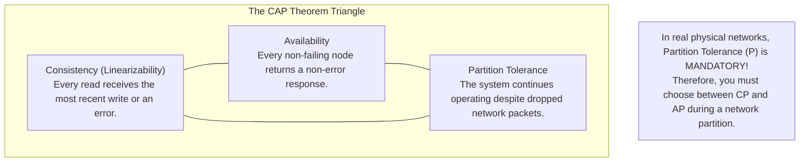
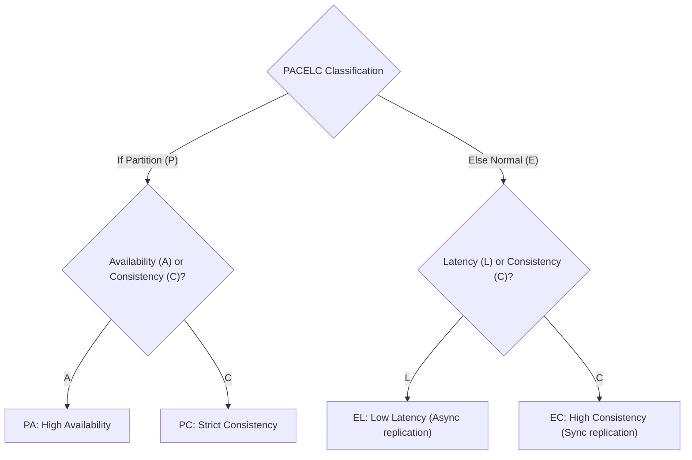
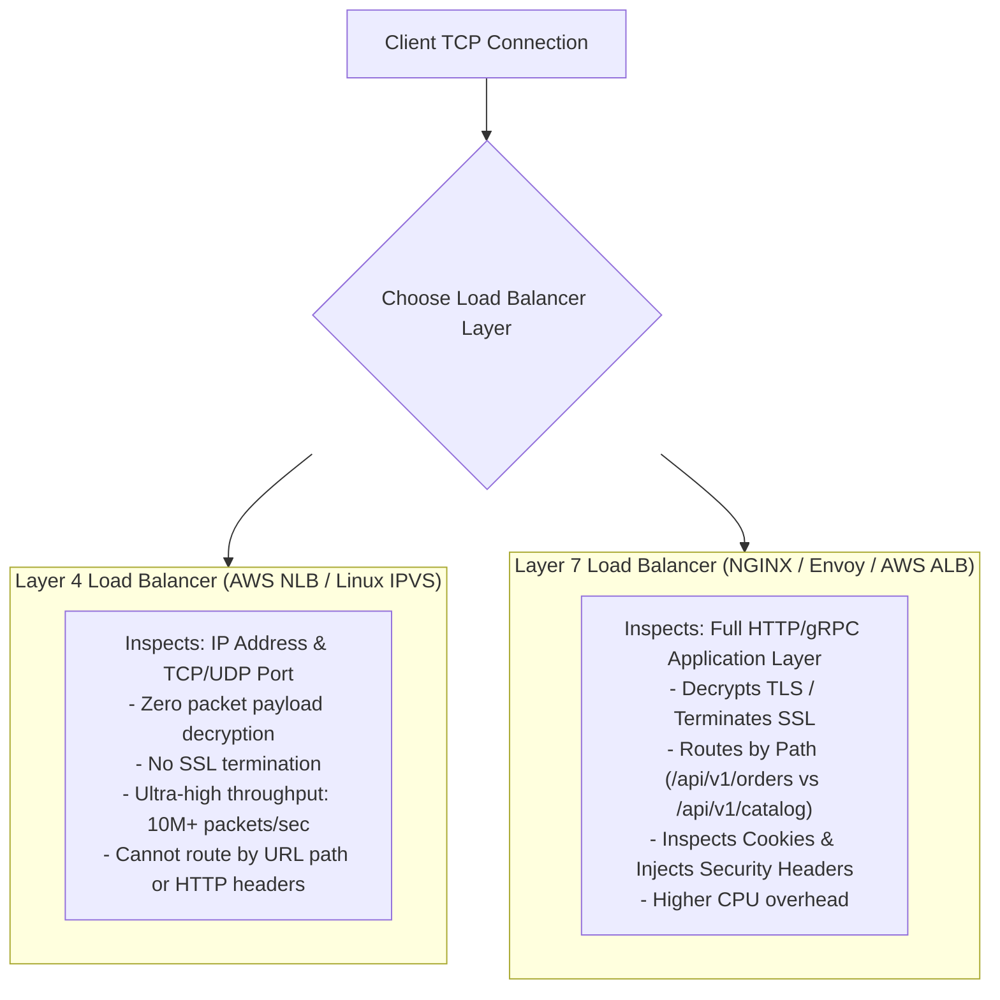
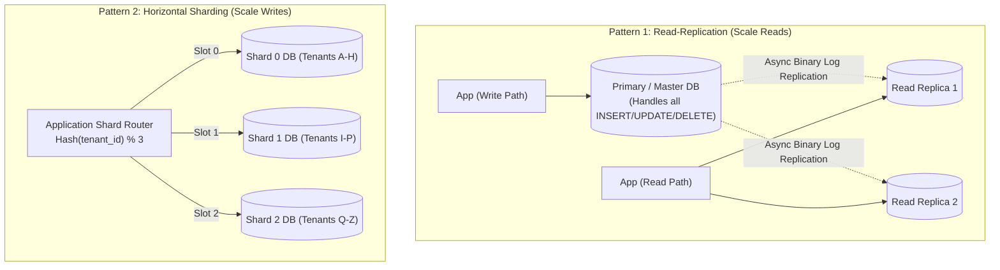
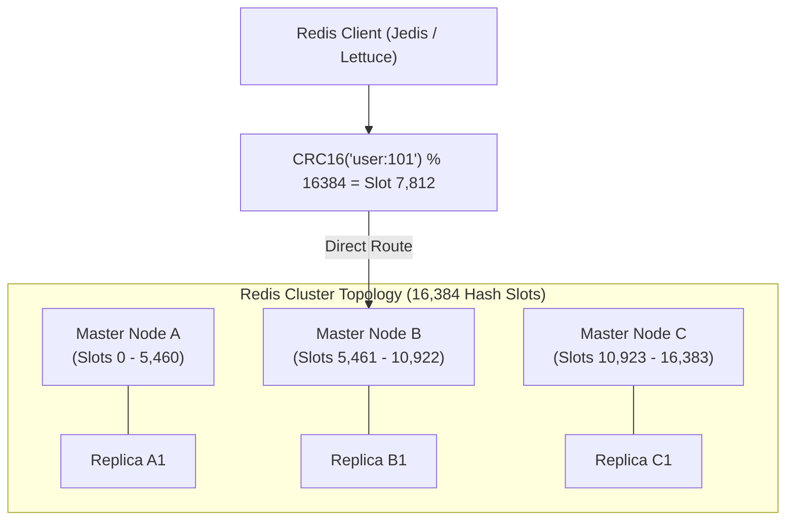
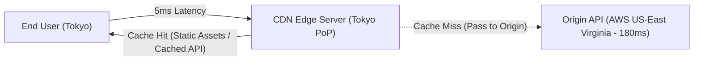

Designing a software system that comfortably handles 1,000 concurrent users is relatively straightforward. Designing a global architecture that scales seamlessly from 100,000 to 50 million active users across three continents without collapsing under database locks or network congestion requires a mastery of foundational distributed systems patterns.

Scalability is not about throwing larger AWS instances at the problem (Vertical Scaling / Scaling Up). Vertical scaling has a hard hardware ceiling and an exponential cost curve. True enterprise scale requires **Horizontal Scaling (Scaling Out)**—designing stateless application tiers and distributed data partitions that scale linearly by adding commodity nodes.

In this guide, we will step into the role of a Principal System Architect. We will dissect the **CAP and PACELC theorems**, contrast **L4 versus L7 load balancing**, conquer **database sharding and replication lag**, navigate **Redis Cluster hash slot topologies**, and leverage **Content Delivery Networks (CDNs)** at the edge.

---

## The True Trade-Offs: CAP vs PACELC Theorem

In 2000, Eric Brewer proposed the **CAP Theorem**: a distributed data store can simultaneously guarantee at most two of the following three properties:



### Why "CA" Does Not Exist in Distributed Systems
Network partitions (fiber cuts, hardware switch failures, GC pauses) are an inescapable law of physics. When a network partition occurs between Datacenter East and Datacenter West:
- If you allow writes on East, West will be out of date. If West accepts reads, it returns stale data (**Violates Consistency -> AP**).
- If you refuse writes or block reads until East and West can synchronize, you reject incoming client requests (**Violates Availability -> CP**).
You cannot choose "CA" unless your entire system runs on a single physical machine with zero network connections.

---

### The PACELC Theorem (The Complete Picture)
In 2012, computer scientist Daniel Abadi noted that CAP only describes what happens **during rare network partitions**. What trade-offs occur during the 99.99% of time when the network is behaving normally?

```
 If there is a Partition (P):
    How do you trade off Availability (A) vs Consistency (C)?
 Else (E):
    How do you trade off Latency (L) vs Consistency (C)?
```



### Real-World PACELC Systems
- **MongoDB**: **PC / EC**. In a partition, it rejects writes on minority partitions to maintain consistency (PC). Under normal conditions, it requires primary acknowledgments for strong consistency (EC).
- **Apache Cassandra / Amazon DynamoDB**: **PA / EL**. In a partition, nodes accept writes locally (PA). Under normal conditions, replicas synchronize asynchronously to deliver single-digit millisecond latency (EL).
- **Google Spanner**: **PC / EC**. Uses atomic GPS/atomic clock synchronization (TrueTime API) to provide external consistency worldwide at the cost of slight latency overhead.

---

## Load Balancing: Layer 4 vs Layer 7

Load balancers distribute incoming traffic across pools of backend application servers. They operate at two distinct layers of the OSI model:



| Dimension | Layer 4 (Transport / TCP) | Layer 7 (Application / HTTP) |
|---|---|---|
| **OSI Layer** | Layer 4 (TCP, UDP) | Layer 7 (HTTP, HTTPS, gRPC, WebSockets) |
| **Payload Inspection** | None. Looks only at IP headers and port numbers. | Deep packet inspection (URI paths, headers, JSON cookies). |
| **TLS Termination** | Passes raw encrypted TCP bytes directly to backend. | Terminates TLS, inspects plaintext, re-encrypts if needed. |
| **Throughput / Latency** | Extreme throughput, microsecond latency. | Lower throughput, millisecond latency (CPU bound by parsing). |
| **Routing Flexibility** | Simple round-robin, hash of client IP/port. | Intelligent routing (A/B testing, Canary, URL path rewrites). |

---

## Database Scalability: Read Replication vs Horizontal Sharding

When a relational database reaches its computational limit, you scale it through two primary architectural patterns:



### The Read-Your-Own-Writes Replication Lag Nightmare
In Read-Replication, the primary database streams changes asynchronously to read replicas. Under heavy load, replicas can lag behind the primary by 200ms to 5 seconds (**Replication Lag**).

If a user updates their shipping address (written to the Primary) and the browser immediately refreshes the page (routed to a lagging Read Replica), the user sees their old address!

#### Production Defenses Against Replication Lag
1. **Sticky Session Routing**: Route a user's read requests to the Primary database for 5 seconds immediately following any write operation.
2. **Replication Lag Tracking**: If a replica's replication lag exceeds 500ms, automatically evict it from the active read pool.
3. **Optimistic UI Caching**: Update the frontend DOM immediately without refetching from the backend.

---

### Horizontal Sharding: Splitting the Monolith Table
When write volume exceeds what a single high-end database server can process (e.g., 20,000 writes/sec), you must **shard** the data across multiple physical database instances.

#### Selecting the Shard Key
The choice of **Shard Key** is the most critical decision in database architecture:
- **Tenant ID (Multi-tenant SaaS)**: All data for Tenant 42 lands on Shard 2. Clean, fast, zero cross-shard joins for normal operations.
- **Customer ID**: All orders for Customer A land on Shard 1.
- *The Danger*: **The Celebrity / Hot Shard Problem**. If Tenant 42 is Apple or Nike, Shard 2 will melt down while Shards 1, 3, and 4 sit 98% idle. You must use salt hashing or dedicated single-tenant sharding for hyperscale accounts.

---

## Distributed Caching: Redis Cluster and 16,384 Hash Slots

A single Redis instance can process 100,000 operations per second in-memory. But what happens when your dataset exceeds 128 GB of RAM or your throughput demands reach 1,000,000 ops/second? You deploy a **Redis Cluster**.



### How Redis Cluster Works
1. Redis Cluster divides the entire keyspace into **16,384 logical Hash Slots**.
2. Master nodes divide the hash slots among themselves (e.g., Node A holds slots 0 to 5,460).
3. To locate the node for a key, the client calculates:
   `slot = CRC16(key) % 16384`
4. Smart client drivers (like Lettuce in Spring Boot) maintain an in-memory routing table mapping slots to node IP addresses, routing commands directly to the correct master node in a single network hop!

### The Multi-Key Hash Tag Solution
In Redis Cluster, multi-key operations (like `MGET` or Lua transactions) fail with a `CROSSSLOT Keys in request don't hash to the same slot` error if the keys hash to different slots.

To force related keys onto the exact same hash slot and node, use **Hash Tags** `{...}`:
- `{user:101}:profile`
- `{user:101}:orders`
- `{user:101}:preferences`

Redis calculates the CRC16 hash **only on the text inside the curly braces**, guaranteeing all three keys land on the exact same master node!

---

## Edge Caching: Content Delivery Networks (CDNs)

A packet travelling over fiber from Sydney, Australia to an AWS datacenter in Virginia, USA takes approximately **220 milliseconds round-trip** due to the speed of light in fiber optics. No amount of Java optimization can overcome the speed of light.

A **Content Delivery Network (CDN)** deploys hundreds of Points of Presence (PoPs) at the physical edges of the internet, caching data within 10 milliseconds of end users.



### Modern Dynamic API Caching with `Cache-Control`
CDNs do not just cache static images and CSS; they can cache read-only REST API endpoints at the edge:

```http
HTTP/1.1 200 OK
Content-Type: application/json
Cache-Control: public, max-age=60, s-maxage=300, stale-while-revalidate=60
```
- **`s-maxage=300`**: Tells the CDN edge proxy to cache the response for 5 minutes.
- **`stale-while-revalidate=60`**: If a request arrives within 60 seconds after expiration, the CDN serves the stale cached response instantly (<10ms), while asynchronously fetching fresh data from the origin server in the background!

---

## Architectural Traps and Real-World Outages

### The "Hot Shard Flash Sale" Meltdown
A major ticketing platform sharded their database by `event_id`. 
When tickets for a global stadium tour went on sale, 4 million users flooded the website simultaneously. All 4 million requests were for `event_id = 998877`, mapping 100% of global traffic directly to **Shard 7**. 

Shard 7's CPU utilization spiked to 100%, disk IOPS exhausted, and the database locked up within 20 seconds. Meanwhile, Shards 1 through 6 sat completely idle at 1% CPU utilization!

**The Fix:** For mega-events, implement a pre-allocated write buffer in Redis or shard high-volume entities using a compound key with random virtual salt partitions: `hash(event_id + "_" + random(0, 10))`.

### The "Cache Stampede / Thundering Herd" Outage
An e-commerce homepage cached the featured product list in Redis with a fixed 1-hour TTL (`ttl = 3600`). 
At 12:00:00 PM, the cache key expired. 
At that exact millisecond, 8,000 incoming requests found a cache miss simultaneously. All 8,000 threads fired the heavy database query at the exact same instant, exhausting the HikariCP connection pool and crashing the PostgreSQL primary.

**The Fix:** Use probabilistic early expiration (XFetch algorithm) or combine cache reads with mutual exclusion locking:
```java
@Cacheable(cacheNames = "featured_products", sync = true)
```

---

## Senior Interview Questions

### Question 1: What is the fundamental difference between the CAP Theorem and the PACELC Theorem?
**Answer:**  
The CAP Theorem states that in the presence of a network **Partition (P)**, a distributed system must choose between **Availability (A)** and **Consistency (C)**. However, CAP ignores system trade-offs when the network is healthy and functioning normally.

The PACELC Theorem expands CAP to cover normal operation:
- **If Partitioned (P)**: Choose between **Availability (A)** and **Consistency (C)**.
- **Else (E)** (normal operation): Choose between **Latency (L)** and **Consistency (C)**.
For example, a system might choose High Availability during a partition (PA), but under normal conditions, choose low latency over strong consistency (EL) by replicating writes asynchronously (e.g., Cassandra / DynamoDB).

### Question 2: In database sharding, what is the "Cross-Shard Query Problem", and how do distributed architectures mitigate it?
**Answer:**  
The Cross-Shard Query problem occurs when an application needs to execute a query that does not include the Shard Key in its `WHERE` clause, or requires joining tables partitioned across different physical database instances. 

To execute `SELECT * FROM orders WHERE status = 'PENDING'`, the application must issue a **Scatter-Gather query**: broadcast the query across every single physical shard, wait for all shards to respond over the network, merge the result sets in application memory, and sort/paginate the aggregated list.

**Mitigation Strategies:**
1. **Denormalized CQRS Read Models**: Stream change events to a centralized search index (Elasticsearch) that indexes all fields for fast global filtering.
2. **Careful Shard Key Selection**: Align the shard key with the dominant access pattern (e.g., sharding by `tenant_id` ensures 99% of enterprise queries stay within a single shard).

### Question 3: How does Consistent Hashing minimize data movement when nodes are added or removed from a caching cluster?
**Answer:**  
In naive modulo hashing (`node = hash(key) % N`), if you have 10 nodes and add an 11th node (`N = 11`), almost **every single key in the cluster** maps to a new node index (roughly 91% of keys move), completely destroying the cache and overwhelming backend databases.

**Consistent Hashing** maps both cache nodes and keys onto a virtual circular ring (from 0 to 2^32 - 1). A key is assigned to the first node encountered moving clockwise around the ring. 
When a new node is added or removed, **only a fraction (1/N) of keys are re-routed to the new node**, while the remaining `(N - 1) / N` keys remain safely mapped to their existing nodes. Virtual nodes (replicas) are placed across the ring to ensure even key distribution.

### Question 4: What is the difference between Cache-Aside, Write-Through, and Write-Behind (Write-Back) caching patterns?
**Answer:**  
- **Cache-Aside (Lazy Loading)**: The application is responsible for cache management. On a read, it checks the cache; if a miss occurs, it queries the database and populates the cache. On a write, it updates the database and evicts the cache key.
  - *Pros:* Resilient (cache failure doesn't stop writes).
  - *Cons:* Cache misses incur three network hops.
- **Write-Through**: The application writes exclusively to the cache layer; the cache synchronously writes to the database before acknowledging success to the caller.
  - *Pros:* Cached data is always fresh; eliminates stale reads.
  - *Cons:* Write latency is higher because it waits for both cache and database writes to complete.
- **Write-Behind (Write-Back)**: The application writes to the cache, which acknowledges immediately. The cache asynchronously batches and flushes writes to the database in the background.
  - *Pros:* Extreme write performance and throughput.
  - *Cons:* Risk of data loss if the cache node crashes before flushing dirty writes to the durable database.
