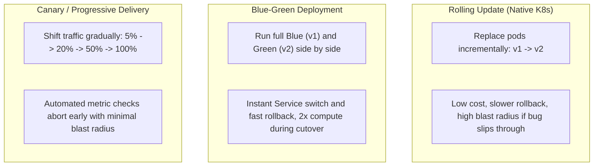
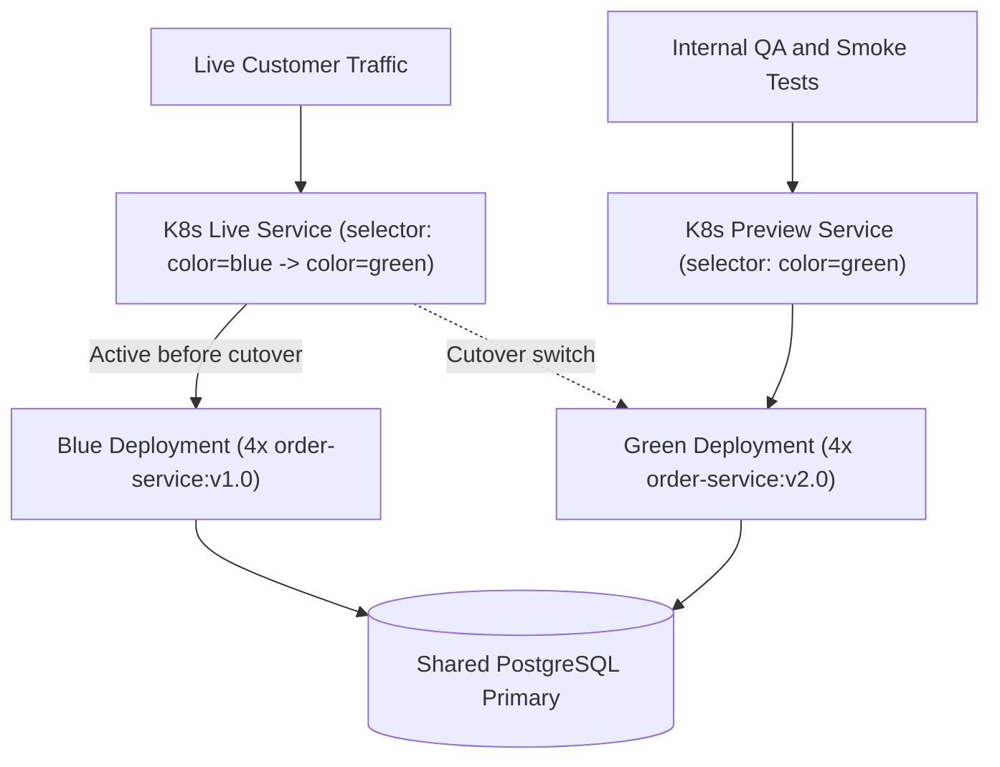
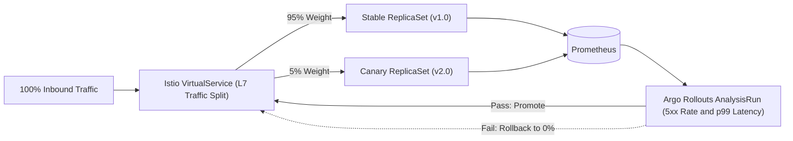
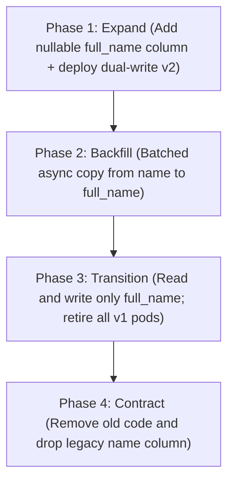
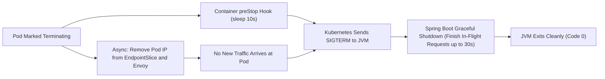

Running `kubectl rollout restart` or letting a default Kubernetes `Deployment` perform a rolling update is rarely enough for true zero-downtime releases. Every deployment introduces a window where version 1 and version 2 run at the same time against live traffic and the same shared database.

Three things routinely break during that overlap:
- A subtle bug or memory leak in v2 rolls out to every pod before anyone notices, leaving you scrambling through a slow reverse rollout.
- A schema migration renames or drops a column while v1 pods are still serving queries, immediately throwing SQL errors.
- Kubernetes sends `SIGTERM` to an old pod before ingress controllers and kube-proxy stop sending new requests to its IP, causing a burst of `502 Bad Gateway` errors for users in the middle of checkout.

Eliminating those failure modes takes three layers working together: controlled traffic shifting (Blue-Green or Canary), backward-compatible database migrations (Expand and Contract), and properly timed connection draining between Kubernetes and Spring Boot.

## Comparing Rolling Update, Blue-Green, and Canary Strategies



| Dimension | Rolling Update | Blue-Green | Canary (Progressive Delivery) |
| :--- | :--- | :--- | :--- |
| **Rollback Speed** | Slow (reverse pod replacement) | Near-instant (flip Service selector or ingress) | Fast (set canary weight back to 0%) |
| **Compute Overhead** | Low (small `maxSurge`) | High (2x full replica count during release) | Low to moderate (small canary replica pool) |
| **Blast Radius** | High (all traffic eventually hits v2) | High (100% shifts at once on cutover) | Small (1% to 5% initially exposed) |
| **v1/v2 Overlap Duration** | Minutes | Short cutover + rollback grace period | Minutes to hours during staged promotion |
| **Infrastructure Needed** | Built-in Kubernetes `Deployment` | Two Deployments + Service/Ingress switch | Service Mesh (Istio) or Ingress + Argo Rollouts |

## Blue-Green Deployments and Traffic Cutover

In a Blue-Green deployment, two full-capacity environments run side by side. **Blue** serves 100% of production traffic (v1.0) while **Green** is spun up with v2.0, connected to the same backing services, and kept isolated from public traffic until smoke tests pass.



### Kubernetes Service Selector Cutover

In plain Kubernetes, Blue and Green are two separate `Deployment` objects differentiated by a label such as `color: blue` and `color: green`. A public `Service` routes traffic strictly by matching that label, while an internal preview `Service` lets CI run automated verification against the idle environment before cutover:

```yaml
apiVersion: v1
kind: Service
metadata:
  name: order-service-live
spec:
  selector:
    app: order-service
    color: blue # Flip to "green" during cutover
  ports:
    - name: http
      port: 80
      targetPort: 8080
---
apiVersion: v1
kind: Service
metadata:
  name: order-service-preview
spec:
  selector:
    app: order-service
    color: green
  ports:
    - name: http
      port: 80
      targetPort: 8080
```

Once smoke tests against `order-service-preview` succeed, cutting over traffic (or rolling back if metrics degrade) is a single selector patch:

```bash
# Cut over live traffic from Blue to Green
kubectl patch service order-service-live \
  -p '{"spec":{"selector":{"app":"order-service","color":"green"}}}'

# Instant rollback to Blue if Green misbehaves
kubectl patch service order-service-live \
  -p '{"spec":{"selector":{"app":"order-service","color":"blue"}}}'
```

Keep Blue warm for a short stabilization window (for example, 30 to 60 minutes) before scaling it down to zero so you retain the fast rollback path.

### The Shared State and Database Rollback Caveat

A Blue-Green router flip is only reversible if Blue can still understand data written while Green was live. Two things commonly break an otherwise instant rollback:

1. **Non-backward-compatible schema changes:** If Green dropped or altered a column Blue queries, flipping back to Blue immediately fails.
2. **Incompatible serialized payloads in shared caches or databases:** If Green writes a new JSON field structure or Java serialized object into a shared Redis cache, or inserts a new enum string into a PostgreSQL column that Blue's Java `enum` does not recognize, rolling back to Blue triggers deserialization exceptions. Version your Redis cache keys (e.g., `order:v2:{id}`) and treat enum/schema additions defensively.

## Canary Deployments with Istio and Argo Rollouts

Blue-Green eliminates deployment downtime, but flipping 100% of users at once still exposes everyone to bugs that only surface under real production data distributions. **Canary deployments** shift a small slice of live traffic (say 5%) to v2 first, compare its telemetry against reliability thresholds, and promote in stages (`5% -> 20% -> 50% -> 100%`).

Plain Kubernetes Services distribute requests roughly by pod replica count: achieving a 5% canary with a native Service requires 19 stable pods and 1 canary pod. For precise fractional routing independent of replica count, pair an L7 traffic router such as **Istio** with **Argo Rollouts**.



### Istio Traffic Splitting (`DestinationRule` and `VirtualService`)

Istio separates **where** traffic can go (`DestinationRule` subsets) from **how much** traffic goes to each subset (`VirtualService` route weights). You can also add header-based matching so internal engineers or automated tests reach the canary before external users do:

```yaml
apiVersion: networking.istio.io/v1beta1
kind: DestinationRule
metadata:
  name: order-service-destrule
spec:
  host: order-service
  subsets:
    - name: stable
      labels:
        app: order-service
    - name: canary
      labels:
        app: order-service
---
apiVersion: networking.istio.io/v1beta1
kind: VirtualService
metadata:
  name: order-service-vsvc
spec:
  hosts:
    - order-service
  http:
    # Optional: route internal QA traffic directly to canary via HTTP header
    - match:
        - headers:
            x-canary-opt-in:
              exact: "true"
      route:
        - destination:
            host: order-service
            subset: canary
    # Default weighted split managed dynamically by Argo Rollouts
    - name: primary
      route:
        - destination:
            host: order-service
            subset: stable
          weight: 100
        - destination:
            host: order-service
            subset: canary
          weight: 0
```

Argo Rollouts injects the exact pod-template hash label into the `stable` and `canary` subsets of the `DestinationRule` and dynamically updates the weights on the `primary` route in the `VirtualService` as the rollout advances.

### Progressive Delivery with an Argo `Rollout`

Replace your standard Kubernetes `Deployment` with an Argo Rollouts `Rollout` resource wired to the Istio `VirtualService` and `DestinationRule`:

```yaml
apiVersion: argoproj.io/v1alpha1
kind: Rollout
metadata:
  name: order-service
spec:
  replicas: 6
  revisionHistoryLimit: 3
  selector:
    matchLabels:
      app: order-service
  strategy:
    canary:
      trafficRouting:
        istio:
          virtualService:
            name: order-service-vsvc
            routes:
              - primary
          destinationRule:
            name: order-service-destrule
            canarySubsetName: canary
            stableSubsetName: stable
      steps:
        - setWeight: 5
        - pause: { duration: 5m }
        - analysis:
            templates:
              - templateName: order-service-canary-check
            args:
              - name: canary-hash
                valueFrom:
                  podTemplateHashValue: Latest
        - setWeight: 20
        - pause: { duration: 10m }
        - analysis:
            templates:
              - templateName: order-service-canary-check
            args:
              - name: canary-hash
                valueFrom:
                  podTemplateHashValue: Latest
        - setWeight: 50
        - pause: { duration: 10m }
        - setWeight: 100
  template:
    metadata:
      labels:
        app: order-service
    spec:
      terminationGracePeriodSeconds: 60
      containers:
        - name: order-service
          image: ghcr.io/example-org/order-service:2.1.0
          ports:
            - containerPort: 8080
```

### Automated Rollbacks with `AnalysisTemplate` and Prometheus

Argo Rollouts automates rollback decisions using an `AnalysisTemplate`. Passing `canary-hash` lets the PromQL queries isolate the canary pods specifically (via the `rollouts_pod_template_hash` label scraped by Prometheus) instead of letting healthy stable pods dilute a bad canary's error rate.

```yaml
apiVersion: argoproj.io/v1alpha1
kind: AnalysisTemplate
metadata:
  name: order-service-canary-check
spec:
  args:
    - name: canary-hash
  metrics:
    - name: canary-5xx-error-rate
      interval: 1m
      count: 5
      # Pass if 5xx error ratio stays below 0.5% (0.005)
      successCondition: len(result) == 0 || result[0] < 0.005
      failureLimit: 2
      provider:
        prometheus:
          address: http://prometheus-server.monitoring.svc.cluster.local:9090
          query: |
            sum(rate(http_server_requests_seconds_count{
              application="order-service",
              rollouts_pod_template_hash="{{args.canary-hash}}",
              status=~"5.."
            }[2m]))
            /
            clamp_min(
              sum(rate(http_server_requests_seconds_count{
                application="order-service",
                rollouts_pod_template_hash="{{args.canary-hash}}"
              }[2m])),
              0.001
            )

    - name: canary-p99-latency-seconds
      interval: 1m
      count: 5
      # Pass if canary p99 latency stays below 400ms (0.4s)
      successCondition: len(result) == 0 || result[0] < 0.4
      failureLimit: 2
      provider:
        prometheus:
          address: http://prometheus-server.monitoring.svc.cluster.local:9090
          query: |
            histogram_quantile(
              0.99,
              sum(rate(http_server_requests_seconds_bucket{
                application="order-service",
                rollouts_pod_template_hash="{{args.canary-hash}}"
              }[2m])) by (le)
            )
```

When an `AnalysisRun` detects two failed checks on either metric, Argo Rollouts immediately marks the rollout as **Degraded**, resets the Istio `VirtualService` back to 100% `stable` and 0% `canary`, and scales down the canary ReplicaSet. No human intervention is needed to stop the bleeding.

> [!WARNING]
> Watch out for **low-traffic false positives**. If a service receives only 20 requests per minute, a 5% canary gets 1 request per minute, so one transient downstream timeout looks like a 100% error rate. On low-volume services, either raise the initial canary weight (for example, 10 to 20%), use a wider evaluation window, or verify synthetic traffic alongside real traffic.

## The Expand and Contract Pattern for Zero-Downtime Database Migrations

Because v1 and v2 run concurrently against the same database during both Blue-Green and Canary deployments, destructive migrations (`ALTER TABLE ... RENAME COLUMN`, `DROP COLUMN`, or changing a column's type in place) immediately break whichever version does not expect the new schema.

The **Expand and Contract** pattern breaks an incompatible change into four safe, sequential steps across multiple deployments.



Walk through renaming `customers.name` to `customers.full_name` in PostgreSQL with Flyway and Spring Data JPA without dropping a single request:

### Phase One: Expand Schema and Dual-Write

Run an additive Flyway migration before deploying v2. Adding a nullable column in PostgreSQL is a fast metadata-only operation that does not rewrite the table:

```sql
-- V12__add_customer_full_name.sql
ALTER TABLE customers ADD COLUMN full_name VARCHAR(255);

-- If you need an index on the new column, always build it concurrently to avoid blocking writes
CREATE INDEX CONCURRENTLY IF NOT EXISTS idx_customers_full_name
    ON customers (full_name);
```

> [!NOTE]
> In Flyway with PostgreSQL, `CREATE INDEX CONCURRENTLY` cannot run inside a transaction block. Place it in a dedicated migration file configured with non-transactional execution (or disable transactions for that migration in Flyway).

Next, deploy v2 so every write populates **both** columns, while reads prefer `full_name` and fall back to `name` for rows that have not been backfilled yet. Existing v1 pods continue reading and writing `name` without noticing `full_name` exists.

```java
@Entity
@Table(name = "customers")
public class Customer {

    @Id
    private Long id;

    @Column(name = "name")
    private String legacyName;

    @Column(name = "full_name")
    private String fullName;

    public String getDisplayName() {
        return fullName != null ? fullName : legacyName;
    }

    public void updateName(String value) {
        // Dual-write keeps both v1 and v2 consistent during the transition
        this.legacyName = value;
        this.fullName = value;
    }
}
```

### Phase Two: Batched Asynchronous Backfill

Once 100% of pods run the dual-write code, backfill historical rows where `full_name IS NULL`. Never run a single giant `UPDATE customers SET full_name = name` on a multi-million-row table: it locks rows for minutes, bloats PostgreSQL dead tuples, and spikes replication lag. Update in small primary-key chunks with brief pauses between batches:

```sql
-- Repeat in a throttled background job until 0 rows are updated
UPDATE customers
SET full_name = name
WHERE id IN (
    SELECT id
    FROM customers
    WHERE full_name IS NULL
    ORDER BY id
    LIMIT 5000
);
```

### Phase Three: Transition and Validate Constraints

When zero rows have `full_name IS NULL`, enforce `NOT NULL` safely without holding a long `ACCESS EXCLUSIVE` table scan lock (PostgreSQL 12+ supports `NOT VALID` check constraints):

```sql
-- V13__validate_customer_full_name_not_null.sql
ALTER TABLE customers
    ADD CONSTRAINT chk_customers_full_name_not_null
    CHECK (full_name IS NOT NULL) NOT VALID;

-- Validates existing rows using SHARE UPDATE EXCLUSIVE (allows concurrent reads and writes)
ALTER TABLE customers
    VALIDATE CONSTRAINT chk_customers_full_name_not_null;
```

Deploy v3, which reads and writes exclusively to `full_name` and stops touching `legacyName`. Verify that no v1 or v2 pods remain running.

### Phase Four: Contract

After v3 has stabilized past your rollback window, remove the `legacyName` field from the JPA entity and apply the final cleanup migration:

```sql
-- V14__drop_legacy_customer_name.sql
ALTER TABLE customers DROP COLUMN name;
```

## Eliminating 502 Errors: Readiness Probes, `preStop` Hooks, and Graceful Shutdown

Even with a spotless Canary rollout and backward-compatible database migrations, you will still see `502 Bad Gateway` or `Connection reset by peer` errors during deployments if Kubernetes kills pods before in-flight HTTP requests finish.

The root cause is a classic Kubernetes race condition during pod termination:
1. Kubernetes marks the pod `Terminating` and starts updating `EndpointSlice` objects asynchronously so kube-proxy, Ingress controllers, and Istio Envoy proxies remove the pod IP from their routing tables.
2. **At the same time**, Kubernetes sends `SIGTERM` to the container.

Propagating endpoint removal across all cluster nodes takes anywhere from a few hundred milliseconds to several seconds. If Spring Boot immediately stops accepting connections upon receiving `SIGTERM`, any request routed to that pod during those few seconds fails with a connection refused error.



### Spring Boot 3 Graceful Shutdown Configuration

Enable graceful shutdown and Kubernetes health probe groups in `application.yml`:

```yaml
server:
  # Stops accepting new requests on SIGTERM and lets active requests complete
  shutdown: graceful

spring:
  lifecycle:
    # Maximum wait for active requests before shutting down remaining beans
    timeout-per-shutdown-phase: 30s

management:
  endpoint:
    health:
      probes:
        # Exposes /actuator/health/liveness and /actuator/health/readiness
        enabled: true
```

When Spring Boot starts, it marks `/actuator/health/readiness` as `OUT_OF_SERVICE` until the application context is ready, and flips it back to `OUT_OF_SERVICE` as soon as graceful shutdown begins.

### Kubernetes Pod Spec Alignment

Configure `readinessProbe`, `livenessProbe`, `preStop`, and `terminationGracePeriodSeconds` together so their timings line up:

```yaml
spec:
  # Must exceed preStop sleep (10s) + Spring timeout-per-shutdown-phase (30s) + buffer
  terminationGracePeriodSeconds: 60
  containers:
    - name: order-service
      image: ghcr.io/example-org/order-service:2.1.0
      ports:
        - containerPort: 8080
      readinessProbe:
        httpGet:
          path: /actuator/health/readiness
          port: 8081
        initialDelaySeconds: 10
        periodSeconds: 5
        failureThreshold: 3
      livenessProbe:
        httpGet:
          path: /actuator/health/liveness
          port: 8081
        initialDelaySeconds: 20
        periodSeconds: 10
        failureThreshold: 3
      lifecycle:
        preStop:
          exec:
            # Give kube-proxy / Ingress / Istio time to drop this pod before SIGTERM
            command: ["sh", "-c", "sleep 10"]
```

Notice the timing budget: `10s (preStop) + 30s (Spring graceful shutdown) = 40s`, leaving 20 seconds of margin inside `terminationGracePeriodSeconds: 60` before Kubernetes forces `SIGKILL`. If you forget to raise `terminationGracePeriodSeconds` from the default 30 seconds, Kubernetes will `SIGKILL` your JVM right in the middle of Spring Boot's 30-second drain window.

### Sticky Sessions and Long-Lived Connections

Short-lived stateless HTTP/1.1 requests drain cleanly with the configuration above. Two stateful patterns need extra care during Blue-Green or Canary switches:

- **Sticky sessions:** Cookie-based session affinity pins returning users to Blue pods even after a router switch. Externalize session state to Redis (for example, via Spring Session Data Redis) so any pod can handle any request.
- **Persistent WebSockets and HTTP/2 gRPC streams:** Existing TCP connections stay open on old pods because load balancers only re-evaluate routing rules on new connections or streams. For WebSockets, send a `1001 Going Away` close frame during shutdown so clients reconnect cleanly to the new version. For gRPC, configure server-side `maxConnectionAge` and `maxConnectionAgeGrace` so clients periodically reconnect across new Envoy endpoints.

## Practical Questions

### Why is a single-step `ALTER TABLE ... RENAME COLUMN` unsafe during Blue-Green or Canary deployments, and how does Expand-and-Contract solve it?

During both Blue-Green cutovers (including the rollback window) and Canary rollouts, v1 and v2 pods query the same database concurrently. Renaming a column immediately breaks v1 pods if applied before deploying v2, or breaks v2 pods if applied afterward. Expand-and-Contract keeps the database compatible with both versions at every step: add the new column as nullable (Expand), deploy dual-write code and backfill historical rows in throttled batches, switch reads and writes to the new column once v1 is retired (Transition), and only drop the old column in a later release after the rollback window closes (Contract).

### When is Blue-Green preferable to Canary, and what can break a "one-second" Blue-Green rollback?

Blue-Green works well when you want clean environment separation, full pre-cutover verification against production dependencies, or when your architecture does not easily support fractional L7 traffic splitting. Canary is better for high-traffic user-facing services where exposing 100% of users at once carries too much risk. A Blue-Green rollback breaks if Green mutated shared state in a way Blue cannot read, such as executing a destructive DB migration, writing incompatible serialized objects into shared Redis keys, or persisting new enum values that crash Blue's deserializers.

### How does Argo Rollouts know when to roll back a Canary automatically, and why must the PromQL query filter by canary pod hash?

Argo Rollouts runs an `AnalysisRun` from an `AnalysisTemplate` at defined rollout steps, polling Prometheus on a fixed interval against boolean conditions such as 5xx error rate < 0.5% and p99 latency < 400 ms. If failures reach `failureLimit`, Argo Rollouts aborts the release, resets the Istio `VirtualService` weight to 0% canary / 100% stable, and scales down the canary ReplicaSet. Filtering the PromQL query by `rollouts_pod_template_hash` is critical because at 5% canary traffic, an unfiltered service-wide error metric averages 95% healthy stable traffic with 5% broken canary traffic. A canary failing 10% of its requests would look like a 0.5% service-wide error rate and slip past the gate.

### Why do Spring Boot applications still return 502 errors during Kubernetes deployments even with `server.shutdown=graceful` enabled?

Because Kubernetes removes the terminating pod's IP from `EndpointSlice` and sends `SIGTERM` in parallel, not sequentially. Without a `preStop` sleep hook (typically 5 to 15 seconds), Spring Boot receives `SIGTERM` and stops accepting new connections before kube-proxy or the Ingress/Envoy proxies finish updating their routing tables, so freshly routed requests hit a closed listener and return `502 Bad Gateway`. You must also set `terminationGracePeriodSeconds` higher than `preStop sleep` plus `spring.lifecycle.timeout-per-shutdown-phase` so Kubernetes does not send `SIGKILL` before in-flight requests finish.
