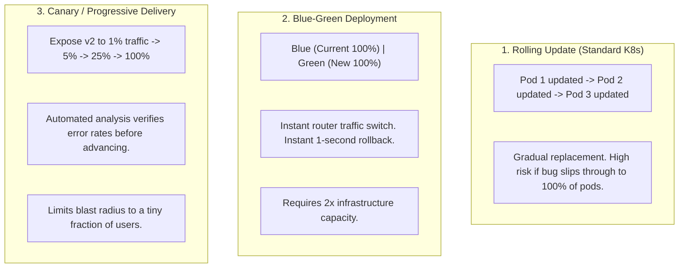
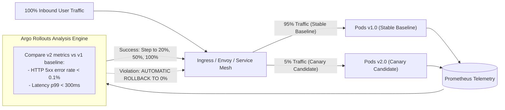
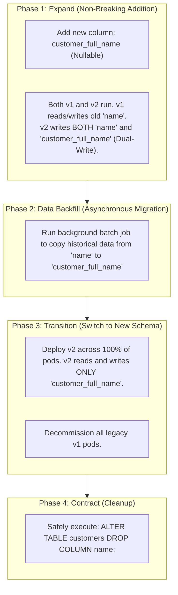

# Zero-Downtime Deployments: Blue-Green and Canary

In modern enterprise engineering, scheduled maintenance windows—taking a service offline at 2:00 AM on a Sunday to deploy updates—are relics of the past. In global cloud architectures with users across every time zone, **downtime directly translates to lost revenue and customer churn**.

However, achieving true **Zero-Downtime Deployments** is far more complex than running `kubectl rollout restart`. 

During a deployment, two distinct versions of your application (v1 and v2) must run simultaneously:
- What happens if v2 contains a memory leak that only surfaces under heavy production concurrency? If you used a simple rolling update, all v1 pods are terminated before you notice the bug, forcing an emergency outage.
- What happens if v2 requires a database schema change (like renaming a column)? If you rename the column in PostgreSQL before deploying v2, the running v1 pods immediately crash with SQL syntax errors. If you deploy v2 before renaming the column, v2 crashes.

To release software continuously without risking downtime, modern Site Reliability Engineers (SREs) adopt **Blue-Green Deployments**, **Canary Analysis**, and the **Expand and Contract Database Migration Pattern**.

---

## The Three Deployment Strategies Compared



| Dimension | Rolling Update | Blue-Green Deployment | Canary / Progressive Delivery |
| :--- | :--- | :--- | :--- |
| **Rollback Speed** | Slow (requires reverse rolling update) | **Instantaneous** (single router flip) | Fast (route traffic back to baseline) |
| **Infrastructure Cost** | Low (only small surge capacity) | High (requires 2x full cluster capacity) | Low-to-Moderate (small canary capacity) |
| **Risk / Blast Radius** | High (100% of users eventually affected) | High (traffic flips to 100% immediately) | **Minimal** (tested on 1% to 5% of real users) |
| **Complexity** | Simple (built into native Kubernetes) | Moderate (requires ingress/router control) | Advanced (requires service mesh or Argo Rollouts) |

---

## Blue-Green Deployments: Architecture and Traffic Flipping

In a **Blue-Green** deployment, two identical production environments exist side-by-side:
- **Blue Environment:** Currently active, serving 100% of live user traffic running version 1.0.
- **Green Environment:** Completely idle, newly provisioned running version 2.0.

```mermaid
flowchart TD
    subgraph Users["Live User Traffic"]
        UserTraffic["Incoming Customer Requests"]
    end

    subgraph RoutingLayer["Edge Routing / Service Mesh (Ingress / Envoy / AWS ALB)"]
        Router{"Traffic Router (Service Selector)"}
    end

    subgraph BlueEnv["Blue Environment (Active Live: v1.0)"]
        BluePods["4x Pods (order-service:1.0)"]
    end

    subgraph GreenEnv["Green Environment (Idle Staging: v2.0)"]
        GreenPods["4x Pods (order-service:2.0)"]
    end

    subgraph DatabaseTier["Shared Persistent Database Tier"]
        DB[(PostgreSQL Primary)]
    end

    UserTraffic --> Router
    Router -->|"1. Currently Routing 100% Traffic"| BluePods
    Router -.->|"2. Internal Smoke Testing & QA"| GreenPods
    
    BluePods --> DB
    GreenPods --> DB

    Note over Router: 3. Instant Traffic Flip: Route 100% to Green!
```

### The Deployment Execution Flow:
1. Version 2.0 is deployed to the **Green** environment. Green is connected to the production database and caches, but receives zero customer traffic.
2. The QA and SRE teams run synthetic end-to-end smoke tests against Green via a private internal ingress (`https://green.internal.company.com`).
3. Once verified, the load balancer or Kubernetes Service selector is flipped from `color: blue` to `color: green`.
4. **Instant Cutover:** Live customer traffic shifts from Blue to Green within milliseconds.
5. **Instant Rollback Safety Net:** The Blue environment is left running untouched for a grace period (e.g., 2 hours). If unexpected errors or memory leaks appear in Green, the router is flipped back to Blue in 1 second.
6. Once Green is proven stable, Blue is decommissioned.

---

## Canary Deployments and Automated Progressive Delivery

While Blue-Green eliminates deployment downtime, it still shifts 100% of live traffic at the moment of the flip. If an obscure bug affects 0.1% of transactions, all users are immediately exposed.

**Canary Deployment** (derived from the historical "canary in a coal mine") minimizes the **blast radius** of a failure by introducing the new version to a small, controlled fraction of live production traffic.



### The Progressive Delivery Pipeline:
1. **Canary Step 1 (1% Traffic):** Direct 1% of production traffic to the new v2 canary pods for 10 minutes.
2. **Automated Canary Analysis (ACA):** An automated controller (like **Argo Rollouts**) continuously queries Prometheus:
   - Does v2's HTTP 5xx error rate exceed 0.5%?
   - Is v2's p99 latency more than 15% higher than v1's baseline?
3. **Canary Step 2 (10% Traffic):** If metrics remain healthy, automatically increase traffic to 10% for 30 minutes.
4. **Canary Step 3 (50% -> 100% Traffic):** Gradually scale up to 100%.
5. **Automated Circuit Breaker:** If at any point v2 breaches an error threshold, the controller **automatically aborts the rollout within seconds**, routing 100% of traffic back to the stable baseline without requiring human intervention.

---

## The Expand and Contract Pattern: Zero-Downtime Database Migrations

The single greatest obstacle to zero-downtime deployments is the database.

During a Blue-Green or Canary rollout, **v1 and v2 application pods are running simultaneously against the exact same database schema**. If a developer applies a destructive migration (like renaming a column or dropping a table), the older v1 pods will crash immediately.

To guarantee zero downtime, all database schema migrations must follow the **Expand and Contract (Parallel Run) Pattern**:



### The Golden Rules of Zero-Downtime Database Migrations:

1. **Every Migration Must Be Backward-Compatible:** Never rename a column. Never drop a column. Never make a new column `NOT NULL` without a default value.
2. **Renaming a Column Requires 3 Separate Deployments:**
   - *Deployment 1 (Expand):* Add the new column `new_col` as nullable. Update application code to dual-write to both `old_col` and `new_col`, while reading from `old_col`.
   - *Data Backfill:* Run a background SQL update to copy all existing historical values from `old_col` to `new_col`.
   - *Deployment 2 (Transition):* Switch application code to read and write exclusively to `new_col`. Older v1 pods are terminated.
   - *Deployment 3 (Contract):* Remove the dual-write code and execute `ALTER TABLE ... DROP COLUMN old_col`.

---

## Implementing Progressive Delivery with Argo Rollouts

In standard Kubernetes, a `Deployment` only supports basic rolling updates. In enterprise Kubernetes, we replace `Deployment` with the **Argo Rollouts `Rollout` Custom Resource Definition (CRD)**.

### Step 1: Defining the `Rollout` Resource

```yaml
apiVersion: argoproj.io/v1alpha1
kind: Rollout
metadata:
  name: order-service-rollout
spec:
  replicas: 10
  strategy:
    canary:
      # Integration with Service Mesh / Ingress for dynamic traffic routing
      trafficRouting:
        nginx:
          stableIngress: order-service-ingress
      steps:
        # Step 1: Send 5% traffic to Canary for 10 minutes
        - setWeight: 5
        - pause: { duration: 10m }
        # Step 2: Automated Prometheus Analysis
        - analysis:
            templates:
              - templateName: success-rate-analysis
        # Step 3: Increase to 20% traffic
        - setWeight: 20
        - pause: { duration: 30m }
        # Step 4: Final promote to 100%
        - setWeight: 100
  selector:
    matchLabels:
      app: order-service
  template:
    metadata:
      labels:
        app: order-service
    spec:
      containers:
        - name: order-service
          image: ghcr.io/my-org/order-service:v2.0.0
          ports:
            - containerPort: 8080
          resources:
            requests:
              cpu: 500m
              memory: 1024Mi
            limits:
              cpu: 1000m
              memory: 1024Mi
```

### Step 2: Defining the `AnalysisTemplate` (Automated Canary Analysis)

The `AnalysisTemplate` instructs Argo Rollouts to query Prometheus during the canary pause:

```yaml
apiVersion: argoproj.io/v1alpha1
kind: AnalysisTemplate
metadata:
  name: success-rate-analysis
spec:
  metrics:
    - name: success-rate
      interval: 1m
      successCondition: result[0] >= 0.995 # Require >= 99.5% HTTP success rate
      failureLimit: 3                     # Abort rollout if 3 consecutive checks fail!
      provider:
        prometheus:
          address: http://prometheus-server.monitoring:9090
          query: |
            sum(rate(http_server_requests_seconds_count{application="order-service", status=~"2..|3.."}[2m]))
            /
            sum(rate(http_server_requests_seconds_count{application="order-service"}[2m]))
```

If the success rate drops below 99.5% during the 10-minute 5% canary evaluation, Argo Rollouts **instantly aborts the release, rolls the ingress weight back to 0%, and scales down the canary pods**. The incident is neutralized before 95% of users ever encounter the faulty release.

---

## Connection Draining and Graceful Shutdown in Spring Boot

During traffic flips and pod terminations, what happens to in-flight HTTP requests that are currently executing database transactions when Kubernetes terminates the old pod?

If the pod is abruptly killed, clients receive a `502 Bad Gateway` or `Connection Reset by Peer`.

### Configuring Graceful Shutdown in Spring Boot 3

In `application.yml`:

```yaml
server:
  # Enable graceful shutdown: stops accepting new requests, finishes active in-flight requests
  shutdown: graceful

spring:
  lifecycle:
    # Maximum time granted to in-flight requests to complete before forced SIGKILL (default: 30s)
    timeout-per-shutdown-phase: 30s
```

In the Kubernetes pod spec, configure `preStop` hooks:

```yaml
lifecycle:
  preStop:
    exec:
      # Sleep 5 seconds before signaling Spring Boot to allow Kube-Proxy / Ingress to remove pod from endpoints!
      command: ["/bin/sh", "-c", "sleep 5"]
```

### Why the `preStop` Sleep is Mandatory:
When Kubernetes terminates a pod:
1. It asynchronously removes the pod IP from the Service endpoints / Ingress routing table.
2. Simultaneously, it sends a `SIGTERM` signal to the container.

Because Kubernetes networking propagation across all cluster nodes takes 1 to 3 seconds, the ingress controller might still route a new HTTP request to the pod *after* Spring Boot received `SIGTERM` and stopped accepting connections! The 5-second `preStop` sleep guarantees that the pod is completely removed from all cluster routing tables before Spring Boot begins shutting down its web server.

---

## Senior Engineer Interview Crucible

### How does the Expand and Contract pattern enable zero-downtime database schema migrations when Blue and Green application versions run concurrently?

During zero-downtime deployments (Blue-Green or Canary), there is an unavoidable window of time where both legacy application pods (v1) and modern application pods (v2) execute concurrently against the same shared database schema.

If a migration immediately drops or renames a column, the running v1 pods will fail instantly with SQL column-not-found errors.

The **Expand and Contract pattern** eliminates this by separating the change into non-breaking, incremental phases:
1. **Expand (Additive Change):** The database schema is expanded with the new column/table defined as optional/nullable. Application v2 is written to **dual-write** to both the old and new columns, ensuring data consistency while reading from the old structure.
2. **Backfill:** An asynchronous background process copies historical data from the old column to the new column without locking the table.
3. **Transition:** Application code is updated to read and write exclusively to the new column. Once v2 is deployed across 100% of pods, all v1 pods are terminated.
4. **Contract (Destructive Cleanup):** Once no active application code references the old column, a final cleanup migration executes `ALTER TABLE ... DROP COLUMN old_column`.

---

### Contrast Blue-Green deployments with Canary deployments. When is Blue-Green preferable over Canary, and vice versa?

- **Blue-Green Deployments:**
  - *Mechanism:* Runs two identical 100% capacity production environments. Once the new version passes smoke tests, traffic is flipped 100% from Blue to Green instantaneously.
  - *When to choose:* When the application requires **instantaneous, one-click rollback**, when database transactions cannot tolerate long multi-hour parallel runs, or when the system architecture makes splitting fractional traffic (1% / 5%) difficult.
  - *Drawbacks:* Requires double the infrastructure capacity (expensive) and carries a large blast radius if a hidden bug affects 100% of users immediately upon the flip.
- **Canary Deployments:**
  - *Mechanism:* Routes a tiny fraction of live customer traffic (e.g., 1% -> 5% -> 25%) to the new version while the rest remains on the baseline. Automated metrics analysis verifies health before gradually expanding traffic.
  - *When to choose:* High-traffic consumer applications where limiting the blast radius of unexpected regressions is paramount. It allows verifying performance, CPU utilization, and error rates against real-world user behavior with minimal risk.
  - *Drawbacks:* Takes longer to complete (often 1-2 hours of progressive rollout) and requires advanced routing infrastructure (like a Service Mesh or Argo Rollouts).

---

### How does Argo Rollouts execute Automated Canary Analysis (ACA), and what happens if a Prometheus metric threshold is violated mid-rollout?

Argo Rollouts executes Automated Canary Analysis by coupling its canary progression steps with an `AnalysisTemplate`:

1. At defined milestones in the canary pipeline (e.g., after routing 5% traffic to canary pods), Argo Rollouts launches an `AnalysisRun`.
2. The `AnalysisRun` executes scheduled PromQL queries against the production Prometheus server at configured intervals (e.g., querying HTTP 5xx error percentages or p99 latencies).
3. The query result is evaluated against a declared boolean expression (e.g., `result[0] < 0.005`).
4. **Failure Reaction:** If the metric breaches the threshold beyond the configured `failureLimit` (e.g., 3 consecutive failures):
   - Argo Rollouts marks the `AnalysisRun` as **Failed**.
   - It immediately **aborts the rollout**, sets the canary traffic weight in the Ingress/Service Mesh back to **0%**, and scales down the canary pods.
   - 100% of production traffic remains safely on the stable baseline. An alert is dispatched, and production users experience near-zero disruption.

---

### Why can sticky HTTP sessions or WebSocket connections break Blue-Green traffic flips, and how do you handle connection draining?

In standard stateless REST APIs, a traffic flip at the load balancer shifts traffic instantaneously because every HTTP request is an independent, short-lived TCP transaction.

**The Failure with Sticky Sessions and WebSockets:**
1. **Sticky Sessions (Session Affinity):** If a load balancer uses cookies to route a user's consecutive requests to the same pod, flipping the router to Green will be ignored for users with existing Blue session cookies. Users remain pinned to the deprecated Blue environment until their session cookies expire.
2. **Persistent WebSockets / gRPC Connections:** WebSockets and HTTP/2 gRPC streams maintain a single long-lived TCP connection that can remain open for hours or days. Flipping the ingress router only affects *new* connections; existing open sockets remain pinned to Blue pods.

**The Architectural Remedy:**
- **Externalize Session State:** Eliminate sticky sessions entirely by storing session state in a shared Redis cluster (`Spring Session Data Redis`).
- **Connection Draining (Graceful Termination):** When initiating the Blue-Green flip, send an HTTP/2 `GOAWAY` frame or a WebSocket close frame (`1001 Going Away`) instructing client browsers to close their existing persistent sockets and reconnect to the load balancer, cleanly shifting them to the new Green environment.

