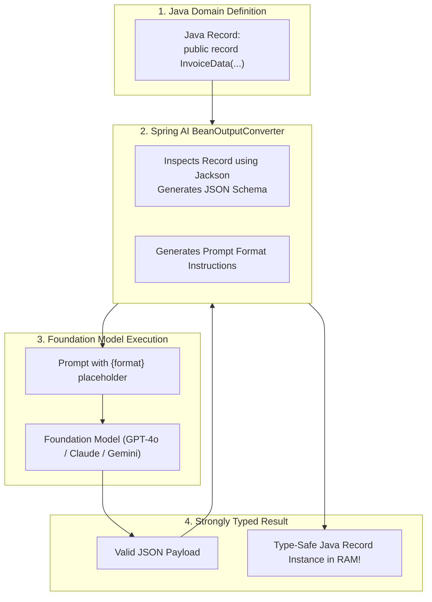
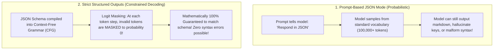

# LLM Integration and Structured Records

The greatest paradox of integrating Large Language Models into enterprise software is the disconnect between how models communicate and how enterprise backends function:

- **Large Language Models are Probabilistic Text Generators:** They predict the next most likely token. Their native output is unstructured natural language prose, markdown formatting, explanations, and conversational filler.
- **Enterprise Backends are Deterministic Computing Engines:** Microservices do not run on markdown. They run on strongly typed Java records, validated integers, immutable enums, database primary keys, and strict JSON schemas.

Many developers attempt to bridge this gap with naive prompt engineering:
```text
"Extract the customer data from this invoice. Respond ONLY with valid JSON. Do not include markdown or explanations!"
```

In production, this approach fails unpredictably. The model occasionally adds markdown backticks (` ```json `), prefixes the response with conversational pleasantries (*"Sure, here is your JSON:"*), or hallucinates extra fields. When your Spring Boot service attempts to parse the payload with Jackson, the application throws a `JsonParseException` and crashes.

To build reliable enterprise AI pipelines, you must eliminate string parsing and enforce **Type-Safe Structured Output Extraction**.

In this guide, we will explore how Spring AI converts Java records into JSON Schemas, contrast prompt-based extraction with constrained decoding (OpenAI Structured Outputs), and build an automated document extraction engine.

---

## The Structured Output Pipeline in Spring AI

Spring AI provides a first-class abstraction for structured parsing: the **`StructuredOutputConverter<T>`** interface, primarily implemented by **`BeanOutputConverter<T>`**.



### The Four-Stage Lifecycle:

1. **Schema Generation:** The `BeanOutputConverter` inspects your target Java record class using Jackson reflection. It automatically generates a comprehensive **JSON Schema** describing all field names, data types, nested records, and array structures.
2. **Instruction Injection:** The converter generates a specialized instruction string:
   ```text
   Your response should be in JSON format. Do not include any explanations, only provide a RFC8259 compliant JSON response following this format: {"type":"object","properties":{...}}
   ```
   This instruction is dynamically bound to the `{format}` parameter in your prompt template.
3. **Model Generation:** The LLM receives the schema definition and restricts its generation to match the requested JSON layout.
4. **Type-Safe Deserialization:** When the raw string returns, the converter parses the JSON directly into your strongly typed Java record instance, validating types and structure before returning it to your business code.

---

## Defining Target Records with Java 21

Java 17/21 `record` classes are uniquely suited for LLM extraction:
- **Immutability:** Once parsed, records cannot be mutated.
- **Compact Syntax:** Zero boilerplate getters, setters, `equals`, or `hashCode`.
- **Jackson Native Support:** Jackson deserializes records cleanly using constructor-based reflection.

Let's model an enterprise invoice extraction domain:

```java
package com.javahub.ai.model;

import com.fasterxml.jackson.annotation.JsonProperty;
import com.fasterxml.jackson.annotation.JsonPropertyDescription;

import java.math.BigDecimal;
import java.time.LocalDate;
import java.util.List;

public record InvoiceExtractionResult(
    @JsonPropertyDescription("The legal invoice identifier or invoice number")
    @JsonProperty(required = true)
    String invoiceNumber,

    @JsonPropertyDescription("The date the invoice was issued in YYYY-MM-DD format")
    LocalDate invoiceDate,

    @JsonPropertyDescription("Vendor or company issuing the invoice")
    VendorInfo vendor,

    @JsonPropertyDescription("Itemized list of products or services billed")
    List<InvoiceLineItem> lineItems,

    @JsonPropertyDescription("Total amount due including taxes and shipping")
    BigDecimal totalAmount,

    @JsonPropertyDescription("Three-letter ISO currency code (e.g. USD, EUR, GBP)")
    String currency,

    @JsonPropertyDescription("Summary of payment terms or due date notes")
    String paymentTerms
) {

    public record VendorInfo(
        String name,
        String taxId,
        String address,
        String contactEmail
    ) {}

    public record InvoiceLineItem(
        String description,
        int quantity,
        BigDecimal unitPrice,
        BigDecimal totalPrice
    ) {}
}
```

> **The Power of `@JsonPropertyDescription`:**
> The descriptions you attach to fields using `@JsonPropertyDescription` are not just Java code comments! Jackson injects these descriptions directly into the generated JSON Schema's `"description"` attributes. The LLM reads these descriptions to understand semantic nuances (e.g., distinguishing between a billing date vs due date).

---

## Fluent Extraction with Spring AI `ChatClient`

In Spring AI 1.0+, you do not need to wire low-level converters manually. The fluent `ChatClient` has built-in support for `.entity(Class<T>)`:

```java
package com.javahub.ai.service;

import com.javahub.ai.model.InvoiceExtractionResult;
import org.slf4j.Logger;
import org.slf4j.LoggerFactory;
import org.springframework.ai.chat.client.ChatClient;
import org.springframework.stereotype.Service;

@Service
public class DocumentExtractionService {

    private static final Logger log = LoggerFactory.getLogger(DocumentExtractionService.class);
    private final ChatClient chatClient;

    public DocumentExtractionService(ChatClient chatClient) {
        this.chatClient = chatClient;
    }

    public InvoiceExtractionResult extractInvoiceData(String rawDocumentText) {
        log.info("Extracting structured invoice data from unstructured document text (Length: {} chars)", 
                rawDocumentText.length());

        return chatClient.prompt()
                .system("""
                    You are an automated accounting intelligence agent.
                    Extract financial invoice data with extreme precision.
                    Ensure all monetary values and line item quantities match arithmetic totals.
                """)
                .user(u -> u.text("""
                    Extract structured invoice information from the following text:
                    ---
                    {document}
                    ---
                """).param("document", rawDocumentText))
                // Spring AI automatically generates schema, injects format instructions, 
                // and deserializes directly into the Java Record!
                .call()
                .entity(InvoiceExtractionResult.class);
    }
}
```

Calling `documentExtractionService.extractInvoiceData(text)` returns a fully populated, type-safe `InvoiceExtractionResult` object in memory.

---

## Constrained Decoding: Prompt Guidance vs Strict Structured Outputs

To appreciate modern enterprise AI reliability, you must understand the difference between **Prompt Guidance** and **Constrained Decoding (Strict Structured Outputs)**.



### Prompt-Based JSON Mode
In standard JSON mode, the model is simply instructed in natural language to produce JSON. However, at every step of token generation, the model's vocabulary of 100,000+ tokens is available. It can still emit leading backticks, omit a closing bracket, or rename a key, causing Jackson deserialization failures.

### Strict Structured Outputs (Constrained Decoding)
With modern foundation models (such as OpenAI's Structured Outputs feature), the model does not rely on natural language compliance.

Instead, the JSON Schema is compiled into a **Context-Free Grammar (CFG)** on the model inference server:
- At every token generation step, the model computes token probabilities as usual.
- The engine applies **Logit Masking**: any token that would violate the grammar or schema is masked out, setting its probability to zero.
- If the schema requires a closing brace `}`, the model is physically prevented from emitting characters other than `}`.
- **Result:** The generated output is **100% mathematically guaranteed** to be valid, RFC-compliant JSON that conforms to your schema without missing fields or unexpected keys.

In Spring AI, modern providers automatically leverage strict structured outputs when you use `.entity(Class<T>)`.

---

## Multi-Modal Extraction: Scanning Invoices from Images

In enterprise accounts payable workflows, invoices do not arrive as clean UTF-8 text strings. They arrive as scanned PDF pages, TIFF scans, or smartphone JPEG photos.

Spring AI supports **Multi-Modal structured extraction**, passing binary image data alongside prompt instructions to vision-capable foundation models:

```java
package com.javahub.ai.service;

import com.javahub.ai.model.InvoiceExtractionResult;
import org.springframework.ai.chat.client.ChatClient;
import org.springframework.core.io.ByteArrayResource;
import org.springframework.stereotype.Service;
import org.springframework.util.MimeTypeUtils;

@Service
public class MultiModalInvoiceScanner {

    private final ChatClient chatClient;

    public MultiModalInvoiceScanner(ChatClient chatClient) {
        this.chatClient = chatClient;
    }

    public InvoiceExtractionResult scanInvoiceImage(byte[] imageBytes) {
        return chatClient.prompt()
                .system("You are an optical document extraction agent. Extract structured invoice data from the image.")
                .user(u -> u
                        .text("Extract all invoice fields from this receipt image.")
                        .media(MimeTypeUtils.IMAGE_JPEG, new ByteArrayResource(imageBytes))
                )
                .call()
                .entity(InvoiceExtractionResult.class);
    }
}
```

The vision model performs Optical Character Recognition (OCR), visual layout analysis, and semantic extraction in a single operation, returning a strongly typed Java record.

---

## Defensive Engineering: Handling Deserialization Failures

Even with high-end models, network truncation, token exhaustion (`max_tokens` reached mid-generation), or unexpected null values can trigger deserialization exceptions.

In production, never let an extraction error crash your microservice. Wrap extraction in an automated **Schema Correction Retry** pipeline:

```java
package com.javahub.ai.resilience;

import com.javahub.ai.model.InvoiceExtractionResult;
import org.slf4j.Logger;
import org.slf4j.LoggerFactory;
import org.springframework.ai.chat.client.ChatClient;
import org.springframework.stereotype.Service;

@Service
public class ResilientExtractionService {

    private static final Logger log = LoggerFactory.getLogger(ResilientExtractionService.class);
    private final ChatClient chatClient;

    public ResilientExtractionService(ChatClient chatClient) {
        this.chatClient = chatClient;
    }

    public InvoiceExtractionResult extractWithSelfCorrection(String rawText) {
        try {
            // First attempt: Fast, direct extraction
            return chatClient.prompt()
                    .user(u -> u.text("Extract invoice from: {text}").param("text", rawText))
                    .call()
                    .entity(InvoiceExtractionResult.class);

        } catch (Exception primaryEx) {
            log.warn("Primary extraction failed: {}. Initiating automated self-correction pass.", primaryEx.getMessage());

            // Second attempt: Self-Correction Prompt passing the failure reason back to the model
            return chatClient.prompt()
                    .user(u -> u.text("""
                        The previous attempt to extract invoice data failed with the following error:
                        {error}
                        
                        Please re-read the original text and output strictly valid, conforming JSON:
                        {text}
                    """)
                    .param("error", primaryEx.getMessage())
                    .param("text", rawText))
                    .call()
                    .entity(InvoiceExtractionResult.class);
        }
    }
}
```

---

## Senior Engineer Interview Crucible

### How does Spring AI's `BeanOutputConverter` automatically generate a JSON Schema from a Java `record` class, and how is it presented to the LLM?

Under the hood, `BeanOutputConverter` uses Jackson's **`JsonSchemaGenerator`** to inspect the target Java `record` via reflection:
1. It analyzes record components, mapping Java primitives, wrappers, strings, and dates to their corresponding JSON Schema types (`integer`, `number`, `string`, `boolean`, `array`, `object`).
2. It parses Jackson annotations: `@JsonPropertyDescription` maps to the schema `"description"`, `@JsonProperty(required = true)` populates the `"required": [...]` array, and enum values populate `"enum": [...]`.
3. It generates format instructions via its `getFormat()` method, embedding the resulting JSON Schema string into the prompt using the `{format}` template placeholder.
4. When the model returns a response string, the converter executes `objectMapper.readValue(content, targetClass)` to deserialize the validated payload into a Java record instance.

---

### Explain the technical difference between prompt-based JSON formatting and constrained decoding (OpenAI Strict Structured Outputs).

- **Prompt-Based JSON Formatting (Probabilistic):** The model is guided purely through natural language prompt instructions (e.g., *"Respond in JSON"*). The model still evaluates probabilities across its entire vocabulary of 100,000+ tokens. If a token like backtick (`` ` ``) or conversational filler has a non-zero probability, the model may output it, causing JSON parsing syntax errors or hallucinated extra keys.
- **Constrained Decoding (Strict Structured Outputs):** The JSON Schema is converted into a formal grammar on the inference server before generation begins. During token sampling, the engine applies **Logit Masking**: at each step, tokens that would violate the syntax rules of the grammar or schema are mathematically masked to zero probability. It is physically impossible for the model to emit a character that invalidates the schema.

---

### How do you handle schema validation failures when an LLM returns a malformed JSON payload that fails Java deserialization?

In enterprise production architectures, schema parsing failures should be addressed through a defensive multi-layered strategy:

1. **Self-Correction Retries:** Catch the `NonTransientAiException` or `ConversionException`. In the retry prompt, pass both the original text and the exact deserialization error message back to the LLM (e.g., *"Field 'totalAmount' was expected to be a number, but received 'one hundred dollars'"*). Models excel at correcting errors when provided with the explicit error trace.
2. **Token Limit Verification:** Check `ChatResponse.getMetadata().getUsage()`. If the completion token count equals the configured `max_tokens`, the JSON was likely cut off mid-stream, breaking closing braces. Raise `max_tokens` or reduce input context.
3. **Dead-Letter Quarantine:** If retries are exhausted, route the raw document and error log to an administrative triage queue for human review rather than dropping the transaction.

---

### Why are immutable Java `record` types uniquely well-suited for LLM structured output parsing compared to traditional mutable JavaBeans with setters?

Java `record` types provide architectural advantages when modeling AI outputs:

1. **Guaranteed Immutability:** Once an LLM output is parsed, domain records represent an unalterable snapshot of that extraction. Downstream microservice threads cannot accidentally mutate or corrupt fields during processing.
2. **Canonical Constructor Integrity:** Unlike traditional JavaBeans—which require a zero-argument default constructor and setter methods—records require all fields to be initialized through their canonical constructor. This prevents half-initialized objects from existing in memory.
3. **Compact Semantic Metadata:** Records minimize boilerplate, allowing developers to cleanly annotate fields with `@JsonPropertyDescription` and Bean Validation annotations (`@NotNull`, `@Pattern`) without wading through hundreds of lines of getters, setters, and builder classes.

