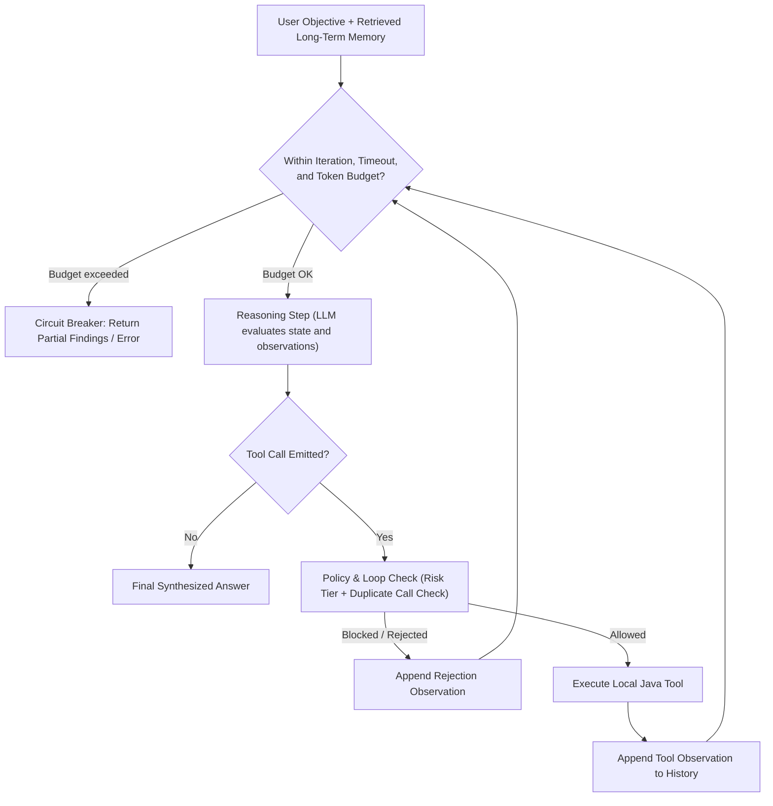
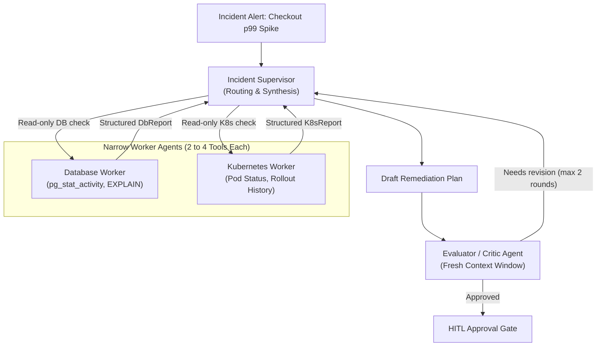

Single-turn completions and standard RAG work well when a request can be answered in one retrieval and one generation step. Many operational tasks do not fit that shape. Consider an incident triage request:

*"Investigate why checkout p99 latency jumped after 14:00 UTC, check recent Kubernetes rollouts and pod restarts, inspect slow PostgreSQL queries, correlate findings with past post-mortems, and draft a remediation checklist for the on-call engineer."*

Handing one prompt 25 unrelated tools (Kubernetes, PostgreSQL, Prometheus, GitHub, Jira, Slack) rarely ends well. As the tool list grows, tool descriptions eat context tokens, the model picks the wrong tools or mixes up arguments, and debugging why step 6 went off the rails becomes miserable.

**Agentic architectures** handle open-ended investigation by running a bounded loop where the model reasons, invokes a focused tool, reads the real output, and decides what to do next. **Multi-agent topologies** go one step further by splitting broad domains into narrow specialists coordinated by a supervisor or checked by an independent evaluator.

## Autonomous Agent Architectures: Perception, Reasoning, and Action

Stripped of hype, an enterprise AI agent is a stateful control loop wrapped around a stateless LLM API. It cycles through three responsibilities:

- **Perception:** Gathering the current state of the world, including the user's objective, conversation memory, retrieved long-term facts, and concrete outputs returned by tools.
- **Reasoning:** Deciding what information is still missing, forming a hypothesis, and choosing either the next tool call or a final answer.
- **Action:** Invoking a local Java tool (or delegating a sub-task to another agent) and recording the real-world observation back into state.

In practice, the **ReAct (Reason + Act)** pattern implements this loop by interleaving short reasoning steps with external tool observations. Unlike plain Chain-of-Thought prompting, where the model guesses an entire multi-step plan in one shot without verifying anything, ReAct grounds each next step in actual runtime output from your systems.



## Implementing a Bounded ReAct Loop in Java 21 and Spring AI 1.0

Never ship an unbounded `while (response.hasToolCalls())` loop. A flaky downstream API or a confused model can keep retrying the same broken tool call until you hit rate limits or burn through your monthly token budget.

By disabling Spring AI's internal tool loop (`internalToolExecutionEnabled(false)`) and driving execution with `ToolCallingManager`, you can enforce four deterministic safety boundaries in plain Java:

1. **Maximum iterations:** Hard cap on reasoning-action turns.
2. **Wall-clock deadline:** Stops the loop even if individual LLM or tool calls are slow.
3. **Cumulative token budget:** Sums `response.getMetadata().getUsage().getTotalTokens()` across turns and halts before runaway billing occurs.
4. **Duplicate-call detection:** Catches the model repeating the exact same tool and arguments without making progress.

```java
package com.javahub.agents.core;

import org.slf4j.Logger;
import org.slf4j.LoggerFactory;
import org.springframework.ai.chat.messages.AssistantMessage;
import org.springframework.ai.chat.messages.Message;
import org.springframework.ai.chat.messages.SystemMessage;
import org.springframework.ai.chat.messages.UserMessage;
import org.springframework.ai.chat.metadata.Usage;
import org.springframework.ai.chat.model.ChatModel;
import org.springframework.ai.chat.model.ChatResponse;
import org.springframework.ai.chat.prompt.Prompt;
import org.springframework.ai.model.tool.ToolCallingChatOptions;
import org.springframework.ai.model.tool.ToolCallingManager;
import org.springframework.ai.model.tool.ToolExecutionResult;
import org.springframework.ai.support.ToolCallbacks;
import org.springframework.stereotype.Component;

import java.time.Duration;
import java.time.Instant;
import java.util.ArrayList;
import java.util.HashMap;
import java.util.List;
import java.util.Map;

@Component
public class BoundedReActAgent {

    private static final Logger log = LoggerFactory.getLogger(BoundedReActAgent.class);

    private final ChatModel chatModel;
    private final ToolCallingManager toolCallingManager;

    public BoundedReActAgent(ChatModel chatModel, ToolCallingManager toolCallingManager) {
        this.chatModel = chatModel;
        this.toolCallingManager = toolCallingManager;
    }

    public AgentRunResult run(
            String systemPrompt,
            String objective,
            Object toolBean,
            Map<String, Object> toolContext,
            ExecutionBudget budget) {

        Instant deadline = Instant.now().plus(budget.maxDuration());
        ToolCallingChatOptions options = ToolCallingChatOptions.builder()
                .toolCallbacks(ToolCallbacks.from(toolBean))
                .toolContext(toolContext)
                .internalToolExecutionEnabled(false)
                .build();

        List<Message> history = new ArrayList<>();
        history.add(new SystemMessage(systemPrompt));
        history.add(new UserMessage(objective));

        int iterations = 0;
        int totalTokensUsed = 0;
        Map<String, Integer> callSignatureCounts = new HashMap<>();

        while (iterations < budget.maxIterations()) {
            if (Instant.now().isAfter(deadline)) {
                return AgentRunResult.aborted("Exceeded wall-clock timeout", iterations, totalTokensUsed);
            }

            iterations++;
            Prompt prompt = new Prompt(List.copyOf(history), options);
            ChatResponse response = chatModel.call(prompt);

            Usage usage = response.getMetadata() != null ? response.getMetadata().getUsage() : null;
            if (usage != null && usage.getTotalTokens() != null) {
                totalTokensUsed += usage.getTotalTokens();
            }

            if (totalTokensUsed > budget.maxTotalTokens()) {
                log.warn("Token budget exceeded: used={} limit={}", totalTokensUsed, budget.maxTotalTokens());
                return AgentRunResult.aborted("Token budget exceeded", iterations, totalTokensUsed);
            }

            if (!response.hasToolCalls()) {
                String finalAnswer = response.getResult().getOutput().getText();
                return AgentRunResult.completed(finalAnswer, iterations, totalTokensUsed);
            }

            // Detect stalled loops where the model repeats the same tool + arguments
            AssistantMessage assistantOutput = response.getResult().getOutput();
            for (AssistantMessage.ToolCall call : assistantOutput.getToolCalls()) {
                String signature = call.name() + ":" + call.arguments();
                int seenCount = callSignatureCounts.merge(signature, 1, Integer::sum);
                if (seenCount >= 3) {
                    log.warn("Detected repeated tool call loop: {}", signature);
                    return AgentRunResult.aborted("Repeated identical tool call: " + call.name(), iterations, totalTokensUsed);
                }
            }

            ToolExecutionResult toolResult = toolCallingManager.executeToolCalls(prompt, response);
            history = new ArrayList<>(toolResult.conversationHistory());
        }

        return AgentRunResult.aborted("Reached max iterations (" + budget.maxIterations() + ")", iterations, totalTokensUsed);
    }

    public record ExecutionBudget(int maxIterations, Duration maxDuration, int maxTotalTokens) {
        public static ExecutionBudget standard() {
            return new ExecutionBudget(6, Duration.ofSeconds(45), 25_000);
        }
    }

    public record AgentRunResult(boolean completed, String output, String abortReason, int steps, int tokensUsed) {
        static AgentRunResult completed(String output, int steps, int tokensUsed) {
            return new AgentRunResult(true, output, null, steps, tokensUsed);
        }

        static AgentRunResult aborted(String reason, int steps, int tokensUsed) {
            return new AgentRunResult(false, null, reason, steps, tokensUsed);
        }
    }
}
```

Returning a structured `AgentRunResult` rather than silently hanging makes it straightforward to expose metrics (steps per run, token consumption, abort reasons) in Micrometer and Grafana so you can see when an agent starts degrading.

## Short-Term Working Memory vs. Long-Term Vector Memory

An engineer investigating an outage uses two kinds of memory: active working notes from the last ten minutes, and searchable long-term records of previous incidents from six months ago. Agents benefit from the exact same split:

- **Short-Term Working Memory (`ChatMemory`):** Tracks the recent turns of the current session or investigation. In Spring AI 1.0 GA, `MessageWindowChatMemory` keeps a fixed sliding window of the most recent messages (persisted via `InMemoryChatMemoryRepository` for local tests or `JdbcChatMemoryRepository` across clustered Spring Boot instances) and attaches them automatically through `MessageChatMemoryAdvisor` keyed by `ChatMemory.CONVERSATION_ID`.
- **Long-Term Episodic Memory (`VectorStore`):** Stores compact, distilled facts that outlive a single session, such as resolved incident summaries, user preferences, or recurring environment quirks. Before starting a new run, the agent queries this store (scoped by `tenantId` and `agentScope`) for relevant past lessons; after finishing, it writes back a short summary rather than raw multi-kilobyte log dumps.

```java
package com.javahub.agents.memory;

import org.springframework.ai.chat.client.ChatClient;
import org.springframework.ai.chat.client.advisor.MessageChatMemoryAdvisor;
import org.springframework.ai.chat.memory.ChatMemory;
import org.springframework.ai.chat.memory.ChatMemoryRepository;
import org.springframework.ai.chat.memory.MessageWindowChatMemory;
import org.springframework.ai.document.Document;
import org.springframework.ai.vectorstore.SearchRequest;
import org.springframework.ai.vectorstore.VectorStore;
import org.springframework.stereotype.Service;

import java.time.Instant;
import java.util.List;
import java.util.Map;
import java.util.stream.Collectors;

@Service
public class HybridMemoryAgentService {

    private final ChatClient chatClient;
    private final VectorStore episodicMemoryStore;

    public HybridMemoryAgentService(
            ChatClient.Builder chatClientBuilder,
            ChatMemoryRepository chatMemoryRepository,
            VectorStore episodicMemoryStore) {

        this.episodicMemoryStore = episodicMemoryStore;

        // Short-term sliding window persisted in JDBC/Redis/In-Memory repository
        ChatMemory workingMemory = MessageWindowChatMemory.builder()
                .chatMemoryRepository(chatMemoryRepository)
                .maxMessages(12)
                .build();

        this.chatClient = chatClientBuilder
                .defaultSystem("You are an SRE triage assistant. Use past incident notes when relevant, but verify live state before concluding.")
                .defaultAdvisors(MessageChatMemoryAdvisor.builder(workingMemory).build())
                .build();
    }

    public String investigate(String conversationId, String tenantId, String promptText) {
        // 1. Recall relevant long-term episodic memories scoped strictly to this tenant
        List<Document> pastLessons = episodicMemoryStore.similaritySearch(
                SearchRequest.builder()
                        .query(promptText)
                        .topK(3)
                        .similarityThreshold(0.75)
                        .filterExpression("tenantId == '" + tenantId + "' && memoryType == 'EPISODIC_INCIDENT'")
                        .build()
        );

        String recalledContext = pastLessons.isEmpty()
                ? "None."
                : pastLessons.stream()
                        .map(doc -> "- " + doc.getText())
                        .collect(Collectors.joining("\n"));

        // 2. Combine long-term recall with short-term conversation window via CONVERSATION_ID
        return chatClient.prompt()
                .user("""
                        Relevant past incident lessons:
                        %s

                        Current request:
                        %s
                        """.formatted(recalledContext, promptText))
                .advisors(spec -> spec.param(ChatMemory.CONVERSATION_ID, conversationId))
                .call()
                .content();
    }

    public void recordEpisodicLesson(String tenantId, String serviceName, String distilledFinding) {
        Document memory = new Document(
                distilledFinding,
                Map.of(
                        "tenantId", tenantId,
                        "service", serviceName,
                        "memoryType", "EPISODIC_INCIDENT",
                        "recordedAt", Instant.now().toString()
                )
        );
        episodicMemoryStore.accept(List.of(memory));
    }
}
```

Keep raw tool payloads out of both memory layers whenever possible. If a Kubernetes log tool returns 8,000 lines of stack traces, truncate and summarize the relevant lines inside the tool itself before handing them back to the LLM. Controlling payload size at the tool boundary prevents your working memory from filling up on step two.

## Multi-Agent Coordination and Supervision Patterns

When a single agent accumulates too many responsibilities, splitting it into narrow workers usually improves reliability more than switching to a bigger model. Two coordination patterns show up most often in production Java systems: **Supervisor-Worker** and **Evaluator-Optimizer (Critic)**.



### Supervisor-Worker with Structured Handoffs

In a **Supervisor-Worker** topology, worker agents do not talk to each other in an open-ended mesh (which risks circular delegation). Instead, deterministic Java code or a supervisor agent dispatches focused sub-tasks to narrow workers, each holding only 2 to 4 domain tools and returning a typed Java `record` via Spring AI's `.entity(...)`.

### Evaluator-Optimizer (Critic) Pattern

LLMs rarely question their own first draft inside the same conversation context. In the **Evaluator-Optimizer** pattern, a second `ChatClient` call runs in a fresh context window with a strict review rubric: look for missing evidence, unsafe SQL locks, unverified rollback steps, or policy violations. If the critic rejects the plan, the supervisor revises it using the critic's concrete feedback, capped at a small number of rounds (typically 2).

```java
package com.javahub.agents.orchestration;

import org.springframework.ai.chat.client.ChatClient;
import org.springframework.stereotype.Service;

import java.util.List;
import java.util.Map;
import java.util.concurrent.StructuredTaskScope;

@Service
public class IncidentOrchestrator {

    private static final int MAX_CRITIC_ROUNDS = 2;

    private final ChatClient dbWorkerClient;
    private final ChatClient k8sWorkerClient;
    private final ChatClient plannerClient;
    private final ChatClient criticClient;

    public IncidentOrchestrator(
            ChatClient.Builder builder,
            DatabaseDiagnosticTools dbTools,
            KubernetesDiagnosticTools k8sTools) {

        this.dbWorkerClient = builder.clone()
                .defaultSystem("You are a PostgreSQL diagnostic specialist. Only inspect read-only metrics and return concise factual findings.")
                .defaultTools(dbTools)
                .build();

        this.k8sWorkerClient = builder.clone()
                .defaultSystem("You are a Kubernetes diagnostic specialist. Inspect rollouts, pod restarts, and OOM events.")
                .defaultTools(k8sTools)
                .build();

        this.plannerClient = builder.clone()
                .defaultSystem("Synthesize worker diagnostics into a safe, minimal remediation plan with explicit rollback steps.")
                .build();

        this.criticClient = builder.clone()
                .defaultSystem("""
                        You are a skeptical SRE safety reviewer.
                        Reject any remediation plan that lacks evidence from diagnostics,
                        proposes locking DDL without CONCURRENTLY, or omits a rollback step.
                        """)
                .build();
    }

    public VerifiedRemediation triageIncident(String serviceName, Map<String, Object> toolContext) {
        // 1. Run independent read-only workers in parallel (or sequentially if preferred)
        WorkerFinding dbFinding = dbWorkerClient.prompt()
                .user("Check active locks and slow queries affecting service: " + serviceName)
                .toolContext(toolContext)
                .call()
                .entity(WorkerFinding.class);

        WorkerFinding k8sFinding = k8sWorkerClient.prompt()
                .user("Check recent rollouts, CrashLoopBackOff, and OOMKilled pods for: " + serviceName)
                .toolContext(toolContext)
                .call()
                .entity(WorkerFinding.class);

        // 2. Evaluator-Optimizer loop bounded to MAX_CRITIC_ROUNDS
        String feedback = "None.";
        RemediationPlan latestPlan = null;

        for (int round = 1; round <= MAX_CRITIC_ROUNDS; round++) {
            latestPlan = plannerClient.prompt()
                    .user("""
                            Service: %s
                            Database diagnostics: %s
                            Kubernetes diagnostics: %s
                            Prior reviewer feedback to address: %s
                            """.formatted(serviceName, dbFinding, k8sFinding, feedback))
                    .call()
                    .entity(RemediationPlan.class);

            CriticVerdict verdict = criticClient.prompt()
                    .user("""
                            Diagnostics: DB=%s, K8s=%s
                            Proposed plan: %s
                            """.formatted(dbFinding, k8sFinding, latestPlan))
                    .call()
                    .entity(CriticVerdict.class);

            if (verdict != null && verdict.approved()) {
                return new VerifiedRemediation(latestPlan, verdict, round, true);
            }
            feedback = verdict != null ? String.join("; ", verdict.objections()) : "Provide clearer rollback criteria.";
        }

        // Did not pass critic review within cap: escalate to human without auto-execution
        return new VerifiedRemediation(latestPlan, new CriticVerdict(false, List.of(feedback)), MAX_CRITIC_ROUNDS, false);
    }

    public record WorkerFinding(String domain, String summary, List<String> evidence) {}
    public record RemediationPlan(String rootCause, List<String> steps, String rollbackPlan, boolean requiresProductionChange) {}
    public record CriticVerdict(boolean approved, List<String> objections) {}
    public record VerifiedRemediation(RemediationPlan plan, CriticVerdict verdict, int rounds, boolean passedReview) {}
}
```

Notice how `builder.clone()` gives each specialist its own isolated system prompt and minimal toolset without leaking tools across agents, and how deterministic Java code enforces the Directed Acyclic Graph (DAG) of delegation so workers can never spin up circular sub-agent calls.

## Human-in-the-Loop Safeguards for Autonomous Workflows

Before an agent executes any external action, classify every tool by blast radius and enforce that policy in deterministic Java code outside the LLM.

| Risk Tier | Action Category | Policy | Examples |
| :--- | :--- | :--- | :--- |
| **Tier 1: Read-Only** | Observational queries | Auto-approved with audit log | Reading Prometheus metrics, querying `EXPLAIN`, searching docs |
| **Tier 2: High-Risk Mutation** | Reversible or financially significant writes | **Mandatory Human-in-the-Loop approval** | Rolling back a deployment, issuing a refund above threshold, updating DNS |
| **Tier 3: Blocked Destructive** | Irreversible, high-impact actions | **Hard-blocked unconditionally** | Dropping tables, wiping production buckets, disabling IAM MFA |

Avoid holding an HTTP request thread open with `Thread.sleep` or blocking calls while waiting 15 minutes for a human to click a button in Slack. In real enterprise backends, persist the pending action request (or use a durable workflow engine like Temporal to pause cleanly), return a `PendingApproval` result to the caller, and execute the action only when the authenticated approver submits a signed callback to a dedicated approval endpoint.

```java
package com.javahub.agents.safety;

import org.slf4j.Logger;
import org.slf4j.LoggerFactory;
import org.springframework.stereotype.Service;

import java.time.Instant;
import java.util.Map;
import java.util.UUID;

@Service
public class TieredActionGateway {

    private static final Logger log = LoggerFactory.getLogger(TieredActionGateway.class);

    private final PendingApprovalRepository approvalRepository;
    private final NotificationDispatcher notifier;
    private final Map<String, RegisteredAction> actions;

    public TieredActionGateway(
            PendingApprovalRepository approvalRepository,
            NotificationDispatcher notifier,
            Map<String, RegisteredAction> actions) {
        this.approvalRepository = approvalRepository;
        this.notifier = notifier;
        this.actions = actions;
    }

    public ActionDecision submitAction(
            String actionName,
            Map<String, Object> arguments,
            String requestedByUserId,
            String tenantId) {

        RegisteredAction action = actions.get(actionName);
        if (action == null) {
            return new ActionDecision.Blocked("Unknown action: " + actionName);
        }

        return switch (action.tier()) {
            case READ_ONLY -> {
                log.info("AUDIT tier=READ_ONLY action={} tenant={} user={}", actionName, tenantId, requestedByUserId);
                String output = action.executor().execute(arguments);
                yield new ActionDecision.Executed(output);
            }
            case HIGH_RISK_MUTATION -> {
                String approvalId = "APR-" + UUID.randomUUID();
                PendingApproval pending = new PendingApproval(
                        approvalId, tenantId, requestedByUserId, actionName, arguments, Instant.now());
                approvalRepository.save(pending);
                notifier.sendApprovalRequest(pending);

                log.info("AUDIT tier=HIGH_RISK_MUTATION status=PENDING approvalId={} action={} user={}",
                        approvalId, actionName, requestedByUserId);
                yield new ActionDecision.PendingHumanApproval(
                        approvalId,
                        "Action requires human approval before execution. Do not retry automatically."
                );
            }
            case BLOCKED_DESTRUCTIVE -> {
                log.warn("SECURITY_ALERT tier=BLOCKED_DESTRUCTIVE action={} tenant={} user={}",
                        actionName, tenantId, requestedByUserId);
                yield new ActionDecision.Blocked(
                        "Action '" + actionName + "' is prohibited for autonomous execution.");
            }
        };
    }

    public enum RiskTier {
        READ_ONLY,
        HIGH_RISK_MUTATION,
        BLOCKED_DESTRUCTIVE
    }

    public sealed interface ActionDecision
            permits ActionDecision.Executed, ActionDecision.PendingHumanApproval, ActionDecision.Blocked {
        record Executed(String output) implements ActionDecision {}
        record PendingHumanApproval(String approvalId, String message) implements ActionDecision {}
        record Blocked(String reason) implements ActionDecision {}
    }

    @FunctionalInterface
    public interface ActionExecutor {
        String execute(Map<String, Object> arguments);
    }

    public record RegisteredAction(String name, RiskTier tier, ActionExecutor executor) {}
    public record PendingApproval(
            String approvalId,
            String tenantId,
            String requestedByUserId,
            String actionName,
            Map<String, Object> arguments,
            Instant createdAt) {}
}
```

## When Deterministic Workflows Beat Multi-Agent Loops

One of the hardest lessons teams learn after shipping their first multi-agent system is that **most business workflows do not need autonomous loops at all**.

Every extra agent hop adds real cost:

- **Latency:** A 5-step supervisor-worker-critic run can easily take 12 to 25 seconds of serial LLM calls, whereas deterministic orchestration calling one structured LLM step takes under 2 seconds.
- **Token cost:** Repeating system prompts, tool schemas, and growing conversation histories across 6 iterations multiplies input token spend quickly.
- **Predictability and testing:** A plain Java state machine or Temporal workflow takes the exact same path on every run and is trivial to unit-test. An autonomous agent can take a different sequence of tool calls tomorrow when the model provider updates weights or a log message changes wording.
- **Debuggability:** Tracing why Agent B misinterpreted Agent A's prose summary takes far more effort than reading a stack trace in normal Java code.

A good rule of thumb for senior Java engineers:

- **Use plain Java or a durable workflow engine (such as Temporal)** when the sequence of steps is known ahead of time (for example: extract invoice fields -> validate against ERP -> route by dollar threshold -> write ledger entry). Put the LLM strictly inside the narrow step that needs unstructured text understanding or classification, and let deterministic Java code own control flow, retries, and compensating Saga rollbacks.
- **Reach for ReAct or multi-agent orchestration** only when the path genuinely depends on open-ended discovery that cannot be hardcoded in advance, such as ad-hoc incident diagnosis, exploratory research across heterogeneous data sources, or complex code investigation. Even then, keep the graph shallow, cap iterations and tokens tightly, and gate mutations behind human approval.

## Interview Questions

### How does the ReAct loop differ from Chain-of-Thought prompting for backend agents?

Chain-of-Thought asks the model to write out its entire reasoning chain in a single generation pass without interacting with external systems. If an early assumption is wrong, every downstream step builds on a fabrication. ReAct interleaves reasoning with concrete tool calls and feeds real runtime observations back into the prompt before the next decision. That allows the agent to verify live database state, react to error responses, and adjust its search strategy based on actual evidence.

### How do you prevent runaway loops and surprise cloud bills in autonomous agents?

Enforce deterministic guardrails in the Java orchestration layer rather than trusting the model to stop on its own. Combine four controls: a hard maximum iteration counter (for example, 6 turns), a wall-clock timeout, a cumulative token-budget check using `ChatResponse.getMetadata().getUsage().getTotalTokens()`, and duplicate tool-call detection that aborts if the agent repeats the same tool name and arguments without progress.

### Why separate short-term `ChatMemory` from long-term `VectorStore` memory?

Short-term working memory (`MessageWindowChatMemory`) preserves conversational continuity within a single session, but keeping every historical turn forever blows past context limits and degrades attention. Long-term vector memory stores distilled, cross-session lessons (such as resolved incident summaries) indexed by metadata like `tenantId` and `service`. Retrieving only the top 2 or 3 relevant memories keeps prompts compact while still letting the agent benefit from past operational history.

### How do you handle partial failures when an autonomous workflow executes multiple external mutations?

An LLM loop cannot participate in a distributed ACID two-phase commit across external APIs like Stripe, GitHub, and Kubernetes. Run stateful multi-step workflows inside a durable execution engine (such as Temporal) using the Saga pattern: every mutating action must be idempotent and paired with a compensating action (for example, `reserveInventory` paired with `releaseReservation`). If a later step fails or a human rejects an approval gate, the workflow engine reliably executes compensating actions in reverse order even if the JVM restarts midway.
