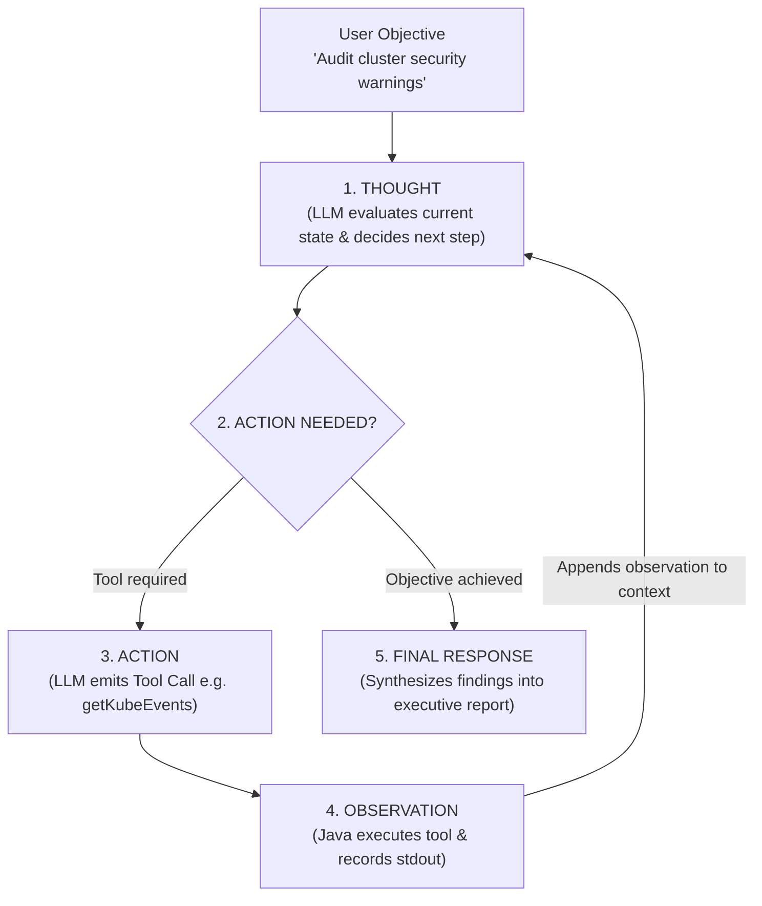
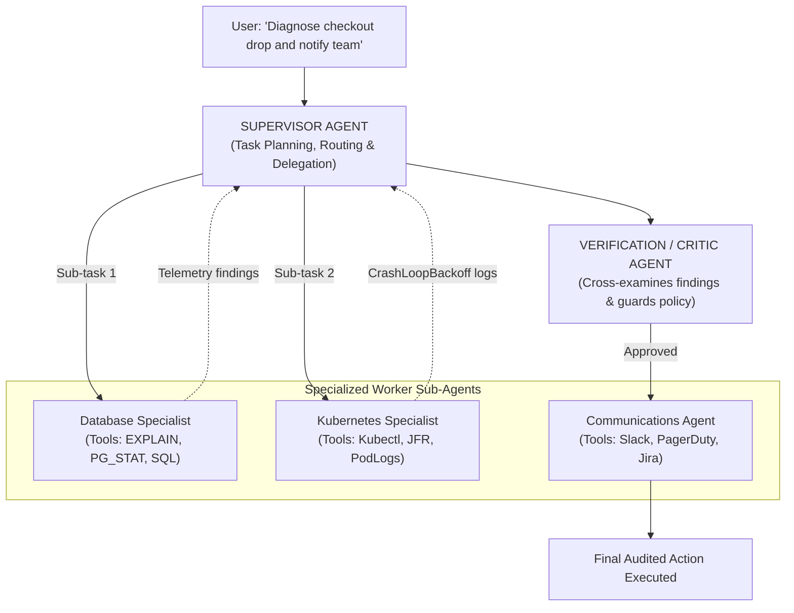

Single-turn LLM completions and basic Retrieval-Augmented Generation (RAG) pipelines represent only the earliest phase of the enterprise AI revolution. In real-world enterprise operations, business goals cannot be solved by a single prompt. 

Consider an IT incident response task: *"Investigate why latency spiked on the checkout service, inspect the last three Kubernetes deployments, query Prometheus metrics, correlate with error logs in Elasticsearch, determine the root cause, draft a remediation pull request, and page the on-call SRE."*

No single prompt or monolithic LLM call can execute this complex sequence reliably. A model presented with dozens of conflicting tools inevitably suffers from context dilution, tool-calling hallucinations, and catastrophic reasoning drift. 

To solve complex multi-step workflows, enterprise Java architectures are evolving toward **Multi-Agent Systems (MAS)**. In a multi-agent topology, tasks are decomposed and distributed across specialized autonomous agents—each equipped with its own narrow system prompt, constrained toolset, dedicated memory window, and supervisory oversight.

In this deep dive, we explore how to build autonomous agent loops in Java, how to implement the **ReAct (Reason + Act)** pattern, how to orchestrate multi-agent collaboration with Spring AI and LangChain4j, and how to enforce strict **Human-in-the-Loop (HITL)** safeguards.

---

### The Anatomy of an Autonomous Agent: The ReAct Loop

At its core, an autonomous agent is not magic; it is a stateful execution loop running on top of an LLM. The predominant cognitive architecture for enterprise agents is the **ReAct (Reasoning + Acting)** pattern, pioneered by Yao et al.:

```
The ReAct Execution Loop
  1. Thought:     The LLM reasons about the user's current goal and historic observations.
  2. Action:      The LLM selects a specific tool and produces structured arguments.
  3. Observation: The Java runtime executes the tool locally and returns the real-world output.
  4. Repeat:      The loop cycles until the LLM decides no further tools are needed.
  5. Finish:      The LLM compiles a final natural language answer.
```



#### Implementing the ReAct Loop in Pure Java

Here is a resilient ReAct loop engine in Java, featuring execution depth bounding and cycle detection:

```java
public class AutonomousAgentEngine {

    private final ChatModel chatModel;
    private final Map<String, AgentTool> registeredTools;
    private final int maxIterations = 8; // Circuit breaker to prevent runaway infinite loops

    public AgentExecutionResult execute(String objective, List<ChatMessage> conversationHistory) {
        List<ChatMessage> context = new ArrayList<>(conversationHistory);
        context.add(new UserMessage("Objective: " + objective));

        int currentStep = 0;

        while (currentStep < maxIterations) {
            currentStep++;

            // 1. Prompt the LLM with current context and tool definitions
            ChatResponse response = chatModel.call(new Prompt(context));
            AssistantMessage assistantMessage = response.getResult().getOutput();
            context.add(assistantMessage);

            // 2. Check if the LLM emitted a Tool Call (Action) or Final Text
            if (!assistantMessage.hasToolCalls()) {
                // LLM concluded its reasoning loop!
                return new AgentExecutionResult(assistantMessage.getText(), currentStep, true);
            }

            // 3. Execute all requested tool actions locally in the JVM
            for (ToolCall toolCall : assistantMessage.getToolCalls()) {
                AgentTool tool = registeredTools.get(toolCall.name());
                if (tool == null) {
                    context.add(new ToolResponseMessage(toolCall.id(), "Error: Unknown tool " + toolCall.name()));
                    continue;
                }

                try {
                    // Execute local Java method
                    String observation = tool.execute(toolCall.arguments());
                    
                    // Feed observation back into context for the next reasoning step
                    context.add(new ToolResponseMessage(toolCall.id(), observation));
                } catch (Exception ex) {
                    context.add(new ToolResponseMessage(toolCall.id(), "Execution Failure: " + ex.getMessage()));
                }
            }
        }

        throw new AgentMaxIterationsExceededException("Agent failed to reach goal within " + maxIterations + " steps");
    }
}
```

---

### Agent Memory Architecture: Working Memory vs Long-Term Vector Memory

A human software engineer does not load the entire company git history into conscious thought when writing code. They rely on **Working Memory** (current active thought) and **Long-Term Memory** (searching documentation and past incident post-mortems).

Autonomous agents in enterprise Java require the identical separation:

```
Agent Memory Hierarchy
  |-- Working Memory:      Sliding context window (Tokens in active LLM prompt)
  |-- Short-Term Scratch:  Execution state of current ReAct loop (Tool outputs)
  `-- Long-Term Memory:    Vector Database (Milvus/PGvector) storing historical facts
```

#### Sliding Window Context Management
If an agent runs a 10-step investigation, intermediate tool responses (e.g., massive Kubernetes JSON manifests or raw database query results) quickly overwhelm the LLM's context window, degrading reasoning quality and wasting API tokens.

**The Solution:** Periodically trigger an asynchronous **Summarization Agent** that compresses older working memory into high-density semantic bullet points:

```java
public List<ChatMessage> compactMemory(List<ChatMessage> fullHistory, int tokenThreshold) {
    if (tokenCounter.count(fullHistory) < tokenThreshold) {
        return fullHistory;
    }

    // Extract older messages (excluding system prompt and recent 3 turns)
    List<ChatMessage> olderMessages = fullHistory.subList(1, fullHistory.size() - 3);
    
    String summary = summarizerModel.call(new Prompt(
        "Compress the following execution history into essential facts and observations:\n" + 
        serialize(olderMessages)
    )).getResult().getOutput().getText();

    List<ChatMessage> compacted = new ArrayList<>();
    compacted.add(fullHistory.get(0)); // Retain original System Prompt
    compacted.add(new SystemMessage("Historical Context Summary: " + summary));
    compacted.addAll(fullHistory.subList(fullHistory.size() - 3, fullHistory.size())); // Keep recent turns

    return compacted;
}
```

---

### Multi-Agent Orchestration Topologies

When building enterprise agents, monolithic agents fail. If you grant an agent 25 different tools (AWS CLI, GitHub API, SQL Executor, Slack Sender, Jira Client), the model suffers from tool hallucination.

The enterprise standard is **Supervisor-Worker Orchestration**:



#### The Supervisor Agent
The Supervisor does **not** execute low-level tools directly. Its tools are other agents! It evaluates the objective, builds a dependency DAG of sub-tasks, delegates sub-tasks to specialized worker agents, and synthesizes their outputs.

#### The Specialized Worker Agents
Worker agents operate in narrow domains with 2-4 focused tools. 
- The `DatabaseAgent` has zero knowledge of Slack or Git; it only understands query plans, connection pools, and table locks.
- The `KubernetesAgent` only understands Pod status, container restarts, and JVM GC flags.

#### The Critic or Verifier Agent
Before any consequential action is taken (e.g., executing an automated database index creation or restarting a production deployment), the supervisor routes the plan to an adversarial **Critic Agent**. 

The Critic is instructed: *"Your job is to find flaws, safety violations, and security risks in the proposed action. If the evidence is insufficient, reject the plan."*

---

### Human-in-the-Loop (HITL) Safeguards & Guardrails

In high-consequence enterprise environments—such as financial banking, healthcare, or core infrastructure—autonomous agents must never be allowed to execute destructive actions without explicit human approval.

#### The Autonomous Action Tier Matrix

| Tier | Action Type | Execution Policy | Example |
| :--- | :--- | :--- | :--- |
| **Tier 1: Read-Only** | Low Risk | Fully Autonomous | Querying metrics, searching vector stores, reading logs |
| **Tier 2: Non-Destructive Write** | Medium Risk | Autonomous with Audit Log | Creating a draft Jira ticket, generating a branch PR |
| **Tier 3: Destructive Mutation** | High Risk | **Mandatory Human-in-the-Loop** | Restarting servers, refunding payments, executing DDL |

#### Implementing Human-in-the-Loop Gateways in Java

When an agent triggers a Tier 3 action, the Java execution runtime halts the loop, stores the state in a durable store (or Temporal workflow), and emits an interactive approval request:

```java
public class EnterpriseToolRegistry {

    private final ApprovalGateway approvalGateway;

    public String executeTool(String toolName, Map<String, Object> arguments, SecurityContext context) {
        ToolDefinition tool = getTool(toolName);

        // Check if action requires Human Approval
        if (tool.riskTier() == RiskTier.TIER_3_DESTRUCTIVE) {
            String approvalToken = UUID.randomUUID().toString();
            
            // Dispatch interactive notification to Slack/Teams with approval buttons
            approvalGateway.requestHumanApproval(new ApprovalRequest(
                approvalToken,
                context.authenticatedUser(),
                toolName,
                arguments,
                "Agent requests permission to execute destructive action"
            ));

            // Suspend agent execution until human approval arrives
            boolean approved = approvalGateway.waitForHumanDecision(approvalToken, Duration.ofMinutes(15));
            
            if (!approved) {
                return "Action REJECTED by Human Supervisor. Do not retry this action; explore alternative paths.";
            }
        }

        // Execute local Java method upon verified approval
        return tool.invoke(arguments);
    }
}
```

---

## Senior Engineer Interview Crucible

### What is the ReAct pattern, and why is it superior to naive chain-of-thought prompting for tool-calling agents?
**Answer:** Chain-of-Thought (CoT) prompting encourages an LLM to generate an internal step-by-step reasoning plan entirely in one shot before outputting an answer. While effective for closed-world mathematical puzzles, CoT fails in dynamic real-world environments because the model cannot verify its assumptions against external truth; errors early in the thought chain compound into massive hallucinations.

The **ReAct (Reason + Act)** pattern interleaves reasoning traces (*"Thought"*) with action execution (*"Action"*) and real-world environmental feedback (*"Observation"*). The agent formulates a hypothesis, executes a tool (e.g., executing a SQL query), inspects the concrete runtime output, updates its mental model, and decides the next step based on reality. This feedback loop allows the agent to recover from unexpected exceptions, refine search queries, and verify facts dynamically.

### How do you prevent multi-agent systems from falling into infinite recursion or circular delegation loops?
**Answer:** In production systems, multi-agent circular delegation is mitigated through four defensive layers:
1. **Hard Iteration Circuit Breakers:** Every agent execution context carries a deterministic counter (e.g., `maxIterations = 10`). If the agent exceeds this threshold without reaching a terminal answer, execution is forcibly terminated with an alert.
2. **Deterministic Context Graphs (DAGs):** Rather than allowing unrestricted peer-to-peer delegation, communication is structured as a directed acyclic graph (DAG) enforced by a Supervisor. Worker agents cannot delegate back to the Supervisor or call each other circularly.
3. **Semantic Similarity Loop Detection:** Maintain a hash set or embedding vector history of recent tool calls and arguments. If an agent calls the exact same tool with identical parameters three times consecutively, an execution hook intercepts the call and injects a warning prompt: *"System Alert: You are repeating the same action without progress. Abort this approach and try another strategy."*
4. **Token Budget Enforcement:** Every workflow is assigned an absolute monetary/token budget cap (e.g., max 100,000 tokens). Once exhausted, the client throws a `BudgetExceededException`.

### Explain the role of an adversarial Critic Agent in a multi-agent architecture.
**Answer:** Large Language Models are inherently predisposed to sycophancy and optimistic bias: when an agent constructs a plan, it rarely cross-examines its own flawed assumptions. 

A **Critic Agent** acts as an automated, adversarial auditor operating in a fresh context window. It is initialized with a cynical system prompt instructing it to identify security vulnerabilities, logical fallacies, edge-case failures, and compliance violations in the proposed output. For example, if a coding agent generates a database migration script, the Critic analyzes the SQL for missing indexes, table lock hazards, or missing foreign keys. If the Critic rejects the plan, it returns concrete objections to the generator agent, forcing an iterative refinement before code ever reaches production.

### How do you maintain transactional consistency across distributed tools when an autonomous agent fails midway through a multi-step workflow?
**Answer:** An autonomous agent cannot participate in a classic ACID two-phase commit (2PC) because tools are heterogeneous, external APIs (GitHub, AWS, Slack, Stripe). 

The production architectural solution is orchestrating the agent within a **Durable Execution Engine (such as Temporal or Cadence)** implementing the **Saga Pattern**:
1. Every destructive or stateful tool registered with the agent must define a corresponding **Compensating Action** (e.g., `provisionDatabase()` must have a compensating `deprovisionDatabase()`).
2. As the agent loops, the orchestrator logs every executed action to an append-only event history.
3. If the agent crashes, times out, or fails an unrecoverable invariant on step 4, the workflow engine automatically walks the execution history in reverse, invoking the compensating actions for steps 3, 2, and 1. This guarantees that external resources are cleanly cleaned up rather than left half-provisioned.
