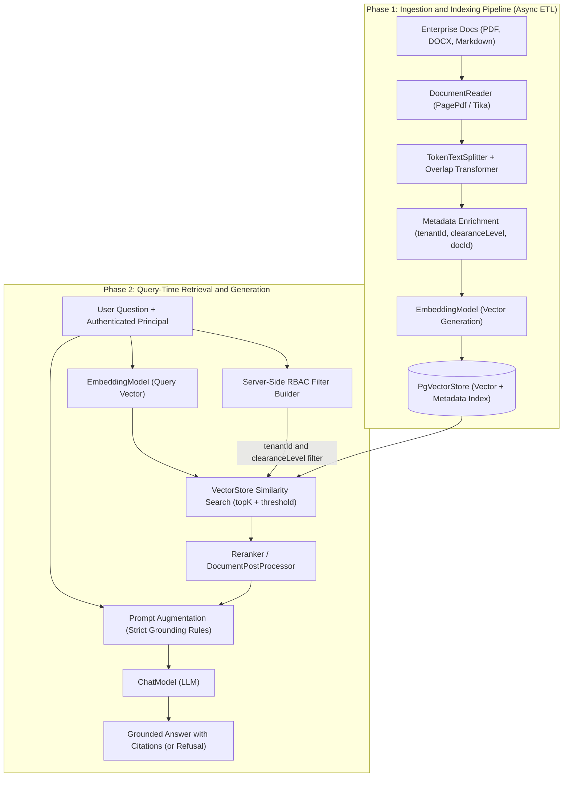
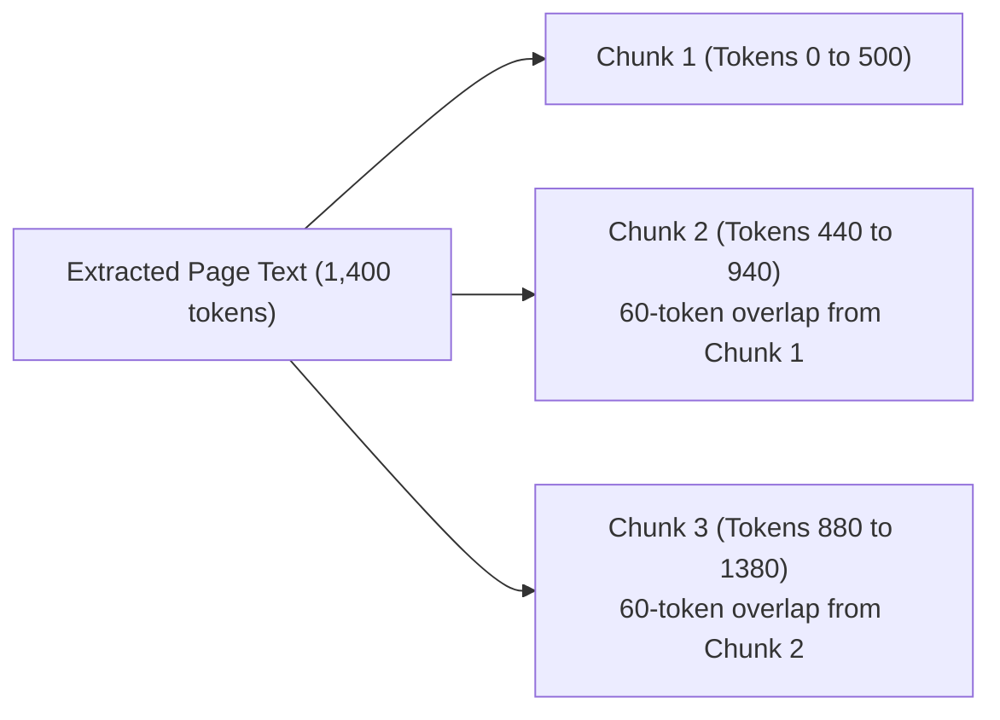

Foundation models like GPT-4o, Claude, and Gemini handle general programming questions and prose well, yet they fail quickly when pointed at internal enterprise systems. Two structural limits cause most of those failures:

1. **Frozen training cutoffs.** Model weights stop learning the day training ends. A model cannot know about an API contract your team shipped last Tuesday or an HR policy updated this quarter.
2. **No access to private data.** Foundation models have never seen your internal runbooks, Confluence pages, support tickets, or customer contracts.

When you ask a model about private material it has never seen, it either refuses to answer or invents plausible details that look convincing in a chat window. Fine-tuning the weights on internal documents sounds tempting at first, but weight updates are slow, expensive to repeat every time a wiki page changes, and cannot enforce per-user document permissions at query time.

**Retrieval-Augmented Generation (RAG)** takes a simpler and more practical path: leave the model weights alone and treat the LLM as a reasoning engine taking an open-book exam.

## The RAG Architecture: Retrieval, Augmentation, and Generation

A RAG system splits work into two distinct phases. An offline (or event-driven) **ingestion pipeline** converts raw enterprise documents into indexed vector embeddings. At request time, an online **query pipeline** retrieves only the chunks relevant to the user's question and passes them into the prompt as grounding context.



Three stages happen on every runtime request:

- **Retrieval:** The user's question is converted into an embedding vector and compared against indexed document chunks, narrowed down by hard metadata filters (such as tenant ID and security clearance) and a minimum similarity threshold.
- **Context Augmentation:** The top matching chunks are formatted with their source metadata and attached to the prompt along with instructions telling the model to rely only on those excerpts.
- **Generation:** The model synthesizes an answer from the supplied context and cites the source documents, or explicitly declines when the retrieved passages do not contain the answer.

Because the facts live in an external database instead of neural network weights, updating a policy takes seconds, deleting a revoked document removes it immediately from future answers, and every claim can be traced back to a specific page and document version.

## Maven Dependencies for Spring AI 1.0 GA

Spring AI 1.0 finalized its artifact naming conventions and ships a Bill of Materials (`spring-ai-bom`) so all starters, document readers, and RAG advisors stay on matching versions. Avoid milestone coordinates like `1.0.0-M1` in new code; use the 1.0 GA BOM and modular starters instead.

```xml
<dependencyManagement>
    <dependencies>
        <dependency>
            <groupId>org.springframework.ai</groupId>
            <artifactId>spring-ai-bom</artifactId>
            <version>1.0.0</version>
            <type>pom</type>
            <scope>import</scope>
        </dependency>
    </dependencies>
</dependencyManagement>

<dependencies>
    <!-- ChatModel and EmbeddingModel starter (OpenAI example) -->
    <dependency>
        <groupId>org.springframework.ai</groupId>
        <artifactId>spring-ai-starter-model-openai</artifactId>
    </dependency>

    <!-- PostgreSQL pgvector starter -->
    <dependency>
        <groupId>org.springframework.ai</groupId>
        <artifactId>spring-ai-starter-vector-store-pgvector</artifactId>
    </dependency>

    <!-- Document readers for PDFs and Office/HTML/Markdown files -->
    <dependency>
        <groupId>org.springframework.ai</groupId>
        <artifactId>spring-ai-pdf-document-reader</artifactId>
    </dependency>
    <dependency>
        <groupId>org.springframework.ai</groupId>
        <artifactId>spring-ai-tika-document-reader</artifactId>
    </dependency>

    <!-- QuestionAnswerAdvisor (simple vector store advisor) -->
    <dependency>
        <groupId>org.springframework.ai</groupId>
        <artifactId>spring-ai-advisors-vector-store</artifactId>
    </dependency>

    <!-- RetrievalAugmentationAdvisor (modular RAG pipeline) -->
    <dependency>
        <groupId>org.springframework.ai</groupId>
        <artifactId>spring-ai-rag</artifactId>
    </dependency>
</dependencies>
```

Notice the split between `spring-ai-advisors-vector-store` (which provides `QuestionAnswerAdvisor` for straightforward RAG) and `spring-ai-rag` (which provides `RetrievalAugmentationAdvisor` for modular query rewriting, reranking, and custom empty-context handling).

## Document Ingestion: Readers, Splitters, and ETL Pipelines

Spring AI models document ingestion as a standard ETL pipeline composed of three functional interfaces:

- `DocumentReader` (`Supplier<List<Document>>`) extracts raw text and structural metadata from files or external sources.
- `DocumentTransformer` (`Function<List<Document>, List<Document>>`) splits, cleans, overlaps, or enriches chunks with metadata.
- `DocumentWriter` (`Consumer<List<Document>>`) writes processed chunks into a target store. `VectorStore` implements `DocumentWriter`, so calling `vectorStore.accept(chunks)` embeds and persists them in one step.

### Choosing Document Readers

Different enterprise formats need different extractors:

- **`PagePdfDocumentReader`** (backed by Apache PDFBox) extracts text page by page and attaches `page_number` metadata automatically. Its `ExtractedTextFormatter` can strip repeating page headers and footers so boilerplate copyright lines do not pollute embeddings.
- **`TikaDocumentReader`** (backed by Apache Tika) handles DOCX, PPTX, HTML, plain text, and Markdown files through a single uniform reader when your ingestion pipeline accepts mixed uploads.

### Chunk Size, Token Awareness, and Overlap

Embedding models accept a fixed maximum token length, and even when a model accepts 8,192 tokens, embedding an entire 30-page runbook into one vector blurs dozens of unrelated topics together. Splitting documents into smaller chunks solves this, though choosing chunk boundaries involves real trade-offs:

- **Too small (under 100 tokens):** Sentences lose their subject. A snippet reading *"Retries are disabled when status 422 is returned"* is nearly useless if the service name and endpoint were two paragraphs earlier.
- **Too large (over 1,500 tokens):** Multiple topics share one vector. When someone searches for a specific timeout setting, the surrounding text drags down the cosine similarity score and inflates prompt token usage.
- **Boundary splits without overlap:** Splitting strictly on token counts often slices a rule, table, or code snippet in half. Repeating a small tail of the previous chunk (around 10% to 15%, or 40 to 80 tokens) at the start of the next chunk keeps concepts that cross boundaries searchable.



> [!NOTE]
> Watch out for an API detail in Spring AI 1.0.0: `TokenTextSplitter.builder()` lets you configure `withChunkSize`, `withMinChunkSizeChars`, `withMinChunkLengthToEmbed`, `withMaxNumChunks`, and `withKeepSeparator`, and its legacy five-argument constructor takes `(chunkSize, minChunkSizeChars, minChunkLengthToEmbed, maxNumChunks, keepSeparator)` — the second argument is *not* overlap. Built-in token overlap was not present in `TokenTextSplitter` in 1.0.0, so if you need sliding overlap on 1.0.0, chain a small `DocumentTransformer` right after `TokenTextSplitter`.

### Complete Spring AI 1.0 ETL Ingestion Pipeline

The service below reads either PDF or Tika-supported files, splits them with `TokenTextSplitter`, prepends a trailing-sentence overlap window from the preceding chunk of the same document, attaches mandatory multi-tenant and clearance metadata, and writes the final chunks using `vectorStore.accept(...)`.

```java
package com.javahub.rag.ingestion;

import org.slf4j.Logger;
import org.slf4j.LoggerFactory;
import org.springframework.ai.document.Document;
import org.springframework.ai.document.DocumentReader;
import org.springframework.ai.document.DocumentTransformer;
import org.springframework.ai.reader.ExtractedTextFormatter;
import org.springframework.ai.reader.pdf.PagePdfDocumentReader;
import org.springframework.ai.reader.pdf.config.PdfDocumentReaderConfig;
import org.springframework.ai.reader.tika.TikaDocumentReader;
import org.springframework.ai.transformer.splitter.TokenTextSplitter;
import org.springframework.ai.vectorstore.VectorStore;
import org.springframework.ai.vectorstore.filter.FilterExpressionBuilder;
import org.springframework.core.io.Resource;
import org.springframework.stereotype.Service;

import java.time.Instant;
import java.util.ArrayList;
import java.util.HashMap;
import java.util.List;
import java.util.Map;

@Service
public class DocumentIngestionService {

    private static final Logger log = LoggerFactory.getLogger(DocumentIngestionService.class);

    private final VectorStore vectorStore;
    private final TokenTextSplitter tokenSplitter;
    private final DocumentTransformer overlapTransformer;

    public DocumentIngestionService(VectorStore vectorStore) {
        this.vectorStore = vectorStore;
        this.tokenSplitter = TokenTextSplitter.builder()
                .withChunkSize(500)
                .withMinChunkSizeChars(200)
                .withMinChunkLengthToEmbed(20)
                .withMaxNumChunks(5000)
                .withKeepSeparator(true)
                .build();
        this.overlapTransformer = new TrailingOverlapTransformer(200);
    }

    public int ingestDocument(
            Resource resource,
            String documentId,
            String tenantId,
            int clearanceLevel,
            String category) {

        String filename = resource.getFilename() != null ? resource.getFilename() : documentId;

        // Remove stale chunks before re-indexing so outdated revisions cannot resurface
        var filter = new FilterExpressionBuilder()
                .and(
                        new FilterExpressionBuilder().eq("tenantId", tenantId),
                        new FilterExpressionBuilder().eq("documentId", documentId)
                )
                .build();
        vectorStore.delete(filter);

        // 1. Extract: choose PDFBox reader for PDFs, Tika for DOCX/HTML/Markdown
        DocumentReader reader = filename.toLowerCase().endsWith(".pdf")
                ? createPdfReader(resource)
                : new TikaDocumentReader(resource);
        List<Document> rawDocuments = reader.read();

        // 2. Transform: split by tokens, apply boundary overlap, and enrich metadata
        List<Document> splitChunks = tokenSplitter.apply(rawDocuments);
        List<Document> overlappedChunks = overlapTransformer.apply(splitChunks);

        Instant indexedAt = Instant.now();
        List<Document> enrichedChunks = new ArrayList<>(overlappedChunks.size());
        for (int i = 0; i < overlappedChunks.size(); i++) {
            Document chunk = overlappedChunks.get(i);
            Map<String, Object> metadata = new HashMap<>(chunk.getMetadata());
            metadata.put("documentId", documentId);
            metadata.put("tenantId", tenantId);
            metadata.put("clearanceLevel", clearanceLevel);
            metadata.put("category", category);
            metadata.put("sourceFilename", filename);
            metadata.put("chunkIndex", i);
            metadata.put("indexedAt", indexedAt.toString());

            enrichedChunks.add(new Document(chunk.getText(), metadata));
        }

        // 3. Load: embed and persist via DocumentWriter.accept(...)
        vectorStore.accept(enrichedChunks);
        log.info("Indexed {} chunks for document={} tenant={}", enrichedChunks.size(), documentId, tenantId);
        return enrichedChunks.size();
    }

    private PagePdfDocumentReader createPdfReader(Resource pdfResource) {
        PdfDocumentReaderConfig config = PdfDocumentReaderConfig.builder()
                .withPageTopMargin(0)
                .withPageBottomMargin(0)
                .withPageExtractedTextFormatter(ExtractedTextFormatter.builder()
                        .withNumberOfTopTextLinesToDelete(1)    // Strip repeating header
                        .withNumberOfBottomTextLinesToDelete(1) // Strip repeating footer
                        .build())
                .withPagesPerDocument(1)
                .build();
        return new PagePdfDocumentReader(pdfResource, config);
    }

    /**
     * Prepends up to maxOverlapChars from the tail of the previous chunk,
     * aligned to a whitespace boundary, to preserve context across splits.
     */
    static class TrailingOverlapTransformer implements DocumentTransformer {

        private final int maxOverlapChars;

        TrailingOverlapTransformer(int maxOverlapChars) {
            this.maxOverlapChars = maxOverlapChars;
        }

        @Override
        public List<Document> apply(List<Document> documents) {
            List<Document> result = new ArrayList<>(documents.size());
            String previousTail = "";

            for (Document doc : documents) {
                String text = doc.getText() != null ? doc.getText() : "";
                String combined = previousTail.isEmpty() ? text : previousTail + "\n" + text;
                result.add(new Document(combined, new HashMap<>(doc.getMetadata())));
                previousTail = extractWordAlignedTail(text, maxOverlapChars);
            }
            return result;
        }

        private String extractWordAlignedTail(String text, int limit) {
            if (text.length() <= limit) {
                return text;
            }
            String tail = text.substring(text.length() - limit);
            int firstSpace = tail.indexOf(' ');
            return firstSpace > 0 ? tail.substring(firstSpace + 1).trim() : tail.trim();
        }
    }
}
```

Deleting prior chunks by `(tenantId, documentId)` before re-indexing is easy to overlook in prototypes and painful in production. Without it, editing a policy PDF three times leaves three conflicting versions of the same paragraph in your vector index, and the retriever happily hands all three to the LLM.

## Query-Time Retrieval, Multi-Tenant RBAC, and Grounding Prompts

A common mistake in enterprise RAG prototypes is indexing documents from all customers or departments into one `VectorStore` and assuming the LLM will avoid revealing unauthorized information if instructed in the system prompt. Never rely on prompt instructions for access control. Once an unauthorized chunk enters the model's context window, data leakage has already occurred.

Enforce authorization **at the vector database query layer** using server-derived metadata filter expressions. Read `tenantId` and `clearanceLevel` strictly from the authenticated Spring Security principal (never from the user's request body or prompt text), validate the values, and pass the filter expression into the advisor per request.

### Option A: `QuestionAnswerAdvisor` for Straightforward RAG

`QuestionAnswerAdvisor` intercepts the `ChatClient` request, runs a similarity search on your `VectorStore`, and injects the retrieved chunks into the prompt. You can override the filter expression on every call via `QuestionAnswerAdvisor.FILTER_EXPRESSION`.

```java
package com.javahub.rag.service;

import org.springframework.ai.chat.client.ChatClient;
import org.springframework.ai.chat.client.advisor.vectorstore.QuestionAnswerAdvisor;
import org.springframework.ai.chat.prompt.PromptTemplate;
import org.springframework.ai.vectorstore.SearchRequest;
import org.springframework.ai.vectorstore.VectorStore;
import org.springframework.stereotype.Service;

import java.util.regex.Pattern;

@Service
public class SimpleKnowledgeService {

    private static final Pattern SAFE_TENANT_ID = Pattern.compile("^[a-zA-Z0-9_-]{3,64}$");

    private final ChatClient chatClient;

    public SimpleKnowledgeService(ChatClient.Builder chatClientBuilder, VectorStore vectorStore) {
        PromptTemplate groundingTemplate = new PromptTemplate("""
                {query}

                Use ONLY the context passages below to answer the question.
                If the context is empty or does not directly support an answer, reply:
                "I do not have enough verified documentation to answer that question."
                Always cite the source filename and page number when available.

                Context:
                ---------------------
                {question_answer_context}
                ---------------------
                """);

        QuestionAnswerAdvisor qaAdvisor = QuestionAnswerAdvisor.builder(vectorStore)
                .searchRequest(SearchRequest.builder()
                        .topK(5)
                        .similarityThreshold(0.72)
                        .build())
                .promptTemplate(groundingTemplate)
                .build();

        this.chatClient = chatClientBuilder
                .defaultSystem("You are an internal engineering documentation assistant. Never fabricate policies, URLs, or credentials.")
                .defaultAdvisors(qaAdvisor)
                .build();
    }

    public String ask(String userQuestion, String authenticatedTenantId, int userClearanceLevel) {
        if (!SAFE_TENANT_ID.matcher(authenticatedTenantId).matches()) {
            throw new IllegalArgumentException("Invalid tenant identifier");
        }

        // Strict server-side RBAC filter executed inside pgvector before results reach the JVM or LLM
        String rbacFilter = "tenantId == '" + authenticatedTenantId
                + "' && clearanceLevel <= " + userClearanceLevel;

        return chatClient.prompt()
                .user(userQuestion)
                .advisors(spec -> spec.param(QuestionAnswerAdvisor.FILTER_EXPRESSION, rbacFilter))
                .call()
                .content();
    }
}
```

> [!WARNING]
> Always validate or allowlist any string interpolated into a `FILTER_EXPRESSION` (or build a `Filter.Expression` programmatically via `FilterExpressionBuilder`). Treating raw input as a filter string opens the door to filter injection, which is the vector-store equivalent of SQL injection.

### Option B: `RetrievalAugmentationAdvisor` with Reranking and Empty-Context Refusal

When a system moves past simple Q&A, `QuestionAnswerAdvisor` becomes limiting. You often want to:

1. Over-fetch candidates from the vector store (say `topK = 20`) using fast bi-encoder cosine similarity.
2. Re-score and trim those candidates down to the best 4 chunks using a cross-encoder reranker (such as Cohere Rerank, BGE-Reranker, or an internal scoring microservice) or compress out irrelevant sentences.
3. Short-circuit cleanly when zero chunks survive filtering instead of letting the LLM improvise from general pretraining knowledge.

Spring AI 1.0's modular `RetrievalAugmentationAdvisor` supports this cleanly through `VectorStoreDocumentRetriever`, `DocumentPostProcessor`, and `ContextualQueryAugmenter`.

```java
package com.javahub.rag.service;

import org.springframework.ai.chat.client.ChatClient;
import org.springframework.ai.chat.prompt.PromptTemplate;
import org.springframework.ai.document.Document;
import org.springframework.ai.rag.Query;
import org.springframework.ai.rag.advisor.RetrievalAugmentationAdvisor;
import org.springframework.ai.rag.generation.augmentation.ContextualQueryAugmenter;
import org.springframework.ai.rag.postretrieval.document.DocumentPostProcessor;
import org.springframework.ai.rag.retrieval.search.VectorStoreDocumentRetriever;
import org.springframework.ai.vectorstore.VectorStore;
import org.springframework.stereotype.Service;

import java.util.Comparator;
import java.util.List;

@Service
public class ModularRagService {

    private final ChatClient chatClient;

    public ModularRagService(
            ChatClient.Builder chatClientBuilder,
            VectorStore vectorStore,
            CrossEncoderClient crossEncoderClient) {

        VectorStoreDocumentRetriever retriever = VectorStoreDocumentRetriever.builder()
                .vectorStore(vectorStore)
                .topK(20) // Over-fetch candidates for high recall before reranking
                .similarityThreshold(0.60)
                .build();

        // Post-processor: cross-encoder reranking + contextual trimming to top 4 chunks
        DocumentPostProcessor reranker = (Query query, List<Document> documents) -> {
            if (documents.isEmpty()) {
                return List.of();
            }
            List<ScoredChunk> scored = crossEncoderClient.score(query.text(), documents);
            return scored.stream()
                    .filter(item -> item.relevanceScore() >= 0.45)
                    .sorted(Comparator.comparingDouble(ScoredChunk::relevanceScore).reversed())
                    .limit(4)
                    .map(this::attachCitationHeader)
                    .toList();
        };

        // allowEmptyContext(false) forces the emptyContextPromptTemplate when retrieval returns nothing
        ContextualQueryAugmenter augmenter = ContextualQueryAugmenter.builder()
                .allowEmptyContext(false)
                .emptyContextPromptTemplate(new PromptTemplate("""
                        No authorized documentation matched the user's question.
                        Respond politely that you do not have verified internal documentation on this topic,
                        and do not attempt to guess from general knowledge.
                        """))
                .build();

        RetrievalAugmentationAdvisor ragAdvisor = RetrievalAugmentationAdvisor.builder()
                .documentRetriever(retriever)
                .documentPostProcessors(reranker)
                .queryAugmenter(augmenter)
                .build();

        this.chatClient = chatClientBuilder
                .defaultSystem("""
                        You are an enterprise architecture assistant.
                        Base every factual statement strictly on the provided source blocks.
                        Include inline citations formatted as [filename, p.X] after each claim.
                        """)
                .defaultAdvisors(ragAdvisor)
                .build();
    }

    public String answerQuestion(String question, String tenantId, int clearanceLevel) {
        String filter = "tenantId == '" + tenantId + "' && clearanceLevel <= " + clearanceLevel;

        return chatClient.prompt()
                .user(question)
                .advisors(spec -> spec.param(VectorStoreDocumentRetriever.FILTER_EXPRESSION, filter))
                .call()
                .content();
    }

    private Document attachCitationHeader(ScoredChunk scored) {
        Document doc = scored.document();
        Object filename = doc.getMetadata().getOrDefault("sourceFilename", "unknown");
        Object page = doc.getMetadata().getOrDefault("page_number", "N/A");
        String formatted = "[Source: " + filename + ", Page: " + page + "]\n" + doc.getText();
        return new Document(formatted, doc.getMetadata());
    }

    public interface CrossEncoderClient {
        List<ScoredChunk> score(String query, List<Document> candidates);
    }

    public record ScoredChunk(Document document, double relevanceScore) {}
}
```

Setting `.allowEmptyContext(false)` on `ContextualQueryAugmenter` is worth highlighting. When a user asks an out-of-domain question (or asks about a confidential project they lack clearance for), the filtered vector search returns zero documents. Rather than passing an empty context block and hoping the LLM remembers not to improvise, Spring AI switches directly to the refusal template.

## Common RAG Failure Modes and Practical Mitigations

Building a demo RAG endpoint takes an afternoon. Making it dependable across thousands of messy PDFs and real user queries means dealing with four recurring failure modes:

1. **Vocabulary mismatch in pure vector search.** Dense embeddings capture semantics well ("database connection exhaustion" matches "pool starvation"), but they often struggle with exact identifiers like error codes (`ORA-01555`), SKU numbers, or internal acronyms. Combine vector similarity with keyword/BM25 search (PostgreSQL full-text search alongside `pgvector`, or Elasticsearch hybrid search) merged via Reciprocal Rank Fusion (RRF).
2. **Lost in the middle.** Studies on transformer attention show that models attend strongly to text near the start and end of a long prompt and frequently miss facts buried in the middle. Dumping 15 unranked chunks into the prompt increases latency, raises token cost, and lowers accuracy. Over-fetch with a bi-encoder (`topK = 20`), then rerank with a cross-encoder and keep only the top 3 to 5 chunks.
3. **Contextual bloat.** Even a relevant 500-token chunk might contain 400 tokens of unrelated boilerplate. **Contextual compression** strips non-relevant sentences (using either a fast extractive model or a lightweight LLM pass) before handing the final passages to the main generation model.
4. **Silent drift from unmonitored ingestion.** Scanned PDFs without OCR produce empty text strings; tables extracted by PDFBox sometimes lose column alignment. Always log extracted character counts per page during ingestion and alert when a PDF yields zero or suspiciously short text.

## Evaluating RAG Quality: Retrieval Recall vs. Generation Faithfulness

Teams often try to debug a bad RAG answer by rewriting the system prompt over and over, only to discover later that the right paragraph was never retrieved in the first place. A RAG pipeline has two independent failure surfaces, so evaluate them separately.

| Dimension | Metric | What It Measures | Typical Fix When Low |
| :--- | :--- | :--- | :--- |
| **Retrieval** | **Recall@k** | Did the ground-truth chunk appear anywhere in the top `k` results? | Tune chunk size/overlap, fix PDF extraction, add hybrid BM25 search, or rewrite ambiguous queries |
| **Retrieval** | **MRR / Precision@k** | How high did the best chunk rank, and how much noise came along? | Add a cross-encoder reranker and tighten `similarityThreshold` |
| **Generation** | **Faithfulness (Groundedness)** | Is every claim in the answer supported by the retrieved context? | Tighten grounding prompt, lower temperature, require inline citations, enforce `allowEmptyContext(false)` |
| **Generation** | **Answer Relevancy** | Did the response actually answer the user's question concisely? | Improve prompt formatting, reduce distracting chunks via contextual compression |

Start small: curate 30 to 50 real questions from your team, paired with the exact document IDs and expected facts. Run that evaluation set in CI whenever you change chunking parameters, embedding models, or reranker thresholds. In Spring AI, you can also automate faithfulness checks in integration tests using `RelevancyEvaluator` and `FactCheckingEvaluator` (LLM-as-a-judge evaluators shipped with Spring AI) to catch regressions before deploying prompt or splitter changes.

## Interview Questions

### Why choose RAG instead of fine-tuning when building an internal documentation assistant?

Fine-tuning adjusts model weights, which works well for teaching a consistent output format, domain style, or specialized DSL syntax. It is a poor fit for factual enterprise knowledge because training is expensive to re-run, models can still hallucinate outdated facts, and weight-level knowledge has no concept of per-user access control. RAG keeps facts in an external vector index where updates take seconds, answers can cite exact source documents and pages, and query-time metadata filters enforce tenant and role permissions before any text reaches the model.

### How do chunk size and chunk overlap affect retrieval quality?

Chunks that are too small lose their surrounding context, so a sentence mentioning a timeout or status code gets separated from the service name it belongs to. Chunks that are too large pack multiple unrelated sections into one embedding vector, which dilutes semantic similarity and wastes prompt tokens. Overlap (commonly 10% to 15% of the chunk size) repeats the trailing portion of one chunk at the beginning of the next so explanations, tables, or rules that cross a split boundary remain intact in at least one indexed vector.

### Why is prompt-level instruction insufficient for multi-tenant security in a RAG system?

If chunks from Tenant B are retrieved and inserted into the prompt for a user from Tenant A, a single prompt-injection attempt (or simple model confusion) can cause the LLM to leak Tenant B's data. Access control must happen inside the vector store query itself via server-side metadata filters (such as `tenantId == '...' && clearanceLevel <= ...`) built from the authenticated security principal, never from user-supplied parameters.

### If a RAG system gives a wrong answer in production, how do you diagnose whether the bug is in retrieval or generation?

Inspect the retrieved chunks logged for that request first. If the correct paragraph is missing from the retrieved set (low Recall@k), the fault is in ingestion, chunking, embedding, hybrid search, or metadata filters; tuning the generation prompt will not fix it. If the correct paragraph was retrieved and placed in the prompt but the model ignored it or added unsupported claims (low Faithfulness), look at Lost-in-the-Middle ordering, reranking, noisy context chunks, or overly permissive grounding instructions.
