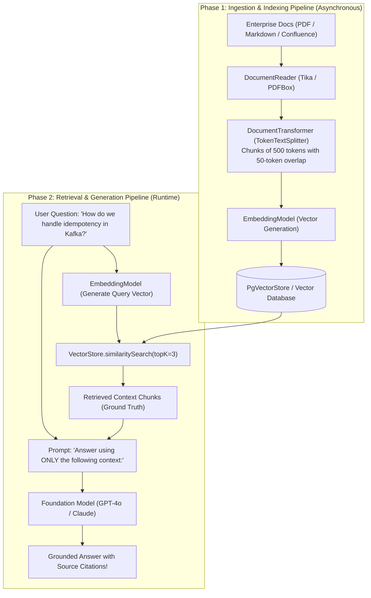
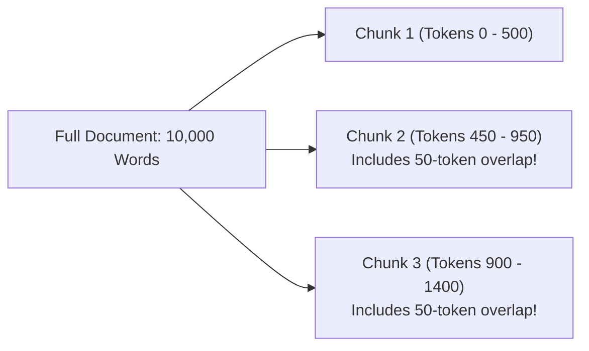
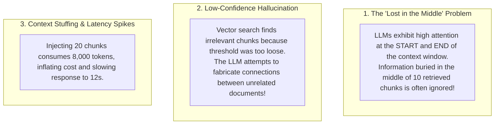

# Retrieval-Augmented Generation (RAG)

Foundation models like GPT-4o, Claude 3.5, and Gemini 1.5 possess impressive general knowledge across computer science, history, and literature. However, within an enterprise, they suffer from two fatal operational handicaps:

1. **Knowledge Cutoffs:** Foundation models are frozen in time at the date their training weights were finalized. They have zero awareness of events, API updates, or code released yesterday.
2. **Zero Proprietary Enterprise Visibility:** Foundation models know nothing about your company's internal architecture, proprietary codebases, customer accounts, HR policies, or confidential Confluence documentation.

When asked about proprietary topics, LLMs either admit ignorance or, worse, **hallucinate**: generating plausible-sounding but factually fabricated explanations that mislead developers and customers.

Historically, organizations attempted to solve this by **Fine-Tuning**—training model weights on internal documents. But fine-tuning is slow, expensive, prone to catastrophic forgetting, and cannot enforce real-time data privacy or dynamic document updates.

The industry-standard architecture for grounding AI in private enterprise knowledge is **Retrieval-Augmented Generation (RAG)**.

In this deep dive, we will explore the complete RAG architectural pipeline, master chunking and overlap strategies, build an automated documentation assistant using Spring AI and `QuestionAnswerAdvisor`, and apply advanced techniques to eliminate hallucinations.

---

## The Core Concept of RAG

Instead of attempting to memorize all enterprise facts inside the neural network's weights, **RAG treats the LLM as an open-book reasoning engine**.

When a user submits a query:
1. The system searches your enterprise knowledge base to **retrieve** the most authoritative, relevant text snippets.
2. It **augments** the prompt by stuffing the retrieved snippets into the context window alongside the user's question.
3. The LLM **generates** an accurate, grounded response derived strictly from the provided text, citing its sources.



---

## Document Ingestion: The Art of Chunking

You cannot simply dump a 200-page PDF into an embedding model. Embedding models have fixed context limits (e.g., 8,192 tokens), and embedding an entire 200-page document into a single vector compresses so much disparate information that semantic search accuracy drops to zero.

Enterprise ingestion requires splitting documents into **Chunks**:



### The Two Critical Parameters:

1. **Chunk Size (e.g., 300 - 800 tokens):**
   - **Too Small (e.g., 50 tokens):** The chunk lacks sufficient semantic context. A sentence like *"It returned a 500 error due to database timeouts"* lacks context on which service or endpoint caused the issue.
   - **Too Large (e.g., 3,000 tokens):** The embedding vector becomes diluted with multiple unrelated topics. When searching for a specific configuration flag, the vector match score is degraded by the surrounding text.
2. **Chunk Overlap (e.g., 10% - 15%, or 50 tokens):**
   - If a crucial technical explanation or code block is cut in half across a chunk boundary, both chunks become semantically incomplete.
   - **Overlap** repeats the last 50 tokens of Chunk 1 at the beginning of Chunk 2, guaranteeing that concepts spanning the split boundary are preserved in vector space.

---

## Spring AI RAG Architecture

In Spring AI 1.0+, building a RAG pipeline is streamlined through three core abstractions:

- **`DocumentReader`:** Ingests raw data from PDFs (`PagePdfDocumentReader`), Word documents, JSON, or Markdown files.
- **`TokenTextSplitter`:** Decomposes documents into token-bounded chunks with configurable overlap.
- **`QuestionAnswerAdvisor`:** The centerpiece of modern Spring AI RAG. It acts as an interceptor around your `ChatClient` prompt:
  1. It extracts the user's natural language question.
  2. It queries your configured `VectorStore` for the top-`k` most similar document chunks.
  3. It formats the chunks and injects them into the prompt's context window automatically.
  4. It invokes the model and returns the grounded answer.

---

## Production Implementation: Enterprise Documentation Assistant

Let's build a complete, production-ready documentation assistant in Spring Boot 3.

### Step 1: Maven Dependencies

```xml
<dependencies>
    <!-- Spring AI OpenAI Starter -->
    <dependency>
        <groupId>org.springframework.ai</groupId>
        <artifactId>spring-ai-openai-spring-boot-starter</artifactId>
        <version>1.0.0-M1</version>
    </dependency>
    <!-- Spring AI PgVector Starter -->
    <dependency>
        <groupId>org.springframework.ai</groupId>
        <artifactId>spring-ai-pgvector-store-spring-boot-starter</artifactId>
        <version>1.0.0-M1</version>
    </dependency>
    <!-- PDF Document Reader -->
    <dependency>
        <groupId>org.springframework.ai</groupId>
        <artifactId>spring-ai-pdf-document-reader</artifactId>
        <version>1.0.0-M1</version>
    </dependency>
</dependencies>
```

### Step 2: Ingestion Service (Document Parsing and Chunking)

```java
package com.javahub.rag.ingestion;

import org.slf4j.Logger;
import org.slf4j.LoggerFactory;
import org.springframework.ai.document.Document;
import org.springframework.ai.reader.pdf.PagePdfDocumentReader;
import org.springframework.ai.reader.pdf.config.PdfDocumentReaderConfig;
import org.springframework.ai.transformer.splitter.TokenTextSplitter;
import org.springframework.ai.vectorstore.VectorStore;
import org.springframework.core.io.Resource;
import org.springframework.stereotype.Service;

import java.util.List;

@Service
public class DocumentIngestionService {

    private static final Logger log = LoggerFactory.getLogger(DocumentIngestionService.class);

    private final VectorStore vectorStore;

    public DocumentIngestionService(VectorStore vectorStore) {
        this.vectorStore = vectorStore;
    }

    public void ingestPdfManual(Resource pdfResource, String documentCategory) {
        log.info("Starting ingestion of PDF manual: {}", pdfResource.getFilename());

        // 1. Read PDF Pages into Raw Documents
        PdfDocumentReaderConfig config = PdfDocumentReaderConfig.builder()
                .withPageExtractedTextFormatter(new PdfDocumentReaderConfig.DefaultPageExtractedTextFormatter())
                .build();
        PagePdfDocumentReader pdfReader = new PagePdfDocumentReader(pdfResource, config);
        List<Document> rawPages = pdfReader.get();

        log.info("Extracted {} raw pages from PDF. Beginning chunking...", rawPages.size());

        // 2. Split Pages into Semantically Balanced Chunks with Overlap
        // Chunk size: 500 tokens; Overlap: 50 tokens; Min chunk: 100 tokens
        TokenTextSplitter splitter = new TokenTextSplitter(500, 50, 100, 5000, true);
        List<Document> chunkedDocuments = splitter.apply(rawPages);

        // 3. Attach Metadata for Security and Hybrid Filtering
        for (Document chunk : chunkedDocuments) {
            chunk.getMetadata().put("category", documentCategory);
            chunk.getMetadata().put("source_filename", pdfResource.getFilename());
        }

        log.info("Generated {} chunks. Embedding and storing in vector database...", chunkedDocuments.size());

        // 4. Batch Embed and Store in pgvector
        vectorStore.add(chunkedDocuments);

        log.info("Successfully ingested PDF into VectorStore!");
    }
}
```

### Step 3: The Retrieval and Generation Assistant

```java
package com.javahub.rag.service;

import org.slf4j.Logger;
import org.slf4j.LoggerFactory;
import org.springframework.ai.chat.client.ChatClient;
import org.springframework.ai.chat.client.advisor.QuestionAnswerAdvisor;
import org.springframework.ai.vectorstore.SearchRequest;
import org.springframework.ai.vectorstore.VectorStore;
import org.springframework.stereotype.Service;

@Service
public class KnowledgeAssistantService {

    private static final Logger log = LoggerFactory.getLogger(KnowledgeAssistantService.class);

    private final ChatClient chatClient;
    private final VectorStore vectorStore;

    public KnowledgeAssistantService(ChatClient.Builder chatClientBuilder, VectorStore vectorStore) {
        this.vectorStore = vectorStore;
        
        // Configure ChatClient with default enterprise safety guardrails
        this.chatClient = chatClientBuilder
                .defaultSystem("""
                    You are JavaHub Enterprise Knowledge Assistant.
                    Answer the user's question strictly using the retrieved documentation context provided below.
                    
                    Rules:
                    1. If the provided context does not contain the answer, state:
                       'I do not possess sufficient documentation to answer this question accurately.'
                    2. Never invent or hallucinate internal URLs, credentials, or architecture details.
                    3. Cite the source document name when possible.
                """)
                .build();
    }

    public String askAssistant(String userQuestion) {
        log.info("Processing user RAG query: '{}'", userQuestion);

        // Configure Search Criteria: Retrieve Top-3 Chunks with high similarity
        SearchRequest searchRequest = SearchRequest.builder()
                .topK(3)
                .similarityThreshold(0.72) // Discard low-confidence matches to prevent hallucinations
                .build();

        // QuestionAnswerAdvisor intercepts the call, executes vector search, 
        // injects chunks into prompt context, and executes the LLM!
        return chatClient.prompt()
                .advisors(new QuestionAnswerAdvisor(vectorStore, searchRequest))
                .user(userQuestion)
                .call()
                .content();
    }
}
```

---

## Mitigating Advanced RAG Hazards

While simple RAG works well in prototypes, production enterprise deployments encounter subtle failure modes:



### Defensive Mitigations:

1. **Similarity Threshold Enforcement:** Always configure `.similarityThreshold(0.70)`. If a user asks *"What is the recipe for chocolate cake?"*, a knowledge base about Kubernetes will find distant matches with a similarity of 0.35. Without a threshold, those irrelevant chunks are stuffed into the prompt, confusing the model. With a 0.70 threshold, the vector store returns empty, and the model safely replies: *"I do not possess documentation on that topic."*
2. **Re-Ranking (Cross-Encoders):** Vector search uses Cosine Similarity (bi-encoders), which is fast but coarse. In mission-critical systems, take the top 20 retrieved vector results and pass them through a **Cross-Encoder Re-ranker** (such as Cohere Re-rank or BGE-Reranker). The re-ranker evaluates deep cross-attention between the query and each chunk, re-sorting the most crucial facts to the top of the context window where LLM attention is highest.
3. **Limiting Top-k:** Keep `k` small (typically 3 to 5 chunks). Providing 3 highly relevant chunks yields faster responses, lower token costs, and higher accuracy than dumping 20 borderline chunks into the prompt.

---

## Senior Engineer Interview Crucible

### Contrast Fine-Tuning with Retrieval-Augmented Generation (RAG). When is fine-tuning appropriate, and why is RAG preferred for factual enterprise data?

- **Fine-Tuning (Model Weight Modification):**
  - *Mechanism:* Continues the gradient descent training process on an existing model using domain-specific dataset pairs, permanently altering the neural network's internal weights.
  - *Best Used For:* Teaching the model a **specific style, tone, jargon, or syntax** (e.g., teaching an LLM to generate code in a proprietary internal DSL, or training a medical diagnosis model to format charts according to hospital protocol).
  - *Flaws for Factual Data:* Models frequently suffer from **catastrophic forgetting**, hallucinate outdated facts, and cannot be updated dynamically without retraining.
- **Retrieval-Augmented Generation (RAG):**
  - *Mechanism:* Leaves model weights completely frozen. Dynamically searches an external vector database at inference time and injects authoritative facts directly into the prompt context window.
  - *Why RAG is Preferred for Enterprise Data:*
    1. **Immediate Data Updates:** When a policy or API changes, you update the document in the vector store in 10 milliseconds. Zero retraining required.
    2. **Strict Attribution & Auditability:** The model cites the exact source document, page, and chunk used to answer the question, essential for compliance (SOC2, HIPAA).
    3. **Access Control & Multi-Tenancy:** By applying relational metadata filters during vector search, you guarantee users only retrieve documents they have permissions to read.

---

### Explain the significance of Chunk Size and Chunk Overlap during document ingestion. What problems arise if chunks are too small or too large?

During document ingestion, text must be partitioned into chunks before embedding:

- **The Danger of Excessively Small Chunks (e.g., 30 tokens):**
  - Chunks lack surrounding semantic context. A sentence reading *"The system returns code 401 when the secret is missing"* does not specify *which* service or API endpoint is failing. When embedded, the vector represents a generic error concept rather than the specific component.
- **The Danger of Excessively Large Chunks (e.g., 4,000 tokens):**
  - When text spans multiple diverse sub-topics, the embedding vector averages all topics together, diluting specific nuances. A query searching for a specific configuration parameter receives a low cosine similarity score because 95% of the chunk discusses other details. Furthermore, large chunks rapidly consume the LLM context window, increasing cost and latency.

**The Purpose of Chunk Overlap:**
When text is split on strict token boundaries, key concepts, sentences, or code blocks are frequently severed in half. A query matching that concept might match neither chunk because the critical thought was fractured. **Chunk Overlap** (typically 10% to 15%) repeats the trailing tokens of Chunk 1 at the beginning of Chunk 2, ensuring that context spanning the boundary remains intact in at least one vector representation.

---

### How does Spring AI's `QuestionAnswerAdvisor` transparently augment a prompt during execution?

Spring AI's `QuestionAnswerAdvisor` is an **Around Advisor** that intercepts prompt execution inside the `ChatClient` pipeline:

1. **Extraction:** It intercepts the outgoing `Prompt` and extracts the text of the latest `UserMessage`.
2. **Retrieval:** It constructs a `SearchRequest` using the user's question, queries the injected `VectorStore` (e.g., `PgVectorStore`), and retrieves the top-`k` most similar `Document` chunks matching the similarity threshold.
3. **Context Augmentation:** It reformats the prompt's `UserMessage`, combining the original question with a contextual document envelope:
   ```text
   Context information is below:
   ---------------------
   [Document Chunk 1]
   [Document Chunk 2]
   ---------------------
   Given the context information and no other information, answer the query:
   [User Question]
   ```
4. **Execution & Cleanup:** It hands the augmented prompt off to the next advisor in the chain and the underlying `ChatModel`, returning the grounded response to the caller without requiring manual vector search boilerplate in the service layer.

---

### What is the "Lost in the Middle" phenomenon in LLM reasoning, and how do re-ranking models mitigate it?

Research in Large Language Model attention mechanisms reveals that **LLMs prioritize information located at the very beginning and very end of their prompt context window**, while frequently overlooking or failing to utilize facts placed in the middle. This U-shaped attention distribution is known as the **"Lost in the Middle" phenomenon**.

If a RAG pipeline retrieves 10 document chunks and the single most critical sentence answering the user's question happens to land in Chunk 5 or Chunk 6, the model may hallucinate or state that it cannot answer, despite the truth sitting directly in its context window.

**How Re-Ranking Models (Cross-Encoders) Mitigate It:**
Standard vector retrieval uses bi-encoders (Cosine Similarity), which independently score documents without cross-attention. 

A **Re-Ranking Model** takes the user query and the retrieved chunks, running full cross-attention across all tokens simultaneously to calculate a precise semantic relevance score. The chunks are then re-sorted so that the highest-scoring, most authoritative chunks are placed at the very top of the context window (or partitioned between the start and end), ensuring they receive the highest neural attention weights during generation.
