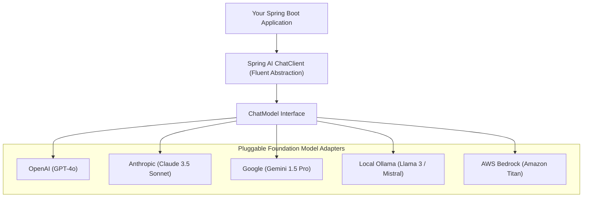
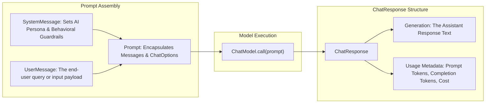
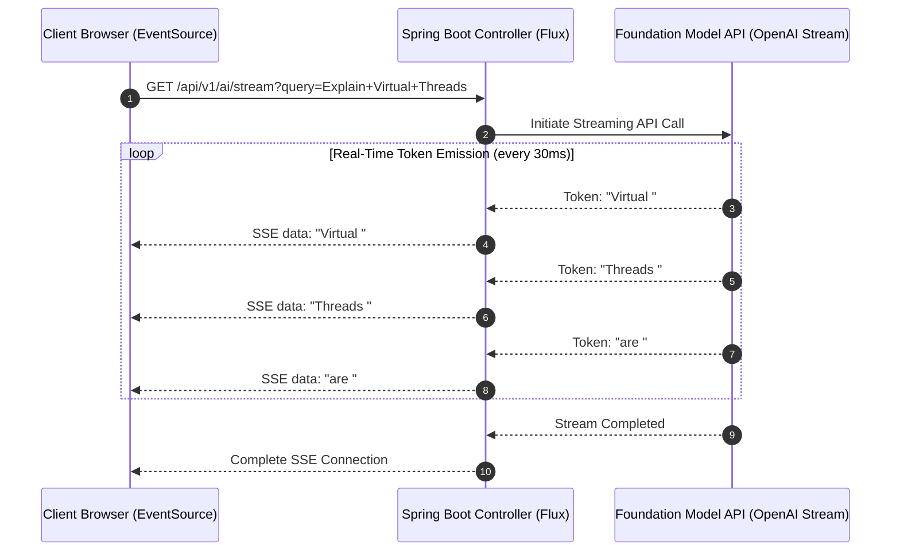

# The AI Landscape for Java: Spring AI

For the past decade, the machine learning and generative AI landscape has been dominated by Python. Data scientists and AI researchers train weights, publish checkpoints, and build proof-of-concept prototypes in Jupyter notebooks using PyTorch and Hugging Face.

However, in the enterprise, **production systems run on Java**.

Core banking engines, high-frequency trading platforms, healthcare records, ERP systems, and e-commerce checkout pipelines are built on Java and Spring Boot. When an enterprise wants to incorporate Large Language Models (LLMs) into production workflows—automating loan decisions, summarizing customer support tickets, or triaging insurance claims—rewriting entire backends in Python is out of the question.

Historically, Java developers were forced to interact with LLMs by constructing raw HTTP requests, manually formatting JSON strings, and parsing unstructured text responses.

The modern cloud-native solution is **Spring AI**. Designed with the same architectural philosophy that made Spring ubiquitous, Spring AI provides portable, idiomatic abstractions that bring foundation models, vector databases, and semantic search directly into the Java enterprise ecosystem.

---

## The Core Philosophy of Spring AI

Spring's greatest strength has always been its ability to **abstract infrastructure behind portable interfaces**:
- `PlatformTransactionManager` abstracts Hibernate, JPA, and JDBC transactions.
- Spring Data abstracts MongoDB, PostgreSQL, and Cassandra under common repository interfaces.

**Spring AI applies this exact same philosophy to Generative AI:**



### The Architectural Advantage

By coding against Spring AI's `ChatClient` and `ChatModel` interfaces:
- Your application logic remains completely decoupled from any single proprietary AI vendor.
- You can develop locally for free using open-source models (like Llama 3 running on **Ollama** in Docker), deploy to staging using **OpenAI**, and run in production using **Azure OpenAI** or **AWS Bedrock** simply by changing a dependency in `pom.xml` and an endpoint in `application.yml`.
- Zero lines of Java business logic need to be rewritten when switching model providers.

---

## Anatomy of the Spring AI Abstraction Layer

Spring AI models conversations using standardized object-oriented domain classes:



### The Core Message Types

- **`SystemMessage`:** Defines the AI's persona, operational boundaries, security guardrails, and expected output format. The system message is invisible to standard end-users but guides the LLM's reasoning:
  ```java
  new SystemMessage("You are a senior compliance auditor for a multinational bank. Answer strictly in JSON.")
  ```
- **`UserMessage`:** The actual prompt, question, or payload provided by the customer or client application.
- **`AssistantMessage`:** Historical responses generated by the model. Used when constructing multi-turn conversational memory.
- **`ChatOptions`:** Runtime execution parameters:
  - `temperature` (0.0 to 1.0): Controls creativity. Set to `0.0` for deterministic structured facts; set to `0.7` for creative writing.
  - `maxTokens`: Caps response length to prevent runaway billing.

---

## Setting Up Spring AI in Spring Boot 3

Spring AI is supported on Spring Boot 3.2+ and Java 17+.

### Step 1: Add the Spring Milestone Repository and Starters

In your `pom.xml`:

```xml
<dependencies>
    <!-- Modern Spring AI OpenAI Starter -->
    <dependency>
        <groupId>org.springframework.ai</groupId>
        <artifactId>spring-ai-openai-spring-boot-starter</artifactId>
        <version>1.0.0-M1</version>
    </dependency>
</dependencies>

<repositories>
    <repository>
        <id>spring-milestones</id>
        <name>Spring Milestones</name>
        <url>https://repo.spring.io/milestone</url>
        <snapshots>
            <enabled>false</enabled>
        </snapshots>
    </repository>
</repositories>
```

### Step 2: Configure Provider Credentials (`application.yml`)

```yaml
spring:
  ai:
    openai:
      api-key: ${OPENAI_API_KEY}
      chat:
        options:
          model: gpt-4o
          temperature: 0.2
          max-tokens: 2000
```

---

## The Modern Fluent `ChatClient` API

In Spring AI 1.0+, the primary interface used by developers is the fluent **`ChatClient`**.

You configure a `ChatClient` bean using the auto-configured `ChatClient.Builder`:

```java
package com.javahub.ai.config;

import org.springframework.ai.chat.client.ChatClient;
import org.springframework.context.annotation.Bean;
import org.springframework.context.annotation.Configuration;

@Configuration
public class AIConfiguration {

    @Bean
    public ChatClient chatClient(ChatClient.Builder builder) {
        return builder
                // Set global enterprise system prompt guardrails
                .defaultSystem("""
                    You are JavaHub Assistant, an expert enterprise software engineering mentor.
                    Explain architectural concepts with focus on memory safety, concurrency, and performance.
                    Never output code containing unescaped raw LaTeX symbols or hardcoded secrets.
                """)
                .build();
    }
}
```

### Executing Synchronous Prompt Calls

Here is a Spring service analyzing code for security vulnerabilities:

```java
package com.javahub.ai.service;

import org.slf4j.Logger;
import org.slf4j.LoggerFactory;
import org.springframework.ai.chat.client.ChatClient;
import org.springframework.stereotype.Service;

@Service
public class SecurityAuditService {

    private static final Logger log = LoggerFactory.getLogger(SecurityAuditService.class);
    private final ChatClient chatClient;

    public SecurityAuditService(ChatClient chatClient) {
        this.chatClient = chatClient;
    }

    public String auditJavaCodeSnippet(String javaSourceCode) {
        log.info("Submitting code snippet to LLM for static security vulnerability analysis");

        return chatClient.prompt()
                .user(u -> u.text("""
                    Review the following Java code for OWASP Top 10 vulnerabilities,
                    SQL injection, or concurrency race conditions.
                    
                    Code snippet:
                    ```java
                    {code}
                    ```
                """).param("code", javaSourceCode))
                .call()
                .content();
    }
}
```

---

## Real-Time Token Streaming with Server-Sent Events (SSE)

Generating large responses from LLMs can take anywhere from 5 to 20 seconds. If an enterprise web application forces a user to stare at a blank loading spinner for 15 seconds, the user assumes the application is broken.

Modern AI applications stream tokens to the frontend in real time as they are generated by the foundation model.

In Spring AI, streaming integrates natively with **Reactive Streams** and **Server-Sent Events (SSE)**:



### Implementing the Streaming Controller

```java
package com.javahub.ai.controller;

import org.springframework.ai.chat.client.ChatClient;
import org.springframework.http.MediaType;
import org.springframework.web.bind.annotation.GetMapping;
import org.springframework.web.bind.annotation.RequestMapping;
import org.springframework.web.bind.annotation.RequestParam;
import org.springframework.web.bind.annotation.RestController;
import reactor.core.publisher.Flux;

@RestController
@RequestMapping("/api/v1/ai")
public class StreamingAIController {

    private final ChatClient chatClient;

    public StreamingAIController(ChatClient chatClient) {
        this.chatClient = chatClient;
    }

    @GetMapping(path = "/stream", produces = MediaType.TEXT_EVENT_STREAM_VALUE)
    public Flux<String> streamAIResponse(@RequestParam String prompt) {
        // chatClient.prompt().stream() returns a reactive Flux emitting tokens as they arrive!
        return chatClient.prompt()
                .user(prompt)
                .stream()
                .content();
    }
}
```

---

## Local Development with Ollama (Zero API Costs)

Calling cloud LLMs (OpenAI, Anthropic) during local development and automated CI integration tests introduces challenges:
- Monthly API billing costs accumulate rapidly.
- Network latency slows down automated unit test suites.
- Sending proprietary internal code or test data over public internet APIs may violate corporate compliance policies.

The enterprise solution is **Ollama**, which runs open-source foundation models (such as Meta's Llama 3 or Mistral) locally on your workstation or container cluster.

### Step 1: Run Ollama via Docker

```bash
docker run -d -v ollama:/root/.ollama -p 11434:11434 --name ollama ollama/ollama
docker exec -it ollama ollama run llama3
```

### Step 2: Use the Spring AI Ollama Starter

```xml
<dependency>
    <groupId>org.springframework.ai</groupId>
    <artifactId>spring-ai-ollama-spring-boot-starter</artifactId>
    <version>1.0.0-M1</version>
</dependency>
```

In `application-local.yml`:

```yaml
spring:
  ai:
    ollama:
      base-url: http://localhost:11434
      chat:
        options:
          model: llama3
          temperature: 0.1
```

Now your entire Spring Boot AI service runs completely offline on your developer laptop with **zero cloud API costs**.

---

## Production Governance: Token Budgets and Cost Control

Integrating LLMs into high-volume microservices introduces significant financial and operational risk:
- An uncontrolled loop in code could fire 100,000 queries to GPT-4o, resulting in thousands of dollars in surprise cloud API charges.
- Excessive context windows inflate latency, degrading user experience.

### Tracking Token Usage Telemetry

Every `ChatResponse` in Spring AI includes usage statistics:

```java
ChatResponse response = chatClient.prompt()
        .user("Summarize enterprise security policy")
        .call()
        .chatResponse();

if (response != null && response.getMetadata() != null) {
    Usage usage = response.getMetadata().getUsage();
    long promptTokens = usage.getPromptTokens();
    long completionTokens = usage.getGenerationTokens();
    long totalTokens = usage.getTotalTokens();

    log.info("LLM Invocation Metrics: PromptTokens={}, CompletionTokens={}, TotalTokens={}",
            promptTokens, completionTokens, totalTokens);

    // Export token usage directly to Prometheus via Micrometer!
    meterRegistry.counter("ai.tokens.prompt.total").increment(promptTokens);
    meterRegistry.counter("ai.tokens.completion.total").increment(completionTokens);
}
```

### Production Guardrails:
1. **Set Hard Limits on `maxTokens`:** Never leave maximum token generation unbounded. Constrain output to the minimum necessary for the domain.
2. **Implement Semantic Caching:** Many user queries are identical or semantically similar. Cache previous LLM answers in Redis using semantic vector similarity; return cached answers in 2 milliseconds rather than paying 2,000 milliseconds and API fees for repeat queries.
3. **Circuit Breakers and Fallbacks:** Wrap LLM invocations in Resilience4j circuit breakers. If OpenAI or Anthropic experiences an outage, fall back to a cached rule-based response or local Ollama model.

---

## Senior Engineer Interview Crucible

### How does Spring AI abstract foundation model providers (OpenAI, Anthropic, Gemini, Ollama) to allow seamless model swapping without rewriting business code?

Spring AI models interactions using standard object-oriented contracts centered around the **`ChatModel`** and **`ChatClient`** interfaces. 

When your application code invokes `chatClient.prompt().user("...").call().content()`, it writes purely against framework-agnostic representations (`Prompt`, `Message`, `ChatResponse`).

Under the hood, Spring AI provides dedicated provider starters (`spring-ai-openai`, `spring-ai-anthropic`, `spring-ai-ollama`, `spring-ai-bedrock`). Each starter implements `ChatModel`, translating Spring's generic `Prompt` into that specific vendor's proprietary JSON wire format and mapping vendor responses back into normalized `ChatResponse` objects. 

To swap providers—for example, switching from OpenAI GPT-4o in the cloud to a self-hosted Llama 3 model on Ollama—you simply change the Maven starter dependency and update connection credentials in `application.yml`. The Java service code remains completely untouched.

---

### Explain the purpose and interaction between SystemMessage, UserMessage, and AssistantMessage in a multi-turn chat prompt.

Modern conversational LLMs operate over an array of structured message roles:

- **`SystemMessage` (The Guardrails):** Establishes the model's persona, capabilities, boundaries, and formatting instructions (e.g., *"You are a senior banking advisor. Never provide legal advice. Respond only in valid JSON"*). It provides static guidance across the entire session.
- **`UserMessage` (The Input):** Contains the dynamic request, query, or payload submitted by the human user or calling microservice.
- **`AssistantMessage` (The Model's Output / Memory):** Contains the text previously returned by the model.

**How They Interact in Multi-Turn Dialogues:**
Because LLM APIs are stateless HTTP endpoints, they retain no internal memory of previous requests. To maintain a conversational dialogue, the application must maintain conversational state and pass the complete conversation history array on every request:
```text
[SystemMessage, UserMessage_1, AssistantMessage_1, UserMessage_2, AssistantMessage_2, UserMessage_3]
```
The model reads the interleaved sequence of user inputs and assistant replies to understand conversational context before generating the next response.

---

### How do you stream LLM tokens to an end-user web client in real time using Spring AI and Server-Sent Events (SSE)?

Generating long textual completions from foundation models can take several seconds. To deliver a responsive user experience, Spring AI supports **streaming token evaluation**:

1. In the service layer, invoke `.stream()` on the fluent `ChatClient` instead of `.call()`. This calls the provider's streaming API (which transmits chunked HTTP payloads using Server-Sent Events under the hood).
2. The method returns a reactive **`Flux<String>`** (Project Reactor), which emits discrete string tokens as soon as they are generated by the model.
3. In the Spring WebFlux or Spring MVC `@RestController`, expose an endpoint returning `Flux<String>` with `produces = MediaType.TEXT_EVENT_STREAM_VALUE`.
4. The client browser connects to the endpoint using the HTML5 `EventSource` API or `fetch` with a `ReadableStream`. The browser receives and renders each token in real time with minimal initial latency.

---

### What architectural safeguards should an enterprise implement to protect against runaway API costs and high token latency when integrating LLMs into Spring Boot microservices?

To govern cloud AI integration responsibly, an enterprise architecture should enforce four layers of protection:

1. **Token Quotas & Strict Max Token Caps:** Never leave `max_tokens` unconfigured in `application.yml`. Bound maximum generation lengths tightly according to the use case.
2. **Telemetry & Budget Alerting via Micrometer:** Instrument every LLM call using `Usage` metadata (`prompt_tokens`, `completion_tokens`). Export token counts to Prometheus and configure Grafana alerting thresholds to detect runaway query loops before monthly billing cycles spike.
3. **Semantic Caching with Redis:** Deploy an in-memory vector cache. Before making an external API call, generate an embedding for the user prompt and check if a semantically identical query was answered recently. Serving answers from cache drops response time from 3,000ms to 5ms and eliminates API fees.
4. **Timeouts and Circuit Breakers (Resilience4j):** Set explicit HTTP client timeouts (e.g., 10 seconds) on LLM calls to prevent thread starvation. Wrap calls in a circuit breaker so that if the external AI vendor suffers an outage or severe degradation, requests fail fast and fall back to local rule-based responses or cached states.

