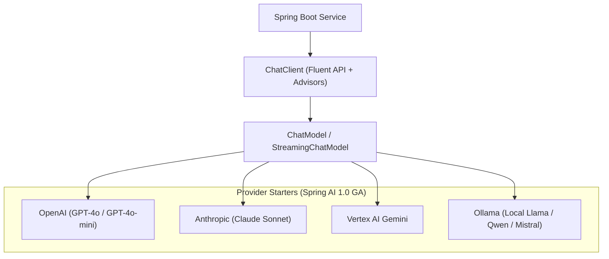
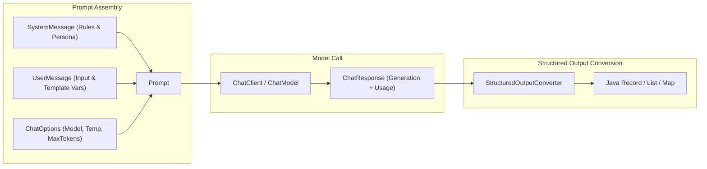

Most model training, fine-tuning, and research tooling lives in Python. PyTorch, Hugging Face Transformers, and notebook workflows dominate that side of the stack, and for good reason.

Production business systems are a different story. Core banking ledgers, order management pipelines, insurance underwriting engines, and healthcare platforms mostly run on the JVM, with Spring Boot at the center of many of them. When a team needs to summarize support tickets, extract line items from supplier invoices, or answer questions over internal runbooks, rewriting the backend in Python or standing up a fragile Python sidecar for every LLM call rarely makes sense. You want LLM orchestration sitting right next to your existing domain services, database transactions, Spring Security filters, and Micrometer metrics.

Early Java integrations meant hand-rolling HTTP requests with `RestClient` or `WebClient`, pasting JSON payloads together, and parsing provider-specific response formats. Every vendor used slightly different schemas for messages, streaming chunks, tool definitions, and token counts.

**Spring AI** solves that integration problem using the same pattern Spring has applied to databases and messaging for two decades: put clean, portable Java interfaces in front of vendor-specific APIs, and let Spring Boot auto-configuration handle the plumbing.

---

## The GenAI Shift for Java Engineers

Integrating a Large Language Model into a Spring Boot service does not require becoming a machine learning researcher. In most enterprise teams, the split of responsibilities is straightforward:

- **Model providers and ML teams** train foundation models, host GPU inference clusters, and expose HTTP or gRPC endpoints.
- **Java backend engineers** own everything around the model call: prompt assembly, context retrieval, structured deserialization, authorization, audit logging, retries, latency budgets, and cost controls.

That second layer is where most real-world AI projects succeed or fail. Calling an LLM endpoint takes ten lines of code; making that call reliable, observable, secure against prompt injection, and bounded in cost under production traffic is standard backend engineering. Java 21 (especially records, pattern matching, and virtual threads for blocking I/O) and Spring Boot 3 fit this workload well.

---

## Spring AI Architecture: Models, Prompts, and Output Converters

Spring AI mirrors the design of Spring Data and Spring Integration. Your application code talks to vendor-neutral abstractions, while provider starters handle serialization, authentication, and HTTP transport behind the scenes.



### Models: `ChatModel`, `StreamingChatModel`, and `EmbeddingModel`

At the lowest portable layer sit the model interfaces:

- `ChatModel` executes synchronous request-response prompts (`ChatResponse call(Prompt prompt)`).
- `StreamingChatModel` returns a reactive `Flux<ChatResponse>` so tokens can be forwarded to clients as they arrive.
- `EmbeddingModel` turns text into float arrays (vectors) for semantic search and retrieval-augmented generation (RAG).
- Image, audio transcription, and text-to-speech models follow the same `Model<TReq, TRes>` contract.

You can inject `ChatModel` directly when you want low-level control, though most application code works through the higher-level fluent **`ChatClient`**. `ChatClient` wraps a `ChatModel`, supports reusable defaults (system instructions, options, tools), and lets you plug in **Advisors**, which are interceptors that wrap every prompt and response for cross-cutting concerns such as conversation memory, RAG context injection, or structured logging.

### Prompts, Messages, and Options

A `Prompt` bundles an ordered list of typed `Message` objects together with optional runtime `ChatOptions` (model override, `temperature`, `maxTokens`, `topP`, stop sequences):

- `SystemMessage` defines the role, constraints, and output rules that govern the assistant's behavior.
- `UserMessage` holds the current user request or input payload (and optional binary media such as images or PDFs for multimodal models).
- `AssistantMessage` represents prior model replies when replaying multi-turn conversation history.
- `ToolResponseMessage` feeds the result of a Java tool/function execution back to the model during tool-calling loops.

Because LLM HTTP APIs are stateless, multi-turn chat works by sending the message sequence (`SystemMessage`, `UserMessage`, `AssistantMessage`, `UserMessage`, ...) on every request.



### From Output Parsers to Structured Output Converters

If you read older tutorials or early Spring AI milestone docs, you will see references to `OutputParser` (`BeanOutputParser`, `MapOutputParser`, `ListOutputParser`). Before the 1.0 GA release, the Spring AI team renamed this abstraction to **`StructuredOutputConverter<T>`** to reflect that it handles both directions of the contract: generating format instructions before the call and converting the model's text into Java objects afterward.

Spring AI ships three built-in converters:

- `BeanOutputConverter<T>` generates a JSON Schema from a Java `record` or POJO using Jackson and deserializes the response into an instance of `T` (or a generic collection via `ParameterizedTypeReference<List<T>>`).
- `MapOutputConverter` converts a JSON object into `Map<String, Object>`.
- `ListOutputConverter` asks for a comma-separated list and converts it into `List<String>`.

With `ChatClient`, you rarely instantiate `BeanOutputConverter` by hand; calling `.entity(MyRecord.class)` wires it automatically:

```java
public record TicketSummary(
        String category,
        String severity,
        String conciseSummary
) {}
```

```java
TicketSummary summary = chatClient.prompt()
        .system("Classify incoming customer support tickets accurately.")
        .user(u -> u.text("Analyze this ticket:\n{body}").param("body", rawTicket))
        .call()
        .entity(TicketSummary.class);
```

We dig deeper into record schemas, validation, and provider-level constrained decoding in the next lesson.

---

## Comparing Spring AI vs. LangChain4j

Spring AI is not the only serious Java framework for LLM applications. **LangChain4j** is widely adopted in the JVM ecosystem and has been in active production use even longer. Picking between them comes down to your stack, your team's style, and how tightly you want to couple to Spring Boot.

| Dimension | Spring AI (1.0 GA+) | LangChain4j |
| :--- | :--- | :--- |
| **Framework coupling** | Designed for Spring Boot 3; relies heavily on Spring auto-configuration, `RestClient`/`WebClient`, and Spring properties. | Framework-agnostic core Java library; works in plain Java, Quarkus (`quarkus-langchain4j`), Helidon, Micronaut, and Spring Boot. |
| **Primary API style** | Fluent `ChatClient` builder with `Advisor` chains, modeled after Spring's `RestClient` and `JdbcClient`. | Declarative `@AiService` Java interfaces backed by dynamic proxies, plus lower-level `ChatModel` APIs. |
| **Observability** | First-class Micrometer metrics and OpenTelemetry tracing out of the box via Spring Boot Actuator. | Supports listeners and metrics integration, though Spring Boot Actuator integration requires extra wiring unless using Quarkus. |
| **Model & Vector Store breadth** | Strong coverage of major enterprise providers (OpenAI, Anthropic, Azure OpenAI, AWS Bedrock, Vertex AI, Ollama, pgvector, Milvus, Chroma, Redis, Qdrant). | Very broad community ecosystem; often adds niche providers, agent patterns, and experimental features quickly. |
| **Enterprise alignment** | Maintained under the official Spring portfolio (`org.springframework.ai`), aligned with Spring Boot release cycles and support policies. | Open-source community project with strong Quarkus/Red Hat backing and rapid iteration. |

To feel the difference in developer ergonomics, compare how LangChain4j models a typed AI service using a declarative interface:

```java
// LangChain4j declarative AiService style
interface TicketClassifier {
    @SystemMessage("Classify incoming customer support tickets accurately.")
    TicketSummary classify(@UserMessage String rawTicket);
}

TicketClassifier classifier = AiServices.builder(TicketClassifier.class)
        .chatModel(openAiChatModel)
        .build();

TicketSummary result = classifier.classify(rawTicket);
```

LangChain4j's interface-proxy approach feels similar to Spring Data repositories or Feign clients: concise and readable for straightforward service contracts. Spring AI's fluent `ChatClient` feels closer to `JdbcClient` or `RestClient`, giving you explicit per-call control over advisors, options, and templates while inheriting Spring Boot's property binding, SSL bundles, observability, and test slices without extra glue code.

A practical rule of thumb: if your organization already standardizes on Spring Boot 3 and Actuator/Micrometer, **Spring AI** keeps the architecture consistent and minimizes dependency sprawl. If you run Quarkus, Micronaut, or plain Java services (or strongly prefer declarative `AiServices` interfaces), **LangChain4j** is an equally solid choice.

---

## Connecting to OpenAI, Anthropic, Gemini, and Local Ollama

As of Spring AI 1.0.0 GA, all artifacts are published directly to Maven Central. You no longer need milestone repositories or `-M1` starter names. Start by importing the Spring AI BOM (Bill of Materials) in `pom.xml` so all model and vector-store starters stay on matching versions.

### Maven BOM Setup

```xml
<dependencyManagement>
    <dependencies>
        <dependency>
            <groupId>org.springframework.ai</groupId>
            <artifactId>spring-ai-bom</artifactId>
            <version>1.0.0</version>
            <type>pom</type>
            <scope>import</scope>
        </dependency>
    </dependencies>
</dependencyManagement>
```

From there, add the starter for whichever provider you want to connect to. Notice that Spring AI 1.0 GA uses the `spring-ai-starter-model-*` naming convention.

### OpenAI

Add the starter:

```xml
<dependency>
    <groupId>org.springframework.ai</groupId>
    <artifactId>spring-ai-starter-model-openai</artifactId>
</dependency>
```

Configure `application.yml`:

```yaml
spring:
  ai:
    openai:
      api-key: ${OPENAI_API_KEY}
      chat:
        options:
          model: gpt-4o-mini
          temperature: 0.2
          max-tokens: 1500
```

### Anthropic (Claude)

Add the starter:

```xml
<dependency>
    <groupId>org.springframework.ai</groupId>
    <artifactId>spring-ai-starter-model-anthropic</artifactId>
</dependency>
```

Configure `application.yml`:

```yaml
spring:
  ai:
    anthropic:
      api-key: ${ANTHROPIC_API_KEY}
      chat:
        options:
          model: claude-3-7-sonnet-latest
          temperature: 0.2
          max-tokens: 1500
```

### Google Vertex AI Gemini

For Google Cloud workloads using Vertex AI authentication (Application Default Credentials via `gcloud auth application-default login` or a Workload Identity service account), add the Vertex AI Gemini starter:

```xml
<dependency>
    <groupId>org.springframework.ai</groupId>
    <artifactId>spring-ai-starter-model-vertex-ai-gemini</artifactId>
</dependency>
```

Configure `application.yml`:

```yaml
spring:
  ai:
    vertex:
      ai:
        gemini:
          project-id: ${GCP_PROJECT_ID}
          location: us-central1
          chat:
            options:
              model: gemini-2.0-flash
              temperature: 0.2
              max-output-tokens: 1500
```

### Local Models with Ollama

Calling hosted cloud APIs on every local test run burns money, depends on internet connectivity, and raises compliance issues if developers paste proprietary source code or sample customer records into prompts. **Ollama** runs quantized open-weight models (such as Llama 3.2, Qwen 2.5, or Mistral) locally over a simple HTTP API.

Start Ollama in Docker and pull a model:

```bash
docker run -d -v ollama_data:/root/.ollama -p 11434:11434 --name ollama ollama/ollama
docker exec -it ollama ollama pull llama3.2
```

Add the Ollama starter:

```xml
<dependency>
    <groupId>org.springframework.ai</groupId>
    <artifactId>spring-ai-starter-model-ollama</artifactId>
</dependency>
```

Configure `application-local.yml`:

```yaml
spring:
  ai:
    ollama:
      base-url: http://localhost:11434
      init:
        pull-model-strategy: when_missing
      chat:
        options:
          model: llama3.2
          temperature: 0.1
          num-predict: 1024
```

Setting `pull-model-strategy: when_missing` lets Spring AI ask Ollama to pull the configured model automatically on startup during local development or Testcontainers integration tests if it is not already cached.

> [!IMPORTANT]
> If you put **multiple** model starters (for example, both OpenAI and Ollama) on the classpath at the same time, Spring Boot creates multiple `ChatModel` beans and cannot auto-configure a single default `ChatClient.Builder`. Set `spring.ai.chat.client.enabled=false` and declare explicit `@Bean` `ChatClient` instances injecting `@Qualifier("openAiChatModel")` and `@Qualifier("ollamaChatModel")` as needed (for example, to route cheap tasks to a fast model and complex reasoning to a frontier model).

---

## Building a Spring Boot Service with `ChatClient`

Once a starter is configured, Spring Boot provides a `ChatClient.Builder` bean. Register a shared `ChatClient` configuration with sensible defaults, or inject `ChatClient.Builder` directly into services that need different system instructions.

```java
package com.javahub.ai.config;

import org.springframework.ai.chat.client.ChatClient;
import org.springframework.context.annotation.Bean;
import org.springframework.context.annotation.Configuration;

@Configuration
public class AiConfig {

    @Bean
    public ChatClient codeReviewChatClient(ChatClient.Builder builder) {
        return builder
                .defaultSystem("""
                    You are a senior Java code reviewer.
                    Identify concrete bugs, concurrency hazards, SQL injection risks, and resource leaks.
                    Be concise, cite the exact line or construct at fault, and avoid stylistic nitpicks.
                    """)
                .build();
    }
}
```

Here is a service that invokes `ChatClient`, logs the response metadata, and records prompt and completion tokens via Micrometer. Notice that in Spring AI 1.0 GA, the `Usage` interface exposes `getPromptTokens()`, `getCompletionTokens()`, and `getTotalTokens()`.

```java
package com.javahub.ai.service;

import io.micrometer.core.instrument.MeterRegistry;
import org.slf4j.Logger;
import org.slf4j.LoggerFactory;
import org.springframework.ai.chat.client.ChatClient;
import org.springframework.ai.chat.metadata.Usage;
import org.springframework.ai.chat.model.ChatResponse;
import org.springframework.stereotype.Service;

@Service
public class SecurityReviewService {

    private static final Logger log = LoggerFactory.getLogger(SecurityReviewService.class);

    private final ChatClient chatClient;
    private final MeterRegistry meterRegistry;

    public SecurityReviewService(ChatClient codeReviewChatClient, MeterRegistry meterRegistry) {
        this.chatClient = codeReviewChatClient;
        this.meterRegistry = meterRegistry;
    }

    public String reviewSnippet(String javaSource) {
        ChatResponse response = chatClient.prompt()
                .user(u -> u.text("""
                        Review the following Java code for security vulnerabilities and concurrency bugs:

                        ```java
                        {code}
                        ```
                        """).param("code", javaSource))
                .call()
                .chatResponse();

        if (response == null || response.getResult() == null) {
            throw new IllegalStateException("LLM returned an empty response");
        }

        Usage usage = response.getMetadata().getUsage();
        if (usage != null) {
            int promptTokens = usage.getPromptTokens() != null ? usage.getPromptTokens() : 0;
            int completionTokens = usage.getCompletionTokens() != null ? usage.getCompletionTokens() : 0;
            int totalTokens = usage.getTotalTokens() != null ? usage.getTotalTokens() : 0;

            log.info("Security review completed: promptTokens={}, completionTokens={}, totalTokens={}",
                    promptTokens, completionTokens, totalTokens);

            meterRegistry.counter("app.ai.tokens", "type", "prompt").increment(promptTokens);
            meterRegistry.counter("app.ai.tokens", "type", "completion").increment(completionTokens);
        }

        return response.getResult().getOutput().getText();
    }
}
```

### Practical Production Guardrails

Even before introducing RAG or agents, four habits prevent most early production incidents with LLM APIs:

1. **Always bound output tokens:** Configure `max-tokens` (or the provider equivalent) in `application.yml`. Unbounded generation lets a stuck repetition loop burn tokens and tie up HTTP connections.
2. **Set explicit HTTP client timeouts:** Model APIs occasionally stall under load. Configure connect and read timeouts on the underlying `RestClient`/`WebClient` so slow upstream calls fail fast instead of exhausting your servlet or virtual thread budget.
3. **Keep secrets and PII out of prompts unless approved:** Treat external LLM APIs like any third-party data processor. Strip secrets, redact sensitive fields where possible, or use private endpoints (Azure OpenAI, AWS Bedrock, Vertex AI, or self-hosted Ollama/vLLM) when compliance requires data residency.
4. **Watch portability limits:** Switching providers via Spring AI keeps your Java interfaces intact, yet prompts themselves are not 100% portable. A prompt tuned for GPT-4o may behave slightly differently on Claude or Llama 3.2. Keep a small regression evaluation suite of real test inputs whenever you switch or upgrade models.

---

## Interview Questions

### How does Spring AI let a Spring Boot service switch between OpenAI, Anthropic, Gemini, and Ollama without rewriting business logic?

Spring AI separates application code from provider wire protocols through the `ChatModel` and fluent `ChatClient` abstractions. Your services build vendor-neutral `Prompt` objects (composed of `SystemMessage`, `UserMessage`, and `ChatOptions`) and consume normalized `ChatResponse` objects or converted Java records. Each starter (`spring-ai-starter-model-openai`, `spring-ai-starter-model-anthropic`, `spring-ai-starter-model-vertex-ai-gemini`, `spring-ai-starter-model-ollama`) supplies a `ChatModel` implementation that translates between Spring AI's model types and that vendor's REST/gRPC API. Changing providers means swapping the starter and updating `application.yml`. In practice, you should still re-run prompt quality tests because different models respond differently to the same wording.

### How would you decide between Spring AI and LangChain4j for a new Java project?

Look at the surrounding runtime and team conventions first. If the project is already built on Spring Boot 3 and uses Spring configuration properties, Actuator, Micrometer, and `RestClient`, Spring AI fits naturally with less boilerplate and first-party observability. If the team runs Quarkus, Micronaut, or lightweight non-Spring Java services, or prefers declarative interface proxies (`@AiService`), LangChain4j is often cleaner. It is also worth checking whether a specific provider, vector store, or agent feature you depend on is already mature in one library before committing.

### What is the role of `SystemMessage`, `UserMessage`, `AssistantMessage`, and `ToolResponseMessage` in a multi-turn conversation?

LLMs are stateless over HTTP, so every turn sends the conversation context as an ordered list of messages. `SystemMessage` sets persistent instructions, persona, and constraints. `UserMessage` carries the caller's request or data. `AssistantMessage` contains previous model responses so the model can follow what it already said. `ToolResponseMessage` carries the output of a local Java function invoked at the model's request so the model can continue reasoning with fresh data.

### Why did Spring AI rename `OutputParser` to `StructuredOutputConverter`, and what does `BeanOutputConverter` actually do?

The older `OutputParser` name suggested it only parsed text after a call. In reality, `StructuredOutputConverter<T>` participates both before and after the LLM request. Before the call, `BeanOutputConverter<T>` reflects over your Java class or record with Jackson to build a JSON Schema and appends formatting instructions to the prompt. After the call, it parses the returned JSON text into a strongly typed Java object using Jackson's `ObjectMapper`.
