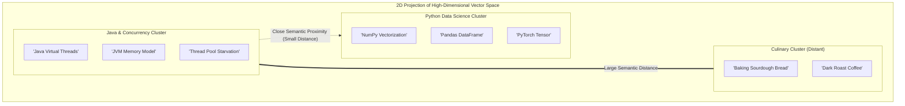
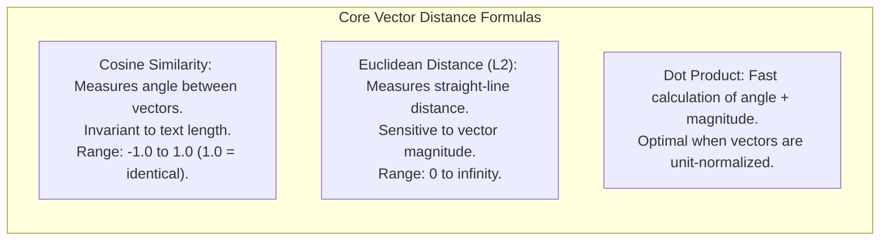
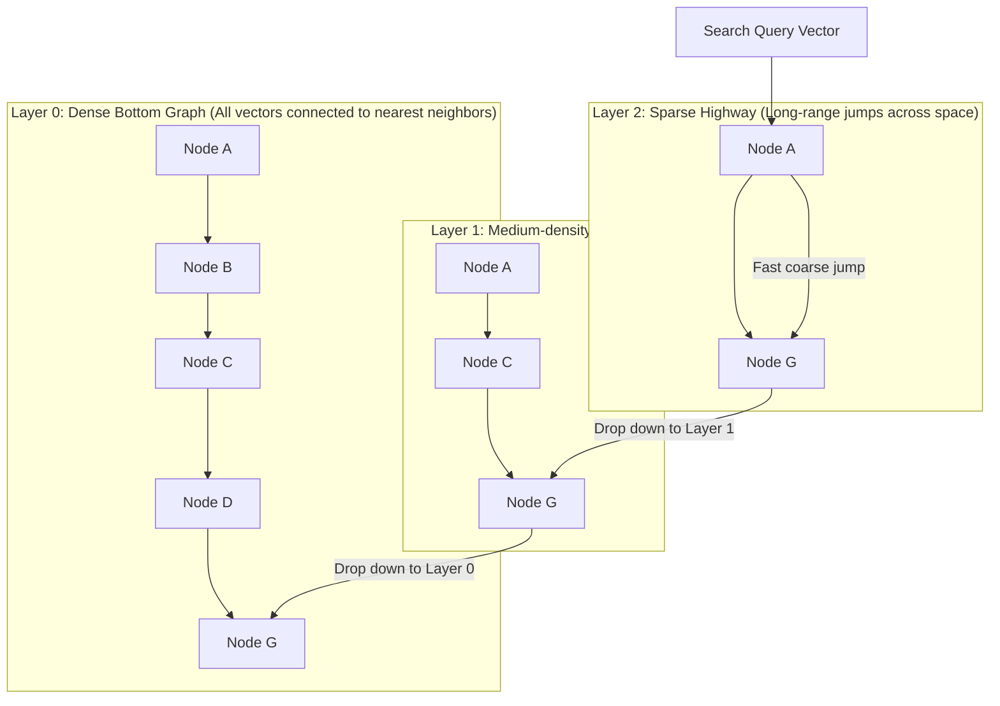
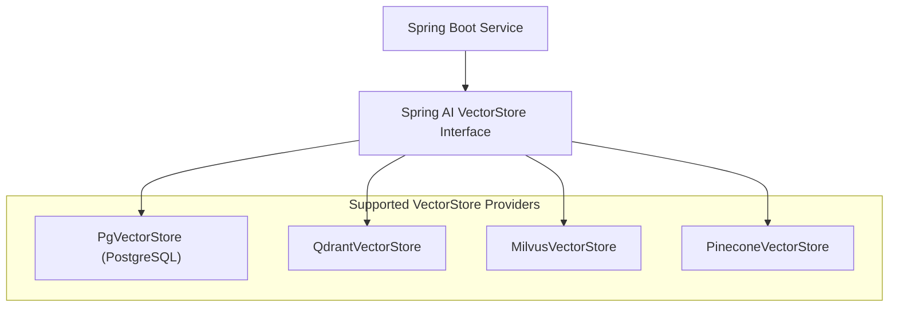

# Vector Databases and Semantic Search

Traditional search engines—whether an SQL `LIKE '%keyword%'` query or an Elasticsearch inverted index—rely on **lexical matching**. They search for the presence of exact words, word stems, or character n-grams.

Lexical matching fails when human users search using concepts rather than identical vocabulary:
- A user searching for *"how to adopt a puppy"* will not match a document titled *"Canine Rescue and Foster Care Guidelines"*, despite being semantically identical.
- A user searching for *"car electrical malfunction"* will match a document discussing *"remote control toy car battery replacement"*, despite being completely irrelevant.

To bridge the gap between literal keywords and human conceptual meaning, modern architectures use **Embeddings** and **Vector Databases**.

In this deep dive, we will explore the mathematics of vector embeddings, analyze distance metrics, examine high-dimensional indexing with **HNSW**, integrate **PostgreSQL with `pgvector`** in Spring AI, and perform semantic similarity queries with metadata filters.

---

## What is an Embedding?

An **Embedding** is a mathematical translation of unstructured text, images, or audio into a dense vector of floating-point numbers in a high-dimensional continuous vector space:

```text
"Java Concurrency"   -->  [-0.0142, 0.0891, -0.0412, ..., 0.0031]  (1,536 dimensions)
"Multithreaded JVM"  -->  [-0.0139, 0.0875, -0.0401, ..., 0.0029]  (1,536 dimensions)
"Strawberry Tart"    -->  [ 0.0781, -0.0125, 0.0914, ..., -0.0612] (1,536 dimensions)
```

Generated by specialized neural networks (such as OpenAI's `text-embedding-3-small` or open-source Hugging Face models), embeddings capture **semantic meaning**:



In high-dimensional space (typically 768 to 1,536 dimensions), sentences discussing similar topics are positioned geometrically close to one another, while unrelated topics sit vast distances apart.

---

## Vector Similarity Distance Metrics

To measure how conceptually related two pieces of text are, we calculate the geometric distance between their embedding vectors.



### Cosine Similarity (The Industry Standard for Text)
Measures the cosine of the angle between two multi-dimensional vectors:

```text
Cosine Similarity = (Vector A · Vector B) / (||Vector A|| * ||Vector B||)
```

- When the angle is zero degrees (`cos(0) = 1`), the vectors point in the exact same direction (maximum semantic similarity).
- When the angle is 90 degrees (`cos(90) = 0`), the vectors are orthogonal (unrelated).
- **Why it dominates text search:** Cosine similarity evaluates direction rather than length. A 500-word essay about Kubernetes and a 20-word summary about Kubernetes will point in roughly the same direction, matching accurately regardless of text length.

---

## Approximate Nearest Neighbor (ANN) and HNSW

Suppose you have an enterprise knowledge base containing 10 million documents. When a user submits a search query:
1. You generate an embedding vector for the query.
2. To find the top 5 most relevant documents using exact **k-Nearest Neighbors (k-NN)**, you must compute the cosine distance between the query vector and all 10 million document vectors.

This brute-force approach requires `O(N)` operations. Calculating 1,536-dimensional dot products against 10 million vectors takes seconds of CPU time—completely unusable for an interactive web search API.

### The Breakthrough: Hierarchical Navigable Small World (HNSW)

To achieve sub-10ms search across millions of vectors, vector databases use **Approximate Nearest Neighbor (ANN)** indexing. The gold standard algorithm is **HNSW (Hierarchical Navigable Small World)**:



### How HNSW Works:
- Inspired by Skip Lists, HNSW constructs a multi-layer graph where upper layers have sparse connections and long-distance edges, while the bottom layer contains all vectors connected to their local neighbors.
- The search starts at the top layer, taking large "highway" jumps across vector space to quickly locate the general neighborhood of the query.
- It drops down layer by layer, refining its search greedily.
- **Performance:** Reduces search complexity from `O(N)` to **`O(log N)`**, delivering top-k semantic matches in 2 to 5 milliseconds across tens of millions of records.

---

## The Vector Database Landscape: Dedicated vs `pgvector`

When choosing a vector storage layer for a Java microservice architecture, there are two primary paths:

| Architecture | Examples | Strengths | Trade-Offs |
| :--- | :--- | :--- | :--- |
| **Dedicated Vector DB** | Milvus, Qdrant, Pinecone, Weaviate | Engineered purely for billion-scale vector indexes; advanced sharding. | Another distributed cluster to operate; lacks ACID relational joins. |
| **Relational Extension** | **PostgreSQL with `pgvector`** | Keeps relational data and vector embeddings in the **same ACID database**; zero sync lag. | Scaling past 50 million vectors requires careful RAM and vacuum tuning. |

### Why PostgreSQL + `pgvector` is the Enterprise Choice

In 90% of enterprise applications, you already use **PostgreSQL**. 

Using a separate vector database (like Pinecone) forces you into the **Dual-Write Hazard**: when an order or article is updated, you must write to PostgreSQL and then sync to Pinecone. If the network drops, your vector index and relational database drift out of sync.

With the **`pgvector`** extension:
- Your embeddings are stored directly in a `vector(1536)` column on your existing tables.
- You can query vectors and standard relational fields in a single SQL query:
  ```sql
  SELECT id, title, price 
  FROM products 
  WHERE in_stock = true AND category = 'Electronics'
  ORDER BY embedding <=> :query_vector
  LIMIT 5;
  ```
- Backups, replication, transactions, and security permissions are managed using standard PostgreSQL tooling.

---

## Spring AI VectorStore Architecture

Spring AI provides the **`VectorStore`** interface, decoupling your application from the underlying vector engine:



### The Core `VectorStore` Operations:
1. `add(List<Document> documents)`: Generates embeddings via `EmbeddingModel` and persists document text, metadata, and vectors.
2. `similaritySearch(SearchRequest request)`: Computes the query embedding, executes the ANN search, applies metadata filters, and returns ranked documents.

---

## Production Implementation with Spring Boot 3 and `pgvector`

Let's build an enterprise semantic document store.

### Step 1: Run PostgreSQL with `pgvector` via Docker

```bash
docker run -d \
  --name postgres-vector \
  -e POSTGRES_DB=knowledge_base \
  -e POSTGRES_USER=postgres \
  -e POSTGRES_PASSWORD=postgres \
  -p 5432:5432 \
  pgvector/pgvector:pg16
```

### Step 2: Maven Dependencies

```xml
<dependencies>
    <!-- Spring AI PgVector Starter -->
    <dependency>
        <groupId>org.springframework.ai</groupId>
        <artifactId>spring-ai-pgvector-store-spring-boot-starter</artifactId>
        <version>1.0.0-M1</version>
    </dependency>
    <!-- Spring AI OpenAI Starter (For generating embeddings) -->
    <dependency>
        <groupId>org.springframework.ai</groupId>
        <artifactId>spring-ai-openai-spring-boot-starter</artifactId>
        <version>1.0.0-M1</version>
    </dependency>
</dependencies>
```

### Step 3: Application Configuration (`application.yml`)

```yaml
spring:
  datasource:
    url: jdbc:postgresql://localhost:5432/knowledge_base
    username: postgres
    password: postgres
  ai:
    openai:
      api-key: ${OPENAI_API_KEY}
      embedding:
        options:
          model: text-embedding-3-small # Produces 1,536-dimensional vectors
    vectorstore:
      pgvector:
        index-type: HNSW # High-performance Hierarchical Navigable Small World index
        distance-type: COSINE_DISTANCE # Use Cosine Distance for text similarity
        dimensions: 1536
        initialize-schema: true # Auto-executes CREATE EXTENSION IF NOT EXISTS vector
```

### Step 4: The Semantic Search Service

```java
package com.javahub.ai.search;

import org.slf4j.Logger;
import org.slf4j.LoggerFactory;
import org.springframework.ai.document.Document;
import org.springframework.ai.vectorstore.SearchRequest;
import org.springframework.ai.vectorstore.VectorStore;
import org.springframework.ai.vectorstore.filter.FilterExpressionBuilder;
import org.springframework.stereotype.Service;

import java.util.List;
import java.util.Map;

@Service
public class EnterpriseSemanticSearchService {

    private static final Logger log = LoggerFactory.getLogger(EnterpriseSemanticSearchService.class);
    private final VectorStore vectorStore;

    public EnterpriseSemanticSearchService(VectorStore vectorStore) {
        this.vectorStore = vectorStore;
    }

    // 1. Ingest Documents into Vector Store
    public void ingestKnowledgeDocuments() {
        List<Document> documents = List.of(
            new Document(
                "Java Virtual Threads lightweight threads introduced in JDK 21 reduce the cost of blocking I/O.",
                Map.of("category", "java", "tier", "standard", "year", 2024)
            ),
            new Document(
                "Kubernetes HPA scales pod replicas dynamically based on CPU utilization and custom metrics.",
                Map.of("category", "devops", "tier", "enterprise", "year", 2024)
            ),
            new Document(
                "PostgreSQL pgvector extension enables high-dimensional vector similarity search inside standard ACID tables.",
                Map.of("category", "database", "tier", "standard", "year", 2023)
            )
        );

        log.info("Ingesting and embedding {} documents into pgvector", documents.size());
        vectorStore.add(documents);
    }

    // 2. Execute Hybrid Semantic Search with Metadata Filtering
    public List<Document> searchDocumentation(String naturalLanguageQuery, String targetCategory) {
        log.info("Executing semantic search for query: '{}' within category: '{}'", naturalLanguageQuery, targetCategory);

        FilterExpressionBuilder b = new FilterExpressionBuilder();

        SearchRequest request = SearchRequest.builder()
                .query(naturalLanguageQuery)
                .topK(3) // Return top 3 most relevant results
                .similarityThreshold(0.70) // Discard results with cosine similarity score below 0.70
                // HYBRID FILTER: Combines vector similarity with exact relational metadata filter!
                .filterExpression(b.eq("category", targetCategory).build())
                .build();

        return vectorStore.similaritySearch(request);
    }
}
```

---

## Hybrid Search: Combining Vector Distance with Relational Filters

In enterprise production applications, **pure vector semantic search is almost never enough on its own**:
- An HR search must find policies related to *"parental leave"*, but only documents accessible to employees in *"Region = Germany"*.
- A SaaS search must match product documentation, but strictly filtered where `"tenant_id = 'acme-corp'"`.

If you perform pure vector search first, the top 10 results might belong to different tenants or regions. When you subsequently filter out unauthorized results, you are left with zero matches.

### The Power of `pgvector` Hybrid Execution:
Spring AI translates the `.filterExpression()` directly into PostgreSQL's internal query planner:

```sql
SELECT id, content, metadata, 1 - (embedding <=> :query_vector) AS similarity
FROM vector_store
WHERE (metadata->>'category') = 'java'
  AND (1 - (embedding <=> :query_vector)) >= 0.70
ORDER BY embedding <=> :query_vector
LIMIT 3;
```

PostgreSQL applies the relational metadata filter and the HNSW vector index in a single coordinated index scan, guaranteeing multi-tenant security and lightning-fast latency.

---

## Senior Engineer Interview Crucible

### What is an Embedding Vector, and how does Cosine Similarity determine semantic relatedness between two arbitrary text passages?

An **Embedding Vector** is a dense numerical array (e.g., 1,536 floating-point numbers) generated by an embedding model that represents the latent semantic meaning of a text passage in high-dimensional vector space. Concepts that share similar meanings or contexts are placed geometrically near each other.

**Cosine Similarity** measures the cosine of the angle between two multi-dimensional vectors:

```text
Cosine Similarity = (A · B) / (||A|| * ||B||)
```

Because the dot product is divided by the product of the vector magnitudes (lengths), Cosine Similarity measures strictly the **directional alignment** of the vectors, ignoring vector length. 
- A score of `1.0` means the vectors point in the identical direction (identical semantic meaning).
- A score of `0.0` indicates orthogonality (unrelated concepts).
- A score of `-1.0` indicates diametrically opposed concepts.

This makes Cosine Similarity ideal for text search because a concise summary and a long article on the same subject produce vectors pointing in nearly identical directions despite differing word counts.

---

### Explain the trade-offs between exact k-NN (k-Nearest Neighbors) and Approximate Nearest Neighbor (ANN) algorithms like HNSW.

- **Exact k-NN (Flat Index):**
  - *Mechanism:* Computes the exact mathematical distance between the query vector and every single vector in the database (brute-force linear scan).
  - *Strengths:* 100% recall accuracy. Guarantees that the returned results are the true nearest neighbors.
  - *Trade-offs:* Computational complexity is `O(N)`. Query latency scales linearly with dataset size; scanning 10 million vectors takes seconds of CPU time and high memory bandwidth, making it unviable for production search.
- **Approximate Nearest Neighbor (ANN - HNSW):**
  - *Mechanism:* Constructs a multi-layer graph where upper layers have sparse, long-distance edges and bottom layers have dense local clustering.
  - *Strengths:* Search complexity is `O(log N)`. Queries complete in 1-5 milliseconds across tens of millions of records.
  - *Trade-offs:* Employs heuristics; recall is typically 95% to 99% rather than 100% (a rare true nearest neighbor might be missed). Building the HNSW graph requires additional memory and increases write/ingestion latency.

---

### Why is PostgreSQL with `pgvector` frequently chosen by enterprise architectures over dedicated vector databases like Pinecone or Milvus?

Enterprise architectures favor PostgreSQL with `pgvector` for three primary reasons:

1. **Elimination of the Dual-Write Hazard:** In architectures using separate vector databases, transactional data lives in PostgreSQL and vector embeddings live in Pinecone. The application must update two independent systems, creating race conditions, synchronization lag, and data drift. With `pgvector`, business entities and their embeddings exist in the same database row, updated within a single ACID transaction.
2. **True Hybrid Queries in a Single Plan:** `pgvector` allows combining full-text search, relational foreign keys, row-level security (RLS), multi-tenant filters (`tenant_id = ?`), and vector distance in a single SQL query evaluated by PostgreSQL's query planner.
3. **Operational Maturity:** Dedicated vector databases require deploying, securing, monitoring, and backing up new infrastructure. PostgreSQL is already deeply integrated into enterprise operations, compliance frameworks, and replication tooling.

---

### What is Hybrid Search, and why is pure vector semantic search insufficient for enterprise search without metadata filtering?

**Hybrid Search** combines dense vector semantic search (understanding conceptual meaning) with sparse keyword matching or relational metadata filtering (exact matching on identifiers, permissions, and categories).

**Why Pure Vector Search Fails in the Enterprise:**
1. **Loss of Keyword Precision:** Vectors excel at broad concepts, but struggle with exact alphanumeric identifiers (e.g., searching for SKU `XYZ-990-Q4` or error code `ERR_7021`). Embedding models blur specific codes into generic concept representations, causing exact matches to rank poorly.
2. **Multi-Tenancy and Security Boundaries:** In enterprise SaaS, data is partitioned by customer (`tenant_id`), geography (`region`), or permission level (`role`). If a system executes pure vector similarity search first, the top 10 matches may belong to other tenants. If you filter them out post-query, you return zero results. 

Hybrid search applies relational metadata filters directly during the index traversal, guaranteeing that results are semantically relevant, adhere strictly to security access controls, and match exact business identifiers.
